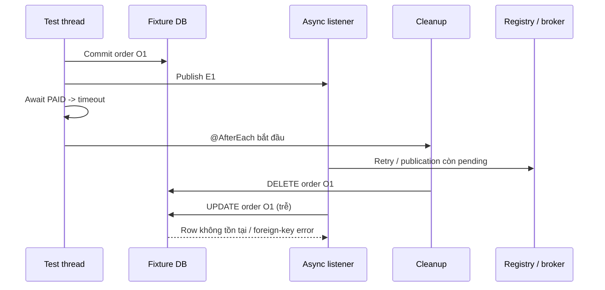

# Xóa dữ liệu sau test thất bại trong Spring Modulith

## 1. Câu hỏi chính: assertion FAIL rồi ai dọn dữ liệu đã commit?

Một test `@ApplicationModuleTest` tạo order `O-1`, phát `PaymentCaptured(E-1)` rồi chờ trạng thái `PAID`. Listener gặp lỗi, `Scenario` hết thời gian chờ và test FAIL. Database vẫn có order do fixture đã commit; Event Publication Registry có thể còn publication chưa hoàn tất, còn executor thì vẫn đang chạy listener hoặc retry.

Nếu phần xóa dữ liệu được đặt **sau assertion**:

```java
UUID orderId = fixture.createAndCommit();
scenario.publish(event)
        .andWaitAtMost(Duration.ofSeconds(5))
        .forStateChange(() -> orders.statusOf(orderId),
                value -> value.contains(OrderStatus.PAID))
        .andVerify(value ->
                assertThat(value).contains(OrderStatus.PAID));

// Không chắc dòng này được chạy khi assertion/timeout ném lỗi.
fixture.delete(orderId);
```

thì một exception sẽ bỏ qua câu lệnh cleanup. Lần chạy tiếp theo có thể gặp dữ liệu cũ, còn một test khác có thể pass sai vì đọc trạng thái mà test thất bại để lại.

**Bài học này tập trung trực tiếp vào cách đảm bảo cleanup được *thử thực hiện* khi test thất bại, nhưng không xóa dữ liệu sai thời điểm khi worker bất đồng bộ chưa dừng.** Hai yêu cầu phải cùng đúng:

1. **Failure-safe invocation:** teardown vẫn được kích hoạt khi test method ném exception, assertion fail, timeout hoặc setup đã tạo một phần dữ liệu.
2. **Safe effect:** cleanup chỉ thao tác đúng dữ liệu/tài nguyên do test sở hữu và theo transaction/lifecycle phù hợp, không phá test khác hay làm sai Event Publication Registry.

Đây là chủ đề *Test isolation* trong học phần `SPRING_MODULITH_VERIFICATION_TESTING`. Học phần nhấn mạnh kiểm chứng ranh giới kiến trúc bằng `ApplicationModules`, `@ApplicationModuleTest`, kiểm thử event, database/tích hợp và CI quality gate chống phụ thuộc sai/hồi quy. Vì thế, cleanup cũng phải giữ ownership của module: không dùng một bài test consumer để xóa bừa bảng nội bộ của module khác.

**Tiêu chí đạt:** mô phỏng một assertion thất bại, xác minh cleanup được gọi, dữ liệu được loại bỏ an toàn sau khi worker đã quiescent, và bài tiếp theo không thấy dữ liệu thất bại còn sót.

## 2. Ba kết quả phải đo riêng: cleanup gọi, cleanup hoàn tất, dữ liệu sạch

Trong test có ngoại lệ, “đã vào `@AfterEach`” chưa phải “database sạch”.

| Cấp độ | Bằng chứng | Điều vẫn có thể sai |
| --- | --- | --- |
| **Cleanup invoked** | Callback `@AfterEach` hoặc `finally` chạy. | Xóa sai ID, rollback thao tác xóa, gặp FK error. |
| **Cleanup completed** | Thao tác xóa/close commit hoặc trả kết quả thành công. | Worker còn sống có thể ghi lại dữ liệu ngay sau cleanup. |
| **Isolation restored** | Không còn side effect thuộc scenario và không còn producer/consumer có thể ghi lại vào resource đó. | Một external broker/registry khác vẫn còn state. |

Ví dụ với listener async:



**Xóa đúng ID nhưng quá sớm vẫn là cleanup sai.** Khi timeout, phải có chính sách xử lý worker chưa hoàn tất (chờ hữu hạn, ngừng stimulus/retry trong phạm vi test, cách ly DB/container, hoặc báo lỗi và giữ resource phục vụ chẩn đoán). Không đơn giản chạy `deleteAll()` trong mọi `@AfterEach`.

## 3. Chọn callback phù hợp khi test FAIL

### 3.1. `@AfterEach` cho dữ liệu do mỗi test method sở hữu

JUnit Jupiter chạy `@AfterEach` trong đường teardown của test method, kể cả khi phần thân test ném assertion error/exception thông thường. Dùng callback này cho tài nguyên sống suốt method.

```java
import java.util.LinkedHashSet;
import java.util.Set;
import java.util.UUID;

import org.junit.jupiter.api.AfterEach;

class PaymentScenarioTests {

    // Mặc định JUnit PER_METHOD: instance fields không dùng chung giữa methods.
    private final Set<UUID> ownedOrderIds = new LinkedHashSet<>();

    @AfterEach
    void cleanupOwnedData() {
        for (UUID orderId : ownedOrderIds) {
            // Xóa theo ID đúng scope, bằng một cleanup adapter hợp lệ.
            // Không gọi global deleteAll().
        }
    }
}
```

Đây là **khung phương pháp**, chưa phải bài test chạy độc lập. Chỉ lưu `ownedOrderIds` trong instance có lifecycle theo method; nếu chọn `@TestInstance(PER_CLASS)`, tập có thể tồn tại xuyên methods và cần thay đổi thiết kế owner/reset.

**Giới hạn:** JUnit không thể bảo đảm callback chạy nếu JVM bị kill, process crash/halt, máy CI mất điện hoặc môi trường chết đột ngột. Với dữ liệu bền vững, vẫn cần resource/namespace test riêng và janitor vận hành có TTL/ownership rõ ràng để xử lý run bị đứt.

### 3.2. `try/finally` khi cleanup phải nằm sát stimulus

Nếu resource được tạo trong một đoạn code ngắn, dùng `try/finally` để bảo đảm code cleanup được gọi khi assertion ném lỗi:

```java
UUID orderId = fixture.createAndCommit();

try {
    publishAndVerify(orderId);
} finally {
    cleaner.deleteOwnedOrder(orderId);
}
```

Đoạn này tốt cho một thao tác đồng bộ, tài nguyên chỉ thuộc test và **không có worker còn ghi**. Với event async, `finally` cần gọi một coordinator kiểm soát quiescence trước khi xóa, không tự xóa ngay sau timeout.

### 3.3. `try-with-resources` cho listener/consumer/fixture handle

Khi resource có `AutoCloseable`:

```java
try (var observer = testBroker.openObserverFor(eventId)) {
    publishAndVerify();
} // close() chạy khi thân try ném exception.
```

`testBroker` là test-support do dự án định nghĩa. `close()` cần thực hiện những hành động phù hợp như unsubscribe/stop observer, nhưng **không mặc định** xóa toàn bộ topic/queue của broker dùng chung.

### 3.4. Callback nào không phải lựa chọn thích hợp?

| Cơ chế | Phù hợp | Cần tránh hiểu nhầm |
| --- | --- | --- |
| `@AfterEach` | Cleanup per-test kể cả assertion failure | Không bảo đảm quiescence hoặc commit DB. |
| `@AfterAll` | Release resource do cả test class sở hữu | Không tự tách dữ liệu từng method; method FAIL vẫn có thể để lại state tới method sau. |
| `try/finally` / `AutoCloseable` | Cleanup gắn đúng registration/resource | Không tự giải quyết pending retry/async work. |
| `@Sql(AFTER_TEST_METHOD)` | SQL cleanup có phạm vi rõ | Transaction mode/order/cleanup toàn bảng phải được xem xét. |
| `@DirtiesContext` | Evict/recreate context không còn an toàn | Không xóa DB/broker/registry hoặc static state. |
| `TestWatcher` extension | Thu status thành công/thất bại để report | Không nên là cơ chế sở hữu cleanup chính; xử lý exception trong watcher có thể có semantics khác. |

## 4. Đăng ký ownership **trước khi** setup có thể thất bại

Một lỗi khó thấy: setup đã chèn dữ liệu rồi ném exception **trước khi lưu ID** cần cleanup.

Anti-pattern:

```java
UUID orderId = fixture.createAndCommit(); // Có thể commit rồi ném lỗi.
ownedOrderIds.add(orderId);                // Có thể chưa chạy.
```

Nếu helper đã tạo row nhưng lỗi ở bước sau commit/trước khi trả ID, teardown không biết phải xóa row nào. Hãy tạo **ID ở test trước** rồi đăng ký ownership trước thao tác có side effect:

```java
UUID orderId = UUID.randomUUID();
ownedOrderIds.add(orderId);          // Ghi nhận trước.
fixture.createAndCommit(orderId);    // Nếu fail, vẫn biết ID để kiểm tra/dọn.
```

Thiết kế này đòi fixture chấp nhận ID được cấp, hoặc trả về một handle đã đăng ký cleanup **ngay khi tạo resource**, theo cách atomic với lifecycle test-support.

### 4.1. Setup có nhiều bước phải dọn những bước đã hoàn thành

Giả sử setup gồm:

1. Tạo order.
2. Tạo reservation.
3. Khởi chạy broker observer.
4. Phát event.

Nếu bước 3 fail, order/reservation vẫn cần dọn. Nên xây một stack cleanup theo scope test, đăng ký action ngay sau/bên cạnh mỗi resource creation. Các action đóng nguồn dữ liệu/consumer thường được thực hiện **ngược thứ tự tạo**, nhưng phụ thuộc quan hệ resource thật.

Không chỉ đăng ký cleanup sau **toàn bộ** setup. Một failure-path test phải kiểm tra được tình huống partial setup.

## 5. Ví dụ JUnit kiểm chứng cleanup khi assertion ném lỗi

Không nên commit một test luôn FAIL vào CI chỉ để chứng minh `finally`. Có thể mô phỏng failure bằng `assertThrows(...)` để chính test kiểm chứng vẫn PASS:

```java
import static org.assertj.core.api.Assertions.assertThat;
import static org.junit.jupiter.api.Assertions.assertThrows;

import java.util.concurrent.atomic.AtomicBoolean;

import org.junit.jupiter.api.Test;

class CleanupOnFailureContractTests {

    @Test
    void closesOwnedResourceWhenAssertionFails() {
        AtomicBoolean closed = new AtomicBoolean();

        AssertionError original = assertThrows(
                AssertionError.class, () -> {
                    try (AutoCloseable owned =
                                 () -> closed.set(true)) {
                        throw new AssertionError(
                                "simulated assertion failure");
                    }
                });

        assertThat(original.getMessage())
                .isEqualTo("simulated assertion failure");
        assertThat(closed).isTrue();
    }
}
```

Test này minh họa **Java try-with-resources** và exception safety, không kiểm chứng JUnit `@AfterEach` hay database. Muốn kiểm chứng lifecycle teardown do JUnit quản lý, có thể dùng JUnit Platform TestKit/test engine fixture riêng hoặc một test được cố ý chạy thất bại trong môi trường học tập cô lập rồi quan sát callback/log. Không nên để một intentional FAIL sống trong quality gate chính.

### 5.1. Test cleanup khi setup fail giữa chừng

Một fixture nhỏ có hai bước, bước hai ném lỗi:

```java
import static org.assertj.core.api.Assertions.assertThat;
import static org.junit.jupiter.api.Assertions.assertThrows;

import java.util.ArrayDeque;
import java.util.Deque;
import java.util.concurrent.atomic.AtomicBoolean;

import org.junit.jupiter.api.Test;

class PartialSetupCleanupTests {

    @Test
    void releasesTheFirstResourceIfSecondSetupStepFails() {
        AtomicBoolean firstClosed = new AtomicBoolean();

        IllegalStateException failure = assertThrows(
                IllegalStateException.class, () -> {
                    try (AutoCloseable first =
                                 () -> firstClosed.set(true)) {
                        throw new IllegalStateException(
                                "second step failed");
                    }
                });

        assertThat(failure.getMessage())
                .isEqualTo("second step failed");
        assertThat(firstClosed).isTrue();
    }
}
```

Chú ý: test này không có database, vì mục tiêu chỉ là xác minh **cleanup vẫn diễn ra trong nhánh exception**. Các bài integration test tiếp theo mới chứng minh transaction/row đã commit được xóa.

## 6. Transaction rollback không phải chiến lược xóa mọi dữ liệu

Spring TestContext với test `@Transactional` thường rollback **test-managed transaction** khi method kết thúc. Điều đó hữu ích cho những bài test đồng bộ chỉ ghi trong cùng transaction, nhưng không bao phủ mọi side effect.

| Dữ liệu / side effect | Rollback của test có tự hoàn tác? | Ghi chú |
| --- | --- | --- |
| Ghi DB nằm trong chính test-managed transaction | Thường có | Trừ khi test chủ động commit hoặc cấu hình khác. |
| Fixture dùng transaction `REQUIRES_NEW` đã commit | Không | Commit độc lập với test transaction ngoài. |
| Listener `@Async` trong thread/transaction khác | Không | Transaction context không tự chuyển qua thread. |
| `@TransactionalEventListener(AFTER_COMMIT)` sau commit thật | Không bảo đảm | Callback có thể mở transaction riêng và commit. |
| Kafka/RabbitMQ message đã broker nhận | Không | Hệ thống ngoài JDBC transaction. |
| Event Publication Registry record đã commit | Không | Cần hiểu transaction/provider/retention. |
| Static recorder hoặc singleton fake | Không | Không thuộc transaction. |
| HTTP call tới service ngoài | Không | Side effect ngoài tiến trình. |

### 6.1. Bẫy: cleanup trong `@AfterEach` cũng có thể nằm trong test transaction

Trong cơ chế Spring TestContext, các lifecycle methods cấp test như `@BeforeEach` và `@AfterEach` thường được thực thi trong phạm vi **test-managed transaction** nếu test được đánh dấu `@Transactional`. Do đó:

```java
@AfterEach
void cleanup() {
    orderRepository.deleteById(orderId);
}
```

có thể chỉ làm thay đổi transaction **sắp bị rollback**. Nếu row cần dọn đã được fixture/listener commit trong transaction khác, thao tác xóa ở trên cũng có thể bị rollback, khiến row vẫn tồn tại.

Đây là một trong những nguyên nhân làm test chỉ FAIL khi chạy lại hoặc chạy sau một test thất bại.

Khi cần xóa **dữ liệu đã commit**, cleanup adapter nên dùng một transaction riêng được commit rõ ràng hoặc thực hiện cleanup sau khi test-managed transaction đã kết thúc, bằng cơ chế test infrastructure phù hợp. Đừng gắn `@Transactional` lên mọi test rồi nghĩ `@AfterEach` sẽ commit thao tác dọn.

### 6.2. Không dùng `saveAndFlush(...)` làm bằng chứng commit

`flush` đẩy SQL xuống database trong phạm vi transaction nhưng không bảo đảm transaction kết thúc. Nếu listener chạy ở thread khác, nó có thể không thấy row chưa commit. Cleanup cũng tương tự: `deleteAllInBatch(...)` hay `flush()` không bảo đảm thao tác xóa trở thành durable nếu transaction cuối cùng rollback.

### 6.3. Khi nào cần `REQUIRES_NEW`?

Một cleanup adapter trong test infrastructure có thể dùng `TransactionTemplate` với `PROPAGATION_REQUIRES_NEW` để xóa dữ liệu test đã commit trong transaction mới. Nhưng:

- Chỉ nên xóa ID do test sở hữu.
- Cần chọn **đúng transaction manager/DataSource** của các bản ghi muốn dọn.
- Nếu transaction ngoài vẫn giữ connection/lock, `REQUIRES_NEW` có thể cần connection thứ hai hoặc bị block.
- Không gọi cleanup trước khi async worker hoàn tất.
- Không trộn xóa business data với xóa registry/broker bên ngoài mà không hiểu transaction boundaries.

## 7. Mẫu cleanup adapter có transaction riêng và phạm vi ID

Đây là một adapter **test-support** minh họa: database là PostgreSQL, schema nghiệp vụ giả định có `orders` và `payment_receipts`. Tên bảng/cột cần điều chỉnh theo dự án; **không** phải bảng mặc định Spring Modulith.

```java
import java.util.Collection;
import java.util.UUID;

import org.springframework.jdbc.core.JdbcTemplate;
import org.springframework.transaction.PlatformTransactionManager;
import org.springframework.transaction.TransactionDefinition;
import org.springframework.transaction.support.TransactionTemplate;

final class OrderTestDataCleaner {

    private final JdbcTemplate jdbc;
    private final TransactionTemplate transactions;

    OrderTestDataCleaner(
            JdbcTemplate jdbc,
            PlatformTransactionManager transactionManager) {
        this.jdbc = jdbc;
        this.transactions = new TransactionTemplate(transactionManager);
        this.transactions.setPropagationBehavior(
                TransactionDefinition.PROPAGATION_REQUIRES_NEW);
    }

    void deleteOwnedOrders(Collection<UUID> orderIds) {
        if (orderIds.isEmpty()) {
            return;
        }

        transactions.executeWithoutResult(status -> {
            for (UUID orderId : orderIds) {
                jdbc.update(
                        "DELETE FROM payment_receipts WHERE order_id = ?",
                        orderId);
                jdbc.update(
                        "DELETE FROM orders WHERE id = ?",
                        orderId);
            }
        });
    }

    long countRemaining(UUID orderId) {
        Long count = jdbc.queryForObject(
                "SELECT COUNT(*) FROM orders WHERE id = ?",
                Long.class, orderId);
        return count == null ? 0L : count;
    }
}
```

**Giả định/giới hạn** của ví dụ:

- `OrderTestDataCleaner` được cung cấp bởi test configuration/integration-test fixture thích hợp; nó không tự là Spring bean.
- Các bảng `orders`, `payment_receipts` và khóa ngoại đúng như giả định.
- `countRemaining(...)` cần được gọi ngoài transaction giữ snapshot cũ, nếu bạn muốn quan sát hậu điều kiện đã commit.
- Xóa receipts trước orders chỉ phù hợp nếu quan hệ khóa ngoại đúng với schema mẫu.
- Nếu có audit, outbox, reservation, registry hoặc queue, phải xử lý chúng theo **ownership và vòng đời riêng**, không thêm một global `TRUNCATE`.
- Xóa dữ liệu test của module khác cần một integration-test cleanup owner hợp lệ; production module không nên import repository `internal` của module khác.

Nếu schema có cascade hoặc soft delete, phép xóa và hậu điều kiện phải theo chính sách dữ liệu thật. Một số hệ thống pháp lý/kiểm toán không cho phép hard-delete ngay cả trong production, nhưng môi trường test riêng có thể hủy **toàn bộ schema/container test** thay vì can thiệp vào logic domain.

### 7.1. Vì sao không `deleteAll()`?

```java
@AfterEach
void cleanup() {
    orderRepository.deleteAll(); // Nguy hiểm với DB dùng chung.
}
```

Nếu test A FAIL trong lúc test B đang chạy, A có thể xóa dữ liệu của B. Ngay cả suite tuần tự, `deleteAll()` có thể xóa dữ liệu seeded mà test kế tiếp cần hoặc hủy incomplete publication phục vụ recovery test.

**Quy tắc:** cleanup theo **orderId/eventId/tenant/test namespace** thuộc scenario. Nếu muốn reset toàn DB, chỉ thực hiện trên **database/schema/container dành riêng cho test**, sau khi đã dừng worker và không có test khác đang dùng.

## 8. Mẫu `@ApplicationModuleTest` có cleanup cả khi assertion thất bại

Giả sử module `orders` nhận event công khai `PaymentCaptured` từ `payments.events`. Các kiểu sau là **contract do ứng dụng ví dụ tự định nghĩa**, mỗi kiểu public nằm trong file Java riêng:

```java
// File: com/example/shop/payments/events/PaymentCaptured.java
package com.example.shop.payments.events;

import java.math.BigDecimal;
import java.util.UUID;

public record PaymentCaptured(
        UUID eventId,
        UUID orderId,
        String transactionId,
        BigDecimal amount) {}
```

```java
// File: com/example/shop/orders/PaymentStatus.java
package com.example.shop.orders;

public enum PaymentStatus {
    AWAITING_PAYMENT, PAID, FAILED
}
```

```java
// File: com/example/shop/orders/OrderPaymentView.java
package com.example.shop.orders;

import java.math.BigDecimal;
import java.util.UUID;

public record OrderPaymentView(
        UUID orderId,
        PaymentStatus status,
        UUID processedEventId,
        String transactionId,
        BigDecimal amount) {

    public boolean matches(
            UUID expectedEventId,
            String expectedTransactionId,
            BigDecimal expectedAmount) {
        return status == PaymentStatus.PAID
                && expectedEventId.equals(processedEventId)
                && expectedTransactionId.equals(transactionId)
                && amount != null
                && amount.compareTo(expectedAmount) == 0;
    }
}
```

```java
// File: com/example/shop/orders/OrderQueries.java
package com.example.shop.orders;

import java.util.Optional;
import java.util.UUID;

public interface OrderQueries {
    Optional<OrderPaymentView> paymentOf(UUID orderId);
}
```

Test fixture chấp nhận ID **đã đăng ký ownership**:

```java
// File: test-support OrderFixture.java
package com.example.shop.orders;

import java.math.BigDecimal;
import java.util.UUID;

interface OrderFixture {
    void createAndCommit(UUID orderId, BigDecimal amount);
}
```

Một coordinator test-only dùng để quản lý điểm an toàn trước cleanup:

```java
// File: test-support ScenarioCleanupCoordinator.java
package com.example.shop.orders;

import java.time.Duration;
import java.util.Set;
import java.util.UUID;

interface ScenarioCleanupCoordinator {

    // Ngừng stimulus mới do test tạo và đồng bộ các handler liên quan.
    // Contract phải được dự án thực hiện, không phải Spring Modulith API.
    void awaitQuiescence(
            Set<UUID> eventIds, Duration timeout);

    // Dọn đúng DB rows test-owned trong transaction đã commit.
    void deleteCommittedOrders(Set<UUID> orderIds);
}
```

Bài test tập trung vào **đường cleanup khi assertion/timeout FAIL**:

```java
package com.example.shop.orders;

import static org.assertj.core.api.Assertions.assertThat;

import java.math.BigDecimal;
import java.time.Duration;
import java.util.LinkedHashSet;
import java.util.Set;
import java.util.UUID;

import com.example.shop.payments.events.PaymentCaptured;
import org.junit.jupiter.api.AfterEach;
import org.junit.jupiter.api.Test;
import org.springframework.beans.factory.annotation.Autowired;
import org.springframework.modulith.test.ApplicationModuleTest;
import org.springframework.modulith.test.Scenario;

@ApplicationModuleTest
class PaymentFailureSafeCleanupTests {

    @Autowired OrderFixture fixture;
    @Autowired OrderQueries queries;
    @Autowired ScenarioCleanupCoordinator cleanup;

    private final Set<UUID> ownedOrders = new LinkedHashSet<>();
    private final Set<UUID> publishedEvents = new LinkedHashSet<>();

    @Test
    void paysTheCurrentOrder(Scenario scenario) {
        BigDecimal amount = new BigDecimal("125000.00");

        UUID orderId = UUID.randomUUID();
        ownedOrders.add(orderId); // Register trước khi DB write.
        fixture.createAndCommit(orderId, amount);

        UUID eventId = UUID.randomUUID();
        publishedEvents.add(eventId);
        String transactionId = "TX-" + eventId;

        assertThat(queries.paymentOf(orderId).orElseThrow().status())
                .isEqualTo(PaymentStatus.AWAITING_PAYMENT);

        scenario.publish(new PaymentCaptured(
                        eventId, orderId, transactionId, amount))
                .andWaitAtMost(Duration.ofSeconds(8))
                .forStateChange(
                        () -> queries.paymentOf(orderId),
                        value -> value.filter(v ->
                                v.matches(eventId, transactionId, amount))
                                .isPresent())
                .andVerify(value -> {
                    OrderPaymentView paid = value.orElseThrow();
                    assertThat(paid.orderId()).isEqualTo(orderId);
                    assertThat(paid.processedEventId())
                            .isEqualTo(eventId);
                    assertThat(paid.transactionId())
                            .isEqualTo(transactionId);
                });
    }

    @AfterEach
    void removeDataEvenWhenTestFails() {
        // Nếu handler còn sống, coordinator phải fail rõ hoặc
        // cách ly resource; KHÔNG xóa trong lúc nó còn ghi.
        cleanup.awaitQuiescence(
                Set.copyOf(publishedEvents),
                Duration.ofSeconds(10));

        cleanup.deleteCommittedOrders(
                Set.copyOf(ownedOrders));
    }
}
```

### 8.1. Điều gì làm ví dụ kiểm chứng được?

- Mỗi test có instance field `ownedOrders`/`publishedEvents` riêng theo JUnit `PER_METHOD` mặc định.
- ID được ghi nhận **trước** khi fixture ghi DB hoặc publish event.
- Test kiểm tra baseline trước stimulus để không pass nhờ dữ liệu cũ.
- `Scenario` chờ state của đúng event/transaction/amount thay vì một row bất kỳ.
- `@AfterEach` được gọi trên đường teardown của test method dù `andVerify(...)` ném assertion error thông thường.
- Cleanup được tách thành **chờ quiescence** rồi **xóa theo ID trong transaction riêng**.

**Những điều cần triển khai thật:** listener, fixture, query adapter, coordinator, bean registration và transaction manager. `ScenarioCleanupCoordinator` **không phải API Spring Modulith**; ứng dụng phải có cách quan sát/điều khiển completion theo event ID. Nếu không có tín hiệu này, không được coi `Thread.sleep(...)` là một triển khai đúng.

### 8.2. Nếu `awaitQuiescence(...)` timeout thì sao?

Khi coordinator không thể chứng minh worker đã dừng, method `@AfterEach` ở trên ném lỗi và **không chạy bước xóa DB**, để tránh race. Đây là lựa chọn có chủ đích cho môi trường có thể cô lập dữ liệu theo ID/schema. CI phải báo cleanup failure và không giả vờ dữ liệu đã sạch.

Nhưng bỏ lại dữ liệu test vĩnh viễn cũng không ổn. Chiến lược hoàn chỉnh là:

1. Ghi correlation IDs và lý do không quiescent.
2. Ngăn resource này ảnh hưởng các test tiếp theo bằng namespace/schema/container **riêng** cho test hoặc test class.
3. Stop/cancel worker theo API của owner nếu an toàn.
4. Khi tài nguyên đã đóng/quiescent, dọn hoặc hủy toàn bộ môi trường cô lập.
5. Nếu cleanup vẫn thất bại, đánh dấu job FAIL và báo tài nguyên còn tồn, không xóa resource dùng chung.

**Không dùng `finally { deleteAll(); }` để cưỡng ép “sạch” khi background tasks vẫn chạy.**

## 9. Cơ chế cleanup stack cho setup nhiều resource

Khi test tạo broker observer, listener thủ công, HTTP stub và dữ liệu DB, nên có một cleanup stack sở hữu **chính xác resource được tạo**, đóng ngược thứ tự tạo.

```java
import java.util.ArrayDeque;
import java.util.Deque;

final class CleanupStack implements AutoCloseable {

    private final Deque<AutoCloseable> owned = new ArrayDeque<>();

    <T extends AutoCloseable> T register(T resource) {
        owned.push(resource);
        return resource;
    }

    @Override
    public void close() throws Exception {
        Exception firstFailure = null;

        while (!owned.isEmpty()) {
            try {
                owned.pop().close();
            } catch (Exception cleanupFailure) {
                if (firstFailure == null) {
                    firstFailure = cleanupFailure;
                } else {
                    firstFailure.addSuppressed(cleanupFailure);
                }
            }
        }

        if (firstFailure != null) {
            throw firstFailure;
        }
    }
}
```

Một ví dụ sử dụng:

```java
try (var owned = new CleanupStack()) {
    var observer = owned.register(
            testBroker.openObserverFor(eventId));
    var registration = owned.register(
            testEvents.registerListenerFor(eventId));

    // Tạo fixture, kích hoạt event, chờ outcome.
    // Nếu assertion FAIL, close() vẫn được gọi.
}
```

Các kiểu `testBroker`/`testEvents` và handle trả về là **test-support giả định**, không phải Spring Modulith API. Cleanup stack đóng observer/listener do test sở hữu; **không** tự xóa DB, broker topic hay publication registry. Mỗi resource wrapper phải có lifecycle hợp lệ.

**Lưu ý thứ tự:** nếu observer phải còn sống tới khi nhận terminal message, đừng close nó trước khi chờ completion. Khi resource close ném lỗi, stack tiếp tục dọn các resource còn lại và báo lỗi; đây là điểm quan trọng trong failure path vì một cleanup failure không nên làm các resource khác bị bỏ quên.

### 9.1. Lỗi gốc và lỗi cleanup

Nếu assertion FAIL rồi cleanup cũng ném exception, log cần bảo toàn **cả hai**. Với try-with-resources, Java có cơ chế suppressed exception khi thân try ném lỗi và `close()` cũng lỗi. Trong JUnit `@AfterEach`, lỗi lifecycle callback cũng cần được báo rõ theo cách Jupiter/extension xử lý.

Đừng viết:

```java
try {
    // Test
} finally {
    try {
        cleanup();
    } catch (Exception ignored) {
        // Anti-pattern: bỏ qua mọi cleanup failure.
    }
}
```

Nếu cleanup thất bại mà suite vẫn tiếp tục, những test sau có thể bị nhiễm, khiến kết quả CI không còn đáng tin.

## 10. Xóa DB dưới failure injection: kiểm tra bằng case có thể PASS

Một bài kiểm thử dọn sau exception có thể dùng test transaction thật, cố tình ném exception **bên trong một scope do test kiểm soát**, rồi kiểm tra row đã bị xóa. Không cần tạo một @Test luôn FAIL.

Giả định có test-support `OrderFixture` và `OrderTestDataCleaner` hoạt động trên test DB riêng. Một phép thử về cleanup:

```java
import static org.assertj.core.api.Assertions.assertThat;
import static org.junit.jupiter.api.Assertions.assertThrows;

import java.util.UUID;

import org.junit.jupiter.api.Test;

class CleanupAfterExceptionalFlowTests {

    @Test
    void removesCommittedRowWhenAssertionFails() {
        UUID orderId = UUID.randomUUID();
        fixture.createAndCommit(orderId);

        AssertionError failure = assertThrows(
                AssertionError.class, () -> {
                    try {
                        throw new AssertionError("simulated failure");
                    } finally {
                        cleaner.deleteOwnedOrders(
                                java.util.List.of(orderId));
                    }
                });

        assertThat(failure.getMessage())
                .isEqualTo("simulated failure");
        assertThat(cleaner.countRemaining(orderId))
                .isZero();
    }
}
```

Code là **trích đoạn test**: `fixture`/`cleaner` cần được inject hoặc khai báo, phải dùng DB test phù hợp và transaction đọc sau commit; nếu chạy trên schema thật, lỗi có thể do FK/transaction khác.

Test này chứng minh **cleanup sau một exception**, không tự chứng minh `@AfterEach` chạy sau test method FAIL. Để test đúng cơ chế JUnit callback, có thể viết một fixture test class có `@AfterEach` và chạy qua JUnit Platform TestKit, rồi assert engine report và database state sau execution. Đó là một integration test cho **test framework lifecycle** và cần dependency/chạy engine riêng.

### 10.1. Một phương pháp quan sát failure path không làm đỏ CI chính

Nếu muốn mô phỏng chính test `Scenario` timeout:

1. Trong **test suite chuyên kiểm thử harness**, cấu hình listener cố ý fail theo một event ID duy nhất.
2. Gọi test case qua JUnit engine ở scope riêng, có database/schema riêng và teardown thật.
3. Xác nhận kết quả nội bộ của test case là FAIL như thiết kế.
4. Sau khi engine kết thúc, query database từ một connection/context hợp lệ để xác nhận fixture ID đã được dọn.
5. Harness test bên ngoài PASS nếu nó quan sát đúng lỗi nội bộ **và** cleanup thành công.

Không giữ một test method luôn FAIL trong main unit-test task rồi chỉ dựa vào CI ignore-failures. Mục tiêu là kiểm chứng harness, không che lỗi.

## 11. Dọn đúng sau failure có listener bất đồng bộ

Một kịch bản thường gặp:

```text
T0: Test tạo order O1 và commit.
T1: Test publish PaymentCaptured(E1).
T2: Listener nhận E1, đang ghi payment.
T3: Scenario timeout hoặc assertion fail.
T4: @AfterEach chạy.
T5: Listener commit hoặc retry E1.
```

Nếu dọn tại T4 không kiểm soát T5, database có thể bị ghi lại, còn broker/registry có thể replay event khi test sau khởi động.

### 11.1. Chờ theo event ID, không dựa vào active thread count

Một test-only completion probe có thể thu future/terminal outcome theo logical event ID hoặc listener target. Nếu background process chưa nhận completion signal:

- `Executor.getActiveCount() == 0` không đủ vì có thể còn task queue hoặc task chuyển sang executor khác.
- `Order.status == PAID` không đủ nếu listener còn gửi broker/audit/mark publication complete.
- `Thread.sleep(1000)` không tạo bảo đảm về thời điểm hoàn tất.
- `future.cancel(true)` không hoàn tác transaction đã commit; task cũng có thể không dừng ngay.

Nên có **completion signal rõ từ nơi sở hữu side effect**. Với listener chỉ cập nhật order, một transaction-confirmed terminal state có thể đủ. Với listener còn publish/downstream, cần thêm tín hiệu send/ack/registry completion tương ứng.

### 11.2. Cleanup khi listener bị treo hoặc không thể cancel

Nếu test cố tình inject lỗi làm worker treo, đừng để teardown chờ vô hạn. Sau timeout hữu hạn:

1. Thử release test gate/latch trong `finally` nếu test sở hữu.
2. Stop test-owned executor/consumer theo API, xác minh termination khi có thể.
3. Không stop executor production dùng chung của Spring context chỉ để xử lý một test.
4. Đánh dấu failure và cô lập môi trường để worker không tiếp tục ghi vào dữ liệu test khác.
5. Cleanup có kiểm soát sau khi worker đã không còn truy cập được tài nguyên đó.

Một database/container riêng cho fault-injection suite rất hữu ích: khi cần, có thể đóng **toàn bộ application/workers của suite đó** rồi hủy container, thay vì xóa các row trong database dùng chung khi worker chưa ngừng.

## 12. Dọn Event Publication Registry khi test FAIL

Event Publication Registry của Spring Modulith có thể lưu incomplete publication của event đã publish tới từng listener target. Nếu test FAIL vì listener không hoàn tất, một incomplete publication **có thể chính là bằng chứng lỗi cần giữ để debug** hoặc có thể được retry ở run sau.

Cần kiểm tra:

| Mục tiêu test | Cách xử lý registry sau failure |
| --- | --- |
| Test event happy path | Đợi listener hoàn tất, kiểm tra không còn outstanding **đúng event/target** nếu đó là hợp đồng, rồi cleanup theo provider policy. |
| Test listener failure/incomplete publication | Giữ publication tới sau assertion của failure path; **không xóa trước khi kiểm chứng**. |
| Test resubmission/restart | Giữ registry data qua hai pha **cùng scenario**, nhưng cô lập DB khỏi test khác. |
| Test độc lập tiếp theo | Không để incomplete publication cũ bị resubmit bất ngờ vào nó. |
| Test timeout chưa xác định worker state | Không purge registry trong khi retry worker còn chạy. |

### 12.1. Đừng dùng một SQL DELETE chung cho mọi provider

Các provider (ví dụ JDBC/JPA hoặc loại persistence được ứng dụng lựa chọn) có cấu trúc và retention khác nhau. Không tự giả định tên bảng/cột, primary key, trạng thái completed giống nhau.

Nếu phải dọn publication, dùng **provider-aware test infrastructure** được cấu hình đúng phiên bản, truy vấn theo event/correlation và target, và chỉ dọn sau khi đã kiểm soát retry/resubmission. Khi provider không hỗ trợ cleanup theo event an toàn, dùng **database/schema riêng** và hủy cả môi trường ở cuối suite.

### 12.2. Đừng coi registry sạch là listener chưa từng fail

Một publication completed có thể bị xóa/purge theo retention. “Không còn row” không chứng minh publication đã hoàn tất hoặc không từng tồn tại. Khi kiểm chứng failure path, kết hợp tín hiệu listener/transaction với quan sát registry theo provider.

## 13. Dọn message broker và external resource sau failure

### 13.1. Kafka: offsets và retry topic là state còn tồn tại

Giả sử test A FAIL sau khi producer send tới Kafka; test teardown chỉ xóa order. Topic vẫn chứa record và consumer group có thể chưa commit offset. Test B dùng lại group/topic có thể đọc event A, hoặc vì offset từ A mà bỏ qua record mong đợi.

Cách cleanup an toàn:

- Topic/consumer group namespace riêng theo test class/suite nếu cần.
- Observer do test tạo phải được đóng dù assertion FAIL.
- Đợi các producer send futures/acks liên quan theo hợp đồng trước khi hủy broker resource.
- Không reset offset hoặc xóa topic **dùng chung** khi các test khác đang chạy.
- Retry/DLT topic cũng phải được tính vào phạm vi dọn.
- Khi test recovery cần state qua restart, giữ topic/group qua hai pha cùng scenario rồi release sau.

### 13.2. RabbitMQ: queue chưa ack có thể requeue

Một consumer RabbitMQ lỗi trước ack có thể khiến message được giao lại. Xóa business DB row nhưng bỏ qua queue có thể làm listener của test sau nhận message cũ.

- Đóng test-owned consumer/observer.
- Đợi ack/nack/requeue đạt trạng thái phù hợp.
- Dọn/hủy **queue riêng** của test khi không còn consumer in-flight.
- Không purge queue production/shared-test hoặc DLQ toàn cục.
- Nếu dùng queue bền để kiểm thử retry, ghi correlation ID và giữ đúng state cho đến khi assertion xong.

### 13.3. Listener subscription, HTTP stub và Testcontainers

Các resource này cũng cần cleanup khi assertion FAIL:

- `ApplicationListener` được test tự `addApplicationListener(...)`: remove **chính instance** đã thêm.
- Reactor `Disposable`: dispose subscription do test sở hữu.
- Spring Integration `SubscribableChannel`: unsubscribe đúng handler.
- HTTP mock server/test server: close theo fixture lifecycle.
- Testcontainers: dừng khi không còn context/client/worker dùng endpoint; không hủy container suite-shared chỉ vì một method fail.

**`@DirtiesContext` không thay thế các bước trên.** Nó thay đổi Spring context cache; dữ liệu bền và resource ngoài context vẫn có thể tồn tại.

## 14. Khi cleanup có thể thất bại: ưu tiên giữ thông tin chẩn đoán

Một cleanup failure có thể do:

- Database connection pool đã cạn vì listener bị treo.
- Foreign key từ receipt/ledger/outbox chưa được dọn theo đúng thứ tự.
- Transaction delete bị rollback hoặc deadlock.
- Retry worker đang khóa publication/aggregate.
- Broker observer không ngừng được.
- Context bị đóng sớm, cleaner bean không còn hoạt động.
- Container bị hủy trước khi cleanup truy cập database.

**Đừng che lỗi gốc bằng cleanup exception mất dấu.** Kết quả kiểm thử nên báo cả assertion failure và cleanup failure, kèm IDs/resource namespace. Không cần dump toàn bộ event payload hay secret để chẩn đoán.

### 14.1. Report tối thiểu

```text
testCase: PaymentFailureSafeCleanupTests.paysTheCurrentOrder
module: orders
eventId: E1
orderId: O1
assertionOutcome: TIMEOUT
lastObservedStatus: AWAITING_PAYMENT
cleanupInvoked: true
workerQuiescence: NOT_CONFIRMED
databaseDelete: SKIPPED_TO_AVOID_RACE
registryOutstanding: UNKNOWN_OR_PENDING
brokerNamespace: isolated-payment-tests
testEnvironmentAction: quarantine/teardown-after-worker-stop
overallResult: FAILED
```

Đây là **mẫu report**, không phải sự kiện thật. Một job không được ghi `cleanup=PASS` nếu chỉ mới gọi method mà chưa xác minh hậu điều kiện.

### 14.2. Không log dữ liệu nhạy cảm

Trong báo cáo cleanup, dùng ID giả và trạng thái kỹ thuật. Không in API key, database password, payment card detail, cookie hay toàn bộ `System.getenv()`.

## 15. `@Sql(AFTER_TEST_METHOD)`: hữu ích nhưng không phải một nút “dọn sạch”

Spring TestContext hỗ trợ `@Sql` sau test method:

```java
import org.springframework.test.context.jdbc.Sql;

@Sql(
    scripts = "/cleanup/owned-fixtures.sql",
    executionPhase = Sql.ExecutionPhase.AFTER_TEST_METHOD
)
class SqlCleanupExampleTests {
    // Các test minh họa.
}
```

Đây chỉ là ví dụ annotation; bài học này **không tạo** file SQL đó. Script phải tồn tại trong classpath và phải có phạm vi dữ liệu đúng.

Nhược điểm của một file SQL tĩnh:

- Khó biết `orderId` ngẫu nhiên do method tạo nếu không có test namespace/owner column.
- Một lệnh `TRUNCATE` toàn bảng có thể phá test song song.
- Transaction mode và thứ tự thực thi listener/cleanup cần được kiểm soát.
- SQL chạy sau test không tự đợi async worker hoặc resubmission job.
- Cleanup database không xóa Kafka offset/RabbitMQ queue.

### 15.1. Transaction mode `ISOLATED` không sửa lỗi ownership

Spring `@SqlConfig(transactionMode = ISOLATED)` có thể dùng để chạy script trong transaction mới, commit độc lập theo cơ chế listener/transaction manager được cấu hình. Điều này có thể cần khi row đã commit trong transaction khác, nhưng vẫn phải đảm bảo:

1. Script chỉ dọn dữ liệu thuộc test.
2. Không xóa khi worker còn truy cập.
3. Provider/data source và transaction manager đúng.
4. Không mặc định script “sạch” khi có các side effect bên ngoài DB.

Không thêm `ISOLATED` vào một script global-delete rồi coi đó là giải pháp.

## 16. Quyết định khi nào nên **không xóa ngay**

Có những trường hợp “dọn sau test thất bại” nên được triển khai bằng **hủy môi trường riêng**, không phải xóa các row ngay tức khắc.

| Hoàn cảnh | Hành động được ưu tiên |
| --- | --- |
| Unit test chỉ tạo object local | Không cần DB cleanup; tạo fixture mới mỗi method. |
| Test đồng bộ chỉ ghi trong test-managed transaction | Rollback thường đủ; xác minh không có commit riêng. |
| Fixture/listener đã commit, không còn worker pending | Cleanup theo IDs với transaction commit riêng. |
| Test timeout, worker chưa quiescent | Trì hoãn xóa, dừng worker/giữ namespace riêng, báo cleanup failure. |
| Test intentionally để publication incomplete | Giữ để assert/recovery, sau đó dọn theo provider/scope. |
| Fault injection phá DB schema/topic toàn cục | Dùng schema/container/broker riêng rồi hủy environment. |
| CI job bị kill, `@AfterEach` không chạy | TTL/janitor theo job namespace hoặc container lifecycle. |
| Hai test chạy parallel trên shared DB | Không global reset; ID/namespace/test-owned cleanup. |

**Nguyên tắc:** “không để lại rò rỉ” không đồng nghĩa “xóa bất chấp trong cùng millisecond”. Nó nghĩa là không để tài nguyên của một test ảnh hưởng test khác, và có kế hoạch kết thúc vòng đời tài nguyên ngay cả khi test FAIL.

## 17. Cleanup của nhiều module phải giữ nguyên ranh giới Modulith

Một test `orders` không nên import `payments.internal.PaymentRepository` hoặc `notifications.internal.OutboxRepository` chỉ để dọn dữ liệu. Cách đó phá ranh giới kiến trúc và có thể bỏ qua invariant của module sở hữu.

Tách trách nhiệm:

- **Module test:** gọi public command/query API để tạo baseline và quan sát state.
- **Fixture/cleanup test-support ở module sở hữu:** có thể thao tác repository nội bộ *của chính module đó* theo scope hợp lệ.
- **Integration-test infrastructure:** quản trị database schema/container, registry provider và broker namespace ở cấp môi trường, không biến admin API thành production contract xuyên module.
- **Architecture verification:** bảo đảm production dependencies không vượt public API/named interface.

Ví dụ cho event contract:

```java
// File: com/example/shop/payments/events/package-info.java
@org.springframework.modulith.NamedInterface("events")
package com.example.shop.payments.events;
```

Và module `orders` chỉ phụ thuộc interface công khai đó:

```java
// File: com/example/shop/orders/package-info.java
@org.springframework.modulith.ApplicationModule(
        allowedDependencies = "payments::events")
package com.example.shop.orders;
```

Test cấu trúc:

```java
import org.junit.jupiter.api.Test;
import org.springframework.modulith.core.ApplicationModules;

class ModuleBoundaryTests {

    @Test
    void publicDependenciesAreRespected() {
        ApplicationModules.of(ShopApplication.class).verify();
    }
}
```

`ShopApplication` là Spring Boot application class giả định. `verify()` kiểm tra module dependency graph, **không** kiểm chứng cleanup hoặc transaction delete đã commit. Cần kết hợp architecture test với behavior/isolation test.

## 18. CI quality gate: kiểm tra thất bại lẫn dọn dẹp

Một pipeline đáng tin không chỉ chạy happy path. Nên có:

1. **Test lifecycle contract:** JUnit test kiểm chứng `finally`/`AutoCloseable` vẫn cleanup khi exception.
2. **Failure-path harness:** cố ý làm test nội bộ fail, xác nhận `@AfterEach` thực thi và database/resource hậu điều kiện đúng.
3. **Module behavior:** `@ApplicationModuleTest` + `Scenario` kiểm chứng event-specific state và baseline.
4. **Committed DB cleanup:** test adapter xóa row theo ID trong transaction phù hợp; chạy cả sau lỗi setup/timeout.
5. **Async quiescence:** test failure path có task pending và đảm bảo không xóa dữ liệu trước worker kết thúc.
6. **Registry recovery:** incomplete publication được giữ qua pha cần thiết và không rò sang test khác.
7. **Broker isolation:** Kafka/RabbitMQ consumer/group/queue retry/DLQ không bị bỏ lại.
8. **Parallel safety:** nhiều test FAIL/pass cạnh nhau không xóa dữ liệu của nhau.
9. **Architecture gate:** `ApplicationModules.of(...).verify()` vẫn PASS.
10. **Cleanup evidence:** CI báo cleanup incomplete là failure, không green do retry che lỗi.

Với Gradle project đã có task `test`:

```bash
./gradlew test
```

Nếu project có task integration/recovery riêng, CI cần chạy các task đó. Bài học này chỉ mô tả cách tổ chức quality gate, **không** thực thi Gradle hay Content QA.

### 18.1. Checklist trước khi merge

- [ ] Test có thể FAIL ở assertion mà teardown vẫn được gọi.
- [ ] IDs/resource owner được ghi lại trước thao tác có thể commit rồi fail.
- [ ] Cleanup không phụ thuộc test body đi đến dòng cuối.
- [ ] Dữ liệu đã commit được dọn bằng transaction thực sự commit.
- [ ] Không suy “`@Transactional` rollback” áp dụng cho worker ngoài test thread.
- [ ] Không dùng `deleteAll()/TRUNCATE` trên database dùng chung.
- [ ] Có completion/quiescence signal trước xóa nếu listener async.
- [ ] Timeout cleanup hữu hạn; khi không an toàn, đánh dấu failure/quarantine.
- [ ] Incomplete Event Publication Registry được quản lý theo event/target.
- [ ] Kafka/RabbitMQ retry/offset/queue được cleanup trong scope test.
- [ ] Observer/subscription/executor nào do test tạo đều có owner close.
- [ ] Cleanup không làm mất dữ liệu của test parallel khác.
- [ ] Test vẫn xác minh state bằng public module API, không import `internal` sai ranh giới.
- [ ] CI giữ được cả assertion failure và cleanup failure để chẩn đoán.

## 19. Bài thực hành kiểm chứng thực tế

**Bài A — bỏ cleanup sau assertion:** viết test tạo row đã commit, dùng `assertThrows` để mô phỏng một assertion fail trước câu lệnh xóa. Quan sát row còn tồn tại. Sửa bằng `try/finally`, kiểm chứng row count = 0 trong DB test riêng.

**Bài B — `@AfterEach` lifecycle:** tạo một fixture test class cố ý FAIL ở method, teardown đánh dấu đã chạy. Dùng JUnit Platform TestKit hoặc engine harness để xác minh kết quả nội bộ FAIL và callback đã thực thi; harness ngoài phải PASS khi quan sát đúng.

**Bài C — partial setup:** fixture tạo order rồi ném exception khi khởi tạo observer. So sánh cách ghi nhận order ID trước/sau lệnh tạo. Sửa để cleanup có ID ngay cả khi setup chỉ thành công một phần.

**Bài D — transaction cleanup rollback:** fixture `REQUIRES_NEW` commit order, test đánh dấu `@Transactional`. Thử xóa row trong `@AfterEach` nhưng cùng test transaction bị rollback; quan sát row vẫn có. Sửa bằng cleanup transaction độc lập hoặc hạ tầng after-transaction phù hợp.

**Bài E — async tail:** listener update order rồi còn xử lý audit/broker. Cho test fail sau khi thấy state đầu tiên. Chứng minh xóa DB ngay gây race; thêm completion signal, cleanup chỉ sau quiescence.

**Bài F — failed retry:** một listener fail để registry giữ incomplete publication. Xác minh registry event/target của scenario, sau đó dọn theo provider đúng scope hoặc hủy DB test riêng. Không để resubmission của test sau xử lý event cũ.

**Bài G — Kafka:** producer send message rồi assertion fail; observer phải close và topic/group namespace phải được dọn/giải phóng theo ownership. Test kế tiếp không được nhận message từ scenario trước.

**Bài H — RabbitMQ:** consumer lỗi trước ack khiến message requeue. Thử cleanup DB khi queue còn message, quan sát nguy cơ redelivery. Sửa bằng queue/consumer lifecycle và namespace riêng.

**Bài I — parallel failure:** hai tests chạy concurrent, test A cố tình fail và cleanup. Xác minh A chỉ xóa row thuộc A, không đụng row B. Tránh câu SQL `TRUNCATE` chung.

**Bài J — cleanup lỗi kép:** assertion ném `AssertionError`, cleanup cũng ném `IOException`. Dùng `AutoCloseable`/try-with-resources và kiểm tra original failure cùng suppressed cleanup exception không bị nuốt.

**Bài K — kiến trúc:** kiểm tra `ApplicationModules.verify()` trong cùng CI; thử một cleanup adapter production import repository `internal` của module khác ở nhánh học tập, xác minh architecture gate bắt lỗi rồi hoàn nguyên.

**Tiêu chí đạt:** test thất bại không làm tài nguyên của nó ảnh hưởng test khác; biết phân biệt callback được gọi với deletion đã commit; có chiến lược an toàn khi worker chưa dừng; cleanup đúng ID/transaction/provider và kiểm chứng hậu điều kiện.

## 20. Tổng kết và tài liệu tham khảo

**Muốn xóa dữ liệu sau test thất bại, phải bảo đảm teardown chạy khi assertion ném lỗi, nhưng còn quan trọng hơn là xóa *đúng dữ liệu, đúng transaction, đúng thời điểm*.** `@AfterEach`/`finally` là điểm gọi cleanup; `TransactionTemplate` hoặc test infrastructure quyết định thao tác xóa đã commit hay chưa; completion signal và resource ownership quyết định có an toàn để xóa không.

Trong Spring Modulith, event-driven tests còn có listener async, registry publication, message broker và module boundaries. Nếu timeout, không dùng global `deleteAll()` để ép suite sạch; ưu tiên dữ liệu theo ID, môi trường/schema/namespace riêng và quiescence trước teardown. Kết hợp `@ApplicationModuleTest`, `Scenario`, `ApplicationModules.verify()` cùng CI failure-path tests để giữ chất lượng bài kiểm thử kể cả khi test không thành công.

Tài liệu tham khảo:

- [JUnit 5 — Lifecycle Methods](https://junit.org/junit5/docs/current/user-guide/#writing-tests-annotations): `@AfterEach`, `@AfterAll` và JUnit lifecycle.
- [JUnit 5 — Extension Model](https://junit.org/junit5/docs/current/user-guide/#extensions): callback lifecycle, test watcher và quản lý resource.
- [Spring Framework — TestContext Transaction Management](https://docs.spring.io/spring-framework/reference/testing/testcontext-framework/tx.html): rollback, transaction boundary và lifecycle methods.
- [Spring Framework — Executing SQL Scripts](https://docs.spring.io/spring-framework/reference/testing/testcontext-framework/executing-sql.html): `@Sql`, execution phase và transaction mode.
- [Spring Framework — Context Caching](https://docs.spring.io/spring-framework/reference/testing/testcontext-framework/ctx-management/caching.html): context lifetime, cache và `@DirtiesContext`.
- [Spring Modulith — Testing Application Modules](https://docs.spring.io/spring-modulith/reference/testing.html): `@ApplicationModuleTest`, `Scenario` và event/state testing.
- [Spring Modulith — Working with Application Events](https://docs.spring.io/spring-modulith/reference/events.html): Event Publication Registry, listener và recovery.
- [Spring Modulith — Verification](https://docs.spring.io/spring-modulith/reference/verification.html): `ApplicationModules.verify()` và module boundary.
- [Testcontainers for Java](https://java.testcontainers.org/): hủy môi trường DB/broker cô lập sau failure.
- [Spring for Apache Kafka — Reference](https://docs.spring.io/spring-kafka/reference/): consumer, offsets, retry/DLT.
- [Spring AMQP — Reference](https://docs.spring.io/spring-amqp/reference/): RabbitMQ queue, ack/retry và lifecycle.
