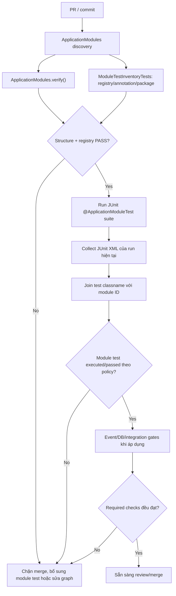

# Đo module nào đã có module test

Trong Spring Modulith, hỏi **“module nào đã có module test?”** không thể trả lời chính xác bằng cách đếm file có hậu tố `*Test.java` hoặc nhìn tỷ lệ line coverage của JaCoCo. Điều cần đo là một phép đối chiếu có căn cứ:

**Tập application module mà `ApplicationModules` thực sự nhận diện** ↔ **tập test dùng `@ApplicationModuleTest`, đặt đúng module và thực sự được JUnit thực thi**.

Một module có test class khai báo nhưng bị `@Disabled`, bị loại khỏi CI hoặc chỉ chứa `contextLoads()` không nên được báo cáo ngang mức với module đã kiểm tra behavior, event và transaction. Vì thế bảng đo cần **nhiều trạng thái bằng chứng**, không gói mọi thứ vào một con số “coverage = 100%”.

Bài thuộc chương **Coverage theo module** của **SPRING_MODULITH_VERIFICATION_TESTING**. Trọng tâm là phương pháp kiểm kê và tự động xác minh test coverage **theo từng module**, phối hợp kiến trúc `ApplicationModules.verify()`, `@ApplicationModuleTest`, kiểm thử sự kiện/database và CI quality gate. Ví dụ dùng Java 17+, JUnit 5, Spring Modulith Test và Spring Test phù hợp phiên bản; không giả định các ví dụ đã được chạy trên một repository cụ thể.

## 1. Định nghĩa chính xác “đã có module test”

Một module chỉ có tên trong báo cáo không đủ để gọi là đã được kiểm chứng. Hãy ghi ít nhất năm trạng thái theo **từng module**:

| Mức | Tên trạng thái | Bằng chứng tối thiểu | Không được suy diễn |
|---|---|---|---|
| D | **Discovered** | `ApplicationModules` nhận diện được module | Đã có test |
| R | **Registered** | Có test class được kiểm kê, đúng package/module, dùng `@ApplicationModuleTest` | JUnit đã chạy test |
| E | **Executed** | Có kết quả thực thi JUnit của test thuộc module trong CI hiện tại | Test đã thành công |
| P | **Passed** | Test thực thi có kết quả đạt, không lỗi/thất bại theo chính sách | Assertions đủ sâu |
| Q | **Qualified** | Có case hành vi/negative path/hợp đồng cần thiết được assert và review | Mọi rủi ro tích hợp đã được kiểm tra |

**Câu trả lời hữu ích** phải là bảng trạng thái D/R/E/P/Q theo từng module. Nếu chỉ cần một chỉ số để điều hành, hãy chọn **R = có module test hợp lệ** làm coverage khai báo, nhưng luôn hiển thị **E và P** cạnh nó.

### 1.1. Ví dụ vì sao một con số đánh lừa

Giả sử Spring Modulith nhận diện ba module `catalog`, `orders`, `shipping`:

| Module | Có `@ApplicationModuleTest` | Có JUnit result CI hiện tại | Kết quả | Mức ý nghĩa |
|---|---|---|---|---|
| catalog | Có | Có | Pass | Kiểm tra lookup sản phẩm |
| orders | Có | Có | Pass | Kiểm tra publish event |
| shipping | Có | Không, test bị exclude | Không có kết quả | **Chưa có bằng chứng chạy** |

Tỷ lệ **registered** là 3/3, nhưng **executed** chỉ 2/3. Ghi “module test coverage 100%” mà không làm rõ trạng thái sẽ che việc shipping chưa được chạy.

### 1.2. Không trộn module test với các loại test khác

Một module có thể có hàng chục unit tests nhưng **chưa có `@ApplicationModuleTest`**. Ngược lại, một class `@ApplicationModuleTest` chỉ chứa `contextLoads()` có thể có mặt nhưng chưa chứng minh use case.

| Loại test | Đếm vào “có module test”? | Ghi chú |
|---|---|---|
| Unit test thuần JUnit/Mockito | Không, ở cột R | Ghi nhận riêng unit coverage |
| `@ApplicationModuleTest` đặt đúng module | Có, nếu thỏa quy ước registry | Cần thêm bằng chứng E/P |
| `@SpringBootTest` full context | Không tự động | Đây là integration/wiring evidence |
| `ApplicationModules.verify()` | Không tự động | Đây là architecture verification toàn ứng dụng |
| `@ApplicationModuleTest` bị skip | R có thể có; E/P không | Phải phơi bày skipped/excluded |
| Test consumer event độc lập bằng `@ApplicationModuleTest` | Có | Cần assertion kết quả consumer |

## 2. Lấy mẫu số từ ApplicationModules, không từ tên thư mục

**Sai lầm lớn nhất khi đo coverage là mẫu số sai.** Nếu chỉ đếm những module có test class, kết quả luôn là “100%” vì module chưa có test biến mất khỏi phép đo.

Giả sử package root:

```text
com.acme.shop
├── ShopApplication.java
├── catalog
├── orders
└── shipping
```

Với module detection mặc định, các package con trực tiếp thường tạo thành application modules. Nhưng cấu hình phát hiện module tùy biến, nested modules, named modules hoặc package root khác có thể làm kết quả thay đổi. **Phải dùng model thật**.

### 2.1. Test kiểm tra mẫu số

File `src/test/java/com/acme/shop/ModuleDiscoveryTests.java`:

```java
package com.acme.shop;

import static org.assertj.core.api.Assertions.assertThat;

import java.util.TreeSet;
import org.junit.jupiter.api.Test;
import org.springframework.modulith.core.ApplicationModules;

class ModuleDiscoveryTests {

    @Test
    void discoveryIncludesTheModulesWeIntendToCover() {
        ApplicationModules modules =
            ApplicationModules.of(ShopApplication.class);

        var discovered = new TreeSet<String>();

        modules.forEach(module ->
            discovered.add(module.getIdentifier().toString()));

        assertThat(discovered)
            .contains("catalog", "orders", "shipping");
    }
}
```

`getIdentifier()` được sử dụng theo API Spring Modulith có `ApplicationModuleIdentifier`; nếu dự án dùng phiên bản có API khác, điều chỉnh truy cập identifier theo version đã quản lý. **Không thay tập module tự phát hiện bằng danh sách viết tay chỉ để làm báo cáo đẹp.**

`contains(...)` xác minh ba module kỳ vọng có mặt, không giả định app chỉ có ba module. Nếu thêm `billing`, nó cũng phải được đưa vào mẫu số khi là application module thật. API `modules.getModuleByName("orders")` hữu ích khi cần kiểm tra một module cụ thể, nhưng **không được thay phép liệt kê toàn bộ module** dùng làm mẫu số.

### 2.2. Architecture test đứng cạnh module coverage

```java
package com.acme.shop;

import org.junit.jupiter.api.Test;
import org.springframework.modulith.core.ApplicationModules;

class ModuleArchitectureTests {

    @Test
    void dependenciesRespectModuleBoundaries() {
        ApplicationModules.of(ShopApplication.class).verify();
    }
}
```

Hai phép kiểm khác nhau:

- **Module discovery**: “Tôi đang đo đúng các module nào?”
- **`verify()`**: “Những dependency giữa các module ấy có thỏa quy tắc kiến trúc không?”

`verify()` pass **không** làm module `shipping` trở thành “đã có module test”. Còn coverage test pass **không** chứng minh dependency cycle, internal API access hoặc `allowedDependencies` đã hợp lệ.

### 2.3. Khi nào loại trừ một module khỏi mẫu số?

Nếu một module chỉ là configuration/bootstrap không có behavior module-level cần test, có thể đặt **ngoại lệ được phê duyệt** và báo cáo hai con số:

- `discoveredModules`: tổng số module theo model.
- `eligibleModules`: các module phải có module test theo chính sách.

Ngoại lệ cần có **module ID, lý do, owner và thời điểm review**. Không xóa module khỏi denominator sau khi thấy chưa có test, và không tự chuyển nó thành “covered” nhờ một test của module khác.

## 3. Quy ước đếm một test cho đúng module

Một class chỉ được gắn vào module X khi quy ước sau được đáp ứng:

1. Class có `@ApplicationModuleTest` theo chính sách nhóm.
2. Test class thuộc package của X, tốt nhất **package root X**: `com.acme.shop.orders`.
3. Có ít nhất một test case thực sự được JUnit khám phá/chạy; không chỉ có annotation ở class rỗng.
4. Test subject thuộc module X, thường được truy cập qua public API của X.
5. Collaborator ngoài module được mock/fake hoặc đưa vào bootstrap mode **có chủ đích**.
6. Có assertion đầu ra/hợp đồng phù hợp; không chỉ xác nhận context khởi động.
7. CI bắt buộc chạy test và giữ report của chính revision cần kiểm.

### 3.1. Convention để việc kiểm kê đơn giản

```text
src/test/java/com/acme/shop
├── catalog/CatalogModuleTests.java
├── orders/OrdersModuleTests.java
├── shipping/ShippingModuleTests.java
├── ModuleDiscoveryTests.java
├── ModuleArchitectureTests.java
└── ModuleTestInventoryTests.java
```

`@ApplicationModuleTest` của orders đặt tại `com.acme.shop.orders` giúp Spring Modulith Test xác định module cần bootstrap theo package class. Test dưới `com.acme.shop.test` với tên `OrdersModuleTests` không nên tự được gán cho orders chỉ vì tên có chữ “Orders”.

Một module có thể có **nhiều** module test classes. Báo cáo nên liệt kê tất cả test classes, nhưng tỷ lệ coverage **đếm module duy nhất**, không phải số class. Ví dụ orders có 12 test classes vẫn đóng góp **một module** vào numerator.

### 3.2. Vì sao annotation không đồng nghĩa chạy thành công?

`@ApplicationModuleTest` đặt trên class có thể giúp thiết lập Spring TestContext. Nó không bảo đảm:

- Class được Maven Surefire/Gradle Test task discover.
- Test không bị `@Disabled` hoặc bị filter.
- Context tạo được đầy đủ bean.
- Một method đã chạy và không fail.
- Có assertion nghiệp vụ quan trọng.

Vì vậy **R phải được đối chiếu với JUnit execution report**, không thay bằng phép quét tên file.

## 4. Ví dụ ba module test thực sự cần kiểm đếm

Để kiểm kê có nghĩa, dùng một ứng dụng nhỏ nhưng có **hành vi** ở cả ba module. Mã bên dưới được chia theo file; chỉ ví dụ Spring Boot thông thường, không thay thế production database/payment integration.

### 4.1. Hợp đồng và logic catalog

File `catalog/ProductLookup.java`:

```java
package com.acme.shop.catalog;

import java.util.UUID;

public interface ProductLookup {
    boolean exists(UUID productId);
}
```

File `catalog/internal/DemoProductLookup.java`:

```java
package com.acme.shop.catalog.internal;

import com.acme.shop.catalog.ProductLookup;
import java.util.UUID;
import org.springframework.stereotype.Component;

@Component
class DemoProductLookup implements ProductLookup {

    private static final UUID KNOWN_ID = UUID.fromString(
        "00000000-0000-0000-0000-000000000001"
    );

    @Override
    public boolean exists(UUID productId) {
        return KNOWN_ID.equals(productId);
    }
}
```

File `src/test/java/com/acme/shop/catalog/CatalogModuleTests.java`:

```java
package com.acme.shop.catalog;

import static org.assertj.core.api.Assertions.assertThat;

import java.util.UUID;
import org.junit.jupiter.api.Test;
import org.springframework.beans.factory.annotation.Autowired;
import org.springframework.modulith.test.ApplicationModuleTest;

@ApplicationModuleTest
class CatalogModuleTests {

    @Autowired ProductLookup products;

    @Test
    void findsKnownProduct() {
        UUID known = UUID.fromString(
            "00000000-0000-0000-0000-000000000001"
        );

        assertThat(products.exists(known)).isTrue();
    }

    @Test
    void rejectsUnknownProduct() {
        assertThat(products.exists(UUID.randomUUID())).isFalse();
    }
}
```

Test này có **hai case hành vi thật** cho demo lookup. Tuy nhiên adapter dùng hằng số in-memory, nên không được diễn giải nó là database integration test.

### 4.2. Orders kiểm tra catalog qua public API và publish event

File `orders/PlaceOrder.java`:

```java
package com.acme.shop.orders;

import java.util.UUID;

public interface PlaceOrder {
    UUID place(UUID productId, int quantity);
}
```

File `orders/events/OrderSubmitted.java`:

```java
package com.acme.shop.orders.events;

import java.util.UUID;

public record OrderSubmitted(
    UUID orderId,
    UUID productId,
    int quantity
) {}
```

File `orders/events/package-info.java`:

```java
@org.springframework.modulith.NamedInterface("events")
package com.acme.shop.orders.events;
```

File `orders/package-info.java`:

```java
@org.springframework.modulith.ApplicationModule(
    allowedDependencies = "catalog"
)
package com.acme.shop.orders;
```

File `orders/internal/DefaultPlaceOrder.java`:

```java
package com.acme.shop.orders.internal;

import com.acme.shop.catalog.ProductLookup;
import com.acme.shop.orders.PlaceOrder;
import com.acme.shop.orders.events.OrderSubmitted;
import java.util.UUID;
import org.springframework.context.ApplicationEventPublisher;
import org.springframework.stereotype.Service;

@Service
class DefaultPlaceOrder implements PlaceOrder {

    private final ProductLookup products;
    private final ApplicationEventPublisher publisher;

    DefaultPlaceOrder(
            ProductLookup products,
            ApplicationEventPublisher publisher) {
        this.products = products;
        this.publisher = publisher;
    }

    @Override
    public UUID place(UUID productId, int quantity) {
        if (productId == null || quantity <= 0) {
            throw new IllegalArgumentException("Invalid order item");
        }

        if (!products.exists(productId)) {
            throw new IllegalArgumentException("Unknown product");
        }

        UUID orderId = UUID.randomUUID();
        publisher.publishEvent(
            new OrderSubmitted(orderId, productId, quantity)
        );
        return orderId;
    }
}
```

Test tại `orders/OrdersModuleTests.java`:

```java
package com.acme.shop.orders;

import static org.assertj.core.api.Assertions.assertThat;
import static org.assertj.core.api.Assertions.assertThatThrownBy;
import static org.mockito.Mockito.when;

import com.acme.shop.catalog.ProductLookup;
import com.acme.shop.orders.events.OrderSubmitted;
import java.util.UUID;
import org.junit.jupiter.api.Test;
import org.springframework.beans.factory.annotation.Autowired;
import org.springframework.modulith.test.ApplicationModuleTest;
import org.springframework.modulith.test.PublishedEvents;
import org.springframework.test.context.bean.override.mockito.MockitoBean;

@ApplicationModuleTest
class OrdersModuleTests {

    @Autowired PlaceOrder orders;

    @MockitoBean ProductLookup catalog;

    @Test
    void publishesEventForKnownProduct(PublishedEvents events) {
        UUID productId = UUID.randomUUID();
        when(catalog.exists(productId)).thenReturn(true);

        UUID orderId = orders.place(productId, 2);

        assertThat(events.ofType(OrderSubmitted.class))
            .singleElement()
            .satisfies(event -> {
                assertThat(event.orderId()).isEqualTo(orderId);
                assertThat(event.productId()).isEqualTo(productId);
                assertThat(event.quantity()).isEqualTo(2);
            });
    }

    @Test
    void rejectsUnknownProductWithoutEvent(
            PublishedEvents events) {
        UUID productId = UUID.randomUUID();
        when(catalog.exists(productId)).thenReturn(false);

        assertThatThrownBy(() -> orders.place(productId, 2))
            .isInstanceOf(IllegalArgumentException.class)
            .hasMessage("Unknown product");

        assertThat(events.ofType(OrderSubmitted.class)).isEmpty();
    }

    @Test
    void rejectsInvalidQuantityWithoutEvent(
            PublishedEvents events) {
        assertThatThrownBy(() ->
            orders.place(UUID.randomUUID(), 0)
        ).isInstanceOf(IllegalArgumentException.class)
         .hasMessage("Invalid order item");

        assertThat(events.ofType(OrderSubmitted.class)).isEmpty();
    }
}
```

Ở `@ApplicationModuleTest` mặc định `STANDALONE`, `@MockitoBean ProductLookup` cung cấp collaborator từ catalog qua **public interface**, không khởi động adapter catalog thật. `PublishedEvents` chứng minh orders publish event theo assertions, không chứng minh shipping đã xử lý.

**Lưu ý phiên bản:** `@MockitoBean` cần Spring Framework 6.2 trở lên; dự án Spring Boot cũ có thể cần `@MockBean`. Đừng thay bằng Mockito `@Mock` thuần nếu Spring phải inject bean ấy.

### 4.3. Shipping tiêu thụ event contract

File `shipping/package-info.java`:

```java
@org.springframework.modulith.ApplicationModule(
    allowedDependencies = "orders::events"
)
package com.acme.shop.shipping;
```

File `shipping/ShippingStatus.java`:

```java
package com.acme.shop.shipping;

import java.util.UUID;

public interface ShippingStatus {
    boolean received(UUID orderId);
}
```

File `shipping/internal/ShippingProjection.java`:

```java
package com.acme.shop.shipping.internal;

import com.acme.shop.shipping.ShippingStatus;
import java.util.Set;
import java.util.UUID;
import java.util.concurrent.ConcurrentHashMap;
import org.springframework.stereotype.Component;

@Component
class ShippingProjection implements ShippingStatus {

    private final Set<UUID> ids =
        ConcurrentHashMap.newKeySet();

    void record(UUID orderId) {
        ids.add(orderId);
    }

    @Override
    public boolean received(UUID orderId) {
        return ids.contains(orderId);
    }
}
```

File `shipping/internal/OnOrderSubmitted.java`:

```java
package com.acme.shop.shipping.internal;

import com.acme.shop.orders.events.OrderSubmitted;
import org.springframework.context.event.EventListener;
import org.springframework.stereotype.Component;

@Component
class OnOrderSubmitted {

    private final ShippingProjection projection;

    OnOrderSubmitted(ShippingProjection projection) {
        this.projection = projection;
    }

    @EventListener
    void on(OrderSubmitted event) {
        projection.record(event.orderId());
    }
}
```

File `shipping/ShippingModuleTests.java`:

```java
package com.acme.shop.shipping;

import static org.assertj.core.api.Assertions.assertThat;

import com.acme.shop.orders.events.OrderSubmitted;
import java.util.UUID;
import org.junit.jupiter.api.Test;
import org.springframework.beans.factory.annotation.Autowired;
import org.springframework.context.ApplicationEventPublisher;
import org.springframework.modulith.test.ApplicationModuleTest;

@ApplicationModuleTest
class ShippingModuleTests {

    @Autowired ApplicationEventPublisher publisher;
    @Autowired ShippingStatus shipping;

    @Test
    void handlesThePublicOrderEvent() {
        UUID orderId = UUID.randomUUID();

        publisher.publishEvent(new OrderSubmitted(
            orderId, UUID.randomUUID(), 2
        ));

        assertThat(shipping.received(orderId)).isTrue();
    }
}
```

Test shipping tự tạo input **public event contract**, không import `orders.internal`. Với `@EventListener` và multicaster đồng bộ mặc định, assertion có thể chạy ngay sau `publishEvent`.

**Giới hạn:** projection chỉ lưu trạng thái trong JVM. Test này đủ để đánh dấu module shipping **có module behavior test** trong demo, nhưng chưa chứng minh database commit, idempotency hay xử lý async.

## 5. Java/JUnit inventory gate: phát hiện module thiếu module test

Một cách dễ kiểm toán là quản lý **registry rõ ràng** từ `module identifier` tới `fully qualified module test class name`. Sau đó dùng `ApplicationModules` làm nguồn module IDs, không suy module từ danh sách test.

Ưu điểm của registry: đơn giản, review được trong PR, không phụ thuộc classpath scanning tùy biến. Nhược điểm: phải cập nhật khi thêm/đổi module hoặc test; vì thế **registry cần một JUnit gate tự kiểm chứng**.

### 5.1. Test kiểm kê có thể chạy bằng JUnit 5

File `src/test/java/com/acme/shop/ModuleTestInventoryTests.java`:

```java
package com.acme.shop;

import static org.assertj.core.api.Assertions.assertThat;

import java.util.Map;
import java.util.TreeSet;
import org.junit.jupiter.api.Test;
import org.springframework.modulith.core.ApplicationModules;
import org.springframework.modulith.test.ApplicationModuleTest;

class ModuleTestInventoryTests {

    // Đây là manifest do nhóm review.
    // Module mới thiếu registry entry sẽ làm test fail.
    private static final Map<String, String> MODULE_TESTS = Map.of(
        "catalog",
        "com.acme.shop.catalog.CatalogModuleTests",
        "orders",
        "com.acme.shop.orders.OrdersModuleTests",
        "shipping",
        "com.acme.shop.shipping.ShippingModuleTests"
    );

    @Test
    void everyDiscoveredModuleHasRegisteredModuleTest()
            throws ClassNotFoundException {

        var discovered = new TreeSet<String>();

        ApplicationModules.of(ShopApplication.class)
            .forEach(module -> discovered.add(
                module.getIdentifier().toString()));

        // Không đếm chỉ module có tên trong manifest.
        // Ở bài demo, tất cả module phải có test.
        assertThat(MODULE_TESTS.keySet())
            .containsExactlyInAnyOrderElementsOf(discovered);

        for (var entry : MODULE_TESTS.entrySet()) {
            String moduleId = entry.getKey();
            String testClassName = entry.getValue();

            Class<?> testClass = Class.forName(
                testClassName,
                false,
                getClass().getClassLoader()
            );

            assertThat(testClass.getPackageName())
                .as("Test package của module %s", moduleId)
                .isEqualTo("com.acme.shop." + moduleId);

            assertThat(testClass.isAnnotationPresent(
                ApplicationModuleTest.class
            )).as("%s phải có @ApplicationModuleTest",
                testClassName)
              .isTrue();
        }
    }
}
```

Test gate này kiểm chứng **R — registered coverage**:

- Đối chiếu mọi module được phát hiện với manifest.
- Phát hiện thiếu module mới nếu chưa đăng ký.
- Phát hiện manifest trỏ vào class không còn tồn tại.
- Phát hiện package sai khi nhóm quy ước module test đặt ở package root.
- Phát hiện class không có **annotation trực tiếp** `@ApplicationModuleTest`.

Nếu nhóm dùng composed/meta-annotation cho module test, phải sửa bước phát hiện annotation thành cơ chế hỗ trợ meta-annotation (ví dụ Spring annotation utilities), thay vì nhận nhầm là thiếu test. Nếu một module có nhiều test classes, thay `Map<String, String>` bằng `Map<String, List<String>>` và kiểm tra tất cả classes.

### 5.2. Vì sao registry gate chưa đủ?

Nó **không chạy test classes trong registry** và cũng không chứng minh có `@Test` methods. Class `@ApplicationModuleTest` có thể rỗng hoặc `@Disabled`; reflection vẫn thấy annotation. Vì vậy báo cáo chỉ được ghi **Registered = yes**, còn **Executed/Passed** phải lấy từ JUnit runtime reports.

Một module test có 50 methods không được tính là 50 module. Tỷ lệ module coverage luôn là **số module duy nhất**.

### 5.3. Tránh “ngoại lệ âm thầm”

Nếu không yêu cầu tất cả modules có module test, thiết kế manifest ngoại lệ minh bạch:

```text
module-id | eligible | reason | owner | review-date
catalog   | yes      |        | ...   |
orders    | yes      |        | ...   |
shipping  | yes      |        | ...   |
bootstrap | no       | configuration-only, covered by wiring test | ... | ...
```

Không dùng `discovered.retainAll(MODULE_TESTS.keySet())` hoặc lọc module thiếu test để numerator bằng denominator. Đó là một dạng **coverage xanh giả**.

## 6. Bằng chứng đã chạy: đọc kết quả JUnit chứ không chỉ đọc source

Sau khi registry đạt, bước quyết định là biết **những test nào thực sự được chạy trong CI hiện tại**.

### 6.1. Nguồn báo cáo phổ biến

- **Maven Surefire**: thường tạo các file `target/surefire-reports/TEST-*.xml`.
- **Maven Failsafe**: nếu integration tests được cấu hình riêng, có các report tương ứng dưới `target/failsafe-reports`.
- **Gradle Test**: thường tạo `build/test-results/test/TEST-*.xml`.
- **Gradle integrationTest**: nếu có custom test task/source set, vị trí report tùy task.

Các vị trí là convention, không phải đảm bảo cho mọi build. Nếu có report path tùy biến, phải lấy đúng từ cấu hình dự án.

### 6.2. Correlate class name → module ID

Sau khi chạy JUnit, đọc từng XML `<testcase>` và lấy `classname`. Với registry ở mục 5, map chính xác:

```text
com.acme.shop.catalog.CatalogModuleTests   -> catalog
com.acme.shop.orders.OrdersModuleTests     -> orders
com.acme.shop.shipping.ShippingModuleTests -> shipping
```

Ví dụ JUnit XML được rút gọn:

```xml
<testsuite tests="2" failures="0" errors="0" skipped="0">
  <testcase
      classname="com.acme.shop.catalog.CatalogModuleTests"
      name="findsKnownProduct"/>
  <testcase
      classname="com.acme.shop.catalog.CatalogModuleTests"
      name="rejectsUnknownProduct"/>
</testsuite>
```

Đối với mỗi module:

- **Executed** khi có ít nhất một testcase tương ứng thực sự bắt đầu/được báo cáo, không bị skip toàn bộ.
- **Passed** khi các test bắt buộc của module đều có kết quả thành công theo policy, không có failures/errors và không bị skip ngoài kế hoạch.
- **Missing** khi class có trong registry nhưng không có kết quả thực thi ở test reports của run.
- **Failed** khi có assertion failure, context bootstrap error hoặc test execution error.

### 6.3. Pseudocode của bộ đối chiếu report

```text
modules = ApplicationModules.of(ShopApplication).identifiers
registry = { moduleId -> set<TestClassFQCN> }
reports = JUnit_XML_of_CURRENT_CI_RUN_only

for each moduleId in modules:
    configuredClasses = registry[moduleId] or emptySet
    testcases = XML testcases whose classname matches configuredClasses

    registered = configuredClasses not empty
    executed   = any testcase with actual non-skipped result
    failed     = any testcase has <failure> or <error>
    skipped    = any testcase has <skipped>
    passed     = executed AND NOT failed
                 AND required testcases are not skipped

    emit(moduleId, registered, executed, passed, skipped, testcases.size)

fail CI if required module:
    has no registered test, no executed test, or failed required tests
```

Đây là **thuật toán minh họa**, không phải parser đã chạy. Với `@Nested`, parameterized hoặc dynamic tests, JUnit report có thể đặt classname hoặc method name theo cách khác; phải xác định policy ánh xạ class con/engine tương ứng. Không “tự gán” những testcase không khớp vào một module để làm coverage cao hơn.

### 6.4. Bảo vệ tính mới của báo cáo

Trước khi đo:

1. Thực thi test suite ở **commit/revision cần kiểm**.
2. Dùng clean test outputs hoặc một workspace mới để tránh đọc report cũ.
3. Kiểm tra test task không bị skip hoặc exclude `*ModuleTests`.
4. Thu thập tất cả report directories từ test tasks bắt buộc.
5. Khớp registry classnames với report testcase classnames.
6. Phân biệt **không có report** với **test fail** và **test skipped**; cả ba không phải PASS.

**Một `BUILD SUCCESS` không phải chứng cứ đủ** nếu module test classes chưa được chạy.

## 7. Công thức coverage và ma trận báo cáo có ích

Đặt:

- `M` = tập modules được phát hiện bởi `ApplicationModules`.
- `E` = tập modules thuộc chính sách cần có module test (thường `E = M`).
- `R` = tập modules có test class hợp lệ trong registry.
- `X` = tập modules có test case thực sự được chạy trong CI.
- `P` = tập modules có các test bắt buộc được chạy thành công.
- `Q` = tập modules có bằng chứng behavior/contract đáp ứng checklist review.

Các chỉ số:

\[
\text{Registered coverage} = \frac{|E\cap R|}{|E|}\times 100\%
\]

\[
\text{Executed coverage} = \frac{|E\cap X|}{|E|}\times 100\%
\]

\[
\text{Passed coverage} = \frac{|E\cap P|}{|E|}\times 100\%
\]

Nếu `E` rỗng, **không hiển thị 100%** theo quy ước toán học không xác định; báo “N/A — cần xem cấu hình/phạm vi”.

### 7.1. Một báo cáo mẫu

| Module | Registered | Executed | Passed | Case thực chạy | Gap |
|---|---|---|---|---:|---|
| catalog | Yes | Yes | Yes | 2 | Không |
| orders | Yes | Yes | Yes | 3 | Thiếu DB integration nếu production có persistence |
| shipping | Yes | No | No data | 0 | Test bị exclude khỏi CI |

Tóm tắt có thể ghi:

```text
Discovered modules: 3
Eligible modules:   3
Registered:         3/3
Executed:           2/3
Passed:             2/3

Missing execution evidence: shipping
Build gate: FAIL
```

Trong ví dụ, không được ghi “shipping failed test” nếu không có testcase chạy; trạng thái đúng là **NO EXECUTION EVIDENCE**. Điều này giúp ưu tiên sửa task/filter CI thay vì điều tra lỗi nghiệp vụ không tồn tại.

### 7.2. Đừng so sánh sai các chỉ số

**JaCoCo line/branch coverage** rất hữu ích để biết code nào được thực thi, nhưng nó **không thay thế module test coverage**:

- 95% lines covered trong orders có thể đến từ `@SpringBootTest` end-to-end, chưa có `@ApplicationModuleTest` dành cho orders.
- Một `@ApplicationModuleTest` đã chạy có thể có low line coverage nếu chỉ kiểm tra một use case.
- Cả hai con số có giá trị, nhưng **định nghĩa và mẫu số khác nhau**.

Nên hiển thị chúng cạnh nhau, không cộng hoặc nhân tùy ý thành một “coverage score” thiếu diễn giải.

### 7.3. Phân biệt “có test” với “đủ test”

Trong công việc thực tế, nên bổ sung một bảng **hợp đồng/rủi ro theo module**:

| Module | Contract test | Negative path | Event/Integration | Database/Transaction |
|---|---|---|---|---|
| catalog | Lookup hợp lệ | Sản phẩm không tồn tại | Không bắt buộc trong demo | Cần khi dùng DB thật |
| orders | Place order | Quantity/product invalid | `PublishedEvents` | Cần nếu lưu order |
| shipping | Nhận event | Payload/error handling | Consumer test | Cần nếu persist shipment |

Bảng này trả lời **“module nào cần bổ sung test gì?”**, thay vì chỉ “module nào có class”. Nếu một module sử dụng database thực, có thể bổ sung integration test với **Testcontainers** để kiểm migration, constraint và trạng thái sau commit; giữ kết quả đó ở cột integration riêng, không đánh tráo nó thành điều kiện duy nhất để gọi một module “có `@ApplicationModuleTest`”.

## 8. Các kiểu coverage xanh giả cần bắt trong quá trình kiểm chứng

### 8.1. Module test class tồn tại nhưng không có test method

```java
@ApplicationModuleTest
class EmptyOrdersModuleTests {
    // Không có @Test, @ParameterizedTest hoặc test case động.
}
```

Registry phản ánh `R = yes`, nhưng không có `E = yes`. Chặn bằng cách đối chiếu **JUnit XML runtime**, không chỉ reflection.

### 8.2. Test bị @Disabled hoặc filter theo tag

```java
@ApplicationModuleTest
@org.junit.jupiter.api.Disabled("Chờ refactor")
class ShippingModuleTests {
    @org.junit.jupiter.api.Test
    void handlesEvent() {}
}
```

`@Disabled` là một trạng thái chính thức, **không phải PASS**. Nếu test dùng `@Tag("slow")` nhưng CI chỉ chạy tag `fast`, report có thể hoàn toàn thiếu class. Ghi rõ **EXCLUDED/NOT EXECUTED** thay vì covered.

### 8.3. Test contextLoads() không có behavior assertion

```java
@ApplicationModuleTest
class OrdersModuleTests {
    @org.junit.jupiter.api.Test
    void contextLoads() {}
}
```

Đây có thể là **bootstrap evidence**, nhưng không chứng minh place order phát đúng event, xử lý input sai, transaction hay repository semantics. Có thể đếm R/E/P tùy policy, nhưng **Q = chưa đạt** nếu không có assertion hợp đồng.

### 8.4. Module test chạy nhưng subject bị mock

Nếu `@MockitoBean PlaceOrder` thay cho implementation orders thật, test có thể xanh nhờ stub và không kiểm tra use case. Code review cần yêu cầu test chạy **real subject** và mock đúng collaborator ngoài module.

### 8.5. Test package không đúng module

`@ApplicationModuleTest` đặt trong `com.acme.shop.testing` rồi gán cho orders theo tên file là rủi ro. Registry gate ở mục 5 kiểm tra package theo module ID. Với nested modules/cách bố trí khác, cần quy tắc ánh xạ được duy trì và kiểm chứng riêng.

### 8.6. Một test integration được đếm cho mọi module liên quan

Một end-to-end test `CreateOrderAndShipTests` có thể gọi catalog, orders và shipping. Không vì thế ghi cả ba module có **module test**. Nó là system/integration evidence; module test coverage vẫn cần lớp test theo module riêng nếu policy yêu cầu.

### 8.7. Architecture xanh nhưng module coverage rỗng

`ApplicationModules.verify()` có thể đạt dù chưa viết bất kỳ `@ApplicationModuleTest` nào. Dùng hai cổng **architecture và module-test coverage** độc lập; không thay thế lẫn nhau.

### 8.8. Báo cáo CI cũ hoặc build task không bao phủ module test

Báo cáo JUnit XML còn từ run trước có thể tạo **executed coverage giả**. CI cần clean workspace/output và gắn artifact vào run/commit cụ thể. Nếu có Maven Surefire và Failsafe, Gradle `test` và `integrationTest`, phải thu đúng report theo những task thực sự chạy.

## 9. CI quality gate: từ danh sách module đến điều kiện chặn merge

Mô hình gate nên tách **bằng chứng khai báo** và **bằng chứng thực thi**.



### 9.1. Lệnh minh họa với Maven Wrapper

```bash
# Build sạch để tránh lấy XML report từ run cũ.
./mvnw -B clean verify
```

Theo cấu hình Maven thực tế, `verify` sẽ kích hoạt các plugin/test phases đã khai báo. Nếu dự án dùng Failsafe/profile riêng, phải xác nhận integration tests cần thiết đã chạy. Sau bước đó, CI đọc `target/surefire-reports` và (nếu có) `target/failsafe-reports`, áp dụng thuật toán mục 6 rồi xuất bảng theo module.

Có thể chạy `ModuleArchitectureTests` hoặc `ModuleTestInventoryTests` như **job fail-fast** trước một suite tốn kém, nhưng job độc lập không thay thế execution report gate.

### 9.2. Lệnh minh họa với Gradle Wrapper

```bash
# Chạy clean test task đã cấu hình.
./gradlew clean test
```

Nếu có task `integrationTest`, phải cấu hình CI gọi task đó và thu đúng XML report. Một số ứng dụng có custom test suites hoặc tag filtering: cần kiểm rõ task discovery để không mất `@ApplicationModuleTest` classes.

### 9.3. Chính sách merge tối thiểu nên áp dụng

- **Architecture check PASS**: `verify()` và module discovery.
- **Registration check PASS**: module thuộc policy phải có test class hợp lệ.
- **Execution check PASS**: từng module yêu cầu có ít nhất một testcase non-skipped ở đúng run.
- **Result check PASS**: required module tests không fail/error và skipped theo chính sách.
- **Contract/integration check PASS**: các rủi ro event/DB/transaction bắt buộc đã được kiểm bằng suite tương ứng.
- **Traceability**: bảng coverage kèm commit SHA, test task, môi trường và artifacts.

Không ép tất cả mọi module có DB test nếu module không sở hữu dữ liệu. Nhưng nếu một module có event listener after-commit hoặc persistence quan trọng, **module test existence** không đủ để bỏ qua integration evidence.

### 9.4. Thử red–green cho gate kiểm kê

Thử có kiểm soát trên nhánh riêng:

1. Xóa entry `shipping` khỏi registry → registry JUnit test phải đỏ.
2. Khôi phục, đổi class name thành không tồn tại → test phải đỏ vì `ClassNotFoundException`.
3. Khôi phục, đổi package của module test → policy check đỏ.
4. Khôi phục, `@Disabled` shipping test → JUnit execution gate phải đỏ hoặc báo không có execution.
5. Khôi phục, làm assertion `OrderSubmitted.quantity` sai → producer test đỏ.
6. Khôi phục, bỏ shipping listener → consumer test đỏ.
7. Chạy lại trên revision đúng, xuất bảng và lưu report.

Nếu gate vẫn xanh ở một ca thử âm tính, **đừng xem coverage metric là đáng tin** trước khi sửa bộ phát hiện.

## 10. Checklist đo lường và bài tập thực hành

### 10.1. Checklist dành cho người triển khai

| # | Điều phải kiểm | Bằng chứng lưu lại |
|---|---|---|
| 1 | Package root của `ShopApplication` đúng? | Module discovery result |
| 2 | `ApplicationModules` nhận đủ modules? | Danh sách module IDs |
| 3 | Có ngoại lệ coverage được phê duyệt? | Module ID, reason, owner |
| 4 | Từng eligible module có registry entry? | `ModuleTestInventoryTests` |
| 5 | Test class có `@ApplicationModuleTest`? | Annotation check |
| 6 | Test class ở đúng module package? | Package check |
| 7 | Một module có nhiều test class được đếm một lần? | Aggregation theo ID |
| 8 | Test thực sự có JUnit testcase trong run hiện tại? | XML report/classname |
| 9 | Skipped/excluded/fail không bị coi là pass? | Status map |
| 10 | Subject module là bean thật, collaborator mock có chủ đích? | Test source review |
| 11 | Có assertion behavior, negative path hoặc contract cần thiết? | JUnit methods và assertions |
| 12 | Event producer và consumer được tách bằng chứng? | `PublishedEvents`/consumer tests |
| 13 | DB/transaction integration được đo riêng khi cần? | DB test reports |
| 14 | `ApplicationModules.verify()` chạy độc lập? | Architecture report |
| 15 | Artifact có gắn commit SHA và test task? | CI metadata |
| 16 | Gate fail khi thiếu module test hoặc test bị skip? | Red–green proof |

### 10.2. Bài tập thực hành từng bước

**Bối cảnh:** ứng dụng có `catalog`, `orders` và `shipping`. Ban đầu chỉ có `CatalogModuleTests` và `OrdersModuleTests`.

**Phần A — Tạo baseline.** Chạy `ApplicationModules.of(ShopApplication.class)` để nhận danh sách module. Ghi tổng số module và các module thuộc scope; kiểm tra `verify()` riêng. Không lấy denominator từ test files.

**Phần B — Tạo registry.** Thêm `ModuleTestInventoryTests` với hai entries catalog/orders. Chạy nó và đọc lỗi cho `shipping`. Không nới điều kiện để gate xanh; bổ sung module test shipping theo đúng public event contract.

**Phần C — Kiểm tra bằng chứng chạy.** Thực thi JUnit suite, thu JUnit XML và đối chiếu `classname` với registry. Nếu shipping bị filter/`@Disabled`, báo **registered yes / executed no**. Sau khi bật test và chạy lại, báo **executed yes / passed yes** nếu assertions đạt.

**Phần D — Kiểm tra chiều sâu.** Với orders, assert `PublishedEvents` đúng type/payload và negative cases; với shipping, publish `OrderSubmitted` và assert consumer effect. Đánh dấu rõ database chưa được kiểm trong ví dụ in-memory. Nếu thay bằng persistence thật, bổ sung transaction/DB integration test độc lập.

**Phần E — Gắn CI quality gate.** Yêu cầu `ModuleArchitectureTests`, `ModuleTestInventoryTests`, suite module tests và XML execution verifier đạt trước merge. Cố ý tạo lần lượt missing registry entry, disabled test và sai payload; mỗi lỗi phải được phát hiện ở gate tương ứng.

### 10.3. Câu hỏi tự kiểm tra

**Có 12 unit test trong module catalog nhưng không có `@ApplicationModuleTest`. Catalog “có module test” chưa?** Chưa theo định nghĩa R ở bài này; unit coverage là cột khác.

**Registry có class `ShippingModuleTests` nhưng CI filter bỏ class. Shipping covered chưa?** Có khai báo, **chưa có execution evidence**; không báo passed.

**Một end-to-end test chạy toàn ứng dụng có đếm cho cả ba module?** Không, trừ khi chính sách đo một loại coverage khác. Nó không thay sự hiện diện của test module-level.

**`verify()` xanh có cho phép báo module-test coverage 100% không?** Không. Architecture verification và test existence/real execution là những phép kiểm khác nhau.

**Có nên coi một `contextLoads()` pass là module đã được kiểm chứng đủ?** Chỉ có bootstrap evidence; cần assertion hành vi và các rủi ro liên quan để đạt qualified evidence.

**Nếu CI chỉ chạy suite ở commit cũ?** Báo cáo không hợp lệ cho commit mới; mọi tỷ lệ thực thi phải gắn vào đúng run/revision.

## Kết luận

Để **đo module nào đã có module test**, hãy lấy danh sách module từ **`ApplicationModules`**, đối chiếu với registry hoặc cơ chế discovery của **`@ApplicationModuleTest`**, rồi **xác minh việc chạy thật bằng JUnit reports**. Báo cáo tối thiểu phải tách **Discovered, Registered, Executed và Passed**; bổ sung đánh giá behavior/contract cho những module có rủi ro sự kiện, database hoặc transaction.

`ApplicationModules.verify()` giữ **module boundaries** hợp lệ; `@ApplicationModuleTest` cho bằng chứng hành vi theo module; producer/consumer và database integration tests cung cấp bằng chứng sâu hơn. Khi registry, JUnit XML và required checks được đưa vào **CI quality gate**, một module mới thiếu test, một class bị skip hay một test chạy fail sẽ hiện thành **gap rõ ràng**, thay vì bị che dưới con số “coverage 100%” không đủ căn cứ.
