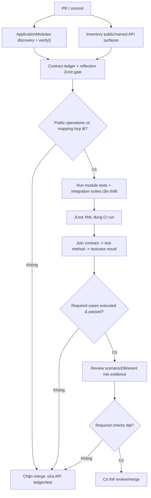

# Đo public API nào được kiểm tra

**“Module orders có test” không trả lời được “public API nào của orders đã được kiểm tra”.** Một bài `@ApplicationModuleTest` có thể chỉ gọi `PlaceOrder.place(...)`; trong khi `CancelOrder.cancel(...)`, query API hoặc named event contract vẫn chưa có bài test nào chứng minh hành vi. Vì thế cần đổi đơn vị đo: từ **application module** sang **public contract operation**, rồi truy vết từng operation tới test case và kết quả thực thi.

Đối với **SPRING_MODULITH_VERIFICATION_TESTING**, cách đo hữu ích là:

```text
ApplicationModules discovery
    -> Public module API / named interfaces
    -> Danh sách contract operations cần bảo vệ
    -> JUnit test case thực sự assert hợp đồng đó
    -> JUnit execution results của CI run hiện tại
    -> Gap: thiếu test / chưa chạy / fail / chưa đủ negative-integrated evidence
```

Bài thuộc chương **Coverage theo module**. Trọng tâm là phương pháp trả lời chính xác câu hỏi **“Đo public API nào được kiểm tra”**, có ví dụ Java/JUnit, bảng truy vết và quality gate. Không suy luận coverage chỉ từ file tồn tại, một annotation, hay JaCoCo line coverage.

## 1. Xác định đúng đơn vị đo: API surface, operation và scenario

Một Spring Modulith application module có thể công bố nhiều phần API:

- **Public API mặc định** ở package gốc module, như `com.acme.shop.orders.PlaceOrder`.
- **Named interface** công bố có chủ đích ở package con, như `orders::events` qua `@NamedInterface("events")`.
- **Hợp đồng event/value type** được consumer sử dụng, không nhất thiết là Spring bean.
- API query, command, integration ports hoặc các type khác mà chính sách kiến trúc công bố.

Ngược lại, một class Java `public` nằm trong `orders.internal` **không tự trở thành public application-module API** chỉ vì Java compiler cho phép import nó.

### 1.1. Hai cấp độ thống kê phải tách nhau

| Cấp | Đơn vị | Ví dụ | Câu hỏi |
|---|---|---|---|
| **API surface** | Interface/record/named interface công bố | `orders.PlaceOrder`, `orders::events` | Hợp đồng này đã có bằng chứng kiểm tra chưa? |
| **API operation** | Method hoặc hành vi thuộc contract | `PlaceOrder.place(UUID,int)` | Operation cụ thể nào được test gọi/quan sát? |
| **Scenario** | Nhánh hành vi/điều kiện của operation | Place thành công; product không tồn tại; quantity không hợp lệ | Test đã bao phủ những nhánh có rủi ro nào? |

Một API operation có thể có **nhiều scenarios**. Nếu chỉ có một happy-path test, operation có thể được đánh dấu “đã có test”, nhưng **không** nên được tuyên bố “đã đủ bằng chứng”.

### 1.2. Dùng định danh operation ổn định

Với method, một định danh dễ truy vết là:

```text
<fully-qualified-public-type>#<method>(<parameter-types>)
```

Ví dụ:

```text
com.acme.shop.catalog.ProductLookup#exists(UUID)
com.acme.shop.orders.PlaceOrder#place(UUID,int)
com.acme.shop.shipping.ShippingStatus#received(UUID)
```

Với record event, bổ sung tên surface để không nhầm với implementation:

```text
surface = orders::events
contract = com.acme.shop.orders.events.OrderSubmitted
observable fields = orderId(), productId(), quantity()
```

Các method overload cần phân biệt bằng parameter types; không gom tất cả `place(...)` vào một ô khi behavior khác nhau. Với REST endpoint hoặc message consumer, có thể dùng route/method, message type/version, hoặc use-case ID thay cho chữ ký Java, **miễn là định danh truy vết ổn định và có owner**.

### 1.3. Không lấy số phương thức Java bất kỳ làm mẫu số

Không tính vào public API coverage:

- Private/package-private implementation.
- `internal` package chưa được công bố.
- Getter/setter của persistence entity nội bộ.
- Methods kế thừa `Object` như `toString()` nếu chúng không là hợp đồng cần test riêng.
- Compiler-generated, bridge, synthetic methods không mang contract nghiệp vụ.
- Test-only fixture hoặc fake.

Ngược lại, một public contract **không phải Spring bean** vẫn cần xét: `OrderSubmitted` có thể là record, nhưng thay đổi field của event gây lỗi consumer.

**Quy tắc:** Mẫu số là **các operation thuộc public module contract được chọn theo kiến trúc**, không phải mọi method có Java `public` modifier.

## 2. Kiểm kê public API từ mô hình module và contract ledger

Bắt đầu bằng `ApplicationModules` để biết đúng module nào tồn tại. Sau đó lập **contract ledger** gồm public root interfaces, named interfaces và operation/scenario tương ứng.

### 2.1. Xác minh danh sách module trước khi đếm API

Với ứng dụng có `catalog`, `orders`, `shipping`, đặt `ShopApplication` ở root `com.acme.shop`. Một test kiến trúc:

```java
package com.acme.shop;

import static org.assertj.core.api.Assertions.assertThat;

import org.junit.jupiter.api.Test;
import org.springframework.modulith.core.ApplicationModules;

class ModuleDiscoveryTests {

    @Test
    void discoversTheModulesWhoseApisWeMeasure() {
        ApplicationModules modules =
            ApplicationModules.of(ShopApplication.class);

        assertThat(modules.getModuleByName("catalog")).isPresent();
        assertThat(modules.getModuleByName("orders")).isPresent();
        assertThat(modules.getModuleByName("shipping")).isPresent();
    }
}
```

Đây là **guard kiểm phạm vi**, không phải bản kiểm kê tự động tất cả public methods. Nếu có module `billing` được thêm mới, quy trình coverage phải xem xét surface mới của billing thay vì chỉ đo ba tên đã biết.

### 2.2. Contract ledger mẫu

| Surface | Public type | Operation/contract | Owner | Bằng chứng tối thiểu |
|---|---|---|---|---|
| `catalog` | `ProductLookup` | `exists(UUID)` | catalog | Hợp lệ và không tồn tại |
| `orders` | `PlaceOrder` | `place(UUID,int)` | orders | Thành công, input sai, product không tồn tại |
| `orders::events` | `OrderSubmitted` | `orderId()` | orders | Producer assert ID; consumer dùng ID |
| `orders::events` | `OrderSubmitted` | `productId()` | orders | Producer assert dữ liệu sản phẩm |
| `orders::events` | `OrderSubmitted` | `quantity()` | orders | Producer assert số lượng; contract evolution |
| `shipping` | `ShippingStatus` | `received(UUID)` | shipping | Consumer nhận đúng ID |

Ledger này **tập trung vào public contract**. Nếu public API `orders.CancelOrder` xuất hiện, phải **thêm surface/operation và bằng chứng**, không được để ledger cũ giữ báo cáo 100%.

### 2.3. Named interface khác Java package visibility

File `orders/events/package-info.java`:

```java
@org.springframework.modulith.NamedInterface("events")
package com.acme.shop.orders.events;
```

File `shipping/package-info.java`:

```java
@org.springframework.modulith.ApplicationModule(
    allowedDependencies = "orders::events"
)
package com.acme.shop.shipping;
```

`shipping` được phép tham chiếu event contract theo cấu hình minh họa, **không** được dùng `orders.internal.DefaultPlaceOrder`. Khi lập ledger, không mở mọi class thuộc `orders` như một API shipping dùng được.

### 2.4. Tránh lỗi “ledger tự định nghĩa thế giới”

Một manifest thủ công dễ bảo trì, nhưng **không thể tự chứng minh đã liệt kê mọi public type mới**. Nên có hai lớp:

1. **Module discovery + architecture verification** xác nhận các module và dependency policy.
2. **API inventory review/automation** phát hiện public root/named-interface types mới, và so sánh operations công bố với ledger.

Có thể dùng Spring Modulith model và/hoặc ArchUnit để xác định surface tùy phiên bản/cấu hình. Nếu chưa có bộ liệt kê toàn surface, ghi rõ **“ledger bao phủ các public types đã đăng ký”**; không tuyên bố hoàn chỉnh chỉ vì mọi dòng ledger có test.

## 3. Đo theo contract/scenario thay vì chỉ đếm test methods

Một operation `PlaceOrder.place(UUID,int)` có thể có những yêu cầu khác nhau:

| Scenario ID | Operation | Preconditions | Assertion bắt buộc |
|---|---|---|---|
| ORD-PLACE-01 | `place(...)` | Product tồn tại, quantity dương | Trả order ID và publish đúng `OrderSubmitted` |
| ORD-PLACE-02 | `place(...)` | Product không tồn tại | Ném lỗi nghiệp vụ, **không publish event** |
| ORD-PLACE-03 | `place(...)` | Quantity bằng 0 | Reject trước khi gọi catalog; không publish |
| EVT-001 | `OrderSubmitted` | Producer thành công | `orderId`, `productId`, `quantity` đúng |
| EVT-002 | `OrderSubmitted` | Consumer nhận event | Shipping xử lý đúng `orderId` |
| SHIP-Q-01 | `received(UUID)` | Đã nhận event | Query trả true cho order tương ứng |

Một JUnit method có thể kiểm nhiều operations/scenarios, nhưng khi báo cáo phải ghi **operation ID và scenario ID nào được assert**. Mười tests gọi cùng happy path vẫn không thay thế một negative-path test.

### 3.1. Bốn trạng thái bằng chứng nên hiển thị

| Trạng thái | Câu hỏi | Nguồn chứng cứ |
|---|---|---|
| **Mapped** | Contract có được liên kết với test case được chỉ định? | Ledger/truy vết |
| **Executed** | Test case đó có thực sự chạy trong CI run hiện tại? | JUnit execution report |
| **Passed** | Testcase chạy đạt, không fail/error/skip trái chính sách? | JUnit result |
| **Qualified** | Assertion có chứng minh đúng nghĩa của contract và đủ scenario rủi ro? | Review test + integration evidence |

Một operation có thể **Mapped=yes, Executed=no** nếu test bị exclude. Có thể **Passed=yes, Qualified=no** khi test chỉ gọi method rồi assert “not null” nhưng contract quan trọng là giao dịch commit hoặc event được xử lý.

### 3.2. Đo public API không đồng nghĩa JaCoCo

JaCoCo line/branch coverage hữu ích để thấy code chạy qua những nhánh nào. Nhưng:

- Method public có line coverage 100% vẫn có thể chưa assert side effect/hợp đồng đúng.
- Một method do mock thay thế có thể làm test xanh mà implementation thật không chạy.
- Event record accessors có thể được gọi nhiều lần nhưng không chứng minh tương thích consumer.
- `@ApplicationModuleTest` đã pass không bảo đảm mọi public operation của module đều được gọi.

**Không cộng JaCoCo và public API coverage thành một tỷ lệ duy nhất.** Nên hiển thị cạnh nhau: operation mapping, execution pass, scenario/risk evidence, line/branch coverage.

## 4. Ví dụ nhất quán: bốn public contracts của ba module

Để có code kiểm chứng, ta dựng một application mẫu. Phần implementation dùng in-memory state và synchronous event listener, nên **không** tuyên bố đã kiểm database commit.

### 4.1. Package root và module dependencies

File `com/acme/shop/ShopApplication.java`:

```java
package com.acme.shop;

import org.springframework.boot.SpringApplication;
import org.springframework.boot.autoconfigure.SpringBootApplication;

@SpringBootApplication
public class ShopApplication {

    public static void main(String[] args) {
        SpringApplication.run(ShopApplication.class, args);
    }
}
```

File `orders/package-info.java`:

```java
@org.springframework.modulith.ApplicationModule(
    allowedDependencies = "catalog"
)
package com.acme.shop.orders;
```

File `orders/events/package-info.java` là `@NamedInterface("events")` như mục 2, và `shipping/package-info.java` giới hạn dependency vào `orders::events`.

### 4.2. Catalog public API và adapter demo

File `catalog/ProductLookup.java`:

```java
package com.acme.shop.catalog;

import java.util.UUID;

public interface ProductLookup {
    boolean exists(UUID productId);
}
```

File `catalog/internal/DemoProductLookup.java`:

```java
package com.acme.shop.catalog.internal;

import com.acme.shop.catalog.ProductLookup;
import java.util.UUID;
import org.springframework.stereotype.Component;

@Component
class DemoProductLookup implements ProductLookup {

    private static final UUID KNOWN = UUID.fromString(
        "00000000-0000-0000-0000-000000000001"
    );

    @Override
    public boolean exists(UUID productId) {
        return KNOWN.equals(productId);
    }
}
```

Adapter này là **production component của ứng dụng demo**, không phải database provider thật. Nó tồn tại để minh họa `catalog.ProductLookup#exists(UUID)` có behavior kiểm được.

### 4.3. Orders public use case và event contract

File `orders/PlaceOrder.java`:

```java
package com.acme.shop.orders;

import java.util.UUID;

public interface PlaceOrder {
    UUID place(UUID productId, int quantity);
}
```

File `orders/events/OrderSubmitted.java`:

```java
package com.acme.shop.orders.events;

import java.util.UUID;

public record OrderSubmitted(
    UUID orderId,
    UUID productId,
    int quantity
) {}
```

File `orders/internal/DefaultPlaceOrder.java`:

```java
package com.acme.shop.orders.internal;

import com.acme.shop.catalog.ProductLookup;
import com.acme.shop.orders.PlaceOrder;
import com.acme.shop.orders.events.OrderSubmitted;
import java.util.UUID;
import org.springframework.context.ApplicationEventPublisher;
import org.springframework.stereotype.Service;

@Service
class DefaultPlaceOrder implements PlaceOrder {

    private final ProductLookup products;
    private final ApplicationEventPublisher events;

    DefaultPlaceOrder(
            ProductLookup products,
            ApplicationEventPublisher events) {
        this.products = products;
        this.events = events;
    }

    @Override
    public UUID place(UUID productId, int quantity) {
        if (productId == null || quantity <= 0) {
            throw new IllegalArgumentException("Invalid order item");
        }

        if (!products.exists(productId)) {
            throw new IllegalArgumentException("Unknown product");
        }

        UUID orderId = UUID.randomUUID();
        events.publishEvent(
            new OrderSubmitted(orderId, productId, quantity)
        );
        return orderId;
    }
}
```

`DefaultPlaceOrder` nằm trong package internal và là class package-private. Nó chỉ dùng `catalog.ProductLookup` public API, không import adapter nội bộ catalog.

### 4.4. Shipping public query và consumer

File `shipping/ShippingStatus.java`:

```java
package com.acme.shop.shipping;

import java.util.UUID;

public interface ShippingStatus {
    boolean received(UUID orderId);
}
```

File `shipping/internal/ShippingProjection.java`:

```java
package com.acme.shop.shipping.internal;

import com.acme.shop.shipping.ShippingStatus;
import java.util.Set;
import java.util.UUID;
import java.util.concurrent.ConcurrentHashMap;
import org.springframework.stereotype.Component;

@Component
class ShippingProjection implements ShippingStatus {

    private final Set<UUID> receivedOrderIds =
        ConcurrentHashMap.newKeySet();

    void record(UUID orderId) {
        receivedOrderIds.add(orderId);
    }

    @Override
    public boolean received(UUID orderId) {
        return receivedOrderIds.contains(orderId);
    }
}
```

File `shipping/internal/OnOrderSubmitted.java`:

```java
package com.acme.shop.shipping.internal;

import com.acme.shop.orders.events.OrderSubmitted;
import org.springframework.context.event.EventListener;
import org.springframework.stereotype.Component;

@Component
class OnOrderSubmitted {

    private final ShippingProjection projection;

    OnOrderSubmitted(ShippingProjection projection) {
        this.projection = projection;
    }

    @EventListener
    void on(OrderSubmitted event) {
        projection.record(event.orderId());
    }
}
```

**Ranh giới:** shipping phụ thuộc **event API** của orders; orders không inject bean shipping. Test producer và consumer phải đo hai hợp đồng khác nhau.

## 5. JUnit tests tạo bằng chứng cho từng public operation

Tất cả test class dưới đây có `@ApplicationModuleTest` và đặt ở package gốc module được kiểm. Để đo **Qualified**, chúng có assertions về kết quả, lỗi và event, không chỉ `contextLoads()`.

### 5.1. Catalog: operation exists(UUID)

```java
package com.acme.shop.catalog;

import static org.assertj.core.api.Assertions.assertThat;

import java.util.UUID;
import org.junit.jupiter.api.Test;
import org.springframework.beans.factory.annotation.Autowired;
import org.springframework.modulith.test.ApplicationModuleTest;

@ApplicationModuleTest
class CatalogModuleTests {

    @Autowired ProductLookup products;

    @Test
    void findsKnownProduct() {
        UUID known = UUID.fromString(
            "00000000-0000-0000-0000-000000000001"
        );
        assertThat(products.exists(known)).isTrue();
    }

    @Test
    void rejectsMissingProduct() {
        assertThat(products.exists(UUID.randomUUID())).isFalse();
    }
}
```

Hai test methods cùng map tới **một operation** `ProductLookup#exists(UUID)`, nhưng bảo vệ hai scenarios khác nhau. Nếu công thức coverage chỉ đếm methods có test, numerator vẫn tăng **một operation**, không phải hai.

### 5.2. Orders: operation place(UUID,int) và event accessors

```java
package com.acme.shop.orders;

import static org.assertj.core.api.Assertions.assertThat;
import static org.assertj.core.api.Assertions.assertThatThrownBy;
import static org.mockito.Mockito.verify;
import static org.mockito.Mockito.verifyNoInteractions;
import static org.mockito.Mockito.when;

import com.acme.shop.catalog.ProductLookup;
import com.acme.shop.orders.events.OrderSubmitted;
import java.util.UUID;
import org.junit.jupiter.api.Test;
import org.springframework.beans.factory.annotation.Autowired;
import org.springframework.modulith.test.ApplicationModuleTest;
import org.springframework.modulith.test.PublishedEvents;
import org.springframework.test.context.bean.override.mockito.MockitoBean;

@ApplicationModuleTest
class OrdersModuleTests {

    @Autowired PlaceOrder orders;

    @MockitoBean ProductLookup products;

    @Test
    void publishesSubmittedEvent(PublishedEvents events) {
        UUID productId = UUID.randomUUID();
        when(products.exists(productId)).thenReturn(true);

        UUID orderId = orders.place(productId, 2);

        assertThat(events.ofType(OrderSubmitted.class))
            .singleElement()
            .satisfies(event -> {
                assertThat(event.orderId()).isEqualTo(orderId);
                assertThat(event.productId()).isEqualTo(productId);
                assertThat(event.quantity()).isEqualTo(2);
            });
        verify(products).exists(productId);
    }

    @Test
    void rejectsUnknownProduct(PublishedEvents events) {
        UUID productId = UUID.randomUUID();
        when(products.exists(productId)).thenReturn(false);

        assertThatThrownBy(() -> orders.place(productId, 2))
            .isInstanceOf(IllegalArgumentException.class)
            .hasMessage("Unknown product");

        assertThat(events.ofType(OrderSubmitted.class)).isEmpty();
        verify(products).exists(productId);
    }

    @Test
    void rejectsBadQuantity(PublishedEvents events) {
        assertThatThrownBy(() ->
            orders.place(UUID.randomUUID(), 0)
        ).isInstanceOf(IllegalArgumentException.class)
         .hasMessage("Invalid order item");

        verifyNoInteractions(products);
        assertThat(events.ofType(OrderSubmitted.class)).isEmpty();
    }
}
```

`@MockitoBean` cung cấp Spring bean mock cho `ProductLookup` ngoài module khi chạy `@ApplicationModuleTest` STANDALONE. Import hiển thị dành cho Spring Framework 6.2+; với một số tổ hợp Spring Boot cũ cần `@MockBean` tương ứng. Không dùng `@Mock` thuần nếu Spring cần inject bean.

**Những điều được chứng minh:**

- Public operation `place(...)` được gọi trên bean thật của orders.
- Success path publish đúng một event với payload được assert.
- Unknown product và bad quantity không publish event.
- Bad quantity không gọi catalog collaborator.

**Chưa được chứng minh:** catalog database adapter thật, transaction commit, shipping consumer xử lý hay asynchronous delivery. Những điều này không nên được tự động đánh dấu covered chỉ từ `PublishedEvents`.

### 5.3. Shipping: operation received(UUID) và consumer contract

```java
package com.acme.shop.shipping;

import static org.assertj.core.api.Assertions.assertThat;

import com.acme.shop.orders.events.OrderSubmitted;
import java.util.UUID;
import org.junit.jupiter.api.Test;
import org.springframework.beans.factory.annotation.Autowired;
import org.springframework.context.ApplicationEventPublisher;
import org.springframework.modulith.test.ApplicationModuleTest;

@ApplicationModuleTest
class ShippingModuleTests {

    @Autowired ApplicationEventPublisher publisher;
    @Autowired ShippingStatus status;

    @Test
    void handlesSubmittedEvent() {
        UUID orderId = UUID.randomUUID();

        assertThat(status.received(orderId)).isFalse();

        publisher.publishEvent(new OrderSubmitted(
            orderId, UUID.randomUUID(), 2
        ));

        assertThat(status.received(orderId)).isTrue();
    }
}
```

Test shipping chỉ import `orders.events.OrderSubmitted` từ named interface. Với `@EventListener` đồng bộ mặc định và projection in-memory, nó kiểm tra **consumer effect**; không cần gọi `orders.internal.DefaultPlaceOrder`.

### 5.4. Cách đọc bằng chứng theo public API

| Public operation | Test case hiện diện | Điều thực sự assert | Chưa có bằng chứng |
|---|---|---|---|
| `ProductLookup.exists` | `findsKnownProduct`, `rejectsMissingProduct` | True/false cho ID | DB lookup thật |
| `PlaceOrder.place` | `publishesSubmittedEvent` + 2 negative tests | Kết quả, validation, no-event on failure | Order persistence/commit |
| `OrderSubmitted.orderId` | `publishesSubmittedEvent`; consumer `handlesSubmittedEvent` | ID producer và consumer | Delivery sau commit |
| `OrderSubmitted.productId` | `publishesSubmittedEvent` | Product ID giữ nguyên | Serialization/version compatibility |
| `OrderSubmitted.quantity` | `publishesSubmittedEvent` | Quantity đúng | Consumer phản ứng với quantity khác |
| `ShippingStatus.received` | `handlesSubmittedEvent` | False trước, true sau publish | Shipment database |

Một test có thể cung cấp bằng chứng cho **nhiều operations** nếu assertions xác minh chúng thật sự. Nhưng không được nhân tỷ lệ coverage theo số assertions hoặc số test methods.

## 6. Java/JUnit contract inventory gate: mapping phải tồn tại và không thiếu operation mới

**Mục đích:** phát hiện public operation đã đăng ký nhưng không có test mapping, method bị đổi signature, test class/method mất hoặc package test không đúng owner. Một gate tĩnh có thể kiểm tra những điểm này mà **không cần chạy lại chính các test methods được trỏ tới**.

Giới hạn quan trọng: gate chỉ bảo đảm **mapping có cấu trúc hợp lệ**. Nó không tự chạy test, không đọc nội dung assertions và không chứng minh toàn bộ public types mới đã được phát hiện. Bằng chứng chạy thực nằm ở mục 7.

### 6.1. Contract manifest kiểm tra bằng reflection

File `src/test/java/com/acme/shop/PublicApiCoverageInventoryTests.java`:

```java
package com.acme.shop;

import static org.assertj.core.api.Assertions.assertThat;

import com.acme.shop.catalog.ProductLookup;
import com.acme.shop.orders.PlaceOrder;
import com.acme.shop.orders.events.OrderSubmitted;
import com.acme.shop.shipping.ShippingStatus;
import java.lang.reflect.Method;
import java.lang.reflect.Modifier;
import java.util.Arrays;
import java.util.List;
import java.util.Set;
import java.util.stream.Collectors;
import org.junit.jupiter.api.Test;
import org.springframework.modulith.core.ApplicationModules;
import org.springframework.modulith.test.ApplicationModuleTest;
import org.springframework.modulith.test.PublishedEvents;

class PublicApiCoverageInventoryTests {

    private record Evidence(
        String ownerModule,
        String surface,
        Class<?> apiType,
        String operation,
        List<Class<?>> apiArgs,
        String testModule,
        String testClass,
        String testMethod,
        List<Class<?>> testArgs
    ) {
        String operationId() {
            return signature(apiType, operation, apiArgs);
        }
    }

    private static final List<Evidence> EVIDENCE = List.of(
        new Evidence(
            "catalog", "catalog",
            ProductLookup.class, "exists", List.of(java.util.UUID.class),
            "catalog", "com.acme.shop.catalog.CatalogModuleTests",
            "findsKnownProduct", List.of()
        ),
        new Evidence(
            "orders", "orders",
            PlaceOrder.class, "place",
            List.of(java.util.UUID.class, int.class),
            "orders", "com.acme.shop.orders.OrdersModuleTests",
            "publishesSubmittedEvent", List.of(PublishedEvents.class)
        ),
        new Evidence(
            "orders", "orders::events",
            OrderSubmitted.class, "orderId", List.of(),
            "orders", "com.acme.shop.orders.OrdersModuleTests",
            "publishesSubmittedEvent", List.of(PublishedEvents.class)
        ),
        new Evidence(
            "orders", "orders::events",
            OrderSubmitted.class, "productId", List.of(),
            "orders", "com.acme.shop.orders.OrdersModuleTests",
            "publishesSubmittedEvent", List.of(PublishedEvents.class)
        ),
        new Evidence(
            "orders", "orders::events",
            OrderSubmitted.class, "quantity", List.of(),
            "orders", "com.acme.shop.orders.OrdersModuleTests",
            "publishesSubmittedEvent", List.of(PublishedEvents.class)
        ),
        new Evidence(
            "shipping", "shipping",
            ShippingStatus.class, "received",
            List.of(java.util.UUID.class),
            "shipping", "com.acme.shop.shipping.ShippingModuleTests",
            "handlesSubmittedEvent", List.of()
        )
    );

    private static String signature(
            Class<?> type,
            String operation,
            List<Class<?>> parameters) {

        String args = parameters.stream()
            .map(Class::getSimpleName)
            .collect(Collectors.joining(","));

        return type.getName() + "#" + operation + "(" + args + ")";
    }

    @Test
    void everyDeclaredContractHasResolvableTestMapping()
            throws Exception {

        ApplicationModules modules =
            ApplicationModules.of(ShopApplication.class);

        for (Evidence row : EVIDENCE) {
            assertThat(modules.getModuleByName(row.ownerModule()))
                .as("Module owner: %s", row.ownerModule())
                .isPresent();

            assertThat(modules.getModuleByName(row.testModule()))
                .as("Module đang kiểm thử: %s", row.testModule())
                .isPresent();

            // Trong app minh họa chỉ có named interface orders::events.
            String expectedPackage =
                row.surface().equals("orders::events")
                    ? "com.acme.shop.orders.events"
                    : "com.acme.shop." + row.ownerModule();

            assertThat(row.apiType().getPackageName())
                .isEqualTo(expectedPackage);

            assertThat(Modifier.isPublic(
                row.apiType().getModifiers())).isTrue();

            Method operation = row.apiType().getMethod(
                row.operation(),
                row.apiArgs().toArray(Class<?>[]::new)
            );

            assertThat(Modifier.isPublic(
                operation.getModifiers())).isTrue();

            Class<?> testClass = Class.forName(
                row.testClass(),
                false,
                getClass().getClassLoader()
            );

            assertThat(testClass.getPackageName())
                .isEqualTo("com.acme.shop." + row.testModule());

            assertThat(testClass.isAnnotationPresent(
                ApplicationModuleTest.class)).isTrue();

            Method testMethod = testClass.getDeclaredMethod(
                row.testMethod(),
                row.testArgs().toArray(Class<?>[]::new)
            );

            assertThat(testMethod.isAnnotationPresent(Test.class))
                .as("Evidence cần @Test: %s#%s",
                    row.testClass(), row.testMethod())
                .isTrue();
        }
    }

    @Test
    void allPublicOperationsOfTrackedTypesAppearInTheLedger() {
        // Không tự phát hiện mọi public TYPE mới trong project.
        // Chỉ kiểm đủ methods thuộc bốn public types đã đưa vào registry.
        List<Class<?>> trackedTypes = List.of(
            ProductLookup.class,
            PlaceOrder.class,
            OrderSubmitted.class,
            ShippingStatus.class
        );

        for (Class<?> type : trackedTypes) {
            Set<String> declared = Arrays.stream(type.getDeclaredMethods())
                .filter(method -> Modifier.isPublic(
                    method.getModifiers()))
                .filter(method ->
                    !method.isSynthetic() && !method.isBridge())
                .filter(method -> !type.isRecord()
                    || !Set.of("equals", "hashCode", "toString")
                        .contains(method.getName()))
                .map(method -> signature(
                    type,
                    method.getName(),
                    Arrays.asList(method.getParameterTypes())
                ))
                .collect(Collectors.toSet());

            Set<String> mapped = EVIDENCE.stream()
                .filter(row -> row.apiType().equals(type))
                .map(Evidence::operationId)
                .collect(Collectors.toSet());

            assertThat(mapped)
                .as("Public operations của %s", type.getName())
                .containsExactlyInAnyOrderElementsOf(declared);
        }
    }
}
```

### 6.2. Phạm vi bảo đảm thực tế của gate

- Nếu đổi `PlaceOrder.place(UUID,int)` sang signature khác mà chưa cập nhật ledger, phép tra cứu method sẽ lỗi.
- Nếu đổi tên `OrdersModuleTests.publishesSubmittedEvent`, reflection không tìm ra test method.
- Nếu test class bị dời sang package không khớp convention, gate sẽ báo.
- Nếu thêm public method vào **một trong bốn type đã tracked** nhưng không thêm ledger, phép đối chiếu declared/mapped operations sẽ báo.
- Nếu thêm một **public type mới** dưới package API của orders mà chưa khai báo vào `trackedTypes`, gate **có thể không biết**. Muốn đảm bảo toàn bộ API surface, cần một lớp inventory/discovery theo public package + named interfaces và phép review danh sách types.
- Vì code chỉ nhận `@Test` trực tiếp, `@ParameterizedTest`, `@TestFactory` hoặc meta-annotations cần được mở rộng policy và cách xác thực; không được lặng lẽ coi chúng là thiếu test.

### 6.3. Không dùng reflection thành “đường tắt kiến trúc”

Reflection trong gate này chỉ **kiểm metadata của các API/test types đã khai báo**. Nó không thực thi production implementation nội bộ của module khác. Test behavior vẫn đi qua `@ApplicationModuleTest` với public API. Đừng dùng reflection để gọi `orders.internal.*` từ shipping test nhằm nâng coverage.

## 7. Bằng chứng thực thi: nối API ledger với JUnit report của CI

Gate mục 6 chỉ nói **“operation A được trỏ tới test method T tồn tại”**. Để nói **“operation A đã được kiểm tra trong revision này”**, phải đối chiếu test method T với kết quả **thực sự chạy**.

### 7.1. Những nguồn dữ liệu cần giữ

- Contract ledger: `operation ID → test class/method → scenario IDs`.
- Test execution report của **CI run hiện tại**.
- Build commit SHA/revision.
- Test task/profile và filters/exclusions.
- Số tests executed/passed/failed/skipped.
- Khi cần, integration test report và environment (DB/container/event mode).

Các đường dẫn JUnit XML thường gặp:

```text
Maven Surefire: target/surefire-reports/TEST-*.xml
Maven Failsafe: target/failsafe-reports/TEST-*.xml
Gradle Test:    build/test-results/test/TEST-*.xml
Gradle custom integrationTest:
                build/test-results/integrationTest/TEST-*.xml
```

Chúng là convention, không phải file bắt buộc tồn tại nếu build cấu hình khác.

### 7.2. Ví dụ XML và join key

```xml
<testsuite tests="3" failures="0" errors="0" skipped="0">
  <testcase
      classname="com.acme.shop.orders.OrdersModuleTests"
      name="publishesSubmittedEvent"/>
  <testcase
      classname="com.acme.shop.orders.OrdersModuleTests"
      name="rejectsUnknownProduct"/>
  <testcase
      classname="com.acme.shop.orders.OrdersModuleTests"
      name="rejectsBadQuantity"/>
</testsuite>
```

Đối chiếu được:

```text
public API: orders.PlaceOrder#place(UUID,int)
    -> com.acme.shop.orders.OrdersModuleTests#publishesSubmittedEvent
    -> XML testcase present, non-skipped, no failure/error
    -> Executed=YES, Passed=YES

event API: orders::events.OrderSubmitted#quantity()
    -> cùng JUnit testcase
    -> test source có assertion quantity đúng
    -> qualified status tùy checklist, không chỉ XML
```

Với JUnit Jupiter parameterized/dynamic tests, XML `name` có thể chứa invocation display name hoặc format theo test engine. Cách tương quan cần được **thử trên reports thực tế**; nếu tổ chức cần ID ổn định, có thể tạo mapping dựa trên JUnit Platform test identifiers hoặc naming/annotation convention có kiểm soát. Không gán bừa testcase có tên gần giống vào một contract.

### 7.3. Thuật toán report verification

```text
contracts = public API operation inventory
evidence = contract -> required test case(s), scenario IDs
reports = JUnit XML from the CURRENT commit/run

for each contract:
    requiredCases = evidence[contract]

    if requiredCases empty:
        status = UNMAPPED
        continue

    caseResults = join(requiredCases, reports)

    if any required case missing:
        status = NOT_EXECUTED
    else if any required case skipped:
        status = SKIPPED
    else if any required case failure/error:
        status = FAILED
    else:
        status = PASSED

    qualified = review of assertions + risk scenarios;
    qualified must not be inferred from PASSED alone

fail merge if a REQUIRED contract is:
    UNMAPPED, NOT_EXECUTED, SKIPPED, FAILED,
    or missing required qualified scenarios
```

Đây là pseudocode cho CI report verifier, **không phải một script đã thực thi**.

### 7.4. Những lỗi đo cần chống

- Dùng XML từ build cũ hoặc workspace không clean.
- Chỉ đọc Surefire, trong khi module tests chạy ở một task khác.
- Không phân biệt test `@Disabled`/excluded với test pass.
- Gắn một end-to-end test duy nhất cho mọi API operation dù không assert từng contract.
- Đếm một API operation hai lần vì hai test classes cùng map tới nó.
- Gán module test đúng package nhưng mock **subject** thay vì collaborator.
- Đánh dấu public event covered khi chỉ có producer test mà chưa xét consumer risk.
- Báo 100% dựa trên manifest nhưng không có kiểm tra API surface mới được thêm.

## 8. Tỷ lệ và ma trận kết quả: coverage có điều kiện, không phải màu xanh trang trí

Gọi:

- `C`: tập API operations **eligible** trong public contract inventory.
- `M`: operations có test mapping hợp lệ.
- `X`: operations có required testcases được thực thi trong CI run hiện tại.
- `P`: operations có required testcases chạy đạt.
- `Q`: operations có đủ assertions/scenarios quan trọng theo policy.

Khi `|C| > 0`:

\[
\text{Mapped API coverage}=\frac{|C\cap M|}{|C|}\times100\%
\]

\[
\text{Executed API coverage}=\frac{|C\cap X|}{|C|}\times100\%
\]

\[
\text{Passed API coverage}=\frac{|C\cap P|}{|C|}\times100\%
\]

Đừng định nghĩa “Qualified coverage” bằng tổng số test methods; nó là **phép đánh giá đáp ứng scenario matrix** có owner, yêu cầu và traceability. Nếu không có API operation eligible, báo **N/A**, không tự hiển thị 100%.

### 8.1. Bảng báo cáo theo API operation

| Contract ID | Mapped | Executed | Passed | Qualified | Gap |
|---|---|---|---|---|---|
| `catalog.ProductLookup#exists` | Yes | Yes | Yes | Partial | Demo in-memory, chưa DB |
| `orders.PlaceOrder#place` | Yes | Yes | Yes | Yes cho logic đơn giản | Chưa persistence/commit |
| `orders::events.OrderSubmitted#orderId` | Yes | Yes | Yes | Yes cho payload demo | Chưa after-commit delivery |
| `orders::events.OrderSubmitted#productId` | Yes | Yes | Yes | Yes cho payload demo | Chưa schema compatibility |
| `orders::events.OrderSubmitted#quantity` | Yes | Yes | Yes | Partial | Chưa consumer sử dụng quantity |
| `shipping.ShippingStatus#received` | Yes | No | No data | No | Test bị exclude khỏi CI |

Bảng là **tình huống minh họa**, không phải kết quả đã đo từ repository này. Với sáu operations trong ledger, khi shipping test không chạy, không được hiển thị “6/6 executed”. Tùy mapping bắt buộc, ít nhất `ShippingStatus#received` chưa có execution proof, và operation event `orderId` có thể thiếu consumer evidence nếu policy yêu cầu cả producer lẫn consumer.

### 8.2. Vì sao phải phân biệt public event contract?

`OrderSubmitted` là public API dù không được inject như Spring bean. Có ba mức evidence khác nhau:

| Bằng chứng | Test | Kết luận chính xác |
|---|---|---|
| **Published** | Orders `PublishedEvents` | Producer đã tạo event và payload đúng |
| **Handled** | Shipping module test | Consumer xử lý một event đầu vào |
| **Committed** | DB/transaction integration | Trạng thái đã bền vững sau commit nếu có DB |

Nếu listener chuyển sang `@ApplicationModuleListener`, `@TransactionalEventListener(AFTER_COMMIT)` hoặc async dispatch, test đồng bộ/in-memory ở mục 5 **chưa đủ**. Cần setup transaction, chờ trạng thái quan sát được và kiểm event replay/idempotency khi phù hợp.

### 8.3. Đối với DB, định nghĩa thêm integration evidence

Nếu `catalog.ProductLookup` trong production dùng PostgreSQL, có thể dùng Testcontainers để test lookup thật cùng migration/constraint. Nhưng **Testcontainers khởi động không đồng nghĩa API operation đã được kiểm tra**: phải gọi public API, assert kết quả và khi cần chứng minh transaction/commit.

Đối với `orders.PlaceOrder` có persistence thật, test cần kiểm trạng thái sau commit và nhánh rollback. Đối với `shipping` cần idempotency, một boolean `received(orderId)` không chứng minh không có hai side effects; phải đếm record/tác dụng cuối và xem unique constraint/concurrency.

Giữ những bằng chứng này trong **cột integration** thay vì gán hết vào “public API đã có test”.

## 9. CI quality gate và phép thử âm tính cho báo cáo public API

Mục tiêu của gate là **fail khi một hợp đồng công khai bị thêm, đổi hoặc mất bằng chứng**. Một quy trình thực tế:



### 9.1. Các phép kiểm tra độc lập

**Architecture verification:**

```java
package com.acme.shop;

import org.junit.jupiter.api.Test;
import org.springframework.modulith.core.ApplicationModules;

class ModuleArchitectureTests {

    @Test
    void verifiesBoundaries() {
        ApplicationModules.of(ShopApplication.class).verify();
    }
}
```

Nó bảo vệ dependency graph và boundary rules, **không** bảo đảm mọi public method có test.

**API inventory gate:** `PublicApiCoverageInventoryTests` kiểm method signatures, test class/method mapping và hiện diện annotation.

**Execution gate:** bộ đối chiếu JUnit XML để chứng minh test methods trong ledger thực sự chạy/đạt.

**Behavior/risk gate:** các module tests và integration tests kiểm public behavior, event, transaction hoặc database ở mức cần thiết.

### 9.2. Lệnh build minh họa

```bash
# Maven; CI phải đảm bảo các plugin/profile liên quan được kích hoạt.
./mvnw -B clean verify

# Gradle; nếu có custom integrationTest task thì gọi thêm task đó.
./gradlew clean test
```

Không tự kết luận Maven `verify` hay Gradle `test` luôn chạy tất cả integration suites. Report verifier cần biết chính xác các test tasks/profiles bắt buộc của dự án, và source revision/commit mà mỗi artifact thuộc về.

### 9.3. Thử âm tính cho coverage gate

Trên nhánh thử nghiệm, mỗi lỗi cần làm **đúng gate** báo đỏ:

1. **Đổi signature** `PlaceOrder.place(UUID,int)` nhưng chưa cập nhật ledger → reflection gate lỗi.
2. **Thêm public operation** `PlaceOrder.cancel(UUID)` vào type đã tracked mà chưa có ledger row → declared-operation gate lỗi.
3. **Thêm public API type mới** `orders.CancelOrder` → API surface inventory/review gate phải phát hiện; reflection với bốn tracked types chưa đủ.
4. **Đổi tên test method** `publishesSubmittedEvent` → evidence mapping lỗi.
5. **Gắn `@Disabled`** vào `ShippingModuleTests` → report/execution gate báo skipped/not executed, dù ledger còn đó.
6. **Sửa payload quantity sai** trong `DefaultPlaceOrder` → `PublishedEvents` test đỏ.
7. **Bỏ `OnOrderSubmitted` listener** → shipping consumer test đỏ.
8. **Cho orders dùng `catalog.internal`** → `ApplicationModules.verify()` đỏ.
9. **Làm duplicate event tạo hai DB rows** ở ứng dụng có persistence → DB/idempotency integration gate đỏ.

Sau từng thử nghiệm, khôi phục mã hợp lệ và xác nhận **toàn bộ required checks PASS trên commit cần merge**. Không giữ vi phạm cố ý trong nhánh chính.

### 9.4. Những metadata cần xuất cùng tỷ lệ

- Commit SHA, CI run ID và thời điểm chạy.
- Version Spring Boot/Spring Modulith/JUnit và build task/profile.
- Application modules và named interfaces đã được phát hiện.
- Public operations eligible và ngoại lệ có lý do/owner.
- Mapping `operation ID → JUnit test class/method → scenario ID`.
- Executed/passed/failed/skipped/missing evidence theo operation.
- Mức qualified và coverage gaps chưa xử lý.
- Trạng thái `ApplicationModules.verify()`, event/DB integration khi áp dụng.

Chỉ số coverage **không gắn với revision hoặc artifact cụ thể** không đủ để làm quality gate.

## 10. Checklist triển khai và bài tập red–green

### 10.1. Checklist kiểm chứng từng public API

| # | Câu hỏi | Bằng chứng mong đợi |
|---|---|---|
| 1 | Đã phát hiện đúng application modules? | `ApplicationModules` discovery report |
| 2 | Public default API và named interfaces có được kiểm kê? | API surface inventory, `package-info.java` |
| 3 | Có lẫn type `internal` vào mẫu số không? | Review surface/module ownership |
| 4 | Có bỏ sót public type hoặc operation mới không? | Type/method diff + inventory gate |
| 5 | Chữ ký overload được phân biệt chưa? | Operation ID có parameter types |
| 6 | Mỗi operation eligible có test mapping? | Ledger rows |
| 7 | Test class thuộc đúng module và dùng `@ApplicationModuleTest`? | Package/annotation checks |
| 8 | Test method có tồn tại và được JUnit phát hiện? | Reflection + JUnit execution report |
| 9 | Subject là bean thật của module, không bị mock? | Test source/code review |
| 10 | Có assertion đầu ra, trạng thái hoặc event payload đúng? | Test code và assertions |
| 11 | Negative path/invalid input được kiểm khi quan trọng? | Scenario matrix |
| 12 | Public event có producer và consumer evidence riêng? | `PublishedEvents`/consumer tests |
| 13 | Test bị skip/exclude có bị đánh dấu gap? | JUnit XML của CI run |
| 14 | Cần DB/transaction/after-commit evidence riêng không? | Integration report |
| 15 | `ApplicationModules.verify()` có chạy độc lập? | Architecture gate |
| 16 | Metric có gắn commit và ngoại lệ/owner? | CI artifact/report |
| 17 | Có thử âm tính chứng minh gate báo đỏ? | Red–green log |

### 10.2. Bài tập thực hành

**Tình huống:** dự án có `catalog`, `orders` và `shipping`; nhóm báo “module test coverage 100%” vì cả ba module đều có ít nhất một test class.

**Phần A — Kiểm kê hợp đồng.** Dùng `ApplicationModules.of(ShopApplication.class)` xác nhận ba module. Liệt kê các public type ở package gốc và `orders::events`. Tạo ledger theo mẫu mục 2, đếm operation ID duy nhất thay vì số methods của test.

**Phần B — Nối tới bằng chứng.** Viết `CatalogModuleTests`, `OrdersModuleTests` và `ShippingModuleTests` ở package root tương ứng. Chỉ ra operation/scenario nào từng test method xác minh. Tách published event của orders và consumer behavior shipping.

**Phần C — Tạo inventory gate.** Dùng `PublicApiCoverageInventoryTests` để xác minh public signatures, mapping class/method và module owner. Bổ sung quy trình phát hiện **public type mới** vì reflection gate chỉ theo dõi tracked types.

**Phần D — Đo thực thi.** Chạy CI test tasks thực sự, thu JUnit XML cùng commit SHA, nối `classname/testcase` với ledger và phân biệt missing, skipped, failed, passed. Không dùng report cũ.

**Phần E — Thử âm tính.** Thêm method `PlaceOrder.cancel(UUID)` nhưng không thêm ledger → gate phải đỏ. Khôi phục rồi disable shipping test → execution gate phải đỏ. Sửa payload quantity sai → producer test đỏ. Sau đó khôi phục và chạy lại suite.

**Phần F — Kết luận chính xác.** Xuất bảng theo operation, kèm registered/mapped, executed, passed và qualified. Viết rõ còn thiếu DB/after-commit/idempotency nếu ứng dụng thực cần những bằng chứng đó. Chỉ tuyên bố “100%” với **mẫu số và loại coverage được định nghĩa rõ**.

### 10.3. Câu hỏi ôn tập

**1. Module orders có `@ApplicationModuleTest`, có thể kết luận mọi public operation của orders đã được kiểm tra không?** Không. Phải đối chiếu từng operation trong public API inventory với test cases và assertions.

**2. Java `public` class trong `orders.internal` có tự được tính là public module API không?** Không. Java visibility khác với public module API theo Spring Modulith.

**3. Tại sao một record `OrderSubmitted` cần được đo dù nó không phải Spring bean?** Vì nó là event contract công bố cho consumers; sai payload/schema có thể phá integration.

**4. Một test method assert ba event fields thì tính bao nhiêu operation?** Có thể mang bằng chứng cho ba accessors/contract obligations, nhưng phải có mapping và assertions rõ; không nhân test count để tính coverage.

**5. Reflection inventory gate chứng minh test đã chạy chưa?** Chưa. Nó chỉ chứng minh mapping và chữ ký tồn tại. Cần JUnit execution report từ CI run hiện tại.

**6. API inventory có bốn types, khi thêm public type thứ năm thì gate tự bắt được không?** Không nếu chỉ scan bốn tracked types. Phải bổ sung discovery/diff quy mô surface.

**7. `PublishedEvents` pass có chứng minh shipping đã lưu DB không?** Không. Published, handled và committed là ba lớp evidence khác nhau.

**8. Test `@Disabled` có được tính passed nếu annotation còn đó không?** Không. Mapping có thể còn nhưng execution/pass phải báo gap.

**9. JaCoCo 95% line coverage có thay được public API coverage không?** Không. Mẫu số khác, và code chạy không đồng nghĩa contract được assert.

**10. Khi nào dùng Testcontainers trong đánh giá public API?** Khi cần kiểm database, migration, constraint và trạng thái sau commit của provider thật; container sẵn sàng chưa đủ chứng minh operation đúng.

## Kết luận

Để **đo public API nào được kiểm tra**, phải có **danh sách công khai rõ ràng của application modules và named interfaces**, định danh từng operation, rồi truy vết **operation → scenario → JUnit test → kết quả thực thi hiện tại**. Một module có test, một test class được annotate hoặc một tỷ lệ JaCoCo cao đều **không thay thế** phép đối chiếu ấy.

Trong **SPRING_MODULITH_VERIFICATION_TESTING**, `ApplicationModules.verify()` bảo vệ dependency boundaries; `@ApplicationModuleTest` bảo vệ behavior của public contracts; `PublishedEvents`, consumer tests và DB/transaction integration bổ sung bằng chứng cho event/persistence. Kết hợp **API inventory gate**, **JUnit execution report verifier** và **CI quality gate** sẽ làm lộ rõ public operation bị bỏ sót, test bị skip, mapping sai hoặc hợp đồng mới chưa được kiểm chứng — thay vì báo cáo một con số “coverage 100%” không có căn cứ.
