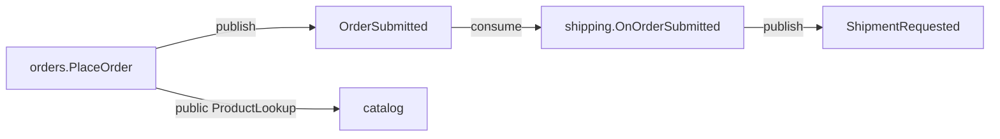
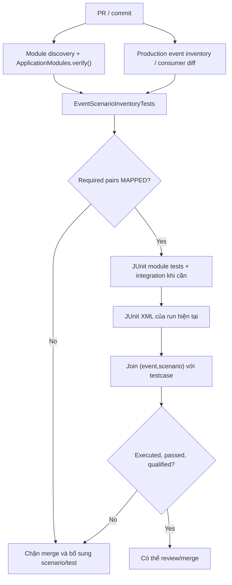

# Đo event nào có scenario tương ứng

Một ứng dụng có thể công bố hai event và có hai test `PublishedEvents`, nhưng vẫn bỏ sót những tình huống quan trọng: **không được phát event khi input sai**, **consumer chưa nhận**, **delivery lặp**, **transaction rollback** hoặc **message đã gửi nhưng side effect không commit**. Chỉ đếm số event types được một test nhắc đến không đủ để nói event coverage đã đạt.

Để trả lời câu hỏi **“Đo event nào có scenario tương ứng”**, hãy quản lý **event–scenario ledger**: kiểm kê event contract độc lập với test; xác định producer, consumer và nghĩa vụ theo điều kiện; ánh xạ từng **cặp (event, scenario ID)** đến JUnit test; rồi kiểm chứng test đó thực sự chạy và đạt trong CI hiện tại.

```text
Production event inventory + ApplicationModules
   -> (Event type, owner, producer, consumers)
   -> Required event–scenario pairs
   -> JUnit test class / method / assertions
   -> JUnit XML executed / passed / failed / skipped
   -> Gap report / CI quality gate
```

Bài thuộc chương **Coverage theo module** của **SPRING_MODULITH_VERIFICATION_TESTING**, nơi ranh giới kiến trúc được kiểm bằng `ApplicationModules`, hành vi module được kiểm bằng `@ApplicationModuleTest`, cùng sự kiện, database/tích hợp và quality gate trong CI. Nội dung đi thẳng vào cách đo **event scenario coverage**, với ví dụ Java 17+, Spring Boot, Spring Modulith Test và JUnit 5. Mã ví dụ cần được đối chiếu phiên bản dependency của dự án trước khi sử dụng.

## 1. Đo theo cặp event–scenario, không chỉ theo event type

### 1.1. Tách event presence và scenario coverage

Một `OrderSubmitted` có thể cần các scenario sau:

1. **Producer success:** đơn hợp lệ phát đúng một `OrderSubmitted`, payload đúng.
2. **Producer rejection:** dữ liệu đầu vào sai hoặc sản phẩm không có thì không phát.
3. **Consumer handling:** shipping nhận event và cập nhật kết quả quan sát được.
4. **Duplicate delivery:** cùng order được gửi lại không tạo side effect trùng.
5. **After-commit:** nếu contract yêu cầu, listener chỉ chạy sau commit.
6. **Recovery:** nếu contract cần, publication chưa hoàn tất được khôi phục/retry.

Một test happy path có thể chứng minh trường hợp 1, nhưng không mặc nhiên chứng minh năm trường hợp còn lại. Cũng không nên áp cả sáu vào mọi event: event nội bộ đồng bộ không có broker có thể không cần externalization/retry scenarios.

### 1.2. Công thức có mẫu số rõ

Đặt:

- `E`: tập event types đủ điều kiện theo chính sách.
- `R`: tập required `(event type, scenario ID)` pairs.
- `M`: tập pairs đã map vào JUnit test hợp lệ.
- `X`: tập pairs có test thực sự executed ở CI run hiện tại.
- `P`: tập pairs có required tests đạt.
- `Q`: tập pairs có đủ assertions/integration evidence theo review.

Hai loại tỷ lệ khác nhau:

\[
\operatorname{EventPresence} =
\frac{|\{e\in E\mid\exists s:(e,s)\in M\}|}{|E|}\times100\%
\]

\[
\operatorname{ScenarioPassed} =
\frac{|R\cap P|}{|R|}\times100\%
\]

Nếu mẫu số bằng 0, báo **N/A**, không hiển thị 100%.

**EventPresence = 100%** chỉ nghĩa mỗi event có ít nhất một mapping. **ScenarioPassed = 100%** mới cho biết mọi scenario bắt buộc đã có test chạy đạt; điều đó vẫn chưa tự chứng minh assertion đủ sâu.

### 1.3. Trạng thái cho từng pair

| Trạng thái | Điều đã xác minh | Có tính là hoàn thành? |
|---|---|---|
| UNMAPPED | Required scenario chưa có test mapping | Không |
| MAPPED | Có test class/method được khai báo | Chưa |
| NOT_EXECUTED | Test không có execution evidence ở run hiện tại | Không |
| SKIPPED | Test `@Disabled` hoặc bị skip | Không |
| FAILED | Test đã chạy nhưng failure/error | Không |
| PASSED | Test đã chạy đạt theo JUnit | Có bằng chứng thực thi |
| QUALIFIED | Assertion đúng nghĩa contract và môi trường đủ phù hợp | Đạt mức bằng chứng cần thiết |

**Một JUnit method có thể phục vụ hai scenario pairs**, nhưng mỗi pair phải được liên kết và có assertion riêng. Ngược lại, nhiều tests cùng gọi happy path không tự bao phủ negative path.

### 1.4. Khi một event có nhiều consumers

Ví dụ `OrderSubmitted` được shipping và notifications cùng tiêu thụ:

```text
OrderSubmitted / producer / valid order published
OrderSubmitted / producer / invalid order no event
OrderSubmitted / shipping / handling
OrderSubmitted / shipping / duplicate
OrderSubmitted / notifications / handling
OrderSubmitted / notifications / transient failure/retry
```

Nếu chỉ có shipping test, không đánh dấu notifications covered. Scenario ID phải biểu đạt **vai trò, actor và điều kiện**, không chỉ tên event.

## 2. Lập event inventory độc lập với test source

### 2.1. Vì sao không thể suy mẫu số từ @Test?

Nếu bạn chỉ tìm `PublishedEvents.ofType(...)` và event type được nhắc tới trong các tests, event **chưa có test** sẽ biến mất khỏi danh sách và tạo tỷ lệ xanh giả.

Hãy kiểm kê từ **production contract và luồng thực tế**:

- Public event records/classes trong named interfaces.
- Domain events nội bộ được publish/consume có rủi ro đáng kiểm.
- Các type trong `@EventListener` và `@TransactionalEventListener`, các listener của Spring Modulith.
- Event được externalize tới broker nếu có.
- Event mới được thêm, event/schema đã đổi giữa hai revisions.
- Consumer mới cho event hiện hữu, dù event type không đổi.

Không tự tính mọi `ContextRefreshedEvent`, lifecycle/framework events vào domain event coverage; cần policy cho eligibility.

### 2.2. Spring Modulith discovery bảo vệ phạm vi module

Trong app mẫu có `catalog`, `orders`, `shipping`, test kiểm danh sách module:

```java
package com.acme.shop;

import static org.assertj.core.api.Assertions.assertThat;

import org.junit.jupiter.api.Test;
import org.springframework.modulith.core.ApplicationModules;

class ModuleDiscoveryTests {

    @Test
    void discoversEventOwnersAndConsumers() {
        ApplicationModules modules =
            ApplicationModules.of(ShopApplication.class);

        assertThat(modules.getModuleByName("catalog")).isPresent();
        assertThat(modules.getModuleByName("orders")).isPresent();
        assertThat(modules.getModuleByName("shipping")).isPresent();
    }
}
```

Đây là **module-scope guard**, chưa phải bộ tìm tất cả event types. `ApplicationModules.verify()` xác minh dependency rules, **không** tự xác nhận rằng event đã có đủ producer/consumer scenarios.

### 2.3. Public event contract và module owner

File `orders/events/package-info.java`:

```java
@org.springframework.modulith.NamedInterface("events")
package com.acme.shop.orders.events;
```

File `shipping/package-info.java`:

```java
@org.springframework.modulith.ApplicationModule(
    allowedDependencies = "orders::events"
)
package com.acme.shop.shipping;
```

File `shipping/events/package-info.java`:

```java
@org.springframework.modulith.NamedInterface("events")
package com.acme.shop.shipping.events;
```

`shipping` chỉ được phép phụ thuộc giao diện event do orders công bố trong mô hình này. Test shipping nên dùng `orders.events.OrderSubmitted` thay vì `orders.internal.DefaultPlaceOrder`. Java `public` modifier của type internal không tự biến nó thành public module API.

### 2.4. Inventory mẫu và trách nhiệm

| Event | Owner | Producer | Consumer quan trọng | Surface |
|---|---|---|---|---|
| `OrderSubmitted` | orders | `DefaultPlaceOrder` | shipping | `orders::events` |
| `ShipmentRequested` | shipping | `OnOrderSubmitted` | Chưa có trong demo | `shipping::events` |
| `OrderCancelled` | orders | Chưa triển khai; chỉ là ví dụ thay đổi tương lai | Tùy hệ thống | Chưa thuộc app mẫu |

Event thứ ba là **ví dụ về một event mới có thể phát sinh**, không phải class đã có trong mã bài này. Khi một type mới xuất hiện, inventory phải đổi trước khi báo cáo đầy đủ.

### 2.5. Đừng tin một phép quét là đã toàn diện

Static search `publishEvent` có thể bỏ qua các publisher wrapper hoặc event được phát qua broker. Scan package `events` có thể bỏ qua internal domain events hoặc lẫn utility classes. Test report chỉ thấy các paths đã chạy.

Do đó nên kết hợp **review diff mã production**, module/named interface inventory, listeners và quy tắc yêu cầu producer–consumer scenarios. Một gate tự động chỉ có giá trị trong **phạm vi nó thật sự quan sát**.

## 3. Event–scenario ledger và điều kiện đạt

### 3.1. Luồng thực hành



Sơ đồ là **event flow/runtime**, không phải đồ thị phụ thuộc module. Về static type dependencies, `orders → catalog` và `shipping → orders::events`; orders không cần import shipping.

### 3.2. Bảy pairs bắt buộc của demo

| Scenario ID | Event | Vai trò/điều kiện | Assertion tối thiểu |
|---|---|---|---|
| OS-PUB-VALID | OrderSubmitted | Producer nhận input hợp lệ | Một event, ID/payload đúng |
| OS-NO-PUB-PRODUCT | OrderSubmitted | Product không tồn tại | Không event; thông báo lỗi |
| OS-NO-PUB-QTY | OrderSubmitted | Quantity bằng 0 | Không event; không gọi catalog |
| OS-CONSUME-SHIPPING | OrderSubmitted | Shipping nhận event | Shipping status được cập nhật |
| OS-REPLAY-SHIPPING | OrderSubmitted | Shipping nhận event lặp | Không tạo shipping request thứ hai |
| SR-PUB-HANDLED | ShipmentRequested | Consumer xử lý thành công | Một output event, order ID đúng |
| SR-NO-DUP | ShipmentRequested | Shipping xử lý lại cùng order | Chỉ một event output trong demo |

Hai event types nhưng **bảy obligations**. Đếm theo type sẽ bỏ lỡ các negative và replay branches.

### 3.3. Cấu trúc ledger dễ truy vết

```text
eventType: com.acme.shop.orders.events.OrderSubmitted
ownerModule: orders
surface: orders::events
scenarioId: OS-CONSUME-SHIPPING
actorModule: shipping
role: consumer
required: true
testClass: com.acme.shop.shipping.ShippingModuleTests
testMethod: handlesSubmittedAndRequestsShipment
assertions: shipping.received(orderId) and ShipmentRequested.orderId
```

Đây là **định dạng minh họa**, không phải file metadata cần ghi cho tác vụ hiện tại.

### 3.4. Scenario policy phải phụ thuộc rủi ro

- Event phát trong module nhưng chưa có consumer: có thể cần **producer contract** mà chưa có consumer case.
- Event được nhiều consumer xử lý: cần **consumer-specific** scenarios.
- Event gửi qua broker: thêm schema compatibility và delivery/retry scenarios.
- Event sau commit: thêm commit/rollback/async scenarios.
- Event có business side effect: thêm duplicate/idempotency nếu có at-least-once delivery.

Không thêm những test “cho đủ số lượng” nếu contract không yêu cầu. Nhưng ngoại lệ cần có lý do và owner thay vì âm thầm làm denominator nhỏ lại.

## 4. Mã production mẫu: từ OrderSubmitted đến ShipmentRequested

Ví dụ dùng Java 17+ và `@EventListener` **đồng bộ mặc định**. `ShippingProjection` chỉ lưu state trong JVM; không dùng mẫu này để tuyên bố đã kiểm commit database.

### 4.1. Cấu trúc module

```text
com.acme.shop
├── ShopApplication.java
├── catalog
│   ├── ProductLookup.java
│   └── internal/DemoProductLookup.java
├── orders
│   ├── package-info.java
│   ├── PlaceOrder.java
│   ├── events
│   │   ├── package-info.java
│   │   └── OrderSubmitted.java
│   └── internal/DefaultPlaceOrder.java
└── shipping
    ├── package-info.java
    ├── ShippingStatus.java
    ├── events
    │   ├── package-info.java
    │   └── ShipmentRequested.java
    └── internal
        ├── ShippingProjection.java
        └── OnOrderSubmitted.java
```

### 4.2. Ứng dụng và catalog contract

File `ShopApplication.java`:

```java
package com.acme.shop;

import org.springframework.boot.SpringApplication;
import org.springframework.boot.autoconfigure.SpringBootApplication;

@SpringBootApplication
public class ShopApplication {

    public static void main(String[] args) {
        SpringApplication.run(ShopApplication.class, args);
    }
}
```

File `catalog/ProductLookup.java`:

```java
package com.acme.shop.catalog;

import java.util.UUID;

public interface ProductLookup {
    boolean exists(UUID productId);
}
```

File `catalog/internal/DemoProductLookup.java`:

```java
package com.acme.shop.catalog.internal;

import com.acme.shop.catalog.ProductLookup;
import java.util.UUID;
import org.springframework.stereotype.Component;

@Component
class DemoProductLookup implements ProductLookup {

    private static final UUID KNOWN_ID = UUID.fromString(
        "00000000-0000-0000-0000-000000000001"
    );

    @Override
    public boolean exists(UUID productId) {
        return KNOWN_ID.equals(productId);
    }
}
```

Đây là provider **in-memory của ứng dụng demo**, không phải persistence integration.

### 4.3. Orders API, event payload và producer

File `orders/package-info.java`:

```java
@org.springframework.modulith.ApplicationModule(
    allowedDependencies = "catalog"
)
package com.acme.shop.orders;
```

File `orders/PlaceOrder.java`:

```java
package com.acme.shop.orders;

import java.util.UUID;

public interface PlaceOrder {
    UUID place(UUID productId, int quantity);
}
```

File `orders/events/OrderSubmitted.java`:

```java
package com.acme.shop.orders.events;

import java.util.UUID;

public record OrderSubmitted(
    UUID eventId,
    UUID orderId,
    UUID productId,
    int quantity
) {}
```

File `orders/internal/DefaultPlaceOrder.java`:

```java
package com.acme.shop.orders.internal;

import com.acme.shop.catalog.ProductLookup;
import com.acme.shop.orders.PlaceOrder;
import com.acme.shop.orders.events.OrderSubmitted;
import java.util.UUID;
import org.springframework.context.ApplicationEventPublisher;
import org.springframework.stereotype.Service;

@Service
class DefaultPlaceOrder implements PlaceOrder {

    private final ProductLookup products;
    private final ApplicationEventPublisher events;

    DefaultPlaceOrder(
            ProductLookup products,
            ApplicationEventPublisher events) {
        this.products = products;
        this.events = events;
    }

    @Override
    public UUID place(UUID productId, int quantity) {
        if (productId == null || quantity <= 0) {
            throw new IllegalArgumentException("Invalid order input");
        }
        if (!products.exists(productId)) {
            throw new IllegalArgumentException("Unknown product");
        }

        UUID orderId = UUID.randomUUID();
        events.publishEvent(new OrderSubmitted(
            UUID.randomUUID(), orderId, productId, quantity
        ));
        return orderId;
    }
}
```

Nhánh thất bại **không** publish event. Sự kiện chỉ chứng minh yêu cầu được xử lý qua validation của demo; chưa chứng minh order đã lưu hoặc commit.

### 4.4. Shipping query và event đầu ra

File `shipping/ShippingStatus.java`:

```java
package com.acme.shop.shipping;

import java.util.UUID;

public interface ShippingStatus {
    boolean received(UUID orderId);
}
```

File `shipping/events/ShipmentRequested.java`:

```java
package com.acme.shop.shipping.events;

import java.util.UUID;

public record ShipmentRequested(
    UUID requestId,
    UUID orderId
) {}
```

File `shipping/internal/ShippingProjection.java`:

```java
package com.acme.shop.shipping.internal;

import com.acme.shop.shipping.ShippingStatus;
import java.util.Set;
import java.util.UUID;
import java.util.concurrent.ConcurrentHashMap;
import org.springframework.stereotype.Component;

@Component
class ShippingProjection implements ShippingStatus {

    private final Set<UUID> orderIds =
        ConcurrentHashMap.newKeySet();

    boolean recordIfAbsent(UUID orderId) {
        return orderIds.add(orderId);
    }

    @Override
    public boolean received(UUID orderId) {
        return orderIds.contains(orderId);
    }
}
```

File `shipping/internal/OnOrderSubmitted.java`:

```java
package com.acme.shop.shipping.internal;

import com.acme.shop.orders.events.OrderSubmitted;
import com.acme.shop.shipping.events.ShipmentRequested;
import java.util.UUID;
import org.springframework.context.ApplicationEventPublisher;
import org.springframework.context.event.EventListener;
import org.springframework.stereotype.Component;

@Component
class OnOrderSubmitted {

    private final ShippingProjection projection;
    private final ApplicationEventPublisher events;

    OnOrderSubmitted(
            ShippingProjection projection,
            ApplicationEventPublisher events) {
        this.projection = projection;
        this.events = events;
    }

    @EventListener
    void on(OrderSubmitted submitted) {
        if (projection.recordIfAbsent(submitted.orderId())) {
            events.publishEvent(new ShipmentRequested(
                UUID.randomUUID(), submitted.orderId()
            ));
        }
    }
}
```

**Giới hạn:** `ConcurrentHashMap.newKeySet()` ngăn duplicate **trong cùng JVM/state**. Nếu JVM restart hoặc crash giữa `recordIfAbsent` và `publishEvent`, chưa có cơ chế đảm bảo publication bền vững. Cần test riêng với DB constraint/outbox/event publication registry và recovery khi hệ thống thật yêu cầu.

## 5. Producer module tests: kiểm cả phát và không phát event

Dùng `@ApplicationModuleTest` của module `orders`, với `ProductLookup` ngoài module được mock bằng public interface. Test producer không cần load shipping.

File `src/test/java/com/acme/shop/orders/OrdersModuleTests.java`:

```java
package com.acme.shop.orders;

import static org.assertj.core.api.Assertions.assertThat;
import static org.assertj.core.api.Assertions.assertThatThrownBy;
import static org.mockito.Mockito.verify;
import static org.mockito.Mockito.verifyNoInteractions;
import static org.mockito.Mockito.when;

import com.acme.shop.catalog.ProductLookup;
import com.acme.shop.orders.events.OrderSubmitted;
import java.util.UUID;
import org.junit.jupiter.api.Test;
import org.springframework.beans.factory.annotation.Autowired;
import org.springframework.modulith.test.ApplicationModuleTest;
import org.springframework.modulith.test.PublishedEvents;
import org.springframework.test.context.bean.override.mockito.MockitoBean;

@ApplicationModuleTest
class OrdersModuleTests {

    @Autowired PlaceOrder orders;

    @MockitoBean ProductLookup catalog;

    @Test
    void publishesSubmittedOnValidInput(PublishedEvents published) {
        UUID productId = UUID.randomUUID();
        when(catalog.exists(productId)).thenReturn(true);

        UUID orderId = orders.place(productId, 2);

        assertThat(published.ofType(OrderSubmitted.class))
            .singleElement()
            .satisfies(event -> {
                assertThat(event.eventId()).isNotNull();
                assertThat(event.orderId()).isEqualTo(orderId);
                assertThat(event.productId()).isEqualTo(productId);
                assertThat(event.quantity()).isEqualTo(2);
            });
        verify(catalog).exists(productId);
    }

    @Test
    void doesNotPublishWhenProductMissing(PublishedEvents published) {
        UUID productId = UUID.randomUUID();
        when(catalog.exists(productId)).thenReturn(false);

        assertThatThrownBy(() -> orders.place(productId, 2))
            .isInstanceOf(IllegalArgumentException.class)
            .hasMessage("Unknown product");

        assertThat(published.ofType(OrderSubmitted.class)).isEmpty();
        verify(catalog).exists(productId);
    }

    @Test
    void doesNotPublishWhenQuantityInvalid(PublishedEvents published) {
        assertThatThrownBy(() ->
            orders.place(UUID.randomUUID(), 0)
        ).isInstanceOf(IllegalArgumentException.class)
         .hasMessage("Invalid order input");

        assertThat(published.ofType(OrderSubmitted.class)).isEmpty();
        verifyNoInteractions(catalog);
    }
}
```

### 5.1. Mapping đến ledger

| Scenario ID | JUnit method | Bằng chứng |
|---|---|---|
| OS-PUB-VALID | `publishesSubmittedOnValidInput` | Event type, số lượng và bốn payload fields |
| OS-NO-PUB-PRODUCT | `doesNotPublishWhenProductMissing` | Exception và không phát event |
| OS-NO-PUB-QTY | `doesNotPublishWhenQuantityInvalid` | Exception, không gọi catalog và không phát event |

### 5.2. Kiểm đúng mức bằng chứng

`PublishedEvents` quan sát event được publish trong Spring module test context. Nó **không** tự chứng minh consumer shipping chạy, data đã commit hay broker nhận event.

`@MockitoBean` thuộc Spring Framework 6.2+. Dự án Spring Boot/Framework cũ có thể cần `@MockBean`. `@Mock` thuần Mockito không tự trở thành Spring bean cho constructor injection của `DefaultPlaceOrder`.

Mock catalog là hợp lệ vì mục tiêu ở đây là **orders producer behavior**, không phải integration với catalog implementation thật.

### 5.3. Không làm xanh giả bằng cách mock chính subject

Nếu thay `@Autowired PlaceOrder` bằng `@MockitoBean PlaceOrder` rồi stub response, test có thể chỉ khẳng định điều chính nó đã lập trình cho mock. Để tính producer scenario **QUALIFIED**, subject production của orders phải thực sự được gọi theo phạm vi test đang tuyên bố.

## 6. Consumer tests: cùng một method có thể bảo vệ hai event contracts

Module `shipping` dùng public `OrderSubmitted` từ `orders::events`. Test của shipping không cần khởi động orders producer và cũng không được đi vòng qua `orders.internal` để dựng một aggregate.

File `src/test/java/com/acme/shop/shipping/ShippingModuleTests.java`:

```java
package com.acme.shop.shipping;

import static org.assertj.core.api.Assertions.assertThat;

import com.acme.shop.orders.events.OrderSubmitted;
import com.acme.shop.shipping.events.ShipmentRequested;
import java.util.UUID;
import org.junit.jupiter.api.Test;
import org.springframework.beans.factory.annotation.Autowired;
import org.springframework.context.ApplicationEventPublisher;
import org.springframework.modulith.test.ApplicationModuleTest;
import org.springframework.modulith.test.PublishedEvents;

@ApplicationModuleTest
class ShippingModuleTests {

    @Autowired ApplicationEventPublisher publisher;
    @Autowired ShippingStatus status;

    @Test
    void handlesSubmittedAndRequestsShipment(PublishedEvents published) {
        UUID orderId = UUID.randomUUID();
        UUID productId = UUID.randomUUID();

        publisher.publishEvent(new OrderSubmitted(
            UUID.randomUUID(), orderId, productId, 2
        ));

        assertThat(status.received(orderId)).isTrue();

        assertThat(published.ofType(ShipmentRequested.class))
            .singleElement()
            .satisfies(request -> {
                assertThat(request.requestId()).isNotNull();
                assertThat(request.orderId()).isEqualTo(orderId);
            });
    }

    @Test
    void repeatedDeliveryDoesNotRequestShipmentTwice(
            PublishedEvents published) {

        UUID orderId = UUID.randomUUID();

        OrderSubmitted submitted = new OrderSubmitted(
            UUID.randomUUID(), orderId, UUID.randomUUID(), 2
        );

        publisher.publishEvent(submitted);
        publisher.publishEvent(submitted);

        assertThat(status.received(orderId)).isTrue();

        assertThat(published.ofType(ShipmentRequested.class))
            .singleElement()
            .satisfies(request ->
                assertThat(request.orderId()).isEqualTo(orderId));
    }
}
```

### 6.1. Đọc đúng bốn scenario pairs

| Event | Scenario ID | Method | Assertion quyết định |
|---|---|---|---|
| `OrderSubmitted` | OS-CONSUME-SHIPPING | `handlesSubmittedAndRequestsShipment` | Shipping status trở thành true |
| `ShipmentRequested` | SR-PUB-HANDLED | `handlesSubmittedAndRequestsShipment` | Một output event, request ID/order ID đúng |
| `OrderSubmitted` | OS-REPLAY-SHIPPING | `repeatedDeliveryDoesNotRequestShipmentTwice` | Gửi cùng input hai lần nhưng không phát lần hai |
| `ShipmentRequested` | SR-NO-DUP | `repeatedDeliveryDoesNotRequestShipmentTwice` | Chỉ một output event được publish |

**Một JUnit method có thể được map tới nhiều pairs**, nhưng báo cáo số method thực chạy không được tự nhân theo số pairs. Scenario coverage đo **nghĩa vụ hợp đồng**, test count đo **số method/invocations**.

### 6.2. Điều kiện để các assertion đồng bộ hợp lệ

Trong code demo, `@EventListener` dùng Spring event multicaster đồng bộ mặc định. Vì thế `publishEvent(...)` có thể kích hoạt listener ngay trong call chain; sau lệnh publish, test quan sát state và output event được.

Nếu cấu hình event multicaster async, listener đổi sang `@ApplicationModuleListener` hoặc `@TransactionalEventListener(AFTER_COMMIT)`, cần **thay cách trigger transaction và chờ kết quả**. Không giữ test đồng bộ rồi kết luận event bị lỗi hoặc đã xử lý.

### 6.3. Đừng gọi duplicate test này là exactly-once bền vững

`ShippingProjection` dùng set in-memory. Hai lần publish cùng order trong cùng JVM chỉ tạo một output event, nhưng:

- Restart có thể xóa state.
- Hai process có thể có hai set khác nhau.
- Crash sau cập nhật set và trước publish output có thể làm mất event.
- Không có database constraint hoặc transaction atomically bảo vệ shipment.
- Chưa kiểm concurrent delivery ở nhiều worker.

Do đó scenario `OS-REPLAY-SHIPPING` và `SR-NO-DUP` của demo chỉ đạt ở **mức in-memory/synchronous**. Nếu business contract yêu cầu idempotency bền vững, phải khai báo thêm một **scenario DB/transaction** và test riêng.

### 6.4. Producer và consumer scenarios không thay thế integration xuyên module

`OrdersModuleTests` dùng mock `ProductLookup` và không load shipping. `ShippingModuleTests` publish public event trực tiếp và không chạy orders use case. Hai bài giúp xác định lỗi rõ theo owner module, nhưng không chứng minh **full application wiring**, broker hoặc giao dịch thật. Khi đó cần một integration test khác và ledger scenario riêng, thay vì gắn “end-to-end passed” vào hai bài test cô lập.

## 7. JUnit registry gate: kiểm mọi required pair có test method thật

Một bảng ledger chỉ tồn tại trong tài liệu có thể bị quên cập nhật. Ta có thể dùng **JUnit inventory test** để:

1. Xác nhận event types đã được đăng ký và có owner module.
2. So sánh **required scenario IDs** với mappings hiện có.
3. Kiểm test class tồn tại, đặt ở package owner của module đang kiểm.
4. Kiểm class có `@ApplicationModuleTest` và method có `@Test`.
5. Phát hiện test method đổi tên hoặc mất khỏi mã.

Đây là **MAPPED gate**, chưa phải execution gate. Nó cũng không tự phát hiện một event type mới nằm ngoài manifest; cần production event inventory/diff độc lập.

### 7.1. EventScenarioInventoryTests dùng JUnit 5 và reflection

File `src/test/java/com/acme/shop/EventScenarioInventoryTests.java`:

```java
package com.acme.shop;

import static org.assertj.core.api.Assertions.assertThat;

import com.acme.shop.orders.events.OrderSubmitted;
import com.acme.shop.shipping.events.ShipmentRequested;
import java.lang.reflect.Method;
import java.lang.reflect.Modifier;
import java.util.List;
import java.util.Map;
import java.util.Set;
import java.util.stream.Collectors;
import org.junit.jupiter.api.Test;
import org.springframework.modulith.core.ApplicationModules;
import org.springframework.modulith.test.ApplicationModuleTest;
import org.springframework.modulith.test.PublishedEvents;

class EventScenarioInventoryTests {

    private static final Map<Class<?>, Set<String>> REQUIRED = Map.of(
        OrderSubmitted.class, Set.of(
            "OS-PUB-VALID",
            "OS-NO-PUB-PRODUCT",
            "OS-NO-PUB-QTY",
            "OS-CONSUME-SHIPPING",
            "OS-REPLAY-SHIPPING"
        ),
        ShipmentRequested.class, Set.of(
            "SR-PUB-HANDLED",
            "SR-NO-DUP"
        )
    );

    private record Mapping(
        Class<?> eventType,
        String scenarioId,
        String eventOwner,
        String testModule,
        String testClass,
        String testMethod
    ) {}

    private static final List<Mapping> MAPPINGS = List.of(
        new Mapping(
            OrderSubmitted.class, "OS-PUB-VALID", "orders", "orders",
            "com.acme.shop.orders.OrdersModuleTests",
            "publishesSubmittedOnValidInput"
        ),
        new Mapping(
            OrderSubmitted.class, "OS-NO-PUB-PRODUCT",
            "orders", "orders",
            "com.acme.shop.orders.OrdersModuleTests",
            "doesNotPublishWhenProductMissing"
        ),
        new Mapping(
            OrderSubmitted.class, "OS-NO-PUB-QTY",
            "orders", "orders",
            "com.acme.shop.orders.OrdersModuleTests",
            "doesNotPublishWhenQuantityInvalid"
        ),
        new Mapping(
            OrderSubmitted.class, "OS-CONSUME-SHIPPING",
            "orders", "shipping",
            "com.acme.shop.shipping.ShippingModuleTests",
            "handlesSubmittedAndRequestsShipment"
        ),
        new Mapping(
            OrderSubmitted.class, "OS-REPLAY-SHIPPING",
            "orders", "shipping",
            "com.acme.shop.shipping.ShippingModuleTests",
            "repeatedDeliveryDoesNotRequestShipmentTwice"
        ),
        new Mapping(
            ShipmentRequested.class, "SR-PUB-HANDLED",
            "shipping", "shipping",
            "com.acme.shop.shipping.ShippingModuleTests",
            "handlesSubmittedAndRequestsShipment"
        ),
        new Mapping(
            ShipmentRequested.class, "SR-NO-DUP",
            "shipping", "shipping",
            "com.acme.shop.shipping.ShippingModuleTests",
            "repeatedDeliveryDoesNotRequestShipmentTwice"
        )
    );

    @Test
    void everyRequiredScenarioIsMapped() {
        for (var entry : REQUIRED.entrySet()) {
            Set<String> mapped = MAPPINGS.stream()
                .filter(m -> m.eventType().equals(entry.getKey()))
                .map(Mapping::scenarioId)
                .collect(Collectors.toSet());

            assertThat(mapped)
                .as("Scenarios for %s",
                    entry.getKey().getSimpleName())
                .containsExactlyInAnyOrderElementsOf(entry.getValue());
        }

        assertThat(MAPPINGS.stream()
            .map(Mapping::eventType)
            .collect(Collectors.toSet()))
            .containsExactlyInAnyOrderElementsOf(REQUIRED.keySet());
    }

    @Test
    void mappingsPointToJUnitTestsInExpectedModules()
            throws Exception {

        ApplicationModules modules =
            ApplicationModules.of(ShopApplication.class);

        for (Mapping row : MAPPINGS) {
            assertThat(modules.getModuleByName(row.eventOwner()))
                .isPresent();
            assertThat(modules.getModuleByName(row.testModule()))
                .isPresent();

            assertThat(row.eventType().isRecord()).isTrue();
            assertThat(Modifier.isPublic(
                row.eventType().getModifiers())).isTrue();

            assertThat(row.eventType().getPackageName())
                .isEqualTo(
                    "com.acme.shop." + row.eventOwner() + ".events"
                );

            Class<?> testClass = Class.forName(
                row.testClass(),
                false,
                getClass().getClassLoader()
            );

            assertThat(testClass.getPackageName())
                .isEqualTo("com.acme.shop." + row.testModule());

            assertThat(testClass.isAnnotationPresent(
                ApplicationModuleTest.class
            )).isTrue();

            Method method = testClass.getDeclaredMethod(
                row.testMethod(), PublishedEvents.class
            );

            assertThat(method.isAnnotationPresent(Test.class))
                .as("%s#%s must be @Test",
                    row.testClass(), row.testMethod())
                .isTrue();
        }
    }
}
```

### 7.2. Vì sao dùng chữ ký method (PublishedEvents)?

Trong ví dụ, toàn bộ các test methods được mapping nhận một tham số `PublishedEvents` do Spring Modulith Test/JUnit resolver cung cấp. Vì vậy `getDeclaredMethod(name, PublishedEvents.class)` là một phép kiểm **cụ thể**.

Khi dự án dùng `@ParameterizedTest`, `@TestFactory`, nested tests hoặc composed annotations, cần mở rộng quy tắc phát hiện và cách đọc JUnit Platform results. Không coi một method hợp lệ nhưng khác signature là “không có scenario” chỉ vì manifest chưa hỗ trợ.

### 7.3. Gate này sẽ đỏ trong trường hợp nào?

| Thay đổi | Kết quả |
|---|---|
| Bỏ `OS-NO-PUB-QTY` khỏi `MAPPINGS` | Missing required pair |
| Đổi tên `handlesSubmittedAndRequestsShipment` | Reflection không tìm thấy method |
| Chuyển shipping test sang package ngoài shipping | Package check thất bại |
| Bỏ `@Test` trên method được map | Annotation check thất bại |
| Mất module `shipping` do module detection | Module discovery check thất bại |
| Đổi event record thành class không theo quy ước demo | Record/type check thất bại |

Nhưng gate **không** đọc hiểu nội dung assertions. Một method `@Test` rỗng vẫn có thể qua reflection. Nó cũng không tự phát hiện `OrderCancelled` mới khi event ấy chưa xuất hiện trong inventory/`REQUIRED`. Cần test execution, assertion review và event inventory diff.

### 7.4. Không dùng reflection để bypass module boundary

Reflection trong `EventScenarioInventoryTests` chỉ để kiểm **metadata của public event types và test classes**. Nó không gọi constructor/repository internal của module khác. Không biến tiện ích kiểm kê thành công cụ truy cập `orders.internal.*` từ shipping test.

## 8. JUnit XML: MAPPED khác EXECUTED và PASSED

Một mapping có tên class/method mới là bằng chứng **khai báo**. Với mỗi pair, hệ thống cần nối mapping ấy tới một JUnit testcase của **CI run trên đúng commit**.

### 8.1. Nguồn báo cáo và khóa đối chiếu

```text
(eventType, scenarioId)
  -> (testClass FQCN, method)
  -> (JUnit XML classname, testcase name)
  -> result: executed/skipped/failure/error/pass
  -> qualification: assertions + environment + risk
```

Một JUnit XML rút gọn:

```xml
<testsuite tests="3" failures="0" errors="0" skipped="0">
  <testcase
      classname="com.acme.shop.orders.OrdersModuleTests"
      name="publishesSubmittedOnValidInput"/>
  <testcase
      classname="com.acme.shop.orders.OrdersModuleTests"
      name="doesNotPublishWhenProductMissing"/>
  <testcase
      classname="com.acme.shop.orders.OrdersModuleTests"
      name="doesNotPublishWhenQuantityInvalid"/>
</testsuite>
```

Report paths thường gặp:

```text
Maven Surefire: target/surefire-reports/TEST-*.xml
Maven Failsafe: target/failsafe-reports/TEST-*.xml
Gradle test:    build/test-results/test/TEST-*.xml
Gradle integrationTest (nếu có):
                build/test-results/integrationTest/TEST-*.xml
```

Đây chỉ là **quy ước phổ biến**; dự án có thể thay output path theo build task. Không tái sử dụng báo cáo từ lần chạy trước.

### 8.2. Thuật toán đối chiếu cần có trong CI

```text
eligibleEvents = production event inventory
requiredPairs  = required (eventType, scenarioId)
mapping        = pair -> test class + method
reports        = JUnit XML of current CI run and commit

for each pair in requiredPairs:
    if mapping missing:
        status = UNMAPPED
        continue

    testcase = find actual execution result for mapping[pair]

    if testcase missing:
        status = NOT_EXECUTED
    else if testcase skipped:
        status = SKIPPED
    else if testcase has failure/error:
        status = FAILED
    else:
        status = PASSED

    qualified = review assertions and semantics of scenario
    # PASSED does not imply QUALIFIED automatically

fail CI for a required pair without acceptable evidence
```

Đây là **pseudocode**, không phải script đã chạy. Với dynamic/parameterized tests, testcase names có thể chứa display name/invocation index. Phải xác minh khóa đối chiếu theo JUnit engine/report thật, không match tên gần giống rồi âm thầm nâng coverage.

### 8.3. Công thức cho scenario pairs

Gọi `R` là tập required pairs:

\[
\operatorname{MappedPairs} =
\frac{|R\cap M|}{|R|}\times100\%
\]

\[
\operatorname{ExecutedPairs} =
\frac{|R\cap X|}{|R|}\times100\%
\]

\[
\operatorname{PassedPairs} =
\frac{|R\cap P|}{|R|}\times100\%
\]

**Event complete** là một chỉ số khác: event chỉ hoàn thành khi **toàn bộ required pairs của event** có bằng chứng đạt theo policy, không phải khi có một test bất kỳ.

### 8.4. Ví dụ hai event có test nhưng thiếu replay

Giả sử ba producer tests và `handlesSubmittedAndRequestsShipment` chạy pass, còn `repeatedDeliveryDoesNotRequestShipmentTwice` bị filter:

| Event | Required pairs | Mapped | Passed | Chưa chạy |
|---|---:|---:|---:|---|
| OrderSubmitted | 5 | 5 | 4 | OS-REPLAY-SHIPPING |
| ShipmentRequested | 2 | 2 | 1 | SR-NO-DUP |
| **Tổng** | **7** | **7** | **5** | **2** |

Vì vậy:

- **Event presence**: 2/2 = 100%.
- **Mapped pairs**: 7/7 = 100%.
- **Passed pairs**: 5/7 ≈ 71,4%.
- **Event complete**: 0/2 theo policy đòi đủ mọi required pair.

Hai scenario bị thiếu do **một JUnit method không chạy**, không phải hai tests đã fail. Cần báo **NOT_EXECUTED**, tránh gọi nhầm thành **FAILED**.

### 8.5. Điều kiện tối thiểu để không có coverage xanh giả

- Runner thực sự discover những tests cần thiết.
- Không bị `@Disabled` hoặc filtering làm mất class/method.
- JUnit XML thuộc đúng build revision.
- Scenario mapping không tự biến mất khi không có test.
- Event inventory không lấy denominator từ test classes.
- Test asserts đúng outcome, không chỉ `contextLoads()` hoặc mock subject.
- Integration obligation không bị đánh dấu pass chỉ bằng một publisher test.

## 9. Event sau commit, async, retry và database phải có scenario riêng

### 9.1. Tách bốn tầng bằng chứng

| Bằng chứng | Scenario điển hình | Không tự chứng minh |
|---|---|---|
| **Published** | Producer publish đúng payload | Consumer đã xử lý |
| **Handled** | Consumer xử lý input và tạo outcome | Kết quả đã commit |
| **Committed** | DB/transaction integration sau commit | Event replay/recovery đúng |
| **Recovered/Externalized** | Retry/pub registry/broker contract | Downstream success nếu chưa có consumer evidence |

Trong demo, `OrderSubmitted` được publish trong method không có transaction persistence; `OnOrderSubmitted` dùng `@EventListener` đồng bộ; projection lưu state trong JVM. Các bài test mục 5–6 vì vậy **không được tính** là after-commit, durable DB hoặc broker recovery scenarios.

### 9.2. Khi chuyển sang @ApplicationModuleListener

`@ApplicationModuleListener` hỗ trợ mô hình xử lý sự kiện theo ngữ nghĩa transaction/asynchronous tương ứng với phiên bản và cấu hình Spring Modulith. Nếu chuyển từ `@EventListener`:

1. Producer có transaction phù hợp chưa?
2. Test có cho transaction **commit thật** hay đang rollback ở cuối?
3. Listener chạy lúc nào và có cần chờ async không?
4. Data assertion có đọc sau commit từ một transaction/context thích hợp không?
5. Publication registry có được cấu hình nếu muốn durable delivery/recovery không?
6. Lỗi listener/retry có tạo side effect trùng không?

Một `@Transactional` test trong Spring Test thường rollback cuối test. Listener `@TransactionalEventListener(AFTER_COMMIT)` không mặc nhiên chạy khi test chưa qua commit.

### 9.3. Scenario API chỉ có nghĩa với thiết lập đúng

Spring Modulith Test có `Scenario` để kích hoạt hành động rồi chờ event hoặc trạng thái quan sát được. Fragment định hướng:

```java
// Fragment minh họa, không phải class test độc lập có thể copy chạy.
// Cần cấu hình transaction, listener và API/version tương ứng.
@Autowired Scenario scenario;
@Autowired ApplicationEventPublisher publisher;

@Test
void waitsForShipmentRequested() {
    UUID orderId = UUID.randomUUID();

    OrderSubmitted input = new OrderSubmitted(
        UUID.randomUUID(), orderId, UUID.randomUUID(), 2
    );

    scenario
        .stimulate(() -> publisher.publishEvent(input))
        .andWaitForEventOfType(ShipmentRequested.class)
        .toArriveAndVerify(output ->
            assertThat(output.orderId()).isEqualTo(orderId));
}
```

Nếu listener chạy sau commit, phải thiết lập **commit semantics phù hợp**, không chỉ thêm `Scenario` vào một test đồng bộ. Tránh `Thread.sleep(...)` cố định vì nó tạo false pass/failure tùy tốc độ CI.

### 9.4. Testcontainers giúp kiểm persistence, không thay assertion

Với một shipping request bền vững, có thể có schema:

```sql
CREATE TABLE shipping_request (
    request_id UUID PRIMARY KEY,
    order_id UUID NOT NULL,
    status VARCHAR(30) NOT NULL,
    CONSTRAINT uq_shipping_request_order UNIQUE (order_id)
);
```

Đây là schema minh họa cho domain **một request trên mỗi order**. Nếu domain có nhiều shipment/parcel, key phải khác.

Một scenario idempotency bền vững cần:

- Publish/replay cùng input trong môi trường DB thực phù hợp.
- Cho các transaction commit/rollback theo hợp đồng.
- Chờ kết quả sau khi listener hoàn tất nếu async.
- Đọc lại state qua transaction/context khác nếu cần.
- Assert số record/business effects, không chỉ boolean received.
- Thử concurrent deliveries nếu nhiều worker.
- Nếu có failure giữa commit và publish event output, xác minh recovery/outbox theo cấu hình thật.

`Testcontainers` cung cấp môi trường database phù hợp, nhưng **container start PASS không phải scenario PASS**.

### 9.5. Publication registry và broker cần scenario theo contract

Nếu dùng event publication registry, có thể cần scenarios về incomplete publication, retry/republication, completion và reprocessing. Nếu dùng broker, bổ sung serialization/schema compatibility, publishing acknowledgement, duplicate delivery và consumer result.

Không xem `PublishedEvents` hoặc registry row là bằng chứng downstream đã xử lý nếu chưa có outcome assertion tương ứng. Mỗi nghĩa vụ nên có **scenario ID có owner**, được map tới test/integration report riêng.

## 10. CI quality gate, red–green và checklist

Mục tiêu cuối không phải một dashboard nhiều màu, mà là **một thay đổi event/consumer thiếu scenario có thể làm required check đỏ**.

### 10.1. Bốn gate độc lập



- **Architecture gate:** `ApplicationModules.verify()`, kiểm `@NamedInterface`/`allowedDependencies` và dependency graph.
- **Inventory gate:** sự hiện diện của mọi event, producer/consumer và required scenario IDs.
- **Mapping/execution gate:** test class/method có thật và JUnit result thuộc CI run hiện tại.
- **Behavior/integration gate:** payload, negative paths, consumer outcome, commit, idempotency và recovery khi có yêu cầu.

### 10.2. Architecture test tách riêng với coverage

```java
package com.acme.shop;

import org.junit.jupiter.api.Test;
import org.springframework.modulith.core.ApplicationModules;

class ModuleArchitectureTests {

    @Test
    void verifiesModuleBoundaries() {
        ApplicationModules.of(ShopApplication.class).verify();
    }
}
```

`verify()` xanh không có nghĩa tất cả event scenarios đã được kiểm. Ngược lại, event tests xanh không thay `verify()` khi một production class khác tham chiếu type nội bộ của module khác.

### 10.3. Lệnh CI minh họa

```bash
# Maven: cần cấu hình Surefire/Failsafe/profiles phù hợp.
./mvnw -B clean verify

# Gradle: nếu có integrationTest task, phải gọi thêm theo cấu hình.
./gradlew clean test
```

Đây là lệnh tham khảo, **không phải công việc đã được chạy**. CI phải xác nhận số tests executed/skipped, các tasks bắt buộc và commit SHA của JUnit report. Một dòng `BUILD SUCCESS` không đủ để chứng minh tất cả required scenarios chạy.

### 10.4. Thử âm tính theo từng loại lỗi

| Lỗi tạo trên nhánh tạm | Gate cần đỏ | Vì sao |
|---|---|---|
| Xóa `OS-NO-PUB-QTY` khỏi MAPPINGS | Mapping gate | Required pair mất mapping |
| Đổi tên method `publishesSubmittedOnValidInput` | JUnit reflection gate | Evidence không còn tồn tại |
| `@Disabled` `ShippingModuleTests` | Execution gate | JUnit không có kết quả chạy thành công |
| Filter bỏ test replay | JUnit XML gate | OS-REPLAY và SR-NO-DUP thiếu execution |
| Đổi `OrderSubmitted.quantity` sai | Producer module test | Payload assertion thất bại |
| Bỏ `OnOrderSubmitted` listener | Consumer module test | Shipping state/output event sai |
| Bỏ điều kiện `recordIfAbsent` | Replay scenario test | Hai output events trong JVM |
| Thêm `OrderCancelled` nhưng không cập nhật inventory | Event inventory diff gate | Event mới chưa được tính |
| Thêm notifications consumer mà không thêm scenario | Consumer inventory review | Một actor chưa có evidence |
| Cho shipping import `orders.internal` | `ApplicationModules.verify()` | Vượt public module API |
| Với DB thật, tạo hai shipping rows | DB/idempotency integration | Business effect bị lặp |

Sau khi xác minh từng gate có thể đỏ, **khôi phục mã hợp lệ** và chạy toàn bộ required checks trên commit định merge. Không duy trì những vi phạm cố ý trên main branch.

### 10.5. Checklist kiểm chứng trước khi báo event coverage

| # | Câu hỏi | Bằng chứng |
|---|---|---|
| 1 | Event inventory có độc lập với test source? | Danh sách production event types |
| 2 | Mỗi event có owner và API surface? | Module metadata và package |
| 3 | Đã chỉ ra producer của event? | Use case/publisher |
| 4 | Có đầy đủ critical consumers? | Listener/subscriber map |
| 5 | Required scenarios có ID rõ ràng? | Event–scenario ledger |
| 6 | Producer success có assert type/count/payload? | `PublishedEvents` |
| 7 | Có negative/no-event scenario khi hợp đồng cần? | Exception/absence assertion |
| 8 | Mỗi consumer quan trọng có behavior test? | State/output assertions |
| 9 | Replay/duplicate có được xét nếu delivery có thể lặp? | Idempotency scenario |
| 10 | After-commit/rollback có nghĩa vụ riêng không? | Transaction test nếu áp dụng |
| 11 | Externalization/schema/recovery đã được phân loại? | Integration contract |
| 12 | Mọi required pair có test class/method hợp lệ? | Inventory JUnit gate |
| 13 | Test có chạy trên commit hiện tại? | JUnit XML và CI metadata |
| 14 | Skipped, failed và not executed được phân biệt? | Per-pair status |
| 15 | Test có assert outcome thật, không chỉ contextLoads? | Source review |
| 16 | Có event/consumer mới bị bỏ qua trong mẫu số không? | Production diff review |
| 17 | Architecture verify chạy độc lập? | Module verification report |
| 18 | Quality gate đã qua thử âm tính? | Red–green evidence |

### 10.6. Bài tập thực hành

**Bối cảnh:** nhóm có `OrderSubmitted` và `ShipmentRequested`, từng event có ít nhất một test nhưng chưa có báo cáo scenario-level.

**Vòng A — Kiểm kê.** Xác định hai event contracts, owner modules, producers và consumer. Xác nhận named interfaces và dependency direction đúng.

**Vòng B — Lập ledger.** Tạo bảy pairs mục 3; xác định rõ producer positive/negative, consumer handling và duplicate behavior. Nếu event có consumer khác, thêm scenario riêng.

**Vòng C — Viết tests.** Dùng `OrdersModuleTests` với `PublishedEvents` và `@MockitoBean ProductLookup`; dùng `ShippingModuleTests` với input event công khai, output event và replay assertion.

**Vòng D — Kiểm registry.** Viết `EventScenarioInventoryTests` để xác nhận required pairs và mapping tới JUnit methods. Bổ sung quy trình detect event/consumer mới ngoài registry.

**Vòng E — Đối chiếu execution.** Chạy suite, đọc JUnit XML, map từng pair theo method. Disable test replay, ghi kết quả **5/7 passed, 2/7 NOT_EXECUTED** chứ không tuyên bố 2/2 event types là đủ.

**Vòng F — Tăng độ sâu theo risk.** Nếu production listener chuyển after-commit/async hoặc lưu DB, bổ sung scenarios về commit, rollback, duplicate, retry/recovery, dùng integration evidence thực sự.

**Vòng G — Red–green.** Làm payload sai, bỏ listener hoặc bỏ mapping để chứng minh đúng gate báo đỏ; khôi phục, chạy required checks và xuất báo cáo kèm commit.

### 10.7. Câu hỏi ôn tập

**1. Hai event types đều được một bài test nhắc tới, có đủ để báo scenario coverage 100% không?** Không. Mỗi event có thể có nhiều required pairs.

**2. Tại sao inventory không được lấy chỉ từ PublishedEvents trong test?** Vì event chưa có test sẽ biến mất khỏi mẫu số.

**3. Một test shipping có thể map tới cả OrderSubmitted và ShipmentRequested không?** Có, nếu nó assert cả consumer state và output event.

**4. Registry reflection test có tự chứng minh JUnit test đã chạy không?** Không. Nó chỉ kiểm sự tồn tại của mapping; cần JUnit execution report.

**5. @Disabled hoặc tag-filtered test được tính PASSED không?** Không. Phải báo SKIPPED/NOT_EXECUTED theo kết quả thực.

**6. Test duplicate với in-memory set có chứng minh sau restart vẫn idempotent không?** Không. Cần DB/transaction/recovery scenarios.

**7. PublishedEvents pass có chứng minh after-commit consumer xử lý không?** Không. Publication, handling và commit là các bằng chứng khác nhau.

**8. Thêm một consumer mới cho event cũ có thay đổi event presence không?** Có thể không; nhưng required scenario ledger phải bổ sung consumer mới.

**9. ApplicationModules.verify() kiểm gì?** Module dependency boundaries theo model, không kiểm mọi event scenario đã chạy.

**10. Có cần biến mọi event internal thành named interface để kiểm test?** Không. Public/named interface chỉ dành cho hợp đồng được công bố; internal event có thể được test trong module owner.

## Kết luận

Để **đo event nào có scenario tương ứng**, cần lấy **event inventory từ production**, xác định producer, consumer và những **cặp event–scenario bắt buộc**, rồi nối mỗi cặp tới **JUnit method, assertions và execution result trên đúng CI run**. Một event xuất hiện trong test mới chứng minh **presence**, không chứng minh mọi nghĩa vụ của nó đã được kiểm.

Trong **SPRING_MODULITH_VERIFICATION_TESTING**, `ApplicationModules.verify()` bảo vệ dependency boundary và named interfaces; `@ApplicationModuleTest` cùng `PublishedEvents` bảo vệ producer/consumer behavior; `Scenario`, database/transaction integration và test recovery bảo vệ các nghĩa vụ async, after-commit, replay khi ứng dụng yêu cầu. Khi **event inventory diff**, **scenario mapping**, **JUnit XML** và **CI quality gate** được duy trì độc lập, event mới thiếu test, consumer mới thiếu scenario, replay test bị skip hay payload sai sẽ hiện thành **gap có tên và có bằng chứng**, thay vì bị che bởi tỷ lệ “event coverage 100%”.
