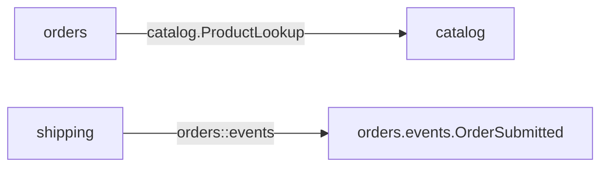
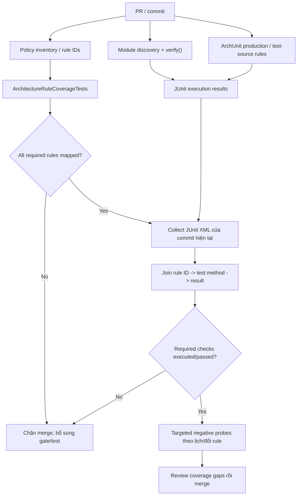

# Đo luật kiến trúc nào có test

Một ứng dụng Spring Modulith có `ModuleArchitectureTests` chạy `ApplicationModules.verify()` và đạt. Nhưng từ kết quả ấy, có thể kết luận **mọi luật kiến trúc của dự án đều đã được kiểm chứng** không? **Không.** `verify()` bảo vệ một tập quy tắc mà Spring Modulith hỗ trợ; nó không tự kiểm mọi policy tùy biến, mọi dependency trong test source, nội dung artifact hoặc hành vi ở runtime. Ngay trong nhóm luật mà `verify()` đảm nhiệm, một JUnit test đạt chỉ cho biết **không có vi phạm được phát hiện trong code hiện tại**, chưa chứng minh test ấy sẽ bắt được **từng loại lỗi cố ý** khi chúng xuất hiện.

Để trả lời **“Đo luật kiến trúc nào có test”**, hãy lập danh mục luật **độc lập với các test đã có**, gán ID và owner cho từng luật, ánh xạ **luật → cơ chế kiểm tra → JUnit test hoặc CI gate**, rồi đối chiếu **kết quả chạy** và **thử âm tính** cho từng luật quan trọng.

```text
Architecture policy inventory
  -> Rule ID / scope / owner / violation example
  -> Verification mechanism: Spring Modulith / ArchUnit / build gate
  -> JUnit class + method hoặc CI job
  -> CI execution result của revision hiện tại
  -> Negative probe: gate có đỏ với đúng vi phạm?
  -> Coverage/gap theo từng luật
```

Bài thuộc chương **Coverage theo module** của **SPRING_MODULITH_VERIFICATION_TESTING**. Trọng tâm là đo độ phủ **quy tắc ranh giới kiến trúc**, sử dụng `ApplicationModules`, `@ApplicationModuleTest` đúng phạm vi, JUnit 5, ArchUnit và CI quality gate. Test sự kiện, database và tích hợp được phân loại để không bị tính nhầm thành bằng chứng luật cấu trúc. Những ví dụ bên dưới là học liệu Java 17+; chưa được compile/run với một bộ dependency cụ thể.

## 1. Định nghĩa “luật có test”: năm mức bằng chứng khác nhau

### 1.1. Phải tách *luật* khỏi *test*

Một `@Test void verifiesModules()` có thể kích hoạt nhiều luật có sẵn trong Spring Modulith. Ngược lại, một luật như “shipping test không import `orders.internal`” có thể cần một JUnit/ArchUnit rule khác, vì test code không nhất thiết thuộc phạm vi production module model.

Vì thế, đơn vị đo chính là **rule ID**, không phải số lớp `*ArchitectureTests.java` hoặc tổng số assertions.

| Mức | Câu hỏi | Bằng chứng | Chưa thể kết luận |
|---|---|---|---|
| **DEFINED** | Luật được ghi trong chính sách chưa? | Rule ID, mô tả, scope, owner | Có chương trình kiểm tra |
| **MAPPED** | Có check cụ thể bảo vệ luật chưa? | JUnit test method hoặc CI check ID | Check thực sự chạy |
| **EXECUTED** | Check có chạy trên revision cần xét không? | JUnit XML/CI log cùng commit SHA | Kết quả đạt |
| **PASSED** | Check thực thi thành công không? | Không failure/error, không bị skip | Check nhạy với vi phạm tương ứng |
| **DETECTION-VERIFIED** | Khi cố ý tạo vi phạm đúng loại, check có đỏ không? | Red–green probe kèm loại lỗi | Mọi trường hợp bất thường đều được bao phủ |

**Không được tự đồng nhất PASSED với DETECTION-VERIFIED.** Nếu ArchUnit importer chỉ nhập các class test rỗng hoặc module discovery bỏ sót một module, luật có thể xanh mà chưa kiểm đúng đối tượng.

### 1.2. Rule coverage khác code coverage và module-test coverage

| Chỉ số | Mẫu số | Ví dụ |
|---|---|---|
| Module-test coverage | Các application modules cần test | Module `shipping` có `@ApplicationModuleTest` |
| Public API coverage | Operations/contract scenarios công khai | `PlaceOrder.place(...)` được kiểm |
| Event scenario coverage | Các cặp event–scenario bắt buộc | `OrderSubmitted` có negative/replay test |
| **Architecture rule coverage** | Các luật kiến trúc bắt buộc | “Không có module cycle”, “không dùng internal API module khác” |
| JaCoCo line/branch coverage | Dòng/nhánh bytecode | Code được thực thi trong test |

Đó là **năm góc nhìn khác nhau**. Một test `@ApplicationModuleTest` của orders với `PublishedEvents` có thể bảo vệ hợp đồng phát event, nhưng không thay `ApplicationModules.verify()` trong việc chặn module dependency cycle.

### 1.3. Điều kiện để gọi một luật “covered”

Một báo cáo thận trọng cần ghi:

- **Mapped coverage**: luật có check được chỉ định và check tồn tại.
- **Executed coverage**: luật có check thực sự chạy trong CI.
- **Passed coverage**: check chạy thành công theo policy.
- **Detection assurance**: luật quan trọng có thử âm tính có kiểm soát và gate đã đỏ đúng nguyên nhân.

Nếu check hợp nhất `verify()` phục vụ ba luật, **một JUnit testcase có thể map tới ba rule IDs**. Không nhân số method thành ba test thực tế; tỷ lệ đo theo **luật**, đồng thời lưu quan hệ nhiều-luật–một-check.

## 2. Lập rule inventory độc lập với các test hiện có

### 2.1. Nhóm luật theo cơ chế có thể kiểm

Không lấy danh mục luật bằng cách chỉ liệt kê những JUnit methods đã tồn tại. Làm vậy khiến luật bị quên không có mặt trong mẫu số.

Một inventory thực dụng gồm:

| Rule ID | Policy cụ thể | Phạm vi | Cơ chế kiểm | Owner đề xuất |
|---|---|---|---|---|
| **MOD-001** | Không có dependency cycle giữa application modules | Production module graph | Spring Modulith `verify()` | Architecture team |
| **MOD-002** | Không sử dụng internal API của module khác | Production type graph | `verify()` | Module owners |
| **MOD-003** | Phụ thuộc tuân thủ `allowedDependencies`/named interfaces | Production type graph | `verify()` | Module owners |
| **SRC-001** | Production code không field-inject bằng `@Autowired` theo policy dự án | Production classes | ArchUnit custom rule | Architecture team |
| **TST-001** | Shipping tests không phụ thuộc `orders.internal` | Test source | ArchUnit custom rule | Test/platform team |

Đây là **năm ví dụ luật bắt buộc trong bài**, không phải tuyên bố rằng mọi dự án đều phải cấm field injection hoặc có chính sách shipping cụ thể. Cần thêm luật phù hợp kiến trúc thật, chẳng hạn quyền sở hữu schema, visibility của persistence adapters, chiều dependency UI/domain hoặc phiên bản event contract.

### 2.2. Phân loại theo khả năng tự động kiểm

Một chính sách có thể gồm nhiều tầng:

- **Static type rules**: module cycle, internal access, named interface, package layering; hợp với `ApplicationModules.verify()` hoặc ArchUnit.
- **Test-source rules**: test của module này không biết implementation module khác; cần quét đúng test output.
- **Build/artifact rules**: test fixture không vào production JAR; cần packaging inspection, không nhất thiết là JUnit.
- **Runtime/behavior rules**: listener chỉ xử lý sau commit, dữ liệu không bị ghi xuyên owner schema; cần integration tests và review kiến trúc dữ liệu.

Đừng ép một luật DB ownership hoặc commit semantics vào `verify()` rồi báo là đã covered. **Gán đúng verification mechanism cho luật**.

### 2.3. Mỗi rule ID cần một định nghĩa đủ chặt

Một rule entry nên ghi:

```text
id: MOD-002
title: Không tham chiếu implementation/internal API của module khác
scope: compiled production application module types
owner: architecture + module owners
verifier: ModuleArchitectureTests#verifiesModuleModel
violationProbe: orders.internal references catalog.internal public type
expectedSignal: ApplicationModules.verify() fails for API boundary
exclusions: none in demo
reviewEvidence: CI JUnit result + isolated negative probe
```

Đây là cấu trúc **minh họa cho một policy registry**, không phải một file cần tạo trong tác vụ bài viết này.

Nếu luật đã bị loại bỏ hoặc tạm miễn, ghi **trạng thái/owner/lý do/ngày xét lại**. Đừng âm thầm xóa luật khó kiểm để denominator nhỏ lại.

### 2.4. Danh mục policy phải được review khi code thay đổi

Thay đổi cần cập nhật rule inventory có thể gồm:

1. Thêm application module hoặc named interface.
2. Thay đổi `allowedDependencies`.
3. Tách/gộp các module.
4. Thêm nguồn SQL truy cập bảng module khác.
5. Đưa một loại test fixture sang test artifact dùng chung.
6. Đổi event từ synchronous sang after-commit/broker-based.
7. Thêm policy riêng về layer/package hoặc DI.

Một **inventory gate chỉ so sánh các IDs đã đăng ký** không tự phát hiện được một quy tắc mới được thảo luận nhưng chưa ghi vào policy. Cần policy review/diff độc lập khi thay đổi kiến trúc.

## 3. Mô hình ứng dụng mẫu và năm luật cần đo

Để tránh tranh luận trừu tượng, ta dùng modular monolith có `catalog`, `orders` và `shipping`.

### 3.1. Package và dependency dự kiến

```text
src/main/java/com/acme/shop
├── ShopApplication.java
├── catalog
│   ├── ProductLookup.java
│   └── internal
│       └── DemoProductLookup.java
├── orders
│   ├── package-info.java
│   ├── PlaceOrder.java
│   ├── events
│   │   ├── package-info.java
│   │   └── OrderSubmitted.java
│   └── internal
│       └── DefaultPlaceOrder.java
└── shipping
    ├── package-info.java
    └── internal
        └── OnOrderSubmitted.java

src/test/java/com/acme/shop
├── ModuleArchitectureTests.java
├── ModuleDiscoveryTests.java
├── ProductionStyleArchitectureTests.java
├── TestSourceArchitectureTests.java
├── ArchitectureRuleCoverageTests.java
├── orders/OrdersModuleTests.java
└── shipping/ShippingModuleTests.java
```

Production graph:



Về type dependency, `shipping` **import event record của orders**. Việc event phát từ orders và được shipping nhận không tạo một dependency kiểu `orders → shipping`.

### 3.2. Application root

File `src/main/java/com/acme/shop/ShopApplication.java`:

```java
package com.acme.shop;

import org.springframework.boot.SpringApplication;
import org.springframework.boot.autoconfigure.SpringBootApplication;

@SpringBootApplication
public class ShopApplication {

    public static void main(String[] args) {
        SpringApplication.run(ShopApplication.class, args);
    }
}
```

Đặt root đúng giúp Spring Modulith nhận diện modules theo package trong cấu hình mặc định. Nếu dự án dùng module detection tùy biến, các assertions phát hiện module phải thích nghi theo model thật.

### 3.3. Public types và module metadata

File `catalog/ProductLookup.java`:

```java
package com.acme.shop.catalog;

import java.util.UUID;

public interface ProductLookup {
    boolean exists(UUID productId);
}
```

File `orders/PlaceOrder.java`:

```java
package com.acme.shop.orders;

import java.util.UUID;

public interface PlaceOrder {
    UUID place(UUID productId, int quantity);
}
```

File `orders/events/OrderSubmitted.java`:

```java
package com.acme.shop.orders.events;

import java.util.UUID;

public record OrderSubmitted(
    UUID orderId,
    UUID productId,
    int quantity
) {}
```

File `orders/package-info.java`:

```java
@org.springframework.modulith.ApplicationModule(
    allowedDependencies = "catalog"
)
package com.acme.shop.orders;
```

File `orders/events/package-info.java`:

```java
@org.springframework.modulith.NamedInterface("events")
package com.acme.shop.orders.events;
```

File `shipping/package-info.java`:

```java
@org.springframework.modulith.ApplicationModule(
    allowedDependencies = "orders::events"
)
package com.acme.shop.shipping;
```

### 3.4. Một implementation tối giản tạo cạnh type thật

```java
package com.acme.shop.orders.internal;

import com.acme.shop.catalog.ProductLookup;
import com.acme.shop.orders.PlaceOrder;
import com.acme.shop.orders.events.OrderSubmitted;
import java.util.UUID;
import org.springframework.context.ApplicationEventPublisher;
import org.springframework.stereotype.Service;

@Service
class DefaultPlaceOrder implements PlaceOrder {

    private final ProductLookup products;
    private final ApplicationEventPublisher publisher;

    DefaultPlaceOrder(
            ProductLookup products,
            ApplicationEventPublisher publisher) {
        this.products = products;
        this.publisher = publisher;
    }

    @Override
    public UUID place(UUID productId, int quantity) {
        if (productId == null || quantity <= 0) {
            throw new IllegalArgumentException("Invalid item");
        }
        if (!products.exists(productId)) {
            throw new IllegalArgumentException("Unknown product");
        }

        UUID orderId = UUID.randomUUID();
        publisher.publishEvent(
            new OrderSubmitted(orderId, productId, quantity)
        );
        return orderId;
    }
}
```

`DefaultPlaceOrder` thuộc package `orders.internal` và là class package-private. Nó phụ thuộc vào `catalog.ProductLookup` công khai, **không** vào một adapter `catalog.internal`.

Shipping listener chỉ biết event public:

```java
package com.acme.shop.shipping.internal;

import com.acme.shop.orders.events.OrderSubmitted;
import org.springframework.context.event.EventListener;
import org.springframework.stereotype.Component;

@Component
class OnOrderSubmitted {

    @EventListener
    void on(OrderSubmitted event) {
        // Demo: shipping sẽ xử lý event theo nghiệp vụ riêng.
        // Không gọi repository/implementation internal của orders.
    }
}
```

Trong mẫu rút gọn này listener chưa có observable side effect; muốn kiểm consumer behavior phải bổ sung query/projection hoặc integration outcome riêng. **Đừng tính một context bootstrap test thành event behavior coverage** chỉ vì class listener có mặt.

### 3.5. Vì sao metadata nằm ở production?

Các khai báo `@ApplicationModule` và `@NamedInterface` thuộc **production architecture**, không được đặt trong `src/test` để lén thay policy. Test đọc/kiểm mô hình ấy chứ không định nghĩa một kiến trúc dễ dãi hơn chỉ cho testing.

## 4. Spring Modulith verify() và ba luật kiến trúc nền tảng

Một bài JUnit `verify()` là điểm đầu tiên, nhưng phải biết nó được **map vào những luật nào** và **scope nó quét tới đâu**.

### 4.1. JUnit kiểm module graph

File `src/test/java/com/acme/shop/ModuleArchitectureTests.java`:

```java
package com.acme.shop;

import org.junit.jupiter.api.Test;
import org.springframework.modulith.core.ApplicationModules;

class ModuleArchitectureTests {

    @Test
    void verifiesModuleModel() {
        ApplicationModules.of(ShopApplication.class).verify();
    }
}
```

Đối với mô hình Spring Modulith mặc định, `verify()` thường kiểm các quy tắc cấu trúc, bao gồm:

- **MOD-001**: không có chu trình phụ thuộc giữa modules.
- **MOD-002**: không truy cập type/internal package của module khác trái public API.
- **MOD-003**: các dependencies tuân thủ `allowedDependencies` và named interfaces đã khai báo.

Cách phát hiện chính xác có thể chịu ảnh hưởng phiên bản, plugin kiến trúc trên classpath và cách application modules được dựng. Đừng tự gán những policy riêng ngoài danh sách thực tế của `verify()` cho JUnit method này.

### 4.2. Một test method có thể map tới ba rule IDs

```text
MOD-001 --+
MOD-002 --+--> ModuleArchitectureTests#verifiesModuleModel
MOD-003 --+
```

Điều này **hợp lệ ở mức mapping**. Nhưng ba IDs không tương đương ba JUnit tests độc lập. Nếu method bị skip trong CI, **cả ba rules mất execution evidence**.

Nếu method pass, ta biết module model hiện tại đã được `verify()` kiểm theo các rules được hỗ trợ. Muốn xác nhận **mỗi rule có khả năng phát hiện vi phạm tương ứng**, cần thử ba canaries riêng ở mục 8.

### 4.3. Không bỏ qua module discovery

File `src/test/java/com/acme/shop/ModuleDiscoveryTests.java`:

```java
package com.acme.shop;

import static org.assertj.core.api.Assertions.assertThat;

import org.junit.jupiter.api.Test;
import org.springframework.modulith.core.ApplicationModules;

class ModuleDiscoveryTests {

    @Test
    void discoversAllExpectedModules() {
        ApplicationModules modules =
            ApplicationModules.of(ShopApplication.class);

        assertThat(modules.getModuleByName("catalog")).isPresent();
        assertThat(modules.getModuleByName("orders")).isPresent();
        assertThat(modules.getModuleByName("shipping")).isPresent();
    }
}
```

Test discovery là **guard cho phạm vi kiểm chứng**, không tự động là test cho một luật trong năm IDs. Nó làm rõ tình huống `verify()` xanh do model không nhận ra một module dự kiến.

`contains(...)` theo những module đã biết không bảo đảm một module thứ tư mới không bị bỏ sót khi policy cần bao phủ **toàn bộ**. Nếu yêu cầu stricter coverage, báo danh sách module IDs thực tế và đối chiếu independent module inventory của tổ chức.

### 4.4. Ngộ nhận phổ biến

- `@SpringBootTest` xanh **không** chứng minh module graph không có cycle.
- `ApplicationModules.verify()` xanh **không** chứng minh constructor injection không có missing beans.
- `@ApplicationModuleTest` của orders với mock `ProductLookup` xanh **không** chứng minh internal-access rule vẫn đúng ở một class production khác.
- JUnit method có tên `checksArchitecture` **không** đủ để biết nó đang gọi những rule engines nào.

**Đo luật** là đo contract của rule và verifier, không suy từ tên class.

## 5. Custom rules: ArchUnit cho production và test source

Không phải mọi policy dự án đều là rule built-in của Spring Modulith. Ví dụ nhóm yêu cầu production code **không sử dụng field injection**, và test của shipping **không import internal type của orders**. Hai luật này cần verification riêng.

### 5.1. Rule SRC-001 — Cấm @Autowired trên production field

File `src/test/java/com/acme/shop/ProductionStyleArchitectureTests.java`:

```java
package com.acme.shop;

import static com.tngtech.archunit.lang.syntax.ArchRuleDefinition.noFields;

import com.tngtech.archunit.core.domain.JavaClasses;
import com.tngtech.archunit.core.importer.ClassFileImporter;
import com.tngtech.archunit.core.importer.ImportOption;
import org.junit.jupiter.api.Test;
import org.springframework.beans.factory.annotation.Autowired;

class ProductionStyleArchitectureTests {

    private static JavaClasses productionClasses() {
        return new ClassFileImporter()
            .withImportOption(new ImportOption.DoNotIncludeTests())
            .importPackages("com.acme.shop");
    }

    @Test
    void productionDoesNotUseFieldInjection() {
        JavaClasses production = productionClasses();

        noFields()
            .should().beAnnotatedWith(Autowired.class)
            .check(production);
    }
}
```

Rule này enforce **policy riêng của nhóm**: constructor injection làm dependencies rõ hơn cho việc phân tích/test; nó **không phải** quy tắc mà mọi ứng dụng Spring Modulith bắt buộc theo đuổi.

**Điều kiện hiệu lực:** `DoNotIncludeTests` được dùng để giới hạn lớp test theo convention ArchUnit/classpath. Với build layout tùy biến, xác minh importer thật sự chứa production classes. Nếu tập class rỗng, một rule có thể pass vô nghĩa.

### 5.2. Rule TST-001 — Test shipping không phụ thuộc orders.internal

File `src/test/java/com/acme/shop/TestSourceArchitectureTests.java`:

```java
package com.acme.shop;

import static com.tngtech.archunit.lang.syntax.ArchRuleDefinition.noClasses;
import static org.assertj.core.api.Assertions.assertThat;

import com.tngtech.archunit.core.domain.JavaClasses;
import com.tngtech.archunit.core.importer.ClassFileImporter;
import com.tngtech.archunit.core.importer.ImportOption;
import org.junit.jupiter.api.Test;

class TestSourceArchitectureTests {

    @Test
    void shippingTestsAvoidOrdersInternalTypes() {
        JavaClasses testClasses = new ClassFileImporter()
            .withImportOption(new ImportOption.OnlyIncludeTests())
            .importPackages("com.acme.shop");

        // Guard chống quét rỗng hoặc nhầm scope.
        assertThat(testClasses.stream()
            .map(type -> type.getName()).toList())
            .contains(
                "com.acme.shop.shipping.ShippingModuleTests"
            );

        noClasses()
            .that().resideInAPackage("com.acme.shop.shipping..")
            .should().dependOnClassesThat()
                .resideInAPackage("com.acme.shop.orders.internal..")
            .check(testClasses);
    }
}
```

Điểm cần chú ý:

- **Test source** không mặc nhiên nằm trong phạm vi `ApplicationModules.verify()` theo cách bạn mong đợi. Rule riêng này bảo vệ test helper/test classes.
- Test thuộc **chính orders** có thể kiểm `orders.internal`; policy ở đây chỉ chặn **shipping → orders.internal**.
- `OnlyIncludeTests` phụ thuộc vị trí output/classpath; nếu dự án custom source sets, phải kiểm importer thật.
- ArchUnit dựa trên bytecode/type references; các quan hệ SQL, chuỗi tên bean hoặc reflection cần kiểm thêm bằng cách khác.

### 5.3. Đừng cố dùng @ApplicationModuleTest thay ArchUnit

`@ApplicationModuleTest` kiểm Spring context/hành vi trong phạm vi một module, có thể cần `@MockitoBean` collaborator ngoài module. Nó **không phải thay thế mặc định** cho một ArchUnit rule kiểm toàn bộ test source hoặc `DoNotIncludeTests` production code.

Một module behavior test xanh vẫn có thể cùng tồn tại với một test helper shipping import `orders.internal.PublicOrderRepository` ở class khác.

### 5.4. Rule custom nào cần thêm?

Một dự án lớn có thể có:

- Infrastructure adapter ở `..internal.persistence..` không được phụ thuộc UI/API transport.
- Controller không được tham chiếu repository của module khác.
- Class thuộc application layer chỉ dùng public ports.
- Test resources và fake beans không được đóng gói vào production artifact.
- Database schema access phải thuộc owner module, kiểm qua integration/schema tests.

Đừng gán những luật ấy cho `noFields()` hoặc `verify()` nếu code thực tế của chúng không kiểm điều kiện ấy. Mỗi luật phải có **rule ID và verifier riêng**, dù được kích hoạt trong cùng một CI job.

## 6. Rule-to-test registry: JUnit kiểm kê mapping có thật

Một ledger lưu trong wiki dễ bị cũ; có thể thêm một **JUnit inventory test** xác minh mọi rule ID bắt buộc đều được ánh xạ vào method có thật, có `@Test` và đúng class.

### 6.1. Bảng mapping ví dụ

| Rule ID | Test method | Engine | Tài liệu phải minh chứng |
|---|---|---|---|
| MOD-001 | `ModuleArchitectureTests#verifiesModuleModel` | Spring Modulith | No module cycles |
| MOD-002 | `ModuleArchitectureTests#verifiesModuleModel` | Spring Modulith | Public/internal API |
| MOD-003 | `ModuleArchitectureTests#verifiesModuleModel` | Spring Modulith | Allowed dependencies |
| SRC-001 | `ProductionStyleArchitectureTests#productionDoesNotUseFieldInjection` | ArchUnit | No field injection |
| TST-001 | `TestSourceArchitectureTests#shippingTestsAvoidOrdersInternalTypes` | ArchUnit | Test source boundary |

Đây là **năm luật và ba JUnit methods**. Khi tính coverage theo luật, tử số tối đa là năm; khi báo số test methods, kết quả là ba. Hai con số không thay thế cho nhau.

### 6.2. ArchitectureRuleCoverageTests — gate kiểm kê bằng reflection

File `src/test/java/com/acme/shop/ArchitectureRuleCoverageTests.java`:

```java
package com.acme.shop;

import static org.assertj.core.api.Assertions.assertThat;

import java.lang.reflect.Method;
import java.util.Map;
import java.util.Set;
import org.junit.jupiter.api.Test;

class ArchitectureRuleCoverageTests {

    // Tập required IDs được review như chính sách kiến trúc.
    private static final Set<String> REQUIRED = Set.of(
        "MOD-001",
        "MOD-002",
        "MOD-003",
        "SRC-001",
        "TST-001"
    );

    private record Evidence(
        String testClass,
        String testMethod,
        String verificationEngine
    ) {}

    private static final Map<String, Evidence> MAPPINGS = Map.of(
        "MOD-001", new Evidence(
            "com.acme.shop.ModuleArchitectureTests",
            "verifiesModuleModel", "Spring Modulith"
        ),
        "MOD-002", new Evidence(
            "com.acme.shop.ModuleArchitectureTests",
            "verifiesModuleModel", "Spring Modulith"
        ),
        "MOD-003", new Evidence(
            "com.acme.shop.ModuleArchitectureTests",
            "verifiesModuleModel", "Spring Modulith"
        ),
        "SRC-001", new Evidence(
            "com.acme.shop.ProductionStyleArchitectureTests",
            "productionDoesNotUseFieldInjection", "ArchUnit"
        ),
        "TST-001", new Evidence(
            "com.acme.shop.TestSourceArchitectureTests",
            "shippingTestsAvoidOrdersInternalTypes", "ArchUnit"
        )
    );

    @Test
    void everyRequiredRuleHasAnEvidenceMapping() {
        assertThat(MAPPINGS.keySet())
            .containsExactlyInAnyOrderElementsOf(REQUIRED);
    }

    @Test
    void everyMappedJUnitMethodExistsAndHasTestAnnotation()
            throws Exception {

        for (var entry : MAPPINGS.entrySet()) {
            Evidence evidence = entry.getValue();

            Class<?> type = Class.forName(
                evidence.testClass(),
                false,
                getClass().getClassLoader()
            );

            Method method = type.getDeclaredMethod(
                evidence.testMethod()
            );

            assertThat(method.isAnnotationPresent(Test.class))
                .as("Rule %s -> %s#%s",
                    entry.getKey(),
                    evidence.testClass(),
                    evidence.testMethod())
                .isTrue();

            assertThat(evidence.verificationEngine())
                .isNotBlank();
        }
    }
}
```

### 6.3. Phạm vi mà gate chứng minh

Nếu rule ID bị xóa khỏi `MAPPINGS`, method bị đổi tên hoặc JUnit annotation bị xóa, gate đỏ. Nhưng nó **không tự kiểm tra thân method thực sự gọi `verify()` hay `ArchRule.check()`**.

Ví dụ một người thay nội dung `verifiesModuleModel()` thành test rỗng nhưng giữ `@Test`, registry vẫn có thể pass. Vì vậy cần:

- Code review để map rule IDs vào đúng verifier.
- Thử âm tính có kiểm soát cho các luật quan trọng.
- Báo cáo execution từ JUnit/CI, không chỉ reflection.
- Một policy source được duy trì **độc lập** với mapping implementation.

`REQUIRED` và `MAPPINGS` trong một class là mẫu minh họa có thể chạy; nếu cả hai cùng được chỉnh để bỏ luật, gate không tự biết. Trong hệ thống thật, rule inventory cần được version-control/review độc lập hoặc có một nguồn policy được quản trị rõ.

### 6.4. Khi dùng @ArchTest thay JUnit @Test

ArchUnit còn hỗ trợ `@ArchTest` trên field/method với `@AnalyzeClasses`. Khi chọn mô hình đó, registry phải hiểu **annotation/method shape tương ứng** và test execution report của ArchUnit JUnit engine.

Ví dụ trong bài dùng **JUnit 5 `@Test` gọi `ArchRule.check(...)`**, vì vậy reflection `getDeclaredMethod(...)` có thể kiểm trực tiếp. Không coi một `@ArchTest` field là thiếu test chỉ vì bộ kiểm kê hiện tại chỉ biết `@Test`.

## 7. Bằng chứng thực thi: JUnit XML và rule-level status

Một mapping tồn tại là **MAPPED**, không chứng minh test được CI chạy. Hãy nối **rule ID → JUnit class/method → testcase result** trong đúng revision.

### 7.1. Báo cáo nên lấy từ nơi nào?

Theo cấu hình Maven/Gradle thông thường:

```text
Maven Surefire: target/surefire-reports/TEST-*.xml
Maven Failsafe: target/failsafe-reports/TEST-*.xml
Gradle test:    build/test-results/test/TEST-*.xml
Gradle integrationTest (nếu có):
                build/test-results/integrationTest/TEST-*.xml
```

Các vị trí là convention, không được mặc định đúng nếu build tùy biến. CI nên clean report output hoặc dùng workspace mới để tránh đọc kết quả cũ.

Ví dụ kết quả JUnit XML rút gọn:

```xml
<testsuite tests="1" errors="0" failures="0" skipped="0">
  <testcase
      classname="com.acme.shop.ModuleArchitectureTests"
      name="verifiesModuleModel"/>
</testsuite>
```

Một testcase này liên kết đến **MOD-001/002/003**. Nếu test không được chạy do filter, cả ba luật là **NOT_EXECUTED**, không được đánh dấu PASSED chỉ vì inventory biết class.

### 7.2. Thuật toán join sang rule IDs

```text
requiredRules = policy inventory, independent of tests
mappings      = ruleId -> className + methodName + engine
results       = JUnit XML of CURRENT CI run / commit

for rule in requiredRules:
    if no mapping:
        status = UNMAPPED
        continue

    testcase = find exact JUnit result for mapping[rule]

    if no testcase:
        status = NOT_EXECUTED
    else if testcase skipped:
        status = SKIPPED
    else if testcase contains failure/error:
        status = FAILED
    else:
        status = PASSED

    detectionVerified = targeted negative probe result
    # Do not infer it from PASSED

fail CI if a REQUIRED rule lacks acceptable execution
or fails its explicit policy
```

Đây là **pseudocode**, không phải script đã được chạy. Với dynamic/parameterized tests hoặc custom test engines, cần mapping phù hợp `classname` và `name` theo report thật.

### 7.3. Kiểm tra đúng nguồn kết quả

- JUnit result phải thuộc **commit SHA** cần merge.
- Tên class/method phải trùng mapping; không match mơ hồ theo hậu tố.
- `@Disabled` và excluded tests phải được ghi **SKIPPED/NOT_EXECUTED**.
- Nếu registry method chạy nhưng test `verifiesModuleModel` không chạy, ba IDs MOD-001/002/003 **không có execution proof**.
- Module discovery guard cũng phải được chạy và pass, dù được báo ở cột **scope assurance** thay vì gộp vào rule numerator.
- Nếu JUnit report vắng do CI job bị bỏ qua, không dùng `BUILD SUCCESS` của job khác để đánh dấu PASS.

### 7.4. Báo cáo machine-readable theo từng luật

```text
ruleId: MOD-003
scope: production module graph
testCase: com.acme.shop.ModuleArchitectureTests#verifiesModuleModel
mapped: yes
executed: yes
passed: yes
detectionVerified: yes
negativeProbe: shipping -> catalog public API
revision: <CI commit identifier>
```

Với luật SRC-001 hoặc TST-001, `negativeProbe` phải khác và đúng phạm vi importer. Không gán cùng một failure ngẫu nhiên cho mọi rule.

## 8. Thử âm tính theo *từng loại luật*, không chỉ chạy verify() xanh

Đây là khâu quyết định để biết **test đã bảo vệ đúng rule**, nhất là khi một `verify()` map nhiều luật.

### 8.1. MOD-001 — Cố tình tạo module cycle

Ứng dụng hợp lệ đã có `orders → catalog`. Trên **nhánh thử tạm**, thêm vào production catalog một type có field tham chiếu `orders.PlaceOrder`:

```java
// File tạm trong catalog.internal, chỉ dùng ở nhánh canary.
package com.acme.shop.catalog.internal;

import com.acme.shop.orders.PlaceOrder;

class CycleProbe {

    private PlaceOrder orders;
}
```

Điều này tạo cạnh `catalog → orders`, kết hợp `orders → catalog` thành chu trình. Kỳ vọng `ModuleArchitectureTests#verifiesModuleModel` **đỏ vì module cycle**, không chỉ vì lỗi không liên quan.

Không giữ canary ở main branch. Nếu một trường được compiler/tooling loại khỏi bytecode trong trường hợp cụ thể, dùng dependency có thật trong signature/method để bảo đảm bộ phân tích nhận diện.

### 8.2. MOD-002 — Dùng internal API module khác

`orders` được phép phụ thuộc public `catalog`. Trên nhánh thử, thêm một **Java-public type** trong `catalog.internal` và để class production orders dùng type đó:

```java
// Chỉ mô tả canary: CatalogInternalPort là type public
// trong package com.acme.shop.catalog.internal.
package com.acme.shop.orders.internal;

import com.acme.shop.catalog.internal.CatalogInternalPort;

class ForbiddenCatalogDependency {

    private CatalogInternalPort internal;
}
```

Module `orders` vẫn được phép phụ thuộc `catalog` ở cấp module, nhưng **không được đi vào internal API**. Kỳ vọng `verify()` báo lỗi public/internal boundary.

**Vì sao chọn type public?** Nếu type là Java package-private, Java compiler đã chặn, và test chưa chứng minh Spring Modulith rule có hiệu lực. Thử âm tính phải biên dịch được để kiến trúc verifier có cơ hội bắt lỗi.

### 8.3. MOD-003 — Vi phạm allowedDependencies mà không vi phạm visibility

`shipping` chỉ được phép phụ thuộc `orders::events`. Trên nhánh thử, thêm vào shipping một type reference đến **public API của catalog**:

```java
// Canary tạm cho shipping: public catalog API nhưng
// shipping không được phép phụ thuộc catalog theo policy.
package com.acme.shop.shipping.internal;

import com.acme.shop.catalog.ProductLookup;

class ForbiddenCatalogShortcut {

    private ProductLookup lookup;
}
```

Ở đây `ProductLookup` là public type hợp lệ của catalog. Sai phạm là **allowedDependencies**, không phải internal visibility. `verify()` phải báo dependency trái policy.

### 8.4. SRC-001 — Field injection trong production

Trên nhánh thử, cho một Spring component **production** có `@Autowired` field:

```java
package com.acme.shop.orders.internal;

import com.acme.shop.catalog.ProductLookup;
import org.springframework.beans.factory.annotation.Autowired;
import org.springframework.stereotype.Component;

@Component
class FieldInjectionProbe {

    @Autowired
    private ProductLookup products;
}
```

Kỳ vọng `ProductionStyleArchitectureTests#productionDoesNotUseFieldInjection` đỏ. Nếu nó vẫn xanh, hãy kiểm xem ArchUnit importer có thực sự thấy class trong production output không.

Canary này chỉ vi phạm **policy code style/DI đã định nghĩa cho dự án**, không phải quy tắc Spring Modulith phổ quát.

### 8.5. TST-001 — Shipping test import orders.internal

Đặt một **Java-public type** tạm trong `orders.internal`. Cho `src/test/java/com/acme/shop/shipping/ShippingModuleTests.java` tham chiếu nó trong field hoặc method:

```java
// Fragment chèn vào shipping test ở nhánh canary.
// Giả định PublicOrdersInternalProbe là Java-public
// và nằm trong package orders.internal.
private com.acme.shop.orders.internal.PublicOrdersInternalProbe
    forbidden;
```

Kỳ vọng `TestSourceArchitectureTests#shippingTestsAvoidOrdersInternalTypes` đỏ. Nếu importer chỉ thấy production classes hoặc không thấy `ShippingModuleTests`, quy tắc có thể xanh giả; guard trong test ở mục 5 giúp phát hiện một phần tình huống này.

### 8.6. Khi thử âm tính, phải phân biệt “đỏ đúng” với “đỏ tình cờ”

Một lỗi compile, test infrastructure không khởi động hoặc assertion ở test khác fail **không** chứng minh rule mong muốn đang nhạy với sai phạm. Lưu:

1. Chính xác một loại vi phạm được chèn trên một nhánh/commit tạm.
2. Chương trình vẫn compile (nếu đang kiểm rule bytecode).
3. Đúng architecture test/gate được thực thi.
4. Failure message chỉ ra type/dependency/rule mục tiêu.
5. Hoàn nguyên canary và thấy **green** ở cùng cấu hình.
6. Không commit mã lỗi vào main.

`DETECTION-VERIFIED` chỉ nên có sau thử âm tính phù hợp hoặc bằng chứng tự động tương đương, không phải vì một lỗi bất kỳ đã từng xảy ra.

## 9. Công thức coverage và báo cáo không che lỗ hổng

### 9.1. Bốn chỉ số theo rule IDs

Gọi:

- `R`: tập luật bắt buộc trong policy.
- `M`: tập luật đã có mapping hợp lệ.
- `X`: tập luật có required checks thực sự chạy trong CI.
- `P`: tập luật có required checks chạy đạt.
- `D`: tập luật đã có thử âm tính phát hiện đúng vi phạm.

Với `|R| > 0`:

\[
\operatorname{MappedRuleCoverage}
=\frac{|R\cap M|}{|R|}\times100\%
\]

\[
\operatorname{ExecutedRuleCoverage}
=\frac{|R\cap X|}{|R|}\times100\%
\]

\[
\operatorname{PassedRuleCoverage}
=\frac{|R\cap P|}{|R|}\times100\%
\]

\[
\operatorname{DetectionVerifiedCoverage}
=\frac{|R\cap D|}{|R|}\times100\%
\]

Nếu `R` rỗng, báo **N/A — policy inventory chưa được xác nhận**, không tự kết luận 100%.

### 9.2. Một ví dụ báo cáo có gap thật

Giả sử năm luật đã có mapping. Trong CI, `ModuleArchitectureTests` và `ProductionStyleArchitectureTests` chạy đạt, nhưng `TestSourceArchitectureTests` không chạy vì task filter:

| Rule ID | Mapped | Executed | Passed | Detection-verified | Gap |
|---|---|---|---|---|---|
| MOD-001 | Yes | Yes | Yes | Yes | Không |
| MOD-002 | Yes | Yes | Yes | Yes | Không |
| MOD-003 | Yes | Yes | Yes | No | Chưa thử canary allowed deps |
| SRC-001 | Yes | Yes | Yes | No | Chưa thử field-injection canary |
| TST-001 | Yes | No | No data | No | Test source rule bị filter |

Khi đó:

- **Mapped**: 5/5 = **100%**.
- **Executed**: 4/5 = **80%**.
- **Passed**: 4/5 = **80%**.
- **Detection-verified**: 2/5 = **40%**.

Đây là **báo cáo minh họa**, không phải kết quả đã thu từ repository. Việc `TST-001` không chạy phải báo **NOT_EXECUTED**, không phải **FAILED**.

### 9.3. Không làm phình tỷ lệ bằng rule IDs nhân tạo

Không nên chia cùng một luật “cấm import orders.internal” thành hàng chục rule IDs theo từng package nhỏ chỉ để số lượng rule đã mapped tăng. ID phải phản ánh **một policy độc lập có thể đánh giá bằng phép thử cụ thể**.

Ngược lại, nếu luật thực ra gồm hai nghĩa vụ không tương đương — ví dụ “event published” và “event committed” — cần **tách** chúng, nhưng đó là nhóm **behavior/integration coverage**, không tự cộng vào static architecture rule coverage.

### 9.4. Guard và diagnostic riêng biệt

Nên báo thêm:

- **Module discovery PASS/FAIL**: model có đủ application modules cần kiểm không?
- **Test import scope PASS/FAIL**: ArchUnit có quét đúng test source không?
- **Packaging PASS/FAIL**: test fixture có lọt production JAR không?
- **@ApplicationModuleTest behavior PASS/FAIL**: các hợp đồng mô-đun có đạt không?
- **Event/DB integration PASS/FAIL**: producer, consumer, commit và retry có bằng chứng riêng không?

Chỉ đưa các mục vào **denominator của rule coverage** khi chúng được định nghĩa là một luật có owner/check cụ thể. Giữ nguyên nhãn để tránh đổi ý nghĩa dashboard qua mỗi sprint.

## 10. CI quality gate, bài thực hành và checklist bàn giao

### 10.1. Pipeline phải bắt cả mapping và execution



Thử âm tính có thể chạy trên nhánh/canary workflow được kiểm soát khi thay đổi rule engine hoặc policy, **không** cần chèn code vi phạm vào mỗi production PR. Nhưng với luật mới, nên có bằng chứng red–green trước khi nhóm xem rule là đáng tin.

### 10.2. Lệnh build tham khảo, không phải kết quả đã chạy

```bash
# Maven: phải cấu hình Surefire/Failsafe và các test profiles phù hợp.
./mvnw -B clean verify

# Gradle: custom integrationTest tasks cần được gọi riêng nếu có.
./gradlew clean test
```

CI cần thu JUnit XML thực tế theo đúng build task/commit. Không dùng một dòng `BUILD SUCCESS` làm bằng chứng rằng toàn bộ architecture test classes đã chạy.

### 10.3. Các lỗi thường gặp khi triển khai

| Sai lầm | Hậu quả | Cách sửa |
|---|---|---|
| Đếm file `*ArchitectureTests.java` | Một file có thể kiểm nhiều/không kiểm luật nào | Dùng rule IDs và mapping |
| Tạo policy từ danh sách test hiện có | Luật chưa có test biến mất khỏi mẫu số | Policy inventory độc lập |
| Xem `verify()` cover mọi project rule | Bỏ qua ArchUnit/test scope/artifact | Ghi verifier theo scope |
| Mapping class/method rồi báo passed | Chưa có execution evidence | Đối chiếu JUnit XML |
| Không kiểm module discovery | `verify()` có thể xanh trên model thiếu | Assertions scope |
| ArchUnit import rỗng | Rule pass vô nghĩa | Canary/guard và thử âm tính |
| Thấy test đỏ do compile error rồi báo rule nhạy | Không chứng minh rule bắt sai phạm | Cần đỏ đúng engine/rule |
| Đặt test source vào denominator production | Lẫn các loại policy | Phân scope rõ |
| Đổi luật nhưng không cập nhật registry | Coverage drift | Policy diff review + CI |
| Bỏ qua skipped tests | Coverage xanh giả | Required execution check |

### 10.4. Bài tập red–green có thể làm theo từng vòng

**Bối cảnh:** một modular monolith có `catalog`, `orders`, `shipping`. Team đang có đúng một test `ApplicationModules.verify()` và tuyên bố “kiến trúc đã được test 100%”.

**Vòng A — Lập danh mục luật.**

1. Viết năm rule IDs `MOD-001/002/003`, `SRC-001`, `TST-001` từ mục 2.
2. Ghi scope, owner, violation example và tool kiểm từng luật.
3. Xác định `ModuleDiscoveryTests` là guard cho scope, không tự đếm thành một trong năm luật.
4. Ghi những luật tổ chức chưa thể kiểm tự động là **UNMAPPED**, không xóa khỏi policy.

**Vòng B — Viết architecture tests.**

1. Tạo `ModuleArchitectureTests#verifiesModuleModel` gọi `ApplicationModules.of(ShopApplication.class).verify()`.
2. Tạo `ModuleDiscoveryTests` xác nhận các module dự kiến được phát hiện.
3. Tạo `ProductionStyleArchitectureTests` cấm `@Autowired` field trong production.
4. Tạo `TestSourceArchitectureTests` chặn shipping tests import `orders.internal`.
5. Kiểm import scopes; rule test-source phải thấy ít nhất một shipping test class.

**Vòng C — Kiểm kê mapping.**

1. Tạo `ArchitectureRuleCoverageTests` với năm required IDs và bốn trường binding.
2. Xác nhận mỗi ID trỏ tới class/method có thật.
3. Bỏ một binding rồi chạy inventory test; kỳ vọng đỏ.
4. Khôi phục và đổi tên test method được map; kỳ vọng đỏ vì reflection.

**Vòng D — Kiểm chứng năng lực phát hiện.**

1. Tạo module cycle bằng field type `catalog → orders`.
2. Tạo internal-API violation từ orders sang catalog.internal Java-public type.
3. Tạo `allowedDependencies` violation từ shipping sang catalog public API.
4. Tạo `@Autowired` field production.
5. Tạo test-source cross-internal dependency shipping → orders.internal.
6. Mỗi lần chỉ thêm **một** vi phạm, chạy đúng gate, xem failure message, hoàn nguyên và chạy green.

**Vòng E — Đo CI thực tế.**

1. Chạy toàn bộ required architecture tests trên commit cần merge.
2. Thu JUnit XML từ đúng Maven/Gradle tasks.
3. Map năm rule IDs vào method results.
4. Nếu `TestSourceArchitectureTests` bị filter, báo `TST-001 = NOT_EXECUTED`.
5. Xuất bảng Mapped/Executed/Passed/Detection-verified và ghi gaps.

**Vòng F — Kết luận.** Giải thích vì sao một bài `@ApplicationModuleTest` orders xanh hoặc một test `PublishedEvents` xanh không đủ để chứng minh `MOD-001`, `MOD-002`, `MOD-003` hoặc `TST-001` đã được kiểm. Giữ test hành vi/module/event/database ở các evidence tracks riêng.

### 10.5. Checklist review rule coverage

| # | Câu hỏi | Bằng chứng mong đợi |
|---|---|---|
| 1 | Policy rule IDs có được quản trị độc lập với tests? | Registry/diff được review |
| 2 | Luật có owner, scope, tình huống vi phạm rõ? | Rule definition |
| 3 | Luật built-in hay custom được phân loại đúng? | Verifier mapping |
| 4 | Spring Modulith model nhận đúng modules? | Discovery JUnit |
| 5 | `verify()` có chạy độc lập? | JUnit result |
| 6 | Custom production ArchUnit có đúng import scope? | Production class set + red–green |
| 7 | Test-source rule có thấy đúng test classes? | Test import guard |
| 8 | Rule ID trỏ tới class/method có thật? | Inventory JUnit |
| 9 | Registry có bỏ sót luật mới không? | Policy diff review |
| 10 | JUnit testcase đã chạy trên commit hiện tại? | XML artifact + commit SHA |
| 11 | Failed/skipped/not executed được phân biệt không? | Per-rule status |
| 12 | Một test map nhiều rules có được báo trung thực? | Rule-to-check trace |
| 13 | Luật quan trọng đã có thử âm tính riêng? | Targeted failure |
| 14 | Red probe fail vì đúng rule, không vì compile/setup? | Failure diagnostics |
| 15 | Đã hoàn nguyên canary và xác nhận green? | Git diff/CI evidence |
| 16 | Runtime/event/DB policy có bị ghi nhầm covered không? | Scope review |
| 17 | CI có required checks/branch protection? | Pipeline config/report |
| 18 | Gaps có owner và kế hoạch khắc phục? | Coverage table |

### 10.6. Câu hỏi ôn tập

**1. Một `ModuleArchitectureTests` chạy `verify()` có thể map tới ba luật không?** Có, nếu ba luật thực sự được verifier hỗ trợ; nhưng vẫn là **một JUnit method**, và cần probe riêng để chứng minh từng loại vi phạm được phát hiện.

**2. Vì sao phải xây rule inventory trước khi đếm test?** Nếu lấy luật từ test names, luật chưa được kiểm sẽ biến mất khỏi mẫu số.

**3. `@ApplicationModuleTest` pass có tự bảo vệ module cycle không?** Không. Nó kiểm Spring module context/behavior theo phạm vi bootstrap, không thay architecture verification.

**4. `verify()` có tự kiểm mọi dependency từ `src/test` không?** Không nên giả định. Dùng test-source rule có importer đúng và thử âm tính.

**5. Vì sao ArchUnit rule cần guard phạm vi import?** Rule trên tập classes rỗng hoặc sai nguồn có thể pass mà không bảo vệ target code.

**6. Test mapping có `@Test` annotation đủ để báo luật PASSED chưa?** Chưa. Cần JUnit execution results ở revision hiện tại.

**7. Vì sao thử internal API violation phải dùng type Java-public trong package internal?** Để code biên dịch và verifier kiến trúc có cơ hội bắt lỗi, thay vì Java compiler chặn trước.

**8. Làm sao phân biệt vi phạm allowedDependencies với internal API?** Chọn một public type ở module **không được phép phụ thuộc**, trong khi rule internal canary dùng internal type thuộc module đã được phép phụ thuộc.

**9. Có thể báo “5/5 rules mapped” khi một test bị skip không?** Có ở mức mapping, nhưng execution/pass coverage phải giảm; không được gộp thành 100% tested.

**10. Testcontainers hoặc `PublishedEvents` có được tính thành kiến trúc static rule test không?** Chỉ nếu đó là một policy cụ thể, phạm vi và cơ chế kiểm phù hợp. Thường chúng là integration/behavior evidence riêng.

## Kết luận

**Đo luật kiến trúc nào có test** không phải đếm số file `*ArchitectureTests` hoặc thấy `ApplicationModules.verify()` xanh rồi tuyên bố hoàn tất. Cần **rule IDs có scope và owner**, **mapping tới verifier cụ thể**, **JUnit/CI execution evidence** và — với luật quan trọng — **thử âm tính chứng minh verifier thực sự bắt đúng vi phạm**.

Trong **SPRING_MODULITH_VERIFICATION_TESTING**, `ApplicationModules.verify()` là nền tảng bảo vệ module cycles, internal API và `allowedDependencies`; ArchUnit hoặc build checks bổ sung các chính sách production/test-source riêng; `@ApplicationModuleTest`, `PublishedEvents` và database/integration tests cung cấp bằng chứng hành vi khác. Giữ những loại evidence ấy tách bạch trong **CI quality gate** sẽ làm rõ luật nào **chưa có check**, **có check nhưng không chạy**, **đã pass nhưng chưa có detection probe** — thay vì một chỉ số “architecture coverage 100%” thiếu căn cứ.
