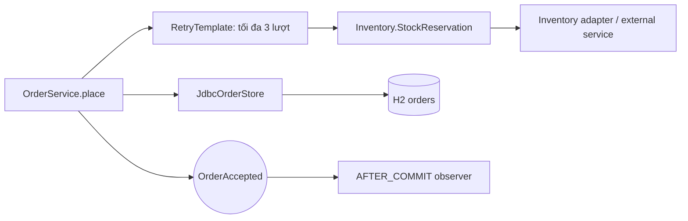
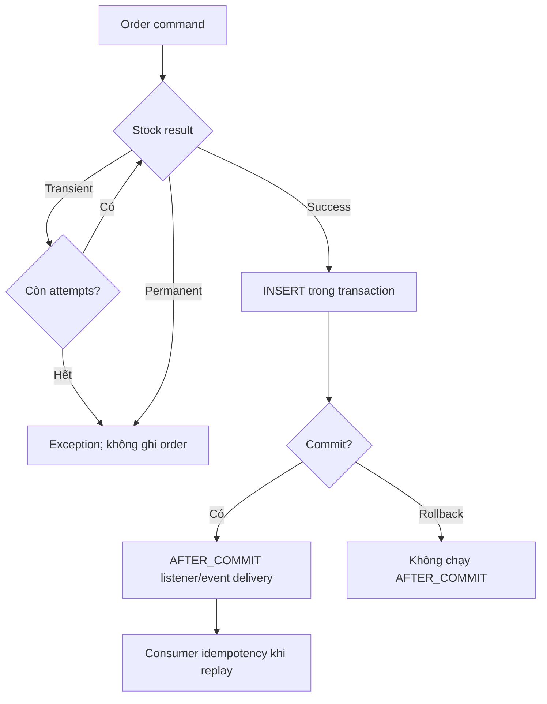

# Độ bao phủ lỗi, retry và rollback trong kiểm thử module Spring Modulith

## 1. Đo **đường lỗi và hậu điều kiện**, không chỉ đếm dòng code

Một module có 90% *line coverage* vẫn có thể chưa chứng minh được điều quan trọng nhất: **khi dependency gặp lỗi, module có retry đúng loại lỗi, dừng đúng lúc và rollback phần dữ liệu đã ghi hay không?** Ví dụ, test chỉ đi qua nhánh thành công của `OrderService.place(...)` có thể chạy gần hết phương thức nhưng không phát hiện trường hợp gọi kho vô hạn, ghi đơn trước khi kho xác nhận hoặc publish event mặc dù transaction rollback.

Bài **“Độ bao phủ lỗi, retry và rollback”** thuộc chương **Coverage theo module** của học phần **SPRING_MODULITH_VERIFICATION_TESTING**. Mục tiêu của học phần là kiểm chứng ranh giới bằng `ApplicationModules`, luyện `@ApplicationModuleTest`, kiểm thử event/database/tích hợp và đưa quality gate vào CI để ngăn phụ thuộc sai và hồi quy. Ở đây tập trung **coverage ngữ nghĩa của các đường lỗi**, không nhắc lại nhập môn JUnit hay toàn bộ bootstrap mode.

Một yêu cầu nghiệp vụ cụ thể: module `order` nhận đơn và gọi API công khai của module `inventory` để giữ hàng; khi giữ hàng thành công mới ghi đơn vào H2/JDBC và phát `OrderAccepted`. Stock API có thể lỗi tạm thời hoặc lỗi không thể phục hồi. Chúng ta cần chứng minh mọi đường đi ảnh hưởng tới dữ liệu và sự kiện.

### Ma trận coverage trước khi viết test

| Kịch bản | Số lượt gọi stock mong đợi | Trả về / exception | DB `orders` | Event đã publish | Listener `AFTER_COMMIT` |
| --- | ---: | --- | --- | --- | --- |
| Kho xác nhận ngay | **1** | Thành công | Đúng 1 đơn | 1 `OrderAccepted` | Chạy |
| Lỗi transient hai lần, lần 3 thành công | **3** | Thành công | Đúng 1 đơn | Đúng 1 event | Chạy đúng 1 lần |
| Lỗi transient cả ba lượt | **3** | `TransientStockFailure` | Không có đơn | Không có event | Không chạy |
| Lỗi permanent từ lượt đầu | **1** | `PermanentStockFailure` | Không có đơn | Không có event | Không chạy |
| Đã ghi/publish nhưng transaction ngoài rollback | **1** | Lỗi chủ động ở transaction ngoài | Không còn đơn | **Có thể đã publish tại bus** | **Không chạy** |
| Checked exception sau khi ghi, có `rollbackFor` | Không liên quan | `CheckoutCheckedException` | Không còn đơn | Không cần publish | Không liên quan |

**Quan trọng:** “Event đã publish” khác “event được consumer xử lý sau commit”. Spring `ApplicationEventPublisher` có thể phát event trong transaction; `PublishedEvents` có thể quan sát việc publish **ngay cả khi transaction cuối cùng rollback**. Chỉ `@TransactionalEventListener(phase = AFTER_COMMIT)` hoặc một hậu điều kiện consumer thực mới chứng minh phản ứng sau commit.

Coverage được đánh giá theo **tổ hợp input → lỗi → số lần thử → thay đổi state → event → transaction outcome**, không chỉ một exception/assertion. Số lượng tình huống ở bảng là **hợp đồng của ví dụ học tập**, không phải tỷ lệ coverage tự động tính từ công cụ JaCoCo.

## 2. Chọn đúng điểm tiêm lỗi và ranh giới module

Sơ đồ tối giản:



- `order` **chỉ phụ thuộc interface và exception công khai** thuộc package gốc `inventory`; không import `inventory.internal`.
- `@ApplicationModuleTest` nằm trong package `order` để bootstrap chính module này. `@MockitoBean StockReservation` thay dependency ngoài scope bằng mock, cho phép điều khiển lỗi transient/permanent **không nạp implementation inventory thật**.
- `RetryTemplate` ở module `order` quyết định retry theo loại exception. Nó là **Spring Retry**, không phải một tính năng tự xuất hiện vì dùng `@ApplicationModuleTest`.
- `JdbcOrderStore` là **bean thật của `order`** và thao tác với **H2 thật** trong test; không mock repository khi mục tiêu là kiểm tra rollback DB.
- `@Transactional` trên service xác định ranh giới DB transaction. Một test dùng `TransactionTemplate` bên ngoài để ép rollback sau khi service đã publish event, nhờ đó kiểm chứng khác biệt giữa **publication** và **AFTER_COMMIT**.

### Chọn “đường lỗi” thay vì mock toàn bộ module

| Tiêm lỗi ở đâu? | Có thể chứng minh | Không chứng minh |
| --- | --- | --- |
| `@MockitoBean StockReservation` ném transient/permanent exception | Chính sách phân loại lỗi, số lần retry, DB/event sau lỗi | Inventory thật có retry network/side effect đúng |
| Repository thật + H2 | SQL insert/query, transaction rollback trong DB test | Hành vi PostgreSQL-specific hoặc deadlock production |
| `TransactionTemplate` bao service rồi ném lỗi | Rollback khi service tham gia transaction ngoài; `AFTER_COMMIT` không chạy | Chưa chứng minh mọi failure mode của broker ngoài |
| Listener kiểm thử `@TransactionalEventListener` | Đúng phase AFTER_COMMIT/AFTER_ROLLBACK trong context | Email/Kafka đã giao thành công |
| Module kiến trúc `ApplicationModules.verify()` | Dependency graph tuân thủ luật Modulith | Chính sách retry/rollback đúng |

**Nguyên tắc:** Mock **cổng ngoài** để tiêm lỗi có thể tái hiện; giữ **thành phần chịu trách nhiệm về hậu điều kiện** ở trạng thái thật. Nếu vừa mock stock vừa mock repository rồi chỉ `verify(repository).save(...)`, bạn chưa có bằng chứng rằng DB rollback.

## 3. Môi trường minh họa: dependency, SQL và module layout

Ví dụ hướng tới **Java 17+, Spring Boot 3.4/3.5, Spring Framework 6.2, Spring Modulith 1.4, Spring Retry 2.0.x, JUnit Jupiter 5**, sử dụng các BOM tương thích. Với Spring Boot 4/Modulith 2.x, kiểm tra lại package/import trước khi áp dụng.

```text
src/
├── main/java/com/example/shop/
│   ├── ShopApplication.java
│   ├── inventory/
│   │   ├── StockReservation.java
│   │   ├── TransientStockFailure.java
│   │   └── PermanentStockFailure.java
│   └── order/
│       ├── OrderAccepted.java
│       ├── OrderRow.java
│       ├── JdbcOrderStore.java
│       ├── RetryConfiguration.java
│       └── OrderService.java
└── test/
    ├── resources/schema.sql
    └── java/com/example/shop/
        ├── ModuleArchitectureTests.java
        └── order/
            └── OrderFailureCoverageTests.java
```

### Maven dependencies

Đặt các dependency sau vào POM đã có Spring Boot và Spring Modulith dependency management (đây **không** phải một `pom.xml` đầy đủ):

```xml
<dependency>
    <groupId>org.springframework.boot</groupId>
    <artifactId>spring-boot-starter-jdbc</artifactId>
</dependency>
<dependency>
    <groupId>org.springframework.retry</groupId>
    <artifactId>spring-retry</artifactId>
</dependency>
<dependency>
    <groupId>org.springframework.boot</groupId>
    <artifactId>spring-boot-starter-test</artifactId>
    <scope>test</scope>
</dependency>
<dependency>
    <groupId>org.springframework.modulith</groupId>
    <artifactId>spring-modulith-starter-test</artifactId>
    <scope>test</scope>
</dependency>
<dependency>
    <groupId>com.h2database</groupId>
    <artifactId>h2</artifactId>
    <scope>test</scope>
</dependency>
```

Ví dụ dùng `RetryTemplate` **lập trình trực tiếp**, nên **không cần `@EnableRetry` hoặc Spring AOP starter**. Nếu dự án dùng `@Retryable` qua proxy thay thế, phải thêm hạ tầng tương thích và kiểm tra **thứ tự proxy retry so với transaction**, không tự giả định chúng tương đương.

### H2 schema để test rollback

`src/test/resources/schema.sql`:

```sql
CREATE TABLE orders (
    order_id UUID PRIMARY KEY,
    sku VARCHAR(64) NOT NULL,
    quantity INTEGER NOT NULL
);
```

Với embedded H2, Spring Boot có thể tự thực thi `schema.sql` lúc khởi tạo datasource; không có Flyway/Liquibase hay một cơ chế schema generation khác trong ví dụ. Nếu dự án đã dùng migration, **chọn một cơ chế duy nhất** để khởi tạo schema nhằm tránh lỗi duplicate table. Với database không embedded, SQL init mặc định có thể không chạy trừ khi cấu hình `spring.sql.init.mode=always`.

`src/main/java/com/example/shop/ShopApplication.java`:

```java
package com.example.shop;

import org.springframework.boot.SpringApplication;
import org.springframework.boot.autoconfigure.SpringBootApplication;

@SpringBootApplication
public class ShopApplication {
    public static void main(String[] args) {
        SpringApplication.run(ShopApplication.class, args);
    }
}
```

Để giữ đúng ranh giới, phần tiếp theo khai báo `StockReservation` cùng exception thuộc **API công khai** của module `inventory`. Cách tổ chức package chính là thông tin được `ApplicationModules.verify()` dùng để phân tích luật phụ thuộc.

## 4. Production code mẫu: phân loại lỗi, ba lượt retry, ghi và publish trong transaction

### API module `inventory`: lỗi transient khác lỗi permanent

`src/main/java/com/example/shop/inventory/StockReservation.java`:

```java
package com.example.shop.inventory;

import java.util.UUID;

public interface StockReservation {
    void reserve(UUID orderId, String sku, int quantity);
}
```

`src/main/java/com/example/shop/inventory/TransientStockFailure.java`:

```java
package com.example.shop.inventory;

public class TransientStockFailure extends RuntimeException {
    public TransientStockFailure(String message) {
        super(message);
    }
}
```

`src/main/java/com/example/shop/inventory/PermanentStockFailure.java`:

```java
package com.example.shop.inventory;

public class PermanentStockFailure extends RuntimeException {
    public PermanentStockFailure(String message) {
        super(message);
    }
}
```

Hai exception ở **package gốc của inventory**, để `order` có thể dựa trên contract công khai. Ví dụ coi lỗi mạng tạm thời là `TransientStockFailure` và SKU không hợp lệ là `PermanentStockFailure`; trong production, adapter thật phải **phân loại lỗi của provider** theo quy tắc nghiệp vụ rõ ràng.

> Trong ví dụ chỉ chạy module test của `order`, interface `StockReservation` sẽ được cấp bởi `@MockitoBean`. Nếu muốn khởi động **full application**, phải bổ sung một bean implementation `StockReservation` trong module `inventory` để wiring hoàn chỉnh. Bài này không tự nhận rằng đã kiểm chứng adapter mạng thật.

### Cấu hình retry chỉ cho loại lỗi transient

`src/main/java/com/example/shop/order/RetryConfiguration.java`:

```java
package com.example.shop.order;

import com.example.shop.inventory.TransientStockFailure;
import org.springframework.context.annotation.Bean;
import org.springframework.context.annotation.Configuration;
import org.springframework.retry.support.RetryTemplate;

@Configuration(proxyBeanMethods = false)
public class RetryConfiguration {

    @Bean
    RetryTemplate stockRetry() {
        return RetryTemplate.builder()
                .maxAttempts(3)
                .retryOn(TransientStockFailure.class)
                .fixedBackoff(1)
                .build();
    }
}
```

Với Spring Retry 2.0.x:

- `maxAttempts(3)` = **lần gọi đầu + tối đa hai lần thử lại**; **không phải ba retry sau lần đầu**.
- `retryOn(TransientStockFailure.class)` chọn chỉ loại lỗi transient (và subclass phù hợp). `PermanentStockFailure` phải thoát ngay, không bị retry.
- `fixedBackoff(1)` = thời gian nghỉ **1 ms giữa các attempts**, giúp test nhanh. **Không** dùng 1 ms làm chính sách mặc định cho API mạng production; production thường cần backoff có giới hạn, jitter, timeout và quan sát tải.
- `RetryTemplate` không tự bảo đảm thao tác từ xa **idempotent**. Vì vậy `orderId` được truyền cho cổng stock để adapter có thể triển khai idempotency key khi tích hợp provider thật.

### Event và row cho `order`

`src/main/java/com/example/shop/order/OrderAccepted.java`:

```java
package com.example.shop.order;

import java.util.UUID;

public record OrderAccepted(UUID orderId, String sku, int quantity) {}
```

`src/main/java/com/example/shop/order/OrderRow.java`:

```java
package com.example.shop.order;

import java.util.UUID;

public record OrderRow(UUID orderId, String sku, int quantity) {}
```

### JDBC repository **thật**

`src/main/java/com/example/shop/order/JdbcOrderStore.java`:

```java
package com.example.shop.order;

import java.util.List;
import java.util.Optional;
import java.util.UUID;
import org.springframework.jdbc.core.JdbcTemplate;
import org.springframework.stereotype.Repository;

@Repository
public class JdbcOrderStore {

    private final JdbcTemplate jdbc;

    public JdbcOrderStore(JdbcTemplate jdbc) {
        this.jdbc = jdbc;
    }

    public void insert(UUID id, String sku, int quantity) {
        jdbc.update(
                "INSERT INTO orders(order_id, sku, quantity) VALUES (?, ?, ?)",
                id, sku, quantity);
    }

    public Optional<OrderRow> findById(UUID id) {
        List<OrderRow> rows = jdbc.query(
                "SELECT order_id, sku, quantity FROM orders WHERE order_id = ?",
                (rs, rowNum) -> new OrderRow(
                        UUID.fromString(rs.getString("order_id")),
                        rs.getString("sku"),
                        rs.getInt("quantity")),
                id);

        return rows.stream().findFirst();
    }

    public void deleteById(UUID id) {
        jdbc.update("DELETE FROM orders WHERE order_id = ?", id);
    }
}
```

Trong test, truy vấn `findById(...)` sau khi `OrderService.place(...)` đã trả về và transaction method đã hoàn tất kiểm tra được **row thực sự có mặt trong H2**. Ở kịch bản rollback, cùng query chạy sau khi `TransactionTemplate` kết thúc sẽ kiểm tra **row không còn trong database**. Không thay repository bằng `@MockitoBean` ở các test này.

### Service đặt hàng: retry trước, ghi và publish sau

`src/main/java/com/example/shop/order/OrderService.java`:

```java
package com.example.shop.order;

import java.util.UUID;
import com.example.shop.inventory.StockReservation;
import org.springframework.context.ApplicationEventPublisher;
import org.springframework.retry.support.RetryTemplate;
import org.springframework.stereotype.Service;
import org.springframework.transaction.annotation.Transactional;

@Service
public class OrderService {

    private final StockReservation stock;
    private final RetryTemplate stockRetry;
    private final JdbcOrderStore orders;
    private final ApplicationEventPublisher events;

    public OrderService(StockReservation stock,
                        RetryTemplate stockRetry,
                        JdbcOrderStore orders,
                        ApplicationEventPublisher events) {
        this.stock = stock;
        this.stockRetry = stockRetry;
        this.orders = orders;
        this.events = events;
    }

    @Transactional
    public UUID place(UUID id, String sku, int quantity) {
        if (id == null || sku == null || sku.isBlank() || quantity < 1) {
            throw new IllegalArgumentException("INVALID_ORDER");
        }

        stockRetry.execute(context -> {
            stock.reserve(id, sku, quantity);
            return null;
        });

        orders.insert(id, sku, quantity);
        events.publishEvent(new OrderAccepted(id, sku, quantity));
        return id;
    }
}
```

**Ranh giới được kiểm chứng:** Khi stock fail *trước insert*, transaction kết thúc với exception và không có row/event. Khi retry cuối cùng thành công, chỉ **một lần** insert và publish xảy ra vì chúng nằm **sau** khối retry. Khi transaction bên ngoài rollback sau khi service đã publish, dữ liệu phải bị hủy còn `AFTER_COMMIT` listener không được xử lý.

**Giới hạn thiết kế production:** Trong ví dụ, `@Transactional` bao cả lời gọi stock có retry. Nếu provider bên ngoài chậm, DB transaction có thể giữ connection/lock lâu. Quan trọng hơn, rollback database **không tự hoàn tác một stock reservation đã thực hiện qua mạng**. Hệ thống thật có thể tách orchestration/retry khỏi giao dịch DB, dùng idempotency key, compensation/saga, outbox hoặc event publication registry. Những test ở đây chứng minh **DB rollback trong ranh giới đã chọn**, không chứng minh distributed atomicity.

## 5. Test thật: retry thành công, lỗi vĩnh viễn và hết số lượt thử

Một bài kiểm thử tốt không chỉ thấy method ném exception; nó phải chứng minh **phân loại lỗi**, **số lần thử chính xác** và **hậu điều kiện** sau khi tất cả attempts kết thúc.

Test dưới đây được chia bởi comment để dễ đọc; đó là **một file Java đầy đủ**. Các assertions về database và transaction sử dụng `JdbcOrderStore` thật. Các exceptions của stock được tiêm qua `@MockitoBean`.

`src/test/java/com/example/shop/order/OrderFailureCoverageTests.java`:

```java
package com.example.shop.order;

import static org.assertj.core.api.Assertions.assertThat;
import static org.assertj.core.api.Assertions.assertThatThrownBy;
import static org.junit.jupiter.api.Assertions.assertAll;
import static org.mockito.Mockito.doNothing;
import static org.mockito.Mockito.doThrow;
import static org.mockito.Mockito.times;
import static org.mockito.Mockito.verify;

import java.util.Set;
import java.util.UUID;
import java.util.concurrent.ConcurrentHashMap;

import com.example.shop.inventory.PermanentStockFailure;
import com.example.shop.inventory.StockReservation;
import com.example.shop.inventory.TransientStockFailure;
import org.junit.jupiter.api.Tag;
import org.junit.jupiter.api.Test;
import org.springframework.beans.factory.annotation.Autowired;
import org.springframework.boot.test.context.TestConfiguration;
import org.springframework.context.annotation.Bean;
import org.springframework.context.annotation.Import;
import org.springframework.modulith.test.ApplicationModuleTest;
import org.springframework.modulith.test.PublishedEvents;
import org.springframework.test.context.bean.override.mockito.MockitoBean;
import org.springframework.transaction.PlatformTransactionManager;
import org.springframework.transaction.event.TransactionPhase;
import org.springframework.transaction.event.TransactionalEventListener;
import org.springframework.transaction.support.TransactionTemplate;

@Tag("module")
@Tag("failure-path")
@ApplicationModuleTest
@Import(OrderFailureCoverageTests.ProbeConfig.class)
class OrderFailureCoverageTests {

    @Autowired OrderService service;
    @Autowired JdbcOrderStore store;
    @Autowired PlatformTransactionManager transactionManager;
    @Autowired TransactionPhaseProbe phaseProbe;

    @MockitoBean StockReservation stock;

    private static final String SKU = "SKU-READY";

    @Test
    void transientFailsTwice_thenSucceedsAndCommitsOneOrder(
            PublishedEvents events) {

        UUID id = UUID.randomUUID();
        doThrow(new TransientStockFailure("stock timeout #1"))
                .doThrow(new TransientStockFailure("stock timeout #2"))
                .doNothing()
                .when(stock).reserve(id, SKU, 2);

        try {
            UUID result = service.place(id, SKU, 2);

            assertAll("Hai retry, một kết quả nghiệp vụ",
                () -> assertThat(result).isEqualTo(id),
                () -> verify(stock, times(3)).reserve(id, SKU, 2),
                () -> assertThat(store.findById(id))
                        .contains(new OrderRow(id, SKU, 2)),
                () -> assertThat(events.ofType(OrderAccepted.class)
                        .matching(OrderAccepted::orderId, id))
                        .singleElement()
                        .satisfies(event -> assertAll(
                            () -> assertThat(event.sku()).isEqualTo(SKU),
                            () -> assertThat(event.quantity()).isEqualTo(2)
                        )),
                () -> assertThat(phaseProbe.committed(id)).isTrue(),
                () -> assertThat(phaseProbe.rolledBack(id)).isFalse()
            );
        } finally {
            clean(id);
        }
    }

    @Test
    void permanentFailure_isNotRetriedAndDoesNotWrite(
            PublishedEvents events) {

        UUID id = UUID.randomUUID();
        doThrow(new PermanentStockFailure("SKU rejected"))
                .when(stock).reserve(id, SKU, 2);

        try {
            assertThatThrownBy(() -> service.place(id, SKU, 2))
                    .isInstanceOf(PermanentStockFailure.class)
                    .hasMessage("SKU rejected");

            assertAll("Permanent = dừng ngay, không side effect",
                () -> verify(stock, times(1)).reserve(id, SKU, 2),
                () -> assertThat(store.findById(id)).isEmpty(),
                () -> assertThat(events.ofType(OrderAccepted.class)
                        .matching(OrderAccepted::orderId, id)).isEmpty(),
                () -> assertThat(phaseProbe.committed(id)).isFalse()
            );
        } finally {
            clean(id);
        }
    }

    @Test
    void transientFailureExhaustsThreeAttempts_withoutWrite(
            PublishedEvents events) {

        UUID id = UUID.randomUUID();
        doThrow(new TransientStockFailure("stock unavailable"))
                .when(stock).reserve(id, SKU, 2);

        try {
            assertThatThrownBy(() -> service.place(id, SKU, 2))
                    .isInstanceOf(TransientStockFailure.class)
                    .hasMessage("stock unavailable");

            assertAll("Exhausted = 3 attempts, 0 order",
                () -> verify(stock, times(3)).reserve(id, SKU, 2),
                () -> assertThat(store.findById(id)).isEmpty(),
                () -> assertThat(events.ofType(OrderAccepted.class)
                        .matching(OrderAccepted::orderId, id)).isEmpty(),
                () -> assertThat(phaseProbe.committed(id)).isFalse()
            );
        } finally {
            clean(id);
        }
    }

    @Test
    void rollbackAfterPublish_doesNotTriggerAfterCommit(
            PublishedEvents events) {

        UUID id = UUID.randomUUID();
        TransactionTemplate template =
                new TransactionTemplate(transactionManager);

        try {
            assertThatThrownBy(() ->
                    template.executeWithoutResult(status -> {
                        service.place(id, SKU, 2);
                        // Transaction ngoài bị hủy sau khi service publish.
                        throw new IllegalStateException("abort outer tx");
                    }))
                    .isInstanceOf(IllegalStateException.class)
                    .hasMessage("abort outer tx");

            assertAll("Rollback DB và chặn AFTER_COMMIT",
                () -> verify(stock, times(1)).reserve(id, SKU, 2),
                () -> assertThat(store.findById(id)).isEmpty(),
                () -> assertThat(phaseProbe.committed(id)).isFalse(),
                () -> assertThat(phaseProbe.rolledBack(id)).isTrue(),
                // Publication != commit: sự kiện nguồn đã được publish.
                () -> assertThat(events.ofType(OrderAccepted.class)
                        .matching(OrderAccepted::orderId, id))
                        .hasSize(1)
            );
        } finally {
            clean(id);
        }
    }

    private void clean(UUID id) {
        store.deleteById(id);
        phaseProbe.forget(id);
    }

    // Test-only bean: quan sát transaction outcome thay vì
    // coi mọi event publish là event đã được xử lý sau commit.
    @TestConfiguration(proxyBeanMethods = false)
    static class ProbeConfig {
        @Bean
        TransactionPhaseProbe transactionPhaseProbe() {
            return new TransactionPhaseProbe();
        }
    }

    public static class TransactionPhaseProbe {
        private final Set<UUID> committed =
                ConcurrentHashMap.newKeySet();
        private final Set<UUID> rolledBack =
                ConcurrentHashMap.newKeySet();

        @TransactionalEventListener(
                phase = TransactionPhase.AFTER_COMMIT)
        public void afterCommit(OrderAccepted event) {
            committed.add(event.orderId());
        }

        @TransactionalEventListener(
                phase = TransactionPhase.AFTER_ROLLBACK)
        public void afterRollback(OrderAccepted event) {
            rolledBack.add(event.orderId());
        }

        boolean committed(UUID id) {
            return committed.contains(id);
        }

        boolean rolledBack(UUID id) {
            return rolledBack.contains(id);
        }

        void forget(UUID id) {
            committed.remove(id);
            rolledBack.remove(id);
        }
    }
}
```

### Những chi tiết làm testcase đáng tin

1. **Không gắn `@Transactional` lên test method**: chúng ta muốn transaction của service/outer template **hoàn tất trước khi assert database và listener**. Nếu test tự mở một transaction rollback bao trùm method, `AFTER_COMMIT` có thể chưa chạy khi assertion diễn ra.
2. `doThrow(...).doThrow(...).doNothing()` đưa ba phản hồi vào **cùng một invocation pattern** của mock. `verify(times(3))` chứng minh đúng retry budget, không chỉ thành công sau một thời gian bất kỳ.
3. `PermanentStockFailure` không thuộc danh sách retryable: phép kiểm tra `times(1)` phải fail nếu implementation retry nhầm loại.
4. `@MockitoBean StockReservation` chỉ mô phỏng contract lỗi của inventory; không chứng minh adapter thật có request timeout hay side effect idempotent.
5. Mỗi testcase tạo một `UUID` và dùng `try/finally` dọn **row DB cùng state của probe**. `@ApplicationModuleTest` có thể reuse Spring context/singleton giữa methods.
6. `TransactionPhaseProbe` được import **chỉ trong test**; listener của nó không chứng minh xử lý email/broker thật. Nó đưa ra bằng chứng cụ thể về **phase** commit/rollback trong Spring transaction.
7. `PublishedEvents` ghi nhận event đã phát. Trong test rollback, publication **có thể tồn tại** dù `AFTER_COMMIT` không chạy; hai assertions ở hai tầng này cố ý không đồng nhất.

**Một giới hạn cần nhớ:** `verify(stock, times(3))` xác nhận số lần gọi **mock**, không chứng minh chỉ có một thao tác reserve thành công ở provider thật. Với adapter thật, hãy thêm test idempotency bằng cùng `orderId` và mô phỏng response bị mất sau khi provider đã thực hiện side effect.

## 6. Bổ sung các nhánh lỗi dễ bị bỏ qua: chuyển loại lỗi và DB constraint

Bốn test phần 5 là nền tảng; để có **error-path coverage** đáng tin, cần kiểm tra những **chuyển trạng thái** mà một testcase “luôn transient” chưa chạm tới.

### Từ transient sang permanent: phải dừng ở lượt thứ hai

Một số hệ thống cho retry sau timeout, nhưng response tiếp theo cho biết SKU đã bị từ chối vĩnh viễn. Không được cố gọi tiếp lượt thứ ba chỉ vì retry policy cho phép tối đa ba lượt.

Phương thức sau có thể được **thêm vào class `OrderFailureCoverageTests`** ở phần 5:

```java
@Test
void transientThenPermanent_stopsOnPermanentFailure(
        PublishedEvents events) {
    UUID id = UUID.randomUUID();

    doThrow(new TransientStockFailure("network glitch"))
            .doThrow(new PermanentStockFailure("invalid SKU"))
            .when(stock).reserve(id, SKU, 2);

    try {
        assertThatThrownBy(() -> service.place(id, SKU, 2))
                .isInstanceOf(PermanentStockFailure.class)
                .hasMessage("invalid SKU");

        assertAll("Dừng khi loại lỗi đổi sang permanent",
            () -> verify(stock, times(2)).reserve(id, SKU, 2),
            () -> assertThat(store.findById(id)).isEmpty(),
            () -> assertThat(events.ofType(OrderAccepted.class)
                    .matching(OrderAccepted::orderId, id)).isEmpty()
        );
    } finally {
        clean(id);
    }
}
```

**Kết quả kỳ vọng:** Hai lượt gọi (lượt 1 transient, lượt 2 permanent), không insert, không event. Nếu test chỉ dùng `verify(stock, atLeastOnce())`, nó không phân biệt được một chính sách retry sai gây quá nhiều call. Tính đúng của **số lượt** quan trọng vì retry quá mức có thể làm tăng tải hoặc gây side effect trùng ở hệ thống ngoài.

### Lỗi duplicate key sau stock reservation thành công

Lỗi DB cũng cần coverage riêng. Một testcase phải phân biệt **record đã tồn tại từ setup** và **record do stimulus cố ghi trùng**. Test sau dùng repository thật:

```java
@Test
void duplicateOrderId_doesNotPublishANewEvent(
        PublishedEvents events) {
    UUID id = UUID.randomUUID();
    // GIVEN: record có sẵn, đã commit qua JdbcTemplate.
    store.insert(id, "OLD-SKU", 1);

    try {
        // WHEN: mock stock chấp nhận mặc định, sau đó DB từ chối PK trùng.
        assertThatThrownBy(() -> service.place(id, SKU, 2))
                .isInstanceOf(
                        org.springframework.dao.DataIntegrityViolationException.class);

        assertAll("Không ghi đè record hoặc publish event sai",
            () -> verify(stock, times(1)).reserve(id, SKU, 2),
            () -> assertThat(store.findById(id))
                    .contains(new OrderRow(id, "OLD-SKU", 1)),
            () -> assertThat(events.ofType(OrderAccepted.class)
                    .matching(OrderAccepted::orderId, id)).isEmpty()
        );
    } finally {
        clean(id);
    }
}
```

Lớp repository dùng `INSERT`, không phải `UPSERT`; H2 từ chối primary key trùng. Event nằm **sau insert**, vì vậy không được publish nếu insert thất bại. Test không nên cố gắng chứng minh “không có stock reservation ngoài hệ thống” — mock đã nhận một call thành công. Trong production, nếu provider thực sự giữ hàng trước khi DB bị lỗi, cần **idempotency/compensation**, không thể chỉ dựa vào rollback H2.

### Validation sớm cũng thuộc failure coverage

Phương thức `place(...)` phải từ chối ID null, SKU trống hoặc quantity không hợp lệ **trước khi gọi stock**. Một test `@ParameterizedTest` có thể cho các giá trị quantity `0` và `-1`, nhưng **không** nên chỉ assert exception rồi bỏ qua side effects.

Ví dụ một method thêm vào `OrderFailureCoverageTests`:

```java
@ParameterizedTest
@ValueSource(ints = {0, -1})
void invalidQuantity_doesNotCallStockOrWrite(int quantity) {
    UUID id = UUID.randomUUID();

    try {
        assertThatThrownBy(() -> service.place(id, SKU, quantity))
                .isInstanceOf(IllegalArgumentException.class)
                .hasMessage("INVALID_ORDER");

        verifyNoInteractions(stock);
        assertThat(store.findById(id)).isEmpty();
    } finally {
        clean(id);
    }
}
```

Đoạn này cần thêm imports `org.junit.jupiter.params.ParameterizedTest`, `org.junit.jupiter.params.provider.ValueSource` và static `org.mockito.Mockito.verifyNoInteractions`. Có thể inject `PublishedEvents` vào method theo chính sách JUnit parameter resolution của dự án để kiểm tra absence of event, hoặc giữ test invalid quantity riêng với các assertions tương đương. Nếu dùng `@ParameterizedTest`, mỗi invocation cần state/mock độc lập; trong Spring Modulith 1.4 `@ApplicationModuleTest` có test-instance lifecycle `PER_CLASS`, nên **không dùng UUID field static dùng chung**.

### Coverage matrix mở rộng

| Đường lỗi | Điều bắt buộc assert | Một lỗi test thường bỏ sót |
| --- | --- | --- |
| Validation không hợp lệ | Exception + **0 lần gọi stock** + **0 row/event** | Chỉ `assertThrows` mà không kiểm tra side effect |
| Transient → success | `times(3)` + **1 row/event** + after-commit | Chỉ verify success, không kiểm đếm attempts |
| Transient → transient → exhausted | `times(3)` + exception giữ nguyên + **0 row/event** | Catch exception rồi test xanh |
| Transient → permanent | `times(2)`, dừng đúng loại lỗi | Tiếp tục retry mọi exception |
| Duplicate key | Existing row không đổi, **0 event mới** | Mock repository nên không thấy SQL constraint |
| Rollback sau publication | DB không có row + **0 AFTER_COMMIT** | Coi PublishedEvents có event là đã commit |

Không nhất thiết tạo một phương thức test cho mọi tổ hợp đầu vào; lựa chọn **mỗi loại hậu quả khác biệt** và những chỗ dễ làm sai chính sách retry/rollback. Coverage hữu ích là **risk-weighted**: ưu tiên lỗi có thể làm mất dữ liệu, phát event sai hoặc thực hiện thao tác ngoài nhiều lần.

## 7. Rollback thật với unchecked và checked exception

Spring declarative transaction dựa trên **exception thoát khỏi phương thức qua transactional proxy**:

| Exception thoát ra từ phương thức `@Transactional` | Quy tắc mặc định của Spring Framework 6.2 | Cách chứng minh |
| --- | --- | --- |
| `RuntimeException` hoặc `Error` | Đánh dấu rollback | Query DB **sau khi method/proxy kết thúc** |
| Checked `Exception` | **Không tự rollback** theo mặc định | Tạo lỗi sau INSERT, xem DB có row nếu không cấu hình |
| Checked có `@Transactional(rollbackFor = X.class)` | Rollback khi lỗi thuộc X | Test phải thấy **không có row** |
| Lỗi bị catch và nuốt trong method | Transaction proxy thấy method thành công, có thể commit | Không coi exception đã bị nuốt là tín hiệu rollback |
| Ngoại lệ từ `REQUIRES_NEW` transaction khác | Transaction mới có commit/rollback riêng | Kiểm tra state từng transaction; outer rollback không tự hoàn tác inner commit |

**Không lẫn hai khái niệm:** Error từ stock xảy ra trước INSERT thì “không có row” **chưa chứng minh** transaction rollback đã hủy dữ liệu. Để kiểm chứng rollback thật, cần **ghi một row trong transaction rồi tạo failure sau đó**. Test `rollbackAfterPublish_doesNotTriggerAfterCommit` ở phần 5 làm điều này qua outer `TransactionTemplate`.

### Checked exception sau INSERT: quy tắc rollback phải tường minh

Ví dụ dưới đây là một **use case giáo dục độc lập**, có mục đích thử quy tắc transaction; trong production không nên cố tình thêm phương thức ném lỗi chỉ để chiều lòng test. Cơ chế cũng áp dụng cho lỗi checked thật do business/service hợp đồng khai báo.

`src/main/java/com/example/shop/order/CheckoutCheckedException.java`:

```java
package com.example.shop.order;

public class CheckoutCheckedException extends Exception {
    public CheckoutCheckedException(String message) {
        super(message);
    }
}
```

`src/main/java/com/example/shop/order/CheckedFailureWriter.java`:

```java
package com.example.shop.order;

import java.util.UUID;
import org.springframework.stereotype.Service;
import org.springframework.transaction.annotation.Transactional;

@Service
public class CheckedFailureWriter {
    private final JdbcOrderStore store;

    public CheckedFailureWriter(JdbcOrderStore store) {
        this.store = store;
    }

    @Transactional(rollbackFor = CheckoutCheckedException.class)
    public void insertThenReject(UUID id)
            throws CheckoutCheckedException {
        store.insert(id, "SKU-READY", 2);
        throw new CheckoutCheckedException("CHECKOUT_REJECTED");
    }
}
```

`src/test/java/com/example/shop/order/CheckedRollbackCoverageTests.java`:

```java
package com.example.shop.order;

import static org.assertj.core.api.Assertions.assertThat;
import static org.assertj.core.api.Assertions.assertThatThrownBy;

import java.util.UUID;
import com.example.shop.inventory.StockReservation;
import org.junit.jupiter.api.Test;
import org.springframework.beans.factory.annotation.Autowired;
import org.springframework.modulith.test.ApplicationModuleTest;
import org.springframework.test.context.bean.override.mockito.MockitoBean;

@ApplicationModuleTest
class CheckedRollbackCoverageTests {

    @Autowired CheckedFailureWriter writer;
    @Autowired JdbcOrderStore store;
    // OrderService cũng được bootstrap trong module này,
    // nên vẫn cần bean cho dependency từ inventory.
    @MockitoBean StockReservation stock;

    @Test
    void checkedExceptionRollsBackBecauseOfExplicitRule() {
        UUID id = UUID.randomUUID();

        try {
            assertThatThrownBy(() -> writer.insertThenReject(id))
                    .isInstanceOf(CheckoutCheckedException.class)
                    .hasMessage("CHECKOUT_REJECTED");

            assertThat(store.findById(id))
                    .as("Row đã INSERT phải biến mất sau rollback")
                    .isEmpty();
        } finally {
            store.deleteById(id);
        }
    }
}
```

**Phép thử red-control:** Tạm bỏ `rollbackFor = CheckoutCheckedException.class`, giữ `@Transactional`. Với **Spring Framework 6.2 và quy tắc mặc định**, checked exception không đánh dấu rollback: row có thể **được commit**, khiến assertion `isEmpty()` fail. Sau khi hoàn nguyên `rollbackFor`, test xanh trở lại. Điều này chứng minh rule thật sự được kiểm tra, không chỉ nhìn thấy exception.

### Những lỗi transaction khiến coverage “xanh giả”

1. **Test method có `@Transactional` và rollback mặc định:** Nếu bạn gọi service và query DB **trước khi test-managed transaction kết thúc**, có thể thấy row tồn tại rồi tưởng đã commit. Trong các bài này, test methods **không** đánh dấu transactional, để assertion chạy sau transaction do service quản lý.
2. **Self-invocation:** Lời gọi `this.insertThenReject(...)` từ một method cùng bean có thể **bỏ qua transactional proxy**. Kiểm tra service qua bean Spring được inject, không gọi trực tiếp object `new CheckedFailureWriter(...)` nếu mục tiêu là kiểm thử interceptor.
3. **Catch exception rồi trả kết quả bình thường:** Proxy có thể commit khi exception không thoát ra. Nếu nghiệp vụ phải rollback dù bắt lỗi để trả response, cần thiết kế rollback rule/transaction boundary tường minh, không chỉ `log.error(...)`.
4. **`REQUIRES_NEW` hoặc async worker:** Inner transaction hoặc thread khác có commit độc lập. Outer rollback **không hoàn tác** row đã commit ở transaction đó. Phải kiểm chứng và dọn riêng.
5. **Preemptive JUnit timeout:** `assertTimeoutPreemptively(...)` đưa executable sang thread khác; Spring TestContext liên kết test-managed transaction với thread, nên JDBC write có thể nằm ngoài rollback test. Ưu tiên `@Timeout(threadMode = SAME_THREAD)` và DB driver timeout.

### Vì sao `AFTER_COMMIT` đáng kiểm tra riêng?

Trong test rollback phần 5, `OrderAccepted` được publish **trước khi outer transaction ném exception**. `PublishedEvents` có thể ghi nhận publication, nhưng observer `AFTER_COMMIT` **không được gọi** và observer `AFTER_ROLLBACK` **được gọi**. Đây là một kiểu **rollback coverage** sâu hơn rất nhiều so với việc chỉ `assertThrows(...)`:

```text
publish(OrderAccepted) → event tồn tại trong bus
                     → transaction ROLLBACK
                     → JDBC row không tồn tại
                     → AFTER_COMMIT listener không chạy
                     → AFTER_ROLLBACK listener chạy
```

Khi chuyển sang module consumer thực, một listener `AFTER_COMMIT` có thể kích hoạt thêm transaction, broker hoặc outbox. Một test module riêng chỉ kiểm chứng phase trong Spring, không tự chứng minh mọi side effect ở tầng ngoài.

## 8. Retry sau lỗi mạng và replay event: kiểm chứng **idempotency** đúng tầng

Một response timeout **không đồng nghĩa thao tác ngoài chưa thành công**. Tình huống nguy hiểm:

```text
order → reserve(orderId) → inventory đã giữ hàng
                      ✕ response bị mất trên mạng
order → retry reserve(cùng orderId) → inventory nhận lại lệnh
```

Nếu inventory adapter không nhận ra cùng một `orderId`, hai lần gọi có thể giữ hàng **hai lần**. `@MockitoBean` trong các test phần 5 chỉ chứng minh số attempts, **không chứng minh** inventory thật đã xử lý duplicate idempotently. Vì vậy coverage retry đầy đủ cần **hai lớp test**:

1. **Module `order`:** số attempts, phân loại lỗi, hậu điều kiện DB/event sau retry.
2. **Adapter/provider của `inventory`:** cùng idempotency key được gửi lặp lại, provider chỉ có **một business side effect**.

### Ví dụ unit contract với fake idempotent

Ví dụ độc lập sau chứng minh **hợp đồng của một fake adapter**, không chứng minh provider mạng thật. Nó mô phỏng request đã áp dụng nhưng ACK lần đầu bị mất:

```java
package com.example.shop.inventory;

import static org.assertj.core.api.Assertions.assertThat;

import java.util.Set;
import java.util.UUID;
import java.util.concurrent.ConcurrentHashMap;
import java.util.concurrent.atomic.AtomicInteger;
import org.junit.jupiter.api.Test;
import org.springframework.retry.support.RetryTemplate;

class IdempotentReservationContractTests {

    @Test
    void lostAcknowledgementDoesNotDoubleReserve() {
        UUID id = UUID.randomUUID();
        LostAckFakeAdapter adapter = new LostAckFakeAdapter();

        RetryTemplate retry = RetryTemplate.builder()
                .maxAttempts(3)
                .retryOn(TransientStockFailure.class)
                .fixedBackoff(1)
                .build();

        retry.execute(context -> {
            adapter.reserve(id, "SKU-READY", 2);
            return null;
        });

        assertThat(adapter.attempts.get()).isEqualTo(2);
        assertThat(adapter.businessWrites.get()).isEqualTo(1);
    }

    static final class LostAckFakeAdapter implements StockReservation {
        private final Set<UUID> applied = ConcurrentHashMap.newKeySet();
        final AtomicInteger attempts = new AtomicInteger();
        final AtomicInteger businessWrites = new AtomicInteger();

        @Override
        public void reserve(UUID id, String sku, int quantity) {
            // Giả lập side effect provider: ghi đúng một lần cho mỗi ID.
            if (applied.add(id)) {
                businessWrites.incrementAndGet();
            }

            // Phản hồi lượt đầu bị mất SAU KHI side effect đã xảy ra.
            if (attempts.incrementAndGet() == 1) {
                throw new TransientStockFailure("ACK lost");
            }
        }
    }
}
```

Sau khi viết fake contract, tiếp tục kiểm thử **adapter thật** ở cấp integration: kiểm tra idempotency key trong request HTTP/message, mô phỏng timeout, retry cùng ID, rồi query hệ thống đích hoặc trạng thái stub/proxy để chắc chắn side effect chỉ một lần. Một fake có `Set<UUID>` không đủ để chứng minh database unique constraint hoặc provider endpoint production tuân thủ contract.

### Tránh retry trùng trên nhiều tầng

| Tầng retry | Rủi ro khi cùng bật | Kiểm thử cần thiết |
| --- | --- | --- |
| `RetryTemplate` ở `order` | Gọi stock tối đa 3 lần | Verify attempts và class của exception |
| HTTP client/service mesh retry | Có thể nhân số lần gọi thực tế | WireMock/network integration kiểm request thực |
| Broker consumer retry | Một event có thể được xử lý nhiều lần | Idempotency của listener theo event/order ID |
| Spring Modulith event publication registry resubmission | Publication **chưa hoàn tất** có thể được phát lại cho listener | Test lưu registry, fail listener, khôi phục và xác nhận hoàn tất |

**Không nhầm `RetryTemplate` với Spring Modulith Event Publication Registry.** RetryTemplate trong ví dụ này chỉ gọi lại cổng stock **trong một use case**. Cơ chế lưu và gửi lại publication đến `@ApplicationModuleListener` là một quy trình **khác**, cần starter persistence/registry phù hợp và bài integration test riêng.

Trong Spring Modulith **1.4**, registry có thể lưu những publication chưa hoàn tất, và `IncompleteEventPublications` có API resubmit phù hợp; cơ chế tự phát lại khi khởi động không phải lúc nào cũng được bật. Đừng sao chép trực tiếp API trạng thái `FAILED/RESUBMITTED/ABANDONED` của Modulith 2.x vào bài test dùng 1.4 mà không kiểm tra phiên bản.

### Ma trận retry khi có transaction và event consumer



**Đích coverage:** Test các cạnh **Transient → Retry**, **Transient → Exhausted**, **Permanent → Stop**, **Success → Commit** và **Success → Rollback**, rồi kiểm tra riêng khả năng **replay cùng ID không tạo side effect trùng**. Nếu chỉ kiểm tra một đường `Success → Commit`, coverage theo module chưa bảo vệ các lỗi nghiêm trọng nhất.

## 9. Quality gate CI cho fault-path coverage: kiến trúc, trạng thái và mutation

Để ngăn hồi quy, CI cần ít nhất ba loại bằng chứng **khác nhau**:

| Gate | Câu hỏi | Kết quả bị coi là lỗi |
| --- | --- | --- |
| **Architecture** | Các module còn tuân thủ luật phụ thuộc? | Cycle, import API nội bộ trái phép, vi phạm `allowedDependencies` |
| **Fault-path module tests** | Lỗi và retry/rollback tạo đúng hậu điều kiện? | Sai attempts, ghi khi đã fail, publish/after-commit sai phase |
| **Integration reliability** | Adapter thật và consumer có idempotency/replay an toàn? | Duplicated external effect, registry/outbox không hoàn tất |

### Architecture gate là JUnit test riêng

`src/test/java/com/example/shop/ModuleArchitectureTests.java`:

```java
package com.example.shop;

import org.junit.jupiter.api.Tag;
import org.junit.jupiter.api.Test;
import org.springframework.modulith.core.ApplicationModules;

@Tag("architecture")
class ModuleArchitectureTests {

    @Test
    void moduleDependenciesRespectArchitecture() {
        ApplicationModules.of(ShopApplication.class).verify();
    }
}
```

`ApplicationModules.verify()` kiểm tra quy tắc cấu trúc do Spring Modulith áp dụng. Ở **Spring Modulith 1.4**, `@ApplicationModuleTest` có `verifyAutomatically = true` mặc định, nhưng một **gate kiến trúc riêng** hữu ích khi CI dùng tags hoặc chỉ chạy một nhóm test theo thay đổi file. Một test có `@Tag("architecture")` mà **không gọi `verify()`** không bảo vệ kiến trúc.

### Gradle: một task cho failure-path tests

Với Gradle Java đã có JUnit Platform và test classpath:

```kotlin
import org.gradle.api.tasks.testing.Test

val failurePathTest by tasks.registering(Test::class) {
    group = "verification"
    description = "Verify retry, error and rollback paths"
    testClassesDirs = sourceSets["test"].output.classesDirs
    classpath = sourceSets["test"].runtimeClasspath

    useJUnitPlatform {
        includeTags("failure-path")
    }
}

val architectureTest by tasks.registering(Test::class) {
    group = "verification"
    description = "Verify Spring Modulith dependencies"
    testClassesDirs = sourceSets["test"].output.classesDirs
    classpath = sourceSets["test"].runtimeClasspath

    useJUnitPlatform {
        includeTags("architecture")
    }
}

tasks.named("check") {
    dependsOn(failurePathTest, architectureTest)
}
```

Phải đảm bảo các test rollback/checked exception có tag `failure-path` hoặc được chạy bởi **một task khác**. Đây là đoạn cấu hình **bổ sung** vào `build.gradle.kts`, không phải build file đầy đủ và không thay thế test suite/JUnit dependencies của dự án.

Trong ví dụ, `OrderFailureCoverageTests` đã mang `@Tag("failure-path")`. Để task này còn chọn bài checked exception ở phần 7, gắn tương tự:

```java
@Tag("failure-path")
@ApplicationModuleTest
class CheckedRollbackCoverageTests {
    // Phần thân như ở mục 7.
}
```

Khi áp dụng, thêm import `org.junit.jupiter.api.Tag`. Nếu bạn không muốn sửa tag, hãy bảo đảm `CheckedRollbackCoverageTests` nằm trong một **task test khác bắt buộc**. Đừng mặc định `includeTags("failure-path")` tự phát hiện tất cả test có tên chứa “rollback”.

**Về zero-test gate:** Một CI job xanh khi bộ lọc chọn 0 testcase không thể coi là coverage đầy đủ. Với các stage bắt buộc, kiểm tra JUnit XML/report để bảo đảm **số test thực thi kỳ vọng lớn hơn 0**, đồng thời build phải thất bại khi assertion fail. Rule này quan trọng hơn việc trang trí báo cáo bằng một tỷ lệ coverage tròn.

### JaCoCo, branch coverage và mutation testing

JaCoCo line/branch coverage giúp phát hiện một nhánh `catch`/`throw` chưa được chạy. Nhưng nó **không biết** một retry đã gọi stock đúng 3 lần hay rollback DB thực sự thành công. Vì vậy kết hợp số liệu code coverage với **ma trận hậu điều kiện** ở mục 1.

Mutation testing có thể chủ động thay:

- `.maxAttempts(3)` thành `.maxAttempts(2)`: test transient hai lỗi rồi success phải fail.
- Loại `.retryOn(TransientStockFailure.class)` hoặc retry nhầm `PermanentStockFailure`: test exhaustion/permanent phải fail.
- Bỏ `orders.insert(...)`: test success mất row phải fail.
- Đổi `events.publishEvent(...)` thành không publish: test event cardinality phải fail.
- Bỏ `rollbackFor = CheckoutCheckedException.class`: test checked rollback phải fail.
- Đổi listener sang `AFTER_ROLLBACK` thay vì `AFTER_COMMIT`: test phase phải fail.

Đây là các **phép thử đỏ có chủ đích**; không để lại mutation trong code production. Nếu test chỉ thất bại vì Spring context không thể khởi động khi mutation được áp dụng, cần điều tra xem mutation thực sự chứng minh được hậu điều kiện nào.

### Báo cáo coverage theo module có thể đọc được

| Module / boundary | Nhánh đã có testcase | Bằng chứng trong assertion | Còn thiếu |
| --- | --- | --- | --- |
| `order → inventory` | Transient retry + permanent stop + exhausted | `verify(times(N))`, exception type | Adapter thật, timeout/network retries |
| `order → orders DB` | Success + duplicate PK + rollback ngoài | Query JDBC sau commit/rollback | Deadlock/constraint production DB |
| `order → OrderAccepted` | Publish đúng một lần, no event on failure | `PublishedEvents` cardinality/payload | Durable outbox/registry |
| Transaction phase | AFTER_COMMIT / AFTER_ROLLBACK | Test probe theo `orderId` | Async consumer commit riêng |
| Inventory adapter | Lost ACK replay fake | Chỉ một side effect trong fake | Provider sandbox thật và idempotency key |
| Architecture | `ApplicationModules.verify()` | JUnit assertion architecture | Luật custom ngoài model nếu có |

Chỉ đánh dấu **“covered”** nếu test có thể fail khi vi phạm điều được tuyên bố. Các ô “còn thiếu” là **công việc tích hợp tiếp theo**, không thể gạch bỏ chỉ vì JaCoCo đạt 100% line coverage.

## 10. Bài tập xác minh, bẫy thường gặp và checklist bàn giao

### Thực hành red–green có điều kiện quan sát

1. **Sai số lượt retry:** Đổi max attempts từ 3 xuống 2. Xác nhận test “hai lỗi transient rồi thành công” fail; sau khi hoàn nguyên nó pass.
2. **Retry nhầm permanent:** Thay policy bằng retry mọi `RuntimeException`. Xác nhận case permanent fail tại `times(1)`.
3. **Không dừng khi lỗi chuyển loại:** Tiêm transient rồi permanent; chứng minh service dừng ở lần thứ hai và không có row/event.
4. **Không ghi DB nhưng vẫn publish:** Bỏ `orders.insert(...)`. Test success phải fail khi đọc row thật, kể cả event vẫn tồn tại.
5. **Sai payload event:** Publish cùng ID nhưng quantity+1; thay assertion ở phần 5 thành kiểm tra payload để test đỏ đúng chỗ.
6. **Rollback sau publish:** Bỏ outer `IllegalStateException("abort outer tx")`. Test kỳ vọng row rỗng/AFTER_COMMIT false phải fail; hoàn nguyên để xác minh rollback.
7. **Checked exception thiếu rollback rule:** Bỏ `rollbackFor`. H2 vẫn có row sau exception, test `CheckedRollbackCoverageTests` phải fail.
8. **Lỗi trùng khóa:** Insert row có sẵn rồi đặt cùng UUID. Chứng minh DB không bị ghi đè, không có event mới, stock mock đã được gọi một lần.
9. **Retry gây double reserve:** Dùng fake “mất ACK” rồi tạo phiên bản không kiểm tra idempotency key. Xem số business writes tăng lên 2; sửa adapter và kiểm tra lại.
10. **Architecture gate:** Cho `order` import class thuộc `inventory.internal`, chạy `ApplicationModules.verify()`. Vì sao test retry với `@MockitoBean` có thể vẫn chạy xanh nếu gate kiến trúc bị bỏ qua?
11. **CI zero-test:** Đổi tag filter của failure-path task thành tag không tồn tại. Kiểm tra report và cấu hình CI để **fail khi 0 testcase được thực thi**.
12. **Mở rộng đáng tin:** Chuyển H2 sang PostgreSQL Testcontainers, thêm unique constraint/transaction tests của provider thực và chỉ khẳng định coverage ở phạm vi đã kiểm chứng.

### Bẫy kỹ thuật nên phát hiện ngay trong code review

| Triệu chứng | Điều cần kiểm tra | Hướng sửa |
| --- | --- | --- |
| `@Transactional` test xanh nhưng chưa có commit | Test đang đọc row **trong transaction sẽ rollback**? | Assert sau transaction đã kết thúc |
| Retry test pass nhưng thực tế gọi 5 lần | Lớp HTTP client/service mesh cũng retry? | Integration test request count ngoài JVM |
| Test exhausted chỉ assert exception | Đã verify attempts, DB rỗng, không event? | Bổ sung toàn bộ hậu điều kiện |
| Permanent failure bị retry | Exception classifier quá rộng | `retryOn(...)` đúng class + test `times(1)` |
| Lỗi checked vẫn commit | Không có `rollbackFor`/transaction rule phù hợp | Viết test INSERT rồi throw checked |
| `PublishedEvents` thấy event sau rollback | Nhầm publication với delivery after commit | Quan sát `@TransactionalEventListener(AFTER_COMMIT)` |
| `@DirtiesContext` được dùng để dọn DB | Context eviction không tự xóa DB ngoài | Cleanup/rollback đúng transaction |
| Retry hoàn thành nhưng stock bị giữ hai lần | Lost ACK và adapter không idempotent | Idempotency key, compensation và integration test |
| Listener không chạy vì module bị slice khỏi context | Consumer không nằm trong scope bootstrap | `extraIncludes` hoặc test consumer với `Scenario` |
| Result xanh nhưng không chạy testcase nào | Tag/filter/naming/runner thiếu engine | Kiểm tra discovery và test count |

### Checklist trước khi merge

| Câu hỏi | Tiêu chí đạt |
| --- | --- |
| Các lỗi quan trọng đã được phân loại? | Transient/permanent, validation, DB constraint, exception sau write |
| Retry có budget hữu hạn? | `maxAttempts` rõ ràng, có test kiểm đúng số attempts |
| Lỗi permanent có dừng ngay? | Một lần call và không side effect |
| Retry success có tạo đúng một business result? | Một row DB thật + một event đúng ID/payload |
| Exhausted không làm thay đổi state? | DB query rỗng, event nguồn không phát |
| Rollback kiểm sau transaction kết thúc? | Row không tồn tại, AFTER_COMMIT không chạy |
| Checked exception có policy rõ? | `rollbackFor` và red-control chứng minh |
| Retry có thể lặp tác vụ ngoài? | Có idempotency key và test adapter/provider thực |
| Async listener/registry có cần test riêng? | Có integration test chờ completion và recovery khi áp dụng |
| State test có độc lập? | UUID riêng, mock reset, `finally` cleanup |
| Không nhầm các tầng event? | Publish ≠ AFTER_COMMIT ≠ provider delivery |
| CI có architecture và failure-path gates? | `ApplicationModules.verify()` và test count bắt buộc |

**Ghi nhớ:** *Coverage theo module* không chỉ là tỷ lệ dòng code được chạm tới. Một bộ test đáng tin phải chứng minh **lỗi nào được retry, thử bao nhiêu lần, khi nào dừng, dữ liệu nào rollback và event nào thật sự được xử lý sau commit**. `@ApplicationModuleTest` với mock ở boundary và DB thật giúp cô lập quy tắc của module; adapter idempotency và event registry cần test tích hợp riêng. Quality gate cuối cùng là tập hợp **behavior tests + transaction assertions + architecture verification**, không phải một con số coverage duy nhất.

### Tài liệu tham khảo

- [Spring Modulith 1.4 — Integration Testing Application Modules](https://docs.spring.io/spring-modulith/reference/1.4/testing.html)
- [Spring Modulith 1.4 — Working with Application Events và Publication Registry](https://docs.spring.io/spring-modulith/reference/1.4/events.html)
- [Spring Modulith — Verification of Application Module Structure](https://docs.spring.io/spring-modulith/reference/verification.html)
- [Spring Modulith 1.4 Javadoc — ApplicationModuleTest](https://docs.spring.io/spring-modulith/docs/1.4.0/api/org/springframework/modulith/test/ApplicationModuleTest.html)
- [Spring Retry 2.0 — RetryTemplateBuilder](https://docs.spring.io/spring-retry/docs/2.0.x/apidocs/spring.retry/org/springframework/retry/support/RetryTemplateBuilder.html)
- [Spring Retry — RetryTemplate](https://docs.spring.io/spring-retry/docs/current/apidocs/org/springframework/retry/support/RetryTemplate.html)
- [Spring Framework — Declarative Transaction Rollback Rules](https://docs.spring.io/spring-framework/reference/data-access/transaction/declarative/rolling-back.html)
- [Spring Framework — Transaction-bound Events](https://docs.spring.io/spring-framework/reference/data-access/transaction/event.html)
- [Spring Framework — TestContext Transaction Management](https://docs.spring.io/spring-framework/reference/testing/testcontext-framework/tx.html)
- [Spring Boot — Database Initialization with SQL Scripts](https://docs.spring.io/spring-boot/how-to/data-initialization.html)
