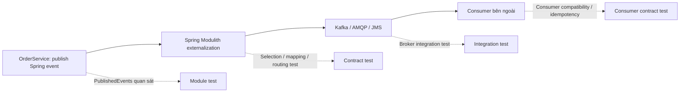

# Độ bao phủ contract external event trong Spring Modulith

## 1. Định nghĩa coverage ở **biên hệ thống**, không nhầm với event nội bộ

Trong chương **Coverage theo module** của học phần **SPRING_MODULITH_VERIFICATION_TESTING**, mục tiêu không phải đạt một tỷ lệ dòng code được chạy, mà là kiểm chứng hợp đồng giữa **module nghiệp vụ** và **hệ thống bên ngoài**. Theo định hướng của học phần, ta vẫn dùng `ApplicationModules` để bảo vệ dependency, `@ApplicationModuleTest` để xác minh hành vi, thêm kiểm thử event/DB/tích hợp và áp dụng quality gate CI. Riêng bài này tập trung vào **external event contract coverage**: đối tác có nhận đúng thông điệp, đúng route, đúng phiên bản, và xử lý an toàn khi delivery lặp hoặc thất bại không?

Ba mốc thường bị gộp sai:



| Bằng chứng test | Kết luận được phép rút ra | **Chưa** kết luận được |
| --- | --- | --- |
| `PublishedEvents` có `OrderPaid` | Module đã **publish Spring event nội bộ** | Có Kafka record, đúng JSON hay consumer đã xử lý |
| `EventExternalizationConfiguration.supports/map/determineTarget` đúng | Luật **chọn – map – route** đúng trên JVM | Broker thực sự nhận record |
| Jackson serialize payload thành JSON đúng schema | DTO và serializer **được cấu hình trong test** tạo được wire shape | Serializer và headers thực tế của broker adapter đã trùng |
| Kafka/AMQP integration test đọc record thật | Message đã xuất hiện trên topic/queue đúng trong môi trường test | Bên nhận nghiệp vụ đã commit thành công |
| Consumer contract test cùng fixture | Consumer parse/validate đúng và phản ứng theo hợp đồng | Đã xử lý idempotent sau restart nếu chỉ dùng in-memory state |
| Publication registry/outbox recovery test | Hệ thống có bằng chứng về lưu, hoàn tất/phát lại theo cấu hình | *Exactly once end-to-end* khi provider có side effect |

**Quy tắc thiết kế:** Kết quả **event published ≠ event externalized ≠ broker acknowledged ≠ consumer applied**. Mỗi dấu bằng sai đều cần một loại test riêng. `SPECIAL_NOTE` của bài trống; các ràng buộc học thuật bổ sung không được tự suy diễn.

## 2. Lập contract coverage matrix trước khi viết assertion

Giả sử sự kiện nội bộ `OrderPaid` của module `order` cần được externalize thành contract **`orders.paid.v1`**. Đối tác cần một event ID bất biến, order ID dùng làm key để cùng đơn vào cùng partition Kafka, số tiền theo **minor units** (không dùng `double`), mã tiền tệ, thời điểm UTC và schema version.

| Nhánh hợp đồng | Test dương | Test âm / thử phá contract |
| --- | --- | --- |
| **Selection** | `OrderPaid` được chọn externalize | `OrderPreviewed` nội bộ không được chọn |
| **Mapping** | Event nội bộ thành DTO `OrderPaidV1` | Đổi nhầm `amountMinor`, bỏ `eventId` hoặc để lọt field nhạy cảm |
| **Routing** | Target `orders.paid.v1`, key = `orderId` | Target sai topic, key là random event ID |
| **Headers** | `eventType`, `schemaVersion` nhất quán | Header thiếu hoặc khác payload |
| **Schema/wire** | JSON field names, integer types, ISO instant ổn định | Thiếu field bắt buộc, version không hỗ trợ, đổi số thành string |
| **Producer publication** | Một lệnh nghiệp vụ → một event đúng ID/payload | Validation/DB lỗi vẫn phát event hoặc lặp payload |
| **Transaction** | Commit kích hoạt externalizer; rollback không đẩy broker record | Nhầm `PublishedEvents` với broker delivery |
| **Delivery/retry** | Broker unavailable → có cơ chế theo dõi/retry phù hợp | Message mất, gửi trùng không được xử lý |
| **Consumer compatibility** | Hỗ trợ fixture v1, chấp nhận field mới không làm đổi nghĩa | Không nhận version sai hoặc payload thiếu dữ liệu bắt buộc |
| **Idempotency** | Cùng `eventId` giao lại không tạo side effect mới | Replay sau restart vẫn thu phí hai lần |

Đối với sự kiện ra ngoài, **contract thường là public API của hệ thống**: đổi event type name, tên field hoặc key có thể phá downstream dù các module Java nội bộ vẫn chạy xanh. Độ bao phủ phải được theo dõi theo *từng phiên bản sự kiện*, không chỉ theo tên method JUnit.

### Hợp đồng cụ thể dùng trong bài

```json
{
  "schemaVersion": 1,
  "eventId": "1555ac1a-8f8c-4589-ab63-e21f0dd948cb",
  "orderId": "2f8cfe02-7542-42e1-a408-99501dffec90",
  "amountMinor": 125000,
  "currency": "VND",
  "occurredAt": "2026-11-26T02:00:00Z"
}
```

Contract giả định **Kafka topic = `orders.paid.v1`**, message key = `orderId`, header `schemaVersion=1` và `eventType=order.paid`. Đây là **quy ước thiết kế cho bài học**, không phải quy ước mặc định mà Spring Modulith tự sinh ra cho mọi event.

## 3. Tách domain event với external DTO và khai báo routing

Ví dụ dùng **Java 17+, Spring Boot 3.4/3.5, Spring Framework 6.2, Spring Modulith 1.4, JUnit Jupiter 5** và dependency BOM tương thích. Với Kafka thật cần Spring Kafka, cấu hình broker và adapter; các test unit/contract đầu tiên không khởi chạy Kafka.

```text
src/main/java/com/example/shop/
  ShopApplication.java
  order/
    OrderPaid.java                   # domain event nội bộ
    OrderPaidV1.java                 # wire payload công khai
    OrderExternalizationConfig.java # selection, mapping, headers, key
    OrderService.java               # nghiệp vụ publish event
src/test/java/com/example/shop/
  order/
    OrderExternalizationContractTests.java
    OrderEventModuleTests.java
    OrderPaidWireContractTests.java
  ModuleArchitectureTests.java
```

Trong Maven project đã có Spring Boot và Modulith dependency management, phần dependency chính:

```xml
<dependency>
    <groupId>org.springframework.boot</groupId>
    <artifactId>spring-boot-starter-jdbc</artifactId>
</dependency>
<dependency>
    <groupId>org.springframework.modulith</groupId>
    <artifactId>spring-modulith-events-api</artifactId>
</dependency>
<dependency>
    <groupId>org.springframework.modulith</groupId>
    <artifactId>spring-modulith-starter-test</artifactId>
    <scope>test</scope>
</dependency>
<dependency>
    <groupId>org.springframework.boot</groupId>
    <artifactId>spring-boot-starter-test</artifactId>
    <scope>test</scope>
</dependency>
<dependency>
    <groupId>com.h2database</groupId>
    <artifactId>h2</artifactId>
    <scope>test</scope>
</dependency>
```

Thêm adapter tương ứng **khi chạy integration broker**: `spring-modulith-events-kafka` (Kafka), `spring-modulith-events-amqp` (AMQP), `spring-modulith-events-jms` hoặc `spring-modulith-events-messaging`. Chỉ khai báo API annotation/configuration **không tự kết nối broker**; mỗi adapter có dependency và semantics riêng. Trong Spring Modulith 1.4, Kafka dùng logical routing target làm **topic** và key làm **record key**; AMQP dùng logical key làm **routing key**, không phải Kafka partition key.

`src/main/java/com/example/shop/ShopApplication.java`:

```java
package com.example.shop;

import org.springframework.boot.SpringApplication;
import org.springframework.boot.autoconfigure.SpringBootApplication;

@SpringBootApplication
public class ShopApplication {
    public static void main(String[] args) {
        SpringApplication.run(ShopApplication.class, args);
    }
}
```

### Domain event: public annotation dùng để đánh dấu externalization

`src/main/java/com/example/shop/order/OrderPaid.java`:

```java
package com.example.shop.order;

import java.time.Instant;
import java.util.UUID;
import org.springframework.modulith.events.Externalized;

@Externalized("orders.paid.v1")
public record OrderPaid(
        UUID eventId,
        UUID orderId,
        long amountMinor,
        String currency,
        Instant occurredAt) {
}
```

`@Externalized` đánh dấu type cần externalize; ở đây ta chọn một **topic logic cố định**. Record gốc chứa `Instant`/`UUID` theo kiểu miền Java, còn wire DTO sẽ dùng kiểu/field ổn định. **Đừng tự suy ra** vì domain event có annotation thì JSON được gửi ra mặc nhiên có schema phù hợp.

### Wire payload: DTO được version hóa có chủ đích

`src/main/java/com/example/shop/order/OrderPaidV1.java`:

```java
package com.example.shop.order;

public record OrderPaidV1(
        int schemaVersion,
        String eventId,
        String orderId,
        long amountMinor,
        String currency,
        String occurredAt) {

    public static OrderPaidV1 from(OrderPaid event) {
        return new OrderPaidV1(
                1,
                event.eventId().toString(),
                event.orderId().toString(),
                event.amountMinor(),
                event.currency(),
                event.occurredAt().toString());
    }
}
```

Không đưa địa chỉ, token hay dữ liệu thanh toán nhạy cảm vào payload chỉ vì domain object có sẵn. Nếu cần PII, phải có hợp đồng tối thiểu, phân quyền, chính sách lưu giữ và compliance phù hợp với loại dữ liệu.

### Externalization config: chọn, map, gắn headers, route key

`src/main/java/com/example/shop/order/OrderExternalizationConfig.java`:

```java
package com.example.shop.order;

import java.util.Map;
import org.springframework.context.annotation.Bean;
import org.springframework.context.annotation.Configuration;
import org.springframework.modulith.events.EventExternalizationConfiguration;

@Configuration(proxyBeanMethods = false)
public class OrderExternalizationConfig {

    @Bean
    EventExternalizationConfiguration externalizationConfiguration() {
        return config();
    }

    public static EventExternalizationConfiguration config() {
        return EventExternalizationConfiguration.externalizing()
                .select(EventExternalizationConfiguration
                        .annotatedAsExternalized())
                .mapping(OrderPaid.class, OrderPaidV1::from)
                .headers(OrderPaid.class, event ->
                        Map.of("eventType", "order.paid",
                               "schemaVersion", "1"))
                .routeKey(OrderPaid.class,
                        event -> event.orderId().toString())
                .build();
    }
}
```

API 1.4 ở trên phân biệt: `select(...)` kiểm tra annotation, `mapping(...)` chuẩn bị wire payload, `headers(...)` cấp metadata, `routeKey(...)` xác định key động. **Routing vẫn dựa trên event gốc** khi mapping được cấu hình, trừ khi chủ động dùng `routeMapped()`. Với selection tùy biến, phải chủ động kiểm soát phạm vi: ví dụ `select(annotatedAsExternalized())` **không tự duy trì bộ lọc base package mặc định**. Hãy test các type được chọn và loại trừ.

## 4. Contract unit test: **selection, mapping, topic, key và headers**

Ở tầng này **không cần Spring context, Kafka, database hoặc Mockito**. Ta kiểm tra trực tiếp cấu hình externalization là một **hợp đồng thuần**. Lợi ích: một refactor làm đổi topic/key/payload sẽ fail trong vài mili giây, trước khi tới integration test tốn chi phí.

`src/test/java/com/example/shop/order/OrderExternalizationContractTests.java`:

```java
package com.example.shop.order;

import static org.assertj.core.api.Assertions.assertThat;

import java.time.Instant;
import java.util.UUID;
import org.junit.jupiter.api.DisplayName;
import org.junit.jupiter.api.Tag;
import org.junit.jupiter.api.Test;
import org.springframework.modulith.events.EventExternalizationConfiguration;
import org.springframework.modulith.events.RoutingTarget;

@Tag("contract")
@Tag("external-event")
@DisplayName("OrderPaid outbound externalization contract")
class OrderExternalizationContractTests {

    private final EventExternalizationConfiguration config =
            OrderExternalizationConfig.config();

    private final UUID orderId =
            UUID.fromString("2f8cfe02-7542-42e1-a408-99501dffec90");

    private final UUID eventId =
            UUID.fromString("1555ac1a-8f8c-4589-ab63-e21f0dd948cb");

    private final OrderPaid sample = new OrderPaid(
            eventId,
            orderId,
            125_000L,
            "VND",
            Instant.parse("2026-11-26T02:00:00Z"));

    @Test
    void onlyExplicitlyExternalizedEventsAreSelected() {
        assertThat(config.supports(sample)).isTrue();
        assertThat(config.supports(
                new InternalOrderPreview(orderId))).isFalse();
    }

    @Test
    void mapsDomainEventToStablePublicV1Payload() {
        assertThat(config.map(sample))
                .isEqualTo(new OrderPaidV1(
                        1,
                        eventId.toString(),
                        orderId.toString(),
                        125_000L,
                        "VND",
                        "2026-11-26T02:00:00Z"));
    }

    @Test
    void routesByOrderIdToVersionedTopic() {
        RoutingTarget routing = config.determineTarget(sample);

        assertThat(routing.getTarget()).isEqualTo("orders.paid.v1");
        assertThat(routing.getKey()).isEqualTo(orderId.toString());
        assertThat(routing.getKey()).isNotEqualTo(eventId.toString());
    }

    @Test
    void exposesContractHeaders() {
        assertThat(config.getHeadersFor(sample))
                .containsEntry("eventType", "order.paid")
                .containsEntry("schemaVersion", "1");
    }

    // Type nội bộ, không được đánh dấu @Externalized.
    record InternalOrderPreview(UUID orderId) {}
}
```

**Cần quan sát gì khi cố ý làm sai?**

- Bỏ `@Externalized` khỏi `OrderPaid` → testcase selection phải **đỏ**.
- Đổi `OrderPaidV1.from(...)` sang `amountMinor / 100` → mapper test phải **đỏ**.
- Thay `orders.paid.v1` bằng `orders.paid.v2` khi chưa có migration contract → test topic **đỏ**.
- Dùng `eventId` thay vì `orderId` làm routing key → test key **đỏ**.
- Xóa header version → test headers **đỏ**.

Test không giả lập “Kafka đã gửi thành công”; nó chỉ chứng minh giá trị sẽ được **trao cho adapter externalization** nếu event được chọn và việc gửi được kích hoạt. Kiểm tra Kafka record thực tế là trách nhiệm của mục 7.

### Hai bẫy thường gặp khi cấu hình custom

**Bẫy 1 — chọn quá rộng:** `.select(annotatedAsExternalized())` có thể chọn sự kiện annotated ở package không thuộc vùng application-base mặc định nếu chúng nằm trong phạm vi được framework quan sát. Nếu cần allowlist chặt, thêm predicate/package rule hoặc xét loại event cụ thể; có unit tests xác nhận **không có các event nội bộ/nhạy cảm được externalize**.

**Bẫy 2 — route theo object sau mapping mà không chủ đích:** Spring Modulith mặc định xác định route từ **original event**, dù payload đã được mapping. Nếu bật `routeMapped()`, phép thử routing phải phản ánh loại object mới. Đừng thay đổi mapping rồi mặc nhiên kết luận topic/key giữ nguyên.

## 5. Wire schema: JSON, version, compatibility và payload an toàn

Contract cấp Java chưa đủ: một consumer ngoài JVM nhìn thấy **bytes và headers**, không thấy Java `record`. Kiểm thử JSON cần chốt tên field, kiểu số, date format, schema version và quy tắc tương thích.

### Golden-shape test với Jackson

`src/test/java/com/example/shop/order/OrderPaidWireContractTests.java`:

```java
package com.example.shop.order;

import static org.assertj.core.api.Assertions.assertThat;
import static org.assertj.core.api.Assertions.assertThatThrownBy;

import com.fasterxml.jackson.databind.JsonNode;
import com.fasterxml.jackson.databind.ObjectMapper;
import java.time.Instant;
import java.util.UUID;
import org.junit.jupiter.api.Tag;
import org.junit.jupiter.api.Test;

@Tag("contract")
@Tag("external-event")
class OrderPaidWireContractTests {

    private final ObjectMapper mapper = new ObjectMapper();

    @Test
    void v1HasRequiredFieldsAndWireTypes() throws Exception {
        var original = new OrderPaid(
                UUID.fromString("1555ac1a-8f8c-4589-ab63-e21f0dd948cb"),
                UUID.fromString("2f8cfe02-7542-42e1-a408-99501dffec90"),
                125_000L, "VND",
                Instant.parse("2026-11-26T02:00:00Z"));

        OrderPaidV1 payload = OrderPaidV1.from(original);
        JsonNode json = mapper.readTree(
                mapper.writeValueAsBytes(payload));

        assertThat(json.size()).isEqualTo(6);
        assertThat(json.get("schemaVersion").intValue()).isEqualTo(1);
        assertThat(json.get("eventId").asText())
                .isEqualTo(original.eventId().toString());
        assertThat(json.get("orderId").asText())
                .isEqualTo(original.orderId().toString());
        assertThat(json.get("amountMinor").isIntegralNumber()).isTrue();
        assertThat(json.get("amountMinor").longValue())
                .isEqualTo(125_000L);
        assertThat(json.get("currency").asText()).isEqualTo("VND");
        assertThat(json.get("occurredAt").asText())
                .isEqualTo("2026-11-26T02:00:00Z");
        assertThat(json.has("creditCardNumber")).isFalse();
        assertThat(json.has("password")).isFalse();
    }

    @Test
    void malformedJsonDoesNotSilentlyPassVerification() {
        assertThatThrownBy(() -> mapper.readTree("{broken"))
                .isInstanceOf(
                        com.fasterxml.jackson.core.JsonProcessingException.class);
    }
}
```

Jackson test trên cố tình dùng một DTO có `String occurredAt` và `String UUID`, nên không phụ thuộc thêm module cấu hình serialization cho `Instant`. Nó chứng minh **wire shape với `ObjectMapper` được khai báo trong test**, chưa bảo đảm Kafka adapter dùng cùng serializer hoặc cùng cấu hình header/byte encoding. Kiểm thử broker cần **đọc chính byte payload từ broker** và so sánh schema.

### Quy tắc evolution cho v1

| Thay đổi đề xuất | Tương thích? | Test bắt buộc |
| --- | --- | --- |
| Thêm field tùy chọn mà consumer v1 bỏ qua được | Có thể **backward compatible**, tùy chính sách reader | Consumer đọc fixture có extra field |
| Đổi `amountMinor` từ integer sang decimal/string | Có thể breaking | Golden JSON type và consumer parse test |
| Đổi `orderId` sang `eventId` ở Kafka key | Breaking đối với partition/order semantics | Route-key test và broker record test |
| Xóa `currency` | Breaking nếu consumer yêu cầu | Missing-required-field rejection |
| Đổi topic `orders.paid.v1` sang `orders.paid.v2` | Contract/channel mới, cần migration | Hai contract versions trong giai đoạn chuyển đổi |
| Đổi `occurredAt` sang timezone không ổn định | Có thể gây lỗi parse/so sánh thời gian | ISO-8601/UTC parse assertion |

**Cảnh báo Jackson:** Java records có thể deserialize **thiếu field** thành `null` hoặc giá trị mặc định cho primitive tùy cấu hình. Đừng coi `readValue(...)` không ném exception là bằng chứng payload hợp lệ. Consumer phải **validate required fields và schemaVersion sau deserialization**. Tương tự, cấu hình cho phép unknown fields cần được chọn tường minh theo compatibility policy của từng phiên bản.

**Không tự khẳng định exactly-once:** `eventId` là **idempotency identifier**, không phải chứng nhận broker sẽ chỉ giao event một lần. Test phải mô phỏng lặp cùng ID, cũng như event khác ID nhưng cùng order, tùy semantic contract đã thống nhất.

## 6. Producer `@ApplicationModuleTest`: xác minh **nguồn event** và transaction

Các contract tests ở mục 4–5 bảo vệ phép biến đổi/routing, nhưng chưa biết nghiệp vụ có thực sự phát `OrderPaid` hay không. Ở đây dùng **JDBC/H2 thật** để kiểm chứng một lần chuyển trạng thái và domain event có cùng ID; vẫn không thay thế kiểm chứng bản ghi Kafka.

### Service phát event trong transaction

`src/test/resources/schema.sql`:

```sql
CREATE TABLE paid_orders (
    order_id UUID PRIMARY KEY,
    amount_minor BIGINT NOT NULL,
    currency VARCHAR(3) NOT NULL
);
```

Trong ví dụ test, H2 embedded được khởi tạo từ `schema.sql` qua Spring Boot SQL initialization. Nếu dự án có Flyway/Liquibase thì **đừng chạy thêm một cơ chế tạo bảng trùng**. File này chỉ phục vụ test; production cần migration thích hợp.

`src/main/java/com/example/shop/order/OrderService.java`:

```java
package com.example.shop.order;

import java.time.Instant;
import java.util.UUID;
import org.springframework.context.ApplicationEventPublisher;
import org.springframework.jdbc.core.JdbcTemplate;
import org.springframework.stereotype.Service;
import org.springframework.transaction.annotation.Transactional;

@Service
public class OrderService {

    private final JdbcTemplate jdbc;
    private final ApplicationEventPublisher publisher;

    public OrderService(JdbcTemplate jdbc,
                        ApplicationEventPublisher publisher) {
        this.jdbc = jdbc;
        this.publisher = publisher;
    }

    @Transactional
    public OrderPaid recordPayment(
            UUID orderId, long amountMinor, String currency) {

        if (orderId == null || amountMinor <= 0
                || currency == null || currency.isBlank()) {
            throw new IllegalArgumentException("INVALID_PAYMENT");
        }

        jdbc.update("""
                INSERT INTO paid_orders(order_id, amount_minor, currency)
                VALUES (?, ?, ?)
                """, orderId, amountMinor, currency);

        OrderPaid domainEvent = new OrderPaid(
                UUID.randomUUID(),
                orderId,
                amountMinor,
                currency,
                Instant.now());
        publisher.publishEvent(domainEvent);
        return domainEvent;
    }
}
```

Đây là use case minh họa: `eventId` được sinh **một lần cho lần chấp nhận thanh toán cụ thể** và giữ trong domain event. Khi phát lại cùng publication từ registry, phải tái sử dụng **cùng eventId**, không tạo eventId mới cho mỗi attempt. Nếu một command được gửi lặp lại hoàn toàn, unique `order_id` và chính sách idempotency của command phải được thiết kế riêng (ví dụ trả lại trạng thái đã lưu), không chỉ dựa vào eventId ngẫu nhiên ở lần gọi đầu.

### JUnit module test: commit, rollback, validation

`src/test/java/com/example/shop/order/OrderEventModuleTests.java`:

```java
package com.example.shop.order;

import static org.assertj.core.api.Assertions.assertThat;
import static org.assertj.core.api.Assertions.assertThatThrownBy;
import static org.junit.jupiter.api.Assertions.assertAll;

import java.util.UUID;
import org.junit.jupiter.api.Tag;
import org.junit.jupiter.api.Test;
import org.springframework.beans.factory.annotation.Autowired;
import org.springframework.jdbc.core.JdbcTemplate;
import org.springframework.modulith.test.ApplicationModuleTest;
import org.springframework.modulith.test.PublishedEvents;
import org.springframework.test.context.TestPropertySource;
import org.springframework.transaction.PlatformTransactionManager;
import org.springframework.transaction.support.TransactionTemplate;

@Tag("module")
@Tag("external-event")
@ApplicationModuleTest
@TestPropertySource(properties =
        "spring.modulith.events.externalization.enabled=false")
class OrderEventModuleTests {

    @Autowired OrderService orders;
    @Autowired JdbcTemplate jdbc;
    @Autowired PlatformTransactionManager transactions;

    @Test
    void successfulPaymentPublishesOneEventWithConsistentPayload(
            PublishedEvents events) {

        UUID orderId = UUID.randomUUID();

        try {
            OrderPaid actual = orders.recordPayment(
                    orderId, 125_000L, "VND");

            Long stored = jdbc.queryForObject(
                    "SELECT amount_minor FROM paid_orders WHERE order_id = ?",
                    Long.class, orderId);

            assertAll("DB và domain event của cùng payment",
                () -> assertThat(stored).isEqualTo(125_000L),
                () -> assertThat(events.ofType(OrderPaid.class)
                        .matching(OrderPaid::orderId, orderId))
                        .singleElement()
                        .satisfies(event -> assertAll(
                            () -> assertThat(event.eventId())
                                    .isEqualTo(actual.eventId()),
                            () -> assertThat(event.amountMinor())
                                    .isEqualTo(125_000L),
                            () -> assertThat(event.currency())
                                    .isEqualTo("VND")
                        ))
            );
        } finally {
            clean(orderId);
        }
    }

    @Test
    void invalidPaymentDoesNotWriteOrPublish(
            PublishedEvents events) {
        UUID orderId = UUID.randomUUID();

        assertThatThrownBy(() ->
                orders.recordPayment(orderId, 0, "VND"))
                .isInstanceOf(IllegalArgumentException.class)
                .hasMessage("INVALID_PAYMENT");

        assertThat(countRows(orderId)).isZero();
        assertThat(events.ofType(OrderPaid.class)
                .matching(OrderPaid::orderId, orderId)).isEmpty();
    }

    @Test
    void outerRollbackRemovesRow_evenIfEventWasPublished(
            PublishedEvents events) {
        UUID orderId = UUID.randomUUID();
        var tx = new TransactionTemplate(transactions);

        try {
            tx.executeWithoutResult(status -> {
                orders.recordPayment(orderId, 125_000L, "VND");
                status.setRollbackOnly();
            });

            assertThat(countRows(orderId)).isZero();

            // PublishedEvents kiểm tra Spring event nguồn,
            // KHÔNG khẳng định broker đã nhận record.
            assertThat(events.ofType(OrderPaid.class)
                    .matching(OrderPaid::orderId, orderId))
                    .hasSize(1);
        } finally {
            clean(orderId);
        }
    }

    private int countRows(UUID id) {
        Integer result = jdbc.queryForObject(
                "SELECT COUNT(*) FROM paid_orders WHERE order_id = ?",
                Integer.class, id);
        return result.intValue();
    }

    private void clean(UUID id) {
        jdbc.update("DELETE FROM paid_orders WHERE order_id = ?", id);
    }
}
```

**Đọc đúng kết quả:** `recordPayment(...)` có transaction thật (do Spring proxy quản lý), test method **không** tự mở `@Transactional`, nên các query phía sau quan sát state **sau khi service/outer transaction kết thúc**. Ở case rollback, `PublishedEvents` vẫn có thể nhìn thấy event nguồn đã publish trước rollback; externalizer thực sự hoạt động **sau commit** theo cơ chế event listener, và bài test này cố ý **tắt externalization**. Vì vậy **không được** suy ra “Kafka không có record” chỉ từ test module này — phải xác minh ở tầng broker.

### Những thay đổi khiến test phải đỏ

| Mutation thử nghiệm | Assertion kỳ vọng fail |
| --- | --- |
| Bỏ `publisher.publishEvent(...)` | Cardinality domain event |
| Publish `amountMinor + 1` | Payload amount của event |
| Bỏ `jdbc.update(INSERT...)` | Database row assertion |
| Bỏ `@Transactional` khỏi service | Rollback outer template vẫn có thể bảo vệ DB vì transaction ngoài; **không đủ để chứng minh annotation riêng** |
| Bỏ `status.setRollbackOnly()` | Rollback testcase chuyển đỏ vì row còn trong DB |

Để chứng minh chính annotation `@Transactional` của service là cần thiết, bổ sung một testcase **insert rồi ném unchecked exception bên trong service** và kiểm tra rollback khi **không có outer transaction**. Test outer rollback ở đây chứng minh *tham gia transaction và rollback theo hợp đồng*, không đủ một mình chứng minh annotation ở đúng vị trí.

## 7. Broker integration: kiểm chứng **record thật** thay vì tin vào `PublishedEvents`

Khi chạy Kafka, Spring Modulith 1.4 cần artifact `spring-modulith-events-kafka`, `spring-kafka` (nếu chưa có qua dependency), và ở test scope `spring-kafka-test`. Broker có thể dùng `@EmbeddedKafka` hoặc Kafka Testcontainers. Mục tiêu là xác minh **topic, key, payload bytes, headers và thời điểm sau commit** trên chính record broker.

Thêm vào POM đã có BOM tương thích:

```xml
<dependency>
    <groupId>org.springframework.modulith</groupId>
    <artifactId>spring-modulith-events-kafka</artifactId>
</dependency>
<dependency>
    <groupId>org.springframework.kafka</groupId>
    <artifactId>spring-kafka</artifactId>
</dependency>
<dependency>
    <groupId>org.springframework.kafka</groupId>
    <artifactId>spring-kafka-test</artifactId>
    <scope>test</scope>
</dependency>
```

Ví dụ test tích hợp tối thiểu cho **môi trường Spring Kafka 3.3**, chạy riêng với module tests ở mục 6:

```java
package com.example.shop;

import static org.assertj.core.api.Assertions.assertThat;

import java.nio.charset.StandardCharsets;
import java.time.Duration;
import java.util.UUID;
import com.example.shop.order.OrderPaid;
import com.example.shop.order.OrderService;
import com.fasterxml.jackson.databind.ObjectMapper;
import org.apache.kafka.clients.consumer.Consumer;
import org.apache.kafka.clients.consumer.ConsumerConfig;
import org.apache.kafka.common.serialization.StringDeserializer;
import org.junit.jupiter.api.Tag;
import org.junit.jupiter.api.Test;
import org.springframework.beans.factory.annotation.Autowired;
import org.springframework.boot.test.context.SpringBootTest;
import org.springframework.jdbc.core.JdbcTemplate;
import org.springframework.kafka.core.DefaultKafkaConsumerFactory;
import org.springframework.kafka.test.EmbeddedKafkaBroker;
import org.springframework.kafka.test.context.EmbeddedKafka;
import org.springframework.kafka.test.utils.KafkaTestUtils;

@Tag("integration")
@Tag("external-event")
@SpringBootTest(properties = {
    "spring.modulith.events.externalization.enabled=true",
    "spring.kafka.producer.key-serializer=org.apache.kafka.common.serialization.StringSerializer",
    "spring.kafka.producer.value-serializer=org.springframework.kafka.support.serializer.JsonSerializer",
    "spring.kafka.producer.properties.spring.json.add.type.headers=false"
})
@EmbeddedKafka(
    partitions = 1,
    topics = "orders.paid.v1",
    bootstrapServersProperty = "spring.kafka.bootstrap-servers"
)
class OrderPaidKafkaIT {

    @Autowired OrderService orders;
    @Autowired JdbcTemplate jdbc;
    @Autowired EmbeddedKafkaBroker broker;

    @Test
    void commitProducesCorrectWireMessage() throws Exception {
        UUID orderId = UUID.randomUUID();
        var consumerProps = KafkaTestUtils.consumerProps(
                "contract-" + UUID.randomUUID(), "false", broker);
        consumerProps.put(
                ConsumerConfig.AUTO_OFFSET_RESET_CONFIG, "earliest");

        var factory = new DefaultKafkaConsumerFactory<>(
                consumerProps,
                new StringDeserializer(),
                new StringDeserializer());

        try (Consumer<String, String> consumer =
                factory.createConsumer()) {

            broker.consumeFromAnEmbeddedTopic(
                    consumer, "orders.paid.v1");

            OrderPaid domain = orders.recordPayment(
                    orderId, 125_000L, "VND");

            var record = KafkaTestUtils.getSingleRecord(
                    consumer, "orders.paid.v1",
                    Duration.ofSeconds(10));
            var json = new ObjectMapper().readTree(record.value());

            assertThat(record.topic()).isEqualTo("orders.paid.v1");
            assertThat(record.key()).isEqualTo(orderId.toString());
            assertThat(json.get("eventId").asText())
                    .isEqualTo(domain.eventId().toString());
            assertThat(json.get("schemaVersion").intValue())
                    .isEqualTo(1);
            assertThat(json.get("amountMinor").longValue())
                    .isEqualTo(125_000L);
            assertThat(json.get("currency").asText()).isEqualTo("VND");

            var versionHeader =
                    record.headers().lastHeader("schemaVersion");
            assertThat(versionHeader).isNotNull();
            assertThat(new String(versionHeader.value(),
                    StandardCharsets.UTF_8)).isEqualTo("1");
        } finally {
            jdbc.update(
                    "DELETE FROM paid_orders WHERE order_id = ?", orderId);
        }
    }
}
```

**Điều kiện để tích hợp vào dự án thật:** Dùng Spring Boot 3.4/3.5 và Spring Kafka 3.3 tương thích, JSON serializer producer đúng, annotation/config bean của mục 3 nằm trong component scan, `spring-kafka-test` khả dụng, H2 schema được khởi tạo và không có broker khác tranh bootstrap property. Kiểm chứng header thực tế có thể cần điều chỉnh converter/serializer nếu hệ thống đã customize header mapping. Ví dụ trên **chưa được chạy trong bước soạn nội dung** và cần xác minh qua build/CI ở bước triển khai, không phải một bằng chứng đã có broker thành công.

Đối với suite dùng chung topic/broker hoặc chạy song song, `getSingleRecord(...)` có thể bị ảnh hưởng bởi record của testcase khác. Hãy **cô lập broker/topic hoặc group offsets**, hoặc tiêu thụ và lọc record theo **eventId**; đừng dùng `Thread.sleep(...)` rồi lấy record bất kỳ. Nếu cần assert **không xuất hiện record khi rollback**, phải có một khoảng quan sát hữu hạn và đối chiếu ID, không thể kết luận “không bao giờ xuất hiện” chỉ từ một poll ngắn.

**Tầng broker này vẫn chưa kiểm chứng consumer nghiệp vụ.** Nó chỉ chứng minh một record của producer có thể đọc được từ Kafka với configuration đang test. Consumer contract và idempotency nằm ở mục 8.

## 8. Inbound contract: validation, compatibility và xử lý **duplicate event**

External event contract coverage không chỉ nhìn **outbound producer**. Nếu ứng dụng còn nhận sự kiện của hệ thống khác, module nhận phải chứng minh **đọc được v1**, từ chối dữ liệu hỏng/không hỗ trợ và không lặp business side effect khi broker gửi cùng event nhiều lần.

Giả sử shop nhận topic `payments.captured.v1` để đối chiếu khoản thanh toán. Đây là **một contract inbound khác** với `orders.paid.v1` ở phần trước:

`src/main/java/com/example/shop/order/inbound/PaymentCapturedV1.java`:

```java
package com.example.shop.order.inbound;

import com.fasterxml.jackson.annotation.JsonIgnoreProperties;

// Quy ước v1: consumer cho phép field mới từ upstream,
// nhưng luôn validate các field bắt buộc trong handler.
@JsonIgnoreProperties(ignoreUnknown = true)
public record PaymentCapturedV1(
        int schemaVersion,
        String eventId,
        String orderId,
        long amountMinor,
        String currency) {
}
```

**Bảo vệ hợp đồng:** Unknown field được bỏ qua để hỗ trợ một số thay đổi additive theo quy ước v1. Nó không có nghĩa thiếu field bắt buộc sẽ bị Jackson từ chối: các field primitive có thể có default `0`, reference có thể là `null`. Validation phải diễn ra ở ranh giới nhận dữ liệu, trước khi tạo side effect.

### Handler core có thể unit test không cần broker

`src/main/java/com/example/shop/order/inbound/PaymentCapturedHandler.java`:

```java
package com.example.shop.order.inbound;

import java.util.Set;
import java.util.UUID;
import java.util.concurrent.ConcurrentHashMap;
import java.util.concurrent.ConcurrentMap;
import org.springframework.stereotype.Component;

@Component
public class PaymentCapturedHandler {

    private final Set<UUID> processed = ConcurrentHashMap.newKeySet();
    private final ConcurrentMap<UUID, Long> receivedMinor =
            new ConcurrentHashMap<>();

    public boolean handle(PaymentCapturedV1 event) {
        if (event == null || event.schemaVersion() != 1
                || event.eventId() == null
                || event.orderId() == null
                || event.amountMinor() <= 0
                || !"VND".equals(event.currency())) {
            throw new IllegalArgumentException(
                    "INVALID_PAYMENT_EVENT_CONTRACT");
        }

        UUID eventId = UUID.fromString(event.eventId());
        UUID orderId = UUID.fromString(event.orderId());

        // Demo: atomic Set.add() chặn duplicate trong một JVM.
        if (!processed.add(eventId)) {
            return false;
        }

        receivedMinor.merge(orderId, event.amountMinor(), Long::sum);
        return true;
    }

    public long receivedMinor(UUID orderId) {
        return receivedMinor.getOrDefault(orderId, 0L);
    }
}
```

**Giới hạn cố ý của fake này:** `ConcurrentHashMap` và `Set` **không bền qua restart**. Ngoài ra, thêm ID vào set rồi cập nhật amount **không phải một transaction DB nguyên tử**; nếu cập nhật amount fail sau khi ID được ghi, có thể nuốt mất sự kiện khi retry. Đưa vào production cần dedup store bền vững và update business state **trong cùng transaction**, cùng unique constraint trên event ID. Demo chỉ chứng minh logic phân loại duplicate trong một process.

### JUnit consumer contract test

`src/test/java/com/example/shop/order/inbound/PaymentCapturedContractTests.java`:

```java
package com.example.shop.order.inbound;

import static org.assertj.core.api.Assertions.assertThat;
import static org.assertj.core.api.Assertions.assertThatThrownBy;

import com.fasterxml.jackson.databind.ObjectMapper;
import java.util.UUID;
import org.junit.jupiter.api.Tag;
import org.junit.jupiter.api.Test;

@Tag("contract")
@Tag("external-event")
class PaymentCapturedContractTests {

    private final ObjectMapper mapper = new ObjectMapper();
    private final PaymentCapturedHandler handler =
            new PaymentCapturedHandler();

    private final String eventId =
            "45f0b811-d35f-454a-adbe-266ce641ac7f";
    private final String orderId =
            "6a155d87-725d-436f-a802-559a013e6e50";

    @Test
    void acceptsV1WithAdditiveOptionalField() throws Exception {
        String raw = """
                {
                  "schemaVersion": 1,
                  "eventId": "45f0b811-d35f-454a-adbe-266ce641ac7f",
                  "orderId": "6a155d87-725d-436f-a802-559a013e6e50",
                  "amountMinor": 120000,
                  "currency": "VND",
                  "traceHint": "optional-new-field"
                }
                """;

        PaymentCapturedV1 decoded =
                mapper.readValue(raw, PaymentCapturedV1.class);

        assertThat(handler.handle(decoded)).isTrue();
        assertThat(handler.receivedMinor(UUID.fromString(orderId)))
                .isEqualTo(120_000L);
    }

    @Test
    void redeliveryOfSameEventDoesNotApplyAmountTwice() {
        var event = new PaymentCapturedV1(
                1, eventId, orderId, 120_000L, "VND");

        assertThat(handler.handle(event)).isTrue();
        assertThat(handler.handle(event)).isFalse();
        assertThat(handler.receivedMinor(UUID.fromString(orderId)))
                .isEqualTo(120_000L);
    }

    @Test
    void missingRequiredFieldAndUnsupportedVersionFail() {
        var missingCurrency = new PaymentCapturedV1(
                1, eventId, orderId, 1_000L, null);
        var version2 = new PaymentCapturedV1(
                2, eventId, orderId, 1_000L, "VND");

        assertThatThrownBy(() -> handler.handle(missingCurrency))
                .isInstanceOf(IllegalArgumentException.class);
        assertThatThrownBy(() -> handler.handle(version2))
                .isInstanceOf(IllegalArgumentException.class);
    }
}
```

Những test trên dùng **một handler mới cho mỗi test instance** (JUnit mặc định `PER_METHOD` cho class thuần ở đây), tránh rò seen IDs giữa methods. Không suy rộng điều này cho `@ApplicationModuleTest`: Spring Modulith 1.4 có test-instance lifecycle riêng và Spring context còn cache singleton beans, nên với module/integration tests phải tự cô lập fixture và cleanup.

### Adapter Kafka đi vào hệ thống

Ở tầng transport, một adapter có thể delegate JSON đã parse cho handler:

```java
package com.example.shop.order.inbound;

import com.fasterxml.jackson.core.JsonProcessingException;
import com.fasterxml.jackson.databind.ObjectMapper;
import org.springframework.kafka.annotation.KafkaListener;
import org.springframework.stereotype.Component;

@Component
public class PaymentCapturedKafkaAdapter {

    private final ObjectMapper mapper;
    private final PaymentCapturedHandler handler;

    public PaymentCapturedKafkaAdapter(
            ObjectMapper mapper, PaymentCapturedHandler handler) {
        this.mapper = mapper;
        this.handler = handler;
    }

    @KafkaListener(
        topics = "payments.captured.v1",
        groupId = "shop-order-payments"
    )
    public void receive(String json) throws JsonProcessingException {
        handler.handle(
                mapper.readValue(json, PaymentCapturedV1.class));
    }
}
```

**Đây là adapter tùy chọn khi có Kafka consumer configuration**, không phải thành phần cần nạp trong tất cả unit/module tests. Test broker cần gửi raw message chứa payload v1 lên `payments.captured.v1`, quan sát side effect và lỗi malformed payload qua `DefaultErrorHandler`/DLQ theo chính sách dự án. Không tự bắt exception rồi `log.warn(...)` và trả thành công: nếu listener trả bình thường, container có thể commit offset mặc dù event bị bỏ qua.

**Ranh giới trách nhiệm:** Producer contract test bảo vệ **message mà hệ thống phát**; consumer contract test bảo vệ **message mà hệ thống chấp nhận**. Hai contract này có thể khác topic, owner, version và lịch phát hành; không dùng DTO nội bộ của producer để thay thế fixture do upstream sở hữu.

## 9. Coverage cho broker failure, rollback, publication registry và replay

Một bài Kafka integration test thành công chưa đủ để tuyên bố hệ thống giao event tin cậy. Cần cố tình tạo **failure ở đúng thời điểm** và kiểm tra cả transaction lẫn điểm ghi nhận đã hoàn tất.

### Ma trận failure injection tại biên externalization

| Thời điểm lỗi | Điều phải quan sát | Kết luận sai cần tránh |
| --- | --- | --- |
| Trước khi tạo domain event | Không có Spring event, không có DB business record | “Không thấy Kafka record” chỉ vì không có producer |
| Transaction rollback **sau publish domain event** | DB business record rollback, externalizer `AFTER_COMMIT` không phát record | `PublishedEvents` rỗng (thực tế event nguồn có thể đã phát) |
| Kafka broker unavailable sau commit | Publication chưa hoàn tất được lưu/đánh dấu theo **registry đã cấu hình**, không mất event âm thầm | “Producer đã gọi KafkaTemplate là broker đã ACK” |
| Broker lưu record nhưng ACK về producer bị mất | Retry **có thể** tạo bản sao với cùng event ID | “At-least-once = exactly-once” |
| JSON không serialize được | Externalization báo lỗi; publication chưa hoàn tất/recovery policy rõ | Ném exception rồi nuốt và mark complete |
| Consumer nhận lại cùng `eventId` | Không tăng business side effect lần hai | “Kafka offset đã commit nên không thể duplicate” |
| Consumer gặp version không hỗ trợ | NACK/retry hoặc DLQ theo lỗi permanent, có observability | Bắt exception và trả thành công |
| Crash sau business commit, trước externalization | Registry/outbox có bản ghi khôi phục được theo implementation đang dùng | “Đã có `@Transactional` nên tự động gửi lại sau restart” |

### Spring Modulith 1.4 Event Publication Registry

Với Spring Modulith 1.4, một cách dùng **persistent publication log** là thêm starter cho persistence technology, ví dụ JDBC:

```xml
<dependency>
    <groupId>org.springframework.modulith</groupId>
    <artifactId>spring-modulith-starter-jdbc</artifactId>
</dependency>
```

Starter này đưa vào event publication registry JDBC cùng serializer Jackson. Nó khác với `spring-boot-starter-jdbc` dùng cho `JdbcTemplate` ở mục 6: **có datasource không đồng nghĩa đã bật persistent event registry**. Nếu không muốn để starter init schema, quản lý bảng bằng Flyway/Liquibase.

Ví dụ property test/production cần được kiểm tra theo môi trường:

```properties
spring.modulith.events.externalization.enabled=true
spring.modulith.events.jdbc.schema-initialization.enabled=true
spring.modulith.events.republish-outstanding-events-on-restart=false
```

Các property trên thuộc Spring Modulith **1.4**. Với JDBC registry, `schema-initialization.enabled=true` chỉ thích hợp khi muốn framework tự chuẩn bị schema; production thường cần migration có kiểm soát. `republish-outstanding-events-on-restart=false` thể hiện lựa chọn **không tự resubmit khi startup**; trong hệ thống multi-instance, bật auto-resubmit cần xem xét cạnh tranh giữa các instance và khả năng duplicate.

Spring Modulith 1.4 có bean `IncompleteEventPublications` cho phép điều phối **resubmit** những publication chưa hoàn tất. Ví dụ lời gọi API hợp lệ:

```java
import java.time.Duration;
import org.springframework.modulith.events.IncompleteEventPublications;

// Dùng trong một component vận hành/test harness đã inject bean.
void retryOldPublications(IncompleteEventPublications publications) {
    publications.resubmitIncompletePublicationsOlderThan(
            Duration.ofMinutes(1));
}
```

Đây **không** phải một test xác nhận recovery, cũng không phải lời khuyên gọi resubmit vô điều kiện trong mọi request. Với test integration đáng tin, phải chủ động:

1. Khởi tạo JDBC registry và broker test, dùng **eventId riêng**.
2. Inject một broker failure có kiểm soát **sau khi business transaction commit**; quan sát publication tương ứng **chưa completed** trong persistence registry.
3. Khôi phục broker, gọi resubmit qua API 1.4 hoặc cơ chế operator đã cấu hình.
4. Chờ record xuất hiện trên topic với **cùng eventId, orderId và schema version**; xác minh publication được đánh dấu completed theo completion mode (`UPDATE`, `DELETE` hoặc `ARCHIVE`).
5. Phát lại record đã có/giả lập ACK bị mất để kiểm tra consumer **không áp dụng side effect hai lần**.
6. Cleanup registry và business data theo ID ở hạ tầng test; không xóa toàn bộ bảng của suite chạy song song.

**Phân biệt phiên bản:** Tài liệu Spring Modulith **2.x** có publication status lifecycle chi tiết như `PUBLISHED`, `PROCESSING`, `FAILED` và `RESUBMITTED`. Không áp dụng nguyên xi tên trạng thái và `ResubmissionOptions` mới của 2.x vào mã kiểm thử 1.4. Với 1.4, đọc Javadoc `IncompleteEventPublications` và schema/registry version được khóa trong dự án.

### Thử rollback với broker thật

Test ở mục 6 **đã chứng minh rollback DB**. Để chứng minh externalizer không gửi record khi rollback, viết một **bài Kafka integration riêng**, tạo consumer độc lập trước stimulus:

```text
GIVEN: consumer đã subscribe topic, eventId/orderId mới
WHEN : TransactionTemplate gọi OrderService.recordPayment(...)
       sau đó status.setRollbackOnly()
THEN : paid_orders không còn row cho orderId
       trong cửa sổ chờ hữu hạn, không có Kafka record
       mang eventId/orderId đó
```

Ở kịch bản âm tính, phải đọc broker và **lọc theo correlation ID**; record khác của cùng topic không làm test fail. Test thành công khi hết khoảng quan sát đã định **mà không có message phù hợp**, nhưng không thể chứng minh một hệ thống phân tán sẽ “không bao giờ” phát message trong tương lai. Đây là ranh giới có thể kiểm tra hợp lý cho contract rollback.

### Ordering và key

Kafka giữ ordering trong **một partition theo thứ tự được broker ghi**. Gắn key bằng `orderId` giúp các event của cùng đơn đi vào cùng partition khi producer dùng partitioner và topic configuration phù hợp, nhưng **không** tự bảo đảm đúng thứ tự nghiệp vụ giữa các listener async/retry hoặc nhiều producers. Nếu downstream phụ thuộc thứ tự `OrderCreated → OrderPaid → OrderShipped`, bổ sung `sequence`/version hoặc expected-state check và bài integration kiểm tra race; đừng suy từ việc key giống nhau rằng end-to-end ordering luôn đúng.

## 10. Quality gate CI, red-control và checklist coverage external contract

Kiểm chứng hợp đồng ngoài biên cần được chia thành ba nhóm chạy có mục tiêu, cộng một **architecture gate độc lập**:

| Stage | Test ví dụ | Khi nào fail? |
| --- | --- | --- |
| **Fast contract** | `OrderExternalizationContractTests`, `OrderPaidWireContractTests`, `PaymentCapturedContractTests` | Topic/key/headers/shape/required fields sai, duplicate v1 bị áp dụng lại |
| **Module behavior** | `OrderEventModuleTests` | Business event bị thiếu/sai payload, DB row sai hoặc rollback không còn đúng |
| **Broker integration** | `OrderPaidKafkaIT` + recovery/inbound tests | Kafka bytes/route sai, record bị mất, không xử lý lỗi hoặc replay không an toàn |
| **Architecture** | `ApplicationModules.verify()` | Cycle, phụ thuộc vào internal API hoặc vi phạm `allowedDependencies` đã khai báo |

### Architecture test bắt buộc

`src/test/java/com/example/shop/ModuleArchitectureTests.java`:

```java
package com.example.shop;

import org.junit.jupiter.api.Tag;
import org.junit.jupiter.api.Test;
import org.springframework.modulith.core.ApplicationModules;

@Tag("architecture")
class ModuleArchitectureTests {
    @Test
    void publicModuleBoundariesAreRespected() {
        ApplicationModules.of(ShopApplication.class).verify();
    }
}
```

Spring Modulith kiểm chứng **module dependencies**; nó **không tự biết** mọi consumer schema, Kafka routing hay version policy của external contract. Vì vậy architecture gate bổ sung, **không thay thế** contract gate.

### Gradle Kotlin DSL: chạy cả fast và broker tests

Trong build Java có JUnit Platform và source set `test`:

```kotlin
import org.gradle.api.tasks.testing.Test

val externalContractTest by tasks.registering(Test::class) {
    group = "verification"
    testClassesDirs = sourceSets["test"].output.classesDirs
    classpath = sourceSets["test"].runtimeClasspath
    useJUnitPlatform {
        includeTags("external-event & !integration")
    }
}

val externalBrokerTest by tasks.registering(Test::class) {
    group = "verification"
    testClassesDirs = sourceSets["test"].output.classesDirs
    classpath = sourceSets["test"].runtimeClasspath
    useJUnitPlatform {
        includeTags("external-event & integration")
    }
}

val architectureTest by tasks.registering(Test::class) {
    group = "verification"
    testClassesDirs = sourceSets["test"].output.classesDirs
    classpath = sourceSets["test"].runtimeClasspath
    useJUnitPlatform {
        includeTags("architecture")
    }
}

tasks.named("check") {
    dependsOn(externalContractTest, externalBrokerTest, architectureTest)
}
```

Đây là **đoạn cấu hình bổ sung**, không phải `build.gradle.kts` hoàn chỉnh. Task `test` mặc định của plugin Java vẫn cần được cấu hình theo chính sách dự án để tránh chạy lặp broker tests trong job nhanh. Nếu cần Maven Surefire/Failsafe, bảo đảm cả **tag và naming convention**: `*Tests` thường đi qua Surefire, `*IT` thường đi qua Failsafe theo cấu hình mặc định.

**Zero-test guard:** Một stage xanh với **0 tests executed** không chứng minh coverage. CI phải có bước kiểm JUnit XML/test count và bắt buộc fail nếu architecture/contract/broker stage kỳ vọng lại không chạy test nào. Đồng thời giữ logs khi broker timeout để phân biệt **test không được chọn**, **event không được externalize**, và **broker không sẵn sàng**.

### Red-control theo contract

| Mutation có chủ đích, hoàn nguyên sau thử | Assertion/CI phải đỏ |
| --- | --- |
| Bỏ `@Externalized` | Selection test |
| Đổi topic `orders.paid.v1` | Routing test, broker record test |
| Map `amountMinor / 100` | Payload mapper + wire + Kafka JSON |
| Dùng `eventId` làm routing key | Routing test + Kafka key |
| Bỏ `publisher.publishEvent(...)` | Module event cardinality, Kafka record |
| Bỏ `TransactionTemplate.setRollbackOnly()` | Rollback DB/broker negative test |
| Chuyển `schemaVersion` thành 2 nhưng consumer chỉ hỗ trợ v1 | Consumer rejection test |
| Xóa dedup check `processed.add(eventId)` | Duplicate-redelivery test |
| Mock broker luôn thành công, bỏ recovery path | Recovery integration test phải phát hiện thiếu thử lỗi |

Để chứng minh các phép thử **có ý nghĩa**, chúng phải **đỏ ở assertion liên quan**, không chỉ đỏ vì application context không khởi động do dependency thiếu. Có thể dùng mutation testing tự động cho logic mapping/validation và failure injection cho broker, nhưng không nên coi mutation score hay line coverage là thay thế cho ma trận contract.

### Bài tập xác minh

1. Tạo một event nội bộ không có `@Externalized` và bảo đảm `supports(...)` là `false`. Bật một bộ lọc rộng theo package rồi phân tích rủi ro rò thông tin.
2. Đổi DTO sang `schemaVersion=2` nhưng giữ topic v1; viết test phát hiện cả mismatch header và payload.
3. Làm consumer v1 đọc fixture có field mới, sau đó fixture thiếu `currency`; chứng minh additive fields có thể được chấp nhận **nhưng required fields vẫn bị từ chối**.
4. Bỏ `publishEvent(...)`, sửa mapper để gửi amount sai, và đổi routing key; thử ba mutation để xác định **tầng test đầu tiên** phát hiện từng lỗi.
5. Chạy Kafka test với `@EmbeddedKafka`; đọc raw JSON/headers, kiểm tra trường bắt buộc và key. Không chỉ `verify(kafkaTemplate).send(...)`.
6. Chủ động rollback sau khi publish event nguồn; kiểm tra DB rỗng, broker không nhận record khớp ID trong observation window, không suy luận chỉ từ `PublishedEvents`.
7. Dùng registry JDBC, ngắt broker, tạo incomplete publication, khôi phục và resubmit; xác nhận eventId giữ nguyên.
8. Replay cùng eventId vào consumer; nâng bài kiểm thử từ in-memory fake lên bảng dedup có unique constraint và transaction thật, xác nhận an toàn sau restart.
9. Gắn `@Tag("architecture")` cho gate riêng và chạy thử việc import `order.internal` từ module ngoài. Vì sao contract test Kafka vẫn có thể xanh?

### Checklist trước khi merge

| Câu hỏi | Tiêu chí đạt |
| --- | --- |
| Contract có owner và version? | Topic/schema version được đặt tên, fixture lưu trong test |
| Producer externalization có được chọn đúng? | Test positive và negative selection |
| Mapping có an toàn? | Đúng field/type, không rò dữ liệu nhạy cảm |
| Route/key/headers có assertion? | Test config và broker record tương ứng |
| Wire schema có compatibility test? | Unknown/additive và missing-required/version rejection |
| Domain publication được test? | Một business action → một event đúng correlation ID |
| Broker thật được quan sát? | Read record bytes/topic/key trong integration test |
| Rollback không tạo outbound side effect? | Test broker negative theo transaction ID |
| Retry/registry được thử qua failure thật? | Failure, incomplete, recovery, completed theo version |
| Duplicate delivery có an toàn? | Durable dedup/atomic business update ở production |
| Có phân biệt tầng bằng chứng? | Internal publish ≠ broker ACK ≠ consumer commit |
| Architecture và contract gates bắt buộc? | Test count dương, fail làm chặn merge |

**Ghi nhớ:** *Độ bao phủ contract external event* là mức bảo vệ ranh giới của hệ thống: **event nào được externalize, wire bytes nào được gửi, gửi tới đâu, consumer hiểu gì, và điều gì xảy ra khi giao nhận lặp hoặc thất bại**. `PublishedEvents` là điểm bắt đầu nhanh, `EventExternalizationConfiguration` và JSON fixture giữ ổn định hợp đồng, broker integration chứng minh transport, còn registry/idempotency/rollback tests chứng minh độ tin cậy. Một quality gate CI hoàn chỉnh kết hợp các tầng đó với `ApplicationModules.verify()`; không gộp chúng thành một kết luận “event đã publish nên external contract đã covered”.

### Tài liệu tham khảo

- [Spring Modulith 1.4 — Externalizing Events, Registry và PublishedEvents](https://docs.spring.io/spring-modulith/reference/1.4/events.html)
- [Spring Modulith 1.4 — Integration Testing Application Modules](https://docs.spring.io/spring-modulith/reference/1.4/testing.html)
- [Spring Modulith 1.4 — Module Structure Verification](https://docs.spring.io/spring-modulith/reference/1.4/verification.html)
- [Spring Modulith 1.4 API — EventExternalizationConfiguration](https://docs.spring.io/spring-modulith/docs/1.4.5/api/org/springframework/modulith/events/EventExternalizationConfiguration.html)
- [Spring Modulith 1.4 API — RoutingTarget](https://docs.spring.io/spring-modulith/docs/1.4.5/api/org/springframework/modulith/events/RoutingTarget.html)
- [Spring Modulith 1.4 API — @Externalized](https://docs.spring.io/spring-modulith/docs/1.4.5/api/org/springframework/modulith/events/Externalized.html)
- [Spring Modulith 1.4 API — IncompleteEventPublications](https://docs.spring.io/spring-modulith/docs/1.4.x/api/org/springframework/modulith/events/IncompleteEventPublications.html)
- [Spring Kafka 3.3 — Testing Applications, @EmbeddedKafka, KafkaTestUtils](https://docs.spring.io/spring-kafka/reference/3.3/testing.html)
- [Spring Boot — Kafka Integration Testing](https://docs.spring.io/spring-boot/reference/messaging/kafka.html)
- [Spring Framework — Transaction-Bound Events](https://docs.spring.io/spring-framework/reference/data-access/transaction/event.html)
- [Jackson Databind — ObjectMapper](https://github.com/FasterXML/jackson-databind)
