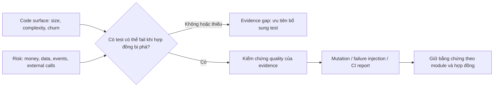
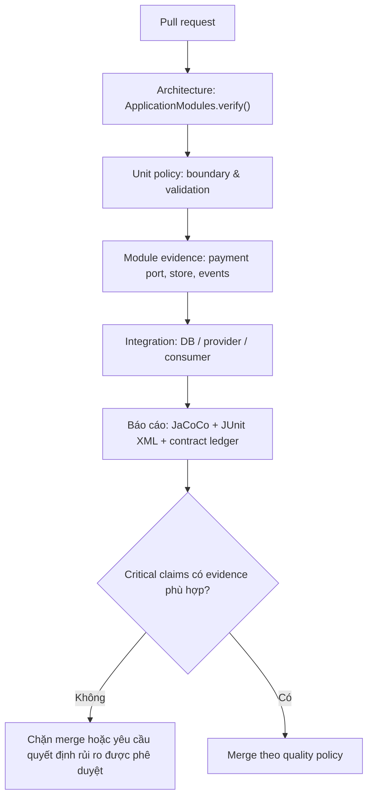

# Nhận diện module có nhiều code nhưng ít bằng chứng kiểm thử

## 1. Bài toán: module “to” nhưng bằng chứng bảo vệ hành vi lại “mỏng”

Một module Spring Modulith có thể có hàng nghìn dòng Java, hàng chục component và nhiều endpoint, nhưng chỉ có một bài `contextLoads()` hoặc vài test kiểm tra “không ném exception”. Nó **đã được thực thi**, song những hợp đồng quan trọng như *không hoàn tiền hai lần*, *không phát event khi giao dịch thất bại* hoặc *không truy cập package nội bộ của module khác* vẫn chưa có bằng chứng.

Trong chương **Coverage theo module** của học phần **SPRING_MODULITH_VERIFICATION_TESTING**, mục tiêu là rèn khả năng kiểm chứng ranh giới bằng `ApplicationModules` và các luật dependency, thực hành `@ApplicationModuleTest`, kiểm thử sự kiện, cơ sở dữ liệu và tích hợp, đồng thời xây quality gate CI chống phụ thuộc sai và hồi quy. Bài này tập trung đúng câu hỏi **“Nhận diện module có nhiều code nhưng ít bằng chứng”**: cách tìm nơi phải bổ sung test **trước tiên**, không phải một bài nhập môn về JUnit hay lý thuyết chung về coverage.

**Định nghĩa làm việc:** Một module là **ứng viên evidence gap** khi có **phạm vi mã và rủi ro đáng kể**, nhưng không tìm được test **được CI thực thi** có assertion đủ mạnh để bảo vệ những hợp đồng quan trọng của module.



Ba mệnh đề cần phân biệt:

1. **Nhiều code ≠ chất lượng kém**: một module gồm DTO/generated code có thể dài nhưng ít quyết định nghiệp vụ; một module nhỏ xử lý thanh toán lại có rủi ro rất cao.
2. **Nhiều test ≠ nhiều bằng chứng**: 100 test cùng gọi một happy path với mock ở mọi tầng có thể không bảo vệ rollback, event contract hay concurrency.
3. **Line coverage cao ≠ hợp đồng được chứng minh**: dòng `events.publishEvent(...)` được chạy không chứng minh đúng payload, event chỉ phát sau điều kiện hợp lệ hoặc consumer đã xử lý.

Các số liệu mẫu trong bài là **giả định để hướng dẫn phân tích**, không phải số đo lấy từ repository của người học. `SPECIAL_NOTE` không có nội dung bổ sung.

## 2. Lập “sổ bằng chứng” theo hợp đồng, không theo tên test

Trước khi gắn nhãn một module “ít test”, hãy liệt kê những *điều nó cam kết với bên ngoài*. Mỗi dòng là một **claim kiểm chứng được**, có điểm quan sát và cách cố ý làm sai để biết test có thật sự bảo vệ claim đó.

Ví dụ module `refund` thực hiện yêu cầu hoàn tiền và phụ thuộc API công khai của module `payment`:

| Claim / hậu điều kiện của `refund` | Test cần có | Assertion hoặc bằng chứng cần nhìn | Phép thử làm test đỏ |
| --- | --- | --- | --- |
| Số tiền `<= 0` bị từ chối | Unit policy | Exception type + không gọi payment port | Bỏ validation |
| Hoàn tiền nhỏ được chấp nhận | Module behavior | Trạng thái lưu + event + lệnh gọi payment | Bỏ lưu, đổi event amount |
| Khoản lớn cần duyệt thủ công | Boundary policy | Không gọi payment; event yêu cầu review | Đổi ngưỡng hoặc gọi payment nhầm |
| Payment provider báo lỗi | Negative path | Không lưu trạng thái completed, không publish completed | Nuốt exception hoặc vẫn publish |
| Trùng refund ID | Idempotency | Không tạo side effect thứ hai | Bỏ duplicate guard |
| DB transaction rollback | Persistence integration | Row không tồn tại sau rollback thật | Bỏ rollback rule |
| Event cho module khác | Event publication/consumer | Source event đúng; consumer completion test riêng | Bỏ event; listener không chạy |
| Phụ thuộc qua API module hợp lệ | Architecture gate | `ApplicationModules.verify()` phải fail nếu vi phạm | Import `payment.internal` |

Một dòng chỉ được đánh dấu **“có bằng chứng”** khi có đủ bốn yếu tố:

1. **Test được phát hiện và thực thi**: không bị `@Disabled`, tag filter hoặc quy tắc đặt tên bỏ qua.
2. **Stimulus thích hợp**: đi qua nhánh mà claim nói tới, không chỉ khởi động Spring context.
3. **Oracle có khả năng fail**: một assertion, Mockito verification, `PublishedEvents` cardinality/payload hoặc terminal `Scenario` thực sự chạy.
4. **Đúng tầng quan sát**: mock interaction không bị gọi là persistence test, event nội bộ không bị gọi là broker delivery, DB query trong transaction chưa commit không bị gọi là durability.

### Các cấp độ bằng chứng có thể dùng khi rà soát

| Mức | Cách mô tả | Ví dụ |
| --- | --- | --- |
| **E0 — chưa rõ** | Không tìm thấy testcase chạy trong CI bảo vệ claim | Một `@Test` rỗng hoặc không có test |
| **E1 — hành vi cơ bản** | Có assertion về happy path hoặc validation | `RefundPolicyTests` |
| **E2 — lỗi và cạnh biên** | Có negative cases, threshold, duplicate, failure injection | Payment failure không để lại completed event |
| **E3 — ranh giới thực** | Có kiểm thử repository/consumer/provider phù hợp | Query DB sau commit, consumer event đúng ID |
| **E4 — phục hồi** | Có retry/replay/rollback/idempotency sau lỗi được quan sát | Không double refund khi ACK bị mất |

**Đây là nhãn mô tả, không phải thang điểm cộng dồn**: claim “amount phải lớn hơn 0” có thể đủ với E2 mà không cần Kafka; claim “không tính tiền hai lần sau redelivery” đòi E4 ở adapter/provider. Đừng bắt mọi claim phải đạt E4 hoặc cộng các nhãn thành “coverage 80%” không có ý nghĩa.

## 3. Thu thập ba nguồn dữ liệu: code, execution và contract evidence

Để nhận diện một module có **nhiều code nhưng ít bằng chứng**, cần đối chiếu **ba nguồn độc lập**.

### Nguồn A — code surface

Thu thập theo **module mà Spring Modulith nhận diện**, không chỉ theo tên thư mục:

- Số lớp và LOC của **production code**; loại trừ generated classes, test fixtures, build output và mapper được sinh tự động.
- Các nhánh quyết định (*if/switch/exception handling*), handler bất đồng bộ, `@Transactional`, repository, listener và adapter ngoài.
- Mức độ phụ thuộc vào module khác, public contracts và API/events được các module khác sử dụng.
- Churn gần đây: số thay đổi liên quan tới behavior hoặc transaction; không đánh đồng format-only commits với rủi ro nghiệp vụ.

`ApplicationModules.of(ShopApplication.class)` là mô hình kiến trúc được Spring Modulith cung cấp; package gốc của module, named interfaces và dependency rules giúp xác định **đơn vị đánh giá**. Một module có thể có subpackages API/internal và một số class phát sinh; **đừng lấy glob tên package rồi tuyên bố đã map chính xác mọi class khi chưa đối chiếu mô hình module**.

### Nguồn B — execution coverage

JaCoCo đo instruction/line/branch coverage của JVM classes; Gradle Java plugin có thể tạo báo cáo **XML + HTML**.

Trong `build.gradle.kts` của dự án Java với plugin `jacoco`:

```kotlin
plugins {
    java
    jacoco
}

tasks.test {
    useJUnitPlatform()
}

tasks.jacocoTestReport {
    dependsOn(tasks.test)
    reports {
        xml.required.set(true)
        html.required.set(true)
    }
}

tasks.named("check") {
    dependsOn(tasks.jacocoTestReport)
}
```

Đây là **đoạn cấu hình bổ sung** cho build đã có dependencies/JUnit Platform. `jacocoTestReport` **không mặc định phụ thuộc `test`**, nên `dependsOn(tasks.test)` là cần thiết khi muốn báo cáo luôn có dữ liệu test mới. Nếu có task `integrationTest` tách riêng, report của `test` **không tự cộng** execution data của task đó; phải tạo báo cáo tổng hợp hoặc báo cáo riêng theo task. Không trộn “coverage chỉ của unit” với “coverage toàn suite” mà không ghi rõ.

XML của JaCoCo có counters theo package/class, ví dụ dạng **giả định**:

```xml
<package name="com/example/shop/refund">
  <!-- Các class/sourcefile và counters khác được lược bỏ -->
  <counter type="LINE" missed="340" covered="660"/>
  <counter type="BRANCH" missed="82" covered="38"/>
</package>
```

Từ đó tính `LINE = 660 / (340+660) = 66%`, `BRANCH = 38 / (82+38) ≈ 31,7%` cho package minh họa. Các package counters **không phản ánh trực tiếp số assertion**, chất lượng oracle, số behavior contract hay độ đúng của cleanup. Mức branch thấp là **tín hiệu truy vết**, không phải kết luận mọi nhánh đều quan trọng như nhau.

### Nguồn C — test execution + evidence ledger

Từ JUnit XML và CI reports, ghi lại test nào **thực sự chạy** (không chỉ có file `*Tests.java`), bao nhiêu passed/failed/skipped, các tags hoặc tasks đã chọn và test nào dùng fixture thật. Sau đó **review thủ công hoặc bằng mapping có kiểm soát** assertion gắn với các claim ở mục 2.

| Chỉ báo | Nó trả lời | Không trả lời |
| --- | --- | --- |
| Số test methods/invocations | Có bao nhiêu lần test chạy? | Những tests đó bảo vệ hợp đồng gì? |
| JaCoCo LINE/BRANCH | Đoạn mã nào đã được đi qua? | Oracle có kiểm tra đúng hậu điều kiện không? |
| Assertion inventory | Có phép kiểm tra rõ ràng nào? | Một assertion có thật sự bắt lỗi khi production thay đổi không? |
| Red-control/mutation result | Phép sửa sai có bị test bắt được? | Các failure mode chưa thử hoặc lỗi hạ tầng production |
| Contract evidence map | Claim nào có test / tầng kiểm chứng tương ứng? | Không tự sinh từ report coverage thuần túy |

**Không dựa vào “assertions per LOC” như một tiêu chí tuyệt đối**: số assertion lớn có thể là trùng lặp. Hãy đo **tỷ lệ claim quan trọng có verification fail-closed**, ghi cả claim chưa có test và trách nhiệm của người sở hữu module.

## 4. Xếp hạng ứng viên: nhiều code, ít bằng chứng, nhưng ưu tiên theo rủi ro

Giả sử sau khi ghép danh mục module với JaCoCo, JUnit XML và sổ bằng chứng, ta có dữ liệu **giả định**:

| Module | LOC production | Line / branch | Test thực thi | Claim quan trọng có bằng chứng | Yếu tố rủi ro | Nhận xét |
| --- | ---: | --- | ---: | --- | --- | --- |
| `refund` | 2.400 | 81% / **31%** | 3 | **2/8** | Tiền, payment gateway, duplicate | **Ưu tiên cao** dù line coverage đẹp |
| `notification` | 1.850 | 87% / 73% | 8 | **2/9** | Async event, broker/retry | **Ưu tiên cao** vì thiếu bằng chứng delivery |
| `catalog` | 1.100 | 68% / 62% | 22 | **8/9** | Đọc dữ liệu, ít side effect | Cải thiện nhánh chưa có test, không nhất thiết ưu tiên nhất |
| `reporting` | 3.900 | 57% / 49% | 14 | **6/7** | Nhiều mapper/generated DTO | Rà soát phạm vi LOC trước khi gắn nhãn |
| `payment-adapter` | 420 | 93% / 89% | 11 | **2/6** | External money transfer | **Ưu tiên cao dù ít code** |

Số `2/8` là **số claim được review có đủ bằng chứng / tổng claim quan trọng trong danh mục này**, không phải metric tự có sẵn trong JaCoCo. Thứ tự ưu tiên không được suy ra chỉ từ `LOC/testCount`; ví dụ `payment-adapter` chỉ 420 LOC nhưng vẫn là điểm có thể gây thiệt hại cao.

### Phân loại theo hai trục

```text
                           BẰNG CHỨNG ĐÁNG TIN
                       mỏng                  đầy đủ hơn
CODE SURFACE  lớn   ┌───────────────────┬───────────────────┐
              / rủi ro│ P0: audit và      │ P1: kiểm tra      │
              cao    │ bổ sung gate      │ nhánh còn thiếu  │
                     ├───────────────────┼───────────────────┤
              nhỏ   │ P1 nếu critical   │ Theo dõi thay    │
              / thấp│ (ví dụ payment)   │ đổi định kỳ       │
                     └───────────────────┴───────────────────┘
```

“Lớn” có thể là trên percentile 75 của **chính repo**, hoặc nhiều behavior branches/ownership; không dùng một ngưỡng LOC cố định cho mọi công ty. “Mỏng” là thiếu bằng chứng cho claim quan trọng, không phải mặc định dưới 80% line coverage.

### Quy trình xác nhận một ứng viên trước khi giao việc

1. **Kiểm tra mapping:** Module có thật thuộc phạm vi Spring Modulith? Có named interface hoặc class nằm ngoài glob đã đếm?
2. **Kiểm tra report scope:** JaCoCo đang cộng những test tasks nào? Integration/smoke tests có chạy ở pipeline khác không?
3. **Kiểm tra generated code:** DTO, mapping code sinh ra hoặc adapter mỏng có chiếm phần lớn LOC không?
4. **Kiểm tra test oracle:** Assertion có fail khi bỏ behavior? Test có chỉ `contextLoads()`, `assertDoesNotThrow()` hay stub mock mà không verify?
5. **Kiểm tra hợp đồng khác tầng:** Test `PublishedEvents` chỉ xem event nội bộ, không thay cho broker hoặc listener sau commit.
6. **Xác nhận ownership:** Người sở hữu module review danh sách claim và đánh dấu những claim thiếu bằng chứng; ghi lý do chấp nhận rủi ro nếu chưa xử lý.

**Đầu ra tốt là một backlog kiểm chứng có chủ đề**, chẳng hạn “REFUND-04: lỗi gateway không được publish `RefundCompleted`”, không phải “tăng coverage module refund từ 81% lên 90%” mà chưa rõ bảo vệ cái gì.

## 5. Mẫu production nhỏ để phân biệt code đã chạy và hợp đồng đã kiểm tra

Ta dùng module `refund` với hai nhánh: **hoàn tiền tự động** dưới/ngang ngưỡng và **yêu cầu duyệt** trên ngưỡng. `refund` phụ thuộc một public port của module `payment`, không truy cập implementation nội bộ. Ví dụ dùng **Java 17+, Spring Boot 3.4/3.5, Spring Framework 6.2, Spring Modulith 1.4, JUnit Jupiter 5** và BOM tương thích.

```text
src/main/java/com/example/shop/
  ShopApplication.java
  payment/PaymentGateway.java
  refund/
    RefundDecision.java
    RefundPolicy.java
    RefundStatus.java
    RefundRecord.java
    RefundCompleted.java
    RefundReviewRequested.java
    RefundStore.java
    RefundService.java
src/test/java/com/example/shop/
  refund/RefundPolicyTests.java
  refund/RefundEvidenceTests.java
  ModuleArchitectureTests.java
```

Dependencies thiết yếu, được **thêm vào POM đã có Spring Boot/Modulith dependency management**, không phải POM hoàn chỉnh:

```xml
<dependency>
    <groupId>org.springframework.boot</groupId>
    <artifactId>spring-boot-starter</artifactId>
</dependency>
<dependency>
    <groupId>org.springframework.boot</groupId>
    <artifactId>spring-boot-starter-test</artifactId>
    <scope>test</scope>
</dependency>
<dependency>
    <groupId>org.springframework.modulith</groupId>
    <artifactId>spring-modulith-starter-test</artifactId>
    <scope>test</scope>
</dependency>
```

Root application:

```java
package com.example.shop;

import org.springframework.boot.SpringApplication;
import org.springframework.boot.autoconfigure.SpringBootApplication;

@SpringBootApplication
public class ShopApplication {
    public static void main(String[] args) {
        SpringApplication.run(ShopApplication.class, args);
    }
}
```

### Public port của module `payment`

`src/main/java/com/example/shop/payment/PaymentGateway.java`:

```java
package com.example.shop.payment;

import java.util.UUID;

public interface PaymentGateway {
    void refund(UUID refundId, long amountMinor);
}
```

Trong bài test `@ApplicationModuleTest` của `refund`, port này được cấp bằng `@MockitoBean`. Để khởi động **full application** ngoài bài học, dự án cần một implementation/adapter của `PaymentGateway` thực sự được cấu hình trong module `payment`. Chúng ta **không** gọi mock test là bằng chứng provider tiền thật đã xử lý.

### Chính sách phân nhánh dễ bỏ sót

`src/main/java/com/example/shop/refund/RefundDecision.java`:

```java
package com.example.shop.refund;

public enum RefundDecision {
    AUTO, REVIEW
}
```

`src/main/java/com/example/shop/refund/RefundPolicy.java`:

```java
package com.example.shop.refund;

import org.springframework.stereotype.Component;

@Component
public class RefundPolicy {

    public RefundDecision decide(long amountMinor) {
        if (amountMinor <= 0) {
            throw new IllegalArgumentException("INVALID_AMOUNT");
        }
        return amountMinor > 500_000L
                ? RefundDecision.REVIEW
                : RefundDecision.AUTO;
    }
}
```

**Ba nhánh có rủi ro khác nhau:** `amountMinor <= 0` bị từ chối, `amountMinor == 500_000` được xử lý tự động, `amountMinor == 500_001` phải duyệt. Chỉ gọi `decide(10_000)` hàng trăm lần có thể tạo coverage đẹp cho một nhánh nhưng **không bảo vệ ngưỡng**.

### Trạng thái và event của module

`src/main/java/com/example/shop/refund/RefundStatus.java`:

```java
package com.example.shop.refund;

public enum RefundStatus {
    COMPLETED, PENDING_REVIEW
}
```

`src/main/java/com/example/shop/refund/RefundRecord.java`:

```java
package com.example.shop.refund;

import java.util.UUID;

public record RefundRecord(
        UUID refundId, long amountMinor, RefundStatus status) {}
```

`src/main/java/com/example/shop/refund/RefundCompleted.java`:

```java
package com.example.shop.refund;

import java.util.UUID;

public record RefundCompleted(UUID refundId, long amountMinor) {}
```

`src/main/java/com/example/shop/refund/RefundReviewRequested.java`:

```java
package com.example.shop.refund;

import java.util.UUID;

public record RefundReviewRequested(UUID refundId, long amountMinor) {}
```

`src/main/java/com/example/shop/refund/RefundStore.java`:

```java
package com.example.shop.refund;

import java.util.Optional;
import java.util.UUID;
import java.util.concurrent.ConcurrentHashMap;
import java.util.concurrent.ConcurrentMap;
import org.springframework.stereotype.Repository;

@Repository
public class RefundStore {

    private final ConcurrentMap<UUID, RefundRecord> records =
            new ConcurrentHashMap<>();

    public Optional<RefundRecord> findById(UUID id) {
        return Optional.ofNullable(records.get(id));
    }

    public void save(RefundRecord record) {
        if (records.putIfAbsent(record.refundId(), record) != null) {
            throw new IllegalStateException("DUPLICATE_REFUND");
        }
    }

    public void deleteById(UUID id) {
        records.remove(id);
    }
}
```

`RefundStore` là **state in-memory**, không phải database có transaction và durable unique constraint. Nó đủ để minh họa cách chứng minh *state của bean* và yêu cầu cleanup khi Spring context được cache, nhưng **không chứng minh** rollback hay chống duplicate trên nhiều process.

### Service dùng policy, port, store và event publisher

`src/main/java/com/example/shop/refund/RefundService.java`:

```java
package com.example.shop.refund;

import java.util.UUID;
import com.example.shop.payment.PaymentGateway;
import org.springframework.context.ApplicationEventPublisher;
import org.springframework.stereotype.Service;

@Service
public class RefundService {

    private final RefundPolicy policy;
    private final PaymentGateway gateway;
    private final RefundStore store;
    private final ApplicationEventPublisher events;

    public RefundService(RefundPolicy policy,
                         PaymentGateway gateway,
                         RefundStore store,
                         ApplicationEventPublisher events) {
        this.policy = policy;
        this.gateway = gateway;
        this.store = store;
        this.events = events;
    }

    public RefundStatus request(UUID id, long amountMinor) {
        if (id == null) {
            throw new IllegalArgumentException("INVALID_REFUND_ID");
        }
        RefundDecision decision = policy.decide(amountMinor);

        if (store.findById(id).isPresent()) {
            throw new IllegalStateException("DUPLICATE_REFUND");
        }

        if (decision == RefundDecision.REVIEW) {
            store.save(new RefundRecord(
                    id, amountMinor, RefundStatus.PENDING_REVIEW));
            events.publishEvent(new RefundReviewRequested(
                    id, amountMinor));
            return RefundStatus.PENDING_REVIEW;
        }

        gateway.refund(id, amountMinor);
        store.save(new RefundRecord(
                id, amountMinor, RefundStatus.COMPLETED));
        events.publishEvent(new RefundCompleted(id, amountMinor));
        return RefundStatus.COMPLETED;
    }
}
```

**Hai giới hạn thiết kế cố ý để người học nhận diện evidence gap:** (1) Payment provider có thể đã thực hiện hoàn tiền nhưng ACK mất, rồi `store.save(...)` lỗi; in-memory state không rollback tiền ở provider. (2) `findById → gateway.refund → save` **không nguyên tử** dưới concurrent requests; hai thread cùng ID có thể gọi gateway trước khi một thread thắng `putIfAbsent`. Test tuần tự không đủ để chứng minh idempotency phân tán. Đây là **claim cần integration/transactional redesign**, không phải chi tiết nên giấu bằng test xanh.

## 6. Phủ các **ranh giới quyết định** bằng JUnit unit test, không cần Spring context

Để bổ sung bằng chứng nhanh cho module nhiều nhánh, bắt đầu từ **policy thuần**. Đừng khởi động cả `@SpringBootTest` chỉ để kiểm ba giá trị biên của một hàm.

File `src/test/java/com/example/shop/refund/RefundPolicyTests.java`:

```java
package com.example.shop.refund;

import static org.assertj.core.api.Assertions.assertThat;
import static org.junit.jupiter.api.Assertions.assertThrowsExactly;

import org.junit.jupiter.api.Tag;
import org.junit.jupiter.api.Test;
import org.junit.jupiter.params.ParameterizedTest;
import org.junit.jupiter.params.provider.CsvSource;
import org.junit.jupiter.params.provider.ValueSource;

@Tag("unit")
@Tag("refund")
class RefundPolicyTests {

    private final RefundPolicy policy = new RefundPolicy();

    @ParameterizedTest(name = "amount={0} -> {1}")
    @CsvSource({
        "1,AUTO",
        "500000,AUTO",
        "500001,REVIEW",
        "999999,REVIEW"
    })
    void amountBoundarySelectsCorrectWorkflow(
            long amountMinor, RefundDecision expected) {
        assertThat(policy.decide(amountMinor)).isEqualTo(expected);
    }

    @ParameterizedTest
    @ValueSource(longs = {0L, -1L})
    void nonPositiveAmountIsRejected(long amountMinor) {
        var error = assertThrowsExactly(
                IllegalArgumentException.class,
                () -> policy.decide(amountMinor));

        assertThat(error).hasMessage("INVALID_AMOUNT");
    }
}
```

**Vì sao test này là bằng chứng mạnh hơn `contextLoads()`?** Nếu đổi `amountMinor > 500_000L` thành `>=`, testcase `500000,AUTO` phải **đỏ**. Nếu bỏ validation, hai test của input âm/0 **đỏ**. Nếu chỉ có một testcase `policy.decide(1000) == AUTO`, bộ test không phân biệt được sự thay đổi của ngưỡng.

### Không tối ưu số lượng test mà bỏ mất nghĩa của assertion

`@ParameterizedTest` có thể chạy nhiều invocation, nhưng một method dù có 100 dòng dữ liệu cùng nhánh `AUTO` vẫn không chứng minh được nhánh `REVIEW`. Với policy/decision tree, ưu tiên:

- Giá trị **dưới, đúng bằng, trên** ranh giới.
- Loại input không hợp lệ.
- Những phân nhóm làm thay đổi **side effect**, không chỉ những giá trị được nhận.
- Exception contract (type/message khi có ý nghĩa), không chỉ boolean `isNotNull()`.

**Điểm dừng hợp lý:** Sau khi tất cả nhánh quyết định độc lập có oracle đủ mạnh, chuyển sang kiểm chứng behavior tích hợp. Không cần biến mọi permutation SKU/amount thành một testcase nếu chúng không tạo hành vi khác biệt.

## 7. `@ApplicationModuleTest`: chứng minh cả **hậu điều kiện**, không chỉ chạy code

Unit test trên bảo vệ policy. Các claim như **gọi cổng thanh toán đúng một lần**, **lưu trạng thái**, **phát event đúng ID** hoặc **không có side effect khi lỗi** cần một test của module `refund`.

File `src/test/java/com/example/shop/refund/RefundEvidenceTests.java`:

```java
package com.example.shop.refund;

import static org.assertj.core.api.Assertions.assertThat;
import static org.assertj.core.api.Assertions.assertThatThrownBy;
import static org.junit.jupiter.api.Assertions.assertAll;
import static org.mockito.Mockito.doThrow;
import static org.mockito.Mockito.times;
import static org.mockito.Mockito.verify;
import static org.mockito.Mockito.verifyNoInteractions;

import java.util.UUID;
import com.example.shop.payment.PaymentGateway;
import org.junit.jupiter.api.DisplayName;
import org.junit.jupiter.api.Tag;
import org.junit.jupiter.api.Test;
import org.springframework.beans.factory.annotation.Autowired;
import org.springframework.modulith.test.ApplicationModuleTest;
import org.springframework.modulith.test.PublishedEvents;
import org.springframework.test.context.bean.override.mockito.MockitoBean;

@Tag("module")
@Tag("refund")
@DisplayName("Refund — bằng chứng cho các workflow có side effect")
@ApplicationModuleTest
class RefundEvidenceTests {

    @Autowired RefundService refunds;
    @Autowired RefundStore store;
    @MockitoBean PaymentGateway gateway;

    @Test
    void smallRefundCallsPaymentAndPublishesExactlyOneEvent(
            PublishedEvents events) {
        UUID id = UUID.randomUUID();
        long amountMinor = 10_000L;

        try {
            RefundStatus result = refunds.request(id, amountMinor);

            assertAll("Tự động hoàn tiền — một outcome nhất quán",
                () -> assertThat(result)
                        .isEqualTo(RefundStatus.COMPLETED),
                () -> verify(gateway, times(1))
                        .refund(id, amountMinor),
                () -> assertThat(store.findById(id))
                        .contains(new RefundRecord(
                                id, amountMinor, RefundStatus.COMPLETED)),
                () -> assertThat(events.ofType(RefundCompleted.class)
                        .matching(RefundCompleted::refundId, id))
                        .as("Đúng một RefundCompleted có payload phù hợp")
                        .singleElement()
                        .satisfies(e -> assertThat(e.amountMinor())
                                .isEqualTo(amountMinor))
            );
        } finally {
            store.deleteById(id);
        }
    }

    @Test
    void largeRefundRequiresReviewWithoutCallingPayment(
            PublishedEvents events) {
        UUID id = UUID.randomUUID();
        long amountMinor = 500_001L;

        try {
            RefundStatus result = refunds.request(id, amountMinor);

            assertAll("Khoản lớn phải review, chưa chuyển tiền",
                () -> assertThat(result)
                        .isEqualTo(RefundStatus.PENDING_REVIEW),
                () -> verifyNoInteractions(gateway),
                () -> assertThat(store.findById(id))
                        .contains(new RefundRecord(
                                id, amountMinor,
                                RefundStatus.PENDING_REVIEW)),
                () -> assertThat(events.ofType(
                        RefundReviewRequested.class)
                        .matching(RefundReviewRequested::refundId, id))
                        .singleElement()
                        .satisfies(e -> assertThat(e.amountMinor())
                                .isEqualTo(amountMinor)),
                () -> assertThat(events.ofType(RefundCompleted.class)
                        .matching(RefundCompleted::refundId, id))
                        .isEmpty()
            );
        } finally {
            store.deleteById(id);
        }
    }

    @Test
    void providerFailureCannotAppearAsCompletedRefund(
            PublishedEvents events) {
        UUID id = UUID.randomUUID();
        long amountMinor = 10_000L;
        doThrow(new IllegalStateException("PROVIDER_DOWN"))
                .when(gateway).refund(id, amountMinor);

        try {
            assertThatThrownBy(() -> refunds.request(id, amountMinor))
                    .isInstanceOf(IllegalStateException.class)
                    .hasMessage("PROVIDER_DOWN");

            assertAll("Payment failure giữ nguyên hậu điều kiện",
                () -> verify(gateway, times(1))
                        .refund(id, amountMinor),
                () -> assertThat(store.findById(id)).isEmpty(),
                () -> assertThat(events.ofType(RefundCompleted.class)
                        .matching(RefundCompleted::refundId, id))
                        .isEmpty()
            );
        } finally {
            store.deleteById(id);
        }
    }

    @Test
    void repeatedSequentialRequestDoesNotPayTwice(
            PublishedEvents events) {
        UUID id = UUID.randomUUID();
        long amountMinor = 10_000L;

        try {
            refunds.request(id, amountMinor);

            // Hai stimuli CÓ CHỦ Ý: đang kiểm thử duplicate request.
            assertThatThrownBy(() -> refunds.request(id, amountMinor))
                    .isInstanceOf(IllegalStateException.class)
                    .hasMessage("DUPLICATE_REFUND");

            assertAll("Một ID tuần tự chỉ một lần gọi gateway",
                () -> verify(gateway, times(1))
                        .refund(id, amountMinor),
                () -> assertThat(store.findById(id)).isPresent(),
                () -> assertThat(events.ofType(RefundCompleted.class)
                        .matching(RefundCompleted::refundId, id))
                        .hasSize(1)
            );
        } finally {
            store.deleteById(id);
        }
    }
}
```

### Cách đọc bằng chứng đúng phạm vi

| Điều test **có** | Điều test **chưa** có |
| --- | --- |
| Spring bootstraps riêng module `refund`, service/store thật | Toàn bộ ứng dụng và adapter `payment` thật |
| `@MockitoBean PaymentGateway` cung cấp phản hồi có thể điều khiển | Provider chuyển tiền bền vững, HTTP timeout/retry đúng |
| `PublishedEvents` xác minh đúng source event của testcase | Consumer đã xử lý hoặc Kafka đã nhận record |
| State trong singleton `RefundStore` đúng sau command | DB transaction, rollback sau commit, restart recovery |
| Một ID gửi **tuần tự** hai lần không gây thêm gateway call | Hai requests **đồng thời** không gọi provider hai lần |

Spring Modulith 1.4 dùng `@ApplicationModuleTest` mặc định `STANDALONE`; khi dependency ở module khác chưa được nạp, `@MockitoBean` cung cấp mock thích hợp. `RefundStore` là bean thật trong context và có thể tồn tại qua nhiều method do context caching, vì vậy UUID riêng và cleanup trong `finally` là bắt buộc cho ví dụ này.

**Lưu ý JUnit/Mockito:** `verifyNoInteractions(gateway)` ở test review khẳng định một hậu điều kiện có ý nghĩa. Nếu gateway vẫn bị gọi với bất kỳ ID nào, test phải đỏ. Stubbing `doThrow(...)` ở negative test chỉ chuẩn bị lỗi; các assertion về exception, store và event mới chứng minh nó được xử lý đúng.

### Red-control cho chất lượng oracle

Thực hiện **trên nhánh thử nghiệm**, rồi hoàn nguyên:

1. Bỏ `events.publishEvent(new RefundCompleted(...))`: bài refund thành công phải **đỏ** ở cardinality.
2. Đổi `amountMinor` của event thành `amountMinor + 1`: test phải **đỏ** ở payload.
3. Cho nhánh review gọi `gateway.refund(...)`: test phải **đỏ** ở `verifyNoInteractions`.
4. Bỏ guard duplicate: test tuần tự phải **đỏ** tại số lần gọi hoặc exception contract.
5. Đổi policy sang `>= 500_000L`: test boundary `500000,AUTO` phải **đỏ**.

Nếu mutation chỉ làm Spring context không khởi động, hãy phân tích lỗi **setup**; đó chưa phải bằng chứng assertion đã bắt đúng hồi quy nghiệp vụ. Điều cần tìm là **failure tại oracle của claim đã định nghĩa**.

## 8. Những “vùng tối” sau khi JaCoCo và module tests đều xanh

Một lỗi thường gặp khi xếp hạng module là coi **bộ test hiện có** như toàn bộ phạm vi cần chứng minh. Hãy rà soát thêm các đường *thực thi khác context, khác transaction hoặc khác hệ thống*.

### Bảng đối chiếu: bằng chứng tưởng có và bằng chứng thực sự cần

| Dấu hiệu khiến nhóm yên tâm | Evidence gap còn lại | Cách xác minh ở đúng tầng |
| --- | --- | --- |
| `@SpringBootTest` khởi động thành công | Không có oracle của hợp đồng hoàn tiền | Assertion state/exception/event sau command |
| Line coverage `refund` đạt 90% | Chưa chắc chạm nhánh `500000 / 500001` | Parameterized boundary tests và mutation `> ↔ >=` |
| `verify(gateway).refund(...)` thành công | Không biết provider đã hoàn tiền hay bị nhân đôi | Integration contract test với idempotency key và trạng thái provider |
| `RefundStore.findById(...)` trả record | Map in-memory không có transaction rollback/durability | Repository/DB thật, query sau commit, constraint |
| `PublishedEvents` có `RefundCompleted` | Consumer chưa chắc được bootstrap/hoàn tất | `Scenario` chờ event/state kết quả của module consumer |
| `@ApplicationModuleTest` xanh | Không chứng minh mọi module dependency hợp lệ nếu test không được chạy trong mọi CI job | Architecture gate riêng `ApplicationModules.verify()` |
| Duplicate test **tuần tự** xanh | Hai request đồng thời có thể gọi provider hai lần | Test concurrency, atomic dedup DB và downstream idempotency |
| Test provider failure ném exception | Provider có thể đã thực hiện side effect nhưng ACK bị mất | Failure injection sau commit/ACK, retry cùng ID |
| Báo cáo XML chứa test class | Test có thể skipped/disabled hoặc filter chọn 0 invocations | CI assert số test **executed** phù hợp |

### Claim cần khung thời gian hoặc transaction riêng

Ví dụ, nếu `refund` phát `RefundCompleted` và module `notification` lắng nghe theo `@TransactionalEventListener(AFTER_COMMIT)`, test chỉ dùng `PublishedEvents` **không thể** chứng minh notification hoàn tất. Khi có implementation consumer thật và transaction manager, bài test khác có thể dùng:

```java
// Mẫu mở rộng, chưa chạy độc lập với RefundStore in-memory phần 5.
// Cần module notification, event RefundNoticeRecorded,
// transaction manager và @ApplicationModuleTest(extraIncludes="notification").
scenario.publish(new RefundCompleted(id, amountMinor))
        .andWaitAtMost(Duration.ofSeconds(5))
        .forEventOfType(RefundNoticeRecorded.class)
        .matching(event -> event.refundId().equals(id))
        .toArriveAndVerify(event ->
                assertThat(event.refundId()).isEqualTo(id));
```

**Giới hạn chính xác:** `Scenario.publish(...)` chỉ đưa event làm stimulus nên **không** kiểm lại đường `RefundService.request(...)`. Nếu muốn chứng minh cả command và consumer, dùng `scenario.stimulate(() -> refunds.request(...))`, đảm bảo transaction boundary phù hợp. Consumer phải thực sự được nạp; từ module `refund`, `ALL_DEPENDENCIES` không tự nạp một module chỉ **phụ thuộc ngược** vào `refund`. `Scenario` cần terminal `toArriveAndVerify(...)` (hoặc tương đương) để không xanh giả.

### Claim về DB/rollback: kiểm tra sau khi transaction kết thúc

Với `RefundStore` map trong ví dụ, một assertion `store.findById(id).isEmpty()` sau exception **chưa nói gì** về database rollback. Khi chuyển sang repository thật, hãy chọn một testcase kiểm chứng **ghi đã xảy ra rồi mới có lỗi**, transaction rollback và query bên ngoài transaction đó:

```text
GIVEN: database/schema test cô lập, refundId mới, dữ liệu hợp lệ
WHEN : một service @Transactional INSERT refund row
       sau đó ném một unchecked exception (hoặc checked + rollbackFor)
THEN : sau khi method/proxy kết thúc, query DB không thấy refund row
       AFTER_COMMIT listener không được xử lý
       refund provider không được gọi lại vô điều kiện
```

Test của service ném exception **trước khi ghi row** nhưng DB rỗng không chứng minh rollback. Nếu test method được gắn `@Transactional` và tự rollback, nó có thể che việc service **thực tế không tự quản lý** transaction như thiết kế. Ngoài ra rollback DB không thể tự hủy việc gọi provider ngoài đã thành công, nên claim “không hoàn tiền trùng” phải được bảo vệ bằng durable dedup/idempotency hoặc compensation ở thiết kế thật.

### Tách “module thiếu test” với “bằng chứng nằm ở nơi khác”

Trước khi tạo testcase mới, kiểm tra trong **danh mục CI/test đã được cho phép**, không đoán từ folder test cùng package:

- Contract của `payment-adapter` có thể được kiểm trong `*IT` hoặc integration-test source set, không nằm trong JaCoCo report của `test`.
- End-to-end scenario có thể nằm ở module consumer; cần map claim tới test đó dù test đặt package khác.
- Một module nhỏ có thể dùng library đã được test kỹ, nhưng **quy tắc tích hợp của hệ thống** (mapping exception, retry, transaction) vẫn cần test.
- Một test hiện có có thể bảo vệ nhiều claim, miễn mỗi claim có **assertion thật và failure sensitivity**.

Mục tiêu là tìm **lỗ hổng bằng chứng**, không tạo test trùng lặp chỉ vì bộ lọc tìm kiếm không thấy lớp theo tên.

## 9. Chuyển phát hiện thành quality gate trong CI, không chỉ báo cáo

Một báo cáo review có thể kết luận `refund` là ứng viên ưu tiên, nhưng thay đổi tiếp theo vẫn dễ làm regression nếu không có gate được chạy bắt buộc.

### Gate 1 — cấu trúc module Spring Modulith

File `src/test/java/com/example/shop/ModuleArchitectureTests.java`:

```java
package com.example.shop;

import org.junit.jupiter.api.Tag;
import org.junit.jupiter.api.Test;
import org.springframework.modulith.core.ApplicationModules;

@Tag("architecture")
class ModuleArchitectureTests {

    @Test
    void applicationModuleBoundariesRemainValid() {
        ApplicationModules.of(ShopApplication.class).verify();
    }
}
```

`verify()` kiểm tra các quy tắc Spring Modulith hỗ trợ như module cycles, truy cập package nội bộ và `allowedDependencies` khi khai báo. `@ApplicationModuleTest` trong 1.4 có `verifyAutomatically=true` mặc định, nhưng gate độc lập vẫn cần thiết nếu CI chạy chọn lọc test theo tags/module. Nó **không** chứng minh policy tiền hoặc provider side effects đúng; gate hành vi phải chạy riêng.

### Gate 2 — JaCoCo branch coverage chỉ là ngưỡng cảnh báo bổ sung

Với Gradle Kotlin DSL đã bật plugin `jacoco` và `test` sử dụng JUnit Platform (mục 3), có thể thêm một **ngưỡng minh họa** riêng cho package `refund`:

```kotlin
tasks.jacocoTestCoverageVerification {
    dependsOn(tasks.test)
    violationRules {
        rule {
            element = "PACKAGE"
            includes = listOf("com.example.shop.refund")
            limit {
                counter = "BRANCH"
                value = "COVEREDRATIO"
                minimum = "0.60".toBigDecimal()
            }
        }
    }
}

tasks.named("check") {
    dependsOn(
        tasks.jacocoTestCoverageVerification,
        tasks.jacocoTestReport
    )
}
```

**60% là ngưỡng mẫu, không phải chuẩn chung.** Chỉ áp dụng khi package đã được map đúng và nhiệm vụ xây dựng báo cáo đã cộng các test tasks cần thiết. Với module có nhiều package/named interfaces, một filter package không tự đại diện cho toàn module; cấu hình `includes` cho tất cả package liên quan hoặc tổng hợp report theo cấu trúc Modulith.

JaCoCo coverage verification nói được **“mã đã được đi qua”**, không nói được **“business claim được kiểm đúng”**. Đừng dùng ngưỡng branch để thay cho ledger các case payment failure, concurrent duplicate và commit/rollback.

### Gate 3 — testcase thật + test-count guard + contract review

Một pipeline có thể tổ chức:



Những kiểm tra cần **thực thi được**, không chỉ hiển thị:

1. **Architecture test executed > 0** và khi `verify()` fail thì required CI check fail.
2. **Các test critical của `refund` được CI chọn**: JUnit XML phải có testcase/invocations không bị skipped và test failures được truyền thành build failure.
3. **Cổng integration cần thiết có thật**: payment-adapter DB/provider contract test không bị skip vĩnh viễn vì thiếu hạ tầng.
4. **Không hạ ngưỡng để che lỗi**: khi threshold đỏ, xem nhánh thiếu và claim tương ứng trước khi quyết định exclusion.
5. **Evidence ledger được cập nhật khi thêm public contract**, với chủ sở hữu và test chứng minh claim. Phần này có thể là một review checklist/manifest, không được khẳng định JaCoCo tự tính ra.

Nếu dùng Maven, đừng quên Surefire/Failsafe có **quy tắc discover tên lớp** khác nhau: một class mang tag `integration` nhưng không khớp pattern của Failsafe có thể bị bỏ lọt khi Surefire loại tag ấy. Dùng reports thực tế để xác nhận, không chỉ nhìn source annotations.

### Quality gate ưu tiên việc **có bằng chứng** hơn số lượng test

Ví dụ một PR sửa `RefundService.request(...)` từ `amountMinor > 500_000L` sang `>=` phải làm `RefundPolicyTests` fail; một PR bỏ `RefundCompleted` phải làm `RefundEvidenceTests` fail. Đó là **red-control** cụ thể. Nếu PR chỉ tăng số test methods từ 3 lên 30 nhưng cả hai mutation vẫn sống, độ tin cậy **chưa tăng** tương xứng.

## 10. Quy trình audit, bài tập và checklist bàn giao

### Quy trình nhận diện một module mỏng bằng chứng

| Bước | Thao tác | Artifact đầu ra |
| --- | --- | --- |
| **1. Chốt scope** | Dùng mô hình `ApplicationModules` và ownership để xác định module/public APIs | Danh mục module và ranh giới |
| **2. Đo code surface** | LOC production, branch points, external ports, transaction/event handlers, churn | Bảng surface/risk |
| **3. Lấy execution** | Chạy các test tasks được CI dùng; xuất JaCoCo XML và JUnit XML | Báo cáo có timestamp/test count |
| **4. Lập claim ledger** | Từ hợp đồng/incident/behavior, ghi claim critical và testcase có thể fail | Danh sách supported/missing |
| **5. Red-control** | Cố ý sửa sai threshold, event, gateway call trên nhánh thử nghiệm | Bằng chứng test đỏ đúng oracle |
| **6. Triaging** | Soát integration tests nằm ngoài package, generated code, framework ownership | Danh sách gap thật sau đối chiếu |
| **7. Bổ sung test** | Unit → module → DB/broker/provider theo đúng tầng rủi ro | Test có assertion và cleanup |
| **8. Đưa vào CI** | Required gates, zero-test guard, số liệu và review ledger | Gate ổn định chặn regression |

### Bài tập thực hành đúng câu hỏi

1. **Module to, test ít:** Dùng bảng giả định mục 4 để xếp hạng `refund`, `reporting` và `payment-adapter`. Vì sao `payment-adapter` chỉ 420 LOC vẫn có thể ưu tiên hơn `reporting`?
2. **Branch gap:** Bổ sung cases 500.000 và 500.001 cho `RefundPolicy`. Đổi toán tử `>` thành `>=` và xác minh test đỏ.
3. **Fake confidence:** Thay bốn tests của `RefundEvidenceTests` bằng một `contextLoads()`; JaCoCo và contract ledger còn chứng minh được những gì?
4. **Event gap:** Bỏ `events.publishEvent(new RefundCompleted(...))`. Xác định test nào bắt regression và vì sao test chỉ assert trạng thái lưu là chưa đủ.
5. **External boundary:** Cho gateway ném lỗi. Chứng minh không có `COMPLETED` record/event, nhưng giải thích vì sao một mock chưa thể chứng minh provider không đã chuyển tiền.
6. **Concurrency:** Cho hai request cùng `refundId` chạy đồng thời với cổng payment giả có barrier. Tìm race giữa `findById` và `save`, sau đó đề xuất dedup/lock/unique constraint + idempotency key ở provider.
7. **Evidence mapping:** Chọn một module có test trong `integrationTest` source set, nhưng report chỉ chạy `test`. Chỉ ra lý do branch coverage thấp/thiếu tưởng tượng và thiết kế report tổng hợp.
8. **Architecture vs behavior:** Cho module `refund` import `payment.internal`, chạy `ApplicationModules.verify()`. Vì sao các test dùng `@MockitoBean` có thể không phát hiện được nếu architecture gate bị CI lọc đi?
9. **Zero-test:** Cấu hình tag không tồn tại ở một CI stage; kiểm tra test count/report và bảo đảm stage required không báo xanh dù chạy 0 testcase.
10. **Sổ bằng chứng:** Lập bảng ít nhất 8 claim của một module thật; với từng claim ghi testcase, assertion, failure mutation và mức bằng chứng còn thiếu. Không dùng “test class tồn tại” để tự đánh dấu covered.

### Checklist trước khi quyết định “module đã được bảo vệ”

| Câu hỏi | Bằng chứng cần có |
| --- | --- |
| Module boundary có được nhận diện đúng? | Mô hình `ApplicationModules` và ownership được đối chiếu |
| Code surface đo đúng? | Loại trừ generated/test; có báo cáo branch/line rõ phạm vi |
| Có kiểm tra JUnit tests thật sự được chạy? | CI test count và skipped/filtered được kiểm |
| Các claim critical đã được liệt kê? | Ledger theo behavior, không chỉ tên class |
| Có case âm và boundary? | Exception/state/event assertions cho các đường lỗi |
| Có điểm quan sát đúng tầng? | Mock ≠ provider; in-memory ≠ DB; PublishedEvents ≠ consumer |
| Có kiểm chứng chống false-green? | Mutation phá behavior làm oracle tương ứng fail |
| Race/idempotency/rollback quan trọng có test thật? | DB/provider/async integration được lên lịch và có cleanup |
| Architecture gate có độc lập? | `ApplicationModules.verify()` chạy trong required CI check |
| Có kế hoạch xử lý claim còn thiếu? | Owner, priority, deadline hoặc quyết định rủi ro được phê duyệt |

**Ghi nhớ:** Một module cần ưu tiên kiểm thử không phải đơn giản là module có **nhiều dòng Java và ít method `@Test`**, mà là module có **bề mặt thay đổi/rủi ro lớn và thiếu bằng chứng có thể làm test đỏ khi hợp đồng bị phá**. Hãy kết hợp mô hình module, JaCoCo, JUnit reports, sổ claim và red-controls. Bổ sung test đúng tầng — unit cho ranh giới logic, `@ApplicationModuleTest` cho hành vi module, database/consumer/provider integration cho side effect bền vững — rồi đưa các claim quan trọng cùng `ApplicationModules.verify()` vào CI bắt buộc.

### Tài liệu tham khảo

- [Spring Modulith 1.4 — Integration Testing Application Modules](https://docs.spring.io/spring-modulith/reference/1.4/testing.html)
- [Spring Modulith — Verifying Application Module Structure](https://docs.spring.io/spring-modulith/reference/verification.html)
- [Spring Modulith — Working with Application Events](https://docs.spring.io/spring-modulith/reference/events.html)
- [Spring Modulith 1.4 API — ApplicationModuleTest](https://docs.spring.io/spring-modulith/docs/1.4.x/api/org/springframework/modulith/test/ApplicationModuleTest.html)
- [JUnit Jupiter User Guide — Parameterized Tests](https://docs.junit.org/current/writing-tests/parameterized-classes-and-tests.html)
- [JUnit Jupiter API — Assertions.assertAll](https://docs.junit.org/current/api/org.junit.jupiter.api/org/junit/jupiter/api/Assertions.html)
- [Gradle — The JaCoCo Plugin](https://docs.gradle.org/current/userguide/jacoco_plugin.html)
- [JaCoCo — Coverage Counters](https://www.jacoco.org/jacoco/trunk/doc/counters.html)
- [Spring Framework — TestContext Transaction Management](https://docs.spring.io/spring-framework/reference/testing/testcontext-framework/tx.html)
