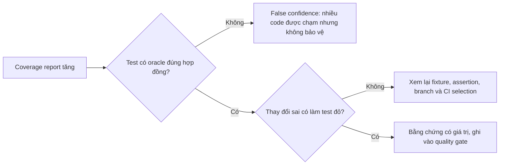
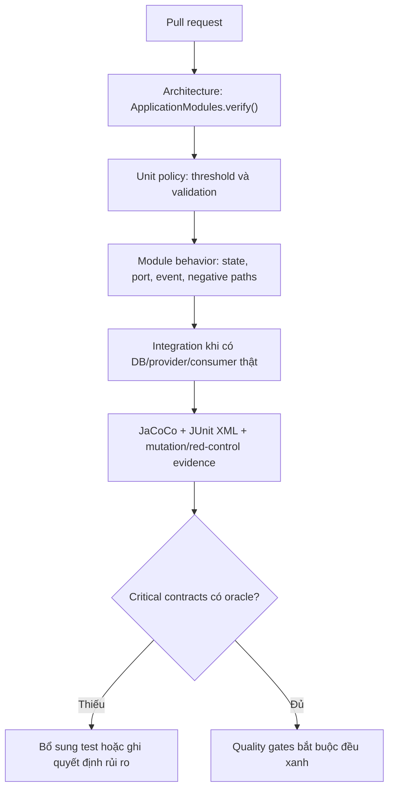

# Tránh tối ưu coverage bằng test ít ý nghĩa

## 1. Đích tối ưu đúng: bảo vệ hợp đồng, không “làm đẹp” tỷ lệ

Trong chương **Coverage theo module** của học phần **SPRING_MODULITH_VERIFICATION_TESTING**, mục tiêu là kiểm chứng ranh giới kiến trúc Spring Modulith bằng `ApplicationModules`, bảo vệ hành vi qua `@ApplicationModuleTest`, event, database và integration tests, đồng thời duy trì quality gate CI chống phụ thuộc sai và hồi quy. Ở bài **“Tránh tối ưu coverage bằng test ít ý nghĩa”**, câu hỏi trung tâm là: **Khi production code bị thay đổi sai, testcase có làm pipeline thất bại đúng vì hợp đồng bị phá không?**

Một module có thể đạt **95% line coverage** nếu suite chỉ gọi hàng loạt method để “chạm” dòng code. Nhưng nếu assertions chỉ là `assertNotNull(...)`, `assertDoesNotThrow(...)` hoặc kiểm tra output vốn luôn cố định, suite đó có thể không bắt nổi thay đổi về **số lần gọi dependency, dữ liệu lưu, event payload hay nhánh từ chối**. Ngược lại, một test nhỏ bảo vệ ranh giới 20.000 gram của chính sách vận chuyển có thể đáng giá hơn 30 test không kiểm tra hậu điều kiện.

**Phân biệt các loại tín hiệu:**

| Tín hiệu | Trả lời được câu hỏi | Không tự trả lời |
| --- | --- | --- |
| JaCoCo instruction/line coverage | Đoạn bytecode nào được **thực thi**? | Hợp đồng nào được kiểm đúng? |
| Branch coverage | Các nhánh bytecode đã được đi qua? | Giá trị sát ngưỡng và hậu quả có được assert? |
| Số lượng JUnit tests | Có bao nhiêu method/invocation chạy? | Assertion có giá trị hay chỉ gọi hàm? |
| Mutation testing | Một số **thay đổi sai có kiểm soát** bị test phát hiện không? | Có bao phủ mọi failure mode, hạ tầng và yêu cầu nghiệp vụ không? |
| Contract evidence | Hậu điều kiện nào có test fail-closed, đúng tầng quan sát? | Không tự sinh ra từ một phần trăm coverage |
| Architecture verification | Dependency module có tuân thủ luật được khai báo? | Business outcome hoặc external event delivery có đúng? |

**Tiêu chí tốt hơn “tỷ lệ cao”:** Với **mỗi hợp đồng quan trọng**, có một stimulus phù hợp, một kết quả quan sát đúng tầng, một assertion thật sự có thể fail, và một phép thử thay đổi sai (*red-control*) chứng minh test phát hiện được hồi quy đó.



Không phải một test phải có thật nhiều assertion; **ít assertion nhưng đúng hậu điều kiện** thường dễ bảo trì hơn một test khổng lồ vừa kiểm tra các chi tiết implementation, vừa bỏ sót hợp đồng công khai.

## 2. Những kiểu “tăng coverage” dễ tạo cảm giác an toàn giả

| Anti-pattern | Ví dụ | Vì sao thiếu ý nghĩa | Hướng thay |
| --- | --- | --- | --- |
| Chỉ **khởi tạo context** | `@SpringBootTest void contextLoads() {}` | Không xác minh logic nghiệp vụ | Test hành vi và architecture gate riêng |
| Gọi command mà **không assert** | `service.dispatch(...)` | Chạy xong không ném lỗi vẫn xanh dù kết quả sai | Assert return/state/event/boundary |
| `assertDoesNotThrow(...)` trên happy path | “Không exception” | Không phát hiện thiếu save/publish hoặc payload sai | Assert chính outcome cần bảo vệ |
| Chỉ assert **non-null** | `assertThat(receipt).isNotNull()` | Receipt sai status/tracking vẫn có thể khác null | Kiểm tra field có ý nghĩa |
| Mock **chính đối tượng cần kiểm thử** | `@Mock ShippingService` | Kiểm tra stubbing do test tự định nghĩa, không chạy production behavior | Inject service thật, mock cổng ngoài |
| Stub rồi nghĩ đã verify | `given(port.book(...)).willReturn(...)` | Stub không chứng minh port được gọi | `then(port).should().book(...)` nếu interaction là contract |
| Lọc event nhưng không assert | `events.ofType(...).matching(...)` | Mới chọn dữ liệu, chưa đặt kỳ vọng | `hasSize(1)`, `singleElement().satisfies(...)` |
| Callback chỉ chạy nếu phần tử tồn tại | `optional.ifPresent(record -> assert...)` | Optional rỗng thì không có assertion nào chạy | Assert presence trước, `hasValueSatisfying(...)` |
| Dồn nhiều input **cùng một nhánh** | 100 giá trị đều dưới ngưỡng | Đếm invocation tăng nhưng không bảo vệ threshold | Dưới – bằng – trên ngưỡng |
| Assert **chi tiết nội bộ** thay vì public contract | `verify(privateMapper).map(...)` | Refactor hợp lệ làm test đỏ, hành vi sai lại có thể qua | Quan sát output/state/message thật |
| Bỏ qua bài test khó chạy | `@Disabled` hoặc CI chỉ chọn tag nhanh | Số coverage từ nhóm còn lại che khoảng trống integration | Theo dõi test executed/skip và required gate |
| Test chỉ kiểm tra mock repository | `verify(repository).save(...)` | Không biết SQL/transaction có commit đúng | Dùng repository/DB thật ở test persistence |

### Một test “xanh giả” điển hình

```java
@Test
void dispatchRunsWithoutException() {
    UUID id = UUID.randomUUID();

    assertDoesNotThrow(() ->
            service.dispatch(id, "12 Main St", 1_000));
    // Không biết đã gọi carrier, lưu shipment, phát event hay chưa.
}
```

Đây là **đoạn minh họa thiếu oracle**, không phải code khuyến nghị. Nếu production service trả `null`, không lưu state và không publish event nhưng không ném exception, test vẫn có thể xanh. Một phép kiểm `assertNotNull(...)` cũng chưa đủ nếu chỉ ngăn được return `null` nhưng không bảo vệ status/tracking.

### Một test có thể đỏ sai mục tiêu

Tối ưu coverage đôi khi khiến test trói vào **thứ tự gọi method private**, **số lần gọi helper nội bộ** hoặc **mọi getter của DTO**. Chúng có thể làm CI đỏ khi refactor hợp lệ mà không đổi behavior. Nhiệm vụ của test không phải **đóng băng implementation**; hãy ưu tiên hợp đồng bên ngoài:

- Port liên module gọi đúng tham số khi hợp đồng yêu cầu.
- State public/repository đúng sau hành động.
- Event đúng type, cardinality, correlation ID và payload.
- Negative path **không tạo side effect bị cấm**.

Với các helper thuần có thuật toán phức tạp, unit test trực tiếp là hợp lý; nhưng đừng chỉ chạy getter/setter được generate để nâng tỷ lệ.

## 3. Chọn test theo rủi ro và **khả năng phân biệt hành vi đúng–sai**

Trước khi viết test, chuyển yêu cầu thành **claim → stimulus → oracle → mutation**. Đây là cách chống “coverage theatre” khi review pull request.

Ví dụ module `shipping` dùng cổng công khai của module `carrier` để đặt vận chuyển:

| Claim | Stimulus tối thiểu | Oracle phải kiểm | Thay đổi sai có chủ đích |
| --- | --- | --- | --- |
| Trọng lượng không hợp lệ bị từ chối | `weight=0/-1` | Exception, **không gọi carrier**, không state/event | Bỏ validation |
| Hàng tối đa 20.000 g được giao tự động | `weight=20_000` | Carrier được gọi, receipt/status/event đúng | Đổi `> 20_000` thành `>=` |
| Hàng trên ngưỡng phải review | `weight=20_001` | Không gọi carrier; ghi trạng thái REVIEW, event review | Luôn gọi carrier |
| Carrier báo lỗi | Port ném exception | Không lưu DISPATCHED, không event dispatch | Nuốt exception rồi báo thành công |
| Tracking code hợp lệ | Port trả code | Receipt/store/event dùng cùng code | Publish code khác hoặc chấp nhận code trống |
| Command trùng ID tuần tự | Gửi hai lần cùng ID | Chỉ một lần gọi carrier, event không nhân đôi | Bỏ guard duplicate |
| Consumer nhận event sau commit | Module consumer/hạ tầng thật | `Scenario` chờ state/event kết quả | Listener không chạy |
| Phụ thuộc kiến trúc hợp lệ | Mô hình `ApplicationModules` | `verify()` phải fail khi import internal package | Truy cập `carrier.internal` |

**Không phải mọi claim cần cùng tầng test.** Validation/ngưỡng là ứng viên unit test nhanh; phối hợp service–port–store–publication dùng `@ApplicationModuleTest`; database commit và event consumer phải dùng hạ tầng thật hoặc scenario có transaction. Nếu test chỉ mock toàn bộ ứng dụng nhưng báo “đã bảo vệ integration”, đó là một kiểu tăng coverage sai.

### Quy tắc chọn đúng mức kiểm chứng

| Rủi ro nếu claim sai | Test tối thiểu có giá trị | Tầng bổ sung khi cần |
| --- | --- | --- |
| Chọn sai nhánh nghiệp vụ | Parameterized boundary unit test | Module behavior test khi khác side effect |
| Gọi nhầm cổng liên module | Module test với mock **chỉ ở boundary** | Contract test với implementation thật |
| Thiếu event nguồn | `PublishedEvents` + assert cardinality/payload | `Scenario` khi consumer cần xử lý |
| SQL rollback sai | JDBC/JPA test với transaction thật | DB engine giống production hoặc Testcontainers |
| Message ngoài hệ thống sai | Externalization mapping/JSON contract | Broker integration, replay/idempotency |

**Không tối ưu theo số test/LOC.** Tối ưu theo số **hậu điều kiện rủi ro cao được bảo vệ** và mức dễ hiểu của failure khi một hậu điều kiện bị phá.

## 4. Ứng dụng mẫu: một nhánh “xanh dễ” nhưng nhiều hợp đồng khó

Ví dụ sử dụng **Java 17+, Spring Boot 3.4/3.5, Spring Framework 6.2, Spring Modulith 1.4 và JUnit Jupiter 5** với các BOM tương thích. `@MockitoBean` là API Spring Framework 6.2; ở Boot cũ hơn có thể phải dùng cơ chế mock tương ứng. Chúng ta dùng store in-memory để tập trung vào **giá trị của test assertions**, không giả nhận đây là JDBC/transaction integration.

```text
src/main/java/com/example/shop/
  ShopApplication.java
  carrier/CarrierBookingPort.java
  shipping/
    ShippingDecision.java
    ShippingPolicy.java
    ShipmentStatus.java
    ShipmentRecord.java
    DispatchReceipt.java
    ShipmentDispatched.java
    ShipmentReviewRequested.java
    ShipmentStore.java
    ShippingService.java
src/test/java/com/example/shop/
  shipping/ShippingPolicyTests.java
  shipping/ShippingEvidenceTests.java
  ModuleArchitectureTests.java
```

### Dependency Maven

Đưa vào POM đã quản lý phiên bản Spring Boot/Modulith; đây **không** phải một POM độc lập:

```xml
<dependency>
    <groupId>org.springframework.boot</groupId>
    <artifactId>spring-boot-starter</artifactId>
</dependency>
<dependency>
    <groupId>org.springframework.boot</groupId>
    <artifactId>spring-boot-starter-test</artifactId>
    <scope>test</scope>
</dependency>
<dependency>
    <groupId>org.springframework.modulith</groupId>
    <artifactId>spring-modulith-starter-test</artifactId>
    <scope>test</scope>
</dependency>
```

`src/main/java/com/example/shop/ShopApplication.java`:

```java
package com.example.shop;

import org.springframework.boot.SpringApplication;
import org.springframework.boot.autoconfigure.SpringBootApplication;

@SpringBootApplication
public class ShopApplication {
    public static void main(String[] args) {
        SpringApplication.run(ShopApplication.class, args);
    }
}
```

### Cổng công khai sang module `carrier`

`src/main/java/com/example/shop/carrier/CarrierBookingPort.java`:

```java
package com.example.shop.carrier;

import java.util.UUID;

public interface CarrierBookingPort {
    String book(UUID shipmentId, String destination, int weightGrams);
}
```

`shipping` import **interface công khai** này, không import `carrier.internal.*`. Trong module test của `shipping`, `@MockitoBean CarrierBookingPort` là mock ở đúng **ranh giới**. Muốn chạy **full application** ngoài test phải có một implementation thực của port (và kiểm chứng adapter/provider riêng).

### Policy có ranh giới rõ

`src/main/java/com/example/shop/shipping/ShippingDecision.java`:

```java
package com.example.shop.shipping;

public enum ShippingDecision {
    AUTO, REVIEW
}
```

`src/main/java/com/example/shop/shipping/ShippingPolicy.java`:

```java
package com.example.shop.shipping;

import org.springframework.stereotype.Component;

@Component
public class ShippingPolicy {

    public ShippingDecision decide(int weightGrams) {
        if (weightGrams <= 0) {
            throw new IllegalArgumentException("INVALID_WEIGHT");
        }
        return weightGrams > 20_000
                ? ShippingDecision.REVIEW
                : ShippingDecision.AUTO;
    }
}
```

Ba input **19.999, 20.000, 20.001** có giá trị hơn nhiều input 1.000–10.000: chúng phân biệt được **ngưỡng** và quyết định liệu có gọi carrier thật hay phải review.

### Snapshot trạng thái và domain events

`src/main/java/com/example/shop/shipping/ShipmentStatus.java`:

```java
package com.example.shop.shipping;

public enum ShipmentStatus {
    DISPATCHED, REVIEW_REQUIRED
}
```

`src/main/java/com/example/shop/shipping/ShipmentRecord.java`:

```java
package com.example.shop.shipping;

import java.util.UUID;

public record ShipmentRecord(
        UUID shipmentId,
        int weightGrams,
        ShipmentStatus status,
        String trackingCode) {
}
```

`src/main/java/com/example/shop/shipping/DispatchReceipt.java`:

```java
package com.example.shop.shipping;

import java.util.UUID;

public record DispatchReceipt(
        UUID shipmentId,
        ShipmentStatus status,
        String trackingCode) {
}
```

`src/main/java/com/example/shop/shipping/ShipmentDispatched.java`:

```java
package com.example.shop.shipping;

import java.util.UUID;

public record ShipmentDispatched(
        UUID shipmentId, int weightGrams, String trackingCode) {
}
```

`src/main/java/com/example/shop/shipping/ShipmentReviewRequested.java`:

```java
package com.example.shop.shipping;

import java.util.UUID;

public record ShipmentReviewRequested(UUID shipmentId, int weightGrams) {}
```

`src/main/java/com/example/shop/shipping/ShipmentStore.java`:

```java
package com.example.shop.shipping;

import java.util.Optional;
import java.util.UUID;
import java.util.concurrent.ConcurrentHashMap;
import java.util.concurrent.ConcurrentMap;
import org.springframework.stereotype.Repository;

@Repository
public class ShipmentStore {

    private final ConcurrentMap<UUID, ShipmentRecord> records =
            new ConcurrentHashMap<>();

    public void save(ShipmentRecord record) {
        if (records.putIfAbsent(record.shipmentId(), record) != null) {
            throw new IllegalStateException("DUPLICATE_SHIPMENT");
        }
    }

    public Optional<ShipmentRecord> findById(UUID id) {
        return Optional.ofNullable(records.get(id));
    }

    public void deleteById(UUID id) {
        records.remove(id);
    }
}
```

`ShipmentStore` là bean singleton giữ state qua các lần thực thi test khi Spring cache context. Dùng **UUID riêng và `finally` cleanup**; đừng coi test với map như đã chứng minh DB rollback, unique constraint hay độ bền sau restart.

### Service có ba đường xử lý khác nhau

`src/main/java/com/example/shop/shipping/ShippingService.java`:

```java
package com.example.shop.shipping;

import java.util.UUID;
import com.example.shop.carrier.CarrierBookingPort;
import org.springframework.context.ApplicationEventPublisher;
import org.springframework.stereotype.Service;

@Service
public class ShippingService {

    private final ShippingPolicy policy;
    private final CarrierBookingPort carrier;
    private final ShipmentStore store;
    private final ApplicationEventPublisher events;

    public ShippingService(
            ShippingPolicy policy,
            CarrierBookingPort carrier,
            ShipmentStore store,
            ApplicationEventPublisher events) {
        this.policy = policy;
        this.carrier = carrier;
        this.store = store;
        this.events = events;
    }

    public DispatchReceipt dispatch(
            UUID id, String destination, int weightGrams) {

        if (id == null || destination == null
                || destination.isBlank()) {
            throw new IllegalArgumentException("INVALID_DESTINATION");
        }

        ShippingDecision decision = policy.decide(weightGrams);

        if (store.findById(id).isPresent()) {
            throw new IllegalStateException("DUPLICATE_SHIPMENT");
        }

        if (decision == ShippingDecision.REVIEW) {
            store.save(new ShipmentRecord(
                    id, weightGrams, ShipmentStatus.REVIEW_REQUIRED, null));
            events.publishEvent(
                    new ShipmentReviewRequested(id, weightGrams));
            return new DispatchReceipt(
                    id, ShipmentStatus.REVIEW_REQUIRED, null);
        }

        String tracking = carrier.book(id, destination, weightGrams);
        if (tracking == null || tracking.isBlank()) {
            throw new IllegalStateException("EMPTY_TRACKING");
        }

        store.save(new ShipmentRecord(
                id, weightGrams, ShipmentStatus.DISPATCHED, tracking));
        events.publishEvent(new ShipmentDispatched(
                id, weightGrams, tracking));
        return new DispatchReceipt(
                id, ShipmentStatus.DISPATCHED, tracking);
    }
}
```

**Giới hạn production cần ghi rõ:** Việc `findById → carrier.book → save` không nguyên tử. Hai request **đồng thời** cùng ID có thể gọi provider hai lần trước khi một thread bị `putIfAbsent` từ chối. Ngoài ra, map `save` không rollback được một booking đã thành công tại carrier. Test tuần tự phần sau chỉ chứng minh tuần tự; cần durable idempotency + transaction/compensation và integration test riêng cho trường hợp concurrency/ACK mất.

Ví dụ có nhiều dòng production, nhưng để có giá trị, tests phải chứng minh **hậu quả khác nhau của các nhánh**, không chỉ chạy đủ ba nhánh để nâng JaCoCo.

## 5. Đối chiếu “nhiều test yếu” với test có oracle đủ mạnh

### Mẫu 1: test lại chính stubbing của mình

```java
// KHÔNG khuyến nghị: không chạy implementation ShippingService thật.
UUID id = UUID.randomUUID();
ShippingService service = mock(ShippingService.class);

when(service.dispatch(id, "A Street", 1_000))
        .thenReturn(new DispatchReceipt(
                id, ShipmentStatus.DISPATCHED, "TRACK-1"));

assertThat(service.dispatch(id, "A Street", 1_000))
        .isEqualTo(new DispatchReceipt(
                id, ShipmentStatus.DISPATCHED, "TRACK-1"));
```

Đây là **trích đoạn minh họa** trong một test có imports Mockito/AssertJ. Nó chỉ xác minh Mockito trả về đúng giá trị ta đã khai báo. Nếu xóa hoàn toàn nội dung production method `ShippingService.dispatch(...)`, test vẫn xanh vì **method thật không chạy**. Không cộng test này như bằng chứng cho hành vi dispatch.

### Mẫu 2: 20 lần gọi một nhánh nhưng chỉ assert non-null

```java
// ANTI-PATTERN: ví dụ trong lớp có service, carrier và store.
for (int weight : new int[]{500, 1_000, 2_000, 5_000}) {
    UUID id = UUID.randomUUID();
    given(carrier.book(id, "A Street", weight))
            .willReturn("TRACK-" + weight);

    try {
        DispatchReceipt receipt =
                service.dispatch(id, "A Street", weight);
        assertThat(receipt).isNotNull();
    } finally {
        store.deleteById(id);
    }
}
```

Mọi input đều nằm trong nhánh **AUTO**; test vẫn có thể xanh nếu service publish sai event, lưu record sai tracking hoặc gọi carrier nhiều lần. Muốn cover nhánh review, phải có stimulus **trên 20.000 g** và assert việc **không gọi carrier**.

### Mẫu 3: số assertion cao nhưng đều đọc một nguồn

```java
assertThat(receipt).isNotNull();
assertThat(receipt.shipmentId()).isNotNull();
assertThat(receipt.status()).isNotNull();
assertThat(receipt.trackingCode()).isNotNull();
```

Nhiều assertion **không đồng nghĩa nhiều bằng chứng độc lập**. Nếu tracking code của đơn A bị trả nhầm sang đơn B, cả bốn dòng vẫn có thể xanh. Thay bằng đối chiếu **cùng correlation ID và tracking code** ở receipt, store và domain event:

```java
assertThat(receipt)
        .isEqualTo(new DispatchReceipt(
                id, ShipmentStatus.DISPATCHED, "TRACK-42"));
assertThat(store.findById(id))
        .contains(new ShipmentRecord(
                id, 20_000, ShipmentStatus.DISPATCHED, "TRACK-42"));
```

Hai assertion sau có thể bảo vệ hai nguồn quan sát khác nhau, nhưng vẫn cần kiểm tra port và event khi đó là hợp đồng của use case. **Không cần luôn kiểm tra tất cả**; chỉ cần những bằng chứng có thể phát hiện các kiểu hồi quy quan trọng của kịch bản.

### Một test JUnit thuần bảo vệ ranh giới tốt hơn hàng loạt happy-path calls

`src/test/java/com/example/shop/shipping/ShippingPolicyTests.java`:

```java
package com.example.shop.shipping;

import static org.assertj.core.api.Assertions.assertThat;
import static org.junit.jupiter.api.Assertions.assertThrowsExactly;

import org.junit.jupiter.api.Tag;
import org.junit.jupiter.params.ParameterizedTest;
import org.junit.jupiter.params.provider.CsvSource;
import org.junit.jupiter.params.provider.ValueSource;

@Tag("unit")
@Tag("shipping")
class ShippingPolicyTests {

    private final ShippingPolicy policy = new ShippingPolicy();

    @ParameterizedTest(name = "{0} gram => {1}")
    @CsvSource({
        "19999, AUTO",
        "20000, AUTO",
        "20001, REVIEW",
        "30000, REVIEW"
    })
    void thresholdIsPartOfTheBusinessContract(
            int weightGrams, ShippingDecision expected) {
        assertThat(policy.decide(weightGrams)).isEqualTo(expected);
    }

    @ParameterizedTest
    @ValueSource(ints = {0, -1})
    void rejectsInvalidWeight(int weightGrams) {
        var error = assertThrowsExactly(
                IllegalArgumentException.class,
                () -> policy.decide(weightGrams));

        assertThat(error).hasMessage("INVALID_WEIGHT");
    }
}
```

**Red-control:** Đổi `weightGrams > 20_000` thành `weightGrams >= 20_000`. Test `20000, AUTO` phải **fail**; đổi thành `> 30_000` thì case `20001, REVIEW` phải fail. Đây là bằng chứng **test nhạy với luật nghiệp vụ**, tốt hơn một tỷ lệ line coverage chỉ cho biết thân method đã chạy.

## 6. Module test có giá trị: một stimulus, nhiều hậu điều kiện cùng hợp đồng

Ở `@ApplicationModuleTest`, không mock `ShippingService` hoặc `ShipmentStore` — đó là những đối tượng cần kiểm chứng. Chỉ mock `CarrierBookingPort` thuộc module khác để điều khiển phản hồi, còn service, policy, store và event publication dùng implementation thật trong module `shipping`.

File `src/test/java/com/example/shop/shipping/ShippingEvidenceTests.java`:

```java
package com.example.shop.shipping;

import static org.assertj.core.api.Assertions.assertThat;
import static org.assertj.core.api.Assertions.assertThatThrownBy;
import static org.junit.jupiter.api.Assertions.assertAll;
import static org.junit.jupiter.api.Assertions.assertThrowsExactly;
import static org.mockito.BDDMockito.given;
import static org.mockito.BDDMockito.then;
import static org.mockito.Mockito.times;
import static org.mockito.Mockito.verifyNoInteractions;

import java.util.UUID;
import com.example.shop.carrier.CarrierBookingPort;
import org.junit.jupiter.api.DisplayName;
import org.junit.jupiter.api.Tag;
import org.junit.jupiter.api.Test;
import org.junit.jupiter.params.ParameterizedTest;
import org.junit.jupiter.params.provider.ValueSource;
import org.springframework.beans.factory.annotation.Autowired;
import org.springframework.modulith.test.ApplicationModuleTest;
import org.springframework.modulith.test.PublishedEvents;
import org.springframework.test.context.bean.override.mockito.MockitoBean;

@Tag("module")
@Tag("shipping")
@DisplayName("Shipping — kiểm tra outcome thay vì tối ưu coverage")
@ApplicationModuleTest
class ShippingEvidenceTests {

    @Autowired ShippingService service;
    @Autowired ShipmentStore store;
    @MockitoBean CarrierBookingPort carrier;

    @Test
    void eligibleShipmentBooksExactlyOnceAndPublishesCorrectEvent(
            PublishedEvents events) {

        UUID id = UUID.randomUUID();
        String destination = "A Street";
        int weight = 20_000;

        given(carrier.book(id, destination, weight))
                .willReturn("TRACK-42");

        try {
            // ACT đúng một lần.
            DispatchReceipt receipt =
                    service.dispatch(id, destination, weight);

            var published = events.ofType(ShipmentDispatched.class)
                    .matching(ShipmentDispatched::shipmentId, id);

            assertAll("Một kiện hợp lệ có kết quả nhất quán",
                () -> assertThat(receipt)
                        .isEqualTo(new DispatchReceipt(
                                id, ShipmentStatus.DISPATCHED, "TRACK-42")),
                () -> then(carrier).should(times(1))
                        .book(id, destination, weight),
                () -> assertThat(store.findById(id))
                        .contains(new ShipmentRecord(
                                id, weight, ShipmentStatus.DISPATCHED,
                                "TRACK-42")),
                () -> assertThat(published)
                        .as("Đúng một event của shipmentId=%s", id)
                        .singleElement()
                        .satisfies(event -> assertAll(
                            () -> assertThat(event.trackingCode())
                                    .isEqualTo("TRACK-42"),
                            () -> assertThat(event.weightGrams())
                                    .isEqualTo(weight)
                        )),
                () -> assertThat(events.ofType(
                        ShipmentReviewRequested.class)
                        .matching(ShipmentReviewRequested::shipmentId, id))
                        .isEmpty()
            );
        } finally {
            store.deleteById(id);
        }
    }

    @Test
    void heavyShipmentRequestsReviewWithoutBookingCarrier(
            PublishedEvents events) {

        UUID id = UUID.randomUUID();
        int weight = 20_001;

        try {
            DispatchReceipt receipt =
                    service.dispatch(id, "A Street", weight);

            assertAll("Quá ngưỡng: chỉ review, không book",
                () -> assertThat(receipt)
                        .isEqualTo(new DispatchReceipt(
                                id, ShipmentStatus.REVIEW_REQUIRED, null)),
                () -> verifyNoInteractions(carrier),
                () -> assertThat(store.findById(id))
                        .contains(new ShipmentRecord(
                                id, weight, ShipmentStatus.REVIEW_REQUIRED,
                                null)),
                () -> assertThat(events.ofType(
                        ShipmentReviewRequested.class)
                        .matching(ShipmentReviewRequested::shipmentId, id))
                        .singleElement()
                        .satisfies(event ->
                            assertThat(event.weightGrams())
                                    .isEqualTo(weight)),
                () -> assertThat(events.ofType(ShipmentDispatched.class)
                        .matching(ShipmentDispatched::shipmentId, id))
                        .isEmpty()
            );
        } finally {
            store.deleteById(id);
        }
    }

    // Các test negative path trong cùng class được trình bày ở mục 7.
}
```

### Vì sao những assertions này có ý nghĩa?

Tất cả được đối chiếu bằng **một `shipmentId`**: outcome trả về, state và event phải nói về **cùng kiện hàng**, cùng trọng lượng và tracking. `times(1)` bảo vệ không đặt vận chuyển hai lần trong kịch bản đơn. `verifyNoInteractions(carrier)` ở nhánh review bảo vệ **absence of prohibited side effect** — một hồi quy nguy hiểm mà chỉ assert receipt sẽ bỏ sót.

Đây là **module contract test**: `@ApplicationModuleTest` chọn module từ package test, và `@MockitoBean` thay bean của module `carrier` không được bootstrap. `PublishedEvents` chứng minh **Spring application event đã publish**, không chứng minh listener khác đã xử lý hoặc message broker đã nhận. Test có *hậu điều kiện rõ*; không nên gọi nó là end-to-end delivery test.

**Lưu ý import:** Những import dùng cho các phương thức ở mục 7 đã có ở đầu class. Khi tích hợp source code, đặt các phương thức của mục 7 **trước dấu `}` cuối cùng của `ShippingEvidenceTests`**, thay comment placeholder bằng nội dung test tương ứng.

## 7. Negative path: thay “đã chạy qua nhánh lỗi” bằng “không có side effect sai”

Một anti-pattern quen thuộc là test lỗi provider chỉ dùng:

```java
assertThatThrownBy(() -> service.dispatch(id, destination, weight))
        .isInstanceOf(RuntimeException.class);
```

Nó biết exception xảy ra nhưng **không bảo vệ hậu quả**. Một refactor có thể lưu trạng thái `DISPATCHED`, phát `ShipmentDispatched` **trước** khi provider ném exception. Test trên vẫn đỏ/xanh đúng kỳ vọng exception nhưng một vi phạm nghiệp vụ nghiêm trọng bị bỏ qua.

Thêm những phương thức sau **vào cùng class `ShippingEvidenceTests`** đã khai báo ở mục 6:

```java
@Test
void carrierFailureCannotAppearAsSuccessfulDispatch(
        PublishedEvents events) {
    UUID id = UUID.randomUUID();
    String destination = "A Street";
    int weight = 1_000;

    given(carrier.book(id, destination, weight))
            .willThrow(new IllegalStateException("CARRIER_UNAVAILABLE"));

    try {
        assertThatThrownBy(() ->
                service.dispatch(id, destination, weight))
                .isInstanceOf(IllegalStateException.class)
                .hasMessage("CARRIER_UNAVAILABLE");

        assertAll("Carrier lỗi: không có kết quả giả thành công",
            () -> then(carrier).should(times(1))
                    .book(id, destination, weight),
            () -> assertThat(store.findById(id)).isEmpty(),
            () -> assertThat(events.ofType(ShipmentDispatched.class)
                    .matching(ShipmentDispatched::shipmentId, id))
                    .isEmpty(),
            () -> assertThat(events.ofType(
                    ShipmentReviewRequested.class)
                    .matching(ShipmentReviewRequested::shipmentId, id))
                    .isEmpty()
        );
    } finally {
        store.deleteById(id);
    }
}

@Test
void emptyTrackingCodeIsNotAValidDispatch(
        PublishedEvents events) {
    UUID id = UUID.randomUUID();
    String destination = "A Street";
    int weight = 2_000;

    given(carrier.book(id, destination, weight)).willReturn(" ");

    try {
        var error = assertThrowsExactly(
                IllegalStateException.class,
                () -> service.dispatch(id, destination, weight));

        assertAll("Tracking trống bị chặn",
            () -> assertThat(error).hasMessage("EMPTY_TRACKING"),
            () -> then(carrier).should(times(1))
                    .book(id, destination, weight),
            () -> assertThat(store.findById(id)).isEmpty(),
            () -> assertThat(events.ofType(ShipmentDispatched.class)
                    .matching(ShipmentDispatched::shipmentId, id))
                    .isEmpty()
        );
    } finally {
        store.deleteById(id);
    }
}

@ParameterizedTest
@ValueSource(ints = {0, -1})
void invalidWeightStopsBeforeCarrier(
        int weight, PublishedEvents events) {
    UUID id = UUID.randomUUID();

    try {
        var error = assertThrowsExactly(
                IllegalArgumentException.class,
                () -> service.dispatch(id, "A Street", weight));

        assertAll("Validation xảy ra trước mọi side effect",
            () -> assertThat(error).hasMessage("INVALID_WEIGHT"),
            () -> verifyNoInteractions(carrier),
            () -> assertThat(store.findById(id)).isEmpty(),
            () -> assertThat(events.ofType(ShipmentDispatched.class)
                    .matching(ShipmentDispatched::shipmentId, id))
                    .isEmpty(),
            () -> assertThat(events.ofType(
                    ShipmentReviewRequested.class)
                    .matching(ShipmentReviewRequested::shipmentId, id))
                    .isEmpty()
        );
    } finally {
        store.deleteById(id);
    }
}

@Test
void sequentialDuplicateDoesNotBookCarrierTwice(
        PublishedEvents events) {
    UUID id = UUID.randomUUID();
    String destination = "A Street";
    int weight = 1_000;

    given(carrier.book(id, destination, weight))
            .willReturn("TRACK-101");

    try {
        DispatchReceipt first =
                service.dispatch(id, destination, weight);

        // Hai stimuli có CHỦ ĐÍCH: đây là hợp đồng idempotency
        // của duplicate request tuần tự, không phải hai lần gọi
        // chỉ để kiểm nhiều field của cùng một output.
        assertThatThrownBy(() ->
                service.dispatch(id, destination, weight))
                .isInstanceOf(IllegalStateException.class)
                .hasMessage("DUPLICATE_SHIPMENT");

        assertAll("Một shipmentId tuần tự chỉ một booking",
            () -> assertThat(first.trackingCode())
                    .isEqualTo("TRACK-101"),
            () -> then(carrier).should(times(1))
                    .book(id, destination, weight),
            () -> assertThat(store.findById(id))
                    .contains(new ShipmentRecord(
                            id, weight, ShipmentStatus.DISPATCHED,
                            "TRACK-101")),
            () -> assertThat(events.ofType(ShipmentDispatched.class)
                    .matching(ShipmentDispatched::shipmentId, id))
                    .hasSize(1)
        );
    } finally {
        store.deleteById(id);
    }
}
```

### Vì sao các negative tests này không phải “test cho đủ số dòng”?

Chúng kiểm tra **kết quả không được xảy ra**. Khi carrier thất bại, module **không** được báo `DISPATCHED`; khi tracking trống, module **không** được lưu một mã vô nghĩa; khi invalid weight, carrier **không** được gọi; khi ID trùng, lệnh không được book lại theo nhánh tuần tự.

| Nếu chỉ test exception | Regression có thể sống | Assertion bổ sung làm test đỏ |
| --- | --- | --- |
| Carrier failure ném exception | Vẫn publish `ShipmentDispatched` trước khi ném | `events.ofType(...).isEmpty()` |
| Empty tracking ném exception | Store đã lưu record tracking rỗng | `store.findById(id).isEmpty()` |
| Weight 0 ném exception | Đã gọi carrier trước validation | `verifyNoInteractions(carrier)` |
| Duplicate request ném exception | Đã book lần hai trước khi kiểm trùng | `then(carrier).should(times(1))` |

**Giới hạn minh bạch:** Những tests này kiểm soát một cổng `carrier` giả. Chúng không chứng minh provider thật không double-book khi response bị mất, không chứng minh H2/PostgreSQL rollback hoặc event consumer đã hoàn tất. Nếu lỗi hạ tầng có ý nghĩa, bổ sung test **đúng tầng**, không tăng assert giả trong module test.

### Cẩn thận với test-instance và mock lifecycle

`@ApplicationModuleTest` trong Spring Modulith 1.4 cấu hình JUnit `@TestInstance(PER_CLASS)`, còn Spring TestContext có thể tái sử dụng singleton context. Vì vậy **không dùng UUID field cố định chung** và không dựa vào state của testcase trước. `@MockitoBean` mặc định được Spring Test reset sau mỗi testcase theo cấu hình thông thường; mỗi invocation vẫn phải tự stub dữ liệu và dọn state nghiệp vụ mà mock reset **không** xử lý.

Với JUnit parameterized test, các argument được cung cấp từ `@ValueSource` đi **trước**, còn tham số `PublishedEvents` do extension resolve nằm **cuối method signature**: `invalidWeightStopsBeforeCarrier(int weight, PublishedEvents events)`. Cách viết này không nhầm tham số dataset và tham số do Spring Modulith/JUnit extension cung cấp.

## 8. Đừng “bù” coverage bằng cách kiểm nhầm tầng hệ thống

Một testcase có thể chứa rất nhiều assertion mà vẫn không có giá trị cho claim mà tên test tuyên bố. Ví dụ:

```java
@Test
void shipmentWasDeliveredToCustomer(PublishedEvents events) {
    UUID id = UUID.randomUUID();
    // ... given một carrier mock thành công ...
    service.dispatch(id, "A Street", 1_000);
    assertThat(events.ofType(ShipmentDispatched.class)
            .matching(ShipmentDispatched::shipmentId, id))
            .hasSize(1);
}
```

**Tên test sai phạm vi:** `PublishedEvents` chỉ chứng minh Spring application event được publish trong module test; nó **không** chứng minh carrier đã giao hàng hay khách nhận kiện. Đặt tên đúng hơn là `publishesShipmentDispatchedWhenBookingSucceeds` và viết **integration test riêng** nếu cần xác nhận hệ thống đối tác.

### Bảng phân biệt để không “tô màu xanh” nhầm claim

| Claim muốn bảo vệ | Bằng chứng thấp nhất có giá trị | Không thể thay bằng |
| --- | --- | --- |
| Chọn đúng `AUTO/REVIEW` | `ShippingPolicyTests` với 20.000/20.001 | 100 `assertNotNull` trên receipt |
| Command gọi carrier đúng | `@ApplicationModuleTest` service thật + mock port và `then(...).should(...)` | Mock chính `ShippingService` |
| Source event đúng | `PublishedEvents` type + ID + count + payload | `contextLoads()` hoặc `ofType(...)` không assert |
| Consumer async đã xử lý | Bootstrap consumer thật, `Scenario` chờ event/state và terminal verification | Source event có mặt |
| Đã commit DB | Repository/JDBC thật, query sau transaction kết thúc | `verify(repository).save(...)` |
| Carrier/provider có idempotency | Adapter integration, lost-ACK retry cùng key, kiểm tra side effect đích | `verify(mock, times(1))` cho một lời gọi |
| Không vi phạm module boundary | `ApplicationModules.verify()` ở gate riêng | Độ phủ code dù đạt 100% |

**Không cần nhồi mọi hạ tầng vào một module test.** Những bằng chứng không thuộc phạm vi của test nên được ghi là **“chưa được chứng minh ở tầng này”** và giao cho integration test thích hợp. Điều đó đáng tin hơn việc đổi tên một module test thành “end-to-end” hoặc thêm Mockito verification để tạo cảm giác đầy đủ.

### Cần chờ completion thì đừng assert state ngay sau publish

Với consumer `notification` nhận `ShipmentDispatched` sau commit hoặc bất đồng bộ, có thể cần một kịch bản mở rộng:

```java
// Blueprint: chỉ dùng khi đã có module notification thật,
// NotificationRecorded(UUID shipmentId), transaction manager,
// và @ApplicationModuleTest(extraIncludes = "notification").
scenario.publish(new ShipmentDispatched(id, 1_000, "TRACK-42"))
        .andWaitAtMost(Duration.ofSeconds(5))
        .forEventOfType(NotificationRecorded.class)
        .matching(e -> e.shipmentId().equals(id))
        .toArriveAndVerify(e ->
                assertThat(e.shipmentId()).isEqualTo(id));
```

Đây là **đoạn phác thảo tích hợp**, không thể chạy chỉ với project tối giản ở mục 4. `Scenario.publish(...)` dùng **event làm stimulus** và bỏ qua logic `ShippingService.dispatch(...)`; muốn chứng minh cả use case, dùng `scenario.stimulate(() -> service.dispatch(...))` với dependency/transaction thích hợp. `toArriveAndVerify(...)` là terminal operation làm scenario thực thi và fail khi event phù hợp không đến; không dừng ở `forEventOfType(...)` rồi coi như verification đã chạy.

**Transaction caution:** `Scenario` thực thi stimulus trong transaction riêng cho việc kích hoạt transactional listeners. Side effect đã commit trong scenario không mặc nhiên bị rollback theo test method, cần cleanup phù hợp; async listener có thể tiếp tục sau timeout. Cơ chế này không chứng minh broker/email/carrier đã giao dịch thành công.

### Khi bài test đụng database

Đừng dùng một repository mock để đẩy line coverage của service lên rồi tuyên bố đã test rollback. Với claim **“ghi DB lỗi thì không có `ShipmentDispatched`”**, kịch bản đúng tầng cần có:

```text
GIVEN: JDBC/JPA repository thật, schema test cô lập,
       shipmentId riêng, input hợp lệ
WHEN : service mở transaction, INSERT rồi gặp lỗi bắt buộc rollback
THEN : sau khi transaction kết thúc, query DB không còn row
       listener AFTER_COMMIT không chạy
       không có message external tương ứng trên broker (nếu claim nói tới)
```

Lưu ý `@Transactional` đặt lên chính test method thường rollback transaction do test quản lý; query trong transaction đó **không chứng minh commit thật**. Không dùng `assertTimeoutPreemptively(...)` cho đoạn test cần test-managed transaction vì nó có thể chạy ở thread khác, làm sai kỳ vọng rollback. Hãy kiểm chứng transaction nơi code thật hoạt động thay vì nâng coverage bằng một mock không có transaction.

## 9. Red-control và mutation: kiểm tra **độ nhạy của test**

Một cách thực dụng để phân biệt test có giá trị với test “tô coverage” là cố ý thay một hậu điều kiện thành sai, chạy test, rồi hoàn nguyên. Đây là **red-control**, không phải đề nghị đưa bug vào production.

### Ma trận mutation cho ví dụ `shipping`

| Mutation có chủ đích | Test phải đỏ | Vì sao đỏ? |
| --- | --- | --- |
| `weightGrams > 20_000` → `>= 20_000` | `ShippingPolicyTests` case 20.000 | Sai ngưỡng |
| Bỏ `carrier.book(...)` rồi trả tracking tĩnh | `eligibleShipmentBooksExactlyOnce...` | Port interaction không xảy ra |
| Lưu `ShipmentRecord` với status `REVIEW_REQUIRED` ở nhánh AUTO | Positive module test | State và receipt/event không nhất quán |
| Không phát `ShipmentDispatched` | Positive module test | `singleElement()` fail vì không có event |
| Phát event với tracking code khác | Positive module test | Assertion payload trong event fail |
| Nhánh REVIEW vẫn gọi carrier | Heavy shipment test | `verifyNoInteractions(carrier)` fail |
| Bắt và nuốt `CARRIER_UNAVAILABLE` rồi return success | Carrier failure test | Exception contract và side effects sai |
| Chấp nhận tracking rỗng | Empty-tracking test | `assertThrowsExactly` không còn đúng |
| Bỏ guard `DUPLICATE_SHIPMENT` | Sequential duplicate test | Thêm booking hoặc exception khác |

**Quy trình thực hiện:**

1. **Green:** Chạy testcase đang bảo vệ claim và xác nhận **test thật sự được chọn**, không skipped.
2. **Mutate:** Thay **một** điều kiện/side effect (ví dụ `>` thành `>=`) trong một nhánh thử nghiệm.
3. **Red:** Test phải fail tại assertion **liên quan tới claim**, không chỉ fail vì Spring context không khởi động.
4. **Restore:** Hoàn nguyên thay đổi và chạy lại; kết quả phải xanh ổn định.
5. **Record:** Ghi claim, mutation, test phát hiện, kết quả và những kịch bản còn thiếu trong review hoặc evidence ledger.

Nếu mutation **sống sót** nhưng đó là thay đổi tương đương về ngữ nghĩa, không tự động kết luận test yếu; phân loại *equivalent mutant* hợp lý. Nếu mutation bị “kill” chỉ do context lỗi hoặc timeout ngẫu nhiên, đừng tính nó là bằng chứng nghiệp vụ mạnh. Mutation score là **tín hiệu phụ**, không phải mục tiêu để tăng số điểm bất chấp ngữ nghĩa.

### Phân biệt những loại failure để không tối ưu sai

| Kết quả khi mutate | Ý nghĩa có thể có | Hành động |
| --- | --- | --- |
| Assertion đúng hợp đồng fail | Test có khả năng bảo vệ claim này | Giữ testcase và mutation rationale |
| Compile failure | Mutation không tạo program hợp lệ | Không xem là test business oracle |
| Spring context/bootstrap failure | Có thể do wiring/config, không phải outcome | Đánh giá lại mutation và test setup |
| Timeout không ổn định | Có thể flaky hoặc async race | Sửa synchronization, không “cộng điểm” |
| Test xanh dù behavior sai | **Khoảng trống bằng chứng** | Bổ sung assertion/fixture đúng nhánh |
| Test xanh vì mutation tương đương | Không nhất thiết là khoảng trống | Phân loại equivalent, không thêm test hình thức |

### Assertion ít nhưng có khả năng bắt lỗi tốt hơn

Giả sử chỉ có thời gian thêm **một** testcase: kiểm trường hợp `weight=20_001` yêu cầu review **và không gọi carrier** thường hữu ích hơn viết 20 test kiểm tra `receipt != null` với các trọng lượng hợp lệ. Lý do không phải “test nào ít code hơn”, mà là test review bảo vệ một **quyết định quan trọng và hậu quả ngoài hệ thống**. Đây là cách tối ưu thời gian của đội kỹ thuật mà không chạy theo coverage số học.

## 10. Quality gate CI: số liệu coverage là **guardrail**, không là đích đến

Một pipeline hữu ích có **nhiều loại bằng chứng bổ sung cho nhau**:



### JaCoCo: cấu hình đúng, diễn giải đúng

Với Gradle Kotlin DSL đã bật Java và chạy JUnit Platform, có thể tạo **XML report** để CI tổng hợp và một ngưỡng branch coverage **minh họa**:

```kotlin
plugins {
    java
    jacoco
}

tasks.test {
    useJUnitPlatform()
}

tasks.jacocoTestReport {
    dependsOn(tasks.test)
    reports {
        xml.required.set(true)
        html.required.set(true)
    }
}

tasks.jacocoTestCoverageVerification {
    dependsOn(tasks.test)
    violationRules {
        rule {
            limit {
                counter = "BRANCH"
                value = "COVEREDRATIO"
                minimum = "0.65".toBigDecimal()
            }
        }
    }
}

tasks.named("check") {
    dependsOn(
        tasks.jacocoTestReport,
        tasks.jacocoTestCoverageVerification
    )
}
```

**Lưu ý quan trọng:**

- `0.65` chỉ là **ví dụ ngưỡng**, không phải tiêu chuẩn chung hoặc một điểm số đã đạt trong repo.
- Rule trên áp dụng **toàn bộ class set mà JaCoCo verification task đọc**, không phải tự động **riêng module `shipping`**. Nếu cần quality gate theo module, phải giới hạn classDirectories/filter hoặc aggregate kết quả theo mapping module đã kiểm chứng.
- `jacocoTestReport` và `jacocoTestCoverageVerification` **không mặc nhiên là dependency của `check`**: đoạn cấu hình đã nối chúng một cách tường minh.
- Nếu dùng `integrationTest` hoặc source set riêng, báo cáo mặc định của `test` **không tự bao gồm execution data từ mọi task khác**. Đừng so sánh các tỷ lệ chưa cùng phạm vi.
- Việc **tăng ngưỡng** từ 65% lên 90% không làm test yếu thành test mạnh. Nó có thể thúc đẩy bổ sung nhiều case vô nghĩa, nếu không kèm contract review.

### Architecture gate bảo vệ một loại hợp đồng khác

File `src/test/java/com/example/shop/ModuleArchitectureTests.java`:

```java
package com.example.shop;

import org.junit.jupiter.api.Tag;
import org.junit.jupiter.api.Test;
import org.springframework.modulith.core.ApplicationModules;

@Tag("architecture")
class ModuleArchitectureTests {

    @Test
    void modulesRespectDeclaredBoundaries() {
        ApplicationModules.of(ShopApplication.class).verify();
    }
}
```

`ApplicationModules.verify()` kiểm tra các luật kiến trúc Spring Modulith áp dụng (như cycle, truy cập nội bộ, `allowedDependencies` đã khai báo). Nó không tự biết `shipping` phải chọn REVIEW ở 20.001 gram, carrier phải nhận đúng destination hay event phải có tracking tương ứng. Vì vậy **architecture gate và behavior tests phải cùng chạy**.

### Tránh “green build với 0 test”

Một build có thể trông xanh khi CI filter chỉ chọn nhóm test rỗng. Với stage bắt buộc:

1. Kiểm tra JUnit XML hoặc test reports và yêu cầu **số testcase executed lớn hơn 0** cho từng nhóm critical (unit/module/architecture/integration theo kế hoạch).
2. Theo dõi số `skipped`, `aborted`, `@Disabled`; không xem “discovered” là “executed”.
3. Đảm bảo lỗi assertion khiến **exit code của test task và required CI check thất bại**.
4. Giữ failure logs và tên test rõ ràng để xác định claim bị phá, không chỉ báo “coverage giảm 1,2%”.
5. Khi dùng tags, hiểu cách filter hoạt động: một job chỉ chạy `shipping & !integration` sẽ không chọn test mang **chỉ** tag `architecture` trừ khi có stage riêng.

Không giả định mọi phiên bản Gradle/Maven đều tự fail khi một filter chọn 0 testcase; **guard test count phải được thiết kế cho runner thực tế**.

### Bảng báo cáo đúng trọng tâm

| Thành phần báo cáo CI | Ví dụ nội dung có ích |
| --- | --- |
| Branch coverage | `shipping`: 78% trên **unit + module tests** *(giả định)* |
| Critical claims được bảo vệ | Validation, threshold, positive booking, carrier fail, review, tracking, duplicate tuần tự |
| Contract còn thiếu | Đồng thời cùng shipmentId; provider ACK mất; SQL rollback; async consumer |
| Red-control chứng minh | Mutation `>` thành `>=` bị `ShippingPolicyTests` bắt |
| Module architecture | Gate `ApplicationModules.verify()` đã chạy và passed |
| CI execution | Có số testcase executed, skipped, test tasks trong phạm vi báo cáo |

Đây là **mẫu báo cáo minh họa**, không phải kết quả đã đo trên một repository. Báo cáo tốt luôn phân biệt “đã chứng minh” với “chưa kiểm tra”; đó là cách tránh dùng một con số tổng che các side effect có rủi ro cao.

## 11. Quy trình review, bài tập và checklist tránh coverage vô nghĩa

### Review một testcase bằng sáu câu hỏi

| Câu hỏi | Dấu hiệu đạt |
| --- | --- |
| **1. Hợp đồng nào?** | Tên test nói về một hành vi, ngưỡng hoặc hậu điều kiện cụ thể |
| **2. Stimulus đúng không?** | Test gọi service/policy thật, không chỉ stub mock của chính đối tượng đó |
| **3. Oracle nào?** | Assertion về result/state/boundary/event chứ không chỉ `isNotNull()` |
| **4. Nếu sai thì fail ở đâu?** | Có mutation/red-control tương ứng và failure có thể giải thích |
| **5. Đúng phạm vi chưa?** | Module test không giả nhận DB/broker/provider/consumer đã được xác minh |
| **6. CI có chạy không?** | Test count dương, không bị skip và failure chặn merge |

Nếu thiếu **một** trong các điều kiện 1–4, đừng đánh dấu “critical contract covered” chỉ vì JaCoCo tăng. Nếu thiếu điều kiện 5–6, bằng chứng có thể đúng trong môi trường cục bộ nhưng không bảo vệ hệ thống hay pull request theo kỳ vọng.

### Bài tập thực hành

1. **Test bị “tô coverage”:** Viết 10 testcase chỉ gọi `ShippingPolicy.decide(...)` với `weight=1000`, assertion `notNull`. Đổi `>20_000` thành `>=20_000`; lý giải vì sao suite có thể vẫn xanh. Sau đó thay bằng test threshold.
2. **Over-mocking:** Mock luôn `ShippingService` và test return value đã stub. Xóa code production trong một branch thử nghiệm và quan sát vì sao test mock vẫn xanh.
3. **Lỗi event:** Bỏ `events.publishEvent(new ShipmentDispatched(...))`. Xác định assertion `singleElement()` nào thất bại; chỉ gọi `PublishedEvents.ofType(...)` có đủ không?
4. **Lỗi mapping:** Publish `trackingCode="WRONG"` dù carrier trả `"TRACK-42"`. So sánh test chỉ `hasSize(1)` với test assert payload.
5. **Nhánh review:** Cho `service.dispatch(...)` gọi `carrier.book(...)` với `weight=20_001`. Xác định test `verifyNoInteractions` làm đỏ.
6. **Carrier down:** Giữ exception đúng nhưng thêm lệnh lưu `DISPATCHED` trước khi ném. Một test chỉ `assertThrows` có bắt được lỗi side effect không?
7. **Tracking rỗng:** Xóa validation tracking. Xác nhận test `emptyTrackingCodeIsNotAValidDispatch` fail và giải thích vì sao `receipt!=null` yếu.
8. **Idempotency:** Tạo hai request **đồng thời** cùng ID bằng barrier. Tìm race của `findById → carrier.book → save`, đề xuất durable dedup/idempotency key/compensation. Không dùng test tuần tự để tuyên bố đã giải quyết concurrency.
9. **Đúng tầng:** Thêm repository thật có transaction; kiểm tra row sau commit/rollback. Phân biệt assertion từ mock `save(...)` và query database sau transaction.
10. **Architecture:** Cho `shipping` import class thuộc `carrier.internal` và chạy `ApplicationModules.verify()`. Tại sao các test booking với `@MockitoBean` không tự thay thế được gate này?
11. **CI zero-test:** Cố tình đặt tag filter không tồn tại, xác nhận test count bằng JUnit XML. Sửa CI để pipeline không được “passed” khi bỏ lọt toàn bộ test critical.
12. **Review một PR thật:** Với mỗi testcase mới, ghi **claim – stimulus – oracle – mutation – tầng test**. Loại bỏ test chỉ lặp lại cùng assertion mà không tăng khả năng phát hiện hồi quy.

### Checklist trước khi merge

| Tiêu chí | Đạt khi |
| --- | --- |
| Không tăng test chỉ để tăng số lần chạy | Mỗi case bảo vệ một nhánh hoặc claim có ý nghĩa |
| Không mock chính đối tượng cần test | Service thật, mock chỉ ở boundary phù hợp |
| Validation/boundary được kiểm | Input dưới–bằng–trên ngưỡng và negative path |
| Test thất bại khi command thiếu side effect bắt buộc | Assert result/state/port/event theo correlation ID |
| Test thất bại khi side effect bị cấm xuất hiện | `verifyNoInteractions`, no state/event trên đường từ chối |
| Callback có thể không chạy được bảo vệ | Assert presence/cardinality trước `ifPresent/forEach` |
| State test độc lập | UUID riêng, fixture rõ, cleanup cả khi assertion fail |
| Không gắn nhãn integration cho mock-only test | Bằng chứng DB/broker/provider ở test hạ tầng thật |
| Mutation có ý nghĩa bị test phát hiện | Red đúng assertion, green lại sau restore |
| JaCoCo scope được ghi rõ | Unit/module/integration tasks nào góp execution data |
| CI chạy đủ test | Execution count > 0, không skipped nhầm |
| Architecture gate bắt buộc | `ApplicationModules.verify()` không bị tag filter bỏ qua |

**Ghi nhớ:** *Coverage là bản đồ các đoạn code đã đi qua, không phải chứng nhận tính đúng của hành vi.* Muốn tránh tối ưu bằng test ít ý nghĩa, hãy gắn mỗi test với **hợp đồng có rủi ro, hậu điều kiện quan sát được và một phép thử thay đổi sai làm test đỏ**. Dùng `@ApplicationModuleTest` và `PublishedEvents` để kiểm chứng module đúng phạm vi, thêm DB/consumer/provider integration khi claim cần bằng chứng đó, và giữ cả **architecture gate lẫn test-execution guard** trong CI.

### Tài liệu tham khảo

- [JaCoCo — Coverage Counters và giới hạn của từng metric](https://www.jacoco.org/jacoco/trunk/doc/counters.html)
- [Gradle — The JaCoCo Plugin, report và coverage verification](https://docs.gradle.org/current/userguide/jacoco_plugin.html)
- [JUnit Jupiter — Parameterized Tests](https://docs.junit.org/current/writing-tests/parameterized-classes-and-tests.html)
- [JUnit Jupiter — Assertions.assertAll](https://docs.junit.org/current/api/org.junit.jupiter.api/org/junit/jupiter/api/Assertions.html)
- [Spring Modulith 1.4 — Integration Testing Application Modules](https://docs.spring.io/spring-modulith/reference/1.4/testing.html)
- [Spring Modulith 1.4 — Testing Published Events](https://docs.spring.io/spring-modulith/reference/1.4/events.html)
- [Spring Modulith 1.4 API — ApplicationModuleTest](https://docs.spring.io/spring-modulith/docs/1.4.0/api/org/springframework/modulith/test/ApplicationModuleTest.html)
- [Spring Modulith — Verifying Application Module Structure](https://docs.spring.io/spring-modulith/reference/verification.html)
- [Spring Framework — TestContext Transaction Management](https://docs.spring.io/spring-framework/reference/testing/testcontext-framework/tx.html)
