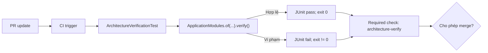
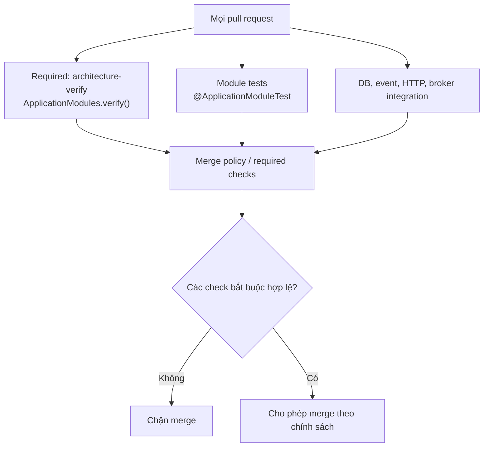

# Chạy ApplicationModules.verify ở mọi pull request

**Một pull request chỉ được merge khi toàn bộ application module graph vẫn hợp lệ.** Đó là hợp đồng của quality gate kiến trúc: mọi lần cập nhật PR phải chạy `ApplicationModules.verify()` trên mã đã biên dịch của commit đang được kiểm tra, trả **exit code khác 0** nếu có vi phạm, và gắn kết quả vào một **required status check** mà nhánh đích không được bỏ qua.

Trong phạm vi `SPRING_MODULITH_VERIFICATION_TESTING`, gate này bảo vệ các ranh giới cấu trúc trước khi chạy những bài `@ApplicationModuleTest`, kiểm thử sự kiện, database và integration vốn thường tốn tài nguyên hơn. Bài tập trung vào cách **biến lệnh verify thành điều kiện merge bắt buộc**, gồm JUnit, Maven/Gradle, GitHub Actions, cấu hình required checks và kiểm thử bằng cách cố tình tạo vi phạm. Đây không phải hướng dẫn nhập môn Spring Modulith.

## 1. Xác định một gate có thể tin được

Một `ApplicationModules.verify()` chạy được trên laptop mới là **điều kiện cần**. Để trở thành quality gate cho mọi PR, phải đủ bốn điều kiện:

1. **Đúng đối tượng:** Spring Modulith tìm thấy toàn bộ các module cần bảo vệ, không chỉ một package vô tình còn sót.
2. **Thực sự thực thi:** JUnit test chứa `verify()` được test runner phát hiện và chạy; không bị `@Disabled`, filter, profile hoặc skip flag loại bỏ.
3. **Fail closed:** exception của `verify()` đi lên JUnit → Maven Surefire/Gradle `Test` → process exit code → CI job; không bị `try/catch` nuốt hoặc shell dùng `|| true`.
4. **Có hiệu lực khi merge:** job có check name ổn định, kích hoạt trên **mọi PR** và được cấu hình **required** trong branch protection/ruleset.



**Quy tắc được verify:** không có **vòng phụ thuộc module**, không truy cập **API nội bộ** của module khác trong mô hình module đóng, và tuân thủ `@ApplicationModule(allowedDependencies = ...)` nếu đã khai báo. Các kiểu được phép truy cập trong **open application modules** là ngoại lệ có chủ đích; ngoài ra, một số rule từ jMolecules có thể được áp dụng khi dependencies tương ứng hiện diện trên classpath.

**Không phải chức năng của gate này:** chạy Spring `ApplicationContext`, kiểm tra dependency injection, xác minh database transaction/SQL, bảo đảm listener xử lý event, hoặc kiểm tra Kafka/HTTP. Những nghĩa vụ runtime cần test riêng. `verify()` làm việc với mô hình Java package/type dependency; không nên kết luận nó phát hiện mọi liên kết dùng reflection, string-based messaging hoặc request HTTP.

### Bằng chứng PASS và FAIL phải quan sát được

| Kết quả | Điều CI phải quan sát | Không đủ để kết luận |
| --- | --- | --- |
| PASS | JUnit verifier **đã chạy** và pass; check của commit mới nhất đạt | Chỉ thấy job xanh nhưng không có test nào chạy |
| FAIL | JUnit hiển thị exception/violation; test process non-zero; check đỏ | Chỉ log warning rồi trả exit 0 |
| MISSING | Không tìm thấy test, không có report hoặc không có required check | Xem như PASS mặc định |
| SKIPPED | Test/job bị skip theo filter hoặc điều kiện | Xem như đã xác minh kiến trúc |

Vì vậy thiết kế tốt **không chỉ hỏi “CI có xanh không?”** mà còn hỏi **“CI đã chạy đúng verifier trên đúng application graph chưa?”**.

## 2. JUnit verifier độc lập với Spring context và hạ tầng

Với ứng dụng minh họa:

```text
src/main/java/com/acme/shop/
├── ShopApplication.java
├── orders/
│   ├── package-info.java
│   ├── OrderOperations.java
│   └── events/
│       ├── OrderPlaced.java
│       └── package-info.java
├── inventory/
│   ├── StockAvailability.java
│   └── internal/DatabaseStockAvailability.java
├── payments/
│   ├── PaymentGateway.java
│   └── internal/HttpPaymentGateway.java
└── notifications/
    ├── package-info.java
    └── internal/OrderPlacedListener.java

src/test/java/com/acme/shop/
└── ArchitectureVerificationTest.java
```

`ShopApplication` xác định root package:

```java
// src/main/java/com/acme/shop/ShopApplication.java
package com.acme.shop;

import org.springframework.boot.autoconfigure.SpringBootApplication;

@SpringBootApplication
public class ShopApplication {
}
```

Các quy tắc dependency có thể được khai báo ở code production:

```java
// src/main/java/com/acme/shop/orders/package-info.java
@org.springframework.modulith.ApplicationModule(
    allowedDependencies = {"inventory", "payments"}
)
package com.acme.shop.orders;
```

```java
// src/main/java/com/acme/shop/orders/events/package-info.java
@org.springframework.modulith.NamedInterface("events")
package com.acme.shop.orders.events;
```

```java
// src/main/java/com/acme/shop/notifications/package-info.java
@org.springframework.modulith.ApplicationModule(
    allowedDependencies = "orders :: events"
)
package com.acme.shop.notifications;
```

Ý nghĩa: `orders` chỉ tham chiếu những module đã được phép; `notifications` chỉ tham chiếu nhóm API `events` của `orders`. Đây là ví dụ một đồ thị module hợp lệ mà PR phải bảo vệ.

### Test bắt buộc

```java
// src/test/java/com/acme/shop/ArchitectureVerificationTest.java
package com.acme.shop;

import org.junit.jupiter.api.Test;
import org.springframework.modulith.core.ApplicationModules;

import static org.junit.jupiter.api.Assertions.assertAll;
import static org.junit.jupiter.api.Assertions.assertTrue;

class ArchitectureVerificationTest {

    @Test
    void allExpectedModulesAreDiscovered() {
        ApplicationModules modules =
                ApplicationModules.of(ShopApplication.class);

        assertAll(
            () -> assertTrue(
                modules.getModuleByName("orders").isPresent(),
                "Không tìm thấy orders module"),
            () -> assertTrue(
                modules.getModuleByName("inventory").isPresent(),
                "Không tìm thấy inventory module"),
            () -> assertTrue(
                modules.getModuleByName("payments").isPresent(),
                "Không tìm thấy payments module"),
            () -> assertTrue(
                modules.getModuleByName("notifications").isPresent(),
                "Không tìm thấy notifications module")
        );
    }

    @Test
    void moduleBoundariesMustRemainValid() {
        ApplicationModules.of(ShopApplication.class).verify();
    }
}
```

**Vì sao dùng hai phép kiểm tra?**

- `verify()` ném exception khi phát hiện vi phạm kiến trúc trong các application modules đã được suy ra.
- `allExpectedModulesAreDiscovered()` ngăn một dạng **xanh giả**: ai đó chuyển package, xóa cấu hình discovery hoặc vô tình loại một module khỏi classpath, khiến các rule không còn chạy trên phần mã cần bảo vệ.
- Test dùng `org.junit.jupiter.api.Test`, class đặt tên `*Test` để Maven Surefire nhận theo cấu hình mặc định.
- Không dùng `@SpringBootTest` hoặc `@ApplicationModuleTest` trên class này: **không cần bootstrap context, DataSource, broker hay HTTP client** để phân tích cấu trúc module.

Danh sách module kỳ vọng phải được quản lý khi team **thêm/xóa/đổi tên module có chủ đích**. Không nên hard-code số lượng rồi khiến việc thêm module hợp lệ vô tình bị chặn; nhưng cũng không nên chỉ assert `modules.stream().count() > 0`, vì phép kiểm đó quá yếu.

### Vì sao “test code nằm trong package root” hữu ích?

Verifier được định vị ở package gốc ứng dụng, không bên trong `orders`. `ApplicationModules.of(ShopApplication.class)` cố định root package mà mô hình module được suy ra, thay vì phụ thuộc vào test package. Nếu dự án có nhiều Spring Boot apps hoặc mô hình multi-module khác nhau, **mỗi application root cần một verifier tường minh**; không giả định một class duy nhất tự quét toàn monorepo.

## 3. Chứng minh gate thật sự chặn hồi quy: red–green có chủ đích

Không nên triển khai CI rồi chỉ chạy một commit đang xanh. Hãy **cố tình đưa vào một vi phạm kiến trúc trong nhánh thử nghiệm**, xác nhận verifier đỏ, sau đó revert và xác nhận xanh.

### Trường hợp A: import implementation nội bộ

Ví dụ ban đầu `orders.internal.DefaultOrderOperations` chỉ phụ thuộc API:

```java
import com.acme.shop.inventory.StockAvailability;
```

Thay tạm bằng một tham chiếu **có thể biên dịch** tới kiểu nằm trong:

```java
// MINH HỌA VI PHẠM - không commit.
import com.acme.shop.inventory.internal.DatabaseStockAvailability;
```

Giả định class nội bộ đó được khai báo `public` để Java compiler cho phép import. Trong closed application module, kiểu vẫn thuộc **internal package**; `verify()` phải báo truy cập sai API.

**Nếu compiler đã từ chối import vì class package-private**, test gate vẫn được bảo vệ bởi bước compile, nhưng ví dụ đó **chưa chứng minh** verifier có bắt được một vi phạm module hợp lệ theo Java hay không. Muốn thử đúng rule, cần trường hợp compile được và `verify()` thất bại.

### Trường hợp B: tạo cycle giữa module

Đồ thị ban đầu:

```text
orders -> inventory
orders -> payments
notifications -> orders :: events
```

Nếu code production của `inventory` tham chiếu trở lại `orders.OrderOperations`, ta có `orders → inventory → orders`. Dù cả hai API đều công khai, chu trình trên application module graph là một lỗi mà `verify()` cần phát hiện.

### Trường hợp C: vượt giới hạn allowedDependencies

`orders` đã khai báo chỉ được phụ thuộc `inventory` và `payments`. Nếu một developer đưa import từ `orders` đến API của `notifications`, việc đó trái với allowlist dù Java compiler vẫn có thể chấp nhận.

| Vi phạm tạm | Dự kiến compile | Dự kiến JUnit verify | CI check |
| --- | --- | --- | --- |
| Import public class trong `inventory.internal` | PASS | **FAIL** – truy cập internal API | Đỏ |
| Tạo vòng `orders ↔ inventory` bằng public API | PASS | **FAIL** – cycle | Đỏ |
| `orders` gọi API `notifications` ngoài allowlist | PASS | **FAIL** – allowed dependency | Đỏ |
| Revert vi phạm, giữ đồ thị đúng | PASS | PASS | Xanh |

### Quy trình kiểm chứng red–green

1. Chạy JUnit verifier trên code hợp lệ, lưu kết quả PASS làm baseline.
2. Tạo vi phạm **trong một nhánh thử nghiệm hoặc thay đổi tạm**, không đưa vào main.
3. Chạy **chính lệnh của CI** (Maven hoặc Gradle) và xác nhận process exit code khác 0.
4. Kiểm tra log có thông tin package/cạnh dependency bị vi phạm, không phải lỗi môi trường thiếu JDK.
5. Revert thay đổi, chạy lại cùng lệnh, xác nhận xanh.
6. Mở PR thử hoặc quan sát required check trên PR thật để xác nhận **nhánh bảo vệ ngăn merge khi job đỏ**.

**Không dùng `@Disabled`, `assumeTrue(false)`, `try/catch` nuốt exception hoặc ghi exception vào log rồi bỏ qua.** Chúng đều biến một kiến trúc sai thành một test không fail.

## 4. Bảo đảm Maven và Gradle thực sự chạy ArchitectureVerificationTest

CI chỉ có thể chặn lỗi nếu test runner **phát hiện** `ArchitectureVerificationTest`. Đây là nơi nhiều dự án thất bại âm thầm: class nằm sai source set, dùng JUnit engine không đúng, bị filter hoặc chỉ chạy integration task khác.

### 4.1. Maven: test-scope dependency và Surefire

Một cấu hình Maven rút gọn, giả định project đã quản lý phiên bản qua Spring Boot/Spring Modulith BOM:

```xml
<!-- pom.xml, chỉ là mảnh dependencies liên quan -->
<dependencies>
    <dependency>
        <groupId>org.springframework.boot</groupId>
        <artifactId>spring-boot-starter-test</artifactId>
        <scope>test</scope>
    </dependency>
    <dependency>
        <groupId>org.springframework.modulith</groupId>
        <artifactId>spring-modulith-starter-test</artifactId>
        <scope>test</scope>
    </dependency>
</dependencies>
```

`spring-modulith-starter-test` cung cấp phần test/verification API cần thiết trong cấu hình Spring Modulith thông dụng. Version phải tương thích với Spring Boot và JUnit trong dự án; không tự gắn version bất kỳ vào mảnh trên nếu BOM đang chịu trách nhiệm dependency management.

Các lệnh kiểm tra ở **module Maven chứa `ArchitectureVerificationTest`**:

```bash
# Chạy một test kiến trúc khi phát triển:
./mvnw -B -ntp -Dtest=ArchitectureVerificationTest test

# Kiểm tra test runner không âm thầm bỏ qua test đã chỉ định:
./mvnw -B -ntp \
  -Dtest=ArchitectureVerificationTest \
  -Dsurefire.failIfNoSpecifiedTests=true \
  test

# Chạy test suite thông thường (bao gồm verifier nếu được discovery):
./mvnw -B -ntp test
```

**Điểm cần chú ý:** Maven Surefire mặc định nhận các tên `Test*.java`, `*Test.java`, `*Tests.java` và `*TestCase.java`. Class `ArchitectureVerificationTest` khớp `*Test.java`. Nếu đổi tên thành `ArchitectureVerificationSpec` mà không cấu hình includes, test có thể không chạy.

`-Dsurefire.failIfNoSpecifiedTests=true` làm lệnh **chỉ định test** thất bại nếu không có test nào khớp. Khi chạy **toàn bộ test suite**, đừng mặc định Surefire sẽ fail khi không có bất kỳ test nào: `failIfNoTests` thường mặc định là `false`. Có thể bật `failIfNoTests=true` **ở module được yêu cầu có test**, nhưng không nên áp đặt bừa cho một multi-module reactor có nhiều module hoàn toàn không chứa test.

**Multi-module Maven:** chạy `-Dtest=ArchitectureVerificationTest` từ reactor root cùng `-am` có thể làm các module phụ thuộc không có test tên đó thất bại, dù module ứng dụng chứa test vẫn đúng. Không khắc phục bằng cách bật `surefire.failIfNoSpecifiedTests=false` trên mọi module mà không kiểm tra riêng module sở hữu verifier. Các lựa chọn:

- Chạy test được chỉ định từ module chứa nó, sau khi các dependency nội bộ đã được build/resolve.
- Hoặc chạy `mvn test` trong reactor và xác minh report của **module ứng dụng** có đúng test verifier đã thực thi.
- Hoặc định nghĩa một build profile/job chuyên cho architecture test, có fail-on-missing ở module sở hữu test.

### 4.2. Gradle: JUnit Platform và test task

Ví dụ Kotlin DSL cho project có Java/Spring Boot plugin và dependency management phù hợp:

```kotlin
// build.gradle.kts, chỉ trích những phần liên quan.
dependencies {
    testImplementation("org.springframework.boot:spring-boot-starter-test")
    testImplementation("org.springframework.modulith:spring-modulith-starter-test")
}

tasks.test {
    useJUnitPlatform()
}
```

Lệnh kiểm tra:

```bash
# Chạy riêng JUnit verifier (một project Gradle):
./gradlew test --tests '*ArchitectureVerificationTest'

# Chạy tất cả test mà task test phát hiện:
./gradlew test

# Build gate thông thường của Java plugin nếu check phụ thuộc test:
./gradlew check
```

Gradle `--tests` có thể lọc theo fully-qualified class; khi đặt filter mà không có test phù hợp, cơ chế test filtering thông thường sẽ báo lỗi. Dẫu vậy, một task `test` hoàn toàn không được cấu hình đúng JUnit Platform hoặc không có test source **có thể bị skip**. Vì vậy đừng chỉ nhìn exit code; kiểm tra **JUnit XML/HTML report** xem `ArchitectureVerificationTest` đã chạy.

### 4.3. Kỳ vọng vào báo cáo, không chỉ terminal log

| Build tool | Nơi report thường có | Tín hiệu cần kiểm tra |
| --- | --- | --- |
| Maven Surefire | `target/surefire-reports/TEST-*.xml` | Có testcase của `ArchitectureVerificationTest`, không có failure/error |
| Gradle `test` | `build/test-results/test/TEST-*.xml` | Có đúng testcase, task không bị SKIPPED |
| JUnit test invocation | Kết quả process CI | Exit code 0 khi hợp lệ, nonzero khi vi phạm |

Report path thay đổi nếu dùng multi-module hoặc custom test task. Việc lưu report và xác nhận test tồn tại giúp phát hiện một gate **“thành công vì chẳng chạy gì”**.

## 5. GitHub Actions: kiến trúc là một check chạy trên mọi PR

Ví dụ sau dành cho **repository Maven một ứng dụng**. Trong repository có nhiều module, phải thay lệnh `run` và đường dẫn report để trỏ đúng module sở hữu `ArchitectureVerificationTest` (mục 7).

```yaml
# .github/workflows/modulith-architecture.yml
name: modulith-architecture

on:
  pull_request:
  merge_group:
  push:
    branches: [main]

permissions:
  contents: read

jobs:
  architecture-verify:
    name: architecture-verify
    runs-on: ubuntu-latest
    timeout-minutes: 10

    steps:
      - name: Checkout pull request
        uses: actions/checkout@v7

      - name: Install Java
        uses: actions/setup-java@v6
        with:
          distribution: temurin
          java-version: '21'
          cache: maven

      - name: Verify application module boundaries
        run: >-
          ./mvnw -B -ntp
          -Dtest=ArchitectureVerificationTest
          -Dsurefire.failIfNoSpecifiedTests=true
          test

      - name: Keep JUnit evidence
        if: always()
        uses: actions/upload-artifact@v4
        with:
          name: architecture-junit
          path: target/surefire-reports/TEST-*.xml
          if-no-files-found: error
```

Điều workflow **cố ý làm**:

1. `pull_request` không có `paths` filter: PR chỉ sửa tài liệu, migration, build configuration hoặc code đều kích hoạt gate.
2. `merge_group` hỗ trợ check khi repository dùng GitHub **merge queue**; đây là sự kiện **khác** với `pull_request`.
3. `push` tới `main` là lớp xác minh **sau merge**, không thay yêu cầu check trên PR.
4. `permissions: contents: read` đủ cho bước checkout/test với PR bình thường, không cần token ghi hoặc secrets production.
5. Job tên **`architecture-verify`** ổn định để cấu hình required status check theo đúng tên.
6. Lệnh chạy **chính bài JUnit verifier** và yêu cầu fail nếu test không được tìm thấy.
7. `if: always()` giúp upload report kể cả khi phép kiểm tra thất bại; `if-no-files-found: error` tránh report biến mất một cách im lặng. Khi build fail trước khi chạy test, thiếu report cũng được phản ánh là tình trạng job lỗi.

**Thực hành bảo mật:** ví dụ dùng các major version tags của GitHub Actions được tài liệu hỗ trợ. Với môi trường có chính sách supply-chain nghiêm ngặt, pin action bằng **full commit SHA đã được phê duyệt** thay vì major tag và cập nhật SHA qua quy trình kiểm soát. Không chạy code PR không tin cậy với `pull_request_target` cùng token có quyền ghi.

### Biến thể nếu dự án dùng Gradle

Giữ trigger, `permissions`, tên job và branch protection như workflow Maven, nhưng thay các bước tool/test bằng:

```yaml
# Thay phần setup Maven bằng các bước này trong job tương đương.
- name: Install Java
  uses: actions/setup-java@v6
  with:
    distribution: temurin
    java-version: '21'

- name: Configure Gradle
  uses: gradle/actions/setup-gradle@v6

- name: Verify application module boundaries
  run: ./gradlew test --tests '*ArchitectureVerificationTest' --no-daemon

- name: Keep JUnit evidence
  if: always()
  uses: actions/upload-artifact@v4
  with:
    name: architecture-junit
    path: build/test-results/test/TEST-*.xml
    if-no-files-found: error
```

Đây là **mảnh steps**, không phải workflow độc lập. Trong Gradle multi-project, có thể cần `:app:test` hoặc task tương ứng; một wildcard test filter áp lên mọi `test` task của nhiều subprojects có thể làm các subprojects **không chứa test đó** thất bại. Hãy chọn **đúng task sở hữu verifier**, rồi kiểm tra report của task ấy.

## 6. Required status check: CI chạy chưa đủ để chặn merge

**Quan trọng:** thêm file workflow chỉ khiến check được tạo; nó **chưa tự động trở thành điều kiện merge**. Người quản trị repository cần thiết lập branch protection hoặc ruleset cho mọi nhánh đích cần bảo vệ.

Quy trình trên GitHub:

1. Vào repository **Settings → Rules → Rulesets** (hoặc **Branches → Branch protection rules** theo giao diện/quyền quản trị).
2. Chọn các nhánh được bảo vệ (ví dụ `main`, `release/*`).
3. Bật **Require status checks to pass before merging**.
4. Chọn check **`architecture-verify`** từ workflow đã từng chạy và lưu cấu hình.
5. Không cho phép bypass tùy tiện; xem lại các vai trò/bot được phép vượt rule theo chính sách tổ chức.
6. Nếu sử dụng merge queue, yêu cầu check trên **merge group** và giữ `merge_group` trigger trong workflow.
7. Đẩy một PR có vi phạm kiến trúc có chủ đích để xác nhận check đỏ **thực sự chặn merge**.

### Ba bẫy của required checks

| Tình huống | Hành vi có thể xảy ra | Cách bảo vệ |
| --- | --- | --- |
| Workflow bị bỏ qua do `paths`/branch filter | Required check có thể ở trạng thái **Pending**, PR không merge được | Đừng lọc path cho verifier bắt buộc |
| **Job** bị bỏ qua bởi `if: ...` | GitHub có thể báo job check **Success/Skipped**, vẫn thỏa required check | Không đặt conditional skip cho job `architecture-verify` |
| Job chỉ chạy qua `workflow_dispatch` | Check có thể không thỏa điều kiện PR required status | Dùng trigger `pull_request` phù hợp |
| Check chỉ chạy trên commit cũ | PR đã có commit mới, kết quả không còn đại diện cho mã mới | Bắt buộc check hợp lệ trên head/merge commit phù hợp |
| Cùng tên check từ hai workflow | Không rõ check nguồn, required status có thể mơ hồ | Dùng job/check name **duy nhất và ổn định** |
| Merge queue không phát `merge_group` | Check bắt buộc không xuất hiện trên merge group | Thêm `merge_group` trigger |

Ngoài ra, nếu job required phụ thuộc `needs: [other-job]` và job tiền nhiệm fail, job required có thể bị **skip**; đừng để status “skipped” vô tình thỏa điều kiện merge. Trong ví dụ này, verifier là **job độc lập**, không phụ thuộc Docker, database hoặc integration job khác.

### Luồng chứng minh check bắt buộc

```text
PR #42, commit A
  architecture-verify  PASS    → Có thể merge nếu các checks khác đạt

PR #42, commit B (thêm import inventory.internal)
  architecture-verify  FAIL    → Không được merge

PR #42, commit C (sửa import)
  architecture-verify  PASS    → Gate được mở lại theo ruleset
```

Không gọi là “chạy ở mọi pull request” nếu CI chỉ chạy khi có thay đổi `src/main/java/**`. Sửa `pom.xml`, `build.gradle.kts`, source-set hoặc test filtering cũng có thể làm verifier bị loại khỏi build, nên chính các thay đổi đó càng cần gate.

## 7. Multi-module repository: đừng verify một đồ thị bị thiếu

Trong repository nhiều Maven/Gradle modules, có hai khái niệm cần phân biệt:

- **Build module:** project Maven/Gradle tạo một artifact riêng, chẳng hạn `:shop-app`, `:inventory-lib`.
- **Spring Modulith application module:** vùng package nghiệp vụ do `ApplicationModules` suy ra, chẳng hạn `com.acme.shop.orders` hoặc `com.acme.shop.inventory`.

Một Maven module không tự động là một application module, và ngược lại. Cùng một application có thể triển khai nhiều application modules trong **một build artifact**, hoặc kéo mã từ nhiều build modules vào application classpath.

### Ví dụ nhiều Gradle subprojects

```text
shop-repository/
├── settings.gradle.kts
├── shop-app/
│   └── src/
│       ├── main/java/com/acme/shop/ShopApplication.java
│       └── test/java/com/acme/shop/ArchitectureVerificationTest.java
├── inventory-lib/
│   └── src/main/java/com/acme/shop/inventory/...
└── payments-lib/
    └── src/main/java/com/acme/shop/payments/...
```

Nếu `shop-app` đã khai báo dependency runtime/test tới `inventory-lib` và `payments-lib`, các kiểu đó có thể nằm trên test runtime classpath để `ApplicationModules.of(ShopApplication.class)` phân tích. Nếu thiếu dependency hoặc package nằm ngoài root đang scan, một nhóm module có thể **không xuất hiện** trong mô hình.

**Do đó test “expectedModulesAreDiscovered” không phải trang trí.** Nó chặn kiểu sai sau:

```text
PR thay đổi dependency:
  shop-app không còn nhìn thấy inventory-lib

Verifier chỉ nhìn thấy:
  orders + payments + notifications

verify() có thể PASS trên phần graph còn lại
nhưng expectedModulesAreDiscovered() FAIL vì thiếu inventory.
```

Lệnh Gradle chọn task ở project sở hữu verifier:

```bash
./gradlew :shop-app:test \
  --tests 'com.acme.shop.ArchitectureVerificationTest'
```

Đường dẫn `:shop-app:test` là **minh họa**, phải thay bằng tên subproject thực tế. Với Maven multi-module, hãy chọn `-pl` đúng module, bảo đảm các reactor dependencies đã được build/resolve và xác nhận report trong thư mục `shop-app/target/surefire-reports`. Đừng áp `-Dtest=ArchitectureVerificationTest` lên mọi reactor module rồi tắt lỗi `no specified tests` toàn cục để che vấn đề; đó chính là cách gate có thể xanh giả.

### Nhiều application roots

Nếu repository chứa:

```text
com.acme.shop.ShopApplication
com.acme.billing.BillingApplication
```

thì `ApplicationModules.of(ShopApplication.class)` không đương nhiên xác minh toàn bộ `BillingApplication`. Cần **hai verifier** hoặc một test rõ ràng gọi `verify()` cho từng root:

```java
@Test
void allBusinessApplicationsStayModular() {
    ApplicationModules.of(ShopApplication.class).verify();
    ApplicationModules.of(BillingApplication.class).verify();
}
```

Đây là **mảnh test**, giả định hai application classes có thật và test class thấy cả hai trên classpath. Nếu một ứng dụng tách thành nhiều build modules nhưng cấu hình root/discovery đặc biệt (`ApplicationModuleSource`, shared modules, named interfaces), test phải dùng **cấu hình discovery chính thức của dự án**, không suy ra toàn bộ graph từ tên thư mục.

### Đừng làm check chạy không cần thiết quá nặng

Một architecture verifier chỉ cần **compiled classes và verification dependencies**, không cần dựng Spring `ApplicationContext`, chạy Flyway, Testcontainers hoặc `@ApplicationModuleTest`. Với CI lớn:

1. Đặt verifier trong source set/test task nhẹ riêng.
2. Để build dependencies cần thiết được compile/cache.
3. Chạy architecture job song song với các runtime integration jobs.
4. Giữ expected-module assertions đủ chặt cho các application roots trọng yếu.

Spring Modulith còn cung cấp cơ chế **change-aware test execution** cho một số module tests khi dùng extension tùy chọn. Đó là tối ưu khác với yêu cầu **verify toàn bộ architecture trên mỗi PR**. Không đặt quality gate kiến trúc dưới một điều kiện “module không đổi nên không chạy”, trừ khi có bằng chứng và kiểm tra độc lập bảo đảm verifier vẫn luôn được thực thi.

## 8. Đọc lỗi verify và sửa tận gốc thay vì bỏ qua gate

Khi `verify()` phát hiện lỗi, câu hỏi cần hỏi trước tiên là **cạnh phụ thuộc nào trong production code tạo vi phạm?** Đừng bắt đầu bằng cách thay đổi GitHub Actions hay thêm mock vào `@ApplicationModuleTest`.

### Mẫu chẩn đoán theo loại vi phạm

| Dấu hiệu từ verifier | Vị trí điều tra | Hướng sửa hợp lệ |
| --- | --- | --- |
| Cycle `orders → inventory → orders` | Constructor, method parameter, static references, event types | Đổi chiều phụ thuộc, tạo public port, hoặc dùng event để giảm coupling |
| Import `inventory.internal.*` | API của module `inventory` đang bị vượt ranh giới | Thay bằng public API ở base package hoặc named interface được công khai |
| `allowedDependencies` không chấp nhận `notifications` | `orders/package-info.java` và những import vừa thêm | Xóa phụ thuộc không mong muốn; chỉ mở allowlist khi có quyết định kiến trúc |
| Module kỳ vọng biến mất | Root scan, package move, Maven/Gradle runtime classpath | Khôi phục discovery/dependency hoặc cập nhật mô hình có kiểm soát |
| Rule mới từ jMolecules xuất hiện sau nâng cấp | Classpath, version dependency và DSL rule tùy chọn | Hiểu rule mới, cập nhật domain design hoặc cấu hình đã phê duyệt |

### Phân biệt violation với lỗi hạ tầng

| CI output | Cách phân loại |
| --- | --- |
| Test failed vì `ApplicationModules.verify()` ném violation | **Vi phạm kiến trúc** cần sửa code/rule |
| `NoClassDefFoundError` khi tạo `ApplicationModules` | Sai dependency/classpath/build, **chưa phải kết luận kiến trúc sai** |
| Maven/Gradle báo không tìm thấy test | Gate cấu hình sai, **chưa chạy verification** |
| CI runner không tải được dependencies | Lỗi hạ tầng; PR vẫn phải bị chặn cho tới khi chạy lại đạt |
| Test bị skip vì JUnit filter | Cấu hình gate sai, không phải PASS |

Một số version Spring Modulith hỗ trợ phân tích vi phạm mà không ném lỗi ngay bằng `detectViolations()`:

```java
// Mảnh API cho các phiên bản có detectViolations().
ApplicationModules.of(ShopApplication.class)
        .detectViolations()
        .throwIfPresent();
```

Với CI, lời gọi này **vẫn phải ném khi có vi phạm**. API `verify()` ngắn gọn hơn cho gate bắt buộc. `detectViolations()` hữu ích khi cần xử lý hoặc trình bày diagnostic chi tiết, nhưng nếu lọc bỏ vi phạm thì phải có một chính sách exception được review rõ, không dùng filter `true`/broad ignore để biến mọi lỗi thành PASS.

### Vì sao “chỉ sửa allowlist” thường là phản ứng sai?

Giả sử `orders` import `notifications.internal.EmailRepository`. Một cách đối phó sai là sửa:

```java
// KHÔNG KHUYẾN NGHỊ chỉ để làm test xanh.
@ApplicationModule(allowedDependencies = {"inventory", "payments", "notifications"})
```

Thêm `notifications` vào allowedDependencies **không làm một internal package trở thành public API** trong mô hình module đóng. Cũng không giải quyết cycle nếu `notifications` vốn phụ thuộc `orders`. Cần xem lại **thiết kế chiều phụ thuộc**, public API hoặc cơ chế event, không coi việc mở rộng allowlist là “bản sửa tự động”.

### Khi nào ngoại lệ kiến trúc chấp nhận được?

Nếu đang di chuyển một monolith legacy và có quan hệ tạm chưa thể sửa ngay:

1. Ghi rõ cạnh/violation cụ thể và lý do, có người chịu trách nhiệm.
2. Gắn issue/thời hạn xử lý, không mở wildcard cho toàn bộ module.
3. Đặt exception chỉ trong phạm vi cần thiết nếu API/version hỗ trợ.
4. Giữ `verify()` hoặc `throwIfPresent()` bắt buộc cho **mọi vi phạm khác**.
5. Xóa exception khi hoàn tất refactor; kiểm tra thử gate vẫn đỏ với vi phạm khác.

Không nên chọn `try { verify(); } catch (Exception ignored) {}`: đó không còn là architecture gate.

## 9. Tách architecture gate khỏi runtime gates để CI nhanh và đáng tin

**Chạy `ApplicationModules.verify()` ở mọi PR không đồng nghĩa dùng nó thay mọi loại kiểm thử.** Phạm vi `SPRING_MODULITH_VERIFICATION_TESTING` cần song song hai tuyến: cấu trúc và runtime.



| Gate | Điều chứng minh | Hạ tầng cần thiết | Tính chất PR |
| --- | --- | --- | --- |
| **Architecture** | Cycle, internal API, allowed dependency, module discovery | Compile + JUnit; **không cần Docker** | **Mọi PR, required** |
| `@ApplicationModuleTest` | Bean wiring/logic trong phạm vi module, event producer `PublishedEvents` | Spring TestContext, có thể có fake/mock | Bắt buộc theo chiến lược coverage |
| Database/transaction | Mapping, constraint, SQL, commit/rollback | Test DB/Testcontainers | Bắt buộc cho thay đổi persistence quan trọng |
| Event consumer | Listener và side effect, xử lý sau commit/retry | Transaction/event infrastructure | Bắt buộc cho luồng event quan trọng |
| HTTP/broker integration | Serialization, endpoint, delivery, contract | Mock server hoặc test broker | Bắt buộc theo policy rủi ro |

### Tại sao architecture job phải độc lập?

Nếu architecture verifier được đặt sau một job Docker integration thất bại, kiến trúc có thể **không bao giờ được kiểm tra**. Tách riêng giúp:

- Có kết quả kiến trúc nhanh, không bị database/network test làm nhiễu.
- Chạy ngay cả khi Docker daemon hoặc broker không khả dụng.
- Dễ xem rõ PR bị chặn vì **vi phạm module** hay vì **hạ tầng runtime**.
- Cho phép team mở rộng integration tests mà không làm chậm feedback kiến trúc.

### Có cần chạy architecture verifier hai lần?

Một dự án có thể chạy verifier trong full `mvn test` và trong job riêng. Việc chạy lại thường không tốn nhiều so với khởi động database, nhưng không phải bắt buộc nếu **một check độc lập đã chạy verifier đầy đủ, có report và được required**. Điều quan trọng là **không có đường merge nào thiếu verification**, hơn là đếm số lần gọi `verify()`.

### Một gate nhanh nhưng không quá “khôn”

Không nên tối ưu thành “chỉ chạy khi package-info.java thay đổi”. Một thay đổi trong **bất kỳ Java class** nào cũng có thể tạo import mới, cycle hoặc phụ thuộc sai. Thậm chí thay đổi Gradle/Maven dependency, module source set hay plugin có thể khiến tập module được nhận diện khác đi.

Với chi phí thấp của architecture verification, **chạy nguyên graph trên mỗi PR** là cách dễ kiểm toán và ít điều kiện ngoại lệ nhất. CI cache dependency/artifact giúp nhanh mà không làm mất scope của phép kiểm tra.

## 10. Bài thực hành: dựng gate, làm đỏ và xác nhận không thể merge

### Nhiệm vụ thực hành

Với ứng dụng `ShopApplication` có `orders`, `inventory`, `payments` và `notifications`:

1. Tạo JUnit `ArchitectureVerificationTest` như mục 2, có **hai bài @Test**: expected modules và `verify()`.
2. Chọn Maven Surefire hoặc Gradle JUnit Platform, bảo đảm test được phát hiện đúng.
3. Tạo GitHub Actions job tên **`architecture-verify`**, chạy trên `pull_request` không lọc path; thêm `merge_group` nếu dùng merge queue.
4. Bật required status check cho nhánh `main` và các nhánh phát hành cần bảo vệ.
5. Chạy baseline trên PR không vi phạm; xác nhận hai test có trong JUnit XML.
6. Đưa một tham chiếu `inventory.internal` có thể compile vào `orders` trong PR thử; kiểm tra verifier fail và GitHub không cho merge.
7. Revert vi phạm; xác nhận PR chuyển từ check đỏ sang xanh trên **commit mới**.
8. Kiểm tra âm tính cho đường chạy thiếu test: đổi tạm tên test hoặc filter sai, xác nhận lệnh CI báo **không tìm thấy test/report** thay vì thành công giả.

### Tự kiểm tra hiểu biết

| Câu hỏi | Kỳ vọng trả lời |
| --- | --- |
| Tại sao không chỉ dùng `@ApplicationModuleTest`? | Runtime module test không thay `verify()` trên toàn bộ dependency graph |
| Vì sao phải assert danh sách module kỳ vọng? | Tránh `verify()` chạy trên graph thiếu module rồi vẫn PASS |
| Một job đã chạy và xanh nhưng không có JUnit XML có đáng tin không? | Chưa; cần xác minh test thực sự được thực thi |
| Tại sao class tên `ArchitectureVerificationSpec` có thể bị Maven bỏ qua? | Không khớp patterns Surefire mặc định nếu chưa cấu hình include |
| Vì sao không dùng path filter `src/main/java/**` cho required gate? | Thay đổi build/test/discovery cũng ảnh hưởng và check có thể không xuất hiện |
| Job có `if: false` báo skipped/success có thể mở đường merge không? | Có thể; không dùng conditional skip cho job required |
| Merge queue cần thêm sự kiện gì? | `merge_group`, tách khỏi `pull_request` |
| Cần Kafka/PostgreSQL để chạy `verify()` không? | Không, đó là static module verification trên compiled classes |
| Chỉ thêm `notifications` vào `allowedDependencies` có hợp thức hóa `notifications.internal` không? | Không; internal access và cycle là rule độc lập |
| Vì sao chạy từ monorepo root có thể cho kết quả thiếu? | Test classpath/application root có thể không chứa mọi module cần verify |
| CI nào phải đỏ khi vi phạm? | JUnit verifier → build runner nonzero → job architecture-verify thất bại |
| Sau khi revert, có được dùng check của commit cũ không? | Không; required check phải hợp lệ với revision/merge commit được xét |

### Checklist nghiệm thu quality gate

- [ ] Class `ArchitectureVerificationTest` nằm trong test source set của ứng dụng đúng.
- [ ] Test sử dụng `ApplicationModules.of(ShopApplication.class).verify()`, không nuốt exception.
- [ ] Có assertion về những application modules bắt buộc phải được phát hiện.
- [ ] Dependency Spring Modulith/JUnit/ArchUnit tương thích; test runner thực thi JUnit Jupiter.
- [ ] Maven/Gradle filter và task không thể bỏ qua verifier âm thầm.
- [ ] JUnit XML/report có bằng chứng verifier đã chạy trên commit được kiểm tra.
- [ ] CI chạy trên **mọi `pull_request`**, không lọc path hoặc `if` bỏ qua job.
- [ ] Có `merge_group` trigger nếu repository dùng GitHub merge queue.
- [ ] Check `architecture-verify` là **required** trong ruleset/branch protection tương ứng.
- [ ] Architecture job không phụ thuộc Docker, database, broker hoặc runtime integration job.
- [ ] Đã thử tạo **ít nhất một vi phạm compile được** và quan sát job fail + merge bị chặn.
- [ ] Test đã được chạy lại và pass sau khi sửa vi phạm trên commit mới.
- [ ] Multi-module repository xác minh đúng application roots và runtime classpath.
- [ ] Các gate runtime khác vẫn bảo vệ `@ApplicationModuleTest`, database, event và integration.

**Kết luận:** “Chạy `ApplicationModules.verify()` ở mọi pull request” không chỉ là đặt một lệnh Java vào CI. Gate phải **nhìn thấy đủ module, thật sự chạy JUnit, fail khi kiến trúc sai, tạo report kiểm chứng được, và là required check ở nhánh được bảo vệ**. Một lỗi có chủ đích phải làm PR đỏ và không thể merge; sau khi sửa, commit mới mới được xanh. Đó là cách biến quy tắc kiến trúc thành một hợp đồng kỹ thuật được thực thi liên tục.

### Tài liệu tham khảo

- [Spring Modulith — Verifying Application Module Structure](https://docs.spring.io/spring-modulith/reference/verification.html)
- [Spring Modulith — ApplicationModules API](https://docs.spring.io/spring-modulith/docs/current/api/org/springframework/modulith/core/ApplicationModules.html)
- [Spring Modulith — Testing Application Modules](https://docs.spring.io/spring-modulith/reference/testing.html)
- [Spring Modulith — Application Module Fundamentals and Named Interfaces](https://docs.spring.io/spring-modulith/reference/fundamentals.html)
- [Apache Maven Surefire — Inclusions and Exclusions of Tests](https://maven.apache.org/surefire/maven-surefire-plugin/examples/inclusion-exclusion.html)
- [Apache Maven Surefire — Test goal parameters](https://maven.apache.org/surefire/maven-surefire-plugin/test-mojo.html)
- [Gradle — Testing in Java and JVM projects](https://docs.gradle.org/current/userguide/java_testing.html)
- [Gradle — GitHub Actions integration](https://docs.gradle.org/current/userguide/github-actions.html)
- [GitHub — Workflow syntax](https://docs.github.com/en/actions/reference/workflows-and-actions/workflow-syntax)
- [GitHub — Required status checks and troubleshooting](https://docs.github.com/en/pull-requests/how-tos/merge-and-close-pull-requests/troubleshooting-required-status-checks)
- [GitHub — About protected branches](https://docs.github.com/en/repositories/configuring-branches-and-merges-in-your-repository/managing-protected-branches/about-protected-branches)
