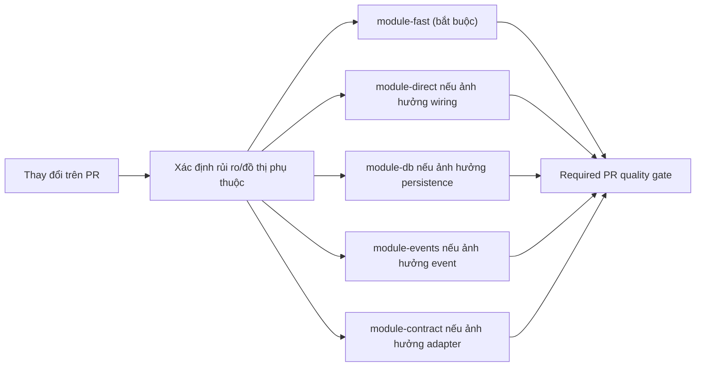
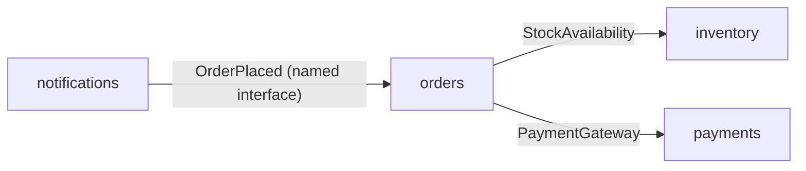

# Chọn nhóm module test trong pipeline

Không phải mọi bài `@ApplicationModuleTest` đều có cùng mục đích hoặc cùng chi phí. Một bài test chỉ kiểm tra logic đặt đơn với hai dependency mock có thể chạy nhanh trên mọi pull request. Một bài test dùng PostgreSQL Testcontainers hoặc Kafka cần khởi động thêm hạ tầng và có các rủi ro về transaction, schema, message delivery mà test cô lập không phát hiện được. **Chọn nhóm module test trong pipeline** là thiết kế một chính sách: *những test nào bắt buộc chạy, khi nào được phép chọn một tập con, và làm sao chứng minh tập con đó đủ bảo vệ thay đổi đang xét*.

Đây là bài thuộc chương **CI và quality gate** của `SPRING_MODULITH_VERIFICATION_TESTING`. Trọng tâm là **phân loại và lựa chọn nhóm `@ApplicationModuleTest` theo module, mức tích hợp, rủi ro và sự kiện CI**. `ApplicationModules.verify()` vẫn là quality gate kiến trúc độc lập chạy trên mọi PR, nhưng sẽ chỉ được nhắc khi cần phân định trách nhiệm; bài này đi sâu vào **runtime module-test selection** với JUnit `@Tag`, Maven Surefire, Gradle và cấu hình pipeline.

## 1. Xác định điều kiện lựa chọn: module nào, rủi ro gì, chạy lúc nào?

Có ba câu hỏi phải trả lời trước khi tạo một pipeline:

1. **Đã thay đổi hợp đồng nào?** Logic nội bộ `orders`, public API `payments`, schema của `inventory`, event `OrderPlaced` hay adapter HTTP/broker?
2. **Mức kiểm chứng nào cần thật?** Chỉ giữ service đang test là thật, hay cần thêm module phụ thuộc, database, event consumer hoặc external adapter?
3. **Khi nào chấp nhận chi phí?** Mọi PR, PR liên quan theo policy, trước merge trên nhánh bảo vệ, sau merge, hoặc nightly/full regression?

Một chính sách tốt luôn có **đường chạy an toàn mặc định**:

- **Mọi PR** chạy architecture verification độc lập và một tập module tests nhanh, ổn định, có assertion nghiệp vụ.
- **PR có rủi ro tương ứng** phải chạy thêm test tích hợp của các module bị ảnh hưởng, bao gồm module **phụ thuộc ngược** vào public API hoặc event vừa đổi.
- **Thay đổi khó phân loại** (build/test config, module discovery, shared library, dependency version) phải **mở rộng phạm vi** thay vì giả định “không có rủi ro”.
- **Main branch hoặc lịch full regression** chạy đầy đủ các nhóm trọng yếu để phát hiện sai sót của bộ chọn; không dùng nightly thay thế một required PR gate cần thiết.

| Lựa chọn sai | Hậu quả dễ gặp | Cách sửa |
| --- | --- | --- |
| Chỉ chạy unit tests khi thay `orders` | Không boot Spring module, lỗi DI/event wiring lọt qua | Có nhóm `module-fast` trên PR |
| Chỉ chạy `orders` khi `payments.PaymentGateway` đổi chữ ký | Consumer `orders` có thể không được kiểm thử hành vi tích hợp | Chọn **reverse dependents** |
| Chỉ chạy `STANDALONE` khi migration DB thay đổi | Query/constraint SQL không được chạm tới | Bật `module-db` |
| Bật toàn bộ broker/DB tests trên từng chỉnh sửa nhỏ | CI chậm, feedback kém, khả năng flaky cao | Tách nhóm nhanh với nhóm tích hợp có policy |
| Không có nhóm regression đầy đủ định kỳ | Lỗi trong logic chọn nhóm tích lũy | Full suite trên main/nightly |
| Job xanh khi filter không chọn test nào | Không có bảo đảm thực tế | Assert JUnit report có số test mong muốn |

**Phân nhóm không có nghĩa giảm chất lượng.** Mục tiêu là **chạy test phù hợp đúng thời điểm**, với một ranh giới không thể bỏ qua cho những rủi ro làm hỏng merge.

## 2. Hai trục độc lập: @ApplicationModuleTest mode và JUnit @Tag

Điểm dễ nhầm nhất là cho rằng `STANDALONE` đồng nghĩa “test nhanh” hoặc `DIRECT_DEPENDENCIES` đồng nghĩa “integration test”. **Bootstrap mode chỉ quyết định module nào được nạp vào Spring context**. Chi phí thực tế còn phụ thuộc DB, broker, HTTP adapter, số bean và transaction. `@Tag` do JUnit Platform xử lý để **chọn test class/method khi chạy**, không thay đổi phạm vi bootstrap của Spring Modulith.

| Thuộc tính | Tác động | Ví dụ |
| --- | --- | --- |
| `@ApplicationModuleTest` mặc định / `STANDALONE` | Nạp module đang test | `orders` với mock `StockAvailability` |
| `mode = DIRECT_DEPENDENCIES` | Nạp module đang test và dependency trực tiếp | `orders` và `inventory`/`payments` |
| `mode = ALL_DEPENDENCIES` | Nạp module hiện tại và cây dependency | Module use case cần toàn cây tích hợp |
| `@Tag("module-fast")` | Cho JUnit runner chọn/bỏ test | Chạy trên mọi PR |
| `@Tag("module-db")` | Đánh dấu test có DB thực | Chạy khi có migration/repository/transaction risk |
| `@Tag("module-events")` | Đánh dấu hợp đồng event consumer | Chạy khi event/listener thay đổi |
| `@Tag("orders")` | Đánh dấu **chủ sở hữu test** | Dùng để lọc/định danh test module `orders` |

Tài liệu Spring Modulith xác định `STANDALONE` là mặc định, `DIRECT_DEPENDENCIES` là dependency trực tiếp và `ALL_DEPENDENCIES` là dependency bắc cầu. Khi dependency bên ngoài không có bean, `@MockitoBean` có thể tạo mock cho test `STANDALONE`; điều này **không kiểm chứng implementation thật của module đích**.

### Bộ tag được khuyến nghị

| Nhóm chạy | Phạm vi kiểm chứng | Chi phí kỳ vọng | Trigger khuyến nghị |
| --- | --- | --- | --- |
| `module-fast` | Service/use case thật, dependency ngoài module mock/fake, assert output và event producer | Thấp | **Mọi PR** |
| `module-direct` | Wiring và hợp tác giữa module với dependency trực tiếp thật | Trung bình | Public API/module wiring thay đổi; full regression |
| `module-db` | Repository/SQL/schema/transaction thật bằng DB test | Trung bình–cao | Migration, repository, transaction; full regression |
| `module-events` | Listener, after-commit, async event, side effect | Trung bình–cao | Event contract, producer/consumer, registry; full regression |
| `module-contract` | HTTP broker/externalization adapter, JSON/routing/timeout | Cao | Adapter, serializer, broker config; full regression |

**Tag là metadata kiểm thử**, không phải bằng chứng một test thực sự dùng DB hay broker: một `@Tag("module-db")` gắn lên test toàn Mockito không khiến nó thành DB integration test. Phải review test giữ đúng bean/hạ tầng thật và assertion phản ánh contract.



Không chỉ chạy nhóm “được chọn” rồi mặc định mọi nhóm còn lại đã PASS: báo cáo CI cần ghi rõ **test nào được chọn, nhóm nào không chạy và vì sao**.

## 3. Chọn theo đồ thị module: thay đổi ở provider còn ảnh hưởng consumer

Ví dụ ứng dụng bán hàng có bốn Spring Modulith modules:

```text
com.acme.shop
├── ShopApplication
├── orders/
│   ├── OrderOperations.java
│   ├── events/OrderPlaced.java
│   └── internal/DefaultOrderOperations.java
├── inventory/
│   ├── StockAvailability.java
│   └── internal/JdbcStockAvailability.java
├── payments/
│   ├── PaymentGateway.java
│   └── internal/HttpPaymentGateway.java
└── notifications/
    └── internal/OrderPlacedListener.java
```



**Chiều Java dependency:** `orders → inventory` và `orders → payments`, còn `notifications → orders` qua event type. Nếu sửa public API `inventory.StockAvailability`, **module tiêu thụ là `orders`** mới là nơi có thể xuất hiện regression. Chỉ chọn test trong `inventory` là thiếu.

### Ma trận quyết định theo tác động

| Loại thay đổi | Nhóm nên chọn trên PR | Tại sao |
| --- | --- | --- |
| Sửa logic nội bộ `orders` | `module-fast` cho `orders`; các nhóm chuyên biệt nếu logic có DB/event/HTTP | Bảo vệ use case; không cần Kafka nếu thay đổi thuần |
| Thay đổi `inventory.StockAvailability` public API | `inventory` + `orders` `module-fast`, `module-direct` có liên quan | Test của consumer và bean wiring |
| Thay `inventory.internal.JdbcStockAvailability` SQL | `inventory` `module-db`, test sử dụng API của `inventory`; `module-direct` nếu integration cần | Bảo vệ SQL/dialect, không chỉ mock |
| Thay event `orders.events.OrderPlaced` | Producer `orders` + consumer `notifications` `module-events` | Event schema/consumer mapping có thể vỡ |
| Đổi HTTP contract của `payments` | `payments` `module-contract`; `orders` `module-direct` nếu mapping domain result bị ảnh hưởng | JSON/status/adapter + use case |
| Thay dependency version/BOM, package scan, build/test plugin | **Toàn bộ nhóm bắt buộc/full suite theo chính sách** | Phạm vi ảnh hưởng khó dự đoán |
| Chỉ sửa tài liệu ngoài runtime | `module-fast` và architecture gate vẫn chạy | Ngăn đường skip không được kiểm soát |

### Reverse dependencies khác với bootstrap mode

Khi `payments` đổi API, pipeline cần chọn test ở **`orders` vì `orders` phụ thuộc `payments`**. Nhưng một `@ApplicationModuleTest` đặt trong `payments` với `DIRECT_DEPENDENCIES` **không tự nạp `orders`**: nó chỉ nạp những module mà `payments` phụ thuộc, không phải những module phụ thuộc ngược vào `payments`.

Như vậy:

- **Bộ chọn CI** xem **đồ thị ảnh hưởng**, đặc biệt các dependent modules.
- **Bootstrap mode của từng test** xem **đồ thị dependency cần nạp** cho chính test ấy.

Hai hướng đi ngược nhau trong nhiều trường hợp. Nếu nhầm, nhóm test của consumer có thể bị bỏ qua dù adapter/provider vừa đổi.

### Quy tắc khi không chắc

Nếu một thay đổi liên quan public API, event contract hoặc shared configuration mà chưa định được mọi consumer, hãy chọn **nhiều nhóm hơn** và cập nhật mapping. Một change detector không nhận dạng được package/rename nên chọn **full regression**, không trả về tập test rỗng.

## 4. Gắn @Tag cho module-fast mà vẫn chạy service thật

Để JUnit lọc nhóm được, cần một quy ước tag nhất quán giữa các module. Ví dụ sử dụng hai loại tag:

- **Tier tag**: chỉ mức kiểm thử, như `module-fast`, `module-db`, `module-events`.
- **Owner tag**: chỉ application module sở hữu test, như `orders`, `inventory`, `payments`, `notifications`.

Junit `@Tag` có thể đặt ở **class** hoặc **method**. Đặt ở class khi cả class cùng mục đích; nếu mỗi method đòi hạ tầng khác nhau thì nên **tách class** thay vì để một class có cả test cực nhanh và test cần Docker. Một test có thể mang **nhiều tag** (ví dụ `module-events` và `module-db`) khi thật sự cần cả hai loại hạ tầng.

### 4.1. Hợp đồng production tối thiểu

Lớp Spring Boot root để Spring Modulith suy ra các module con:

```java
// src/main/java/com/acme/shop/ShopApplication.java
package com.acme.shop;

import org.springframework.boot.autoconfigure.SpringBootApplication;

@SpringBootApplication
public class ShopApplication {
}
```

```java
// src/main/java/com/acme/shop/inventory/StockAvailability.java
package com.acme.shop.inventory;

public interface StockAvailability {
    boolean available(String sku, int quantity);
}
```

```java
// src/main/java/com/acme/shop/payments/PaymentGateway.java
package com.acme.shop.payments;

import java.util.UUID;

public interface PaymentGateway {

    Authorization authorize(UUID orderId, long amountCents);

    record Authorization(boolean approved, String reference) {
    }
}
```

```java
// src/main/java/com/acme/shop/orders/OrderOperations.java
package com.acme.shop.orders;

import java.util.UUID;

public interface OrderOperations {
    UUID place(String sku, int quantity, long amountCents);
}
```

```java
// src/main/java/com/acme/shop/orders/events/OrderPlaced.java
package com.acme.shop.orders.events;

import java.util.UUID;

public record OrderPlaced(
        UUID orderId,
        String sku,
        int quantity,
        String authorizationReference
) {
}
```

Vì `notifications` cần tham chiếu event từ `orders`, package sự kiện là named interface:

```java
// src/main/java/com/acme/shop/orders/events/package-info.java
@org.springframework.modulith.NamedInterface("events")
package com.acme.shop.orders.events;
```

Service thật của `orders` kiểm tra tồn kho, gọi payment và publish event:

```java
// src/main/java/com/acme/shop/orders/internal/DefaultOrderOperations.java
package com.acme.shop.orders.internal;

import com.acme.shop.inventory.StockAvailability;
import com.acme.shop.orders.OrderOperations;
import com.acme.shop.orders.events.OrderPlaced;
import com.acme.shop.payments.PaymentGateway;
import java.util.UUID;
import org.springframework.context.ApplicationEventPublisher;
import org.springframework.stereotype.Service;

@Service
class DefaultOrderOperations implements OrderOperations {

    private final StockAvailability stock;
    private final PaymentGateway payments;
    private final ApplicationEventPublisher events;

    DefaultOrderOperations(
            StockAvailability stock,
            PaymentGateway payments,
            ApplicationEventPublisher events
    ) {
        this.stock = stock;
        this.payments = payments;
        this.events = events;
    }

    @Override
    public UUID place(String sku, int quantity, long amountCents) {
        if (sku == null || sku.isBlank()
                || quantity <= 0 || amountCents <= 0) {
            throw new IllegalArgumentException("Order invalid");
        }

        if (!stock.available(sku, quantity)) {
            throw new IllegalStateException("Out of stock");
        }

        UUID id = UUID.randomUUID();
        PaymentGateway.Authorization authorization =
                payments.authorize(id, amountCents);

        if (!authorization.approved()) {
            throw new IllegalStateException("Payment declined");
        }

        events.publishEvent(new OrderPlaced(
                id, sku, quantity, authorization.reference()));
        return id;
    }
}
```

Đây là logic minh họa tập trung vào use case/event producer, **chưa lưu đơn vào database**. Test nhanh ở dưới không được dùng làm bằng chứng SQL hoặc transaction đúng. `StockAvailability` và `PaymentGateway` là public API của module khác; implementation của chúng không được nạp khi test `orders` ở `STANDALONE`.

### 4.2. JUnit class thuộc nhóm module-fast

```java
// src/test/java/com/acme/shop/orders/OrdersFastModuleTest.java
package com.acme.shop.orders;

import com.acme.shop.inventory.StockAvailability;
import com.acme.shop.orders.events.OrderPlaced;
import com.acme.shop.payments.PaymentGateway;
import java.util.UUID;
import org.junit.jupiter.api.Tag;
import org.junit.jupiter.api.Test;
import org.springframework.beans.factory.annotation.Autowired;
import org.springframework.modulith.test.ApplicationModuleTest;
import org.springframework.modulith.test.PublishedEvents;
import org.springframework.test.context.bean.override.mockito.MockitoBean;

import static org.assertj.core.api.Assertions.assertThat;
import static org.junit.jupiter.api.Assertions.assertThrows;
import static org.mockito.ArgumentMatchers.any;
import static org.mockito.ArgumentMatchers.eq;
import static org.mockito.Mockito.verify;
import static org.mockito.Mockito.verifyNoInteractions;
import static org.mockito.Mockito.when;

@Tag("module-fast")
@Tag("orders")
@ApplicationModuleTest
class OrdersFastModuleTest {

    @Autowired
    OrderOperations orders;

    @MockitoBean
    StockAvailability stock;

    @MockitoBean
    PaymentGateway payments;

    @Test
    void publishesEventWhenAuthorized(PublishedEvents events) {
        when(stock.available("SKU-7", 2)).thenReturn(true);
        when(payments.authorize(any(UUID.class), eq(12_500L)))
                .thenReturn(new PaymentGateway.Authorization(
                        true, "PAY-7"));

        UUID id = orders.place("SKU-7", 2, 12_500L);

        verify(stock).available("SKU-7", 2);
        verify(payments).authorize(id, 12_500L);
        assertThat(events.ofType(OrderPlaced.class)
                .matching(OrderPlaced::orderId, id))
                .hasSize(1);
        assertThat(events.ofType(OrderPlaced.class)
                .matching(OrderPlaced::authorizationReference, "PAY-7"))
                .hasSize(1);
    }

    @Test
    void doesNotCallPaymentWhenStockUnavailable(
            PublishedEvents events) {
        when(stock.available("SKU-7", 9)).thenReturn(false);

        assertThrows(IllegalStateException.class,
                () -> orders.place("SKU-7", 9, 12_500L));

        verifyNoInteractions(payments);
        assertThat(events.ofType(OrderPlaced.class)).isEmpty();
    }
}
```

### Vì sao test này thuộc nhóm nhanh?

1. `@ApplicationModuleTest` mặc định `STANDALONE` nên Spring bootstraps **module `orders`**.
2. Mockito mock chỉ cung cấp hai **cổng ngoài module**; bean `DefaultOrderOperations` và publisher vẫn thật.
3. Test có assertion output, điều kiện lỗi và event payload bằng `PublishedEvents`.
4. Không cần Docker, PostgreSQL, Kafka, HTTP server hoặc transaction data store để chạy logic hiện tại.
5. `@Tag("module-fast")` cho phép chọn class qua JUnit Platform; `@Tag("orders")` giúp đánh dấu owner khi phân tích tác động.

**Giới hạn:** không kiểm tra `HttpPaymentGateway` thật, SQL `inventory`, consumer `notifications` hoặc event `AFTER_COMMIT`. Vì vậy phải chọn nhóm tích hợp khác khi PR chạm các hợp đồng đó.

**Điều kiện về version/configuration:** ví dụ dùng `@MockitoBean` của Spring Framework 6.2+ (thường với Spring Boot 3.4+); dự án dùng Spring Boot cũ phải chọn API tương thích. Một test `STANDALONE` vẫn là **Spring Boot test**; nếu classpath/auto-configuration của ứng dụng tự khởi tạo `DataSource` hoặc hạ tầng khác, có thể cần một test profile/auto-configuration có chủ đích để giữ nhóm `module-fast` không phụ thuộc Docker hay database. Không bỏ những bean cần thiết cho nghiệp vụ chỉ để ép test xanh.

## 5. Các nhóm đắt hơn: database, module-direct và event consumer

Không nên gắn `module-db` chỉ vì test có `@ApplicationModuleTest`. Cần **repository và database thật** cùng assertion về dữ liệu. Tương tự, `module-events` phải kiểm tra consumer/after-commit nếu mục tiêu là event processing, thay vì chỉ đếm producer event ở `PublishedEvents`.

### 5.1. Database của module inventory thực sự được kiểm tra

Implementation production minh họa:

```java
// src/main/java/com/acme/shop/inventory/internal/JdbcStockAvailability.java
package com.acme.shop.inventory.internal;

import com.acme.shop.inventory.StockAvailability;
import org.springframework.jdbc.core.JdbcTemplate;
import org.springframework.stereotype.Repository;

@Repository
class JdbcStockAvailability implements StockAvailability {

    private final JdbcTemplate jdbc;

    JdbcStockAvailability(JdbcTemplate jdbc) {
        this.jdbc = jdbc;
    }

    @Override
    public boolean available(String sku, int quantity) {
        Integer available = jdbc.queryForObject(
                "SELECT available_quantity " +
                "FROM inventory_stock WHERE sku = ?",
                Integer.class,
                sku);
        return available != null && available >= quantity;
    }
}
```

Để test chạy, migration Flyway/Liquibase phải tạo bảng `inventory_stock` trong PostgreSQL test, ví dụ:

```sql
CREATE TABLE inventory_stock (
    sku VARCHAR(80) PRIMARY KEY,
    available_quantity INTEGER NOT NULL
        CHECK (available_quantity >= 0)
);
```

JUnit test đặt tại `com.acme.shop.inventory`:

```java
// src/test/java/com/acme/shop/inventory/InventoryDbModuleTest.java
package com.acme.shop.inventory;

import org.junit.jupiter.api.BeforeEach;
import org.junit.jupiter.api.Tag;
import org.junit.jupiter.api.Test;
import org.springframework.beans.factory.annotation.Autowired;
import org.springframework.boot.testcontainers.service.connection.ServiceConnection;
import org.springframework.jdbc.core.JdbcTemplate;
import org.springframework.modulith.test.ApplicationModuleTest;
import org.springframework.test.context.ActiveProfiles;
import org.testcontainers.containers.PostgreSQLContainer;
import org.testcontainers.junit.jupiter.Container;
import org.testcontainers.junit.jupiter.Testcontainers;

import static org.assertj.core.api.Assertions.assertThat;

@Tag("module-db")
@Tag("inventory")
@Testcontainers
@ApplicationModuleTest
@ActiveProfiles("integration")
class InventoryDbModuleTest {

    @Container
    @ServiceConnection
    static PostgreSQLContainer<?> postgres =
            new PostgreSQLContainer<>("postgres:16-alpine");

    @Autowired
    JdbcTemplate jdbc;

    @Autowired
    StockAvailability stock;

    @BeforeEach
    void resetRows() {
        jdbc.update("DELETE FROM inventory_stock");
    }

    @Test
    void queriesRealInventoryData() {
        jdbc.update(
                "INSERT INTO inventory_stock " +
                "(sku, available_quantity) VALUES (?, ?)",
                "SKU-7", 3);

        assertThat(stock.available("SKU-7", 2)).isTrue();
        assertThat(stock.available("SKU-7", 4)).isFalse();
    }
}
```

**Bằng chứng nhóm này cần:** PostgreSQL Testcontainers chạy được, migration tạo bảng, `JdbcStockAvailability` là bean thật, và assertion phụ thuộc vào SQL. Nếu test thay `StockAvailability` bằng `@MockitoBean`, tag `module-db` chỉ còn là **nhãn sai**. Ví dụ cleanup `DELETE FROM inventory_stock` giả định DB test được cô lập, **không nên chạy song song trên cùng schema**; dự án lớn có thể dùng fixture key/schema riêng.

### 5.2. Chọn module-direct để kiểm tra wiring của dependency thật

Một test đặt trong `orders` khi cần kiểm tra cả `inventory` và `payments` có thể dùng:

```java
// Khung cho kiểm thử tích hợp module, phải cấp DB/HTTP test infrastructure.
@Tag("module-direct")
@Tag("orders")
@ApplicationModuleTest(
        mode = ApplicationModuleTest.BootstrapMode.DIRECT_DEPENDENCIES)
class OrdersDependenciesModuleTest {

    @Autowired
    OrderOperations orders;

    @Test
    void usesRealDependencyModules() {
        // Seed inventory trong test DB.
        // Stub HTTP payment provider, KHÔNG mock PaymentGateway.
        // Gọi orders.place(...) rồi assert kết quả, request và event.
    }
}
```

Đây là **khung chủ đích**, không phải bài test hoàn chỉnh: project phải cấp datasource, migration, endpoint giả lập cho HTTP adapter và bean thật thuộc các dependency trực tiếp. `DIRECT_DEPENDENCIES` chỉ mở rộng Spring component scan/module bootstrap; nó **không tự tạo PostgreSQL, broker hay server mock**.

Nếu module `payments` đổi interface hoặc wiring, nhóm `module-direct` của `orders` có thể phát hiện lỗi mà `module-fast` dùng `@MockitoBean` bỏ qua.

### 5.3. Chọn module-events khi cần kiểm chứng consumer

Đặt test ở package `notifications`, nơi sở hữu event listener:

```java
// Mảnh JUnit trong module notifications; projection và DB fixture
// là các bean của dự án và phải được cấu hình theo listener thật.
@Tag("module-events")
@Tag("notifications")
@ApplicationModuleTest
class NotificationsEventModuleTest {

    @Autowired
    NotificationProjection projection;

    @Test
    void handlesOrderPlacedAfterEvent(Scenario scenario) {
        UUID id = UUID.randomUUID();
        var event = new OrderPlaced(
                id, "SKU-7", 2, "PAY-7");

        scenario.publish(event)
                .andCleanup(() -> projection.delete(id))
                .andWaitForStateChange(
                        () -> projection.exists(id),
                        Boolean.TRUE::equals)
                .andVerify(found -> assertThat(found).isTrue());
    }
}
```

`NotificationProjection` là API/bean **do ứng dụng minh họa định nghĩa**, không phải type của Spring; cần import `Scenario`/`OrderPlaced`/JUnit/AssertJ và cấu hình listener, transaction/database tương ứng. `Scenario.publish(...)` kích hoạt stimulus trong transaction để listener transactional có thể xử lý; `andCleanup(...)` giúp dọn dữ liệu đã commit. Nếu projection dùng DB thật, **gắn thêm `@Tag("module-db")`**; JUnit sẽ chọn test trong cả hai nhóm, đây là hành vi đúng.

**Lưu ý tên và vị trí test:** `@ApplicationModuleTest` chọn module dựa trên package hoặc cấu hình `module` rõ ràng. Đưa một test consumer vào package `orders` rồi chỉ đổi `@Tag("notifications")` **không làm test chuyển sang bootstrap `notifications`**. Tag chỉ là metadata của runner.

### 5.4. Module-contract cho adapter/broker thực

Test `payments` dùng `RestClient` thật và MockWebServer/WireMock, hoặc test event externalization dùng Kafka/RabbitMQ Testcontainers, nên gắn `@Tag("module-contract")`. Nếu có DB/event registry thực, gắn thêm `module-db`/`module-events` theo nhu cầu, nhưng nên tránh lạm dụng tag đa nhóm gây **chạy lại test đắt nhiều lần** trong các job song song mà không đem lại thêm bảo đảm.

Nhóm `module-contract` cần assert **request/response, headers, body, status, routing, serializer** chứ không chỉ `Mockito.verify(client).send(...)`. Mức độ integration phụ thuộc hợp đồng thật đang bảo vệ.

## 6. Maven và Gradle: lọc JUnit tags mà không bỏ lọt test

Một quy ước tag chỉ có hiệu lực khi Maven/Gradle **đã được cấu hình để JUnit Platform đọc tag**. Hãy chọn **một cơ chế chạy rõ ràng** cho mỗi build tool, sau đó lưu JUnit XML report để chứng minh test của nhóm thật sự được thực thi.

### 6.1. Maven Surefire với groups / excludedGroups

Đối với JUnit Jupiter, Maven Surefire có thể dùng property `groups` để **include tag hoặc tag expression**, và `excludedGroups` để loại trừ. Ví dụ:

```bash
# Chạy nhóm module test nhanh:
./mvnw -B -ntp -Dgroups=module-fast test

# Chạy repository/database integration tests:
./mvnw -B -ntp -Dgroups=module-db test

# Chọn cả event và contract tests:
./mvnw -B -ntp '-Dgroups=module-events | module-contract' test

# Chỉ test nhanh thuộc module orders:
./mvnw -B -ntp '-Dgroups=module-fast & orders' test
```

Các ví dụ giả định project có `spring-boot-starter-test`, `spring-modulith-starter-test` và Maven Surefire hỗ trợ JUnit Platform. Cú pháp dấu `|`/`&` thuộc **JUnit tag expressions**; quote chúng theo shell để ký tự đặc biệt không bị shell diễn giải trước. Nếu dùng Windows PowerShell, cũng cần quote toàn bộ argument như trong ví dụ.

**Vấn đề tên class:** Surefire mặc định tìm những tên như `*Test`, `*Tests`, `Test*`, `*TestCase`. Các lớp `OrdersFastModuleTest` và `InventoryDbModuleTest` ở trên khớp. Nếu đặt `InventoryDbModuleIT`, Maven Failsafe thường dùng `*IT` cho integration phase, còn Surefire `test` có thể không tự chạy class đó. Khi đó phải cấu hình Failsafe/lifecycle phù hợp, không tự cho rằng `-Dgroups` bao phủ mọi test trên classpath.

### 6.2. Cấu hình Surefire rõ version và test engine

```xml
<!-- pom.xml, mảnh cấu hình tham khảo cho JUnit Platform -->
<build>
    <plugins>
        <plugin>
            <groupId>org.apache.maven.plugins</groupId>
            <artifactId>maven-surefire-plugin</artifactId>
            <version>3.6.1</version>
            <configuration>
                <failIfNoTests>true</failIfNoTests>
            </configuration>
        </plugin>
    </plugins>
</build>
```

`failIfNoTests` giúp một **module build được yêu cầu có test** thất bại khi không tìm thấy test nào. Nhưng khi chạy reactor Maven nhiều modules, một module thư viện hoàn toàn không có test có thể fail không mong muốn. Hãy áp dụng fail-on-empty **ở module chứa test hoặc job cụ thể**, không đặt bừa toàn reactor.

**Cần thận trọng hơn với tag filter:** một runner có thể tìm thấy test classes nhưng sau khi filter theo tag thì **không thực thi method nào**. Vì vậy, chỉ `failIfNoTests` không phải bảo đảm hoàn chỉnh rằng nhóm `module-db` đã có test. Phần CI nên kiểm tra số `testcase`/`tests` thực thi trong JUnit XML của **đúng module**, hoặc có một bước kiểm kê tag bảo đảm nhóm bắt buộc không rỗng.

### 6.3. Gradle: tạo Test tasks cho từng tier

Ví dụ Gradle Groovy DSL, giả định Java plugin và JUnit Platform đã được cấu hình:

```groovy
// build.gradle, chỉ mảnh cấu hình test selection.
tasks.named('test', Test) {
    useJUnitPlatform()
}

tasks.register('moduleFastTest', Test) {
    group = 'verification'
    description = 'Run fast Spring Modulith module tests'
    testClassesDirs = sourceSets.test.output.classesDirs
    classpath = sourceSets.test.runtimeClasspath
    useJUnitPlatform {
        includeTags 'module-fast'
    }
}

tasks.register('moduleDbTest', Test) {
    group = 'verification'
    description = 'Run module tests with real database'
    testClassesDirs = sourceSets.test.output.classesDirs
    classpath = sourceSets.test.runtimeClasspath
    useJUnitPlatform {
        includeTags 'module-db'
    }
}

tasks.register('moduleEventsTest', Test) {
    group = 'verification'
    description = 'Run event consumer/module integration tests'
    testClassesDirs = sourceSets.test.output.classesDirs
    classpath = sourceSets.test.runtimeClasspath
    useJUnitPlatform {
        includeTags 'module-events'
    }
}
```

Các lệnh:

```bash
./gradlew moduleFastTest
./gradlew moduleDbTest
./gradlew moduleEventsTest

# Nếu muốn test toàn bộ test source set theo cấu hình test task:
./gradlew test
```

Các custom tasks trên dùng cùng `sourceSets.test` nhưng lọc theo tag; nếu `moduleDbTest` và `moduleEventsTest` có chung một class hai tag, test đó có thể **chạy hai lần** khi cả hai task được gọi. Đây không nhất thiết là lỗi, nhưng cần tính chi phí và bảo đảm fixture/DB có isolation.

**Lưu ý:** `test` mặc định vẫn có thể chạy các test nặng nếu toàn bộ classes nằm trong cùng source set và không có excludeTags. Để giữ pipeline nhanh, phải **gọi đúng custom task**. Nếu thêm custom tasks vào `check.dependsOn(...)`, mọi `./gradlew check` sẽ chạy thêm chúng; đừng giả định tách task rồi build sẽ tự trở nên nhanh hơn.

### 6.4. Báo cáo sau lọc là một phần của quality gate

| Runner | Report thường có | Phải xác minh |
| --- | --- | --- |
| Maven Surefire | `target/surefire-reports/TEST-*.xml` | Có test thuộc tag đã chọn, không fail/error, không chỉ 0 tests |
| Gradle custom task | `build/test-results/moduleFastTest/TEST-*.xml` (tương tự task khác) | Task không SKIPPED và có testcase thực thi |
| CI job | Process exit code + JUnit report artifact | Exit nonzero nếu test fail hoặc nhóm bắt buộc không thực thi |

**Đề nghị thêm một phép kiểm tra:** trước khi đưa group vào required checks, cố tình đổi `@Tag("module-db")` thành một tên sai trong nhánh thử và xem pipeline có báo **“required module-db group empty”** hay chỉ xanh. Đây là cách thử chính sách chọn test, không chỉ thử business logic.

## 7. Bộ chọn nhóm theo thay đổi: mặc định an toàn và có thể kiểm toán

Khi nhóm `module-fast` chạy trên mọi PR, bước tiếp theo là **chọn thêm nhóm đắt dựa trên thay đổi**. Tuy nhiên, file-path matching đơn thuần không đủ để hiểu dependency trong Spring Modulith:

- Một thay đổi `orders/events/OrderPlaced.java` cần test producer **và** consumer `notifications`.
- Một public interface `inventory.StockAvailability` đổi kiểu có thể ảnh hưởng `orders` dù file `orders` không đổi.
- Một thay đổi `pom.xml` hoặc `build.gradle` có thể làm **toàn bộ test context/serializer** thay đổi.
- Một rename/move package có thể làm `ApplicationModuleTest` bootstrap sai module.

### Chính sách tuyển chọn đề xuất

```text
function selectTestGroups(changedFiles, impactGraph):
    selected = { "module-fast" }              // luôn có

    if changedFiles chưa xác định, parse lỗi, hoặc change thuộc
       build/plugin/dependency/module discovery/shared configuration:
        return ALL_GROUPS                      // fail closed

    owners = classifyChangedModules(changedFiles)
    impacted = owners + reverseDependents(owners, impactGraph)

    if public API / named interface / wiring thay đổi:
        selected += { "module-direct" }
        include impacted owners' tests

    if SQL / migration / repository / transaction thay đổi:
        selected += { "module-db" }
        include impacted modules' tests

    if event schema / producer / consumer / publication registry thay đổi:
        selected += { "module-events" }
        include event producer and consumer tests

    if HTTP / Kafka / Rabbit / serializer / external client thay đổi:
        selected += { "module-contract" }
        include adapter and affected consumer tests

    if mapping không rõ module hoặc tag group bắt buộc bị rỗng:
        return ALL_GROUPS                      // không tự cho xanh

    return selected with reasons
```

Đây là **pseudocode chính sách**, không phải script có sẵn trong repository. Nếu muốn tự động hóa, cần một selector được version-control và kiểm thử riêng. Bản ghi lý do lựa chọn nên có dạng:

```text
PR #123:
changed:
  - src/main/java/com/acme/shop/orders/events/OrderPlaced.java
selected groups:
  - module-fast       [mandatory]
  - module-events     [event schema changed]
affected owners:
  - orders            [event producer]
  - notifications     [event consumer / reverse dependency]
not selected:
  - module-db         [no persistence contract change known]
  - module-contract   [no external adapter change known]
fallback:
  - full suite if dependency graph/classification unavailable
```

### Điều kiện tối thiểu cho selector đáng tin

1. **Có mapping owner** từ package/test class tới application module thật.
2. **Biết reverse dependencies** hoặc có policy thủ công cho các event/API công khai.
3. **Nhận biết file rename/delete**, không chỉ các dòng source mới.
4. **Biết những thay đổi toàn cục** buộc chọn full suite.
5. **Không tin tên tag do test tự gắn là bằng chứng đầy đủ**; phải kiểm kê test inventory.
6. **Ghi log/artifact selection plan** và lý do vào từng PR.
7. **Fallback toàn bộ nhóm** khi selector lỗi hoặc không có đủ dữ liệu.
8. **Full regression định kỳ** để đối chiếu những gì selector có thể bỏ lỡ.

### Không chuyển nhầm tối ưu hóa thành cơ chế bỏ kiểm tra

Một `@ApplicationModuleTest` đã đánh dấu `module-contract` có thể tốn tài nguyên, nhưng một PR thay đổi config chung của Spring Boot vẫn phải chạy nó nếu config có thể ảnh hưởng client. **Chỉ chạy nhóm “path vừa đổi” mà không tính dependency và config là chọn sai theo kiến trúc.**

Tối ưu thứ hai thường hiệu quả hơn trước khi áp dụng selection thông minh là **chạy các nhóm song song với hạ tầng cô lập**, cache dependencies, chia test classes thành shards ổn định và giảm thời gian khởi động context. Không phải mọi dự án đều cần một selector phức tạp ngay từ đầu.

## 8. Pipeline mẫu: nhóm bắt buộc, nhóm chuyên sâu và required gate

Một pipeline đáng tin nên tiến hóa theo hai giai đoạn:

- **Giai đoạn an toàn ban đầu:** chạy `module-fast` cùng các nhóm chuyên sâu có test thật trong một matrix rõ ràng trên **mọi PR**. Đây là cấu hình bảo thủ, dễ kiểm toán; team có thể đo chi phí trước khi tối ưu.
- **Giai đoạn tối ưu có kiểm chứng:** bổ sung selector theo mục 7, chọn một tập nhóm chuyên sâu trên PR nhưng **không bao giờ loại `module-fast` hoặc architecture gate**, và fallback full suite nếu selector lỗi.

### 8.1. GitHub Actions mẫu chạy theo các nhóm đã định nghĩa

Giả định đây là **một ứng dụng Maven** có đủ test tagged cho cả năm nhóm, test class khớp pattern Surefire, build runner dùng Java 21, hạ tầng Testcontainers được runner hỗ trợ:

```yaml
# .github/workflows/modulith-module-tests.yml
name: modulith-module-tests

on:
  pull_request:
  merge_group:
  push:
    branches: [main]

permissions:
  contents: read

jobs:
  module-fast:
    name: module-fast
    runs-on: ubuntu-latest
    timeout-minutes: 12
    steps:
      - uses: actions/checkout@v4
      - uses: actions/setup-java@v4
        with:
          distribution: temurin
          java-version: '21'
          cache: maven
      - name: Run fast module tests
        run: ./mvnw -B -ntp -Dgroups=module-fast test
      - name: Save fast JUnit report
        if: always()
        uses: actions/upload-artifact@v4
        with:
          name: junit-module-fast
          path: target/surefire-reports/TEST-*.xml
          if-no-files-found: error

  module-focused:
    name: module-focused / ${{ matrix.group }}
    runs-on: ubuntu-latest
    timeout-minutes: 25
    strategy:
      fail-fast: false
      matrix:
        group:
          - module-direct
          - module-db
          - module-events
          - module-contract
    steps:
      - uses: actions/checkout@v4
      - uses: actions/setup-java@v4
        with:
          distribution: temurin
          java-version: '21'
          cache: maven
      - name: Run selected module-test group
        run: ./mvnw -B -ntp "-Dgroups=${{ matrix.group }}" test
      - name: Save group JUnit report
        if: always()
        uses: actions/upload-artifact@v4
        with:
          name: junit-${{ matrix.group }}
          path: target/surefire-reports/TEST-*.xml
          if-no-files-found: error

  module-tests-gate:
    name: module-tests-gate
    needs: [module-fast, module-focused]
    if: always()
    runs-on: ubuntu-latest
    steps:
      - name: Require successful module test jobs
        env:
          FAST_RESULT: ${{ needs.module-fast.result }}
          FOCUSED_RESULT: ${{ needs.module-focused.result }}
        run: |
          test "$FAST_RESULT" = "success"
          test "$FOCUSED_RESULT" = "success"
```

### Những gì mẫu này làm và không làm

1. `module-fast` là **job riêng**, không phụ thuộc việc Docker hoặc HTTP server của nhóm khác có khởi động được không.
2. `module-focused` chạy **bốn nhóm** theo matrix; mỗi nhóm có report artifact riêng để dễ xác định thất bại.
3. `module-tests-gate` dùng `if: always()` và kiểm tra `needs.*.result`. Nếu một job fail/cancel/skip bất ngờ, gate **không coi đó là PASS**.
4. Workflow không có `paths` filter nên thay đổi build config/test config hoặc docs cũng **không làm gate mất khỏi PR**.
5. `merge_group` có mặt cho repository dùng merge queue.
6. Check `module-tests-gate` chỉ có hiệu lực ngăn merge khi được thêm vào **branch protection/ruleset**. Architecture verifier phải là **required check riêng**, không thay bằng module test gate.

**Giới hạn có chủ đích:** đây là workflow **bảo thủ chạy đầy đủ bốn nhóm chuyên sâu**, chưa dùng selector theo diff. Nếu các nhóm trên chưa có test thực tế, **đừng copy matrix vào required CI rồi nghĩ kiểm chứng đã đạt**. Trước khi đưa vào nhánh bảo vệ, phải có ít nhất một bài test phù hợp trong mỗi nhóm được bật và kiểm tra report **tests > 0**. Với Maven multi-module, phải chọn đúng module sở hữu test/report hoặc cấu hình reactor, không giả định `target/surefire-reports` ở root luôn tồn tại.

### 8.2. Cách chuyển sang selective matrix an toàn

Khi bộ chọn mục 7 được kiểm chứng bằng các PR thử:

1. Tạo một **selection plan** có tag groups và lý do, được lưu làm artifact.
2. Cho `module-fast` và architecture gate chạy **vô điều kiện**.
3. Thay matrix tĩnh `module-focused` bằng danh sách được tạo từ plan.
4. **Không dùng matrix rỗng** mà không xử lý rõ: matrix rỗng có thể làm job không chạy hoặc phát sinh lỗi tùy cấu hình.
5. Có thể chọn một baseline focused group luôn chạy hoặc tạo một job selection rõ trạng thái “không có focused group”, nhưng **required aggregator phải đối chiếu plan** chứ không mặc định job skipped là đạt.
6. Nếu planner lỗi/thiếu dữ liệu, xuất ra **toàn bộ focused groups**; không trả danh sách trống.
7. Required `module-tests-gate` phải fail nếu một nhóm **được plan yêu cầu** nhưng chưa thực thi/không có report hoặc không PASS.
8. Định kỳ chạy full suite trên `main`/nightly và so sánh sự cố mới với lựa chọn trên PR để tinh chỉnh policy.

**Cảnh báo:** trên GitHub Actions, một job bị bỏ qua bởi `if` có thể có kết quả **Success/Skipped** đủ thỏa một required check trực tiếp. Vì vậy **required aggregator** phải kiểm tra danh sách nhóm **được lên kế hoạch**, trạng thái thực thi và kết quả, thay vì đặt trực tiếp mọi optional job làm required check rồi trông chờ GitHub phân biệt “skip có chủ đích” với “test không chạy”.

### 8.3. Không để test nhóm khác chia sẻ tài nguyên nguy hiểm

Matrix jobs chạy song song trên các runner khác nhau thường có môi trường tách biệt, nhưng:

- Hai nhóm `module-db` cùng dùng database CI chia sẻ có thể xóa dữ liệu của nhau.
- Hai nhóm event/broker cùng dùng consumer group hoặc queue name có thể nhận nhầm message.
- Spring TestContext cache trong mỗi job vẫn có thể reuse singleton mock/fake/server state.
- Nếu cùng một test có cả `module-db` và `module-events` tag, nó có thể chạy **hai lần** ở hai matrix jobs; cleanup và idempotency phải đúng.

Ưu tiên Testcontainers/HTTP mock server port động, fixture key riêng, schema/consumer group riêng, lifecycle phù hợp và test reports phân nhóm. Không ép test integration chạy song song vô hạn chỉ để giảm thời gian PR.

## 9. Chẩn đoán lỗi lựa chọn nhóm và đo hiệu quả pipeline

| Dấu hiệu | Nguyên nhân khả dĩ | Kiểm tra/cách khắc phục |
| --- | --- | --- |
| `module-fast` chạy xanh nhưng JUnit report không có `OrdersFastModuleTest` | Sai class name, source set, test filter hoặc profile | Xem report XML và test discovery, fail khi nhóm rỗng |
| Chạy `module-db` nhưng không có kết nối PostgreSQL | Test đã mock repository hoặc tag sai | Kiểm tra bean/hạ tầng thật; thêm assertion SQL/constraint |
| Đổi `PaymentGateway` nhưng test `orders` không chạy | Selector chỉ nhìn file sửa, bỏ reverse dependency | Mở rộng impact graph và chạy consumer tests |
| Đổi `OrderPlaced` nhưng không chạy `notifications` | Chỉ chọn producer; bỏ event consumers | Mapping event contract → producer + consumers |
| `DIRECT_DEPENDENCIES` của `payments` không chứa `orders` | Hiểu nhầm hướng dependency | CI phải chọn **test ở orders**, không tăng mode ở payments |
| Test cùng class chạy hai lần | Class có nhiều tier tags và jobs chạy tách | Chấp nhận/đo chi phí, hoặc tách ownership tier rõ |
| CI xanh dù một tag nhóm bị viết sai | Tag filter chọn 0 tests nhưng runner vẫn exit 0 | Guard số JUnit testcases và test inventory |
| PR chỉ sửa `build.gradle` vẫn không chạy CI | Workflow có paths filter | Bỏ filter ở required workflow |
| Optional job bị skip nhưng merge vẫn được | Required check đặt trực tiếp trên job conditional | Dùng required aggregator đối chiếu selection plan |
| Test DB chạy riêng đạt, chạy cùng suite fail | Shared schema/transaction, context cache hoặc container lifecycle | Kiểm tra isolation và teardown theo từng group |
| CI quá chậm dù tag đã tách | `gradlew check`/`mvn test` vẫn chạy toàn bộ hoặc cache vô hiệu | Gọi đúng task/tag; đo test count và duration |
| Một module mới không có tag/không có test | Bộ chọn không có inventory/owner mapping | Bắt buộc đăng ký test, fallback full suite và review coverage |

### Những số liệu nên đo sau mỗi PR

| Chỉ số | Vì sao cần |
| --- | --- |
| **Số test chạy theo từng nhóm** | Phát hiện nhóm rỗng hoặc tag bị mất |
| **Tỷ lệ PASS/FAIL và nguyên nhân** | Phân biệt lỗi nghiệp vụ với hạ tầng |
| **Thời gian theo group, median/p95** | Xác định bottleneck thực, không tối ưu theo cảm giác |
| **Số lần khởi động Spring context/container** | Phát hiện nhóm có chi phí bootstrap quá cao |
| **Flaky/retry rate** | Ngăn nhóm tích hợp trở thành nguồn false alarm |
| **Selector fallback/full-suite frequency** | Biết classifier có đang quá thận trọng hoặc quá yếu |
| **Số lỗi chỉ phát hiện ở full regression** | Đo mức độ bỏ sót của risk-based selection |

Không đặt mục tiêu “giảm số test trên PR càng nhiều càng tốt”. Chỉ số quyết định là **thời gian phản hồi với tỷ lệ lỗi lọt qua thấp**. Nếu nightly liên tục tìm lỗi lẽ ra PR phải bắt, selection policy chưa đủ mạnh và phải mở rộng nhóm required.

### Một phép kiểm định selector hữu ích

Tạo một thay đổi có chủ đích ở **public API** của `payments`:

1. Selector phải ghi nhận owner `payments`.
2. Impact map phải thêm **reverse dependent `orders`**.
3. Selection plan phải có `module-direct` của `orders` và những contract tests phù hợp.
4. Nếu test contract bị thiếu/tag sai, gate phải báo **missing coverage** hoặc kích hoạt full suite.
5. Nếu sửa code về hợp lệ, test suite selected phải đạt trên commit mới.

Thực hành tương tự với `orders.events.OrderPlaced` để chắc rằng cả `orders` producer và `notifications` consumer được chọn.

## 10. Bài thực hành: tự chọn nhóm, kiểm chứng và nghiệm thu

### Đề bài

Một nhóm phát triển sở hữu bốn module `orders`, `inventory`, `payments` và `notifications` như sơ đồ ở mục 3. Test inventory gồm:

```text
ArchitectureVerificationTest                [architecture, mọi PR]
OrdersFastModuleTest                       [module-fast, orders]
InventoryFastModuleTest                    [module-fast, inventory]
PaymentsFastModuleTest                     [module-fast, payments]
NotificationsFastModuleTest                [module-fast, notifications]
OrdersDependenciesModuleTest               [module-direct, orders]
InventoryDbModuleTest                      [module-db, inventory]
NotificationsEventModuleTest               [module-events, notifications]
PaymentsHttpContractModuleTest             [module-contract, payments]
KafkaExternalizationModuleTest             [module-events, module-contract]
```

Mỗi lớp `*ModuleTest` có thể được chạy bằng tag filter. `ArchitectureVerificationTest` nằm trong quality gate cấu trúc **riêng**, không phải một tag của runtime module-test matrix.

### 10 câu tình huống

1. PR A chỉ đổi thông báo lỗi trong `orders.internal.DefaultOrderOperations` mà không đổi contract. Nhóm tối thiểu nào chạy bắt buộc?
2. PR B đổi kiểu trả về của `payments.PaymentGateway`. Tại sao chỉ chạy `PaymentsFastModuleTest` là không đủ?
3. PR C đổi migration `inventory_stock` từ `INTEGER` sang `BIGINT`. Nhóm nào phải có DB thật?
4. PR D thêm một field vào `OrderPlaced` và đổi listener `notifications`. Vì sao test producer riêng không bảo vệ đủ?
5. PR E đổi serializer Kafka và routing topic. Một test `PublishedEvents` đạt có chứng minh broker message đúng không?
6. PR F chỉ sửa `pom.xml` để nâng Spring Boot/Modulith version. Selector path-only có thể bỏ lỡ điều gì?
7. Sau khi gắn `@Tag("module-db")` lên một test hoàn toàn mock `StockAvailability`, có nên coi nó đã kiểm thử database không?
8. Một test có hai tier tags `module-events` và `module-db`. Nếu chạy hai Gradle tasks tương ứng, điều gì xảy ra?
9. GitHub Actions optional `module-contract` job bị skip nhưng required check trực tiếp vẫn xanh. Cần thay đổi thiết kế gate thế nào?
10. Tại sao phải chạy full regression định kỳ ngay cả khi risk-based selector đã giảm thời gian PR?

### Đáp án gợi ý

1. **`module-fast` của `orders`** và architecture verifier (mọi PR); nếu có quy tắc khác liên quan event/DB, bổ sung theo rủi ro thực.
2. Vì **`orders` là consumer của public API `payments`**. Phải chọn test `orders` (và `module-direct` phù hợp) để kiểm tra wiring/hợp đồng mới.
3. **`module-db` của `inventory`** với PostgreSQL/Testcontainers, migration thật và SQL assertions. Mock repository không bắt lỗi kiểu cột.
4. Phải chạy **producer `orders` và consumer `notifications`**; khác biệt event schema có thể làm listener deserialize/map/handle sai.
5. **Không.** `PublishedEvents` quan sát Spring application event. Cần `module-contract` với Kafka/broker và serializer/routing thật, đồng thời xem lại event externalization.
6. Thay version framework có thể đổi auto-configuration, context bootstrap, TestContext, serializer, module discovery và cả test engine; cần **full-suite fallback**.
7. **Không.** Tag chỉ giúp chọn test; nội dung test cần repository/SQL/database thật.
8. Test có thể được **thực thi hai lần** khi cả hai nhóm được chạy độc lập; fixture phải cô lập và CI phải tính chi phí.
9. Đặt **required aggregator** luôn chạy, đọc selection plan và xác nhận mỗi nhóm được yêu cầu đã thực thi/pass, không tin “skipped success” của optional job.
10. Để phát hiện lỗi **bộ chọn bỏ sót**, đo những regression chỉ lộ ở full suite, rồi cập nhật mapping/selection policy.

### Quy trình nghiệm thu trên một PR thử

1. Gắn tag theo ma trận, chạy `module-fast` trên local build và xác nhận JUnit report có `OrdersFastModuleTest`.
2. Tạo thay đổi giả tại `inventory.internal.JdbcStockAvailability`, xác nhận selector có `module-db`.
3. Tạo thay đổi tại `orders.events.OrderPlaced`, xác nhận selector có `module-events` của `notifications`.
4. Tạm đổi tag `module-db` thành tên sai, xác nhận gate báo thiếu test thay vì PASS.
5. Tạo thay đổi ở build configuration, xác nhận fallback **toàn bộ nhóm**.
6. Trên PR thật, kiểm tra required `module-tests-gate` và architecture gate đều gắn với commit đang được xét.
7. Sau merge/định kỳ, chạy full regression và đối chiếu với selection log của các PR gần đây.

### Checklist trước khi triển khai

- [ ] Có danh sách các module tests và owner module rõ ràng.
- [ ] Tier tags mang nghĩa **đã kiểm chứng bằng hạ tầng thật**, không chỉ theo tên.
- [ ] `module-fast` chạy trên mọi PR, không có path filter có thể bỏ qua.
- [ ] Bootstrap mode (`STANDALONE`, `DIRECT_DEPENDENCIES`, `ALL_DEPENDENCIES`) được chọn theo phạm vi **bean thật** cần kiểm tra.
- [ ] Khi public API đổi, selector xét **reverse dependencies**; event contract đổi xét cả producer/consumer.
- [ ] Những thay đổi build/plugin/module discovery/shared config có **full-suite fallback**.
- [ ] Maven Surefire/Gradle JUnit Platform chạy đúng nhóm; không bỏ sót test classes do naming/source set.
- [ ] Bước báo cáo kiểm tra **số test thực thi > 0** cho mọi nhóm bắt buộc được chọn.
- [ ] Test DB, broker, HTTP có isolation/lifecycle phù hợp khi chạy song song.
- [ ] Selection plan và lý do chọn/bỏ nhóm được lưu trên PR.
- [ ] Required gate không xem các nhóm được yêu cầu nhưng bị skipped/cancelled là PASS.
- [ ] Architecture verifier vẫn chạy trên mọi PR **độc lập** với module-test selection.
- [ ] Có full regression trên main/nightly và đo lỗi chỉ lộ ở đó.

**Kết luận:** chọn nhóm module test không phải chỉ đặt `@Tag` rồi lọc theo tên package. Phải kết hợp **đồ thị phụ thuộc (kể cả chiều tác động ngược), rủi ro của thay đổi, mức hạ tầng thật trong test, chi phí CI và bằng chứng test thực thi**. Giữ `module-fast` cùng architecture gate luôn chạy; chọn `module-direct`, `module-db`, `module-events`, `module-contract` khi thay đổi liên quan; fallback full suite khi không chắc; và không cho một nhóm bị skip/rỗng biến thành quality gate xanh giả.

### Tài liệu tham khảo

- [Spring Modulith — Integration Testing Application Modules](https://docs.spring.io/spring-modulith/reference/testing.html)
- [Spring Modulith — Verifying Application Module Structure](https://docs.spring.io/spring-modulith/reference/verification.html)
- [Spring Modulith — Working with Application Events](https://docs.spring.io/spring-modulith/reference/events.html)
- [JUnit User Guide — Tags and Filtering](https://docs.junit.org/current/user-guide/#writing-tests-tagging-and-filtering)
- [Apache Maven Surefire — Using JUnit Platform and Tag Filtering](https://maven.apache.org/surefire/maven-surefire-plugin/examples/junit-platform.html)
- [Apache Maven Surefire — Test Inclusion Patterns](https://maven.apache.org/surefire/maven-surefire-plugin/examples/inclusion-exclusion.html)
- [Gradle — Testing in Java & JVM Projects, Tags](https://docs.gradle.org/current/userguide/java_testing.html)
- [Spring Boot — Testing with Testcontainers](https://docs.spring.io/spring-boot/reference/testing/testcontainers.html)
- [GitHub Actions — Workflow Syntax and Matrix](https://docs.github.com/en/actions/reference/workflows-and-actions/workflow-syntax)
- [GitHub Actions — Skipped Jobs and Conditions](https://docs.github.com/en/actions/how-tos/write-workflows/choose-when-workflows-run/control-jobs-with-conditions)
- [GitHub — Troubleshooting Required Status Checks](https://docs.github.com/en/pull-requests/how-tos/merge-and-close-pull-requests/troubleshooting-required-status-checks)
