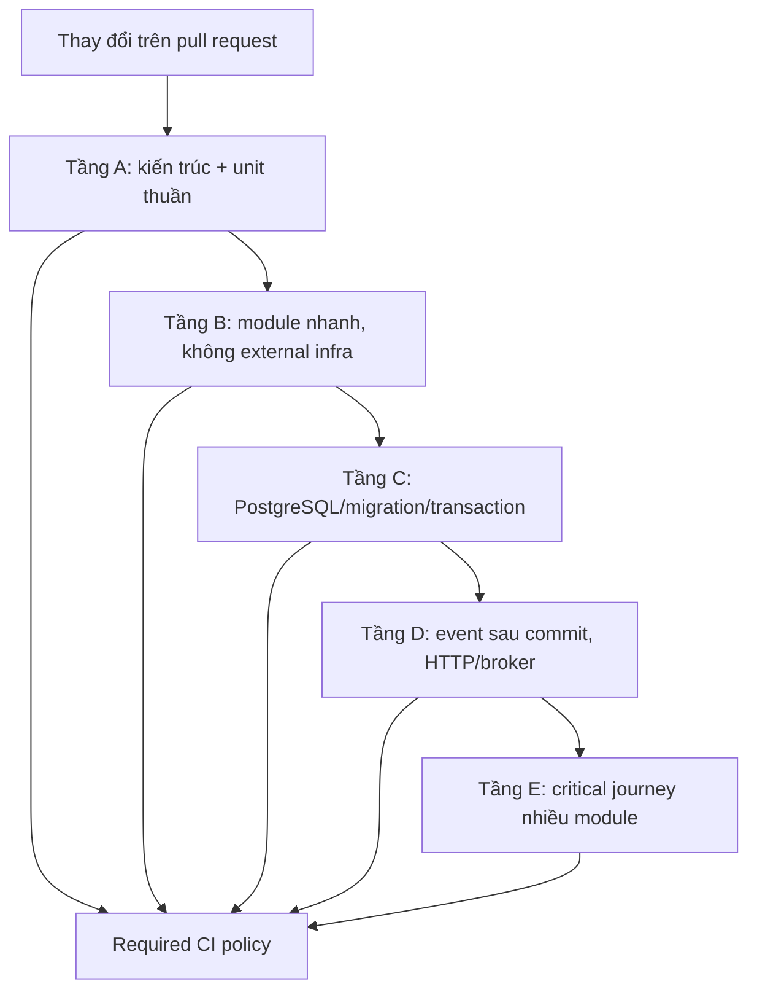
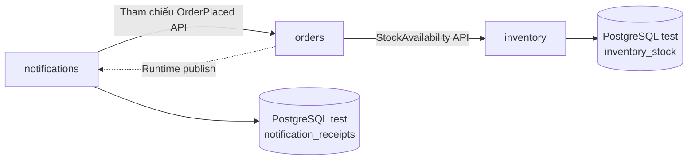

# Phân tầng test nhanh và test hạ tầng

Một pipeline của ứng dụng Spring Modulith thường có hai nhu cầu trái chiều: **phản hồi sớm cho lập trình viên** và **bắt được lỗi mà chỉ hạ tầng thật mới làm lộ ra**. Nếu mọi `@ApplicationModuleTest` cùng khởi động PostgreSQL, broker và web server giả lập, pull request chậm và dễ gặp lỗi môi trường. Nếu chỉ chạy Mockito, các lỗi migration, transaction, serialization và xử lý sự kiện sau commit có thể lọt qua dù mọi bài test đều xanh.

Bài **“Phân tầng test nhanh và test hạ tầng”** thuộc chương **CI và quality gate** của `SPRING_MODULITH_VERIFICATION_TESTING`: kiểm chứng ranh giới kiến trúc bằng `ApplicationModules`, thử hành vi module bằng `@ApplicationModuleTest`, bảo vệ sự kiện/database/tích hợp và đưa các kết quả thành quality gate CI. Trọng tâm ở đây **không phải chọn tag theo module nào vừa thay đổi**, mà là thiết kế **ranh giới bảo đảm của từng tầng**, cách triển khai các tầng bằng Java/JUnit và cách tách thời gian chạy trong pipeline mà không tạo khoảng trống kiểm chứng.

## 1. Phân tầng theo rủi ro thật, không chỉ theo tên annotation

Một tầng kiểm thử được xác định bởi **đối tượng thật đang chạy và loại lỗi mà assertion có thể quan sát**. `@ApplicationModuleTest` không tự biến mọi bài test thành “nhanh” hay “hạ tầng”; bootstrap mode chỉ giới hạn các application module được nạp. Một bài `STANDALONE` vẫn có thể dùng database thật. Một bài `DIRECT_DEPENDENCIES` có thể chạy nhanh nếu các dependency thuần bộ nhớ.

| Tầng | Giữ thành phần nào thật? | Thường thay bằng gì? | Lỗi chính cần bắt |
| --- | --- | --- | --- |
| **A — Kiến trúc & unit thuần** | Java classes, module dependency model, pure domain function | Không boot Spring context | Cycle, truy cập API nội bộ, sai quy tắc logic |
| **B — Module nhanh** | Spring bean/use case của **một module**, publisher | Mock/fake **cổng ngoài module** | Wiring trong module, business branch, event producer |
| **C — Persistence & transaction** | Repository, `DataSource`, database dialect, migration, transaction manager | Database production được thay bởi **DB test cùng loại** | SQL, constraint, rollback, commit |
| **D — Event & external adapter** | Transactional listener, event state, HTTP/broker client, serialization | External service được thay bằng server/broker test | Sau commit, side effect, routing, HTTP status, message format |
| **E — Luồng rộng tùy rủi ro** | Nhiều module thật, có thể gồm DB và broker | Phụ thuộc ngoài production vẫn được cô lập | Hợp đồng liên module, hồi quy xuyên nhiều boundary |

Các tầng **không phải thứ bậc thay thế nhau**. Test ở tầng D không làm `ApplicationModules.verify()` trở nên thừa; tầng B không chứng minh SQL đúng; tầng C không chứng minh consumer đã nhận event. Cần một **bộ minh chứng bổ sung** phù hợp với mức rủi ro.

### Không đặt ngân sách bằng một con số cảm tính

| Quyết định | Nguyên tắc đo |
| --- | --- |
| Tầng A/B chạy trên mỗi PR | Ưu tiên feedback ngắn; đo median/p95 và số Spring contexts thực sự bootstrap |
| Tầng C/D có thể chạy dài hơn | Tách task/job để có timeout, log và hạ tầng phù hợp |
| Tầng E | Tập trung vào vài critical journeys thay vì nhân bản mọi test của tầng dưới |
| Giới hạn thời gian | Đặt sau khi đo dự án; không mặc định “tất cả integration tests phải dưới N giây” |

**Anti-pattern:** đổi nhãn một bài Testcontainers sang `fast` để giảm thời gian CI. Tag đổi, nhưng Docker, migration và các vấn đề lifecycle vẫn còn; hãy tách đúng phạm vi kiểm thử hoặc tối ưu fixture.



Sơ đồ thể hiện **phạm vi bảo đảm tăng dần**, không bắt buộc jobs phải chạy tuần tự theo mũi tên. CI có thể chạy tầng A/B và C/D song song sau khi compile. Quan trọng là **job được yêu cầu phải chạy và đạt**, không bị skip nhưng vẫn được tính là thành công.

## 2. Một ứng dụng mẫu và đường biên hạ tầng cần kiểm chứng

Xét ứng dụng `ShopApplication` có ba module chính:

```text
src/main/java/com/acme/shop/
├── ShopApplication.java
├── orders/
│   ├── OrderOperations.java
│   ├── events/
│   │   ├── OrderPlaced.java
│   │   └── package-info.java
│   └── internal/
│       ├── OrderInputPolicy.java
│       └── DefaultOrderOperations.java
├── inventory/
│   ├── StockAvailability.java
│   └── internal/JdbcStockAvailability.java
└── notifications/
    └── internal/OrderPlacedListener.java

src/main/resources/db/migration/
├── V1__inventory_stock.sql
└── V2__notification_receipts.sql
```

Root application:

```java
// src/main/java/com/acme/shop/ShopApplication.java
package com.acme.shop;

import org.springframework.boot.autoconfigure.SpringBootApplication;

@SpringBootApplication
public class ShopApplication {
}
```

Module `orders` chỉ tham chiếu cổng công khai của `inventory`:

```java
// src/main/java/com/acme/shop/inventory/StockAvailability.java
package com.acme.shop.inventory;

public interface StockAvailability {
    boolean available(String sku, int quantity);
}
```

```java
// src/main/java/com/acme/shop/orders/OrderOperations.java
package com.acme.shop.orders;

import java.util.UUID;

public interface OrderOperations {
    UUID place(String sku, int quantity);
}
```

Event là một value object immutable. Vì module `notifications` dùng type này, package `orders.events` phải công khai qua named interface:

```java
// src/main/java/com/acme/shop/orders/events/OrderPlaced.java
package com.acme.shop.orders.events;

import java.util.UUID;

public record OrderPlaced(UUID orderId, String sku, int quantity) {
}
```

```java
// src/main/java/com/acme/shop/orders/events/package-info.java
@org.springframework.modulith.NamedInterface("events")
package com.acme.shop.orders.events;
```

Logic validation thuần để làm đối tượng unit test:

```java
// src/main/java/com/acme/shop/orders/internal/OrderInputPolicy.java
package com.acme.shop.orders.internal;

final class OrderInputPolicy {

    static void requireValid(String sku, int quantity) {
        if (sku == null || sku.isBlank() || quantity <= 0) {
            throw new IllegalArgumentException("Invalid order input");
        }
    }

    private OrderInputPolicy() {
    }
}
```

Service production dùng cổng tồn kho và Spring event publisher:

```java
// src/main/java/com/acme/shop/orders/internal/DefaultOrderOperations.java
package com.acme.shop.orders.internal;

import com.acme.shop.inventory.StockAvailability;
import com.acme.shop.orders.OrderOperations;
import com.acme.shop.orders.events.OrderPlaced;
import java.util.UUID;
import org.springframework.context.ApplicationEventPublisher;
import org.springframework.stereotype.Service;

@Service
class DefaultOrderOperations implements OrderOperations {

    private final StockAvailability stock;
    private final ApplicationEventPublisher publisher;

    DefaultOrderOperations(
            StockAvailability stock,
            ApplicationEventPublisher publisher
    ) {
        this.stock = stock;
        this.publisher = publisher;
    }

    @Override
    public UUID place(String sku, int quantity) {
        OrderInputPolicy.requireValid(sku, quantity);
        if (!stock.available(sku, quantity)) {
            throw new IllegalStateException("Insufficient stock");
        }

        UUID orderId = UUID.randomUUID();
        publisher.publishEvent(
                new OrderPlaced(orderId, sku, quantity));
        return orderId;
    }
}
```

Đây là phiên bản **không ghi order vào database** để tầng B thật sự cô lập. Khi cần test database, ta kiểm tra repository ở module `inventory`. Khi cần test event after-commit, module `notifications` có transaction manager/database và stimulus có transaction từ `Scenario`.



Chú ý chiều mũi tên Java: `notifications → orders` vì listener import `OrderPlaced`; chiều event runtime ngược lại. Đừng suy ra `@ApplicationModuleTest(mode = DIRECT_DEPENDENCIES)` đặt trong `orders` sẽ nạp consumer `notifications`; nó chỉ nạp **dependency** của module đang test.

## 3. Tầng A: kiến trúc và unit thuần phải không phụ thuộc Spring context

Hai bài dưới đây cần **compiled classes/JUnit**, không cần Docker hay kết nối DB.

### 3.1. Kiểm chứng đúng application module graph

```java
// src/test/java/com/acme/shop/ArchitectureVerificationTest.java
package com.acme.shop;

import org.junit.jupiter.api.Test;
import org.springframework.modulith.core.ApplicationModules;

import static org.junit.jupiter.api.Assertions.assertAll;
import static org.junit.jupiter.api.Assertions.assertTrue;

class ArchitectureVerificationTest {

    @Test
    void verifiesArchitectureAndExpectedModules() {
        ApplicationModules modules =
                ApplicationModules.of(ShopApplication.class);

        assertAll(
            () -> assertTrue(modules.getModuleByName("orders").isPresent()),
            () -> assertTrue(modules.getModuleByName("inventory").isPresent()),
            () -> assertTrue(modules.getModuleByName("notifications").isPresent())
        );

        modules.verify();
    }
}
```

`verify()` kiểm tra những quy tắc kiến trúc của Spring Modulith, như **dependency cycle, truy cập internal API và allowed dependencies**. Assertion về các module được tìm thấy ngăn phép kiểm chạy xanh trên **graph thiếu module**. Kiến trúc không được kiểm chứng bằng cách boot toàn bộ Spring context rồi assert `contextLoads()`.

**Đặt test này ngoài nhóm bị filter bỏ trong job nhanh**; nó phải thực thi trên mọi PR, ngay cả khi chưa chạy test cần database/broker.

### 3.2. Kiểm thử điều kiện đầu vào không khởi động Spring

```java
// src/test/java/com/acme/shop/orders/internal/OrderInputPolicyTest.java
package com.acme.shop.orders.internal;

import org.junit.jupiter.api.Test;

import static org.junit.jupiter.api.Assertions.assertDoesNotThrow;
import static org.junit.jupiter.api.Assertions.assertThrows;

class OrderInputPolicyTest {

    @Test
    void acceptsValidSkuAndQuantity() {
        assertDoesNotThrow(
                () -> OrderInputPolicy.requireValid("SKU-7", 2));
    }

    @Test
    void rejectsInvalidInput() {
        assertThrows(IllegalArgumentException.class,
                () -> OrderInputPolicy.requireValid("", 2));
        assertThrows(IllegalArgumentException.class,
                () -> OrderInputPolicy.requireValid("SKU-7", 0));
        assertThrows(IllegalArgumentException.class,
                () -> OrderInputPolicy.requireValid(null, 1));
    }
}
```

Test thuần chạy nhanh và có chẩn đoán rõ nếu chỉ sửa rule validation. Tuy nhiên nó **không phát hiện** bean `StockAvailability` bị thiếu trong module context hoặc `OrderPlaced` không được publish. Những lỗi đó thuộc tầng B.

### Thử âm tính cho tầng A

- Tạm đổi điều kiện `quantity <= 0` thành `quantity < 0`: unit test phải đỏ ở trường hợp quantity bằng 0.
- Thử cho `orders` import kiểu `inventory.internal.JdbcStockAvailability` được khai báo public: `verify()` phải đỏ dù compiler cho phép (giả định mô hình module đóng).
- Revert hai thay đổi: test trở lại PASS.

Nếu test bị bỏ qua bởi filter hoặc nuốt exception rồi process vẫn exit 0, tầng A **không còn là quality gate**, dù log có chữ “verify”.

## 4. Tầng B: @ApplicationModuleTest nhanh với phụ thuộc ngoài module được giả lập

Tầng B không khởi động PostgreSQL hoặc Kafka chỉ để kiểm tra quy tắc đặt đơn. Nó giữ **`DefaultOrderOperations` và Spring `ApplicationEventPublisher` thật**, nhưng mock `StockAvailability` của module `inventory` vì tầng này chưa kiểm chứng repository của `inventory`.

```java
// src/test/java/com/acme/shop/orders/OrdersFastModuleTest.java
package com.acme.shop.orders;

import com.acme.shop.inventory.StockAvailability;
import com.acme.shop.orders.events.OrderPlaced;
import java.util.UUID;
import org.junit.jupiter.api.Tag;
import org.junit.jupiter.api.Test;
import org.springframework.beans.factory.annotation.Autowired;
import org.springframework.modulith.test.ApplicationModuleTest;
import org.springframework.modulith.test.PublishedEvents;
import org.springframework.test.context.bean.override.mockito.MockitoBean;

import static org.assertj.core.api.Assertions.assertThat;
import static org.junit.jupiter.api.Assertions.assertThrows;
import static org.mockito.Mockito.verify;
import static org.mockito.Mockito.verifyNoInteractions;
import static org.mockito.Mockito.when;

@Tag("fast")
@ApplicationModuleTest
class OrdersFastModuleTest {

    @Autowired
    OrderOperations orders;

    @MockitoBean
    StockAvailability stock;

    @Test
    void publishesOrderEventWhenStockIsAvailable(
            PublishedEvents events) {
        when(stock.available("SKU-7", 2)).thenReturn(true);

        UUID orderId = orders.place("SKU-7", 2);

        verify(stock).available("SKU-7", 2);
        assertThat(events.ofType(OrderPlaced.class)
                .matching(OrderPlaced::orderId, orderId))
                .hasSize(1);
        assertThat(events.ofType(OrderPlaced.class)
                .matching(OrderPlaced::quantity, 2))
                .hasSize(1);
    }

    @Test
    void rejectsInvalidInputBeforeCallingInventory(
            PublishedEvents events) {
        assertThrows(IllegalArgumentException.class,
                () -> orders.place("SKU-7", 0));

        verifyNoInteractions(stock);
        assertThat(events.ofType(OrderPlaced.class)).isEmpty();
    }

    @Test
    void doesNotPublishWhenInventoryRejects(
            PublishedEvents events) {
        when(stock.available("SKU-7", 9)).thenReturn(false);

        assertThrows(IllegalStateException.class,
                () -> orders.place("SKU-7", 9));

        assertThat(events.ofType(OrderPlaced.class)).isEmpty();
    }
}
```

**Điều kiện chạy:** ví dụ sử dụng Spring Framework 6.2+ với `@MockitoBean`, Spring Modulith test starter và JUnit Jupiter. Class đặt tại package `orders` để `@ApplicationModuleTest` nhận diện module tương ứng. Nếu classpath có auto-configuration khởi tạo một `DataSource` không liên quan, nhóm cần một test profile/cấu hình tách hạ tầng có kiểm soát; **không tự giả định `STANDALONE` loại bỏ mọi auto-configuration external**.

### Vì sao đây vẫn là test có giá trị?

1. Spring thực sự tạo service và inject fake/mocked bean đúng type.
2. Use case thật xác minh validation, nhánh success/failure.
3. `PublishedEvents` nhận sự kiện **từ publisher thật** thay vì mock `ApplicationEventPublisher`.
4. Không yêu cầu Docker nên feedback nhanh và ít phụ thuộc môi trường.

### Không suy diễn ngoài bảo đảm của test

| Có bằng chứng | Chưa có bằng chứng |
| --- | --- |
| `OrderOperations.place(...)` gọi `StockAvailability` đúng | SQL của `JdbcStockAvailability` đúng |
| Event `OrderPlaced` được **publish** trong context test | Event consumer `notifications` đã chạy |
| Bean wiring của module `orders` phù hợp | Transaction đã commit hoặc AFTER_COMMIT đã xảy ra |
| Logic xử lý tồn kho được phép/từ chối | Database constraint hoặc broker contract đúng |

**Thử âm tính:** sửa production để publish `OrderPlaced` ngay cả khi không đủ tồn kho, test `doesNotPublishWhenInventoryRejects` phải đỏ. Nhưng khi cố tình đổi một câu SQL trong `inventory.internal`, các test này có thể vẫn xanh vì `StockAvailability` đang bị mock — **đó là lý do tồn tại tầng C**.

## 5. Tầng C: PostgreSQL, migration và transaction phải là thật

Giả sử module `inventory` sở hữu bảng `inventory_stock`. Khi PR sửa SQL, migration hoặc transaction, một bài test chỉ mock interface không đủ. Tầng C chạy **adapter/repository thật** kết nối **PostgreSQL test**, không phải database production hoặc H2 với dialect khác.

### 5.1. Implementation và migration tối thiểu

```java
// src/main/java/com/acme/shop/inventory/internal/JdbcStockAvailability.java
package com.acme.shop.inventory.internal;

import com.acme.shop.inventory.StockAvailability;
import org.springframework.jdbc.core.JdbcTemplate;
import org.springframework.stereotype.Repository;

@Repository
class JdbcStockAvailability implements StockAvailability {

    private final JdbcTemplate jdbc;

    JdbcStockAvailability(JdbcTemplate jdbc) {
        this.jdbc = jdbc;
    }

    @Override
    public boolean available(String sku, int quantity) {
        Integer actual = jdbc.queryForObject(
                "SELECT available_quantity FROM inventory_stock " +
                "WHERE sku = ?",
                Integer.class, sku);
        return actual != null && actual >= quantity;
    }
}
```

```sql
-- src/main/resources/db/migration/V1__inventory_stock.sql
CREATE TABLE inventory_stock (
    sku VARCHAR(80) PRIMARY KEY,
    available_quantity INTEGER NOT NULL
        CHECK (available_quantity >= 0)
);
```

Đây là Flyway migration PostgreSQL. Nếu dự án dùng Liquibase, thay bằng changelog tương đương; không thêm hai công cụ migration để có “test cho chắc”. Với Flyway phiên bản mới, có thể cần artifact `flyway-database-postgresql` ngoài `flyway-core` và PostgreSQL driver. Dữ liệu test phải được tạo trên DB **mới/cô lập**, không sử dụng production credentials.

### 5.2. Module test dùng @ServiceConnection do Spring sở hữu

Ví dụ sau dùng **Spring Boot test-managed Testcontainers** thay vì `@Container` của JUnit. Bean container sống theo Spring context, thuận lợi khi TestContext cache các context giữa nhiều test classes.

```java
// src/test/java/com/acme/shop/inventory/InventoryDatabaseIT.java
package com.acme.shop.inventory;

import org.junit.jupiter.api.BeforeEach;
import org.junit.jupiter.api.Tag;
import org.junit.jupiter.api.Test;
import org.springframework.beans.factory.annotation.Autowired;
import org.springframework.boot.test.context.TestConfiguration;
import org.springframework.boot.testcontainers.service.connection.ServiceConnection;
import org.springframework.context.annotation.Bean;
import org.springframework.context.annotation.Import;
import org.springframework.dao.DataIntegrityViolationException;
import org.springframework.jdbc.core.JdbcTemplate;
import org.springframework.modulith.test.ApplicationModuleTest;
import org.springframework.test.context.ActiveProfiles;
import org.springframework.transaction.PlatformTransactionManager;
import org.springframework.transaction.support.TransactionTemplate;
import org.testcontainers.containers.PostgreSQLContainer;

import static org.assertj.core.api.Assertions.assertThat;
import static org.assertj.core.api.Assertions.assertThatThrownBy;

@Tag("infra")
@Tag("infra-db")
@ApplicationModuleTest
@ActiveProfiles("infra")
@Import(InventoryDatabaseIT.DatabaseFixture.class)
class InventoryDatabaseIT {

    @Autowired
    JdbcTemplate jdbc;

    @Autowired
    StockAvailability inventory;

    @Autowired
    PlatformTransactionManager transactions;

    @TestConfiguration(proxyBeanMethods = false)
    static class DatabaseFixture {

        @Bean
        @ServiceConnection
        PostgreSQLContainer<?> postgres() {
            return new PostgreSQLContainer<>("postgres:16-alpine");
        }
    }

    @BeforeEach
    void cleanPreviousFixtures() {
        jdbc.update(
                "DELETE FROM inventory_stock WHERE sku LIKE 'TEST-%'");
    }

    @Test
    void readsDataInsertedIntoRealPostgres() {
        jdbc.update(
                "INSERT INTO inventory_stock " +
                "(sku, available_quantity) VALUES (?, ?)",
                "TEST-SKU-7", 3);

        assertThat(inventory.available("TEST-SKU-7", 2)).isTrue();
        assertThat(inventory.available("TEST-SKU-7", 4)).isFalse();
    }

    @Test
    void rollsBackBothStatementsOnDuplicateKey() {
        TransactionTemplate tx =
                new TransactionTemplate(transactions);

        assertThatThrownBy(
                () -> tx.executeWithoutResult(status -> {
                    jdbc.update(
                        "INSERT INTO inventory_stock " +
                        "(sku, available_quantity) VALUES (?, ?)",
                        "TEST-DUPLICATE", 2);
                    jdbc.update(
                        "INSERT INTO inventory_stock " +
                        "(sku, available_quantity) VALUES (?, ?)",
                        "TEST-DUPLICATE", 3);
                })
        ).isInstanceOf(DataIntegrityViolationException.class);

        Long count = jdbc.queryForObject(
                "SELECT COUNT(*) FROM inventory_stock WHERE sku = ?",
                Long.class, "TEST-DUPLICATE");
        assertThat(count).isZero();
    }
}
```

### 5.3. Profile và dependencies đi kèm

Ví dụ file `src/test/resources/application-infra.yml`:

```yaml
spring:
  flyway:
    enabled: true
  sql:
    init:
      mode: never
```

`@ServiceConnection` cấp JDBC connection details động từ container; không hard-code `spring.datasource.url` tới một địa chỉ production. Test cần `spring-boot-starter-jdbc`, driver PostgreSQL, Flyway/Liquibase, `spring-boot-testcontainers` và Testcontainers PostgreSQL. Khi dùng `@Bean @ServiceConnection`, Spring Boot quản lý start/stop của bean container; **không gắn `@Container` của JUnit vào cùng một instance**.

### 5.4. Những gì tầng C thực sự chứng minh

- Repository/SQL thật đọc dữ liệu từ schema migration.
- PostgreSQL phát hiện duplicate primary key; transaction rollback **cả hai insert**, không chỉ lỗi ở lệnh thứ hai.
- Không có `@Transactional` bọc test method trong ví dụ; assertion ngoài `TransactionTemplate` đọc kết quả sau rollback. Nếu đặt test-level `@Transactional`, dữ liệu chưa commit vẫn có thể nhìn thấy trong cùng transaction, gây nhầm với production commit.
- Không kiểm chứng publisher/consumer event và không chứng minh Kafka/HTTP contract. Các nghĩa vụ đó thuộc tầng D.

**Thử âm tính:** sửa câu SQL của `JdbcStockAvailability` thành một tên cột không tồn tại: test DB phải đỏ, trong khi `OrdersFastModuleTest` có thể xanh. Đây là một phép thử quan trọng: nếu cả test DB vẫn xanh, hãy kiểm tra repository có vô tình bị `@MockitoBean` thay hay không.

## 6. Tầng D: kiểm tra listener sau commit, không chỉ event đã publish

Event processing có rủi ro khác với SQL đơn lẻ: listener có thể chạy bất đồng bộ, chỉ sau commit, hoặc được retry. Một test `PublishedEvents` ở tầng B chỉ chứng minh **producer phát event**; nó không phải bằng chứng rằng listener `notifications` đã ghi dữ liệu.

Ví dụ consumer thật thuộc module `notifications`:

```java
// src/main/java/com/acme/shop/notifications/internal/OrderPlacedListener.java
package com.acme.shop.notifications.internal;

import com.acme.shop.orders.events.OrderPlaced;
import org.springframework.jdbc.core.JdbcTemplate;
import org.springframework.modulith.events.ApplicationModuleListener;
import org.springframework.stereotype.Component;

@Component
class OrderPlacedListener {

    private final JdbcTemplate jdbc;

    OrderPlacedListener(JdbcTemplate jdbc) {
        this.jdbc = jdbc;
    }

    @ApplicationModuleListener
    void on(OrderPlaced event) {
        jdbc.update(
                "INSERT INTO notification_receipts (order_id, sku) " +
                "VALUES (?, ?)",
                event.orderId(), event.sku());
    }
}
```

Migration tương ứng:

```sql
-- src/main/resources/db/migration/V2__notification_receipts.sql
CREATE TABLE notification_receipts (
    order_id UUID PRIMARY KEY,
    sku VARCHAR(80) NOT NULL
);
```

`@ApplicationModuleListener` là shortcut cho listener sự kiện module có xử lý transactional/async theo Spring Modulith. Consumer import `orders.events.OrderPlaced` qua named interface hợp lệ, nhưng test đặt trong `notifications` phải **bootstrap chính module `notifications`**, không phải `orders` ở `STANDALONE`.

### JUnit dùng Scenario để chờ side effect thật

```java
// src/test/java/com/acme/shop/notifications/NotificationsEventIT.java
package com.acme.shop.notifications;

import com.acme.shop.orders.events.OrderPlaced;
import java.time.Duration;
import java.util.UUID;
import org.junit.jupiter.api.Tag;
import org.junit.jupiter.api.Test;
import org.springframework.beans.factory.annotation.Autowired;
import org.springframework.boot.test.context.TestConfiguration;
import org.springframework.boot.testcontainers.service.connection.ServiceConnection;
import org.springframework.context.annotation.Bean;
import org.springframework.context.annotation.Import;
import org.springframework.jdbc.core.JdbcTemplate;
import org.springframework.modulith.test.ApplicationModuleTest;
import org.springframework.modulith.test.Scenario;
import org.springframework.test.context.ActiveProfiles;
import org.testcontainers.containers.PostgreSQLContainer;

import static org.assertj.core.api.Assertions.assertThat;

@Tag("infra")
@Tag("infra-events")
@ApplicationModuleTest
@ActiveProfiles("infra")
@Import(NotificationsEventIT.DatabaseFixture.class)
class NotificationsEventIT {

    @Autowired
    JdbcTemplate jdbc;

    @TestConfiguration(proxyBeanMethods = false)
    static class DatabaseFixture {

        @Bean
        @ServiceConnection
        PostgreSQLContainer<?> postgres() {
            return new PostgreSQLContainer<>("postgres:16-alpine");
        }
    }

    @Test
    void persistsNotificationAfterTransactionalEvent(
            Scenario scenario) {
        UUID id = UUID.randomUUID();
        OrderPlaced event = new OrderPlaced(id, "SKU-7", 2);

        scenario.publish(event)
                .andCleanup(() -> jdbc.update(
                        "DELETE FROM notification_receipts WHERE order_id = ?",
                        id))
                .andWaitAtMost(Duration.ofSeconds(8))
                .andWaitForStateChange(
                        () -> jdbc.queryForObject(
                                "SELECT COUNT(*) FROM notification_receipts " +
                                "WHERE order_id = ?",
                                Long.class, id),
                        count -> count != null && count == 1L)
                .andVerify(count -> assertThat(count).isEqualTo(1L));
    }
}
```

**Tại sao `Scenario`?** Nó tạo transaction cho stimulus và chờ điều kiện, phù hợp transactional listeners. Thay vì `Thread.sleep(...)` với một con số tùy ý, test quan sát **bản ghi do consumer thật tạo** và có timeout hữu hạn. `Scenario.publish(...)` dùng transaction riêng; dữ liệu tạo ra không tự rollback cùng test method bao ngoài, nên `andCleanup(...)` rất quan trọng.

Đoạn này cần PostgreSQL/Flyway setup như tầng C và hạ tầng listener thực sự được bootstrap; với dự án bật Event Publication Registry có thể cần thêm persistence schema tương ứng. Nếu listener của dự án gửi HTTP/email thay vì DB, hãy dùng fake external gateway **ở phía cuối** nhưng giữ listener thật và assert side effect có thể quan sát được.

### Phân biệt ba mức kết luận

| Assertion | Kết luận hợp lệ |
| --- | --- |
| `PublishedEvents` có `OrderPlaced` | Producer đã publish Spring application event |
| `Scenario` chờ `notification_receipts` row xuất hiện | Consumer/transaction path đã tạo side effect trong DB test |
| Broker consumer nhận message thật | Message đã qua transport và consumer probe; chưa chắc consumer nghiệp vụ ngoài service đã xử lý |

Không trộn những kết luận trên; đó là lý do phân tầng phải dựa vào **tác dụng phụ thật được quan sát**, không dựa vào việc test dùng chung annotation.

## 7. Tầng D mở rộng: HTTP/broker thật ở phía client, đối tác giả lập

Tầng hạ tầng không nhất thiết là Docker. Khi kiểm tra **HTTP outbound**, một server giả lập chạy qua socket trên loopback đã có giá trị hơn mock `RestClient` hoặc mock toàn bộ adapter. Khi kiểm tra Kafka/RabbitMQ, một broker Testcontainers gần với loại hạ tầng production là phù hợp hơn chỉ `Mockito.verify(template).send(...)`.

### 7.1. Một adapter HTTP nhỏ, test được mà không phải boot toàn bộ Spring

Đặt adapter tại `notifications.internal` để giữ ví dụ trong phạm vi module đã có:

```java
// src/main/java/com/acme/shop/notifications/internal/WebhookHttpClient.java
package com.acme.shop.notifications.internal;

import java.util.Map;
import java.util.UUID;
import org.springframework.http.MediaType;
import org.springframework.web.client.RestClient;

final class WebhookHttpClient {

    private final RestClient client;

    WebhookHttpClient(RestClient client) {
        this.client = client;
    }

    void send(UUID orderId) {
        client.post()
                .uri("/hooks/orders")
                .contentType(MediaType.APPLICATION_JSON)
                .body(Map.of("orderId", orderId.toString()))
                .retrieve()
                .toBodilessEntity();
    }
}
```

Đây là adapter hỗ trợ thông báo webhook; nó không phải bean tự được component scan vì ta chưa thêm `@Component`. Điều đó **có chủ đích**: bài test dưới đây kiểm tra **transport contract** mà không bootstrap `OrderPlacedListener`, PostgreSQL hoặc application context.

```java
// src/test/java/com/acme/shop/notifications/internal/WebhookHttpIT.java
package com.acme.shop.notifications.internal;

import java.util.UUID;
import java.util.concurrent.TimeUnit;
import okhttp3.mockwebserver.MockResponse;
import okhttp3.mockwebserver.MockWebServer;
import okhttp3.mockwebserver.RecordedRequest;
import org.junit.jupiter.api.Tag;
import org.junit.jupiter.api.Test;
import org.springframework.web.client.RestClient;

import static org.assertj.core.api.Assertions.assertThat;

@Tag("infra")
@Tag("infra-http")
class WebhookHttpIT {

    @Test
    void sendsJsonRequestOverLoopbackHttp() throws Exception {
        MockWebServer stub = new MockWebServer();
        stub.start();

        try {
            stub.enqueue(new MockResponse().setResponseCode(202));

            WebhookHttpClient client = new WebhookHttpClient(
                    RestClient.builder()
                            .baseUrl(stub.url("/").toString())
                            .build());

            UUID id = UUID.fromString(
                    "00000000-0000-0000-0000-000000000042");
            client.send(id);

            RecordedRequest request =
                    stub.takeRequest(2, TimeUnit.SECONDS);

            assertThat(request).isNotNull();
            assertThat(request.getMethod()).isEqualTo("POST");
            assertThat(request.getPath()).isEqualTo("/hooks/orders");
            assertThat(request.getHeader("Content-Type"))
                    .contains("application/json");
            assertThat(request.getBody().readUtf8())
                    .contains(id.toString());
        } finally {
            stub.shutdown();
        }
    }
}
```

Với OkHttp MockWebServer 4.x, `start()` mở socket trên một port test động và `shutdown()` đóng server. `try/finally` bảo đảm resource được đóng kể cả khi assertion fail. JUnit method dùng adapter và `RestClient` **thật**; chỉ upstream provider là giả lập.

**Bằng chứng:** method/path/header/body được truyền qua HTTP loopback, server trả 202 và adapter không throw. **Chưa có bằng chứng:** adapter được inject đúng qua Spring hay listener production đã gọi nó; để kiểm tra wiring cần thêm `@ApplicationModuleTest` có test bean/config tương ứng.

Nếu dự án dùng WebFlux `WebClient`, request được kích hoạt khi subscribe tới `Mono`/`Flux`; phải dùng `StepVerifier` hoặc subscriber thay vì chỉ tạo publisher. Với retry/timeout, hãy cấu hình đúng client production và mô phỏng response delay/socket fault; không tự coi “server trả 503” là “connection refused”.

### 7.2. Khi cần broker và event externalization

Một smoke test Kafka/RabbitMQ thuộc tầng hạ tầng nếu:

- Có **broker test thật** (ví dụ Testcontainers Kafka/RabbitMQ) và client thực sự kết nối qua mapped port.
- Với Kafka, assert topic/key/payload và consumer test nhận record; với RabbitMQ, assert exchange/routing/queue/binding cùng kết quả nhận.
- Nếu mục tiêu là Spring Modulith externalization, kích hoạt **business use case publish event** thay vì tự gọi `KafkaTemplate.send(...)` rồi kết luận externalization đã đúng.
- Phân biệt producer send acknowledgement với consumer đã commit side effect; trường hợp retry cần kiểm tra idempotency.

Một mảnh cấu hình cho Spring Boot 3.1+ với Testcontainers Kafka được hỗ trợ:

```java
// Ví dụ test fixture: cần spring-boot-testcontainers,
// Testcontainers Kafka/JUnit, Spring Kafka và Docker runtime.
@Testcontainers
class KafkaTransportIT {

    @Container
    @ServiceConnection
    static ConfluentKafkaContainer kafka =
            new ConfluentKafkaContainer(
                    "confluentinc/cp-kafka:7.8.1");

    // @Test: KafkaTemplate thật gửi record, consumer probe thật đọc
    // và assert topic/key/payload với timeout hữu hạn.
}
```

Đây chỉ là **khung hạ tầng Kafka**, chưa phải test hoàn chỉnh: namespace `org.testcontainers.kafka.ConfluentKafkaContainer` phụ thuộc dòng Testcontainers, còn `@ServiceConnection` phụ thuộc integration của Spring Boot. Nếu không có broker consumer assertion, chỉ start container không chứng minh messaging contract.

### Tránh biến tầng hạ tầng thành “toàn ứng dụng”

Tầng D có thể là **test adapter rất hẹp**: HTTP transport không nhất thiết phải nạp các module database; test listener không nhất thiết phải nạp `orders` vì event type đã là public API. Đó là giá trị của phân tầng: **mỗi test chỉ mang những dependency thật cần thiết để tạo bằng chứng**.

## 8. Tách tiến trình chạy nhanh và hạ tầng bằng Gradle/Maven

### 8.1. Quy ước nhận diện duy nhất

Một quy ước đơn giản:

- Các test cần hạ tầng thật gắn **`@Tag("infra")`** và thêm tag chi tiết như `infra-db`, `infra-events`, `infra-http`.
- Các test architecture, unit và module-fast **không gắn `infra`**; có thể gắn `@Tag("fast")` để dễ lập báo cáo.
- Test class nên có một **mục tiêu bảo đảm chính**. Một test cần cả database và broker vẫn gắn `infra`; nếu quá nhiều mục tiêu, tách thành các classes độc lập để lỗi dễ chẩn đoán.

**Đừng chỉ phân loại bằng tên file `*IT`** nếu đội đã có tag rõ, vì một `@ApplicationModuleTest` cần DB có thể được đặt tên `*Test` và vô tình chạy trong nhóm nhanh. Ngược lại, nếu Maven Failsafe được tổ chức theo tên `*IT`, cả tên lẫn tag phải nhất quán.

### 8.2. Gradle: một source set, hai Test tasks

Ví dụ `build.gradle` (Groovy DSL) khi Java/Spring Boot và JUnit Platform đã sẵn sàng:

```groovy
// Task test mặc định chạy architecture + unit + module-fast.
tasks.named('test', Test) {
    useJUnitPlatform {
        excludeTags 'infra'
    }
}

// Chạy tất cả những test có @Tag("infra").
tasks.register('infrastructureTest', Test) {
    group = 'verification'
    description = 'Run tests using real DB, events or HTTP/broker'

    testClassesDirs = sourceSets.test.output.classesDirs
    classpath = sourceSets.test.runtimeClasspath

    useJUnitPlatform {
        includeTags 'infra'
    }

    shouldRunAfter tasks.named('test')
}
```

Lệnh minh họa:

```bash
# Tầng nhanh: không chạy tests gắn tag infra
./gradlew test

# Tầng hạ tầng: chọn những tests có tag infra
./gradlew infrastructureTest

# Cả hai tầng, khi muốn chạy thủ công:
./gradlew test infrastructureTest
```

`shouldRunAfter` chỉ thể hiện **thứ tự tương đối khi cả hai tasks được yêu cầu**; nó **không tự thêm `infrastructureTest` vào `check`**. Nếu muốn `./gradlew check` cũng bao gồm hạ tầng trong pipeline trước merge, phải gắn dependency/task policy có chủ đích. Đừng chỉ gọi `check` rồi tin rằng task mới đã chạy.

Lưu ý các tests untagged vẫn chạy trong task `test`. Vì vậy muốn giữ tầng nhanh thật sự nhanh, phải **kiểm tra không có bài test Docker/broker nào quên tag `infra`**.

### 8.3. Maven: Surefire nhanh, Failsafe hạ tầng

Với Maven, một lựa chọn có tính tường minh là:

- JUnit tests thuộc tầng nhanh đặt tên `*Test`, chạy trong **Surefire/test**.
- Các bài kiểm thử hạ tầng có tên `*IT` (như `InventoryDatabaseIT`, `NotificationsEventIT` và `WebhookHttpIT`), chạy trong **Failsafe/integration-test và verify**.

Ví dụ mảnh cấu hình Failsafe cho `pom.xml` (version plugin được quản lý/pin theo chính sách dự án):

```xml
<plugin>
    <groupId>org.apache.maven.plugins</groupId>
    <artifactId>maven-failsafe-plugin</artifactId>
    <executions>
        <execution>
            <goals>
                <goal>integration-test</goal>
                <goal>verify</goal>
            </goals>
        </execution>
    </executions>
</plugin>
```

```bash
# Test nhanh của Maven:
./mvnw -B -ntp test

# Chạy toàn bộ lifecycle đến verify: Surefire + Failsafe.
./mvnw -B -ntp verify
```

**Khác biệt so với Gradle ở trên:** `mvn verify` thường chạy cả tests nhanh rồi integration tests, không phải chỉ “hạ tầng”. Nếu tách thành hai CI jobs cùng chạy từ đầu source code, job `verify` có thể chạy lại nhóm nhanh; chấp nhận khi đơn giản hóa đáng giá, hoặc tạo Maven profile/module riêng khi chi phí thực sự lớn.

**Cảnh báo:** chỉ thêm Failsafe plugin **không đủ** nếu test không khớp include patterns, không có JUnit Platform engine hoặc bị `-DskipITs`/`-DskipTests`. Với reactor nhiều modules, file reports nằm trong thư mục module chứa test, không nhất thiết ở root. Phải xác nhận cả `target/surefire-reports` và `target/failsafe-reports` có testcase đúng.

### Quy tắc bắt buộc: một tầng được chọn phải thực sự có test

Một command có exit code 0 nhưng **0 JUnit testcases** không phải bằng chứng quality gate đạt. Tại CI, sau khi chạy mỗi tầng, phải:

1. Kiểm tra report JUnit XML của **đúng test task** tồn tại.
2. Tính số test thực thi, loại trừ skipped nếu chính sách yêu cầu.
3. Fail job khi nhóm bắt buộc bị rỗng, bị bỏ qua hoặc report bị thiếu.
4. Lưu report thành artifact và hiển thị số lượng test theo tầng.

Không dùng `-x test`, `-DskipTests`, `-DskipITs` hoặc `|| true` trong required gate. Khi project chưa có bài test hạ tầng nào, hãy **nói rõ độ phủ đang thiếu** và không quảng bá một job rỗng thành kiểm chứng tích hợp thành công.

## 9. CI hai tầng: phản hồi nhanh, fail-closed và có bằng chứng

Một pipeline có thể **chạy tầng nhanh trước** để tiết kiệm hạ tầng khi PR đã sai kiến trúc hoặc logic, sau đó mới chạy tầng C/D. Nếu muốn giảm wall-clock latency khi hạ tầng ổn định, hai nhóm cũng có thể chạy song song; chính sách chất lượng không thay đổi miễn **tất cả checks được yêu cầu đều phải đạt**.

### 9.1. Workflow Gradle minh họa

Ví dụ sau dùng hai jobs `fast` và `infrastructure`, thêm một job tổng hợp `module-tier-gate`. Giả định project đã khai báo Gradle test tasks ở mục 8 và hạ tầng CI có Docker chạy Testcontainers:

```yaml
# .github/workflows/modulith-test-tiers.yml
name: modulith-test-tiers

on:
  pull_request:
  merge_group:
  push:
    branches: [main]

permissions:
  contents: read

jobs:
  fast:
    name: modulith-fast
    runs-on: ubuntu-latest
    timeout-minutes: 12
    steps:
      - uses: actions/checkout@v4
      - uses: actions/setup-java@v4
        with:
          distribution: temurin
          java-version: '21'
      - uses: gradle/actions/setup-gradle@v4

      - name: Run architecture + unit + fast module tests
        run: ./gradlew test --no-daemon

      - name: Require non-empty JUnit evidence
        run: |
          python3 - <<'PY'
          from pathlib import Path
          import xml.etree.ElementTree as ET

          files = list(Path("build/test-results/test").glob("TEST-*.xml"))
          if not files:
              raise SystemExit("FAST gate has no JUnit reports")

          suites = [ET.parse(path).getroot() for path in files]
          tests = sum(int(s.get("tests", "0")) for s in suites)
          skipped = sum(int(s.get("skipped", "0")) for s in suites)
          if tests - skipped <= 0:
              raise SystemExit("FAST gate executed zero non-skipped tests")
          print(f"FAST: {tests - skipped} executed JUnit tests")
          PY

      - name: Keep fast reports
        if: always()
        uses: actions/upload-artifact@v4
        with:
          name: junit-fast
          path: build/test-results/test/TEST-*.xml
          if-no-files-found: warn

  infrastructure:
    name: modulith-infrastructure
    needs: fast
    runs-on: ubuntu-latest
    timeout-minutes: 30
    steps:
      - uses: actions/checkout@v4
      - uses: actions/setup-java@v4
        with:
          distribution: temurin
          java-version: '21'
      - uses: gradle/actions/setup-gradle@v4

      - name: Run database, event and external adapter tests
        run: ./gradlew infrastructureTest --no-daemon

      - name: Require non-empty infrastructure evidence
        run: |
          python3 - <<'PY'
          from pathlib import Path
          import xml.etree.ElementTree as ET

          files = list(Path("build/test-results/infrastructureTest")
                       .glob("TEST-*.xml"))
          if not files:
              raise SystemExit("INFRA gate has no JUnit reports")

          suites = [ET.parse(path).getroot() for path in files]
          tests = sum(int(s.get("tests", "0")) for s in suites)
          skipped = sum(int(s.get("skipped", "0")) for s in suites)
          if tests - skipped <= 0:
              raise SystemExit("INFRA gate executed zero non-skipped tests")
          print(f"INFRA: {tests - skipped} executed JUnit tests")
          PY

      - name: Keep infrastructure reports
        if: always()
        uses: actions/upload-artifact@v4
        with:
          name: junit-infrastructure
          path: build/test-results/infrastructureTest/TEST-*.xml
          if-no-files-found: warn

  module-tier-gate:
    name: module-tier-gate
    needs: [fast, infrastructure]
    if: always()
    runs-on: ubuntu-latest
    steps:
      - name: Require both tiers
        env:
          FAST_RESULT: ${{ needs.fast.result }}
          INFRA_RESULT: ${{ needs.infrastructure.result }}
        run: |
          test "$FAST_RESULT" = "success"
          test "$INFRA_RESULT" = "success"
```

**Giải thích kiểm chứng được:**

1. `fast` chạy **không cần Docker** theo thiết kế, gồm kiến trúc và module test cô lập.
2. `infrastructure` chỉ chạy khi `fast` đạt; điều đó **tiết kiệm tài nguyên** nhưng kéo dài tổng thời gian so với chạy song song. Team có thể bỏ `needs: fast` khi muốn tối ưu latency.
3. Mỗi job yêu cầu report XML từ **đúng task**, tổng số tests không bị skip phải lớn hơn 0. Một job không có test sẽ **thất bại**, không được tính là PASS.
4. `if: always()` ở job tổng hợp giúp job vẫn được đánh giá nếu tầng trước fail hoặc bị skip. Biến `needs.*.result` phải bằng `success` cho **cả hai**.
5. `pull_request` không lọc paths; `merge_group` dành cho GitHub merge queue. Nếu repo dùng branch ruleset, thêm **`module-tier-gate`** làm required status check.
6. Các action được pin major version cho ví dụ dễ đọc. Với môi trường có yêu cầu supply-chain cao, thay bằng **full commit SHA đã review**.

### Hai giới hạn cần giải thích trước khi copy

- Đây là ví dụ **Gradle một ứng dụng**. Trong multi-project build, report có thể nằm dưới `shop-app/build/test-results/...` và task phải là `:shop-app:test`/`:shop-app:infrastructureTest`. Không coi một report của subproject khác là bằng chứng.
- Guard `tests - skipped > 0` bảo đảm **có ít nhất một test thực thi**, chưa chứng minh **tất cả bài quan trọng** có mặt. Team nên bổ sung test inventory/minimum test count hoặc tên critical classes trong report, ví dụ `ArchitectureVerificationTest` và `InventoryDatabaseIT`.

**Với Maven:** job nhanh chạy `./mvnw test`, job hạ tầng có thể chạy `./mvnw verify` sau khi đã bind Failsafe. Kiểm tra report ở `target/surefire-reports` và `target/failsafe-reports`, không dùng nhầm thư mục Gradle.

### 9.2. Required status không tự có chỉ nhờ workflow

Khi bảo vệ nhánh `main`, người quản trị cần vào **GitHub repository Rulesets / Branch protection**, bật **Require status checks to pass before merging**, chọn đúng tên `module-tier-gate` và kiểm tra trên một PR thử có lỗi. Job `fast`/`infrastructure` có thể được yêu cầu riêng nếu chính sách tổ chức muốn, nhưng **không dựa vào một optional job có `if` để chặn merge** vì “skipped” đôi khi được tính là một check thành công.

Để nghiệm thu gate: làm đỏ một test `OrdersFastModuleTest`, xác nhận `fast` đỏ và `module-tier-gate` đỏ; revert rồi làm đỏ `InventoryDatabaseIT`, xác nhận `infrastructure` và gate đỏ. Nếu một job đỏ nhưng PR vẫn merge bình thường, vấn đề nằm ở **branch ruleset/required check**, không phải annotation JUnit.

### 9.3. Chi phí, flakiness và tài nguyên phải được đo

| Dấu hiệu | Cần phân tích | Không nên làm |
| --- | --- | --- |
| Fast test khởi động Docker | Bean/auto-configuration ngoài scope, thiếu `infra` tag | Tăng timeout của job fast rồi gọi nó là nhanh |
| Test DB chỉ fail khi chạy suite | Testcontainers lifecycle, context cache, shared schema | Bật rerun vô hạn và bỏ qua lỗi |
| Listener test fail ngẫu nhiên | Transaction sau commit, async completion, cleanup quá sớm | `Thread.sleep(...)` với thời gian tùy ý |
| HTTP test thỉnh thoảng fail do cổng | Hard-coded port, server shutdown trước context | Gắn cố định một host port trong CI |
| Job xanh với 0 tests | Tag/filter/source set không chọn được test | Bỏ guard JUnit report |
| Hạ tầng quá chậm | Thời gian migration/container, số contexts, test trùng lặp | Loại bỏ toàn bộ test hạ tầng khỏi required gate |

Nên theo dõi số JUnit test đã chạy ở mỗi tầng, median/p95 duration, số lần bootstrap Spring context/container, tỷ lệ timeout/flaky và nguyên nhân thất bại. Nếu muốn dùng retry CI để xác định flaky, **bản ghi lần thất bại đầu tiên vẫn phải được lưu và điều tra**, không xóa khỏi thống kê chất lượng.

**Cleanup có chủ đích:** static JUnit `@Container` thường dừng khi test class kết thúc, còn Spring context có thể được cache. Nếu context giữ `DataSource` trỏ endpoint container đã dừng, suite có thể fail khi reuse. Dùng container bean do Spring sở hữu như ví dụ tầng C/D hoặc thiết kế context/container lifetime đồng bộ. `Scenario` có transaction riêng, nên bản ghi sự kiện đã commit cần cleanup riêng; không mặc định rollback theo test.

## 10. Bài thực hành: chứng minh từng tầng bắt đúng loại hồi quy

Mục đích của bài thực hành không chỉ là “chạy các lệnh cho xanh”, mà là **thử làm sai một thứ có chủ đích và quan sát test ở tầng tương ứng đỏ**. Chỉ thực hiện trên nhánh học tập; revert toàn bộ vi phạm trước khi đưa PR thật đi review.

### Ma trận kiểm chứng red–green

| Thay đổi có chủ đích | Test phải phát hiện | Test không thể thay thế nó |
| --- | --- | --- |
| `orders` tham chiếu `inventory.internal` qua một public class | `ArchitectureVerificationTest` (`verify()`) | Test HTTP/SQL thuần |
| Cho phép `quantity=0` trong validation | `OrderInputPolicyTest` | Chỉ kiểm tra context startup |
| Phát `OrderPlaced` cả khi tồn kho bị từ chối | `OrdersFastModuleTest` | `InventoryDatabaseIT` chỉ kiểm tra SQL |
| Đổi `inventory_stock.available_quantity` thành tên cột sai trong query | `InventoryDatabaseIT` | `OrdersFastModuleTest` vì đã mock inventory |
| Bỏ `@ApplicationModuleListener` khỏi consumer | `NotificationsEventIT` chờ trạng thái sẽ timeout/fail | `PublishedEvents` ở producer |
| Đổi path `/hooks/orders` thành `/hooks/order` | `WebhookHttpIT` assert `RecordedRequest.getPath()` | Mockito `verify(webhookClient).send(...)` |
| Bỏ `@Tag("infra")` khỏi một integration test | CI test inventory/tag audit phải phát hiện **phân tầng sai** | Chỉ đếm tổng test của một job |
| Làm job `infrastructure` bị skip | `module-tier-gate` phải FAIL | Một required check trực tiếp trên optional job bị skipped |

### Thực hành Java/JUnit có thể làm ngay

**A — Kiểm tra ranh giới giữa tầng nhanh và DB.** Sửa `JdbcStockAvailability` từ:

```java
"SELECT available_quantity FROM inventory_stock WHERE sku = ?"
```

thành:

```java
// Minh họa SQL sai: cột không tồn tại trên migration V1.
"SELECT quantity_available FROM inventory_stock WHERE sku = ?"
```

Chạy `./gradlew test`: nếu logic nhanh không đụng repository thật, nó có thể **PASS**. Chạy `./gradlew infrastructureTest`: `InventoryDatabaseIT` phải **FAIL** do PostgreSQL báo cột không tồn tại. Điều này chứng minh **không thể dùng Mockito thay database validation**.

**B — Kiểm tra ranh giới giữa publication và consumer.** Trong `OrderPlacedListener`, tạm bỏ thao tác `jdbc.update(...)`. Test `OrdersFastModuleTest` vẫn có thể thấy `OrderPlaced` và PASS. Nhưng `NotificationsEventIT` phải **FAIL do không thấy bản ghi** trước timeout. Đây là bằng chứng `PublishedEvents` và `Scenario` bảo vệ **hai hành vi khác nhau**.

**C — Kiểm tra HTTP adapter.** Đổi `WebhookHttpClient` từ `.uri("/hooks/orders")` sang `.uri("/hooks/order")`, giữ response 202. Nếu test chỉ assert “không throw”, nó có thể PASS. Test có `RecordedRequest` kiểm tra path phải **FAIL**. Mục tiêu là làm assertion phản ánh **contract**, không chỉ một HTTP status giả.

**D — Kiểm tra chất lượng workflow.** Thử bỏ tag `infra` của `InventoryDatabaseIT`. Với cấu hình Gradle ở mục 8, test DB có nguy cơ rơi vào task `test` và chạy Docker trong tầng nhanh; `infrastructureTest` có thể vẫn còn tests khác, nên guard “nhóm hạ tầng không rỗng” **chưa đủ** để phát hiện. Bổ sung một test inventory/audit trong CI: những class được phê duyệt thuộc tầng hạ tầng phải có tag hoặc nằm trong source set riêng. Chạy lại và xác nhận policy phát hiện lỗi phân tầng.

### 10 câu hỏi tự đánh giá

1. Vì sao `@ApplicationModuleTest` `STANDALONE` không tự động đồng nghĩa “test nhanh”?
2. Kiểm thử `OrderInputPolicy` bằng JUnit thuần có phát hiện thiếu bean `StockAvailability` ở Spring context không?
3. `PublishedEvents` có đủ chứng minh `@ApplicationModuleListener` đã commit side effect không?
4. Nếu repository bị `@MockitoBean` thay, test `infra-db` có còn chứng minh SQL không?
5. Tại sao `InventoryDatabaseIT` cố ý không đặt `@Transactional` lên test method khi kiểm tra rollback của `TransactionTemplate`?
6. Tại sao `Scenario` có `andCleanup(...)` trong bài test event?
7. `MockWebServer` có gửi HTTP qua socket không? Nó có tự chứng minh Spring bean wiring production không?
8. Với Gradle ở mục 8, `./gradlew check` có mặc định chạy `infrastructureTest` không?
9. Nếu `module-tier-gate` thấy `infra=skipped`, nên cho phép merge không?
10. Một JUnit report có 10 tests nhưng cả 10 bị skipped có được xem là gate đã kiểm chứng chưa?

### Đáp án có giải thích

1. Vì mode giới hạn **module được nạp**, không giới hạn auto-configuration, DB hay broker mà các bean test đòi.
2. **Không.** Nó chỉ kiểm chứng logic thuần; tầng B kiểm tra Spring wiring và use case thật.
3. **Không.** Đó là producer publication; tầng D phải chờ side effect của consumer và commit đúng.
4. **Không.** Mock không thực thi JDBC, migration, unique key hoặc rollback của database thật.
5. Để phép kiểm bên ngoài `TransactionTemplate` quan sát **transaction thực sự kết thúc**, không bị test-managed transaction bao ngoài làm sai kết luận.
6. `Scenario` mở transaction cho stimulus; dữ liệu commit không tự rollback cùng transaction của test bên ngoài.
7. **Có** với mock HTTP server chạy loopback; **không** tự chứng minh adapter đã được Spring inject, vì ví dụ tạo client trực tiếp.
8. **Không.** Chỉ đăng ký custom task chưa nối nó vào Gradle `check`; CI phải gọi đúng task hoặc gắn dependency tường minh.
9. **Không.** Nhóm được policy yêu cầu nhưng skip/fail/cancel đều phải làm required gate không đạt.
10. **Không.** Phải có testcases thực thi không bị skipped và đúng các critical test classes được mong đợi.

### Checklist trước khi đưa các tầng vào required CI

- [ ] Tầng A có `ApplicationModules.verify()` và ít nhất những unit assertions trọng yếu, không cần Docker.
- [ ] Tầng B giữ service và publisher thật; chỉ mock dependency bên ngoài module.
- [ ] Tầng C giữ repository, `DataSource`, migration và transaction manager thật.
- [ ] Tầng D chờ listener/side effect hoặc kiểm tra HTTP/broker transport thật theo contract.
- [ ] Có phép thử red–green cho **mỗi tầng** để xác minh assertion bắt được hồi quy.
- [ ] Tag `infra` hoặc quy ước `*IT` được áp dụng nhất quán; không để test Docker lọt vào task nhanh.
- [ ] Gradle `test` và `infrastructureTest` hoặc Maven Surefire/Failsafe thực sự chạy các test được giao.
- [ ] CI kiểm tra JUnit report có testcase đã thực thi; không chấp nhận tập rỗng.
- [ ] Report/diagnostic cho biết lỗi của tầng nào, không chỉ “build failed”.
- [ ] Testcontainers, HTTP mock server, DB fixtures và listener được cleanup đúng vòng đời.
- [ ] Không dùng endpoint, dữ liệu hoặc credentials production để thực hiện integration tests.
- [ ] Required branch check chạy cho PR và merge queue phù hợp, không cho skipped job mở đường merge.
- [ ] Các luồng xuyên nhiều module có rủi ro cao vẫn có tầng E/full regression theo chính sách.
- [ ] Định kỳ đo median/p95 duration, flakiness và lỗi chỉ xuất hiện ở full suite.

**Ghi nhớ:** phân tầng test nhanh và test hạ tầng không phải chia tên file thành “unit” và “integration”, mà là phân chia **loại bằng chứng thực tế**. Tầng nhanh trả lời sớm câu hỏi “kiến trúc, logic và wiring một module còn đúng không?”. Tầng hạ tầng trả lời “SQL/transaction, listener sau commit, HTTP/broker có hoạt động với dependency thật không?”. Khi từng tầng có assertion đúng, trách nhiệm rõ, lifecycle hợp lệ và required CI gate không thể bỏ qua, ta vừa có feedback nhanh vừa ngăn các hồi quy quan trọng.

### Tài liệu tham khảo

- [Spring Modulith — Integration Testing Application Modules](https://docs.spring.io/spring-modulith/reference/testing.html)
- [Spring Modulith — Verification of Module Structure](https://docs.spring.io/spring-modulith/reference/verification.html)
- [Spring Modulith — Working with Application Events](https://docs.spring.io/spring-modulith/reference/events.html)
- [Spring Boot — Testcontainers and Service Connections](https://docs.spring.io/spring-boot/reference/testing/testcontainers.html)
- [Spring Framework — Transactional Test Execution](https://docs.spring.io/spring-framework/reference/testing/testcontext-framework/tx.html)
- [JUnit — User Guide: Tags and Filtering](https://docs.junit.org/current/user-guide/#writing-tests-tagging-and-filtering)
- [Gradle — Testing in Java & JVM Projects](https://docs.gradle.org/current/userguide/java_testing.html)
- [Maven Surefire — JUnit Platform](https://maven.apache.org/surefire/maven-surefire-plugin/examples/junit-platform.html)
- [Maven Failsafe — Integration Tests](https://maven.apache.org/surefire/maven-failsafe-plugin/examples/inclusion-exclusion.html)
- [GitHub Actions — Workflow Syntax](https://docs.github.com/en/actions/reference/workflows-and-actions/workflow-syntax)
- [GitHub — Required Status Checks](https://docs.github.com/en/pull-requests/how-tos/merge-and-close-pull-requests/troubleshooting-required-status-checks)
