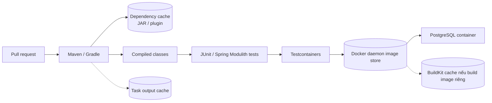

# Cache dependency và container image

Một pipeline Spring Modulith có thể đã cấu hình cache Maven/Gradle nhưng bài `@ApplicationModuleTest` dùng PostgreSQL Testcontainers vẫn phải tải Docker image ở mỗi CI run. Điều này **không nhất thiết là lỗi cache**: thư viện Java, kết quả build và Docker image thuộc **ba loại dữ liệu khác nhau**, với phạm vi lưu trữ và cơ chế khôi phục riêng. Ngược lại, cache hit không chứng minh rằng kiến trúc vẫn hợp lệ hoặc JUnit đã chạy.

Bài **“Cache dependency và container image”** thuộc chương **CI và quality gate** của `SPRING_MODULITH_VERIFICATION_TESTING`. Mục tiêu là rút ngắn thời gian kiểm chứng `ApplicationModules.verify()`, `@ApplicationModuleTest`, kiểm thử database, sự kiện và tích hợp **mà không làm yếu bằng chứng test**, không dùng artifact cũ để tạo kết quả xanh giả và không để cache không tin cậy ảnh hưởng mã chạy trong CI.

Ta sẽ phân biệt chính xác cache nào đang tối ưu giai đoạn nào, viết cấu hình Maven/Gradle và Testcontainers có thể kiểm tra được, quan sát cold/warm runs và áp dụng quy tắc bảo mật, invalidation, cleanup. Các mã minh họa sử dụng Java 21, Spring Boot/Spring Modulith phiên bản tương thích, JUnit Jupiter và PostgreSQL Testcontainers; cần điều chỉnh phiên bản theo build thực tế của dự án.

## 1. Bốn loại cache không thể thay thế cho nhau

| Loại dữ liệu | Ví dụ | Được lưu ở đâu? | Điều được tăng tốc | Điều **không** tự được tăng tốc |
| --- | --- | --- | --- | --- |
| **Dependency cache** | Maven `~/.m2/repository`; Gradle dependency artifacts | Cache của build tool / GitHub Actions | Tải JAR, POM, plugins, metadata | Docker pull, chạy JUnit, Spring bootstrap |
| **Build/task cache** | Compile outputs, Gradle task outputs | Local/remote build cache | Tính toán lại từ source khi input không đổi | Đảm bảo integration tests mới thực thi |
| **Docker image store** | `postgres:16.6-alpine`, Kafka image, Testcontainers helper images | Docker daemon của **runner** | Không cần tải lại image layers đã có | Maven resolve, database migration, container startup |
| **Docker BuildKit cache** | Layers khi `docker buildx build` image của ứng dụng | BuildKit local/registry/`gha` backend | Rebuild Dockerfile image | Tự nạp `postgres` image vào daemon mà Testcontainers đang dùng |



**Quan hệ nhân quả chính xác:**

1. Cache Maven đã được restore → `spring-modulith-starter-test` và PostgreSQL driver có thể không phải tải lại.
2. JUnit bắt đầu → Spring tạo test context và Testcontainers yêu cầu Docker tạo container.
3. Docker daemon kiểm tra image theo tên/tag/digest và **pull nếu local image chưa có** hoặc pull policy yêu cầu.
4. Container start → PostgreSQL sẵn sàng → migration chạy → kiểm thử SQL/transaction diễn ra.
5. Các bước 2–4 vẫn có chi phí ngay cả khi **dependency cache hit 100%**.

Không cache nguyên thư mục `target/` hay `build/` và suy rằng Java test “đã được kiểm chứng” trên commit mới. Compile/task outputs chỉ hợp lệ khi build tool khẳng định đúng tất cả inputs; integration tests còn phụ thuộc external state, database schema và container image.

### Cách nhận diện bottleneck trước khi tối ưu

| Quan sát trong CI | Đang chậm ở đâu? | Hướng xử lý |
| --- | --- | --- |
| Log nhiều “Downloading from Maven Central” / Gradle downloading | Dependency resolution | Dependency cache, repository mirror, lock/verification |
| `docker pull postgres...` mất thời gian | Image download, registry latency | Image layer locality, mirror, pin và prefetch hợp lý |
| Image đã có nhưng `waiting for database` lâu | Container start/readiness/migration | Fixture/DB startup, schema/migration |
| Tải dependency rất nhanh nhưng JUnit vẫn lâu | Spring context/test execution | Tối ưu bootstrap scopes và data isolation, không thêm cache mù quáng |
| Task `test` báo `FROM-CACHE`/`UP-TO-DATE` | Có thể không thực thi test mới | Kiểm tra policy test execution, reports và cacheability |

**Đo riêng từng pha**; cache miss có thể chậm nhưng cũng có khi network nhanh hơn tải/xả một cache archive quá lớn. Không mặc định “càng cache nhiều càng tốt”.

## 2. Maven: cache đúng dependency và version key

Trong GitHub Actions, `actions/setup-java` có tùy chọn `cache: maven`. Với phiên bản hiện đại, action tự quản cache cho local Maven repository (và có thể quản lý Maven wrapper/JDK cache theo input), **không yêu cầu** thêm `actions/cache` riêng cho toàn bộ `~/.m2`.

### Workflow Maven tối thiểu

```yaml
# Mảnh steps trong một GitHub Actions job chạy Maven.
steps:
  - uses: actions/checkout@v7

  - name: JDK and Maven dependency cache
    id: java
    uses: actions/setup-java@v6
    with:
      distribution: temurin
      java-version: '21'
      cache: maven
      cache-dependency-path: |
        **/pom.xml
        **/.mvn/wrapper/maven-wrapper.properties
        **/.mvn/extensions.xml
      cache-read-only: ${{ github.ref != 'refs/heads/main' }}

  - name: Observe dependency cache
    run: echo "Maven dependency cache hit: ${{ steps.java.outputs.cache-hit }}"

  - name: Run architecture + fast module tests
    run: ./mvnw -B -ntp test
```

**Ý nghĩa của cache key:**

- `pom.xml` đại diện dependencies/plugins và version management của các Maven modules.
- `.mvn/wrapper/maven-wrapper.properties` mô tả Maven Wrapper distribution được chọn.
- `.mvn/extensions.xml` có thể ảnh hưởng cách Maven resolve/build.
- `setup-java` tính key theo môi trường/kiến trúc và hash các dependency input; đổi `pom.xml` sẽ sinh key khác để tránh tin cache cũ như cache mới.
- `cache-read-only` trên nhánh không phải `main` cho phép dùng cache được tin cậy đã tạo trước đó nhưng không ghi cache mới từ PR.

`cache-dependency-path` là **override của tập đường dẫn input**, nên nếu project có file ảnh hưởng dependency resolution khác (ví dụ custom configuration, parent POM ở vị trí đặc biệt), cần đưa vào key theo chính sách. Không tự hash `src/main/java/**` vào dependency key: sửa Java source không thay danh sách dependency, khiến cache miss vô ích.

### Không cache secrets và không coi cache là lockfile

Không restore/save toàn bộ `~/.m2` nếu trong đó có `settings.xml` chứa access token hoặc credentials. Cơ chế `cache: maven` chủ yếu nhắm vào local repository, **không đồng nghĩa cache riêng settings/secrets**. Dùng GitHub Secrets/permissions phù hợp cho private artifact repositories.

**Version pinning** và integrity checks vẫn cần:

- Quản lý Spring Boot/Spring Modulith BOM và plugin versions theo bản đã review.
- Kiểm soát dynamic/SNAPSHOT dependencies; cache không biến một dependency thay đổi theo thời gian thành bản reproducible.
- Khi nghi metadata stale hoặc snapshot mới không được lấy, chẩn đoán có chủ đích bằng `./mvnw -U ...`; không luôn bật update vô điều kiện chỉ để che cấu hình version thiếu chặt.
- Không sử dụng `-o` (offline mode) như biện pháp bắt buộc cho mọi PR: một dependency mới có thể chưa có trong cache; pipeline cần truy cập registry được kiểm soát.

### Một build Maven trong monorepo

```text
repo/
├── pom.xml                 # parent/aggregator
├── shop-app/pom.xml
├── inventory-lib/pom.xml
└── shared-test/pom.xml
```

Với cấu trúc này, `**/pom.xml` giúp key bị invalidated khi dependency của bất kỳ module nào thay đổi. Tuy vậy, **job chạy verifier phải chạy đúng Maven module** chứa `ArchitectureVerificationTest` và report của nó; cache hit không chứng minh test đó nằm trong classpath.

**Giới hạn:** tên action/tag minh họa dựa trên các phiên bản action tương thích hiện hành; trong repository có policy security nghiêm ngặt nên pin bằng **full commit SHA đã kiểm duyệt**. Cache key bị invalidated không có nghĩa test tự fail: test vẫn phải thực sự chạy và process trả mã thất bại khi vi phạm.

## 3. Gradle: cache dependencies khác build cache và configuration cache

Một cách phổ biến để tối ưu Gradle CI là `gradle/actions/setup-gradle`. Nó quản lý Gradle User Home cache có chọn lọc, cleanup và cache policy. **Không bật trùng** `actions/setup-java` với `cache: gradle` hoặc `actions/cache` trỏ thẳng `~/.gradle` trong cùng workflow nếu đã dùng `setup-gradle`.

### Workflow Gradle không trùng cache

```yaml
# Mảnh steps trong một GitHub Actions job chạy Gradle.
steps:
  - uses: actions/checkout@v7

  - name: Install Java
    uses: actions/setup-java@v6
    with:
      distribution: temurin
      java-version: '21'
      # Không đặt cache: gradle tại đây.

  - name: Configure Gradle cache
    uses: gradle/actions/setup-gradle@v4
    with:
      cache-read-only: ${{ github.ref != 'refs/heads/main' }}

  - name: Run fast tests
    run: ./gradlew test --no-daemon
```

Các nhóm cache của Gradle:

| Cơ chế | Tác động | Giới hạn |
| --- | --- | --- |
| **Dependency cache** | Không tải lại artifact và metadata khi có cache hợp lệ | Không rút ngắn query PostgreSQL hoặc Kafka |
| **Gradle build cache** | Có thể tái sử dụng outputs của các task được đánh dấu cacheable và có inputs/outputs đúng | Không được dùng để làm bằng chứng test integration với external state luôn phải chạy lại |
| **Configuration cache** | Tái sử dụng kết quả configuration phase của Gradle khi inputs hỗ trợ | Không thay task execution, không liên quan Docker image |
| **Gradle daemon** | Reuse JVM trong một môi trường thích hợp | `--no-daemon` trong CI có trade-off startup/cleanup; không phải persistent cache giữa GitHub jobs |

### Cấu hình build cache là quyết định riêng

```properties
# gradle.properties, ví dụ minh họa cần review chính sách build.
org.gradle.caching=true
```

`org.gradle.caching=true` cho phép Gradle build cache khi task hỗ trợ. Điều đó **không bắt buộc** mọi task phải dùng cache, và **không an toàn** để suy “`Test` task báo `FROM-CACHE` ⇒ đã chạy các SQL assertions trên DB vừa dựng”.

Nếu mục đích quality gate bắt buộc phải **thực thi** test database/event/HTTP trên commit hiện tại, hãy cấu hình test tasks đó không được lấy output từ cache, hoặc dùng quy trình CI yêu cầu task execution mới thay vì chỉ nhận XML kết quả cũ. Ví dụ Gradle Groovy DSL:

```groovy
// Ví dụ cho task integrationTest thực sự tồn tại trong project.
tasks.named('integrationTest', Test) {
    // Không cho kết quả Test task này được lấy từ remote/local build cache.
    outputs.cacheIf('External infrastructure tests must execute') {
        false
    }
    // Không xem task là up-to-date giữa các lần gọi trên cùng workspace.
    outputs.upToDateWhen { false }
}
```

Đây là **mảnh cấu hình**, phải gắn vào đúng task của dự án; nó không tự tạo `integrationTest`. Với những test thuần deterministic, caching task output có thể phù hợp sau khi chứng minh inputs/outputs được khai báo đầy đủ; với **integration tests hạ tầng**, bảo đảm test mới thực thi thường quan trọng hơn chút thời gian tiết kiệm.

### Lock dependency, xác minh nguồn

Gradle hỗ trợ **dependency locking** và **dependency verification** để kiểm soát phiên bản/checksum/metadata theo policy. Khi thay `libs.versions.toml`, `build.gradle(.kts)`, wrapper hoặc lockfiles, cache nên được invalidated hoặc tái xác thực phù hợp. Không lưu `gradle.properties` chứa passwords vào shared cache. Một thay đổi ở build scripts có thể khiến module test bootstrap sai, nên `ApplicationModules.verify()` và các test quan trọng vẫn phải chạy.

## 4. Docker image cache: hiểu phạm vi của runner và Testcontainers

Với Testcontainers, một khai báo như:

```java
PostgreSQLContainer<?> postgres =
        new PostgreSQLContainer<>("postgres:16.6-alpine");
```

**không tải image vào Maven cache**. Nó giao tiếp với Docker daemon. Docker sẽ dùng layers hiện có trong **image store của daemon ấy** nếu image phù hợp và pull policy không yêu cầu tải lại. Image đã được pull trong một job có thể được dùng lại bởi nhiều test classes thuộc **cùng Docker daemon**, nhưng **không tự tồn tại** ở một GitHub-hosted runner mới của job/run khác.

### Cold và warm là khái niệm tương đối

```text
PR #18 / job A / GitHub-hosted runner A:
  - Restore Maven cache: HIT
  - docker image inspect postgres:16.6-alpine: NOT FOUND
  - Testcontainers pull postgres image: DOWNLOAD
  - Start PostgreSQL + Flyway + JUnit assertions
  - Job kết thúc, runner tạm thời bị thu hồi

PR #19 / job B / GitHub-hosted runner B:
  - Restore Maven cache: HIT
  - Docker daemon khác, image postgres: NOT FOUND
  - Testcontainers có thể phải pull postgres lần nữa
```

Một image **warm trên laptop hoặc self-hosted runner** không có nghĩa warm trên GitHub-hosted runner mới. Khi xem dashboard CI, phải ghi nhận runner type, image digest và cache state trước khi kết luận tối ưu có hiệu quả.

### Kiểm tra Docker image tại đúng runner

Các lệnh chỉ đọc thông tin image Docker:

```bash
# Xem image đã có ở Docker daemon hiện tại chưa:
docker image inspect postgres:16.6-alpine \
  --format '{{.Id}}'

# Xem danh sách tên và digest đã liên kết với image local:
docker image inspect postgres:16.6-alpine \
  --format '{{json .RepoDigests}}'
```

Nếu lệnh inspect fail vì không tìm thấy image, Testcontainers thường cần pull nó (hoặc yêu cầu một registry mirror/private image phù hợp). Nếu có image local, startup vẫn cần **create container, volume/network và health/readiness**; cache không loại bỏ chi phí đó.

**Không cache `/var/lib/docker` bằng `actions/cache`** như một zip archive cho GitHub Actions: Docker daemon metadata, quyền truy cập, overlay filesystem và storage driver khiến cách này không phải một cơ chế image-cache portable/an toàn. Đây không phải tương đương cache JAR.

### Pre-pull image làm gì và không làm gì?

```yaml
# Các steps trong cùng job sẽ chạy Testcontainers.
- name: Inspect image already on runner
  run: |
    docker image inspect postgres:16.6-alpine \
      --format '{{.Id}}' || echo 'PostgreSQL image not local'

- name: Pre-pull PostgreSQL image
  run: docker pull postgres:16.6-alpine

- name: Confirm image after pre-pull
  run: docker image inspect postgres:16.6-alpine \
       --format '{{.Id}}'
```

Khi đã `docker pull` vào **cùng Docker daemon**, bước Testcontainers sau đó thường thấy image local và không phải tải các layers ấy lại. Lợi ích là **đưa lỗi registry/network ra sớm, tách log download khỏi log test và cho phép đo pull time rõ ràng**; nó không nhất thiết giảm tổng thời gian của một **cold hosted runner**, vì download vẫn phải xảy ra ở bước pre-pull. Pre-pull ở job A **không làm image hiện ra trong Docker daemon của job B**.

Với Testcontainers, còn có **helper images** cho việc quản lý tài nguyên/network (tùy version), không chỉ image PostgreSQL. Nếu log vẫn báo pull sau khi pre-pull PostgreSQL, cần kiểm tra **image name/digest, helper image và pull policy** trước khi kết luận Docker cache hỏng.

## 5. Pin image và chọn chiến lược phân phối an toàn

**Image local là cache, không phải một chuẩn bảo mật hay reproducibility.** Một tag có thể được registry cập nhật để trỏ tới digest khác, còn local store trên self-hosted runner có thể giữ image cũ. Vì vậy **chiến lược versioning và refresh** là một phần của quality gate.

### Tag, digest và policy

| Cách tham chiếu | Ưu điểm | Rủi ro |
| --- | --- | --- |
| `postgres:latest` | Viết nhanh | Không ổn định; runtime/schema behavior thay đổi ngoài PR |
| `postgres:16` | Cố định major | Minor/patch có thể đổi theo thời gian |
| `postgres:16.6-alpine` | Kiểm soát rõ minor/patch theo tag | Tag vẫn có thể được publish lại |
| `postgres@sha256:<digest>` | Chọn manifest content-addressed đã xác nhận | Phải cập nhật digest/chính sách platform thủ công |

Chuỗi `<digest>` trong bảng chỉ là **ký hiệu giải thích**, không phải một digest hợp lệ để copy vào Java. Nếu cần pin digest thật, dùng digest đã được đội kiểm tra từ registry/Image SBOM, theo platform đúng của runner, rồi cập nhật bằng PR có kiểm thử. Không tự điền chuỗi bịa thành `sha256:...` rồi cho rằng Docker sẽ chấp nhận.

### Đừng để Java và CI pull khác image

```java
// Tên image cần thống nhất với quy tắc CI.
static final String POSTGRES_IMAGE = "postgres:16.6-alpine";

PostgreSQLContainer<?> postgres =
        new PostgreSQLContainer<>(POSTGRES_IMAGE);
```

```bash
# Trong job sử dụng cùng giá trị đã được review:
docker pull postgres:16.6-alpine
```

Nếu test dùng `postgres:16.6-alpine` nhưng CI pre-pull `postgres:16-alpine`, local cache của **tên image khác** không bảo đảm test tránh registry call; thậm chí cùng layers vẫn có metadata lookup theo tên/tag khác.

### Tránh AlwaysPull không cần thiết

Testcontainers hỗ trợ `ImagePullPolicy`. Ví dụ **chỉ khi yêu cầu rõ** phải kiểm tra image mới nhất theo tag trong một test/job:

```java
// KHÔNG nên bật vô điều kiện trong mọi PR test tốc độ cao.
PostgreSQLContainer<?> postgres =
        new PostgreSQLContainer<>("postgres:16.6-alpine")
                .withImagePullPolicy(PullPolicy.alwaysPull());
```

Import `org.testcontainers.images.PullPolicy`. Với `alwaysPull()`, Docker/Testcontainers sẽ chủ động kiểm tra/pull image theo policy, **giảm lợi ích image đã local**, đặc biệt trên self-hosted runner. Với image pin digest có kiểm soát, chiến lược local-if-present thường giảm download không cần thiết, nhưng vẫn cần lịch cập nhật dependency/CVE/digest. API/policy phải được xác minh theo phiên bản Testcontainers của dự án.

### Chọn chiến lược theo môi trường

| Môi trường | Chiến lược hợp lý | Kiểm soát cần có |
| --- | --- | --- |
| GitHub-hosted ephemeral runner | Dependency cache + pre-pull khi cần quan sát; image từ registry/mirror gần runner | Đừng giả định images persist giữa runs |
| Self-hosted runner | Preload/prefetch image đã pin, dùng daemon local cache | Dọn images cũ, CVE scanning, isolation giữa jobs |
| Private registry/mirror | Dùng digest/tag approved và cấu hình image substitution/prefix phù hợp Testcontainers | Phân quyền/credentials, verify image nguồn |
| App tự build Docker image | Dùng BuildKit `cache-from/cache-to` hoặc registry cache | **Khác** Docker pull của PostgreSQL image |

Docker BuildKit `type=gha` dùng cho **các layers khi build image** bằng `docker buildx build` hoặc `docker/build-push-action`; nó không tự động nạp image PostgreSQL đã build ở nơi khác vào Testcontainers Docker daemon. Với nhu cầu Testcontainers, giải pháp có giá trị hơn thường là registry mirror nhanh, pre-provisioned runner hoặc chia sẻ daemon **trong cùng job**, không phải thêm BuildKit cache vào một workflow chưa hề chạy `docker build`.

### Không dùng reusable Testcontainers như Docker image cache

`TESTCONTAINERS_REUSE_ENABLE=true` cùng `withReuse(true)` là **reusable container experimental**, khác hoàn toàn **reuse image layers**. Tài liệu Testcontainers nêu rõ container reuse **không phù hợp CI**, vì container có thể tiếp tục chạy sau test và trạng thái dữ liệu không được cleanup bình thường.

Một cache image tốt **vẫn tạo container mới** với data fixture kiểm soát được. Đừng bật container reuse hoặc tắt cơ chế cleanup như Ryuk chỉ để giảm vài giây startup trong required CI: nó làm tăng rủi ro rò state và sai kết quả.

## 6. Ví dụ Java/JUnit: cache image nhưng vẫn kiểm chứng DB và ranh giới module thật

Ta dùng một ứng dụng Spring Modulith nhỏ với hai module `orders` và `inventory`. Test kiến trúc không cần Docker; test database ở `inventory` phải **chạy JdbcTemplate và PostgreSQL thật**. Image `postgres:16.6-alpine` chỉ là một input hạ tầng đã chọn, không phải đối tượng được mock hay kết quả test được cache.

### 6.1. Application root và public API

```java
// src/main/java/com/acme/shop/ShopApplication.java
package com.acme.shop;

import org.springframework.boot.autoconfigure.SpringBootApplication;

@SpringBootApplication
public class ShopApplication {
}
```

```java
// src/main/java/com/acme/shop/inventory/StockAvailability.java
package com.acme.shop.inventory;

public interface StockAvailability {
    boolean available(String sku, int quantity);
}
```

Repository thật của module `inventory`:

```java
// src/main/java/com/acme/shop/inventory/internal/JdbcStockAvailability.java
package com.acme.shop.inventory.internal;

import com.acme.shop.inventory.StockAvailability;
import org.springframework.jdbc.core.JdbcTemplate;
import org.springframework.stereotype.Repository;

@Repository
class JdbcStockAvailability implements StockAvailability {

    private final JdbcTemplate jdbc;

    JdbcStockAvailability(JdbcTemplate jdbc) {
        this.jdbc = jdbc;
    }

    @Override
    public boolean available(String sku, int quantity) {
        Integer result = jdbc.queryForObject(
                "SELECT available_quantity FROM inventory_stock " +
                "WHERE sku = ?",
                Integer.class,
                sku);
        return result != null && result >= quantity;
    }
}
```

Migration chạy vào PostgreSQL test:

```sql
-- src/main/resources/db/migration/V1__create_inventory_stock.sql
CREATE TABLE inventory_stock (
    sku VARCHAR(80) PRIMARY KEY,
    available_quantity INTEGER NOT NULL
        CHECK (available_quantity >= 0)
);
```

Đây là **bộ mã ví dụ** để hiểu cache và kiểm chứng, không phải yêu cầu worker tạo thêm file trong repository. Dự án thật phải có dependency Spring Boot JDBC, PostgreSQL driver, Flyway và module Flyway PostgreSQL tương thích version, cùng Spring Modulith test starter.

### 6.2. Architecture gate nhanh

```java
// src/test/java/com/acme/shop/ArchitectureVerificationTest.java
package com.acme.shop;

import org.junit.jupiter.api.Test;
import org.springframework.modulith.core.ApplicationModules;

import static org.assertj.core.api.Assertions.assertThat;

class ArchitectureVerificationTest {

    @Test
    void boundariesAreValidAndModulesDiscovered() {
        ApplicationModules modules =
                ApplicationModules.of(ShopApplication.class);

        assertThat(modules.getModuleByName("inventory")).isPresent();
        assertThat(modules.getModuleByName("orders")).isPresent();

        modules.verify();
    }
}
```

`ApplicationModules.of(...).verify()` có thể chạy trong JUnit mà **không bootstrap Spring ApplicationContext**. Cache Maven giúp tải phần mềm cho test nhanh hơn, nhưng **không thể dùng một JUnit XML cũ để thay phép gọi này trên commit mới**. Assertion expected modules ngăn tình huống mô hình module bị thiếu nhưng `verify()` vẫn được gọi trên phần graph còn lại.

### 6.3. @ApplicationModuleTest + @ServiceConnection

```java
// src/test/java/com/acme/shop/inventory/InventoryJdbcModuleTest.java
package com.acme.shop.inventory;

import org.junit.jupiter.api.AfterEach;
import org.junit.jupiter.api.Test;
import org.springframework.beans.factory.annotation.Autowired;
import org.springframework.boot.test.context.TestConfiguration;
import org.springframework.boot.testcontainers.service.connection.ServiceConnection;
import org.springframework.context.annotation.Bean;
import org.springframework.context.annotation.Import;
import org.springframework.dao.DataIntegrityViolationException;
import org.springframework.jdbc.core.JdbcTemplate;
import org.springframework.modulith.test.ApplicationModuleTest;
import org.testcontainers.containers.PostgreSQLContainer;

import static org.assertj.core.api.Assertions.assertThat;
import static org.assertj.core.api.Assertions.assertThatThrownBy;

@ApplicationModuleTest
@Import(InventoryJdbcModuleTest.DatabaseFixture.class)
class InventoryJdbcModuleTest {

    private static final String POSTGRES_IMAGE = "postgres:16.6-alpine";

    @Autowired
    StockAvailability stock;

    @Autowired
    JdbcTemplate jdbc;

    @TestConfiguration(proxyBeanMethods = false)
    static class DatabaseFixture {

        @Bean
        @ServiceConnection
        PostgreSQLContainer<?> postgres() {
            return new PostgreSQLContainer<>(POSTGRES_IMAGE);
        }
    }

    @AfterEach
    void cleanupRows() {
        // Fixture test dùng DB container riêng, không phải production DB.
        jdbc.update(
                "DELETE FROM inventory_stock WHERE sku LIKE 'TEST-CACHE-%'");
    }

    @Test
    void usesRealJdbcAndMigratedSchema() {
        jdbc.update(
                "INSERT INTO inventory_stock " +
                "(sku, available_quantity) VALUES (?, ?)",
                "TEST-CACHE-7", 5);

        assertThat(stock.available("TEST-CACHE-7", 4)).isTrue();
        assertThat(stock.available("TEST-CACHE-7", 6)).isFalse();
    }

    @Test
    void rejectsInvalidQuantityInPostgres() {
        assertThatThrownBy(() -> jdbc.update(
                "INSERT INTO inventory_stock " +
                "(sku, available_quantity) VALUES (?, ?)",
                "TEST-CACHE-NEG", -1
        )).isInstanceOf(DataIntegrityViolationException.class);
    }
}
```

**Tại sao dùng `@Bean @ServiceConnection`?** Với Spring Boot Testcontainers integration được cấu hình đầy đủ, Spring tạo container bean và quản lý nó **theo vòng đời ApplicationContext**. `@ServiceConnection` cấp `JdbcConnectionDetails` cho auto-configuration; `JdbcStockAvailability` được nạp thật trong module `inventory`, không bị `@MockitoBean` thay thế. JUnit có thể cache Spring context; dùng Spring-managed container tránh trường hợp `static @Container` bị JUnit đóng sau test class nhưng `DataSource` của context cached vẫn trỏ tới endpoint cũ.

**Điều code thực sự kiểm tra:**

1. PostgreSQL image đã được Docker daemon tìm thấy/pull, container khởi động được.
2. Flyway tạo bảng `inventory_stock` với constraint trên DB test.
3. `JdbcStockAvailability` chạy câu SQL thật, trả kết quả theo dữ liệu seed.
4. PostgreSQL phát hiện `available_quantity = -1` và Spring dịch lỗi theo exception phù hợp.
5. `@AfterEach` dọn dữ liệu test đã commit theo prefix trên DB được cô lập.

**Điều code không kiểm tra:** cache hit có xảy ra hay không, ảnh Docker đã qua security scanning chưa, hoặc `orders` có dùng cổng `StockAvailability` đúng không. Cache hit phải quan sát **ở CI/cache logs và Docker image store**, không suy từ việc database test PASS.

### 6.4. Dependencies minh họa

```groovy
// Mảnh Gradle Groovy DSL; version do BOM phù hợp quản lý.
dependencies {
    implementation 'org.springframework.boot:spring-boot-starter-jdbc'
    implementation 'org.flywaydb:flyway-core'
    runtimeOnly 'org.flywaydb:flyway-database-postgresql'
    runtimeOnly 'org.postgresql:postgresql'

    testImplementation 'org.springframework.boot:spring-boot-starter-test'
    testImplementation 'org.springframework.modulith:spring-modulith-starter-test'
    testImplementation 'org.springframework.boot:spring-boot-testcontainers'
    testImplementation 'org.testcontainers:postgresql'
}
```

Những dependency này **không phải toàn bộ build**: vẫn cần Spring Boot plugin, Spring Modulith BOM/dependency management tương thích và configuration của ứng dụng. Với JDBC-only service, không cần thêm JPA starter chỉ để test. Test `@ServiceConnection` trên Spring bean container **không yêu cầu** `@Testcontainers`/`@Container` của JUnit Jupiter.

### 6.5. Thử làm sai để chứng minh cache không che lỗi

- Đổi query trong `JdbcStockAvailability` từ `available_quantity` thành tên cột không tồn tại, giữ Maven cache và Docker image y nguyên: test phải **FAIL**.
- Đổi migration `CHECK (available_quantity >= 0)` thành cho phép số âm, giữ image local: `rejectsInvalidQuantityInPostgres()` phải **FAIL** vì không còn exception.
- Tạo cycle hoặc import package nội bộ giữa `orders` và `inventory`, giữ caches: `ArchitectureVerificationTest` phải **FAIL**.
- Revert các lỗi: cùng caches vẫn được dùng nhưng JUnit trở lại PASS.

**Điểm cần chứng minh:** cache chỉ tiết kiệm **tải artifact/image**, không được cho phép sử dụng **kết quả kiểm thử cũ** để bỏ qua một thay đổi source/migration.

## 7. Workflow CI hoàn chỉnh: hai loại cache, hai phép kiểm tra và required gate

Ví dụ workflow dưới đây dành cho **một Maven application** có đầy đủ các lớp và migration minh họa ở mục 6. Một job kiến trúc không phụ thuộc Docker; một job PostgreSQL tích hợp dùng dependency cache và kiểm tra image local trước khi pull. Cả hai phải **chạy trên commit hiện tại**, tạo JUnit reports và cùng được tính vào một required gate.

```yaml
# .github/workflows/modulith-cache-quality.yml
name: modulith-cache-quality

on:
  pull_request:
  merge_group:
  push:
    branches: [main]

permissions:
  contents: read

jobs:
  architecture:
    name: architecture
    runs-on: ubuntu-latest
    timeout-minutes: 12
    steps:
      - uses: actions/checkout@v7

      - name: Install Java and restore Maven dependencies
        id: java
        uses: actions/setup-java@v6
        with:
          distribution: temurin
          java-version: '21'
          cache: maven
          cache-read-only: ${{ github.ref != 'refs/heads/main' }}

      - name: Show dependency cache status
        run: echo "Maven cache exact hit: ${{ steps.java.outputs.cache-hit }}"

      - name: Run module architecture verifier
        run: >-
          ./mvnw -B -ntp
          -Dtest=ArchitectureVerificationTest
          -Dsurefire.failIfNoSpecifiedTests=true
          test

      - name: Preserve JUnit report
        if: always()
        uses: actions/upload-artifact@v4
        with:
          name: junit-architecture
          path: target/surefire-reports/TEST-*.xml
          if-no-files-found: error

  postgres-module:
    name: postgres-module
    needs: architecture
    runs-on: ubuntu-latest
    timeout-minutes: 30
    steps:
      - uses: actions/checkout@v7

      - name: Install Java and restore Maven dependencies
        id: java
        uses: actions/setup-java@v6
        with:
          distribution: temurin
          java-version: '21'
          cache: maven
          cache-read-only: ${{ github.ref != 'refs/heads/main' }}

      - name: Inspect image locality and prepare Postgres
        shell: bash
        run: |
          if docker image inspect postgres:16.6-alpine >/dev/null 2>&1; then
            echo 'DOCKER_IMAGE_LOCAL_HIT=true'
          else
            echo 'DOCKER_IMAGE_LOCAL_HIT=false'
            docker pull postgres:16.6-alpine
          fi
          docker image inspect postgres:16.6-alpine \
            --format '{{.Id}}'

      - name: Run real JDBC module test
        run: >-
          ./mvnw -B -ntp
          -Dtest=InventoryJdbcModuleTest
          -Dsurefire.failIfNoSpecifiedTests=true
          test

      - name: Preserve JUnit report
        if: always()
        uses: actions/upload-artifact@v4
        with:
          name: junit-postgres-module
          path: target/surefire-reports/TEST-*.xml
          if-no-files-found: error

  modulith-quality-gate:
    name: modulith-quality-gate
    needs: [architecture, postgres-module]
    if: always()
    runs-on: ubuntu-latest
    steps:
      - name: Require all expected verification jobs
        env:
          ARCHITECTURE_RESULT: ${{ needs.architecture.result }}
          POSTGRES_RESULT: ${{ needs.postgres-module.result }}
        run: |
          test "$ARCHITECTURE_RESULT" = "success"
          test "$POSTGRES_RESULT" = "success"
```

### Đọc workflow đúng ý nghĩa

1. `setup-java@v6` quản lý **Maven dependency cache**; thuộc tính `cache-read-only` giới hạn PR không ghi cache mới. GitHub-hosted runner mới vẫn phải clone, compile và chạy test.
2. `architecture` chạy `ArchitectureVerificationTest`, có fail-if-no-specified-tests; **không khởi động Docker**.
3. `postgres-module` có thể thấy Docker image local hoặc phải pull, nhưng **cùng dùng một tag** `postgres:16.6-alpine` với Java Testcontainers.
4. `docker image inspect` kiểm tra image ở **daemon của job PostgreSQL**, không phải “Docker cache GitHub Actions” xuyên job.
5. `./mvnw ... test` vẫn chạy JUnit thật. `-Dtest` chọn class rõ ràng; `surefire.failIfNoSpecifiedTests` giảm nguy cơ kết quả xanh khi class bị rename/không tồn tại.
6. `upload-artifact` giữ JUnit XML để người review xác định test đã chạy hay lỗi hạ tầng; tên artifact khác nhau theo job.
7. `modulith-quality-gate` dùng `if: always()` và kiểm tra **cả hai job có result = success**. Một job fail/cancel/skip không được biến thành PASS.

**Điều kiện trước khi copy:** Maven Surefire và JUnit Jupiter phải được cấu hình tương thích, project root phải chứa test classes, PostgreSQL integration dependencies/migration phải có thật. Nếu Maven multi-module, `-Dtest=...` từ reactor root có thể khiến các module không chứa test bị fail; chọn **đúng module sở hữu JUnit class** và kiểm tra đường dẫn report. Ví dụ workflow là cấu hình học tập, không phải workflow tự động đã được ghi vào repository.

### Gate bắt buộc cần được cấu hình trên repository

Vào GitHub **Settings → Rules → Rulesets** hoặc branch protection, chọn **Require status checks to pass before merging**, đưa `modulith-quality-gate` vào danh sách required và thử một PR có SQL/schema error. Khi dùng merge queue, `merge_group` phải tạo check trên merge-group commit tương ứng.

Nếu chỉ tạo workflow mà không bật branch protection, PR vẫn có thể được merge theo quyền của repository dù test đỏ. Ngoài ra, một job trực tiếp bị skip vì `if` có thể được xem là status thỏa điều kiện trong một số cấu hình; required aggregator kiểm tra kết quả tường minh như ví dụ giúp tránh lỗi này.

### Vì sao không “cache Docker image qua hai jobs” trong ví dụ?

`architecture` không cần image; `postgres-module` có Docker daemon riêng. Ta **không thêm bước tải image** ở architecture để rồi hy vọng postgres-module dùng lại: điều đó chỉ tốn thời gian và không làm thay đổi daemon của job sau. Nếu có nhiều hạ tầng tests trong cùng job, pre-pull **một lần ở đầu job** có thể tránh duplicate pulls bên trong những test classes ấy.

### Fast feedback và chi phí

`needs: architecture` làm PostgreSQL job chỉ bắt đầu khi kiến trúc đạt: tránh phí container khi PR đã sai ranh giới module, nhưng làm tăng end-to-end latency so với song song. Với team tối ưu wall-clock, có thể chạy hai jobs song song; **vẫn giữ required aggregator và fail-on-missing-test**. Đây là quyết định lịch chạy, không phải một cơ chế cache.

## 8. Cache security: checksum, nguồn tin cậy và rủi ro poisoning

Cache làm **phân phối artifact nhanh hơn**, nghĩa là nếu artifact hoặc cache bị sửa sai, rủi ro cũng có thể lan nhanh hơn. Đừng đồng nhất cache hit với “artifact an toàn”.

### Ma trận rủi ro

| Rủi ro | Cách phát sinh | Biện pháp thực tế |
| --- | --- | --- |
| Cache poisoning từ PR không tin cậy | Workflow cho phép code của fork ghi shared cache được nhánh bảo vệ restore | PR dùng cache **read-only**, hạn chế token/permissions, tách scope |
| Maven/Gradle artifact bị thay đổi | SNAPSHOT/dynamic version, compromised repository/mirror | Pin versions, lockfile khi phù hợp, verification/checksums |
| Docker tag drift | `postgres:16` trỏ digest mới nhưng self-hosted runner giữ image cũ | Pin patch/digest approved, quy trình refresh image và kiểm tra digest |
| Cache vô tình chứa secrets | Cache `~/.m2/settings.xml`, Gradle properties, file credentials | Chỉ cache dependency path cần thiết; secrets lấy từ runner/secret store |
| Reuse test results cũ | Restore `target/surefire-reports` hoặc `build/test-results` rồi bỏ chạy JUnit | Không dùng test report cache làm bằng chứng; fail nếu test không thực thi |
| Reusable container giữ dữ liệu | Dùng `withReuse(true)` trong CI | Container mới và fixture isolation; chỉ reuse **layers** |
| Image chứa CVE | “Đã cache” nên không cập nhật image cũ | Security scan, patch cadence, approved digests/SBOM |
| Nhiều platform architectures | Cache/digest cho `amd64` dùng trên `arm64` không tương thích | Key theo OS/arch; chọn manifest/platform phù hợp |

### Quy tắc với pull request từ fork

- `permissions: contents: read` là baseline hợp lý cho job test.
- Không đưa secrets production vào untrusted PR jobs; không dùng `pull_request_target` để chạy code của PR với token có quyền ghi.
- Hạn chế cache write từ PR; restore cache theo quy tắc branch/repository và key của GitHub Actions.
- Không cho phép cache trỏ vào thư mục chứa JDK trust store/credentials/test signing keys được sửa trong PR nếu không có kiểm soát.
- Khi dùng self-hosted runners, cô lập Docker daemon/workspace và dọn image/container nguy hiểm theo policy; chạy PR không tin cậy trên runner có quyền truy cập mạng nội bộ production là rủi ro nghiêm trọng.

### Invalidation phải có đường kiểm chứng

| Thay đổi | Cần invalidated/refresh gì? |
| --- | --- |
| `pom.xml` đổi dependency/plugin | Maven dependency key tương ứng |
| `build.gradle(.kts)`/version catalog/lockfile đổi | Gradle dependencies/config cache theo inputs |
| `Dockerfile` app đổi | BuildKit image build cache theo layers/context đúng |
| `POSTGRES_IMAGE` đổi tag/digest | Docker image local matching và pre-pull cùng tham chiếu |
| Flyway SQL migration đổi nhưng Docker tag giữ nguyên | **Không cần cache image miss**; cần **chạy lại migration/JUnit** |
| Java business code đổi nhưng POM giữ nguyên | Dependency cache vẫn HIT là hợp lệ; **JUnit phải chạy lại** |

**Quan trọng:** source change có thể **không invalidate Maven cache** và đó là hành vi đúng. “Cache không đổi” không có nghĩa “kết quả test không đổi”; JUnit vẫn chạy trên class mới được biên dịch.

## 9. Đo cache effectiveness và chẩn đoán đúng điểm nghẽn

Không đánh giá cache bằng một lần chạy “sau khi thêm YAML thấy nhanh hơn”. Cần **so sánh có cùng môi trường và lưu bằng chứng**: cùng JDK, runner type, dependency set, Docker image tag/digest, test classes, trạng thái registry và số lượng JUnit assertions.

### Tách thời gian theo giai đoạn

| Pha | Bắt đầu/kết thúc đo | Dấu hiệu và cách ghi nhận |
| --- | --- | --- |
| Restore dependency cache | `setup-java`/`setup-gradle` bắt đầu → xong | `cache-hit`, bytes restore, duration action |
| Maven/Gradle resolve & compile | Lệnh wrapper bắt đầu → trước JUnit test execution | Download logs, build scan/summary nếu dự án cho phép |
| Docker pull | `docker image inspect`/`pull` bắt đầu → hoàn tất | Local hit/miss, thời gian pull, image ID/digest |
| Container startup + migration | Testcontainers create → readiness → Flyway migration | Container logs/test timeline, số contexts |
| JUnit thực thi | Test class bắt đầu → assertions hoàn tất | JUnit XML testcase count, failures, test duration |
| Save cache | Post-step cache upload | Size, duration, eviction/success status |

**Cache hit là metadata, test pass là bằng chứng hành vi.** Một bảng theo dõi nên ghi cả hai:

| CI run | Maven cache | Docker image local | `ArchitectureVerificationTest` | `InventoryJdbcModuleTest` |
| --- | --- | --- | --- | --- |
| Cold-run (minh họa) | MISS | MISS | Executed + PASS | Executed + PASS |
| Warm dependencies, cold Docker (minh họa) | HIT | MISS | Executed + PASS | Executed + PASS |
| Warm both trên self-hosted runner (minh họa) | HIT | HIT | Executed + PASS | Executed + PASS |
| Regression sau khi sửa SQL (minh họa) | HIT | HIT | Executed + PASS | **Executed + FAIL** |

Đây là **kịch bản minh họa**, không phải các số đo thực từ repository. Dòng cuối đặc biệt quan trọng: **cache hit ở cả hai loại vẫn phải cho test SQL mới báo FAIL** khi thay đổi có vi phạm.

### Cách làm thí nghiệm cold/warm có kiểm soát

1. Ghi runner OS/architecture, Java version, Maven/Gradle version, image reference và số test classes.
2. Chạy baseline khi dependency cache hoặc image store chưa có (trong môi trường test được phép). Không cần xóa cache production/shared để mô phỏng “cold”; có thể dùng key test riêng hoặc runner mới.
3. Chạy lại cùng commit, giữ các yếu tố giống nhau; log cache hit/miss và Docker image ID.
4. So sánh **total job duration** và từng pha riêng. Chú ý restore/upload cache cũng mất thời gian.
5. Tạo một thay đổi Java nhưng không thay POM, kiểm tra Maven cache vẫn có thể HIT trong khi JUnit **chạy lại**.
6. Tạo một thay đổi migration SQL (không đổi Docker image), kiểm tra test DB chạy lại trên schema mới và phát hiện hồi quy.
7. Chạy full test suite theo policy để phát hiện lỗi xuất hiện do context caching, data cleanup hoặc image sharing.

### Không biến đo đạc thành cache churn

Không xóa toàn bộ `~/.m2`, `~/.gradle` hoặc Docker images trên **self-hosted runner dùng chung** trong lúc các jobs khác còn chạy. Để đánh giá cold-start, dùng runner/namespace thí nghiệm riêng hoặc cache key thí nghiệm đã review. Cleanup images nên do quản trị runner có lịch/chiến lược storage rõ ràng, không phải lệnh `docker system prune -af` đặt tùy tiện trong từng PR job.

### Bảng chẩn đoán khi CI chậm hoặc kết quả đáng ngờ

| Triệu chứng | Nguyên nhân thường gặp | Hướng điều tra |
| --- | --- | --- |
| Maven cache miss trên mọi commit | `cache-dependency-path` trỏ sai/đổi thường xuyên, branch scope, key | Kiểm tra action summary, hash input, scope và write permissions |
| Gradle job rất chậm dù `setup-gradle` cache HIT | Chậm ở compile, tests, container startup; không phải dependency resolve | Đo từng pha, đừng thêm caching chồng chéo |
| `setup-java` và `setup-gradle` cùng restore `~/.gradle` | Hai cache managers can thiệp cùng Gradle User Home | Bỏ một cache manager |
| `docker image inspect` trả NOT FOUND dù Maven cache HIT | Hai hệ thống cache khác nhau; hosted runner mới | Kiểm tra image locality của Docker daemon và registry |
| Đã pre-pull image nhưng Testcontainers còn pull | Khác tag/digest, helper image, pull policy `alwaysPull` | So sánh image names, image logs, policy |
| Dùng self-hosted runner, image tag không nhận bản patch mới | Local tag giữ image cũ hoặc policy ưu tiên local | Pin digest mới và refresh theo policy |
| Docker image đã local nhưng test vẫn chậm | PostgreSQL start/migration/network readiness, Spring context bootstrap | Xem test/container logs, tối ưu fixtures |
| `test` báo `FROM-CACHE` nhưng không có execution mới | Task-output caching hoặc task bị skip | Xác minh test task policy, XML report và build logs |
| PostgreSQL test chỉ fail khi chạy cả suite | Context cache, container lifecycle hoặc dữ liệu fixture tồn dư | Kiểm tra owner của container, transaction/cleanup |
| PR xanh nhưng `ArchitectureVerificationTest` vắng report | Surefire/Gradle filter, naming, source set sai | Fail-on-missing-test, required report guard |
| CI tự động retry cho PASS dù lần đầu FAIL | Flaky test bị che | Lưu lại kết quả lần đầu, sửa race/timeout |

### Nên tối ưu theo thứ tự nào?

Thứ tự hiệu quả thường là: **loại bỏ tải dependency lặp lại**, xác định Docker image download thực tế, tổ chức test classes để tái sử dụng **Spring context hợp lệ trong một job**, giảm migration/fixture tốn kém, rồi mới cân nhắc nâng cấp runner/registry mirror/remote cache. Không nên bắt đầu bằng shared container reuse hoặc bỏ required integration tests để “đạt chỉ tiêu thời gian”.

## 10. Bài thực hành, câu hỏi kiểm chứng và checklist vận hành

### Tình huống

Team có hai CI jobs:

```text
Job A: architecture-fast
  - Java 21, Maven dependency cache
  - ArchitectureVerificationTest
  - OrdersFastModuleTest (@ApplicationModuleTest + @MockitoBean)
  - Không dùng Docker

Job B: postgres-integration
  - Java 21, Maven dependency cache
  - PostgreSQLContainer("postgres:16.6-alpine")
  - InventoryJdbcModuleTest + Flyway migration
  - Test runner: GitHub-hosted runner tạm thời
```

Sau khi team bật `cache: maven`, job A nhanh hơn nhưng job B vẫn phải tải image PostgreSQL ở lần chạy kế tiếp. Một người đề nghị cache `target/` và bật `TESTCONTAINERS_REUSE_ENABLE=true` để “khỏi chạy test nhiều lần”.

### Thực hành 1 — chẩn đoán và sửa cấu hình

Hãy giải thích: tại sao Maven cache HIT không làm PostgreSQL image xuất hiện ở job B? Sau đó sửa **chiến lược**, không sửa test assertion:

1. Dùng `docker image inspect postgres:16.6-alpine` trong **job B** để quan sát local hit/miss.
2. Đảm bảo image trong Java và pre-pull job B khớp tag/digest đã review.
3. Giữ Maven dependencies cache; không cache `target/` hoặc JUnit XML như kết quả test mới.
4. Không bật reusable Testcontainers trên CI; container cần cleanup đúng và data isolation.
5. Nếu cold image pull chiếm phần lớn thời gian, cân nhắc registry mirror hoặc self-hosted runner preloaded image, nhưng phải tính security/isolation.
6. Required gate vẫn phải chạy `ArchitectureVerificationTest` và `InventoryJdbcModuleTest`, không được skip.

### Thực hành 2 — kiểm tra tính đúng đắn khi cache HIT

**Thử A:** giữ POM và Docker tag, sửa câu SQL:

```java
// Đoạn sai có chủ đích, chưa được merge.
"SELECT quantity_available FROM inventory_stock WHERE sku = ?"
```

Vì migration chỉ có `available_quantity`, `InventoryJdbcModuleTest` phải **FAIL** dù Maven và Docker caches đều HIT. Nếu JUnit không thực thi vì test result được cache/skip, quality gate đang sai.

**Thử B:** giữ caches, đổi constraint:

```sql
-- Sai có chủ đích: làm mất kiểm tra nonnegative.
available_quantity INTEGER NOT NULL
```

`rejectsInvalidQuantityInPostgres()` phải **FAIL** vì PostgreSQL không còn từ chối `-1`. Đây là phép thử để bảo đảm migration mới thật sự được chạy trên DB test mới/cô lập.

**Thử C:** giữ caches, đưa một import vào `inventory.internal` từ module khác (nếu Java visibility cho phép). `ArchitectureVerificationTest` phải **FAIL** khi `ApplicationModules.verify()` phát hiện ranh giới module sai. Cache dependency đúng không được che kết quả này.

### 12 câu hỏi tự kiểm tra

| Câu hỏi | Đáp án trọng tâm |
| --- | --- |
| 1. `cache: maven` có cache Docker image không? | **Không**, đó là local Maven repository/artifacts |
| 2. `setup-java` output `cache-hit=true` chứng minh điều gì? | Cache dependency exact match được restore; **không** chứng minh JUnit đã chạy |
| 3. Sao Docker image HIT trên laptop nhưng MISS trên GitHub-hosted runner? | Hai Docker daemons/stores khác nhau |
| 4. Pre-pull image trước Testcontainers có luôn giảm tổng thời gian cold job? | **Không**; đôi khi chỉ chuyển download sang step sớm hơn |
| 5. Vì sao không cache `/var/lib/docker` như `~/.m2/repository`? | Docker store/overlay metadata không phải archive cache portable/an toàn |
| 6. `BuildKit type=gha` tự cache `postgres:16.6-alpine` cho Testcontainers không? | **Không**; nó cache build layers khi build Docker image |
| 7. Có nên bật `PullPolicy.alwaysPull()` mọi PR không? | Không mặc định; nó có thể bỏ qua lợi ích image local |
| 8. Image tag cụ thể đã đủ bất biến chưa? | Chưa; có thể pin digest đã xác nhận nếu cần reproducibility cao |
| 9. `withReuse(true)` có phù hợp required CI không? | **Không** theo hướng dẫn Testcontainers về reusable containers experimental |
| 10. Có nên cache JUnit XML như PASS result của commit mới? | **Không**; cần kiểm chứng execution mới và test reports mới |
| 11. Maven/Gradle dependency cache nên invalidated khi nào? | Khi dependency/build inputs thay đổi theo cache key, không phải mọi Java source edit |
| 12. PR từ fork được ghi shared cache tùy ý có an toàn không? | Không; cần read-only cache, permissions và provenance policy |

### Checklist nghiệm thu quality gate

- [ ] Đã phân biệt rõ **dependency cache, task-output cache, Docker image store và BuildKit cache**.
- [ ] Maven/Gradle cache manager không chồng chéo, key phản ánh dependency inputs và môi trường phù hợp.
- [ ] Không cache settings/secrets hoặc test results để thay JUnit execution.
- [ ] Có log `cache-hit` và Docker image inspect tại **job sử dụng container**.
- [ ] Testcontainers image name/digest khớp pre-pull/mirror config đã review.
- [ ] Không dùng `latest`/dynamic image tag cho required integration tests.
- [ ] Image CVE/digest có lịch cập nhật và phê duyệt, không bị cache đóng băng vô thời hạn.
- [ ] Không bật reusable containers experimental hoặc vô hiệu cleanup chỉ để giảm thời gian.
- [ ] `ApplicationModules.verify()` thực thi trên compiled classes của PR hiện tại.
- [ ] `@ApplicationModuleTest` với PostgreSQL dùng repository/migration thật, không mock mục tiêu cần kiểm tra.
- [ ] Có thử âm tính: SQL/constraint/module boundary sai phải khiến test fail **dù cache HIT**.
- [ ] JUnit XML có testcases thực thi, không phải report restore cũ hay zero tests.
- [ ] Required status check gộp đúng mọi job bắt buộc, không cho skipped/failure được xem là PASS.
- [ ] CI đo **restore time, image pull time, startup time, test duration** thay vì chỉ đo total duration.
- [ ] Chiến lược self-hosted runner/registry mirror có kiểm soát storage, isolation và quyền truy cập.

**Ghi nhớ:** cache dependency làm Maven/Gradle ít tải JAR hơn; Docker image locality làm Testcontainers ít tải layers hơn; BuildKit cache phục vụ xây dựng image riêng. **Không cơ chế cache nào thay phép kiểm chứng kiến trúc, database, sự kiện hoặc tích hợp trên commit hiện tại.** Một quality gate được thiết kế đúng phải vừa **nhanh khi cache HIT**, vừa **đỏ khi có hồi quy**, và vẫn quản lý an toàn version, lifecycle, nguồn cache và artifact provenance.

### Tài liệu tham khảo

- [Spring Modulith — Verifying Application Module Structure](https://docs.spring.io/spring-modulith/reference/verification.html)
- [Spring Modulith — Integration Testing Application Modules](https://docs.spring.io/spring-modulith/reference/testing.html)
- [Spring Boot — Testcontainers and Service Connections](https://docs.spring.io/spring-boot/reference/testing/testcontainers.html)
- [GitHub Actions — actions/setup-java: dependency cache, cache-hit, cache-read-only](https://github.com/actions/setup-java)
- [Gradle GitHub Actions — setup-gradle caching, read-only cache và tránh trùng cơ chế](https://github.com/gradle/actions/blob/main/docs/setup-gradle.md)
- [Gradle — Build Cache](https://docs.gradle.org/current/userguide/build_cache.html)
- [Gradle — TaskOutputs cacheIf/doNotCacheIf API](https://docs.gradle.org/current/javadoc/org/gradle/api/tasks/TaskOutputs.html)
- [Testcontainers for Java — Image Pull Policies](https://java.testcontainers.org/features/advanced_options/)
- [Testcontainers for Java — Reusable Containers: experimental, không dành cho CI](https://java.testcontainers.org/features/reuse/)
- [Testcontainers for Java — Configuration](https://java.testcontainers.org/features/configuration/)
- [Docker — GitHub Actions BuildKit Cache](https://docs.docker.com/build/cache/backends/gha/)
- [Docker — External Build Cache Backends](https://docs.docker.com/build/cache/backends/)
- [GitHub Actions — Caching dependencies to speed up workflows](https://docs.github.com/en/actions/using-workflows/caching-dependencies-to-speed-up-workflows)
- [GitHub — Required Status Checks](https://docs.github.com/en/pull-requests/how-tos/merge-and-close-pull-requests/troubleshooting-required-status-checks)
