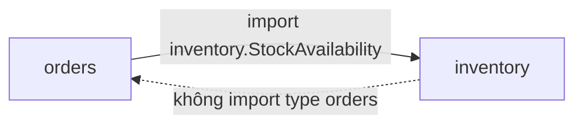
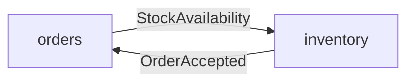

# Quality gate cho dependency cycle

## 1. Hợp đồng CI: không cho vòng phụ thuộc module lọt vào nhánh chính

Giả sử module `orders` gọi `inventory` để kiểm tra còn hàng. Một developer thêm listener trong `inventory` nhận trực tiếp Java event của `orders`. Dự án vẫn **biên dịch** được, và các unit test có thể xanh, nhưng dependency graph đã thành:

```text
orders ──────> inventory
   ^              │
   └──────────────┘
```

Đây là **dependency cycle giữa application modules**. Nó làm mất chiều phụ thuộc rõ ràng: muốn thay hoặc tách `inventory` phải quan tâm lại `orders`, và muốn thay `orders` cũng bị ràng buộc theo chiều ngược. Nếu hai module còn inject bean của nhau, đôi khi xuất hiện vòng khởi tạo Spring context; nhưng **compile-time cycle** đã là vi phạm kiến trúc ngay cả khi chưa có lỗi tạo bean.

Trong chương **CI và quality gate** của `SPRING_MODULITH_VERIFICATION_TESTING`, yêu cầu là biến quy tắc **“application modules không được tạo dependency cycle”** thành phép kiểm tự động, chạy trên mọi pull request và ngăn merge khi vi phạm. Bài này tập trung vào:

- Định nghĩa đúng node/edge của dependency graph ở cấp **Spring Modulith module**, không nhầm với Gradle dependency graph hay Spring bean graph.
- Viết một JUnit test dùng `ApplicationModules.of(...).verify()`, không khởi động Spring context nặng.
- Tạo thử một cycle **có thể compile** và kiểm tra rằng test phải đỏ.
- Chọn cách phá vòng phụ thuộc đúng semantics, thay vì thêm một exception vào rule.
- Thiết lập task Gradle, workflow CI, required check và bằng chứng test thực sự chạy.

**Hợp đồng gate:** cycle xuất hiện → kiểm chứng kiến trúc FAIL → CI required check FAIL → không được merge. Đổi tên test, tắt test hoặc không chọn được test cũng **không được coi là PASS**.

### Acceptance criteria

| ID | Điều kiện | Kết quả cần quan sát |
| --- | --- | --- |
| `CYCLE-01` | `orders → inventory`, không có chiều ngược | `ApplicationModules.verify()` PASS |
| `CYCLE-02` | Thêm `inventory → orders` qua một type public | `ApplicationModules.verify()` FAIL |
| `CYCLE-03` | Refactor phá một chiều dependency | Gate trở lại PASS |
| `CI-01` | Test bị đổi tên/không được chọn | Task Gradle FAIL, không âm thầm 0 tests |
| `CI-02` | Test bị `@Disabled` | CI evidence step FAIL |
| `CI-03` | Cycle test fail | Required status check đỏ, PR bị chặn |

**Phạm vi kết luận:** PASS xác nhận các ràng buộc kiến trúc mà Spring Modulith nhận diện ở source/classpath được kiểm. Nó **không** xác nhận mọi tính toán, database transaction hay external event delivery đã đúng; các hợp đồng đó có test riêng.

## 2. Vẽ graph đúng: dependency module không phải chỉ là constructor injection

Một **node** trong graph là một application module mà Spring Modulith nhận diện, thông thường từ package con trực tiếp dưới root application. Một **edge `A → B`** tồn tại khi code của A sử dụng type/API được định nghĩa trong B theo các quan hệ phụ thuộc mà bộ phân tích kiến trúc ghi nhận.

Ví dụ:

```text
com.example.shop
├── ShopApplication
├── orders                   [module orders]
│   ├── OrderAcceptanceService
│   ├── OrderAccepted
│   └── package-info.java
└── inventory                [module inventory]
    ├── StockAvailability
    └── internal
        └── InMemoryStockAvailability
```

Hướng hợp lệ ban đầu:



Vòng phụ thuộc có thể hình thành qua nhiều loại tham chiếu Java:

| Tham chiếu trong module A | Có thể tạo edge A → B? | Nhận xét |
| --- | --- | --- |
| Constructor parameter là public interface B | Có | Dù Bean B chưa được khởi tạo |
| Method parameter/return type thuộc B | Có | Không cần Spring DI |
| Class field/annotation dùng type của B | Có thể | Tùy quan hệ mà bộ phân tích nhận diện |
| Listener nhận Java event class của B | Có | Import type event tạo ràng buộc ở source |
| `new B.SomeType(...)` | Có | Phụ thuộc type/class trực tiếp |
| Chỉ truyền `String orderId` | Không tự tạo edge đến module chứa `Order` | Primitive/value tự thân không tham chiếu type module |
| HTTP URL đến service ngoài JVM | Không phải static Java module edge | Cần integration contract khác |
| Gradle project dependency | Không đồng nhất với application-module edge | Một project Gradle có thể chứa nhiều module |
| Bean cycle trong Spring `ApplicationContext` | Khái niệm khác | Có thể gặp mà không phải cycle theo module model, và ngược lại |

**Quan trọng:** một cycle không đòi hai service phải gọi nhau trong runtime. Chỉ cần `inventory` tham chiếu type `orders`, trong khi `orders` đã dùng `inventory`, là mô hình dependency đã có chiều ngược.

Một cycle dài hơn cũng không hợp lệ: `orders → inventory → catalog → orders`. Không giới hạn kiểm tra ở các cặp module trực tiếp; cycle là một đường khép kín trong toàn graph.

`@ApplicationModule(allowedDependencies = "inventory")` cho `orders` chỉ giới hạn **đích mà orders được phụ thuộc**. Nó **không biến cycle thành hợp lệ**. Ngay cả khi mỗi edge riêng lẻ được liệt kê như “được phép”, graph có vòng vẫn trái nguyên tắc acyclic.

## 3. Dựng ví dụ Java hợp lệ: chỉ một chiều `orders → inventory`

Ví dụ dùng Java 17+, Spring Boot và Spring Modulith tương thích. Các file dưới đây là **mẫu trong bài học**, không phải thay đổi thêm vào repository của nhiệm vụ hiện tại.

Ứng dụng gốc:

```java
// src/main/java/com/example/shop/ShopApplication.java
package com.example.shop;

import org.springframework.boot.SpringApplication;
import org.springframework.boot.autoconfigure.SpringBootApplication;

@SpringBootApplication
public class ShopApplication {
    public static void main(String[] args) {
        SpringApplication.run(ShopApplication.class, args);
    }
}
```

API công khai của module `inventory`:

```java
// src/main/java/com/example/shop/inventory/StockAvailability.java
package com.example.shop.inventory;

public interface StockAvailability {
    boolean available(String sku);
}
```

Implementation thuộc `inventory.internal`:

```java
// src/main/java/com/example/shop/inventory/internal/
// InMemoryStockAvailability.java
package com.example.shop.inventory.internal;

import com.example.shop.inventory.StockAvailability;
import java.util.Set;
import org.springframework.stereotype.Service;

@Service
class InMemoryStockAvailability implements StockAvailability {

    private final Set<String> availableSkus =
        Set.of("SKU-1", "SKU-2");

    @Override
    public boolean available(String sku) {
        return sku != null
            && availableSkus.contains(sku);
    }
}
```

Public domain event của `orders`:

```java
// src/main/java/com/example/shop/orders/OrderAccepted.java
package com.example.shop.orders;

public record OrderAccepted(String orderId, String sku) {
}
```

Service `orders` chỉ import API của `inventory`:

```java
// src/main/java/com/example/shop/orders/
// OrderAcceptanceService.java
package com.example.shop.orders;

import com.example.shop.inventory.StockAvailability;
import org.springframework.context.ApplicationEventPublisher;
import org.springframework.stereotype.Service;

@Service
public class OrderAcceptanceService {

    private final StockAvailability inventory;
    private final ApplicationEventPublisher events;

    public OrderAcceptanceService(
            StockAvailability inventory,
            ApplicationEventPublisher events) {
        this.inventory = inventory;
        this.events = events;
    }

    public boolean accept(String orderId, String sku) {
        if (orderId == null || orderId.isBlank()
                || sku == null || sku.isBlank()) {
            throw new IllegalArgumentException(
                "Invalid order identity or SKU");
        }

        if (!inventory.available(sku)) {
            return false;
        }

        events.publishEvent(new OrderAccepted(orderId, sku));
        return true;
    }
}
```

Khai báo module caller chỉ được phụ thuộc `inventory`:

```java
// src/main/java/com/example/shop/orders/package-info.java
@org.springframework.modulith.ApplicationModule(
    allowedDependencies = "inventory"
)
package com.example.shop.orders;
```

**Graph hiện tại:**

```text
orders ── StockAvailability ──> inventory
inventory ── implementation nội bộ ──> (không có orders)
```

Điều service mẫu hứa: SKU hợp lệ và còn hàng thì phát `OrderAccepted` trong Spring context; SKU hết hàng thì trả `false`, không phát event. Đây **không phải hệ thống đặt hàng production hoàn chỉnh**: chưa có transaction, stock reservation atomic, database commit, idempotency hay broker. Bài đang kiểm **cycle của package/module dependency graph**, không kiểm những cam kết runtime đó.

### Cảnh báo về `internal`

`InMemoryStockAvailability` không trở thành public module API vì có annotation `@Service`. Nó là một implementation package-private nằm dưới `inventory.internal`. `orders` chỉ import `inventory.StockAvailability`, đúng ranh giới module.

## 4. JUnit quality gate: `ApplicationModules.verify()` thuần kiến trúc

Viết một test class ở package root, **không** gắn `@SpringBootTest` hoặc `@ApplicationModuleTest`.

```java
// src/test/java/com/example/shop/ModuleCycleTest.java
package com.example.shop;

import org.junit.jupiter.api.Test;
import org.springframework.modulith.core.ApplicationModules;

class ModuleCycleTest {

    @Test
    void applicationModulesMustRemainAcyclic() {
        ApplicationModules.of(ShopApplication.class).verify();
    }
}
```

`verify()` là phép kiểm kiến trúc mà Spring Modulith cung cấp. Nó kiểm tra graph và các quy tắc ranh giới phụ thuộc, trong đó có **dependency cycles** theo mô hình mà thư viện nhận diện. Ngoài cycle, phép kiểm có thể đỏ do vi phạm public/internal hoặc `allowedDependencies`—đó đều là lỗi kiến trúc cần sửa, không phải lý do bỏ test.

Để đảm bảo kết luận “cycle” là đúng khi test fail, đọc chi tiết các dependency được báo cáo thay vì suy từ một dòng `AssertionError` chung.

### Vì sao không khởi động Spring context?

```java
// KHÔNG CẦN cho gate kiến trúc này:
@SpringBootTest
class ModuleCycleTest {
    // ...
}
```

Test thật phía trên chỉ cần mô hình class/package và JUnit runner. Không khởi tạo DataSource, Kafka, web server hay producer bean. Điều này làm gate dễ đặt ở **lane sớm, nhanh** của CI.

### Một module behavior test riêng nếu cần

Ở module `orders`, kiểm hành vi bằng `@ApplicationModuleTest`, mock đúng collaborator **ngoài module**:

```java
// src/test/java/com/example/shop/orders/
// OrderAcceptanceModuleTest.java
package com.example.shop.orders;

import com.example.shop.inventory.StockAvailability;
import org.junit.jupiter.api.Test;
import org.springframework.beans.factory.annotation.Autowired;
import org.springframework.modulith.test.ApplicationModuleTest;
import org.springframework.modulith.test.PublishedEvents;
import org.springframework.test.context.bean.override.mockito.MockitoBean;

import static org.assertj.core.api.Assertions.assertThat;
import static org.mockito.BDDMockito.given;

@ApplicationModuleTest
class OrderAcceptanceModuleTest {

    @Autowired
    OrderAcceptanceService orders;

    @MockitoBean
    StockAvailability inventory;

    @Test
    void acceptedOrderPublishesEvent(PublishedEvents events) {
        given(inventory.available("SKU-1")).willReturn(true);

        assertThat(orders.accept("ORD-1", "SKU-1")).isTrue();

        assertThat(events.ofType(OrderAccepted.class))
            .singleElement()
            .satisfies(event -> {
                assertThat(event.orderId()).isEqualTo("ORD-1");
                assertThat(event.sku()).isEqualTo("SKU-1");
            });
    }

    @Test
    void unavailableSkuDoesNotPublish(PublishedEvents events) {
        given(inventory.available("SKU-X")).willReturn(false);

        assertThat(orders.accept("ORD-2", "SKU-X"))
            .isFalse();

        assertThat(events.ofType(OrderAccepted.class))
            .isEmpty();
    }
}
```

`@MockitoBean` yêu cầu Spring Framework 6.2+ với Spring Boot/Spring Modulith tương thích; trên stack cũ có thể cần `@MockBean`. **Test module behavior không thay `ModuleCycleTest`**: Mockito có thể làm caller hoạt động dù graph còn cycle ở class khác. Ngược lại, graph không có cycle cũng chưa chứng minh sự kiện có payload đúng.

## 5. Negative drill: cố tình tạo cycle dù Java vẫn compile

Để xác minh gate có “răng”, hãy thực hiện trên **nhánh tạm không merge**. Giữ code `orders → inventory` như ở phần 3, rồi thêm class sau vào `src/main/java`:

```java
// PHẢN VÍ DỤ — CHỈ THÊM TRÊN NHÁNH THỬ NGHIỆM.
// src/main/java/com/example/shop/inventory/internal/
// BadOrderDependency.java
package com.example.shop.inventory.internal;

import com.example.shop.orders.OrderAccepted;

final class BadOrderDependency {

    boolean shouldAudit(OrderAccepted event) {
        return event != null
            && !event.orderId().isBlank();
    }
}
```

Về Java, class này dùng một `public record` có thể truy cập được. Nó không inject bean và không cần được Spring khởi tạo. Nhưng nó tạo **static dependency từ `inventory` sang `orders`**, trong khi `orders` đã import `inventory.StockAvailability`.



Hãy chạy **trong project demo đã thêm code mẫu**:

```bash
# Test trực tiếp, khi chưa có task Gradle riêng.
./gradlew --no-daemon test \
  --tests com.example.shop.ModuleCycleTest
```

Kết quả cần ghi lại:

1. **Java compile thành công** với ví dụ vì import hợp lệ theo Java.
2. JUnit `ModuleCycleTest` chạy thật, không skipped.
3. `ApplicationModules.verify()` **FAIL** với đường phụ thuộc khép kín `orders ↔ inventory`.
4. Gradle task test trả exit code khác 0.
5. Xóa/revert `BadOrderDependency` → chạy lại → PASS.

Không thay `ApplicationModules.of(ShopApplication.class)` thành một root package hẹp hơn để “sửa” lỗi; không thêm `@Disabled`, không dùng `-x test` hoặc loại class khỏi test selection.

### Vì sao đây là một negative test kiến trúc tốt?

- **Không dựa vào Spring bean wiring:** vẫn kiểm được cycle dù runtime chưa gặp lỗi.
- **Không lẫn lỗi compile:** code hợp lệ ở cấp Java.
- **Không lẫn sai dependency allowlist:** dù `orders` được phép phụ thuộc `inventory`, chiều ngược tạo vòng.
- **Có hướng trở về PASS:** revert class tham chiếu `OrderAccepted`.
- **Có thể chạy trước mọi Testcontainers/database integration.**

### Nếu fail vì lý do khác?

Bản demo phải được bắt đầu từ trạng thái `ModuleCycleTest` PASS. Nếu ngay từ đầu đã fail do một cycle khác, hãy xử lý graph nền trước rồi mới kết luận mutation này chứng minh điều gì. Không đọc mỗi tên class trong stack trace rồi gắn nhãn “cycle” nếu `verify()` thực tế báo internal API violation.

## 6. Phá cycle đúng nghĩa: chọn một chiều phụ thuộc, không che rule

Đừng giải quyết vòng phụ thuộc bằng cách đổi cả hai chiều thành “allowed”. **Acyclic** là tính chất của graph, khác với việc từng edge có được liệt kê trong `allowedDependencies` hay không.

Có hai chiến lược có ý nghĩa nghiệp vụ khác nhau.

### Phương án A — Giữ gọi đồng bộ `orders → inventory`

Nếu business yêu cầu `orders` **phải kiểm tra kho ngay** trước khi chấp nhận đơn, giữ `StockAvailability` trong module `inventory`. Loại bỏ việc `inventory` import `orders.OrderAccepted` và truyền dữ liệu cần thiết qua API của chính `inventory`, nếu nghiệp vụ thật sự đòi thao tác thêm.

Ví dụ mở rộng API inventory:

```java
// src/main/java/com/example/shop/inventory/StockReservations.java
package com.example.shop.inventory;

public interface StockReservations {

    /**
     * Lệnh nghiệp vụ: reserve theo orderId và SKU.
     * Có thể cần idempotency/transaction riêng trong production.
     */
    boolean reserve(String orderId, String sku);
}
```

`orders` gọi `StockReservations.reserve(...)`; implementation `inventory.internal` xử lý nghiệp vụ dựa trên `String orderId`, **không import Java type thuộc `orders`**. Graph vẫn một chiều `orders → inventory`.

**Trade-off:** gọi đồng bộ tạo coupling về thời gian/khả dụng, nhưng có thể là yêu cầu nghiệp vụ hợp lệ. Nếu reserve có side effect, cần contract về idempotency, concurrency, transaction; architecture gate không tự kiểm chúng.

### Phương án B — Nếu inventory thực sự phải phản ứng với event của orders

Nếu `inventory` được thiết kế thành consumer của `OrderRequested`, có thể chọn chiều ngược: **`inventory → orders`** ở compile time, còn `orders` không import inventory type. Khi đó `orders` công bố sự kiện thuộc API mình:

```java
// src/main/java/com/example/shop/orders/OrderRequested.java
package com.example.shop.orders;

public record OrderRequested(
    String orderId, String sku) {
}
```

```java
// src/main/java/com/example/shop/orders/OrderRequestService.java
package com.example.shop.orders;

import org.springframework.context.ApplicationEventPublisher;
import org.springframework.stereotype.Service;

@Service
public class OrderRequestService {

    private final ApplicationEventPublisher events;

    public OrderRequestService(ApplicationEventPublisher events) {
        this.events = events;
    }

    public void request(String orderId, String sku) {
        if (orderId == null || orderId.isBlank()
                || sku == null || sku.isBlank()) {
            throw new IllegalArgumentException();
        }
        events.publishEvent(new OrderRequested(orderId, sku));
    }
}
```

`inventory` lắng nghe Java event công khai đó:

```java
// src/main/java/com/example/shop/inventory/internal/
// OrderRequestListener.java
package com.example.shop.inventory.internal;

import com.example.shop.orders.OrderRequested;
import org.springframework.context.event.EventListener;
import org.springframework.stereotype.Component;

@Component
class OrderRequestListener {

    @EventListener
    void on(OrderRequested event) {
        // Delegate tới inventory policy/port nội bộ.
        // Không import OrderAcceptanceService để gọi ngược.
    }
}
```

**Muốn graph thật sự đảo chiều, phải loại bỏ cả `OrderAcceptanceService → StockAvailability` của phương án A**, không giữ hai phiên bản service đồng thời rồi nghĩ rằng event tự động phá cycle. Trong thiết kế B, `orders` không còn import API inventory; `inventory` import event type `orders.OrderRequested` và graph có một chiều `inventory → orders`. Metadata `orders/package-info.java` cũng nên bỏ quyền phụ thuộc inventory không còn cần thiết để tránh nới khả năng phụ thuộc trong tương lai.

**Trade-off quan trọng:** `OrderRequestService.request(...)` chỉ công bố một yêu cầu, **không xác nhận kho đã reserve xong**. `@EventListener` minh họa xử lý trong JVM; nếu cần hậu commit, bất đồng bộ, độ bền hoặc retry, hãy chọn `@ApplicationModuleListener`/transactional event publication phù hợp phiên bản và test transaction/recovery riêng. Không thay gọi đồng bộ bằng event rồi ngầm giữ cam kết “stock đã được xác nhận trước khi trả response”.

### Khi nào cần module điều phối thứ ba?

Nếu `orders` và `inventory` **đều cần phối hợp nhưng không nên import ngược nhau**, có thể đưa orchestration vào một module `checkout` ở tầng cao:

```text
        checkout
        /      \
       v        v
    orders   inventory
```

`checkout` phụ thuộc API công khai của cả hai; `orders` và `inventory` không phụ thuộc lẫn nhau. Cách này phù hợp khi workflow thực sự có owner mới, nhưng không nên tạo module thứ ba chỉ để giấu cycle: phải xác định transaction boundary, state transitions và ownership của orchestration.

### Quy tắc chọn

**Giữ một chiều rõ ràng rồi chạy lại `ApplicationModules.verify()`.** Nếu business semantics buộc cả hai chiều phải giao tiếp, hãy đổi cách phân phối trách nhiệm, không sửa test để cho phép vòng.

## 7. Gradle task riêng: cycle gate chạy nhanh và fail nếu 0 test

Quality gate sẽ khó duy trì nếu người dùng phải chạy cả DB/Kafka suite dài chỉ để phát hiện cycle. Trong một Gradle project **Groovy DSL** dùng Java plugin/Spring Boot, tạo task riêng chọn chính xác `ModuleCycleTest`:

```groovy
// build.gradle — thêm vào project chứa ShopApplication.

tasks.register('moduleCycleTest', Test) {
    group = 'verification'
    description =
        'Fail the build on Spring Modulith dependency cycles'

    dependsOn tasks.named('testClasses')

    testClassesDirs = sourceSets.test.output.classesDirs
    classpath = sourceSets.test.runtimeClasspath

    useJUnitPlatform()

    filter {
        includeTestsMatching(
            'com.example.shop.ModuleCycleTest')
        failOnNoMatchingTests = true
    }

    reports {
        junitXml.required = true
        html.required = true
    }
}

tasks.named('check') {
    dependsOn tasks.named('moduleCycleTest')
}
```

Chạy trong project demo:

```bash
./gradlew --no-daemon moduleCycleTest
```

Khi test đã được chọn đúng, Gradle sẽ chạy `ApplicationModules.of(...).verify()` mà **không** bootstrap toàn bộ application context. Task vẫn cần biên dịch test và chuẩn bị classpath, nhưng không khởi động Testcontainers/Kafka chỉ để phân tích graph.

### Phân biệt các trạng thái Gradle

| Task outcome | Có chấp nhận? | Lý do |
| --- | --- | --- |
| `SUCCESS`, report có test executed và không skipped | Có | Có bằng chứng verify chạy |
| `FAILED` do cycle | Không | Chính sách gate hoạt động đúng |
| `FAILED` do filter không match | Không | `failOnNoMatchingTests=true` chặn “0 tests” |
| `SKIPPED` do `enabled=false` hoặc `onlyIf` | Không | Verify không chạy |
| Report chỉ có `skipped=1` vì `@Disabled` | Không | Task có thể xanh dù phép kiểm bị vô hiệu |
| `UP-TO-DATE`/`FROM-CACHE` | Có điều kiện | Chỉ chấp nhận nếu cache inputs/results hợp lệ và report/evidence được cung cấp |
| `FAILED` do compile/dependency | Không | Chặn merge, phân loại nguyên nhân chứ không gắn nhãn cycle |

**Không trộn cycle verification và module test có Spring context vào cùng một class**. Điều này giữ gate kiến trúc nhanh, dễ phân loại lỗi và dễ đưa vào CI trước test tích hợp nặng.

### Có nên cấu hình test suite mặc định chạy lại `ModuleCycleTest`?

Có thể để `test` mặc định chạy class này nữa; chi phí thường nhỏ. Nếu tổ chức quyết định chỉ chạy qua `moduleCycleTest`, phải đảm bảo workflow và `check` luôn phụ thuộc task ấy, đồng thời có required check độc lập. Không loại test khỏi mọi lane để giảm vài giây.

## 8. GitHub Actions required gate: không để cycle bị bỏ qua

Ví dụ workflow với hai job, architecture chạy trước, module/integration chạy sau. Dùng một required job tên **Dependency cycle gate** để bảo vệ pull request.

```yaml
# Ví dụ: .github/workflows/modulith-cycles.yml
name: Modulith dependency cycle gate

on:
  pull_request:
  push:
    branches: [main]

permissions:
  contents: read

jobs:
  dependency-cycle:
    name: Dependency cycle gate
    runs-on: ubuntu-latest
    timeout-minutes: 15

    steps:
      - uses: actions/checkout@v4

      - uses: actions/setup-java@v4
        with:
          distribution: temurin
          java-version: '21'

      - uses: gradle/actions/setup-gradle@v4

      - name: Verify module graph
        run: >
          ./gradlew --no-daemon --console=plain
          moduleCycleTest

      - name: Assert a cycle test really executed
        shell: bash
        run: |
          report="build/test-results/moduleCycleTest/TEST-com.example.shop.ModuleCycleTest.xml"
          test -s "$report"
          grep -Eq 'tests="[1-9][0-9]*"' "$report"
          grep -q 'skipped="0"' "$report"

      - name: Publish failure evidence
        if: ${{ always() }}
        uses: actions/upload-artifact@v4
        with:
          name: modulith-cycle-test-report
          path: |
            build/test-results/moduleCycleTest/
            build/reports/tests/moduleCycleTest/
          if-no-files-found: warn
          retention-days: 7

  module-tests:
    name: Modulith behavior tests
    needs: dependency-cycle
    runs-on: ubuntu-latest
    timeout-minutes: 40

    steps:
      - uses: actions/checkout@v4

      - uses: actions/setup-java@v4
        with:
          distribution: temurin
          java-version: '21'

      - uses: gradle/actions/setup-gradle@v4

      - name: Run JUnit/module tests
        run: ./gradlew --no-daemon --console=plain test
```

### Tại sao job này là một gate thực sự?

1. `moduleCycleTest` chạy trước lane nặng. Cycle fail → job fail → `module-tests` với `needs` không chạy trong workflow ví dụ.
2. Không đặt `continue-on-error: true` cho test architecture.
3. Gradle filter bắt buộc tìm thấy `ModuleCycleTest`.
4. Bước evidence yêu cầu JUnit XML hiện diện, `tests>0`, `skipped=0` để bắt trường hợp test bị disable.
5. XML/HTML report được upload cả khi Gradle step fail.
6. Không có `paths:` filter làm các thay đổi ở `package-info.java`, build scripts hoặc source module vô tình không kích hoạt gate.
7. `actions/checkout@v4`, `setup-java@v4` và `setup-gradle@v4` là ví dụ; tổ chức có thể pin full commit SHA theo chính sách supply-chain.

**Giới hạn của bước grep:** nó phù hợp report JUnit XML **một class** trong demo và cấu trúc report Gradle thông dụng. Với nhiều class/method hoặc report khác, dùng XML parser đáng tin để cộng các chỉ số thay vì grep; bảo đảm `failures/errors=0` nếu bước này được tách khỏi Gradle failure handling. Bản workflow này dựa vào exit code của Gradle để fail khi JUnit test thất bại.

### Còn một bước ngoài YAML: branch protection

Repository owner phải đánh dấu check **Dependency cycle gate** là **required status check** trong branch ruleset/protection cho nhánh cần bảo vệ. Chỉ có workflow YAML mà không có required check thì PR có thể vẫn được merge khi test đỏ, tùy quyền và chính sách repository.

Không đặt điều kiện `if: false`, `@Disabled` hay `-x moduleCycleTest` để “sửa” build. Nếu cần test performance, đo riêng compilation và verification; không hạ mức kiến trúc.

## 9. Kiểm chứng chất lượng của chính gate bằng phép thử có kiểm soát

Trước khi coi CI đã bảo vệ dependency cycle, chạy các **negative drills** trên pull request thử nghiệm rồi revert. Không sửa file thật của nhiệm vụ này để chạy thí nghiệm; đây là hướng dẫn thực hành cho project demo.

| Thí nghiệm | Thay đổi có chủ đích | Bằng chứng bắt buộc |
| --- | --- | --- |
| **Green baseline** | Không có vòng `orders ↔ inventory` | `ModuleCycleTest` PASS, report có test chạy |
| **Direct cycle** | Thêm `BadOrderDependency` ở phần 5 | Compile PASS, `verify()` FAIL, required check đỏ |
| **Cycle dài** | Thêm cạnh tạo `orders → inventory → catalog → orders` trong demo ba module | `verify()` FAIL, xác định được đường vòng |
| **Refactor hợp lệ** | Bỏ import ngược; giữ một chiều | `verify()` PASS trở lại |
| **Test renamed** | Đổi `ModuleCycleTest` mà không đổi filter | Gradle FAIL do không match |
| **Test disabled** | Thêm `@Disabled` vào test `applicationModulesMustRemainAcyclic` | XML có skipped, evidence step FAIL |
| **Task disabled** | Tạm đặt `enabled=false` cho `moduleCycleTest` | Không có bằng chứng thực thi; CI FAIL |
| **Behavior thay đổi nhưng graph không đổi** | Ví dụ `accept(...)` trả sai boolean | Cycle gate có thể PASS; behavior test phải bắt |
| **Infrastructure chậm** | DB/Kafka integration kéo dài | Gate cycle vẫn chạy riêng; không skip vì chậm |

### Khi bị báo cycle, đọc lỗi theo trình tự nào?

1. Kiểm tra **có đúng test `ModuleCycleTest` chạy** hay không.
2. Đọc phần failure báo các application modules tham gia cycle; ghi lại đường vòng.
3. Với mỗi edge, xác định **type/import/method/annotation** nào tạo phụ thuộc.
4. Phân biệt **cycle thật** với lỗi public/internal/allowed dependency khác trong `verify()`.
5. Xác định owner của trách nhiệm bị đặt sai. Module nào cần API, module nào chỉ nên phản ứng một sự kiện?
6. Chọn giữ một chiều phụ thuộc, đảo chiều theo semantics hoặc tách orchestration.
7. Chạy lại architecture gate; sau đó chạy `@ApplicationModuleTest`/integration tests có liên quan để chứng minh **hành vi không bị phá khi refactor**.

### Những phản ứng sai khi gate đỏ

- **“Tăng retry 3 lần.”** Static cycle không tự biến mất khi chạy lại cùng source.
- **“Chạy `-x test` cho nhanh.”** Build thành công không chứng minh đã kiểm kiến trúc.
- **“Đổi `allowedDependencies` để cho phép cả hai chiều.”** Không loại bỏ vòng.
- **“Chuyển class sang package khác để verifier không nhìn thấy.”** Có thể che vấn đề và làm hỏng ownership; chỉ chuyển khi package/module thật sự đúng.
- **“Mock bean ở `@ApplicationModuleTest` là xong.”** Mock có thể giải quyết context/wiring của behavior test nhưng không xóa compile-time edge.
- **“Chuyển mọi lời gọi thành event.”** Nếu producer vẫn import consumer type, hoặc consumer dùng event rồi producer tiếp tục gọi trực tiếp consumer, graph vẫn cycle.

## 10. Checklist, bài tập và Definition of Done

### Checklist cho pull request có thay đổi dependency

- [ ] Xác định module owner và dependency graph trước/sau refactor.
- [ ] Không chỉ kiểm Java compile; có `ApplicationModules.verify()`.
- [ ] Kiểm tra cả cycle hai module và đường vòng nhiều module.
- [ ] `orders` chỉ import API công khai `inventory` khi chọn chiều đồng bộ.
- [ ] Không dùng `catalog.internal`/`inventory.internal` như API xuyên module.
- [ ] `allowedDependencies` không được dùng làm “ngoại lệ cho cycle”.
- [ ] Có JUnit `ModuleCycleTest` không bootstrap Spring context không cần thiết.
- [ ] Gradle `moduleCycleTest` chọn đúng class và `failOnNoMatchingTests=true`.
- [ ] `check` không bỏ `moduleCycleTest`; CI không dùng `-x` hoặc `enabled=false`.
- [ ] JUnit report tồn tại, số test > 0 và skipped = 0.
- [ ] GitHub required check **Dependency cycle gate** được bật cho nhánh bảo vệ.
- [ ] Đã thử cố tình tạo cycle, quan sát gate đỏ và revert.
- [ ] Sau phá cycle, chạy module behavior/event tests để đảm bảo nghiệp vụ vẫn đúng.
- [ ] Nếu đổi synchronous sang asynchronous, transaction/eventual consistency được review.
- [ ] Gate architecture không bị chuyển thành nightly-only chỉ vì integration suite chậm.
- [ ] Có owner xử lý khi CI phát hiện vi phạm dependency graph.

### Bài tập A — Xác định chiều gây cycle

Cho graph:

```text
checkout  → orders
checkout  → inventory
inventory → catalog
catalog   → orders
```

**Câu hỏi:** có cycle không?  
**Đáp:** **Không**, vì `orders` không có cạnh dẫn ngược về `checkout`, `inventory` hay `catalog`; các nhánh cùng đổ về `orders` vẫn là DAG nếu không có thêm cạnh. Một node có nhiều incoming dependencies không tự thành cycle.

Thêm `orders → inventory` thì sao?  
**Đáp:** có vòng `orders → inventory → catalog → orders`. `ApplicationModules.verify()` phải fail khi các edges đó xuất hiện trong mô hình được kiểm.

### Bài tập B — Review một patch “tối ưu”

```groovy
// PHẢN VÍ DỤ
tasks.named('moduleCycleTest') {
    enabled = false
}
```

**Câu hỏi:** vì sao `./gradlew check` có thể xanh nhưng không an toàn?  
**Đáp:** task bị vô hiệu hóa; dependency graph của Gradle vẫn có thể chứa task nhưng verification không chạy. Cần xóa cấu hình này, giữ required CI check và xác nhận JUnit evidence.

### Bài tập C — Sửa một thiết kế event tạo vòng

`orders` gọi `inventory.StockAvailability` rồi `inventory` lắng nghe `orders.OrderAccepted`. Hãy chọn và giải thích:

- Giữ gọi đồng bộ và bỏ import event ngược ở `inventory`.
- Bỏ gọi đồng bộ, dùng event từ `orders` để `inventory` phản ứng rồi thiết kế workflow eventual consistency.
- Đưa orchestration lên module thứ ba nếu đây là trách nhiệm nghiệp vụ hợp lệ.

**Yêu cầu chấm:** graph sau sửa phải acyclic; `ModuleCycleTest` PASS; test hành vi chứng minh user-visible semantics theo phương án đã chọn. Chỉ làm JUnit xanh bằng cách tắt verifier không được coi là hoàn thành.

### Definition of Done

Một quality gate cho dependency cycle được chấp nhận khi:

1. **Có graph và rule rõ ràng:** tất cả application modules liên quan nằm trong phạm vi verification.
2. **Có bài kiểm tự động:** `ApplicationModules.of(ShopApplication.class).verify()` chạy trong JUnit.
3. **Có negative proof:** import ngược tạo vòng khiến test và required CI check FAIL.
4. **Không có silent skip:** test rename/`@Disabled`/task disabled đều bị phát hiện.
5. **Có cách sửa đúng kiến trúc:** loại bỏ một chiều phụ thuộc nhưng vẫn kiểm tra lại behavior.
6. **CI chạy sớm và bắt buộc:** không chờ đến khi integration suite nặng kết thúc mới biết graph sai.

**Ghi nhớ:** dependency cycle là **lỗi kiến trúc**, không phải lỗi có thể chữa bằng mock, retry hay bỏ test. Với Spring Modulith, `ApplicationModules.verify()` làm gate ở cấp module graph; `@ApplicationModuleTest` bảo vệ hành vi sau refactor; Gradle/GitHub Actions bảo đảm phép kiểm thực sự chạy và chặn merge. Một quality gate tốt phải **đỏ khi graph có vòng, xanh khi vòng bị loại bỏ, và không thể xanh giả chỉ vì test bị bỏ qua**.
