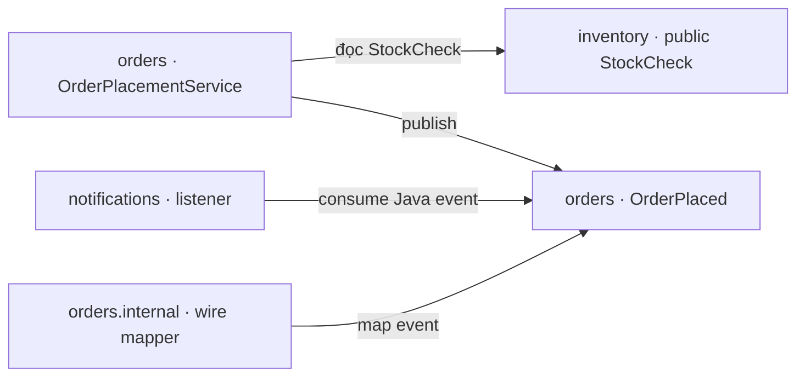

# Quality gate cho test module và event contract

## 1. Định nghĩa gate bằng bằng chứng, không bằng trạng thái “BUILD SUCCESSFUL”

Trong ứng dụng Spring Modulith, nhóm `orders` chỉnh lại xử lý đơn hàng; PR compile thành công và `ApplicationModules.verify()` không báo vi phạm. Tuy vậy, một refactor có thể làm `OrderPlaced` thiếu `sku`, phát hai lần khi gọi một lệnh, hoặc làm listener xử lý sự kiện **trước khi transaction nguồn commit**. Kiến trúc module vẫn hợp lệ nhưng **hợp đồng hành vi và sự kiện đã sai**.

Một quality gate cho **module test và event contract** phải bảo vệ các lời hứa có thể quan sát:

- Module mục tiêu khởi động được với các collaborator đúng phạm vi, không tùy tiện nạp toàn ứng dụng.
- Thành công và thất bại tạo **kết quả và sự kiện khác nhau** theo contract.
- Event được công bố với đúng identity, field, quantity và không chứa trạng thái thành công giả.
- Listener hậu commit chỉ xử lý khi transaction đã commit; rollback không phát tác động tương ứng.
- Nếu sự kiện được externalize, schema/type/version và key trên wire được kiểm tra riêng.
- CI **thực sự chạy các test bắt buộc**, không âm thầm pass khi filter không match, test bị `@Disabled` hoặc bị exclude.

Bài thuộc chương **CI và quality gate** của `SPRING_MODULITH_VERIFICATION_TESTING`: học phần rèn kỹ năng kiểm chứng ranh giới kiến trúc với `ApplicationModules`, thực hành `@ApplicationModuleTest`, kiểm thử sự kiện, database và tích hợp, rồi đưa bằng chứng thành gate ngăn hồi quy. Ở đây, trọng tâm là **lựa chọn đúng các test của module và event, sau đó biến chúng thành required check trong CI**.

### Contract matrix của ví dụ

| ID | Cam kết | Test cần làm đỏ khi sai |
| --- | --- | --- |
| `MOD-01` | `orders` nhận được public API `inventory.StockCheck` qua test double trong `STANDALONE` | `OrdersModuleContractTest` |
| `MOD-02` | SKU còn hàng → trả `true` và phát đúng một `OrderPlaced` với field đúng | `OrdersModuleContractTest` |
| `MOD-03` | SKU hết hàng hoặc input sai → không phát `OrderPlaced` | `OrdersModuleContractTest` |
| `INT-01` | `orders` phối hợp được với implementation `inventory` thật | `OrdersInventoryEventContractTest` |
| `EVT-01` | Listener xử lý `OrderPlaced` **sau commit**, không xử lý event thuộc transaction rollback | `OrderPlacedListenerEventContractTest` |
| `WIRE-01` | Event external V1 giữ literal type/version, identity và payload | `OrderPlacedWireContractTest` |
| `ARCH-01` | Không import internal API, không dependency cycle | `ModuleArchitectureTest` |
| `CI-01` | Mọi test contract bắt buộc được chạy và không bị skip | Gradle filter + kiểm JUnit XML trong CI |

**Ranh giới bằng chứng:** `PublishedEvents` chứng minh domain event được publish trong Spring context; listener test chứng minh xử lý trong JVM theo transaction phase; wire mapper test chứng minh định dạng dự định phát. **Không test nào trong ba loại đó tự chứng minh Kafka đã nhận message.** Khi broker delivery là cam kết, cần producer/broker integration riêng.

## 2. Mẫu sản phẩm nhỏ nhưng có ranh giới module thật

Ví dụ dùng Java 17+, Spring Boot 3.x và Spring Modulith tương thích, với ba application modules `inventory`, `orders` và `notifications`:

```text
src/main/java/com/example/shop/
├── ShopApplication.java
├── inventory/
│   ├── StockCheck.java
│   └── internal/InMemoryStockCheck.java
├── orders/
│   ├── package-info.java
│   ├── OrderPlaced.java
│   ├── OrderPlacementService.java
│   └── internal/OrderPlacedWireMapper.java
└── notifications/
    ├── package-info.java
    ├── NotificationInbox.java
    └── internal/
        ├── InMemoryNotificationInbox.java
        └── OrderPlacedListener.java

src/test/java/com/example/shop/
├── ModuleArchitectureTest.java
├── orders/
│   ├── OrdersModuleContractTest.java
│   ├── OrdersInventoryEventContractTest.java
│   └── OrderPlacedWireContractTest.java
└── notifications/OrderPlacedListenerEventContractTest.java
```



Dependency hợp lệ: `orders → inventory` và `notifications → orders`. `orders` **không** import `notifications`, tránh vòng phụ thuộc.

Application root:

```java
// src/main/java/com/example/shop/ShopApplication.java
package com.example.shop;

import org.springframework.boot.SpringApplication;
import org.springframework.boot.autoconfigure.SpringBootApplication;

@SpringBootApplication
public class ShopApplication {
    public static void main(String[] args) {
        SpringApplication.run(ShopApplication.class, args);
    }
}
```

API module `inventory`:

```java
// src/main/java/com/example/shop/inventory/StockCheck.java
package com.example.shop.inventory;

public interface StockCheck {
    boolean available(String sku, int quantity);
}
```

Implementation thật, thuộc nội bộ `inventory`:

```java
// src/main/java/com/example/shop/inventory/internal/InMemoryStockCheck.java
package com.example.shop.inventory.internal;

import com.example.shop.inventory.StockCheck;
import org.springframework.stereotype.Service;

@Service
class InMemoryStockCheck implements StockCheck {
    @Override
    public boolean available(String sku, int quantity) {
        return "SKU-1".equals(sku)
            && quantity > 0
            && quantity <= 5;
    }
}
```

Domain event của `orders`:

```java
// src/main/java/com/example/shop/orders/OrderPlaced.java
package com.example.shop.orders;

import java.util.UUID;

public record OrderPlaced(
    UUID eventId,
    String orderId,
    String sku,
    int quantity
) {
}
```

Service ở module `orders`:

```java
// src/main/java/com/example/shop/orders/OrderPlacementService.java
package com.example.shop.orders;

import com.example.shop.inventory.StockCheck;
import java.util.UUID;
import org.springframework.context.ApplicationEventPublisher;
import org.springframework.stereotype.Service;
import org.springframework.transaction.annotation.Transactional;

@Service
public class OrderPlacementService {

    private final StockCheck stock;
    private final ApplicationEventPublisher events;

    public OrderPlacementService(
            StockCheck stock,
            ApplicationEventPublisher events) {
        this.stock = stock;
        this.events = events;
    }

    @Transactional
    public boolean place(String orderId, String sku, int quantity) {
        if (orderId == null || orderId.isBlank()
                || sku == null || sku.isBlank()
                || quantity <= 0) {
            throw new IllegalArgumentException(
                "Invalid order command");
        }

        if (!stock.available(sku, quantity)) {
            return false;
        }

        events.publishEvent(new OrderPlaced(
            UUID.randomUUID(), orderId, sku, quantity));
        return true;
    }
}
```

Khai báo dependency:

```java
// src/main/java/com/example/shop/orders/package-info.java
@org.springframework.modulith.ApplicationModule(
    allowedDependencies = "inventory"
)
package com.example.shop.orders;
```

**Giới hạn thiết kế có chủ đích:** service chưa ghi order xuống database và không có idempotency registry. `@Transactional` chỉ minh họa transaction phase khi test cung cấp `PlatformTransactionManager`; **nó chưa chứng minh order được lưu bền**. `UUID.randomUUID()` tạo identity mới cho mỗi lời gọi; production cần lưu identity của **một business transition** để replay không sinh ID khác. Mục tiêu của ví dụ là kiểm contract publication và gate, không phải hoàn thiện checkout workflow.

## 3. Module contract test: chạy service thật, mock đúng port bên ngoài

Một test `@ApplicationModuleTest` ở package `orders` thường bootstrap module mục tiêu với mode `STANDALONE`. Không nạp `inventory.internal.InMemoryStockCheck`; thay public port `StockCheck` bằng `@MockitoBean`. **Không mock `OrderPlacementService`**, vì đó là code cần bảo vệ.

```java
// src/test/java/com/example/shop/orders/OrdersModuleContractTest.java
package com.example.shop.orders;

import com.example.shop.inventory.StockCheck;
import org.junit.jupiter.api.Test;
import org.springframework.beans.factory.annotation.Autowired;
import org.springframework.modulith.test.ApplicationModuleTest;
import org.springframework.modulith.test.PublishedEvents;
import org.springframework.test.context.bean.override.mockito.MockitoBean;

import static org.assertj.core.api.Assertions.assertThat;
import static org.assertj.core.api.Assertions.assertThatThrownBy;
import static org.mockito.BDDMockito.given;
import static org.mockito.Mockito.verifyNoInteractions;

@ApplicationModuleTest
class OrdersModuleContractTest {

    @Autowired
    OrderPlacementService orders;

    @MockitoBean
    StockCheck stock;

    @Test
    void mod02_publishesOneEventWithExactPayload(
            PublishedEvents events) {

        given(stock.available("SKU-1", 2)).willReturn(true);

        assertThat(orders.place("ORD-1", "SKU-1", 2)).isTrue();

        assertThat(events.ofType(OrderPlaced.class))
            .singleElement()
            .satisfies(event -> {
                assertThat(event.eventId()).isNotNull();
                assertThat(event.orderId()).isEqualTo("ORD-1");
                assertThat(event.sku()).isEqualTo("SKU-1");
                assertThat(event.quantity()).isEqualTo(2);
            });
    }

    @Test
    void mod03_doesNotPublishWhenUnavailable(
            PublishedEvents events) {

        given(stock.available("SKU-X", 2)).willReturn(false);

        assertThat(orders.place("ORD-2", "SKU-X", 2))
            .isFalse();

        assertThat(events.ofType(OrderPlaced.class)).isEmpty();
    }

    @Test
    void mod03_invalidInputDoesNotCallInventory(
            PublishedEvents events) {

        assertThatThrownBy(() ->
            orders.place("", "SKU-1", 2))
            .isInstanceOf(IllegalArgumentException.class);

        verifyNoInteractions(stock);
        assertThat(events.ofType(OrderPlaced.class)).isEmpty();
    }
}
```

### Assertions nào là quan trọng?

- `singleElement()` bảo vệ **đúng một event**, không chỉ `isNotEmpty()`.
- Kiểm từng field bảo vệ public event contract; refactor mất `quantity` sẽ làm test fail hoặc không compile.
- Nhánh unavailable và invalid bảo vệ **không phát false-positive success event**.
- `verifyNoInteractions(stock)` chỉ kiểm việc validation phải chạy trước lời gọi port; assertion này có giá trị vì precondition `quantity/orderId` được owner xác định.
- Test mock API ngoài module nên CI không cần boot toàn bộ inventory adapter cho từng module test.

**Cần cấu hình transaction manager:** vì service có `@Transactional`, context phải có một `PlatformTransactionManager`. Bộ dependency test ở mục 8 cung cấp JDBC/H2 để minh họa transaction phase. Với production đã có JPA/DataSource transaction manager, dùng đúng cấu hình thật và đừng tạo thêm manager cạnh tranh. Nếu không cần transaction ở use case thật, có thể bỏ `@Transactional` ở service và kiểm thử transaction ở một test flow khác, nhưng phải cập nhật lời hứa `AFTER_COMMIT` cho phù hợp.

`@MockitoBean` thuộc Spring Framework 6.2+; trên stack cũ có thể cần `@MockBean` của Spring Boot tương ứng. Chọn version nhất quán thay vì trộn annotation từ hai thế hệ.

### Điều module test này không chứng minh

Nó không chứng minh implementation thật của `inventory` có đúng, listener `notifications` được gọi, transaction đã commit dữ liệu SQL hoặc broker đã acknowledge. Đó là lý do cần **tách gate hợp tác và gate event-consumer**, thay vì kéo toàn ứng dụng vào mọi module test.

## 4. Integration module: không chỉ để hai bộ mock tự đồng ý

Khi hai module thuộc cùng modulith, test `DIRECT_DEPENDENCIES` giúp chứng minh `orders` gọi implementation `inventory` thật. Không thêm `@MockitoBean StockCheck` trong test này.

```java
// src/test/java/com/example/shop/orders/
// OrdersInventoryEventContractTest.java
package com.example.shop.orders;

import org.junit.jupiter.api.Test;
import org.springframework.beans.factory.annotation.Autowired;
import org.springframework.modulith.test.ApplicationModuleTest;
import org.springframework.modulith.test.ApplicationModuleTest.BootstrapMode;
import org.springframework.modulith.test.PublishedEvents;

import static org.assertj.core.api.Assertions.assertThat;

@ApplicationModuleTest(
    mode = BootstrapMode.DIRECT_DEPENDENCIES)
class OrdersInventoryEventContractTest {

    @Autowired
    OrderPlacementService orders;

    @Test
    void int01_realStockAcceptsAndPublishes(
            PublishedEvents events) {

        assertThat(orders.place("ORD-IT-1", "SKU-1", 2))
            .isTrue();

        assertThat(events.ofType(OrderPlaced.class))
            .singleElement()
            .satisfies(event -> {
                assertThat(event.orderId())
                    .isEqualTo("ORD-IT-1");
                assertThat(event.sku()).isEqualTo("SKU-1");
                assertThat(event.quantity()).isEqualTo(2);
            });
    }

    @Test
    void int01_realStockRejectsUnknownSku(
            PublishedEvents events) {

        assertThat(orders.place("ORD-IT-2", "MISSING", 1))
            .isFalse();

        assertThat(events.ofType(OrderPlaced.class)).isEmpty();
    }
}
```

Với `orders` phụ thuộc trực tiếp `inventory.StockCheck`, `DIRECT_DEPENDENCIES` nạp module mục tiêu và dependency trực tiếp theo mô hình Spring Modulith. `notifications` là consumer của `orders`, **không phải dependency của `orders`**, nên listener của nó không nhất thiết nằm trong context module test này.

| Test | `OrderPlacementService` | `StockCheck` | Chứng minh |
| --- | --- | --- | --- |
| `OrdersModuleContractTest` | Thật | Mock API | Module caller xử lý input và publish đúng |
| `OrdersInventoryEventContractTest` | Thật | Implementation thật | Hai module hoạt động cùng nhau đúng |
| `OrderPlacedListenerEventContractTest` | Thật trong full context | Implementation thật | Listener phản ứng đúng sau commit/rollback |

Khi `inventory` thật dùng database/HTTP, test này phải cung cấp infrastructure tương ứng hoặc dùng một test fixture được định nghĩa rõ. Không biến `DIRECT_DEPENDENCIES` thành `ALL_DEPENDENCIES` chỉ vì một bean nội bộ khác bị thiếu; cần tìm đúng dependency và phạm vi test.

**Lưu ý:** cả hai bài trên chỉ kiểm **domain publication** qua `PublishedEvents`. Chúng không bảo vệ thời điểm listener hoàn thành hoặc consumer side effect.

## 5. Event contract phía consumer: chứng minh AFTER_COMMIT và rollback

Một event contract hoàn chỉnh trong JVM cần nhiều hơn “publisher đã gọi `publishEvent`”. Nếu `notifications` chỉ được gửi thông báo sau khi order transaction commit, hãy kiểm tra **phase của listener** ở một integration test có transaction manager thật.

### 5.1. Bean consumer và trạng thái có thể quan sát

Ví dụ một inbox in-memory để test quan sát, **không phải hệ thống thông báo bền vững**:

```java
// src/main/java/com/example/shop/notifications/NotificationInbox.java
package com.example.shop.notifications;

import com.example.shop.orders.OrderPlaced;

public interface NotificationInbox {
    void record(OrderPlaced event);
    boolean containsOrder(String orderId);
}
```

```java
// src/main/java/com/example/shop/notifications/internal/
// InMemoryNotificationInbox.java
package com.example.shop.notifications.internal;

import com.example.shop.notifications.NotificationInbox;
import com.example.shop.orders.OrderPlaced;
import java.util.concurrent.ConcurrentHashMap;
import java.util.concurrent.ConcurrentMap;
import org.springframework.stereotype.Component;

@Component
class InMemoryNotificationInbox implements NotificationInbox {

    private final ConcurrentMap<String, OrderPlaced> recorded =
        new ConcurrentHashMap<>();

    @Override
    public void record(OrderPlaced event) {
        recorded.putIfAbsent(event.orderId(), event);
    }

    @Override
    public boolean containsOrder(String orderId) {
        return recorded.containsKey(orderId);
    }
}
```

Listener đồng bộ sau commit, dùng annotation phổ biến của Spring Framework:

```java
// src/main/java/com/example/shop/notifications/internal/
// OrderPlacedListener.java
package com.example.shop.notifications.internal;

import com.example.shop.notifications.NotificationInbox;
import com.example.shop.orders.OrderPlaced;
import org.springframework.stereotype.Component;
import org.springframework.transaction.event.TransactionPhase;
import org.springframework.transaction.event.TransactionalEventListener;

@Component
class OrderPlacedListener {

    private final NotificationInbox inbox;

    OrderPlacedListener(NotificationInbox inbox) {
        this.inbox = inbox;
    }

    @TransactionalEventListener(
        phase = TransactionPhase.AFTER_COMMIT)
    public void on(OrderPlaced event) {
        inbox.record(event);
    }
}
```

Khai báo chiều phụ thuộc hợp lệ `notifications → orders`:

```java
// src/main/java/com/example/shop/notifications/package-info.java
@org.springframework.modulith.ApplicationModule(
    allowedDependencies = "orders"
)
package com.example.shop.notifications;
```

Ở đây chọn **`@TransactionalEventListener` đồng bộ** để assert phase một cách quyết định. Nếu production dùng `@ApplicationModuleListener` của Spring Modulith (thường kết hợp asynchronous execution và transaction riêng), không được dùng assertion đồng bộ giả định listener đã hoàn tất: phải chờ điều kiện nghiệp vụ bằng `Scenario`/Awaitility với timeout, và test publication registry/recovery đúng dependency/backend.

### 5.2. JUnit integration chạy transaction commit thật

Bài test đặt ở package `notifications`, dùng full Spring context, một `PlatformTransactionManager` và `TransactionTemplate`. Test class **không gắn `@Transactional` ở bên ngoài**, tránh Spring Test tự rollback sau mỗi method làm callback `AFTER_COMMIT` không chạy.

```java
// src/test/java/com/example/shop/notifications/
// OrderPlacedListenerEventContractTest.java
package com.example.shop.notifications;

import com.example.shop.orders.OrderPlaced;
import com.example.shop.orders.OrderPlacementService;
import java.util.UUID;
import org.junit.jupiter.api.Test;
import org.springframework.beans.factory.annotation.Autowired;
import org.springframework.boot.test.context.SpringBootTest;
import org.springframework.context.ApplicationEventPublisher;
import org.springframework.transaction.PlatformTransactionManager;
import org.springframework.transaction.support.TransactionTemplate;

import static org.assertj.core.api.Assertions.assertThat;

@SpringBootTest
class OrderPlacedListenerEventContractTest {

    @Autowired
    OrderPlacementService orders;

    @Autowired
    ApplicationEventPublisher publisher;

    @Autowired
    NotificationInbox inbox;

    @Autowired
    PlatformTransactionManager transactionManager;

    @Test
    void evt01_listenerHandlesEventAfterCommit() {
        String orderId = "ORD-COMMIT-" + UUID.randomUUID();

        // OrderPlacementService dùng @Transactional;
        // method return sau khi transaction commit.
        assertThat(orders.place(orderId, "SKU-1", 2))
            .isTrue();

        assertThat(inbox.containsOrder(orderId)).isTrue();
    }

    @Test
    void evt01_rolledBackEventIsNotHandled() {
        String orderId = "ORD-ROLLBACK-" + UUID.randomUUID();
        var transactions =
            new TransactionTemplate(transactionManager);

        transactions.executeWithoutResult(status -> {
            publisher.publishEvent(new OrderPlaced(
                UUID.randomUUID(), orderId, "SKU-1", 2));
            assertThat(inbox.containsOrder(orderId)).isFalse();

            status.setRollbackOnly();
        });

        assertThat(inbox.containsOrder(orderId)).isFalse();
    }
}
```

**Cách test chứng minh đúng điều gì:**

- Trong test commit, service chạy qua Spring proxy, transaction manager hoạt động và listener nhận sự kiện ở phase `AFTER_COMMIT` trước khi lời gọi đồng bộ hoàn tất.
- Trong test rollback, event được publish **trong transaction đang hoạt động** nhưng không được xử lý bởi listener `AFTER_COMMIT`.
- `NotificationInbox` chỉ là một consumer state trong bộ nhớ, nên test không chứng minh email được gửi hay database ghi bền.
- Test không xác nhận publisher đã serialize/đưa payload lên Kafka; đó là hợp đồng khác.

**Điều kiện cần:** test runtime có transaction manager thực, ví dụ dependency `spring-boot-starter-jdbc` và database H2 ở mục 8. Nếu service production không được gọi qua proxy hoặc không có transaction, callback `AFTER_COMMIT` mặc định có thể **không chạy**; đây là một lỗi contract cần phát hiện chứ không phải lý do bật `fallbackExecution` tùy tiện.

**Đặc biệt với DB thật:** `AFTER_COMMIT` không có nghĩa JPA repository bên consumer đã commit một transaction mới. Khi listener viết database sau commit, cần xác định transaction propagation và kiểm tra dữ liệu ở transaction khác. Ví dụ này chỉ ghi `ConcurrentMap` nên không giả lập commit của notification DB.

## 6. Wire event là một hợp đồng khác, vẫn phải có regression test

Khi `OrderPlaced` được externalize sang Kafka/RabbitMQ/HTTP, consumer deploy độc lập không đọc Java record trực tiếp. Nó phụ thuộc **logical type, version, identity, route và payload**. Không để refactor Java package tự đổi tên event trên wire.

Một mapper V1 minh họa:

```java
// src/main/java/com/example/shop/orders/internal/
// OrderPlacedWireMapper.java
package com.example.shop.orders.internal;

import com.example.shop.orders.OrderPlaced;
import org.springframework.stereotype.Component;

@Component
public class OrderPlacedWireMapper {

    public static final String TYPE =
        "shop.orders.order-placed";

    public WireEventV1 toV1(OrderPlaced event) {
        return new WireEventV1(
            TYPE,
            1,
            event.eventId().toString(),
            event.orderId(),
            event.sku(),
            event.quantity());
    }

    public record WireEventV1(
        String type,
        int schemaVersion,
        String eventId,
        String orderId,
        String sku,
        int quantity
    ) {
    }
}
```

JUnit không cần broker để kiểm tra **mapping contract**:

```java
// src/test/java/com/example/shop/orders/
// OrderPlacedWireContractTest.java
package com.example.shop.orders;

import com.example.shop.orders.internal.OrderPlacedWireMapper;
import java.util.UUID;
import org.junit.jupiter.api.Test;

import static org.assertj.core.api.Assertions.assertThat;

class OrderPlacedWireContractTest {

    private final OrderPlacedWireMapper mapper =
        new OrderPlacedWireMapper();

    @Test
    void wire01_keepsV1TypeVersionAndPayload() {
        var id = UUID.fromString(
            "1b2bb5da-6de6-4279-b92b-a3c8b9052841");

        var domain = new OrderPlaced(
            id, "ORD-1", "SKU-1", 2);

        var wire = mapper.toV1(domain);

        assertThat(wire.type())
            .isEqualTo("shop.orders.order-placed");
        assertThat(wire.schemaVersion()).isEqualTo(1);
        assertThat(wire.eventId()).isEqualTo(id.toString());
        assertThat(wire.orderId()).isEqualTo("ORD-1");
        assertThat(wire.sku()).isEqualTo("SKU-1");
        assertThat(wire.quantity()).isEqualTo(2);

        assertThat(mapper.toV1(domain)).isEqualTo(wire);
    }
}
```

Test này khóa **shape và semantics của DTO mapper**, chứ chưa kiểm JSON/Avro/Protobuf bytes hay topic/key. Nếu producer production dùng Jackson, Schema Registry hoặc routing DSL, bổ sung phép kiểm **serializer thật + golden fixture/schema**, và broker integration cho route/ack. Nếu consumer deploy riêng, chạy reader của consumer trên fixture V1 và có chính sách V2/forward/backward compatibility.

### Đừng nhầm bốn mức độ chứng minh về sự kiện

| Test | Bằng chứng | Chưa chứng minh |
| --- | --- | --- |
| `PublishedEvents` trong module test | Module phát domain event đúng và đủ | Listener đã chạy; transaction commit; broker ack |
| `@TransactionalEventListener(AFTER_COMMIT)` test | Listener in-JVM xử lý sau commit, không xử lý rollback | Broker delivery, distributed exactly-once |
| `OrderPlacedWireContractTest` | Mapper V1 giữ type/version/payload | Serializer bytes, Kafka topic/key |
| Broker/consumer integration | Message đi qua broker, consumer reader xử lý theo test | Mọi failure/replay ngoài các scenario đã kiểm |

**Không công bố gate “event contract PASS” nếu chỉ có một assertion `verify(kafkaTemplate).send(...)`.** Lời gọi method chưa phải acknowledgement và không bảo vệ schema consumer.

## 7. Architecture gate đi kèm: test module không tự bảo vệ dependency graph

Các module `orders`, `inventory` và `notifications` có graph một chiều như mục 2. Nếu một class bất kỳ trong `inventory.internal` import `orders.OrderPlaced` trong khi `orders` đã import `inventory.StockCheck`, graph có cycle ngay cả khi tất cả event behavior tests dùng mock vẫn xanh.

Vì vậy, thêm bài kiến trúc độc lập:

```java
// src/test/java/com/example/shop/ModuleArchitectureTest.java
package com.example.shop;

import org.junit.jupiter.api.Test;
import org.springframework.modulith.core.ApplicationModules;

class ModuleArchitectureTest {

    @Test
    void verifiesDeclaredModuleBoundaries() {
        ApplicationModules.of(ShopApplication.class).verify();
    }
}
```

Bài này **thuần JUnit**, không gắn `@SpringBootTest` để kiểm kiến trúc. Trong CI, nên chạy nó sớm ở lane riêng hoặc trong tập required tests. `verify()` phát hiện những vi phạm được mô hình Spring Modulith nhận diện: quan hệ phụ thuộc trái `allowedDependencies`, internal API access hoặc dependency cycle.

Không thay `ApplicationModules.verify()` bằng “context load xanh”; bean có thể tạo được ngay cả khi một public class từ `internal` bị import sai chỗ. Cũng không dùng architecture test thay behavior tests: dependency graph hợp lệ không chứng minh `OrderPlaced.quantity` đúng.

### Chọn mức ưu tiên CI

| Gate | Mục tiêu | Khuyến nghị |
| --- | --- | --- |
| Architecture | Chặn graph sai ngay từ đầu | Required, chạy sớm |
| Module contract | Chặn sai behavior và false-positive events | Required trên PR |
| Direct dependency integration | Chặn drift giữa caller và provider thật | Required trên PR nếu chi phí vừa phải |
| AFTER_COMMIT listener | Chặn lỗi phase/rollback | Required cho event quan trọng |
| Wire mapper/schema | Chặn thay tên/type/version/field | Required khi externalized event có consumer |
| Broker/DB durability | Chặn mất message/duplicate/SQL commit | Required trước phát hành theo rủi ro; không giả vờ module test thay thế được |

Phân lane để giảm thời gian, nhưng không loại phép kiểm quan trọng khỏi **đường bắt buộc trước khi merge/release** theo policy đã đặt.

## 8. Gradle: task riêng và test discovery không được âm thầm biến mất

Ví dụ **single-project Gradle Groovy DSL** có plugin Java/Spring Boot, source set `test`. Tạo task chạy đúng bốn contract classes:

```groovy
// build.gradle — bổ sung, dùng BOM/version tương thích.

dependencies {
    implementation(
        'org.springframework.modulith:spring-modulith-starter-core')

    testImplementation(
        'org.springframework.boot:spring-boot-starter-test')
    testImplementation(
        'org.springframework.modulith:spring-modulith-starter-test')

    // Cho test transaction phase ở mục 5.
    testImplementation(
        'org.springframework.boot:spring-boot-starter-jdbc')
    testRuntimeOnly('com.h2database:h2')
}

tasks.withType(Test).configureEach {
    useJUnitPlatform()
}

tasks.register('moduleEventContractTest', Test) {
    group = 'verification'
    description =
        'Run required module and event contract tests'

    dependsOn tasks.named('testClasses')
    testClassesDirs = sourceSets.test.output.classesDirs
    classpath = sourceSets.test.runtimeClasspath

    useJUnitPlatform()

    filter {
        includeTestsMatching(
            'com.example.shop.orders.OrdersModuleContractTest')
        includeTestsMatching(
            'com.example.shop.orders.OrdersInventoryEventContractTest')
        includeTestsMatching(
            'com.example.shop.notifications.OrderPlacedListenerEventContractTest')
        includeTestsMatching(
            'com.example.shop.orders.OrderPlacedWireContractTest')

        failOnNoMatchingTests = true
    }

    reports {
        junitXml.required = true
        html.required = true
    }
}

tasks.named('check') {
    dependsOn tasks.named('moduleEventContractTest')
}
```

**Lưu ý quan trọng về filter:** `failOnNoMatchingTests=true` có thể bảo vệ trường hợp **không có test nào match**, nhưng **không bảo đảm từng class trong bốn `includeTestsMatching` đã chạy** nếu vẫn còn các class khác match. Do đó CI phải kiểm tra report JUnit XML **cho từng class bắt buộc**, không chỉ một dòng `BUILD SUCCESSFUL`.

### Chạy ở máy developer

```bash
./gradlew --no-daemon moduleEventContractTest
```

Mặc định, Gradle ghi báo cáo task tại:

```text
build/test-results/moduleEventContractTest/
build/reports/tests/moduleEventContractTest/
```

Đường dẫn có thể khác trong multi-project hoặc khi cấu hình report directory được override. `./gradlew check` cũng bao gồm task trên qua `dependsOn`; nếu `test` task mặc định chạy các class ấy, bạn có thể thấy một số test được chạy lại. Có thể tổ chức test suites riêng khi chi phí tăng, **nhưng không loại toàn bộ contract test khỏi mọi required gate**.

### Phụ thuộc H2 ở đây nhằm mục đích gì?

Ví dụ code chủ yếu in-memory. JDBC/H2 ở **test runtime** cung cấp `PlatformTransactionManager` để `@Transactional` và listener `AFTER_COMMIT` có transaction thật trong phép thử. Nó **không** chứng minh tính bền vững của order hay notification. Nếu production dùng JPA/PostgreSQL và event publication registry, hãy bổ sung test với schema/transaction/backend production tương thích, thường qua Testcontainers.

Nếu Spring Boot đang dùng stack không tương thích với `@MockitoBean`, điều chỉnh annotation/dependency theo đúng version. **Không chạy Gradle và không đổi build file trong nhiệm vụ viết bài này**; đoạn cấu hình chỉ là ví dụ cần áp dụng trong project học tập.

## 9. GitHub Actions: required check có bằng chứng per-class

Workflow dưới đây chạy module/event contracts trước lane full test. Không dùng `continue-on-error` hoặc `-x test`. Điểm quan trọng là bước **Verify each required contract**: mỗi class phải tạo JUnit XML, có test được thực thi và không bị skip.

```yaml
# Ví dụ .github/workflows/modulith-contract-gate.yml
name: Modulith module and event contract gate

on:
  pull_request:
  push:
    branches: [main]

permissions:
  contents: read

jobs:
  module-event-contracts:
    name: Module and event contract gate
    runs-on: ubuntu-latest
    timeout-minutes: 25

    steps:
      - uses: actions/checkout@v4

      - uses: actions/setup-java@v4
        with:
          distribution: temurin
          java-version: '21'

      - uses: gradle/actions/setup-gradle@v4

      - name: Run module and event contract tests
        run: >
          ./gradlew --no-daemon --console=plain
          moduleEventContractTest

      - name: Verify each required contract executed
        shell: bash
        run: |
          for klass in \
            com.example.shop.orders.OrdersModuleContractTest \
            com.example.shop.orders.OrdersInventoryEventContractTest \
            com.example.shop.notifications.OrderPlacedListenerEventContractTest \
            com.example.shop.orders.OrderPlacedWireContractTest; do
            file="build/test-results/moduleEventContractTest/TEST-$klass.xml"
            test -s "$file"
            grep -Eq 'tests="[1-9][0-9]*"' "$file"
            grep -q 'skipped="0"' "$file"
            grep -q 'failures="0"' "$file"
            grep -q 'errors="0"' "$file"
          done

      - name: Preserve evidence after success or failure
        if: ${{ always() }}
        uses: actions/upload-artifact@v4
        with:
          name: module-event-contract-reports
          path: |
            build/test-results/moduleEventContractTest/
            build/reports/tests/moduleEventContractTest/
          if-no-files-found: warn
          retention-days: 7

  full-tests:
    name: Full JUnit and integration suite
    needs: module-event-contracts
    runs-on: ubuntu-latest
    timeout-minutes: 40

    steps:
      - uses: actions/checkout@v4

      - uses: actions/setup-java@v4
        with:
          distribution: temurin
          java-version: '21'

      - uses: gradle/actions/setup-gradle@v4

      - name: Run application test suite
        run: ./gradlew --no-daemon --console=plain test
```

### Gate chặn được những kiểu “xanh giả” nào?

| Tình huống | Điều phải xảy ra |
| --- | --- |
| Test class đổi tên, một class khác vẫn match | Evidence step FAIL vì thiếu XML của class bắt buộc |
| Toàn bộ test filter không match | Gradle task FAIL vì `failOnNoMatchingTests` |
| Một test bị `@Disabled` | XML `skipped>0`; evidence step FAIL |
| Assertion event sai | Gradle task FAIL; artifact có failure details |
| Test report bị tắt/mất | Evidence step FAIL |
| Listener bean không được register | AFTER_COMMIT integration assertion FAIL |
| Task bị `enabled=false` | Không có XML mới trên runner sạch; evidence FAIL |
| Test task FAIL nhưng artifact vẫn cần điều tra | `if: always()` upload report khi có |

**Giới hạn của `grep`:** cú pháp ví dụ phù hợp Gradle JUnit XML một class trong project demo. Với report aggregator/custom runner, sử dụng XML parser có kiểm đếm test cases và trạng thái thay vì phụ thuộc grep. Một test class có nhiều methods có thể có methods bị skipped; `skipped="0"` ở cấp testsuite giúp chặn trường hợp đó.

**Bước bắt buộc ngoài YAML:** đặt job **Module and event contract gate** làm **required status check** trong GitHub branch ruleset/protection. Chỉ có workflow YAML không bảo đảm PR bị chặn nếu repository không yêu cầu job. Nên chạy workflow cho mọi pull request được bảo vệ, không thêm path filter bỏ sót thay đổi source, package metadata hoặc test config.

Khi muốn thêm architecture gate riêng, chạy `ModuleArchitectureTest` trước job này và đặt nó là required check tương ứng. Không gộp `ApplicationModules.verify()` vào `@SpringBootTest` nặng chỉ để tiết kiệm một tên job.

## 10. Negative drills, cách đọc lỗi và checklist bàn giao

Để đánh giá gate, **cố ý phá một lời hứa** trên branch thử nghiệm, quan sát red build rồi revert. Không chờ tới khi một hồi quy tình cờ xuất hiện.

### Bảng thử nghiệm bắt buộc

| Thử nghiệm | Mutation | Gate phải đỏ |
| --- | --- | --- |
| **M1** | Trong `OrderPlacementService` bỏ `events.publishEvent(...)` | `OrdersModuleContractTest` |
| **M2** | Phát hai lần cùng `OrderPlaced` cho một lời gọi | `singleElement()` ở module contract |
| **M3** | Phát event cả khi `stock.available(...)` là false | Negative module test |
| **M4** | Gán `quantity=1` cố định vào event | Payload assertions |
| **M5** | `InMemoryStockCheck` trả true cho SKU lạ | `OrdersInventoryEventContractTest` |
| **M6** | Đổi listener từ `AFTER_COMMIT` sang `BEFORE_COMMIT` | Rollback-phase integration nếu listener gây side effect ngay |
| **M7** | Đổi `OrderPlacedWireMapper.TYPE` hoặc version từ 1 sang 2 | `OrderPlacedWireContractTest` |
| **M8** | Thêm import từ `inventory.internal` vào `orders` | `ModuleArchitectureTest` |
| **M9** | Đánh dấu `@Disabled` vào một test contract | CI per-class XML evidence |
| **M10** | Đổi tên một test class nhưng không đổi Gradle filter | CI per-class XML evidence |

**Chú ý M6:** nếu chỉ chuyển listener sang `BEFORE_COMMIT` nhưng không sửa test và listener ghi vào một resource tham gia transaction, rollback có thể xóa side effect khiến assertion cuối vẫn false. Để chứng minh rõ thứ tự phase, nên dùng **probe không rollback** hoặc assertion về invocation timing trong transaction, không chỉ đếm DB row sau rollback. Với inbox `ConcurrentMap` của ví dụ, `BEFORE_COMMIT` ghi state ngoài transaction nên case rollback sẽ bị test bắt ngay. Nếu đổi sang JPA inbox, thiết kế test cần điều chỉnh để phân biệt callback được gọi với dữ liệu cuối cùng sau rollback.

### Triage khi CI không đạt

1. **Không có JUnit XML:** kiểm Gradle filter, task `enabled`, source set, test discovery, report path và CI event trigger.
2. **Context không tạo được trong `STANDALONE`:** bean thiếu thuộc module mục tiêu hay public port module khác? Chỉ mock đúng boundary; đừng nạp toàn bộ app vô cớ.
3. **`PublishedEvents` sai:** đọc trường nào, số lượng bao nhiêu, nhánh business nào; đừng tự thêm `Thread.sleep` cho publication đồng bộ.
4. **`DIRECT_DEPENDENCIES` fail:** kiểm implementation `inventory` thật và cấu hình của nó; không quy lỗi cho Mockito stub vì test này không dùng stub.
5. **Listener AFTER_COMMIT không chạy:** kiểm transaction manager, proxy `@Transactional`, transaction đã commit hay rollback, listener có nằm trong context không.
6. **Listener chạy quá sớm/không ổn định:** xác định dùng `@TransactionalEventListener` đồng bộ hay `@ApplicationModuleListener` async; với async cần chờ điều kiện có timeout và kiểm context/test fixture.
7. **Wire V1 sai:** kiểm mapper/serializer và thay đổi version; không cập nhật expected value theo implementation mới nếu consumer V1 vẫn dựa vào contract cũ.
8. **Architecture FAIL:** xem import/type tạo phụ thuộc sai hoặc cycle; không thêm allowed dependency chỉ để bỏ cảnh báo.
9. **CI job xanh nhưng không required:** sửa branch ruleset; một job xanh tự nguyện không phải quality gate.
10. **Test flaky:** sửa race/isolation, không dùng retry vô hạn để biến fail thành pass sạch.

### Checklist Definition of Done

- [ ] Mỗi contract có owner, ID, given/when/then và tên JUnit test.
- [ ] Module test chạy service thật, mock đúng port ngoài module.
- [ ] Thành công assert **đúng một event** và đầy đủ payload.
- [ ] Business failure/invalid input assert **không có success event**.
- [ ] Có test `DIRECT_DEPENDENCIES` không mock provider thật.
- [ ] Event consumer quan trọng được thử ở transaction phase/rollback đúng.
- [ ] Không đánh đồng `PublishedEvents`, after-commit handling, wire mapping và broker acknowledgement.
- [ ] Externalized event có test type/schema version/payload và consumer reader khi cần.
- [ ] `ApplicationModules.verify()` vẫn là required architecture gate độc lập.
- [ ] Gradle task chọn đúng classes; không có silent zero-test PASS.
- [ ] CI kiểm JUnit XML **cho từng class** và từ chối skipped tests.
- [ ] Gate là required branch check; không `continue-on-error` hoặc `-x`.
- [ ] Artifact đủ để điều tra; không chứa token/PII.
- [ ] Negative drills M1–M10 được thử trên branch tạm và revert.
- [ ] Nếu dùng DB/broker thật, có integration tests theo đúng cam kết durability/delivery.

**Ghi nhớ:** quality gate cho module và event contract không chỉ là chạy `@ApplicationModuleTest`. Cần **assert điều module hứa**, **kiểm cả nhánh thất bại**, **phân biệt publication với xử lý hậu commit và dữ liệu trên wire**, và **buộc CI chứng minh từng test bắt buộc thực sự chạy**. Khi kết hợp `ApplicationModules.verify()`, module tests, event-phase/integration tests và required CI checks, một thay đổi nhỏ làm sai API, sự kiện hoặc ranh giới module sẽ bị phát hiện **trước khi merge**, thay vì sau khi consumer đã gặp lỗi.
