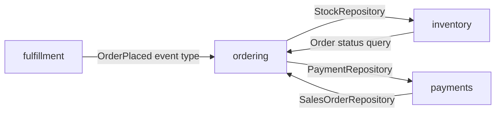

# Khảo sát package và dependency trước khi thêm module test

Một dự án Spring Boot tồn tại nhiều năm có thể đang chạy ổn định với các package `controller`, `service`, `repository`, `domain`. Khi thêm `@ApplicationModuleTest` vào `OrderServiceTests`, người phát triển mong chỉ khởi động nghiệp vụ Ordering, nhưng Spring Modulith lại phát hiện `service`, `repository`, `domain` là những module ở cấp package khác với ý định. Ở dự án khác, `ordering` trông đã là một module độc lập, nhưng `PlaceOrderService` vẫn inject `inventory.internal.StockRepository`, dùng native SQL sửa bảng của Billing và đọc một static cache dùng chung.

**Cần khảo sát package và dependency trước khi thêm module test** vì test được bootstrap theo **ranh giới module mà Spring Modulith thực sự nhận diện**, không theo sơ đồ mong muốn trong tài liệu. Nếu ranh giới sai, test có thể không tìm thấy bean; nếu dependency ngầm, test có thể xanh khi mock quá nhiều nhưng lỗi ở tích hợp. Chuyển package ngay khi chưa có bản đồ hành vi còn làm tăng nguy cơ hồi quy.

Bài học thuộc chương **Refactoring an existing app**, trong lộ trình **SPRING_MODULITH_VERIFICATION_TESTING**: kiểm chứng ranh giới ứng dụng bằng `ApplicationModules`, quy tắc phụ thuộc, `@ApplicationModuleTest`, kiểm thử event/database/integration và quality gate CI. Trọng tâm ở đây là **cách khảo sát và thu được bằng chứng đủ để quyết định module test nào đáng viết trước**, không lặp lại phần nhập môn về annotation.

> **Đầu ra của một cuộc khảo sát tốt:** (1) bản đồ package và application root; (2) dependency graph có phân loại trực tiếp/ẩn; (3) danh sách vi phạm ranh giới và vòng phụ thuộc; (4) bản đồ ownership của bảng, event, transaction; (5) kế hoạch characterization test và module test theo mức độ sẵn sàng, kèm tiêu chí kiểm chứng.

## 1. Chốt phạm vi khảo sát và baseline trước khi động vào mã

Đừng bắt đầu bằng thao tác đổi package hàng loạt. Hãy ghi lại **thực trạng có thể kiểm tra** trước khi dùng công cụ refactor của IDE.

| Điều cần chốt | Câu hỏi khảo sát | Bằng chứng cần giữ |
| --- | --- | --- |
| **Application root** | Class `@SpringBootApplication` nằm ở package nào? Có nhiều application contexts không? | FQCN ứng dụng, base package, cấu hình scan |
| **Package topology** | Package cấp ngay dưới root biểu diễn feature hay kỹ thuật? | Cây thư mục/package hiện tại |
| **Đường vào nghiệp vụ** | HTTP endpoint, scheduled job, message listener nào kích hoạt use case? | Class/method entrypoint và chức năng |
| **Dependency Java** | Module nào import/inject/khởi tạo kiểu của module khác? | Bảng caller → callee có đường dẫn vị trí |
| **Dependency runtime** | Native SQL, JPA mapping, event, transaction, topic/queue nào tạo coupling ngoài Java import? | Bản đồ table/topic/event và owner |
| **Baseline behavior** | Luồng nào không được thay đổi khi refactor? | Test hiện hành, input/output, dữ liệu, side effect |
| **Điểm rủi ro** | Chu trình, repository lộ ra ngoài, shared mutable state, listener nhạy thời điểm? | Danh sách rủi ro có mức ưu tiên |

### 1.1. Chọn một “lát cắt” nghiệp vụ để khảo sát

Ví dụ sản phẩm bán hàng có ba luồng:

1. **Place order:** nhận đơn, kiểm tra tồn, giữ hàng, tạo order.
2. **Capture payment:** xử lý kết quả thanh toán, chuyển trạng thái order.
3. **Prepare shipment:** phản ứng với sự kiện order/stock và tạo công việc kho.

Không cần vẽ toàn bộ 500 package trước khi làm bất kỳ test nào. Hãy chọn một luồng có ý nghĩa, truy vết **từ điểm vào qua tất cả dependency trực tiếp** và ghi các dependency ngoài phạm vi cần xử lý sau. Mục tiêu là có **bằng chứng đủ để cô lập một module**, không phải đổi toàn bộ kiến trúc trong một pull request.

### 1.2. Phân biệt dữ liệu thực với dự định kiến trúc

Trong bảng khảo sát, nên có hai cột riêng:

- **AS-IS:** `ordering.application.PlaceOrderService` inject `inventory.internal.StockRepository`.
- **TO-BE:** Ordering gọi `InventoryReservations` ở API package do Inventory công bố.

Không xóa dòng AS-IS chỉ vì đã thống nhất sẽ sửa. Một baseline trung thực giúp nhận diện được **thay đổi nào đã loại bỏ dependency nguy hiểm** và thay đổi nào mới chỉ đổi tên package.

### 1.3. Một báo cáo khảo sát ngắn nhưng có thể hành động

```text
Luồng: Place order
Entrypoint: web.OrderController.place(...)
Owner ứng viên: ordering
Đường gọi:
  OrderController
    -> PlaceOrderService
    -> InventoryStockRepository (khác module)
    -> PaymentGatewayClient (khác module)
Writes:
  sales_order, inventory_stock
Events:
  OrderPlaced
Risks:
  direct repository access; cross-module transaction;
  unknown ownership of PaymentGatewayClient
Next evidence:
  DB-integration characterization test + dependency check
```

Đầu ra này vẫn là mô tả **một use case**, nhưng chỉ rõ câu hỏi cần trả lời **trước khi** kỳ vọng `@ApplicationModuleTest(STANDALONE)` chạy được.

## 2. Quan sát package tree bằng đúng quy tắc nhận diện module

Spring Modulith thông thường nhận diện các **package cấp trực tiếp dưới root application package** như các application modules theo chiến lược phát hiện mặc định. Vì vậy, hai layout sau có ý nghĩa rất khác nhau.

### 2.1. AS-IS: package-by-layer của một hệ thống legacy

```text
com.example.shop
├── ShopApplication.java        // @SpringBootApplication
├── web/
│   ├── OrderController.java
│   └── PaymentCallbackController.java
├── service/
│   ├── PlaceOrderService.java
│   ├── InventoryService.java
│   └── PaymentService.java
├── repository/
│   ├── SalesOrderRepository.java
│   ├── StockRepository.java
│   └── PaymentRepository.java
├── domain/
│   ├── SalesOrder.java
│   ├── StockReservation.java
│   └── Payment.java
└── config/
    └── JpaConfiguration.java
```

Nếu không có tùy chỉnh phát hiện module, những package cấp trực tiếp như `web`, `service`, `repository`, `domain`, `config` có thể được xem là ứng viên module. Nhưng đó là **ranh giới kỹ thuật**, không phải ranh giới trách nhiệm “Ordering–Inventory–Payment” mà ta muốn kiểm tra.

**Hệ quả đối với test:** Đặt `@ApplicationModuleTest` dưới `com.example.shop.service` có thể khiến test bootstrap một nhóm `PlaceOrderService`, `InventoryService`, `PaymentService` cùng một module kỹ thuật, trong khi repository và domain nằm ở module khác. Cách bootstrap đó không phản ánh ownership nghiệp vụ.

### 2.2. TO-BE: package theo năng lực nghiệp vụ

```text
com.example.shop
├── ShopApplication.java
├── ordering/
│   ├── placement/
│   │   ├── package-info.java
│   │   └── OrderPlacement.java
│   ├── events/
│   │   ├── package-info.java
│   │   └── OrderPlaced.java
│   └── internal/
│       ├── PlaceOrderService.java
│       ├── SalesOrder.java
│       └── SalesOrderRepository.java
├── inventory/
│   ├── reservations/
│   │   ├── package-info.java
│   │   └── InventoryReservations.java
│   └── internal/
│       ├── StockReservationService.java
│       ├── StockReservation.java
│       └── StockRepository.java
├── payments/
│   ├── collection/
│   │   ├── package-info.java
│   │   └── PaymentCollection.java
│   └── internal/
│       └── PaymentService.java
└── fulfillment/
    └── internal/
        └── OrderPlacedListener.java
```

Ở layout này, các ứng viên module là `ordering`, `inventory`, `payments`, `fulfillment`. Package API công khai chứa contract mà consumer được phép biết; entity và repository thuộc `internal`.

Đây mới là **đề xuất đích**, chưa phải lời khuyên chuyển mọi file ngay. Phải khảo sát xem `PlaceOrderService` thực sự sở hữu trạng thái nào, hợp đồng nào có thể công bố, và dependency nào cần chuyển thành event hoặc API trước khi áp dụng.

### 2.3. Đừng bỏ qua root và cấu hình scan

Những trường hợp cần ghi rõ:

- `@SpringBootApplication` không nằm ở common package cha của các feature.
- `@ComponentScan`/`@EntityScan`/`@EnableJpaRepositories` có package tùy chỉnh.
- Có nhiều Spring Boot applications trong cùng repository hoặc nhiều application contexts.
- Có custom module detection strategy hoặc cấu hình nhận diện package không theo mặc định.
- Có package `shared`, `common`, `config`, `infrastructure` ở root đang chứa beans công khai cho toàn hệ thống.

Không giả định mọi `shared` package **tự động được miễn** kiểm tra module. Nếu package đó nằm ở vị trí Spring Modulith phát hiện, nó có thể là module và tạo dependency từ rất nhiều module khác. Cần xác định rõ vì sao code ở đó là shared kernel, configuration hay tiện ích thuần Java; **không** đặt logic nghiệp vụ chung ở `shared` chỉ để tránh vi phạm dependency.

### 2.4. Quy tắc đặt test không thể bỏ qua

Khi dùng `@ApplicationModuleTest`, **package của test class** giúp xác định module đang test. Sau refactor, test Ordering nên nằm dưới `com.example.shop.ordering`:

```text
src/test/java/com/example/shop/ordering/
    OrderingModuleTests.java
```

Đừng đặt `OrderingModuleTests` dưới `com.example.shop.test` hoặc `com.example.shop.service` rồi suy rằng tên class tự chọn module Ordering. Nếu test không được đặt ở package phù hợp với module, bootstrap có thể không xác định module như mong đợi.

## 3. Lập bảng dependency trực tiếp: ai dùng ai và để làm gì?

Ở lượt đầu, ghi **những dependency có thể thấy trong source code**: import, kiểu field/constructor, method parameter, `new`, injection, repository, event type và các interfaces. Nên truy từ **entrypoint** để không bị lạc trong danh sách import lớn.

### 3.1. Một đoạn legacy cần phân tích

```java
package com.example.shop.service;

import com.example.shop.domain.SalesOrder;
import com.example.shop.repository.SalesOrderRepository;
import com.example.shop.repository.StockRepository;
import com.example.shop.repository.PaymentRepository;

@Service
public class PlaceOrderService {

    private final SalesOrderRepository orders;
    private final StockRepository stock;
    private final PaymentRepository payments;

    public PlaceOrderService(
        SalesOrderRepository orders,
        StockRepository stock,
        PaymentRepository payments
    ) {
        this.orders = orders;
        this.stock = stock;
        this.payments = payments;
    }

    @Transactional
    public UUID place(String sku, int quantity, UUID customerId) {
        // Rút gọn: không đầy đủ validation/locking/idempotency.
        stock.decrement(sku, quantity);
        var order = orders.save(new SalesOrder(
            UUID.randomUUID(), customerId, sku, quantity
        ));
        payments.createPendingFor(order.getId());
        return order.getId();
    }
}
```

Đây là **mã giả Java định hướng khảo sát**, không phải implementation sản xuất hoàn chỉnh. Điểm cần quan sát không phải cú pháp repository mà là `PlaceOrderService` đang giữ **quyền thao tác trực tiếp trên ba aggregate thuộc ba owner ứng viên**.

### 3.2. Dependency ledger bắt buộc có mục đích

| Caller | Callee/đối tượng | Mục đích | Loại dependency | Đánh giá ban đầu |
| --- | --- | --- | --- | --- |
| `PlaceOrderService` | `SalesOrderRepository` | Lưu đơn | Internal của Ordering | Giữ trong module owner |
| `PlaceOrderService` | `StockRepository` | Trừ tồn | Repository chéo Inventory | **Vi phạm dự kiến**, cần API giữ hàng |
| `PlaceOrderService` | `PaymentRepository` | Tạo payment pending | Repository chéo Payments | **Vi phạm dự kiến**, cần contract/event |
| `OrderController` | `PlaceOrderService` | Chuyển HTTP request thành use case | Adapter → application service | Thường thuộc cùng Ordering |
| `PaymentCallbackController` | `PaymentService` | Nhận callback cổng thanh toán | Adapter → payment owner | Cần kiểm tra cùng module |
| `FulfillmentListener` | `OrderPlaced` | Lắng nghe sự kiện | Contract event | Chỉ hợp lệ nếu event được công bố |

**Tại sao thêm cột “mục đích”?** Hai dependency cùng trỏ Inventory không nhất thiết có cách sửa giống nhau. Một consumer có thể cần **query thông tin tồn**; một caller khác cần **thực hiện lệnh giữ**. Chúng có thể đòi hai contract khác nhau, không phải một façade khổng lồ có toàn bộ method repository.

### 3.3. Công cụ quét chỉ hỗ trợ, không thay thế diễn giải

Trên repository của chính dự án (đây là ví dụ lệnh cho người học, **không phải bước cần chạy để viết bài học này**), có thể bắt đầu với:

```bash
# Tìm injection, dependency kiểu và event/listener.
rg -n '(@Autowired|private final|@EventListener|@ApplicationModuleListener)' src/main/java

# Tìm đường truy cập persistence cross-feature.
rg -n '(Repository|EntityManager|JdbcTemplate|@Query|@ManyToOne)' src/main/java

# Tìm vòng đời transaction và integration.
rg -n '(@Transactional|@Async|KafkaListener|RabbitListener|RestClient|WebClient)' src/main/java
```

Kết quả grep chỉ chỉ ra **nơi đáng đọc**, không tự suy được module ownership. Static import của `java.time.Clock` hoặc một DTO thuần không có mức rủi ro tương đương việc inject repository module khác.

### 3.4. Ghi cạnh dependency với hướng chính xác

Nếu `ordering.PlaceOrderService` import `inventory.reservations.InventoryReservations`, hướng dependency Java là:

```text
ordering ──(Java type dependency)──> inventory::reservations
```

Nếu Inventory publish `StockReserved` và Fulfillment lắng nghe bằng kiểu đó, hướng dependency kiểu có thể là:

```text
fulfillment ──(Java type dependency)──> inventory::events
```

Luồng **event runtime** là Inventory → Fulfillment, nhưng hướng **Java dependency** của listener tới event type lại là Fulfillment → Inventory. Vẽ đúng cả hai giúp tránh hiểu sai `allowedDependencies` và gán module test bootstrap mode không phù hợp.

## 4. Đọc dependency graph để tìm vòng và vùng cần tách

Sau khi lập ledger, nhóm cạnh theo owner ứng viên và vẽ một đồ thị. Ví dụ một hệ thống legacy:



Đồ thị cho thấy **hai vòng** đáng điều tra: `ordering → payments → ordering` và `ordering → inventory → ordering`. Việc một nhóm đổi tên `PaymentService` thành `PaymentFacade` không tự cắt vòng nếu implementation vẫn import `SalesOrderRepository` của Ordering.

### 4.1. Đừng sửa bằng cách cho tất cả module phụ thuộc nhau

Phản mẫu:

```java
@ApplicationModule(
    allowedDependencies = {
        "inventory", "payments", "fulfillment", "ordering"
    }
)
package com.example.shop.ordering;
```

Việc mở toàn bộ dependency làm hạn chế giá trị của quality gate, và **không** giải quyết kiến trúc có chu trình. `allowedDependencies` phải phản ánh **quyền có chủ đích** sau khi đã xem loại contract, không phải một danh sách tạo cho `verify()` im lặng.

### 4.2. Chọn một đường phá vòng có lý do nghiệp vụ

Giả sử vòng Payments → Ordering chỉ tồn tại vì Payment muốn cập nhật trạng thái order sau khi nhận callback. Có các hướng cần so sánh:

- Payment công bố `PaymentCaptured`/`PaymentFailed`; Ordering lắng nghe và tự cập nhật order.
- Ordering cung cấp API hẹp `OrderPaymentStatus` nếu Payment có nhu cầu đồng bộ đã được chấp nhận về ownership.
- Một application orchestration rõ ràng ở module điều phối, thay vì hai module cùng ghi repository của nhau.

Không có một cách duy nhất tốt cho mọi hệ thống. Nếu thanh toán và đặt đơn phải nằm trong **một transaction vật lý** theo yêu cầu hiện tại, thay bằng sự kiện bất đồng bộ có thể làm thay đổi semantics và phải có reconciliation/saga/idempotency. Trước khi cắt vòng, cần bảo vệ hành vi cũ bằng characterization tests.

### 4.3. Phân loại cạnh để ưu tiên

| Nhóm cạnh | Ví dụ | Mức ưu tiên khảo sát | Điều phải chứng minh |
| --- | --- | --- | --- |
| **Chéo repository/aggregate** | Ordering dùng `StockRepository` | Rất cao | Owner của invariant, transaction, write path |
| **Vòng phụ thuộc kiểu** | Payments gọi Ordering và ngược lại | Rất cao | Cách cắt vòng không đổi hành vi |
| **Sự kiện và consumer** | Fulfillment nghe `OrderPlaced` | Cao | Contract, commit phase, retry |
| **Query/read-only API** | Ordering hỏi availability | Trung bình–cao | Hợp đồng, tính nhất quán dữ liệu |
| **Utility thuần** | Converter, parser không chứa state nghiệp vụ | Thấp hơn | Nằm đúng common/shared package |
| **Cấu hình/persistence hạ tầng** | Bean database client | Trung bình | Scope test, lifecycle, không tràn public API |

Hãy ghi số lượng và loại vi phạm theo từng **feature pair**, thay vì chỉ lưu một con số “38 dependency errors”. Con số không cho biết nên viết module test cho `ordering`, `inventory` hay `payments` trước.

## 5. Tìm dependency ẩn: SQL, JPA, bean configuration, event và transaction

`ApplicationModules.verify()` kiểm chứng dependency có thể suy từ cấu trúc Java/module, nhưng **không thể thay người khảo sát hiểu mọi liên kết ở runtime**. Một ứng dụng legacy thường chứa những dependency có tác động lớn hơn một import.

### 5.1. Native SQL ghi bảng của module khác

Ví dụ Ordering không inject `InventoryStockRepository` mà thao tác trực tiếp:

```java
package com.example.shop.ordering.internal;

@Service
class PlaceOrderService {

    private final JdbcTemplate jdbc;

    // ...
    void reserveLegacy(String sku, int quantity) {
        jdbc.update("""
            UPDATE inventory_stock
               SET available = available - ?
             WHERE sku = ?
            """, quantity, sku);
    }
}
```

Trong Java dependency graph, class này chỉ phụ thuộc `JdbcTemplate`. Nhưng nó **ghi bảng do Inventory sở hữu**, bỏ qua invariant và logic giữ hàng có thể đang nằm trong Inventory.

**Bằng chứng cần ghi:** package nguồn chứa SQL, bảng đọc/ghi, nhóm sở hữu bảng, transaction manager, khóa idempotency/concurrency và khả năng thay bằng API module. Một lớp test `ApplicationModules.verify()` **không thay thế** test concurrency/DB constraint và review những chuỗi SQL như vậy.

### 5.2. Quan hệ JPA xuyên ranh giới

```java
// Giả sử domain.OrderEntity là của Ordering.
@ManyToOne(fetch = FetchType.LAZY)
private PaymentEntity payment;
```

Nếu `PaymentEntity` được di chuyển vào `payments.internal`, Ordering đã có dependency cấp kiểu tới entity nội bộ. Những câu hỏi cần trả lời:

- Quan hệ này thực sự là invariant **cùng aggregate** hay chỉ là tham chiếu ID giữa bounded contexts?
- Cần joint transaction hay chỉ cần một trạng thái read model?
- Khi `PaymentEntity` thay schema, có bao nhiêu query của Ordering sẽ bị ảnh hưởng?
- Nếu tách mapping, có cần giữ foreign key ở DB và làm gì để không mất referential integrity?

Không **tự động** thay mọi association bằng UUID string nếu chưa xác định những ràng buộc nghiệp vụ và transaction phụ thuộc. Characterization test phải bảo vệ những đường dữ liệu quan trọng trước khi tách.

### 5.3. Bean wiring và configuration

Legacy system có thể dùng:

```java
@Bean
StockService stockService(
    StockRepository repository,
    ApplicationEventPublisher events
) {
    return new StockService(repository, events);
}
```

Nếu bean được định nghĩa trong package `config` nằm ngoài Inventory, một module test Inventory có thể thiếu bean, hoặc khi nạp cấu hình lại kéo thêm repository/module khác. Ghi rõ **bean được định nghĩa ở đâu**, component scan/import thế nào, và vì sao có/không thuộc module.

Những cơ chế có thể ẩn dependency:

- `@Import`, `@Configuration`, `@ConditionalOn...` và bean qualifiers.
- Repository/entity scan custom vượt package của module.
- `ApplicationContext.getBean(...)`, reflection hoặc `Class.forName(...)`.
- Spring AOP, interceptors, filters, scheduled beans, global exception handlers.
- Nhiều datasource/transaction managers và cấu hình hạ tầng dùng chung.

Một lớp test không load đủ bean **có thể là tín hiệu package boundary chưa hợp lý**, nhưng cũng có thể là configuration test thiếu dependency đã được công bố. Cần phân biệt trước khi đổi bootstrap mode sang `ALL_DEPENDENCIES`.

### 5.4. Event: dependency kiểu và coupling theo thời điểm

Ví dụ Inventory publish `StockReserved`, Fulfillment lắng nghe:

```java
// Một contract có thể được công bố bởi Inventory.
public record StockReserved(
    UUID reservationId,
    String sku,
    int quantity
) {}
```

```java
@ApplicationModuleListener
void whenStockReserved(StockReserved event) {
    // Lưu picking task, có thể trong transaction riêng.
}
```

Bản khảo sát cần **hai đường**:

```text
Java type:
  fulfillment → inventory::events

Runtime event:
  inventory --StockReserved--> fulfillment
```

Thêm các thuộc tính của event vào ledger:

| Thuộc tính | Câu hỏi bắt buộc |
| --- | --- |
| Producer | Event publish trong service nào, trước hay ngoài transaction? |
| Consumer | Listener ở module nào, được bootstrap bằng cấu hình gì? |
| Phase | `@EventListener`, `AFTER_COMMIT` hay `@ApplicationModuleListener`? |
| Persistence | Có Event Publication Registry/outbox hoặc broker không? |
| Retry | Listener lỗi có được chạy lại và xử lý lặp an toàn không? |
| Contract | Event class nằm ở API được công bố hay package nội bộ? |

Nếu consumer async hoặc after-commit, việc mock nó thành một `void on(...)` đồng bộ trong module test có thể **xóa mất** các rủi ro quan trọng về transaction/commit mà hệ thống đang có.

### 5.5. Dependency transaction và dữ liệu

Một use case chạy:

```text
Ordering place order:
  UPDATE inventory_stock
  INSERT sales_order
  INSERT payment_request
  COMMIT tất cả trên cùng datasource
```

Trước refactor, có thể hệ thống đang dựa vào **một transaction vật lý** cho cả ba bảng. Nếu thay đường ghi Payment bằng event `AFTER_COMMIT`, Payment có thể xử lý sau khi order đã commit — semantics không còn atomic theo cùng nghĩa. Đây có thể là tiến bộ kiến trúc **nhưng là thay đổi hành vi**.

Vì vậy ghi `transaction owner`, `datasource`, `rollback boundary`, `event phase` và `idempotency` trong dependency ledger. Một module test chỉ check bean injection mà bỏ qua những điểm này không bảo vệ được hợp đồng cũ.

### 5.6. Bảng owner dữ liệu cuối buổi khảo sát

| Dữ liệu/tài nguyên | Owner mong muốn | Đang được ai dùng | Loại truy cập | Rủi ro |
| --- | --- | --- | --- | --- |
| `sales_order` | Ordering | Ordering, Payments | Write + status lookup | Cross-write/cycle |
| `inventory_stock` | Inventory | Inventory, Ordering | Update trực tiếp | Oversell/invariant bypass |
| `stock_reservation` | Inventory | Inventory, Fulfillment | Read/consumer join | Leak schema, coupling |
| `payment_request` | Payments | Ordering, Payments | Insert/update | Transaction ownership |
| `OrderPlaced` | Ordering | Fulfillment/Payments | Event type | Public contract/version |
| `StockReserved` | Inventory | Fulfillment | Event type | After-commit/retry |
| Event publication registry | Infrastructure | Các listener được quản lý | Read/write/replay | Test schema và delivery |

Đây là bảng **để lựa chọn test và refactor**, không phải phán quyết rằng mọi cross-table query đều phải loại bỏ ngay. Cần quyết định dựa vào owner và invariant; ít nhất mọi cross-write nên được review trước tiên.

## 6. Dùng `ApplicationModules.verify()` làm chẩn đoán baseline

Sau khi có package map, dùng Spring Modulith để kiểm tra **cách framework thực sự nhìn ứng dụng**. Một bài test kiến trúc tối thiểu:

```java
package com.example.shop;

import org.junit.jupiter.api.Test;
import org.springframework.modulith.core.ApplicationModules;

class ModularityBaselineTests {

    @Test
    void reportsInvalidModuleDependencies() {
        ApplicationModules.of(ShopApplication.class).verify();
    }
}
```

`ApplicationModules.of(ShopApplication.class)` dựng mô hình các application modules từ cấu trúc package và cấu hình phát hiện; `verify()` kiểm tra ràng buộc kiến trúc, trong đó có **vòng phụ thuộc** và việc tham chiếu package không được công bố theo quy tắc áp dụng. Đối với một legacy app, lần chạy đầu **có thể thất bại** — đó là **bằng chứng cần triage**, không phải lý do bật toàn bộ `allowedDependencies`.

### 6.1. Diễn giải lỗi theo nhóm

| Nhóm lỗi/tín hiệu | Khả năng nguyên nhân | Việc nên làm trước khi thêm module test |
| --- | --- | --- |
| Module names thành `web`, `service`, `repository` | Package-by-layer ngay dưới application root | Xác định root/layout mục tiêu, tránh đặt test module theo layer |
| Vòng `ordering ↔ payments` | Hai feature import chéo nhau | Truy ra cụ thể class/method và transaction semantics |
| Ordering truy cập package nội bộ Inventory | Repository/entity leak | Xác định interface hẹp hoặc event/read model |
| Dependency không nằm trong `allowedDependencies` | API chưa được công bố hoặc dependency trái chủ đích | Review owner, sửa contract/rule đúng nghĩa |
| Không thấy dependency SQL trực tiếp | SQL string không thành Java type edge | Bổ sung review và test về data ownership |
| Module test thiếu bean dù graph hợp lý | Bean config ở package ngoài scope/custom scan | Khảo sát wiring, không đổi mode mù quáng |

**Đừng biến baseline thất bại thành một test bị `@Disabled` vô thời hạn.** Có thể tách giai đoạn ghi nhận vi phạm và giai đoạn enforce; khi đã thống nhất module boundaries, quality gate kiến trúc phải chạy thật trong CI. Nếu một bước refactor vẫn còn vi phạm có chủ đích, ghi **owner và kế hoạch loại bỏ**; không tự cho phép phụ thuộc nguy hiểm vì “legacy vẫn đang chạy”.

### 6.2. Kết hợp model của công cụ với quan sát runtime

Ba phép kiểm chứng bổ sung nhau:

1. **Module model:** Package/module nào thực sự được framework phát hiện?
2. **Static dependency:** Class nào import/call/construct class của module khác?
3. **Runtime coupling:** SQL/event/transaction/external IO nào không biểu diễn hết qua import Java?

Một `verify()` xanh chỉ là một lớp bằng chứng. Nó **không** chứng minh dữ liệu giữa module được sở hữu đúng, event async hoàn tất hay module test đã có fixture cần thiết. Không nên kết luận “module độc lập” chỉ từ một bài test kiến trúc xanh.

### 6.3. Baseline báo cáo bằng bảng thay vì chỉ screenshot lỗi

```text
Finding ID: MOD-03
Caller: ordering.internal.PlaceOrderService
Target: inventory.internal.StockRepository
Cause: direct repository use
Business need: reserve stock atomically
Risk: inventory invariant bypassed
Suggested contract: inventory::reservations
Evidence: class constructor + stock update SQL
Verification after fix:
  - ApplicationModules.verify() PASS
  - inventory module test PASS
  - ordering→inventory integration test PASS
Status: OPEN
```

Lưu lại **một mô tả hành động** như vậy giúp reviewer kiểm tra refactor có giải quyết nguyên nhân thật không. Đây là nội dung trong tài liệu/issue của người học; bài Knowledge này không yêu cầu sinh bất kỳ file audit ngoài file được giao.

## 7. Chốt module candidate và hợp đồng công khai có giới hạn

Khi đã biết ai sở hữu dữ liệu và dependency nào cần cắt, có thể đề xuất **công bố API hẹp**. Ví dụ Ordering cần giữ hàng, không cần toàn bộ repository Inventory.

### 7.1. Contract của Inventory

```java
// inventory/reservations/package-info.java
@org.springframework.modulith.NamedInterface("reservations")
package com.example.shop.inventory.reservations;
```

```java
// inventory/reservations/InventoryReservations.java
package com.example.shop.inventory.reservations;

import java.util.UUID;

public interface InventoryReservations {
    ReservationReceipt reserve(
        String sku, int quantity, UUID requestId
    );
}
```

```java
// inventory/reservations/ReservationReceipt.java
package com.example.shop.inventory.reservations;

import java.util.UUID;

public record ReservationReceipt(UUID reservationId) {}
```

Impl `InventoryReservationService` cùng entity/repository ở `inventory.internal`; Ordering chỉ cần depend on interface và record công khai. Nghiệp vụ thiếu tồn, timeout và idempotent retry cần được định nghĩa trong contract thật (ví dụ một public exception hoặc result type).

### 7.2. Quy tắc dependency ở Ordering

```java
// ordering/package-info.java
@org.springframework.modulith.ApplicationModule(
    allowedDependencies = "inventory::reservations"
)
package com.example.shop.ordering;
```

Nếu Ordering còn phụ thuộc API hẹp của Payments để thu tiền đồng bộ, cần quyết định có bổ sung `payments::collection` hoặc loại bỏ dependency bằng event/điều phối. **Không** coi `allowedDependencies` là một cơ chế tự động chuyển transaction hay làm nhiệm vụ Mockito mock.

### 7.3. Các tiêu chí để một API thật sự “hẹp”

- DTO thuộc API không chứa JPA entity hay `EntityManager`.
- Consumer không được sửa đối tượng persistence của module owner.
- Contract được đặt tên theo **lệnh/query nghiệp vụ**, không theo tên bảng/CRUD repository.
- Lỗi và kết quả đủ rõ để module gọi xử lý mà không biết internal exception tree.
- Idempotency/transaction/correlation ID được định nghĩa nếu workflow cần.
- Những dependency chưa được loại bỏ phải có lý do và thời hạn xử lý.

Phản mẫu façade:

```java
public interface InventoryFacade {
    StockRow findEntity(String sku);
    void saveEntity(StockRow row);
    void executeSql(String sql);
}
```

Đây chỉ là **repository lộ ra dưới một tên khác**. Một module test có thể dễ bootstrap hơn, nhưng boundary nghiệp vụ vẫn không được bảo vệ.

### 7.4. Không đẩy implementation detail sang `shared`

Một lỗi refactor thường gặp là chuyển `SalesOrderEntity`, `StockRepository` và `PaymentTransaction` vào `common` để tránh cycle. Việc đó làm mờ ownership và mở rộng dependency xuyên module. `shared` chỉ nên chứa những khái niệm thực sự ổn định, không mang quyền cập nhật aggregate của một owner.

**Kết luận bước khảo sát:** Nếu không thể giải thích tại sao một API được phép công bố và module nào sở hữu invariant, **chưa nên thêm module test giả định boundary đó đã đúng**.

## 8. Characterization tests: khóa hành vi legacy trước khi tách module

Một cuộc khảo sát dependency chỉ mô tả cấu trúc. Refactor sẽ an toàn hơn nếu ta có **bằng chứng hành vi ban đầu** cho những luồng quan trọng, đặc biệt khi di chuyển transaction và event giữa modules.

### 8.1. Chọn đúng những đường cần khóa

| Luồng legacy | Input có kiểm soát | Kết quả/side effect cần giữ |
| --- | --- | --- |
| Đặt hàng thành công | SKU có tồn, quantity hợp lệ, request ID | Order được tạo, tồn giảm đúng, payment request theo policy |
| Thiếu hàng | Quantity lớn hơn tồn | Không tạo order/payment bất hợp lệ, tồn không âm |
| Payment callback thành công | Callback/event thuộc đơn hợp lệ | Trạng thái payment/order thay đổi đúng, idempotent |
| Callback lặp lại | Cùng transaction/provider reference | Không charge/ghi nhận hai lần |
| Rollback sau giảm tồn | Lỗi có chủ đích khi ghi order/payment | DB khôi phục invariant theo transaction hiện tại |
| Order event | Order commit thành công/rollback | Listener xử lý đúng phase, không công bố thành công sai |

Mục đích là **khóa nghĩa nghiệp vụ đang cần giữ**. Nếu phát hiện hành vi legacy rõ ràng sai (ví dụ oversell), ghi thành defect/risk và định nghĩa expectation mục tiêu rõ, không viết test khẳng định lỗi đó là “hợp đồng chuẩn” mãi mãi.

### 8.2. Test tích hợp ở baseline, trước khi có module boundary tốt

Ví dụ rút gọn trên PostgreSQL/Testcontainers:

```java
package com.example.shop;

import static org.assertj.core.api.Assertions.assertThat;

import com.example.shop.service.PlaceOrderService;
import java.util.UUID;
import org.junit.jupiter.api.Test;
import org.springframework.beans.factory.annotation.Autowired;
import org.springframework.boot.test.context.SpringBootTest;
import org.springframework.boot.testcontainers.service.connection.ServiceConnection;
import org.springframework.jdbc.core.JdbcTemplate;
import org.springframework.test.annotation.DirtiesContext;
import org.testcontainers.containers.PostgreSQLContainer;
import org.testcontainers.junit.jupiter.Container;
import org.testcontainers.junit.jupiter.Testcontainers;

@SpringBootTest
@Testcontainers
@DirtiesContext(classMode = DirtiesContext.ClassMode.AFTER_CLASS)
class LegacyPlaceOrderCharacterizationIT {

    @Container
    @ServiceConnection
    static PostgreSQLContainer<?> postgres =
        new PostgreSQLContainer<>("postgres:16-alpine");

    @Autowired PlaceOrderService orders;
    @Autowired JdbcTemplate jdbc;

    @Test
    void placingOrderPreservesExistingStockAndPaymentBehavior() {
        String sku = "IT-" + UUID.randomUUID();
        UUID customerId = UUID.randomUUID();
        jdbc.update(
            "INSERT INTO inventory_stock(sku, available) VALUES (?, 5)",
            sku
        );

        // Call service qua Spring bean, không có @Transactional trên test.
        UUID orderId = orders.place(sku, 2, customerId);

        Integer remaining = jdbc.queryForObject(
            "SELECT available FROM inventory_stock WHERE sku = ?",
            Integer.class, sku
        );
        Integer ordersCount = jdbc.queryForObject(
            "SELECT count(*) FROM sales_order WHERE order_id = ?",
            Integer.class, orderId
        );
        Integer paymentsCount = jdbc.queryForObject(
            "SELECT count(*) FROM payment_request WHERE order_id = ?",
            Integer.class, orderId
        );

        assertThat(remaining).isEqualTo(3);
        assertThat(ordersCount).isEqualTo(1);
        assertThat(paymentsCount).isEqualTo(1);

        // Một scenario dùng container của riêng class;
        // DB được bỏ theo lifecycle container, không dùng lại cho test khác.
    }
}
```

**Đây là test định hướng dựa trên mô hình dữ liệu ví dụ**, cần điều chỉnh theo tên bảng/khóa/constructor và migration thực. Nó giả định `PlaceOrderService.place(...)` hiện đang đồng bộ tạo `payment_request`, và các bảng được tạo từ Flyway/Liquibase production. Spring Boot cần dependency tích hợp Testcontainers tương thích nếu dùng `@ServiceConnection`.

Ví dụ dành **một container cho class chỉ có một scenario**; Testcontainers thu hồi môi trường sau vòng đời class, còn `@DirtiesContext` tránh để Spring cache tái sử dụng context với datasource trỏ về container đã dừng. Nó không phải mẫu để dùng trên database chia sẻ. Nếu thêm nhiều scenario vào cùng class hoặc dùng container singleton, phải có cleanup theo khóa scenario trong `finally`/`@AfterEach`, hoặc cấp database/schema riêng. Nếu có event listener/registry async, phải chờ completion hoặc dừng/hủy tài nguyên riêng sau test; không xóa bảng khi worker còn chạy.

### 8.3. Vì sao test baseline chưa dùng `@ApplicationModuleTest`?

Trước khi dời package, boundary theo feature **có thể chưa tồn tại**. Một `@SpringBootTest` chạy luồng legacy đầy đủ giúp bảo vệ output/transaction đã có. Khi ranh giới feature đã được xác định và di chuyển từng lát cắt, thêm `@ApplicationModuleTest` có scope đúng để kiểm tra module riêng.

Đây là cách giảm rủi ro: **characterization trước, module isolation sau**, không phải ngừng viết module tests cho đến khi toàn bộ legacy được refactor.

## 9. Từ bản đồ dependency đến `@ApplicationModuleTest` đúng scope

Sau khi một module candidate có root package và API rõ ràng, mới quyết định **bootstrap mode nào thực sự kiểm tra được ranh giới**. Mỗi mode trả lời một câu hỏi khác nhau.

| Mục tiêu kiểm chứng | Mode/loại test đề xuất | Điều phải chuẩn bị |
| --- | --- | --- |
| Inventory chạy được với những bean do chính nó sở hữu | `@ApplicationModuleTest` `STANDALONE` | Bean, persistence config, database/migration, fixture Inventory |
| Ordering cần Inventory vì có dependency trực tiếp đã công bố | `DIRECT_DEPENDENCIES` | Inventory contract/implementation trong phạm vi phù hợp; fixture của các module tham gia |
| Use case cần cả dependency bắc cầu theo module graph | `ALL_DEPENDENCIES` có lý do | Hiểu vì sao dependency bắc cầu cần nạp; tránh che một boundary sai |
| Cả hệ thống và event consumer sau commit | Full `@SpringBootTest`/integration test | Async workers, Event Publication Registry, PostgreSQL, cleanup |
| Vi phạm dependency Java hoặc vòng module | `ApplicationModules.verify()` | Cấu trúc package và module metadata đúng |

**Điểm cần nhớ:** `@ApplicationModuleTest` xác định **phạm vi bean theo module**, **không** mặc định tạo schema/database riêng cho mỗi module. Flyway/JPA có thể bootstrap datasource dùng chung và cần migration của toàn ứng dụng.

### 9.1. Bài test Inventory cô lập sau khi đã có contract

```java
package com.example.shop.inventory;

import static org.assertj.core.api.Assertions.assertThat;

import com.example.shop.inventory.reservations.InventoryReservations;
import java.util.UUID;
import org.junit.jupiter.api.Test;
import org.springframework.beans.factory.annotation.Autowired;
import org.springframework.jdbc.core.JdbcTemplate;
import org.springframework.modulith.test.ApplicationModuleTest;
import org.springframework.modulith.test.ApplicationModuleTest.BootstrapMode;

@ApplicationModuleTest(mode = BootstrapMode.STANDALONE)
class InventoryModuleTests {

    @Autowired InventoryReservations inventory;
    @Autowired JdbcTemplate jdbc;

    @Test
    void reservesStockWithoutImportingOrderingRepository() {
        String sku = "IT-" + UUID.randomUUID();
        UUID requestId = UUID.randomUUID();
        jdbc.update(
            "INSERT INTO inventory_stock(sku, available) VALUES (?, 5)",
            sku
        );

        try {
            var receipt = inventory.reserve(sku, 2, requestId);

            Integer available = jdbc.queryForObject(
                "SELECT available FROM inventory_stock WHERE sku = ?",
                Integer.class, sku
            );
            Integer reservations = jdbc.queryForObject("""
                SELECT count(*) FROM stock_reservation
                WHERE reservation_id = ?
                """, Integer.class, receipt.reservationId());

            assertThat(available).isEqualTo(3);
            assertThat(reservations).isEqualTo(1);
        } finally {
            jdbc.update(
                "DELETE FROM stock_reservation WHERE sku = ?", sku
            );
            jdbc.update(
                "DELETE FROM inventory_stock WHERE sku = ?", sku
            );
        }
    }
}
```

**Điều kiện để test có ý nghĩa:**

- `inventory` đã là package module ứng viên theo layout target.
- `InventoryReservations` có implementation Spring bean trong Inventory và transaction/persistence đúng.
- Các migration production tạo `inventory_stock`, `stock_reservation` và constraint liên quan; database test không bị một test khác dọn toàn bảng.
- Test không bọc trong `@Transactional`; nếu service tự commit, truy vấn JDBC kiểm tra state đã lưu.
- Cleanup chỉ chạm key của scenario; nếu service có async listener/registry hoặc side effect ngoài module, cần integration test riêng và cleanup/drain an toàn.

Nếu test Inventory standalone vẫn cần mock `PaymentRepository` hoặc bootstrap `OrderController`, có thể nó đang còn dependency trực tiếp hoặc configuration lẫn module. **Đừng lập tức đổi sang `ALL_DEPENDENCIES`**; quay lại ledger để xem vì sao.

### 9.2. Ordering cần direct dependency đúng chiều

```java
package com.example.shop.ordering;

import org.junit.jupiter.api.Test;
import org.springframework.modulith.test.ApplicationModuleTest;
import org.springframework.modulith.test.ApplicationModuleTest.BootstrapMode;

@ApplicationModuleTest(
    mode = BootstrapMode.DIRECT_DEPENDENCIES
)
class OrderingWithInventoryTests {

    @Test
    void placingOrderUsesPublicInventoryContract() {
        // Given:
        //   seed Inventory stock và Ordering input của scenario.
        // When:
        //   gọi Ordering API thay vì StockRepository.
        // Then:
        //   order + reservation đúng, không ghi thiếu/oversell.
    }
}
```

Đây là **khung test mục tiêu**, cần bổ sung Spring beans, fixture và assertions tương ứng. Với `DIRECT_DEPENDENCIES`, module khác được nạp dựa trên dependency graph đã xác định; nó **không tự chọn** những module listener chạy theo hướng event runtime.

### 9.3. Thất bại đầu tiên của module test là dữ liệu khảo sát bổ sung

| Test symptom | Câu hỏi truy ngược |
| --- | --- |
| Không tìm thấy service bean Inventory | Bean ở package/module khác? `@Configuration` nằm ở đâu? |
| Không tìm thấy repository/JPA entity | Repository/entity scan tùy chỉnh hay mapping ngoài root? |
| Module test nạp nhiều bean bất ngờ | Module root sai? `ALL_DEPENDENCIES` quá rộng? |
| Ordering test gọi được StockRepository nội bộ | Dependency rule/API chưa được khóa? Test đang full context? |
| Test DB thiếu bảng dù bean nạp được | Flyway/Liquibase migration location và datasource test đúng chưa? |
| Producer publish event nhưng consumer không chạy | Listener module ngoài bootstrap scope hoặc transaction chưa commit? |
| Test xanh nhưng `verify()` vẫn fail | Hành vi use case đúng không đồng nghĩa dependency architecture hợp lệ |

**Không sửa theo triệu chứng bằng cách nạp toàn application cho mọi module test.** Nếu cần full context để kiểm tra workflow, viết một integration test rõ tên và mục tiêu; giữ module test cho phép kiểm tra ranh giới thực sự.

## 10. Refactor theo lát cắt: mỗi bước đều có bằng chứng “trước/sau”

Sau khảo sát, một chuỗi thay đổi có thể review được thường an toàn hơn một commit di chuyển hàng trăm class.

### 10.1. Lộ trình khuyến nghị

<escape>1.</escape> **Đóng băng baseline hành vi có ý nghĩa.** Giữ characterization test cho đặt hàng, thiếu hàng, rollback, payment callback và event quan trọng. Lưu các vi phạm kiến trúc AS-IS để so sánh.

<escape>2.</escape> **Chốt owner của một aggregate.** Ví dụ Inventory sở hữu `inventory_stock` và reservation; quyết định đường ghi nào phải đi qua Inventory.

<escape>3.</escape> **Tạo package feature đúng scope.** Di chuyển class thuộc một lát cắt cùng cấu hình cần thiết. Không đổi nghiệp vụ và event semantics đồng thời nếu có thể tránh.

<escape>4.</escape> **Công bố API hẹp.** Tạo `inventory::reservations`; chuyển Ordering từ repository trực tiếp sang `InventoryReservations`. Định nghĩa transaction/error/idempotency contract trước khi đổi cách gọi.

<escape>5.</escape> **Chạy lại characterization test.** So sánh state DB, kết quả lỗi, event phase và transaction boundary.

<escape>6.</escape> **Viết module test tối thiểu.** Inventory `STANDALONE`; Ordering `DIRECT_DEPENDENCIES` khi cần Inventory. Không mở rộng context để tránh đối diện một vi phạm cần sửa.

<escape>7.</escape> **Chạy `ApplicationModules.verify()`.** Giảm số vi phạm ở dependency graph, không thêm danh sách `allowedDependencies` quá rộng để che chu trình.

<escape>8.</escape> **Thêm integration/event/database gates.** Dùng PostgreSQL production-type cho constraint/transaction; kiểm tra listener `AFTER_COMMIT`, registry và idempotency khi chúng thuộc luồng.

<escape>9.</escape> **Chỉ khi bằng chứng đạt, tiếp tục module khác.** Ưu tiên các vòng hoặc cross-write có rủi ro cao; không chuyển mọi package cùng lúc.

### 10.2. Cách chứng minh một lát cắt đã tốt hơn

| Bằng chứng | Trước | Sau một lát cắt |
| --- | --- | --- |
| Package tree | `service/repository/domain` trộn feature | Inventory entity/repository ở `inventory.internal` |
| Đường giữ hàng | Ordering inject `StockRepository` | Ordering dùng `inventory::reservations` |
| Graph | Ordering → Inventory internal | Ordering → named interface hợp lệ |
| Transaction | Chưa rõ owner/commit | Service owner/rollback policy được test rõ |
| Module test | Không xác định scope nghiệp vụ | Inventory `STANDALONE` chạy được |
| Integration | Chưa khóa tồn/order/payment | Characterization/integration vẫn giữ kết quả |
| CI gate | Không kiểm tra phụ thuộc | `ApplicationModules.verify()` chạy và chặn regression |

**Tiêu chí dừng:** Nếu việc tách package khiến use case không còn atomic trong trường hợp bắt buộc, consumer phát event trước commit hoặc test phải mock quá nhiều implementation để xanh, chưa đủ bằng chứng để kết luận slice hoàn thành.

### 10.3. Tránh ba kiểu “refactor” không làm ranh giới tốt hơn

- **Chỉ đổi tên package:** `service.InventoryService` → `inventory.InventoryService` nhưng Ordering vẫn import `inventory.internal.StockRepository`.
- **Façade giả:** API mới trả entity/repository ra ngoài, caller vẫn điều khiển invariant trực tiếp.
- **Module test toàn hệ thống:** Gắn `@ApplicationModuleTest(mode=ALL_DEPENDENCIES)` khắp nơi và cho phép dependency bất kỳ để tránh lỗi bootstrap.

Một dependency graph tốt hơn là graph có **quyền rõ và ít đường chéo trái ownership**, không nhất thiết là graph có ít module nhất hoặc ít interface nhất.

## 11. Bài thực hành khảo sát và checklist trước module test đầu tiên

### 11.1. Đề bài

Nhóm nhận một ứng dụng bán hàng có package tree:

```text
com.example.shop
├── ShopApplication.java
├── controller/
│   ├── OrderController.java
│   └── PaymentWebhookController.java
├── service/
│   ├── PlaceOrderService.java
│   ├── StockService.java
│   ├── PaymentService.java
│   └── ShipmentService.java
├── repository/
│   ├── OrderRepository.java
│   ├── StockRepository.java
│   ├── PaymentRepository.java
│   └── ShipmentRepository.java
├── domain/
│   ├── OrderEntity.java
│   ├── StockEntity.java
│   ├── PaymentEntity.java
│   └── ShipmentEntity.java
└── config/
    ├── DbConfiguration.java
    └── EventsConfiguration.java
```

Phát hiện thêm:

```text
PlaceOrderService:
  writes sales_order
  calls StockRepository.decrement(...)
  calls PaymentRepository.createPending(...)

PaymentService:
  reads/writes PaymentEntity
  calls OrderRepository.markPaid(...)

ShipmentService:
  listens OrderPlaced
  queries OrderRepository and creates ShipmentEntity

EventsConfiguration:
  registers event infrastructure

One native query in OrderRepository:
  UPDATE inventory_stock SET available = available - :qty
```

### 11.2. Nhiệm vụ có thể đánh giá

1. Vẽ AS-IS package tree và xác định module names có thể bị Spring Modulith phát hiện theo root hiện tại. Nêu lý do chúng **chưa** trùng feature.
2. Viết **dependency ledger** ít nhất tám cạnh: caller, callee, mục đích, owner, rủi ro, hướng refactor.
3. Phân biệt **Java dependency** của Shipment tới `OrderPlaced` với **runtime event direction** từ Ordering tới Shipment.
4. Chỉ ra ít nhất một dependency **ẩn trong SQL string** mà `verify()` không tự nhận diện như một dependency package.
5. Ghi dữ liệu owner cho `sales_order`, `inventory_stock`, `payment_request`, `shipment`.
6. Xác định hai vòng nghiệp vụ tiềm ẩn và những transaction đang gắn với nhau.
7. Đề xuất TO-BE package tree có `ordering`, `inventory`, `payments`, `fulfillment` và API hẹp ở mỗi module cần thiết.
8. Viết một characterization test đặt hàng thành công và một case thiếu tồn trên DB test đúng engine; giải thích cách cleanup.
9. Viết `ApplicationModules.of(ShopApplication.class).verify()`; phân loại lỗi baseline theo package/layout và dependency thay vì chỉ sửa để pass.
10. Sau khi tách Inventory, viết một `@ApplicationModuleTest(STANDALONE)` gọi contract giữ hàng; chứng minh không cần `PaymentRepository`.
11. Viết một Ordering test `DIRECT_DEPENDENCIES` và giải thích vì sao nó cần Inventory.
12. Bổ sung CI gate: compile/unit + architecture + module DB tests + integration/event tests cho luồng đặt hàng.

### 11.3. Đáp án định hướng cho vài điểm mấu chốt

| Dấu hiệu | Diễn giải | Quyết định tối thiểu |
| --- | --- | --- |
| Root chứa `controller/service/repository/domain` | Default detection có thể nhận chúng làm modules kỹ thuật | Đề xuất feature packages, xác minh bằng `ApplicationModules` |
| `PlaceOrderService` gọi `StockRepository` | Ordering vượt owner của Inventory | Công bố `InventoryReservations` |
| Native SQL update tồn trong `OrderRepository` | Rò ownership không nhất thiết lộ qua import Java | Review SQL; chuyển lệnh sang Inventory |
| `PaymentService` gọi `OrderRepository` | Vòng nếu Ordering đang gọi Payments | Đánh giá event/API/orchestration cùng semantics |
| Shipment nghe `OrderPlaced` | Dependency typed event và runtime direction khác nhau | Công bố `ordering::events` |
| Bean events config ở `config` | Scope/config detection có thể không đúng feature | Xác định hạ tầng common vs module-specific |
| Module test bị thiếu `PaymentRepository` | Inventory còn dependency hay test chọn sai scope? | Truy ngược ledger, không tự bật `ALL_DEPENDENCIES` |

### 11.4. Checklist nghiệm thu khảo sát

- [ ] Xác nhận `@SpringBootApplication` root, scan configurations và cách nhận diện module thực tế.
- [ ] Có AS-IS package tree; phân biệt package theo layer với theo business capability.
- [ ] Đã chọn luồng nghiệp vụ và entrypoints cần khảo sát, không chỉ chạy grep toàn repo.
- [ ] Dependency ledger ghi **caller → callee**, purpose, type và owner.
- [ ] Đã phân loại injection/import, JPA mapping, native SQL, event, transaction, external client.
- [ ] Không gọi mọi dependency là lỗi: phân biệt API hợp lệ với truy cập internal và shared utility.
- [ ] Nhận diện vòng phụ thuộc và chuỗi cross-write nguy hiểm.
- [ ] Có bảng ownership cho aggregate, table, event và state hạ tầng.
- [ ] Có bằng chứng commit/rollback, listener phase và retry cho use case liên module quan trọng.
- [ ] Đã chạy `ApplicationModules.verify()` để biết model/vi phạm AS-IS, không chỉ đoán từ folder.
- [ ] Vi phạm baseline được ghi thành việc có owner và tiêu chí sửa; không bị disable vô thời hạn.
- [ ] TO-BE module candidate có trách nhiệm rõ và API công khai hẹp.
- [ ] Không chuyển repository/entity thuộc owner sang `shared` chỉ để né cycle.
- [ ] Không mở rộng `allowedDependencies` vô tội vạ để test xanh.
- [ ] Characterization test bảo vệ behavior đang cần giữ trước khi di chuyển package.
- [ ] Module test class đặt trong đúng package module ứng viên.
- [ ] Chọn `STANDALONE`, `DIRECT_DEPENDENCIES` hoặc integration test theo dependency thực.
- [ ] Module test dùng database/schema/migration đúng scope, không cho rằng mỗi module có DB riêng.
- [ ] Failure “missing bean” được truy ngược đến package/wiring thay vì bật toàn bộ dependencies.
- [ ] Kết quả refactor được so bằng graph, tests, invariant và CI gates, không chỉ số file đã di chuyển.
- [ ] `ApplicationModules.verify()` thực sự chạy như quality gate khi boundary đã được chốt.

**Kết luận:** Trước khi thêm `@ApplicationModuleTest` cho một ứng dụng legacy, hãy xác định **Spring Modulith đang nhìn những package nào là module**, những dependency nào tồn tại dưới dạng Java type và những coupling nào bị ẩn trong SQL, JPA, transaction hoặc event. Một module test đáng tin được sinh ra từ **bản đồ ownership và contract có bằng chứng**, không từ việc tùy chọn annotation. Sau khi có characterization tests và dependency ledger, refactor từng lát cắt rồi dùng `ApplicationModules.verify()`, module tests và integration/CI gates để chứng minh ranh giới mới **thực sự giảm coupling mà không làm đổi sai hành vi nghiệp vụ**.
