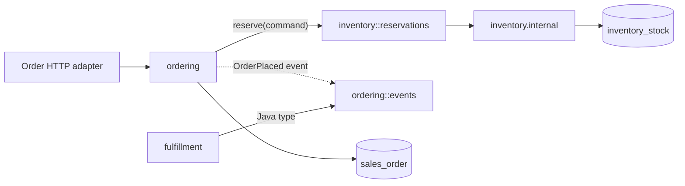

# Xử lý package chưa có boundary rõ

Một ứng dụng bán hàng Spring Boot đã chuyển `ordering` và `inventory` thành các package theo tính năng, nhưng vẫn còn `common`, `support`, `workflow`, `service` và `integration` nằm dưới package gốc. `common.CheckoutHelper` vừa tính giá, vừa kiểm tra tồn, vừa cập nhật đơn; `workflow.SubmitOrderService` mở transaction cho cả hai module; `integration.EventRelay` đọc repository của Ordering để gửi sự kiện. Khi chạy `ApplicationModules.verify()`, nhóm nhìn thấy vòng phụ thuộc hoặc một “module common” được gần như mọi module sử dụng. Nếu chỉ di chuyển toàn bộ `common` sang `shared` hoặc đánh dấu nó là open module, kiến trúc có vẻ bớt lỗi nhưng **chưa có ranh giới chịu trách nhiệm thực sự**.

**Xử lý package chưa có boundary rõ** là quá trình giải quyết từng trường hợp chưa xác định được **ai sở hữu hành vi, dữ liệu và invariant**, rồi quyết định mã nên nằm trong một module nghiệp vụ, trở thành contract công khai, thuộc hạ tầng dùng chung hay được tách thành luồng điều phối. Không thể quyết định chỉ từ tên class, số lượng import hoặc việc một helper có nhiều nơi gọi.

Bài thuộc chương **Refactoring an existing app** của **SPRING_MODULITH_VERIFICATION_TESTING**. Ta sẽ dùng ví dụ Java/SQL thật, mô hình `ApplicationModules`, quy tắc dependency và `@ApplicationModuleTest` để kiểm chứng cách xử lý package mơ hồ; bổ sung integration test database/event và quality gate CI để ngăn refactor làm sai hành vi. Các mục đi thẳng vào **quyết định và bằng chứng**, không lặp lại phần giới thiệu Spring Modulith hay lập sơ đồ package cơ bản.

> **Mục tiêu nghiệm thu:** Sau mỗi lát cắt, một class không còn nằm trong “vùng xám” chỉ vì mọi nơi đều gọi nó. Mã có owner hoặc mục đích hạ tầng rõ, dependency mới có chiều hợp lệ, dữ liệu chỉ được ghi qua module owner, và các test có khả năng phát hiện cả việc chuyển sai responsibility lẫn hành vi hồi quy.

## 1. Xác định cụ thể điều gì đang “chưa rõ boundary”

Một package không tự trở thành vấn đề chỉ vì có tên `common`. Điều đáng lo là **quyền và trách nhiệm bị trộn** trong các class hoặc đường gọi.

### 1.1. Bốn kiểu mơ hồ thường gặp

| Kiểu | Dấu hiệu trong code | Câu hỏi quyết định |
| --- | --- | --- |
| **Owner mơ hồ** | `CheckoutHelper` vừa trừ tồn vừa ghi order | Ai phải bảo vệ invariant và xử lý lỗi của từng bước? |
| **API mơ hồ** | Module A import `B.internal.*` vì không có contract công khai | A thật sự cần *lệnh/query* nào từ B? |
| **Hạ tầng lẫn domain** | `CommonUtils` vừa format chuỗi, vừa gọi `EntityManager` | Phần nào thuần chức năng, phần nào sở hữu dữ liệu/transaction? |
| **Orchestration mơ hồ** | `WorkflowService` gọi nhiều owner rồi mở transaction hoặc phát event | Ai quyết định thứ tự bước, commit boundary và chính sách bù trừ? |

Khảo sát không nên bắt đầu bằng lệnh “di chuyển `common` vào module nào?”. Trước hết phải tách **những trách nhiệm bên trong**. Một class có thể cần **tách thành ba class ở ba module khác nhau**, thay vì chuyển nguyên khối tới một module.

### 1.2. Ví dụ AS-IS cần xử lý

```text
com.example.shop
├── ShopApplication.java
├── ordering/
│   └── internal/PlaceOrderService.java
├── inventory/
│   └── internal/StockJpaRepository.java
├── payments/
│   └── internal/PaymentRepository.java
├── common/
│   ├── MoneyFormatter.java
│   ├── CheckoutHelper.java
│   ├── OrderStatusHelper.java
│   └── CommonJpaRepository.java
├── workflow/
│   └── CheckoutWorkflowService.java
├── integration/
│   ├── PaymentGatewayClient.java
│   └── OrderEventPublisher.java
└── config/
    └── TransactionConfiguration.java
```

Với cách phát hiện module mặc định của Spring Modulith, các package trực tiếp dưới `com.example.shop` **có thể là các application modules**: `ordering`, `inventory`, `payments`, **cả** `common`, `workflow`, `integration` và `config`. Việc `common` là một module theo cơ chế phát hiện không có nghĩa nó là một **bounded context** hợp lệ theo nghiệp vụ.

### 1.3. Bảng bằng chứng trước khi sửa

```text
Finding: BOUNDARY-07
Class: common.CheckoutHelper
Callers: ordering.PlaceOrderService, workflow.CheckoutWorkflowService
Reads: inventory_stock, product_price
Writes: inventory_stock, sales_order
Events: CheckoutCompleted (đang phát trước commit)
Transaction: REQUIRED, cùng datasource
Reason unclear: cùng một helper sở hữu ba invariant
Candidate owners: inventory, pricing, ordering
Unknown: Payment là đồng bộ hay xử lý sau commit?
Required test: rollback khi INSERT sales_order thất bại
```

Bảng này là **đầu ra khảo sát của người học**, không phải file bổ sung cần tạo trong workflow bài Knowledge. Với mỗi finding, ghi đủ *caller → callee*, table/event, transaction và hành vi bắt buộc giữ; nếu chưa biết, đánh dấu `UNKNOWN`, không tự suy đoán.

### 1.4. Đặt câu hỏi theo “quyền thay đổi” thay vì tên package

Ví dụ `MoneyFormatter` có thể hoàn toàn thuần dữ liệu và không có owner nghiệp vụ riêng. `CheckoutHelper.reserveStock()` lại quyết định số hàng được giữ; nó phải chịu **policy của Inventory** dù đã được nhiều feature gọi.

Một heuristic hữu ích:

1. Khi luật nghiệp vụ đổi, **team/feature nào** phải quyết định và test lại?
2. Class có ghi **bảng/aggregate** của owner nào?
3. Nó bảo vệ invariant, hay chỉ chuyển đổi định dạng dữ liệu?
4. Nếu caller đổi, có cần sửa implementation của class không?
5. Có thể công bố một **contract nhỏ** thay vì cho caller điều khiển repository?
6. Có transaction/event side effect khiến việc di chuyển thay đổi kết quả không?

Nếu câu 1–3 đều không có câu trả lời nhất quán, **chưa có đủ căn cứ để cố định boundary**. Hãy viết characterization test cho luồng liên quan và giữ finding mở trong kế hoạch refactor.

## 2. Phân rã package mơ hồ theo trách nhiệm và dữ liệu

Với `common`, `workflow`, `integration`, mục tiêu không phải **xóa tên package bằng mọi giá** mà là xác định từng class cần thuộc owner nào hoặc cần loại trung gian ở đâu.

### 2.1. Ma trận phân loại trước khi di chuyển

| Mã cũ | Đang làm gì | Đích hợp lý | Vì sao |
| --- | --- | --- | --- |
| `common.MoneyFormatter` | Định dạng hiển thị tiền, không IO | `shared.formatting` thuần Java hoặc adapter UI | Không sở hữu order, payment hay price |
| `common.PricingRules` | Áp giá/chiết khấu, tính tổng tiền | `pricing` nếu Pricing thực sự sở hữu chính sách | Chính sách thay đổi theo nghiệp vụ giá |
| `common.CheckoutHelper.reserve()` | Ghi `inventory_stock` | `inventory.internal`, công bố `InventoryReservations` | Inventory sở hữu invariant số lượng |
| `common.CheckoutHelper.createOrder()` | Ghi `sales_order` | `ordering.internal` | Ordering sở hữu vòng đời đơn |
| `common.CommonJpaRepository` | CRUD cho nhiều entity khác owner | Tách repository về từng owner | Không nên có kho ghi toàn hệ thống |
| `workflow.CheckoutWorkflowService` | Điều phối luồng đặt đơn | `ordering.internal` hoặc module orchestration có trách nhiệm riêng | Quyền điều phối/transaction cần được xác nhận |
| `integration.PaymentGatewayClient` | Giao tiếp API nhà cung cấp thanh toán | Adapter nằm trong `payments.internal` nếu chỉ Payments sử dụng | Bảo vệ provider-specific details |
| `integration.OrderEventPublisher` | Publish event của Ordering | `ordering.internal` hoặc hạ tầng event được cấu hình rõ | Event contract do Ordering sở hữu |
| `config.TransactionConfiguration` | Tạo transaction manager dùng chung | Bootstrap/infrastructure có chính sách rõ | Không phải domain API của Ordering |

**Lưu ý:** Đây là quyết định *có điều kiện*, không phải công thức. Nếu Pricing chỉ là một policy nội bộ Ordering và không có owner/vòng đời riêng, đặt `PricingRules` trong Ordering có thể hợp lý hơn lập module `pricing` bé nhưng vô nghĩa.

### 2.2. Cách quyết định một đoạn mã là shared kernel thật

Một tiện ích chia sẻ có thể ở vùng shared khi:

- Không sở hữu trạng thái nghiệp vụ của một feature.
- Không thao tác repository/entity manager hoặc gọi external systems thay mặt một owner.
- Không chứa điều kiện nghiệp vụ chỉ đúng cho một bounded context.
- API ổn định, thay đổi không kéo theo nhiều module phải cùng sửa.
- Dependency direction không tạo vòng với những module đang sử dụng nó.

Ví dụ:

```java
public final class MoneyFormatting {
    private MoneyFormatting() {}

    public static String formatVnd(long dong) {
        return "%,d ₫".formatted(dong);
    }
}
```

Đây là tiện ích định dạng; không phù hợp làm nơi chứa `calculateDiscountForVipCustomer()` hoặc `reserveStock()`. Đặc biệt, nếu giá trị tiền có quy tắc nghiệp vụ về scale, rounding, currency và tax, cần cân nhắc value object/policy owner thay vì mặc định dùng formatter chung.

### 2.3. Không đưa aggregate của mọi module vào `shared`

Một phản mẫu:

```text
shared/
  BaseEntity.java
  OrderEntity.java
  StockEntity.java
  PaymentEntity.java
  UniversalRepository.java
```

Với layout này, module nào cũng có thể trực tiếp dùng entity và repository thuộc những owner khác. Kiến trúc **không có vòng Java dependency** trong một số trường hợp vì mọi module cùng trỏ `shared`, nhưng invariants bị phân tán sang caller. Tránh dùng `shared` làm “ngăn kéo” để `verify()` ngừng báo lỗi.

### 2.4. Phân loại “khó” bằng thay đổi có chủ đích

Cho `CheckoutHelper` ba thay đổi giả định:

| Yêu cầu mới | Phần nào bắt buộc sửa? | Phát hiện |
| --- | --- | --- |
| Không được giữ quá số tồn khả dụng | Logic `reserveStock`/SQL và test cạnh tranh | Thuộc Inventory |
| Đơn chuyển `PLACED → CANCELLED` khi timeout | Trạng thái Order, rule hủy | Thuộc Ordering |
| Phí giao hàng thay đổi theo vùng | Shipping quotation hoặc Pricing policy theo ownership | Cần phân định giữa Pricing và Fulfillment |

Nếu một class phải sửa cho cả ba thay đổi, đó là bằng chứng cần **tách trách nhiệm**, không chỉ đổi tên package.

## 3. Chọn boundary bằng invariant, transaction và hướng dependency

Một package có thể chứa nhiều class được sử dụng bởi hai module; dấu hiệu đó **không đủ** để đặt nó thành module thứ ba. Hãy quyết định theo **đơn vị nhất quán** và luồng lệnh.

### 3.1. Trước khi tách: code trộn trách nhiệm

```java
// common/CheckoutHelper.java — phản mẫu rút gọn.
@Component
public class CheckoutHelper {

    private final JdbcTemplate jdbc;

    public CheckoutHelper(JdbcTemplate jdbc) {
        this.jdbc = jdbc;
    }

    @Transactional
    public UUID checkout(String sku, int quantity) {
        Integer current = jdbc.queryForObject(
            "SELECT available FROM inventory_stock WHERE sku = ?",
            Integer.class, sku
        );
        if (current == null || current < quantity) {
            throw new IllegalStateException("Not enough stock");
        }
        jdbc.update(
            "UPDATE inventory_stock SET available = ? WHERE sku = ?",
            current - quantity, sku
        );

        UUID id = UUID.randomUUID();
        jdbc.update(
            "INSERT INTO sales_order(order_id, sku, quantity) VALUES (?, ?, ?)",
            id, sku, quantity
        );
        return id;
    }
}
```

Đây là ví dụ **phản mẫu**, không phải code production an toàn: read–modify–write có thể oversell, thiếu `requestId`/idempotency và transaction manager có thể chưa được cấu hình đúng.

Nhưng nó cho thấy một điểm quan trọng: việc tách `CheckoutHelper` phải giữ **quyền cập nhật stock** ở Inventory, **quyền tạo order** ở Ordering và quyết định **điểm commit** của luồng. Nếu chỉ di chuyển nguyên helper vào `ordering.internal`, ta đang hợp thức hóa Ordering ghi bảng Inventory.

### 3.2. Trước khi chuyển, chốt hợp đồng behavior

Ví dụ một characterization test có thể bảo vệ:

```text
Given:
  SKU-TEST có available=5 đã commit
  requestId R chưa có order/reservation

When:
  submit order SKU-TEST quantity=2

Then:
  một order và một reservation của R được commit
  tồn còn 3
  nếu INSERT order thất bại sau bước reserve:
      available vẫn 5
      không có reservation R
      không có OrderPlaced success event sau commit
```

Nếu test này đòi **cả order và inventory cùng rollback**, cần biết hai service còn dùng **cùng datasource/transaction manager** và propagation phù hợp. Chuyển ngay sang event `AFTER_COMMIT` để làm boundary “đẹp hơn” có thể thay đổi hợp đồng từ atomic sang eventual consistency, phải thiết kế compensation riêng.

### 3.3. Đồ thị TO-BE tối thiểu



**Hai hướng phải phân biệt:** Ordering phụ thuộc Java contract `inventory::reservations`; Fulfillment phụ thuộc Java event type `ordering::events`. Runtime event chạy Ordering → Fulfillment, nhưng dependency Java của consumer hướng ngược về event owner.

### 3.4. Khi nào cần module điều phối riêng?

Không phải mọi `workflow` đều nên nằm trong Ordering. Nếu một quy trình có vòng đời, KPI, dữ liệu/scheduling và trách nhiệm riêng — ví dụ **subscription activation** điều phối Account, Billing và Provisioning trong nhiều ngày — một module orchestration có thể có lý do tồn tại. Nhưng cần:

1. Tên và owner nghiệp vụ rõ (không chỉ `workflow`).
2. State machine, correlation ID và chính sách timeout/retry/bù trừ rõ.
3. Contract với từng module owner, không ghi repository của họ.
4. Test failure/interleaving và recovery.
5. Không giả định một distributed transaction nếu hệ thống thực sự chạy bất đồng bộ.

Với use case đặt đơn đồng bộ của ví dụ, **Ordering là owner hợp lý cho orchestration**; không cần sinh module `workflow` chỉ vì có nhiều lời gọi.

## 4. Tách lớp mơ hồ thành contract có owner rõ, giữ commit boundary

Giải pháp không phải tạo một `CommonFacade` có thể sửa mọi bảng. Ta tách `CheckoutHelper` thành **đường lệnh Inventory** và **orchestration Ordering**, để mỗi module giữ invariant của nó.

### 4.1. Đích package và public contracts

```text
com.example.shop
├── ShopApplication.java
├── inventory/
│   ├── package-info.java
│   ├── reservations/
│   │   ├── package-info.java
│   │   ├── ReserveStock.java
│   │   ├── ReservationReceipt.java
│   │   ├── InventoryReservations.java
│   │   └── InsufficientStock.java
│   └── internal/
│       └── StockReservationService.java
├── ordering/
│   ├── package-info.java
│   ├── placement/
│   │   ├── package-info.java
│   │   ├── PlaceOrder.java
│   │   └── OrderPlacement.java
│   ├── events/
│   │   ├── package-info.java
│   │   └── OrderPlaced.java
│   └── internal/
│       └── PlaceOrderService.java
└── fulfillment/
    ├── package-info.java
    └── internal/OrderPlacedListener.java
```

Các public contracts **không** trả entity JPA, `JdbcTemplate` hoặc repository. Một consumer phải nhận được **nghĩa nghiệp vụ** và kết quả cần thiết, không được điều khiển cách update của owner.

```java
// inventory/reservations/package-info.java
@org.springframework.modulith.NamedInterface("reservations")
package com.example.shop.inventory.reservations;
```

```java
// inventory/reservations/ReserveStock.java
package com.example.shop.inventory.reservations;

import java.util.UUID;

public record ReserveStock(String sku, int quantity, UUID requestId) {
    public ReserveStock {
        if (sku == null || sku.isBlank() || quantity <= 0
                || requestId == null) {
            throw new IllegalArgumentException("ReserveStock không hợp lệ");
        }
    }
}
```

```java
// inventory/reservations/ReservationReceipt.java
package com.example.shop.inventory.reservations;

import java.util.UUID;

public record ReservationReceipt(UUID reservationId) {}
```

```java
// inventory/reservations/InventoryReservations.java
package com.example.shop.inventory.reservations;

public interface InventoryReservations {
    ReservationReceipt reserve(ReserveStock command);
}
```

```java
// inventory/reservations/InsufficientStock.java
package com.example.shop.inventory.reservations;

public class InsufficientStock extends RuntimeException {
    public InsufficientStock(String sku) {
        super("Không đủ hàng cho SKU " + sku);
    }
}
```

### 4.2. Inventory bảo vệ điều kiện tồn ngay tại SQL

Implementation tối giản trong `inventory.internal`:

```java
package com.example.shop.inventory.internal;

import com.example.shop.inventory.reservations.InsufficientStock;
import com.example.shop.inventory.reservations.InventoryReservations;
import com.example.shop.inventory.reservations.ReservationReceipt;
import com.example.shop.inventory.reservations.ReserveStock;
import java.util.UUID;
import org.springframework.jdbc.core.JdbcTemplate;
import org.springframework.stereotype.Service;
import org.springframework.transaction.annotation.Transactional;

@Service
class StockReservationService implements InventoryReservations {

    private final JdbcTemplate jdbc;

    StockReservationService(JdbcTemplate jdbc) {
        this.jdbc = jdbc;
    }

    @Override
    @Transactional
    public ReservationReceipt reserve(ReserveStock command) {
        int affected = jdbc.update("""
            UPDATE inventory_stock
               SET available = available - ?
             WHERE sku = ? AND available >= ?
            """,
            command.quantity(), command.sku(), command.quantity()
        );
        if (affected != 1) {
            throw new InsufficientStock(command.sku());
        }

        UUID reservationId = UUID.randomUUID();
        jdbc.update("""
            INSERT INTO stock_reservation
                (reservation_id, request_id, sku, quantity)
            VALUES (?, ?, ?, ?)
            """,
            reservationId, command.requestId(),
            command.sku(), command.quantity()
        );
        return new ReservationReceipt(reservationId);
    }
}
```

Phần này bảo vệ thao tác update và insert **trong một transaction**. PostgreSQL conditional update xử lý cạnh tranh trên cùng một hàng theo row locking/recheck phù hợp; muốn chứng minh không oversell, phải có test concurrency thật, không chỉ nhìn cú pháp.

**Độ sâu production chưa được triển khai trong snippet:** request lặp có thể vấp `UNIQUE(request_id)`. Cần định nghĩa policy idempotency (trả receipt cũ, hoặc lỗi có nghĩa), xử lý retry qua transaction mới, cùng các tình huống cancel/release. Đó không phải trách nhiệm của Ordering hoặc `common`.

### 4.3. Ordering điều phối nhưng không biết bảng Inventory

```java
// ordering/placement/package-info.java
@org.springframework.modulith.NamedInterface("placement")
package com.example.shop.ordering.placement;
```

```java
// ordering/placement/PlaceOrder.java
package com.example.shop.ordering.placement;

import java.util.UUID;

public record PlaceOrder(
    String sku, int quantity, UUID requestId
) {
    public PlaceOrder {
        if (sku == null || sku.isBlank() || quantity <= 0
                || requestId == null) {
            throw new IllegalArgumentException("PlaceOrder không hợp lệ");
        }
    }
}
```

```java
// ordering/placement/OrderPlacement.java
package com.example.shop.ordering.placement;

import java.util.UUID;

public interface OrderPlacement {
    UUID place(PlaceOrder command);
}
```

```java
// ordering/events/package-info.java
@org.springframework.modulith.NamedInterface("events")
package com.example.shop.ordering.events;
```

```java
// ordering/events/OrderPlaced.java
package com.example.shop.ordering.events;

import java.util.UUID;

public record OrderPlaced(UUID orderId) {}
```

Service:

```java
package com.example.shop.ordering.internal;

import com.example.shop.inventory.reservations.InventoryReservations;
import com.example.shop.inventory.reservations.ReserveStock;
import com.example.shop.ordering.events.OrderPlaced;
import com.example.shop.ordering.placement.OrderPlacement;
import com.example.shop.ordering.placement.PlaceOrder;
import java.util.UUID;
import org.springframework.context.ApplicationEventPublisher;
import org.springframework.jdbc.core.JdbcTemplate;
import org.springframework.stereotype.Service;
import org.springframework.transaction.annotation.Transactional;

@Service
class PlaceOrderService implements OrderPlacement {

    private final InventoryReservations inventory;
    private final JdbcTemplate jdbc;
    private final ApplicationEventPublisher events;

    PlaceOrderService(
        InventoryReservations inventory,
        JdbcTemplate jdbc,
        ApplicationEventPublisher events
    ) {
        this.inventory = inventory;
        this.jdbc = jdbc;
        this.events = events;
    }

    @Override
    @Transactional
    public UUID place(PlaceOrder command) {
        var reserved = inventory.reserve(new ReserveStock(
            command.sku(), command.quantity(), command.requestId()
        ));
        UUID orderId = UUID.randomUUID();
        jdbc.update("""
            INSERT INTO sales_order
                (order_id, request_id, sku, quantity, reservation_id)
            VALUES (?, ?, ?, ?, ?)
            """,
            orderId, command.requestId(), command.sku(),
            command.quantity(), reserved.reservationId()
        );
        events.publishEvent(new OrderPlaced(orderId));
        return orderId;
    }
}
```

Giả định hai service là Spring beans, dùng **cùng datasource và transaction manager**, propagation `REQUIRED` (mặc định của `@Transactional`), test gọi qua Spring proxy. Inventory tham gia transaction của Ordering; nếu INSERT `sales_order` lỗi, cập nhật stock/reservation phải rollback cùng nhau. Nếu transaction manager khác nhau hoặc service Inventory dùng `REQUIRES_NEW`, đây **không** còn là refactor giữ nguyên semantics và phải được thiết kế/test lại.

### 4.4. Quy tắc phụ thuộc chỉ công bố điều cần thiết

```java
// inventory/package-info.java
@org.springframework.modulith.ApplicationModule
package com.example.shop.inventory;
```

```java
// ordering/package-info.java
@org.springframework.modulith.ApplicationModule(
    allowedDependencies = "inventory::reservations"
)
package com.example.shop.ordering;
```

`ordering` có quyền dùng named interface `inventory::reservations`; không có quyền import `inventory.internal.StockReservationService` hoặc `StockRepository`. Giới hạn này bắt được **Java dependency sai** sau refactor, nhưng không tự kiểm tra native SQL string — phần đó cần review và test dữ liệu owner.

Nếu Fulfillment cần lắng nghe `OrderPlaced`, quy tắc consumer:

```java
// fulfillment/package-info.java
@org.springframework.modulith.ApplicationModule(
    allowedDependencies = "ordering::events"
)
package com.example.shop.fulfillment;
```

Luồng runtime của event đi từ Ordering tới Fulfillment, còn Java dependency từ Fulfillment tới event DTO công khai đi theo chiều ngược lại.

### 4.5. Phân biệt một điểm API rõ với façade giả

Phản mẫu:

```java
public interface CommonDataAccess {
    Object findEntity(String table, String id);
    void updateStock(String sku, int available);
    void executeAnySql(String statement);
}
```

Đây chỉ là quyền ghi database của nhiều owner được che dưới một interface. Một contract tốt làm cho hành vi **khó sử dụng sai hơn**: `reserve()` kiểm tra đủ hàng, xử lý rollback, trả receipt có nghĩa và giữ SQL nội bộ.

## 5. Giữ package chuyển tiếp mà không biến nó thành module vĩnh viễn

Trong ứng dụng lớn, một vài class chưa thể di chuyển ngay vì hàng chục caller, contract nhị phân, reflection hoặc cấu hình scan. Có thể dùng **giai đoạn chuyển tiếp**, nhưng phải giữ việc phân định ownership hiển thị.

### 5.1. Chiến lược strangler tại ranh giới cũ

Ví dụ các caller legacy vẫn gọi `common.CheckoutHelper`, nhưng code mới đã nằm trong Ordering:

```java
// common/CheckoutHelper.java — adapter chuyển tiếp.
package com.example.shop.common;

import com.example.shop.ordering.placement.OrderPlacement;
import com.example.shop.ordering.placement.PlaceOrder;
import java.util.UUID;
import org.springframework.stereotype.Component;

@Deprecated(forRemoval = true)
@Component
public class CheckoutHelper {

    private final OrderPlacement placement;

    public CheckoutHelper(OrderPlacement placement) {
        this.placement = placement;
    }

    public UUID checkout(String sku, int quantity, UUID requestId) {
        return placement.place(new PlaceOrder(
            sku, quantity, requestId
        ));
    }
}
```

Adapter chỉ chuyển tiếp tới **public API**. Nó **không** tự cập nhật `inventory_stock` hoặc `sales_order`, không mở transaction riêng với semantics khác và không phát event lần hai. Dùng `@Deprecated(forRemoval=true)` là tín hiệu cho caller; thời gian xóa phải được quản lý bằng issue/CI metrics, không chỉ dựa vào annotation.

### 5.2. Vấn đề module graph của adapter chuyển tiếp

Nếu `common` nằm ngay dưới application root, nó có thể được phát hiện là **một application module riêng**. Khi đó:

```text
common → ordering::placement
```

có thể là dependency Java hợp lệ nếu Ordering công bố API phù hợp, nhưng code mới **không được phụ thuộc ngược `common.CheckoutHelper`**. Nếu Ordering import adapter chuyển tiếp, ta dễ tạo vòng `common ↔ ordering`.

Đặc biệt, `common.CheckoutHelper` dùng kiểu `PlaceOrder` ở `ordering::placement`; Ordering package phải công bố named interface đúng, và `common` nếu có `allowedDependencies` cần khai báo `ordering::placement` có chủ đích. Không giả định Spring Modulith tự hiểu một adapter là “không thuộc graph” vì có tên `legacy` hoặc `common`.

Khi `common` **đã được thu hẹp** thành adapter chỉ dùng contract này, có thể khóa chiều dependency:

```java
// common/package-info.java — chỉ áp dụng sau khi tách các trách nhiệm khác.
@org.springframework.modulith.ApplicationModule(
    allowedDependencies = "ordering::placement"
)
package com.example.shop.common;
```

Nếu `common` vẫn chứa nhiều class có dependency khác, tiếp tục phân loại chúng trước khi áp rule hẹp; không mở rộng policy bừa bãi cho test xanh.

### 5.3. Không “giấu” package cũ bằng custom detection để test xanh

Một module detection strategy tùy chỉnh có thể hữu ích trong dự án có nhiều package legacy và module boundaries do tổ chức quy định. Nhưng nếu loại `common` khỏi mô hình chỉ để `verify()` không còn cảnh báo, runtime dependencies và SQL writes của nó **vẫn tồn tại**.

Nếu dùng detection tùy chỉnh, cần thêm bằng chứng:

1. Những package nào được phân tích và package nào đang bị loại?
2. Mã bị loại có còn **ghi dữ liệu của module mới** không?
3. `ApplicationModules.of(...).verify()` có bao phủ những dependencies nguy hiểm theo thiết kế không?
4. Có test bổ sung cho các ngoại lệ và kế hoạch loại bỏ khi adapter cũ hết caller không?

**Tránh đặt mặc định** mọi package legacy vào “unmanaged” mà không có owner. Điều đó biến đường chuyển tiếp thành **vùng mù của quality gate**.

### 5.4. Open module chỉ là ngoại lệ có giá

Một open module cho phép nhiều tham chiếu package hơn mô hình closed module, làm yếu kiểm tra ranh giới. Nếu vì lý do tương thích buộc phải tạm mở:

| Thông tin phải ghi | Ví dụ |
| --- | --- |
| Vì sao cần mở? | Caller cũ dùng `inventory.internal.StockService` |
| Phạm vi thực tế | Hai callers thuộc legacy integration, không phải toàn hệ thống |
| API mục tiêu | `inventory::reservations` |
| Bằng chứng chuyển đổi | Compiler không còn import nội bộ; `verify()` chặn lại khi closed |
| Điều kiện đóng lại | Hai caller chuyển xong và integration test pass |

Không dùng open module như một cách “đúng hóa” boundaries vĩnh viễn. Cũng không mở tất cả allowed dependencies để giải quyết vòng Java thực.

### 5.5. Khi còn package-by-layer chưa xử lý hết

Ví dụ `com.example.shop.service`, `repository`, `domain` vẫn tồn tại ngay dưới root; Spring Modulith có thể phát hiện chúng như các module kỹ thuật. Hãy:

- Gắn từng class vào một **finding** và owner mục tiêu.
- Chuyển từng slice, giữ characterization tests.
- Không đưa class nghiệp vụ mới vào package kỹ thuật cũ.
- Theo dõi số class/caller chưa chuyển và hướng dependency đến các feature modules.
- Chốt deadline xóa adapters và lỗi kiến trúc còn lại.

Lúc đó một test `ApplicationModules` fail ở baseline có thể là **dữ liệu về nợ kỹ thuật**, không nên bị disable vô hạn. Quality gate chuyển từ kiểm soát không phát sinh lỗi mới sang `verify()` toàn ứng dụng khi đã đủ điều kiện.

## 6. Phân biệt hạ tầng dùng chung với dependency nghiệp vụ thực

Không phải mọi bean không biết đặt đâu đều phải được “chủng” thành feature module. Một phần là **infrastructure dùng chung**, nhưng phải xác định chỗ nó được cấu hình và những quyền side effect của nó.

### 6.1. Những package hay bị nhầm

| Package/class | Nên xem là | Lỗi khi phân loại sai |
| --- | --- | --- |
| `config.ClockConfiguration` | Hạ tầng cung cấp Clock | Đưa clock mutable vào domain shared, test rò state |
| `integration.StripeClient` | Payment outbound adapter nếu Payments sở hữu thanh toán | Ordering gọi thẳng provider, vượt Payment |
| `integration.EmailSender` | Outbound port/adapter theo notification owner | Feature gọi trực tiếp và tự quyết định gửi email trước commit |
| `config.JpaConfiguration` | Hạ tầng persistence | Module test thiếu scan hoặc import module ngẫu nhiên |
| `support.OrderValidator` | Ordering domain policy | Mọi module import rule Order và tự đổi trạng thái |
| `support.CustomerIdParser` | Parser thuần dữ liệu nếu thật sự generic | Gắn thêm query Customer rồi vô tình trở thành cross-module dependency |
| `integration.EventPublicationRegistry` config | Event infrastructure | Test thiếu migrations/retry trong full context |

Một hạ tầng thật sự shared nên phục vụ module thông qua interface/bean config **không expose nội bộ nghiệp vụ**. Ví dụ `Clock` thuần cho thời gian có thể dùng chung, nhưng chính sách “reservation hết hạn sau 15 phút” thuộc Inventory, không thuộc `CommonClockService`.

### 6.2. Chuyển adapter outbound về đúng owner

Phản mẫu:

```java
// ordering/internal/PlaceOrderService.java
stripeClient.charge(customerId, amount);
```

Ordering lúc này phải biết chi tiết nhà cung cấp thanh toán và policy retry. Một hướng refactor an toàn:

```java
// payments/collection/PaymentCollection.java
public interface PaymentCollection {
    PaymentReceipt collect(CollectPayment command);
}
```

`StripeClient` hoặc adapter tương ứng nằm ở `payments.internal` hoặc infrastructure được quản lý bởi Payments. Nếu Ordering cần gọi đồng bộ, công bố `payments::collection` và định nghĩa hợp đồng thời điểm thanh toán, idempotency và lỗi. Nếu chuyển sang event async, đó là **thay đổi transaction semantics** cần bài test end-to-end/reconciliation, không thể chỉ đổi injection type.

### 6.3. Khi module test thiếu bean hạ tầng

Một `@ApplicationModuleTest(STANDALONE)` ở Inventory có thể báo không tìm thấy `JdbcTemplate`, mapper hoặc configuration tùy chỉnh. Cần kiểm tra:

1. Bean đó do Spring Boot auto-configuration cung cấp hay do một `@Configuration` trong package legacy?
2. Cấu hình thuộc hạ tầng chung được bootstrap đúng, hay thực sự chứa logic của module khác?
3. Nếu đưa test configuration, nó có **tái hiện đúng resource/transaction** cần kiểm tra không?
4. Có đang dùng mock làm mất invariant hoặc commit behavior?

**Không** tự đổi sang `BootstrapMode.ALL_DEPENDENCIES` chỉ để có bean. Nạp thêm nhiều modules có thể làm test xanh nhưng đánh mất mục tiêu phơi bày boundary mơ hồ. Nếu use case cần integration thật, hãy tạo test có phạm vi integration được nói rõ.

### 6.4. Bean location không hoàn toàn đồng nghĩa Java owner

Một Spring `@Configuration` dưới package root có thể cung cấp `DataSource`/`TransactionManager` dùng chung. Điều đó không có nghĩa mọi module application phải *import Java type* của một module `config`. Ngược lại, nếu `config` chứa factory trả `StockReservationService` của Inventory và lén inject `OrderRepository`, đó là dấu hiệu wiring vượt boundary.

Phân biệt:

- **Bean infrastructure resource:** được share có chủ đích (DataSource, Clock, transaction manager).
- **Business dependency:** caller import kiểu API/module khác để thực hiện use case.
- **Runtime data coupling:** SQL, JPA mapping, transaction hoặc event nối hai owner nhưng không phản ánh hết qua Java import.

Chỉ sau khi phân loại đúng mới quyết định đổi package configuration, bổ sung named interface hay chuyển code vào module.

## 7. Rà soát các boundary ẩn trong SQL, JPA, event và transaction

Đưa `StockReservationService` vào `inventory.internal` không đủ nếu `ordering.internal.PlaceOrderService` vẫn có một câu native SQL cập nhật trực tiếp `inventory_stock`. Đây là **quyền sở hữu dữ liệu bị vượt qua mà Java dependency graph có thể không thể hiện**.

### 7.1. Tìm cross-write không phụ thuộc tên Java class

Ví dụ:

```java
// ordering/internal/LegacyOrderCalculator.java — PHẢN MẪU
private final JdbcTemplate jdbc;

void markReserved(String sku, int quantity) {
    jdbc.update("""
        UPDATE inventory_stock
           SET available = available - ?
         WHERE sku = ?
        """, quantity, sku);
}
```

`ApplicationModules.verify()` thấy dependency Java tới `JdbcTemplate`, không nhất thiết biết chuỗi `"inventory_stock"` thuộc Inventory. Nếu tồn không đủ, câu update này có thể làm âm tồn; nó bypass toàn bộ policy của `InventoryReservations.reserve(...)`.

Bảng review:

| Loại truy cập | Đường ghi/đọc | Owner có thể bị vượt? | Kiểm chứng |
| --- | --- | --- | --- |
| JDBC/native SQL | `UPDATE inventory_stock` từ Ordering | Có | Review tên bảng, constraint, service-level test |
| JPQL/HQL bulk update | `UPDATE StockRow ...` | Có; thêm JPA version caveat | Cấm import entity internal; test affected rows |
| JPA association | `SalesOrderRow` giữ `@ManyToOne StockRow` | Có thể | `verify()`, transaction/mapping tests |
| Report query | `SELECT JOIN sales_order, inventory_stock` | Phụ thuộc read-model policy | Quy định read ownership, quyền DB/test |
| Stored procedure | `CALL release_inventory(...)` từ module khác | Có | Review SQL/procedure owner và integration |
| Database trigger | Trigger bảng A cập nhật bảng B | Có thể | Migration, transaction/rollback test |
| Event consumer | Listener update order bằng JDBC | Có | Public API/message contract, event test |

**Không kết luận mọi cross-module SELECT đều sai**: reporting/read models có thể cần join có chủ đích. Nhưng **cross-write** vào dữ liệu của owner khác cần được xử lý rõ, vì nó bỏ qua invariant mà module owner công bố.

### 7.2. Cắt liên kết JPA entity mà không phá referential integrity

Phản mẫu sau khi dời entities:

```java
// ordering/internal/SalesOrderRow.java
@ManyToOne(fetch = FetchType.LAZY)
private StockRow inventoryStock; // inventory.internal.persistence.StockRow
```

Ordering bây giờ phụ thuộc trực tiếp entity nội bộ của Inventory. Một hướng thay thế nếu hợp đồng cho phép:

```java
// ordering/internal/SalesOrderRow.java
@Column(name = "sku", nullable = false)
private String sku;
```

Ordering giữ SKU như một reference ID/snapshot nghiệp vụ; muốn giữ hàng thì gọi `InventoryReservations`. **Nhưng** không tùy tiện bỏ FK hoặc cascade đang là invariant thật: cần xác nhận liệu đơn có cần bắt buộc tham chiếu một SKU tồn tại, SKU có được xóa, stock dùng kho/tenant nào và migration có giữ dữ liệu không.

Khi thay JPA association:

1. Ghi toàn bộ query dựa vào association cũ (fetch join, lazy loading, cascade).
2. Viết characterization tests cho query output và transaction.
3. Chọn FK/ID/read model phù hợp với owner mới.
4. Đổi mapping, chạy migration/validation nếu cần.
5. Kiểm tra N+1, constraint/locking và serialization hậu thay đổi.

Đây là **boundary refactor có tác động dữ liệu**, không phải việc đổi một import trong IDE.

### 7.3. Event có thể thay phụ thuộc nhưng không tự giữ semantics

Trong `common` cũ có code:

```java
paymentRepository.createPendingFor(orderId);
```

Nếu chuyển nó sang `events.publishEvent(new OrderPlaced(orderId))` với Fulfillment/Payments listener `AFTER_COMMIT`, hệ thống chuyển từ **thao tác đồng bộ trong cùng transaction** sang **hậu xử lý có thể bất đồng bộ**. Những câu hỏi bắt buộc:

- Khi payment pending insert thất bại, Order đã commit chưa?
- Có Event Publication Registry hoặc outbox để retry không?
- Event được phát trước commit, trong commit callback hay ngoài transaction?
- Consumer xử lý lặp có tạo hai payment requests không?
- Có yêu cầu người dùng thấy payment request ngay khi API trả kết quả không?

Nếu hợp đồng cũ yêu cầu atomic commit với payment pending, chỉ tạo `OrderPlaced` event rồi bỏ test rollback là **thay đổi hành vi không kiểm soát**. Có thể cần giữ synchronous Payment API, hoặc định nghĩa quy trình eventual consistency, compensation và reconciliation có chủ đích.

### 7.4. Ownership của transaction không phải ownership của mọi bảng

Một `PlaceOrderService` ở Ordering có thể là **transaction boundary cho use case**, trong khi từng module vẫn sở hữu phần cập nhật bảng của mình. Với một datasource và các service `@Transactional(REQUIRED)` gọi qua Spring bean proxy, transaction của Ordering có thể bao cả lệnh Inventory, giữ tính nguyên tử.

```text
Ordering transaction BEGIN
  |
  +-- InventoryReservations.reserve(...)
  |      UPDATE inventory_stock
  |      INSERT stock_reservation
  |
  +-- Ordering lưu sales_order
  |
  +-- Publish OrderPlaced trong transaction
  |
Ordering COMMIT
  |
  +-- Fulfillment AFTER_COMMIT (nếu listener được cấu hình)
```

**Không kết luận luôn atomic** nếu Inventory dùng `REQUIRES_NEW`, có datasource/transaction manager khác hoặc caller bypass proxy. Đây là điểm cần integration test sau khi tách module; `ApplicationModules.verify()` không kiểm tra transaction semantics runtime.

### 7.5. Lựa chọn boundary phải có test chống hồi quy tương ứng

| Quyết định refactor | Failure cần test |
| --- | --- |
| Đưa stock update về Inventory | Hai request tranh đơn vị cuối không oversell |
| Thay JPA entity reference bằng ID | Query/order serialization và FK không hỏng |
| Công bố `InventoryReservations` | Ordering không thể import `inventory.internal.*` |
| Chuyển tác vụ sang `AFTER_COMMIT` listener | Producer rollback không tạo side effect thành công |
| Đưa payment gateway vào Payments | Retry/idempotency không charge hai lần |
| Giữ workflow đồng bộ | Lỗi order sau reserve rollback stock/reservation |

Không nên “đóng boundary” mà chưa có ít nhất một phép kiểm chứng cho **rủi ro cụ thể vừa được chuyển giao**.

## 8. Dùng `ApplicationModules` để bắt dependency sai, không che package mơ hồ

Sau khi định nghĩa owner và `@NamedInterface`, đo mô hình thực tế từ package, đừng chỉ review sơ đồ TO-BE.

### 8.1. Test identifiers và verification

```java
// src/test/java/com/example/shop/ModuleBoundaryTests.java
package com.example.shop;

import static org.assertj.core.api.Assertions.assertThat;

import java.util.ArrayList;
import org.junit.jupiter.api.Test;
import org.springframework.modulith.core.ApplicationModules;

class ModuleBoundaryTests {

    @Test
    void knowsBusinessModules() {
        var modules = ApplicationModules.of(ShopApplication.class);
        var ids = new ArrayList<String>();
        modules.forEach(module ->
            ids.add(module.getIdentifier().toString())
        );

        assertThat(ids).contains(
            "ordering", "inventory", "fulfillment"
        );
    }

    @Test
    void onlyPublishedDependenciesAreUsed() {
        ApplicationModules.of(ShopApplication.class).verify();
    }
}
```

Test đầu chứng minh các feature modules **được nhận diện**; nếu `common`, `workflow`, `service` còn tồn tại thì chúng có thể vẫn là module ứng viên. **Không cần giả vờ danh sách `ids` chỉ có ba mục** khi có các module chuyển tiếp hợp lệ hoặc đang được theo dõi. Đánh giá những module còn thừa bằng báo cáo nợ kỹ thuật, không xóa assertion để khỏi nhìn thấy.

`verify()` kiểm tra những quy tắc Spring Modulith có thể suy từ Java/module model: những phụ thuộc vòng và việc truy cập kiểu không được công bố của closed modules, cũng như `allowedDependencies` đã khai báo. Nó **không tự** truy vết SQL string, hạ tầng broker, transaction hoặc domain invariants.

### 8.2. Negative test quan trọng nhất

Trong branch thử nghiệm, cố tình thêm:

```java
// ordering/internal/PlaceOrderService.java — import sai để thử gate
import com.example.shop.inventory.internal.StockReservationService;
```

Hoặc tham chiếu cụ thể `inventory.internal.persistence.StockRepository` từ Ordering. Khi Inventory là closed module và Ordering chỉ được phép dùng `inventory::reservations`, **architecture gate phải fail**. Sau đó revert code sai.

Nếu test vẫn xanh:

1. Module root/detection có nhận đúng Inventory/Ordering không?
2. Kiểu đang import thật sự nằm trong `internal` hay trong root API/named interface?
3. Module có vô tình được khai báo `OPEN` hoặc allowed dependency quá rộng?
4. Test `verify()` có **thực sự chạy** trong CI không?
5. Cấu trúc source/test khác có khiến import đang xét nằm ngoài tập Java dependency được phân tích?

Negative check này cho biết **gate sẽ ngăn regression tương lai** chứ không chỉ xác nhận trạng thái hiện tại.

### 8.3. Khi `common` đang còn là module tạm

Thêm một bảng “hướng phụ thuộc cho phép” trong quá trình migration:

| Caller | Target | Trạng thái |
| --- | --- | --- |
| `common.CheckoutHelper` legacy | `ordering::placement` | Tạm cho phép; cần xóa adapter |
| `ordering` | `inventory::reservations` | Hợp lệ lâu dài |
| `fulfillment` | `ordering::events` | Hợp lệ lâu dài |
| `ordering` | `common.CheckoutHelper` | **Không**, tạo hướng ngược/vòng |
| `ordering` | `inventory.internal.*` | **Không**, vượt boundary |
| `payments` | `ordering.internal.SalesOrderRepository` | **Không**, business write chéo |

`allowedDependencies` là **giới hạn có chủ đích**, không phải công cụ tắt cảnh báo. Nếu `common` vẫn bao gồm SQL cross-write, dù phần dependency kiểu đã chuyển hợp lệ, vẫn cần test/review riêng để không vô tình bỏ sót quyền ghi dữ liệu.

### 8.4. Không đánh đồng một test kiến trúc xanh với một module chạy được

Một `ApplicationModules.verify()` xanh có thể xảy ra trong khi:

- Module Inventory thiếu `JdbcTemplate` bean do configuration sai.
- JPA repository không được scan sau khi đổi package.
- Flyway migration của bảng module chưa chạy trong test datasource.
- Consumer event nằm ngoài bootstrap scope.
- Orchestration đã đổi transaction propagation gây partial commit.

Vì thế ngay sau `verify()`, phải có `@ApplicationModuleTest` với **scope được chọn rõ**, rồi integration test cho những luồng vượt module.

## 9. Hai module tests và một integration test chứng minh boundary mới

Hãy dùng **PostgreSQL thật** cho đường JDBC + transaction của ví dụ. Schema migration tối giản:

```sql
CREATE TABLE inventory_stock (
    sku VARCHAR(80) PRIMARY KEY,
    available INTEGER NOT NULL,
    CONSTRAINT ck_available_nonnegative CHECK (available >= 0)
);

CREATE TABLE stock_reservation (
    reservation_id UUID PRIMARY KEY,
    request_id UUID NOT NULL UNIQUE,
    sku VARCHAR(80) NOT NULL
        REFERENCES inventory_stock(sku),
    quantity INTEGER NOT NULL CHECK (quantity > 0)
);

CREATE TABLE sales_order (
    order_id UUID PRIMARY KEY,
    request_id UUID NOT NULL UNIQUE,
    sku VARCHAR(80) NOT NULL,
    quantity INTEGER NOT NULL CHECK (quantity > 0),
    reservation_id UUID NOT NULL UNIQUE
        REFERENCES stock_reservation(reservation_id)
);
```

Đây là DDL dạy học, nên được triển khai qua migration test giống production, không dựa vào `ddl-auto=create-drop` che thiếu index/constraints. Các test sử dụng request ID riêng và database/container không chia sẻ với job khác.

### 9.1. Inventory `STANDALONE`: API tự bảo vệ dữ liệu

```java
// src/test/java/com/example/shop/inventory/InventoryBoundaryTests.java
package com.example.shop.inventory;

import static org.assertj.core.api.Assertions.assertThat;

import com.example.shop.inventory.reservations.InventoryReservations;
import com.example.shop.inventory.reservations.ReserveStock;
import java.util.UUID;
import org.junit.jupiter.api.Test;
import org.springframework.beans.factory.annotation.Autowired;
import org.springframework.boot.testcontainers.service.connection.ServiceConnection;
import org.springframework.jdbc.core.JdbcTemplate;
import org.springframework.modulith.test.ApplicationModuleTest;
import org.springframework.modulith.test.ApplicationModuleTest.BootstrapMode;
import org.springframework.test.annotation.DirtiesContext;
import org.testcontainers.containers.PostgreSQLContainer;
import org.testcontainers.junit.jupiter.Container;
import org.testcontainers.junit.jupiter.Testcontainers;

@ApplicationModuleTest(mode = BootstrapMode.STANDALONE)
@Testcontainers
@DirtiesContext(classMode = DirtiesContext.ClassMode.AFTER_CLASS)
class InventoryBoundaryTests {

    @Container
    @ServiceConnection
    static PostgreSQLContainer<?> postgres =
        new PostgreSQLContainer<>("postgres:16-alpine");

    @Autowired InventoryReservations inventory;
    @Autowired JdbcTemplate jdbc;

    @Test
    void reservesThroughOwnerContract() {
        String sku = "IT-" + UUID.randomUUID();
        UUID requestId = UUID.randomUUID();
        jdbc.update(
            "INSERT INTO inventory_stock(sku, available) VALUES (?, 5)",
            sku
        );

        var receipt = inventory.reserve(
            new ReserveStock(sku, 2, requestId)
        );

        Integer available = jdbc.queryForObject("""
            SELECT available FROM inventory_stock WHERE sku = ?
            """, Integer.class, sku);
        Integer reservations = jdbc.queryForObject("""
            SELECT count(*) FROM stock_reservation
            WHERE reservation_id = ? AND request_id = ?
            """, Integer.class, receipt.reservationId(), requestId);

        assertThat(available).isEqualTo(3);
        assertThat(reservations).isEqualTo(1);

        // Một scenario trên container riêng của class;
        // container bị bỏ sau class thay vì xóa shared tables.
    }
}
```

Những điều kiện để kết quả có nghĩa:

- Inventory là module được phát hiện đúng package, `InventoryReservations` có bean implementation thuộc Inventory.
- Không có `@Transactional` trên test; service tự commit và JDBC đọc lại state đã lưu.
- Migration đã được chạy, transaction manager nối vào đúng datasource.
- Container test **thật sự riêng** cho class, không bật global container reuse hoặc dùng lại datasource của class khác.
- `@DirtiesContext` điều phối Spring context cache; nó **không** tự xóa dữ liệu, lifecycle container chịu trách nhiệm bỏ DB.
- PostgreSQL image/version cần khớp những tính năng production đang phụ thuộc; `@ServiceConnection` cần Spring Boot/Testcontainers integration tương ứng.

Nếu `STANDALONE` thiếu bean của Ordering/Payments để chạy reserve, đó là **tín hiệu dependency bị phân loại sai hoặc wiring hạ tầng lẫn module**, chưa phải lý do lập tức mở mode.

### 9.2. Ordering `DIRECT_DEPENDENCIES`: chỉ dùng Inventory API

```java
// src/test/java/com/example/shop/ordering/OrderingBoundaryTests.java
package com.example.shop.ordering;

import static org.assertj.core.api.Assertions.assertThat;

import com.example.shop.ordering.placement.OrderPlacement;
import com.example.shop.ordering.placement.PlaceOrder;
import java.util.UUID;
import org.junit.jupiter.api.Test;
import org.springframework.beans.factory.annotation.Autowired;
import org.springframework.boot.testcontainers.service.connection.ServiceConnection;
import org.springframework.jdbc.core.JdbcTemplate;
import org.springframework.modulith.test.ApplicationModuleTest;
import org.springframework.modulith.test.ApplicationModuleTest.BootstrapMode;
import org.springframework.test.annotation.DirtiesContext;
import org.testcontainers.containers.PostgreSQLContainer;
import org.testcontainers.junit.jupiter.Container;
import org.testcontainers.junit.jupiter.Testcontainers;

@ApplicationModuleTest(mode = BootstrapMode.DIRECT_DEPENDENCIES)
@Testcontainers
@DirtiesContext(classMode = DirtiesContext.ClassMode.AFTER_CLASS)
class OrderingBoundaryTests {

    @Container
    @ServiceConnection
    static PostgreSQLContainer<?> postgres =
        new PostgreSQLContainer<>("postgres:16-alpine");

    @Autowired OrderPlacement ordering;
    @Autowired JdbcTemplate jdbc;

    @Test
    void placingOrderUsesInventoryWithoutDirectRepositoryAccess() {
        String sku = "IT-" + UUID.randomUUID();
        UUID requestId = UUID.randomUUID();
        jdbc.update("""
            INSERT INTO inventory_stock(sku, available)
            VALUES (?, 5)
            """, sku);

        UUID orderId = ordering.place(
            new PlaceOrder(sku, 2, requestId)
        );

        Integer stock = jdbc.queryForObject("""
            SELECT available FROM inventory_stock WHERE sku = ?
            """, Integer.class, sku);
        Integer orders = jdbc.queryForObject("""
            SELECT count(*) FROM sales_order
            WHERE order_id = ? AND request_id = ?
            """, Integer.class, orderId, requestId);
        Integer reservations = jdbc.queryForObject("""
            SELECT count(*) FROM stock_reservation
            WHERE request_id = ?
            """, Integer.class, requestId);

        assertThat(stock).isEqualTo(3);
        assertThat(orders).isEqualTo(1);
        assertThat(reservations).isEqualTo(1);
    }
}
```

`DIRECT_DEPENDENCIES` bootstraps Ordering và direct Java dependencies theo module model — ở đây Inventory. Nó **không có nghĩa** Fulfillment (nghe event runtime từ Ordering) chắc chắn được nạp. Test này chứng minh **synchronous contract và database state**; còn consumer Fulfillment phải có integration test đúng scope.

### 9.3. Integration test giữ transaction rollback và event semantics

Những việc không thể chứng minh chỉ bằng hai positive tests:

**Rollback khi order lỗi sau reserve:**

```text
Given: stock.available = 5, requestId R chưa tồn tại
When:
  Inventory cập nhật tồn và insert reservation
  INSERT sales_order gặp lỗi có chủ đích
Then, sau transaction rollback:
  stock.available = 5
  reservation R không tồn tại
  order R không tồn tại
  không có consumer success side effect sau commit
```

Khi tạo fault, phải **đặt lỗi sau lời gọi Inventory**; một lỗi validation bị ném trước reserve không kiểm tra atomicity xuyên module. Cần test qua Spring proxy và đọc database bằng transaction mới sau khi transaction thất bại; nếu cố ý gây lỗi SQL trong PostgreSQL, transaction có thể bị aborted đến khi rollback.

**Fulfillment event sau commit:**

Một consumer minh họa, dùng PostgreSQL và public `OrderPlaced`:

```sql
CREATE TABLE picking_task (
    task_id UUID PRIMARY KEY,
    order_id UUID NOT NULL UNIQUE REFERENCES sales_order(order_id)
);
```

```java
// fulfillment/internal/OrderPlacedListener.java
package com.example.shop.fulfillment.internal;

import com.example.shop.ordering.events.OrderPlaced;
import java.util.UUID;
import org.springframework.jdbc.core.JdbcTemplate;
import org.springframework.modulith.events.ApplicationModuleListener;
import org.springframework.stereotype.Component;

@Component
class OrderPlacedListener {
    private final JdbcTemplate jdbc;

    OrderPlacedListener(JdbcTemplate jdbc) {
        this.jdbc = jdbc;
    }

    @ApplicationModuleListener
    void on(OrderPlaced event) {
        jdbc.update("""
            INSERT INTO picking_task(task_id, order_id)
            VALUES (?, ?)
            ON CONFLICT (order_id) DO NOTHING
            """, UUID.randomUUID(), event.orderId());
    }
}
```

`@ApplicationModuleListener` yêu cầu event infrastructure và dependencies tương thích; `ON CONFLICT` là một lớp idempotency theo `orderId`, không phải bảo đảm exactly-once delivery.

```java
// Trích đoạn trong @SpringBootTest full context, không có
// @Transactional trên test method.
UUID orderId = ordering.place(
    new PlaceOrder(sku, 2, requestId)
);

await().atMost(Duration.ofSeconds(10))
    .untilAsserted(() -> {
        Integer tasks = jdbc.queryForObject("""
            SELECT count(*) FROM picking_task WHERE order_id = ?
            """, Integer.class, orderId);
        assertThat(tasks).isEqualTo(1);
    });
```

Đoạn này cần listener Fulfillment thật, migration bảng `picking_task`, dependency Awaitility trong test scope và `import static org.awaitility.Awaitility.await`. Khi listener là `@ApplicationModuleListener`, consumer có thể bất đồng bộ và commit ở transaction riêng. **Không** coi một `PublishedEvents` assertion đơn thuần là bằng chứng consumer đã xử lý.

Nếu Event Publication Registry được bật, cần test publication chưa hoàn tất, retry/resubmission và idempotency theo `orderId`. Một side effect đã xuất hiện chưa chắc toàn bộ publication/retry state đều quiescent; cleanup trong shared database phải dựa trên completion contract thực tế hoặc dùng container disposable.

## 10. Chốt boundary theo từng PR, có cách phát hiện sai lầm

Đối với package `common` có nhiều responsibility, không nên nộp một PR đổi tên 200 class rồi chỉ chạy compile. Một kế hoạch tốt cần **mỗi bước có điểm rollback và bằng chứng đúng**.

### 10.1. Lộ trình thực hiện

| PR/bước | Thay đổi trong code | Bằng chứng trước khi merge |
| --- | --- | --- |
| **0 — Khóa hành vi** | Chưa di chuyển package; thêm characterization tests của Checkout | Place order/thiếu hàng/rollback đúng contract cũ |
| **1 — Chia trách nhiệm** | Tách phần format thuần khỏi `CheckoutHelper`; phân loại Pricing/Inventory/Ordering | Unit tests cho policy/formatter và ownership ledger |
| **2 — Contract Inventory** | Công bố `inventory::reservations`, đưa SQL reserve về Inventory | Module test owner; concurrency/invariant không oversell |
| **3 — Ordering orchestration** | `PlaceOrderService` chỉ gọi Inventory API, ghi order của chính mình | `DIRECT_DEPENDENCIES` + rollback test giữ atomicity |
| **4 — Adapter legacy** | Biến `common.CheckoutHelper` thành delegate tới Ordering API | Caller cũ vẫn có output; không có cross-write mới |
| **5 — Cắt callers** | Chuyển từng client sang `ordering::placement`; loại reverse dependency | Graph không có `ordering → common`; architecture test |
| **6 — Event/adapter owner** | Đưa `OrderEventPublisher`/Payment adapter vào owner hợp lý | Event phase/consumer retry/idempotency tests |
| **7 — Đóng vùng chuyển tiếp** | Xóa class `common` đã hết caller, rà cấu hình module detection | `ApplicationModules.verify()` chạy trong CI, negative boundary mutation đỏ |

Đây là một **trình tự gợi ý**, không phải buộc mọi ứng dụng phải mở bảy PR. Với hệ thống thiếu test, bước 0 rất quan trọng; với hạ tầng release chặt, có thể chia mỗi bước nhỏ hơn.

### 10.2. Đo tiến độ đúng thứ, không chỉ đếm số package

Nên theo dõi:

| Chỉ số/bằng chứng | Trước refactor | Tiêu chí sau slice |
| --- | --- | --- |
| Đường ghi `inventory_stock` ngoài Inventory | Nhiều SQL callers | Không còn đường cross-write trái owner |
| Số callers của `common.CheckoutHelper` | Các module legacy phụ thuộc | Giảm theo kế hoạch, cuối cùng bằng 0 |
| Dependency từ Ordering tới `inventory.internal` | Có | Không |
| Dependency từ Ordering tới `inventory::reservations` | Chưa có | Có, hợp lệ |
| Vòng `common ↔ ordering` | Có hoặc tiềm ẩn | Không được tạo |
| Số invariants được kiểm tra ở owner | Ít | Có test success/failure/concurrency cần thiết |
| Hành vi transaction đặt đơn | Được baseline test ghi lại | Không đổi ngoài thay đổi đã phê duyệt |
| Kết quả module detection | Package kỹ thuật mơ hồ | Feature modules đúng và adapters còn lại được theo dõi |

**Đếm class đã di chuyển** có thể trông đẹp trong báo cáo nhưng chưa chứng minh không còn cách gọi `CommonDataAccess.executeAnySql(...)`.

### 10.3. Phân loại lỗi đầu tiên sau khi move

| Lỗi xuất hiện | Chẩn đoán ưu tiên | Không nên làm |
| --- | --- | --- |
| Inventory standalone thiếu repository/bean | Entity/repository scan hoặc config còn nằm ở package cũ | Bật `ALL_DEPENDENCIES` ngay |
| `verify()` báo `common → ordering → common` | Adapter cũ được module mới import ngược | Mở cả hai modules |
| Module test xanh nhưng integration rollback fail | Transaction manager/propagation thay đổi | Bỏ test rollback |
| Không bắt được native SQL cross-write | Dependency chỉ có ở SQL string | Cho rằng `verify()` đã bảo vệ bảng |
| Event consumer không chạy | Listener nằm ngoài bootstrap scope hoặc producer chưa commit | Dùng `Thread.sleep` không giới hạn |
| Cùng code nhưng JPA query khác | Association/fetch/schema mapping đổi | Chỉ assert entity trong persistence context |
| Retry payment tạo hai giao dịch | Hợp đồng idempotency chưa được giữ | Retry vô hạn đến khi test xanh |
| CI test flakey khi parallel | Shared fixture/DB hoặc worker event còn chạy | Thêm `@TestMethodOrder` để che state |

Test fail sau refactor là **dữ liệu chẩn đoán**, không tự động nghĩa là phải nạp thêm module. Hỏi “bean thuộc owner nào?”, “ai mở transaction?”, “SQL truy cập bảng của ai?” trước khi sửa test setup.

### 10.4. Quality gate CI theo rủi ro

```text
Pull request
  |
  +-- Compile + characterization unit/API
  |      -> Không đổi hợp đồng người dùng vô tình
  |
  +-- Package/model verification
  |      -> ApplicationModules.of(ShopApplication.class)
  |      -> package root và named interfaces đúng
  |      -> verify() chặn cycle/internal access
  |
  +-- Inventory owner module test
  |      -> STANDALONE; constraint và lệnh reserve
  |
  +-- Ordering dependency module test
  |      -> DIRECT_DEPENDENCIES; order + stock consistency
  |
  +-- PostgreSQL integration
  |      -> Rollback sau reserve, race, migration
  |      -> AFTER_COMMIT event, consumer idempotency/retry
  |
  +-- Parallel/repeatability gate
         -> Fixture theo scenario, DB/container lifecycle rõ
         -> Không phụ thuộc test chạy trước
```

**Gate phải thật sự chạy.** Một class kết thúc bằng `IT` có thể cần Maven Failsafe hoặc Gradle integration-test task. Nếu PostgreSQL container runtime không sẵn có cho job cần test DB, gate phải báo lỗi rõ; không tự bỏ qua hoặc thay H2 rồi coi kết quả là tương đương cho locking và SQL dialect.

### 10.5. Hai phép thử mạnh nhất cho một boundary vừa chốt

**Negative architecture mutation:** Cố tình tham chiếu `inventory.internal.StockReservationService` từ Ordering trong branch tạm; `verify()` phải đỏ. Nếu vẫn xanh, policy/detection/module visibility có thể sai.

**Negative behavior mutation:** Cố tình thay SQL `WHERE available >= ?` thành cập nhật không điều kiện trong môi trường test; contention/insufficient-stock test phải phát hiện invariant bị phá. Sau đó revert. Việc này không phải thay đổi được commit vào production.

Hai phép thử trả lời hai câu hỏi khác nhau: **“có đi sai qua boundary được không?”** và **“nếu implementation sai, test có bắt được không?”**.

## 11. Bài thực hành và checklist phân định package mơ hồ

### 11.1. Bài toán Ticketing có `helpers`, `common`, `integration`

Một ứng dụng đặt vé còn layout:

```text
com.example.tickets
├── TicketsApplication.java
├── booking/
│   └── internal/BookingService.java
├── seating/
│   └── internal/SeatRepository.java
├── payments/
│   └── internal/PaymentRepository.java
├── helpers/
│   ├── SeatBookingHelper.java
│   ├── MoneyFormatHelper.java
│   └── BookingStatusHelper.java
├── common/
│   ├── CommonRepository.java
│   └── ReservationEvents.java
├── integration/
│   ├── PaymentProviderClient.java
│   └── BookingEventRelay.java
└── workflow/
    └── CompleteBookingFlow.java
```

Đặc điểm của code cũ:

```text
SeatBookingHelper:
  SELECT seat
  UPDATE seat HOLD
  INSERT booking
  publish BookingPlaced

BookingStatusHelper:
  UPDATE booking.status
  SELECT payment.status

MoneyFormatHelper:
  formatVnd(long amount), không IO

CommonRepository:
  executeSql(String), findOrder(UUID), savePayment(...)

CompleteBookingFlow:
  @Transactional, gọi SeatBookingHelper + PaymentProviderClient

BookingEventRelay:
  đọc BookingRepository, gửi event tới Payment listener
```

Nhóm muốn tạo các closed modules `booking`, `seatallocation`, `payments`. **Yêu cầu bắt buộc:** không có hai ACTIVE holds trên cùng ghế/suất diễn; nếu tạo Booking thất bại trong transaction hiện tại thì hold được rollback; payment callback lặp không tạo hai khoản thu.

### 11.2. Nhiệm vụ thực hành có thể kiểm chứng

1. **Phân loại từng class** trong `helpers/common/integration/workflow` theo owner hoặc shared/hạ tầng; đối với `SeatBookingHelper` hãy tách ít nhất hai responsibility.
2. Giải thích vì sao `MoneyFormatHelper` có thể là utility, nhưng `BookingStatusHelper` không thể tự được coi là shared kernel khi nó ghi trạng thái Booking.
3. Định nghĩa package `seatallocation.holds` và một interface `SeatHolds.hold(PlaceHold)` chỉ công bố lệnh nghiệp vụ; entity/repository phải ở `seatallocation.internal`.
4. Định nghĩa `booking.placement.Bookings` hoặc contract tương đương; Booking điều phối và ghi dữ liệu chính nó qua API SeatAllocation.
5. Xác định `PaymentProviderClient` thuộc Payments, không để `CompleteBookingFlow` truy cập provider SDK trực tiếp nếu policy thanh toán do Payments sở hữu.
6. Quyết định `CompleteBookingFlow` nên thuộc Booking hay một process module có state riêng; trình bày **lý do theo transaction/owner**, không theo tên class.
7. Viết bridge `@Deprecated` cho callers cũ của `SeatBookingHelper`, chỉ delegate tới public API và có kế hoạch xóa.
8. Khai báo `@NamedInterface("holds")`, `allowedDependencies` đúng chiều cho Booking; công bố `booking::events` nếu Payments/Fulfillment cần event.
9. Dùng `ApplicationModules.of(TicketsApplication.class).verify()` để nhận diện modules và phát hiện dependency không hợp lệ.
10. Viết một `@ApplicationModuleTest(STANDALONE)` cho SeatAllocation với một ca giữ ghế hợp lệ và một ca không cho giữ trùng.
11. Viết một `@ApplicationModuleTest(DIRECT_DEPENDENCIES)` cho Booking; xác minh rollback hold khi ghi Booking lỗi sau bước giữ.
12. Tạo integration test cho payment event/callback với PostgreSQL, commit và retry theo correlation ID; tránh đếm dữ liệu toàn bảng.
13. Thử thêm import `seatallocation.internal.SeatRepository` từ Booking trong branch tạm: quality gate architecture phải fail.
14. Thử xóa index `UNIQUE`/điều kiện locking **chỉ trên DB test mới**: test concurrency phải fail nếu tạo hai holds.

### 11.3. Đáp án định hướng

| Mã legacy | Owner/đích hợp lý | Contract hoặc test cần bổ sung |
| --- | --- | --- |
| `SeatBookingHelper` ghi seat | `seatallocation.internal` | `seatallocation::holds`, unique/locking test |
| `SeatBookingHelper` tạo booking | `booking.internal` | Booking transaction/rollback test |
| `BookingStatusHelper` | `booking.internal` hoặc API status hẹp | Booking status transition tests |
| `MoneyFormatHelper` | Utility thuần, nếu thật sự không domain-specific | Unit tests không DB |
| `CommonRepository` | Tách repository từng owner, xóa API execute arbitrary SQL | Review SQL cross-write |
| `PaymentProviderClient` | `payments.internal` | Payment idempotency/timeout tests |
| `CompleteBookingFlow` | Booking orchestration hoặc process module có owner riêng | Tài liệu transaction semantics và characterization |
| `BookingEventRelay` | Event production/adapter phù hợp owner | `AFTER_COMMIT`, retry và consumer tests |

Không cần biến mọi utility thành module có tên riêng. Đầu ra tốt nhất là **ít quyền mơ hồ hơn**, không phải số lượng modules tăng nhiều nhất.

### 11.4. Ma trận nghiệm thu

| ID | Kiểm tra | Đạt khi |
| --- | --- | --- |
| B1 | Package ownership | Mỗi class trong `helpers/common` có owner hoặc chính sách shared rõ |
| B2 | API boundary | Booking chỉ dùng `seatallocation::holds`, không import internal |
| B3 | Data owner | Không có `UPDATE seat_hold` từ Booking ngoài test infrastructure |
| B4 | Transaction | Lỗi sau hold rollback Booking và SeatAllocation đúng hợp đồng |
| B5 | Seat invariant | Hai request tranh một ghế không tạo hai ACTIVE holds |
| B6 | Payment | Callback lặp không tạo side effect thanh toán trùng |
| B7 | Event | Rollback không bị xem thành BookingPlaced thành công |
| B8 | Detection | `ApplicationModules` nhận diện các module nghiệp vụ mới |
| B9 | Architecture | `verify()` chặn import nội bộ và vòng không được phép |
| B10 | Migration | Adapter cũ giảm callers và có thời hạn xóa |
| B11 | CI | Module tests/integration tests được thực thi, không bị skip |

### 11.5. Checklist trước khi coi một package đã hết mơ hồ

- [ ] Biết **class nào sở hữu invariant**, không chỉ class nào đang được import.
- [ ] Biết owner của từng bảng/aggregate mà package đọc hoặc ghi.
- [ ] Biết event type do module nào công bố và listener thuộc module nào.
- [ ] Biết transaction manager, propagation và commit boundary của use case.
- [ ] Package `common/shared` không chứa SQL write, repository hoặc domain orchestration trái owner.
- [ ] Tiện ích thuần có dependency thấp, không gọi IO hoặc nắm business state ẩn.
- [ ] Một class nhiều trách nhiệm đã được tách theo **quyền thay đổi và dữ liệu**, không di chuyển nguyên khối tùy tiện.
- [ ] Những helper có caller cũ được bridge bằng API hẹp, không expose `internal` hoặc CRUD entity.
- [ ] Adapter chuyển tiếp không tạo dependency ngược từ module mới về `common`.
- [ ] Có người sở hữu/deadline việc xóa adapter cũ, không biến ngoại lệ thành trạng thái vĩnh viễn.
- [ ] Có named interface/allowedDependencies đúng chiều theo **Java type dependency**.
- [ ] Không dùng open modules hoặc custom detection chỉ để giấu vi phạm đang tồn tại.
- [ ] `ApplicationModules.of(...).verify()` được chạy và module identifiers phù hợp topology.
- [ ] Negative architecture test/mutation làm lộ import internal trái policy.
- [ ] Các SQL string/stored procedures/JPA mapping xuyên module đã được review bổ sung.
- [ ] `@ApplicationModuleTest(STANDALONE)` kiểm tra owner mà không cần bean trái boundary.
- [ ] `DIRECT_DEPENDENCIES` chỉ nạp dependency có chủ đích cho use case.
- [ ] Characterization tests bảo vệ hành vi và transaction đã có trước khi move code.
- [ ] PostgreSQL integration test kiểm chứng rollback/concurrency/commit/event theo dữ liệu đã lưu.
- [ ] Event consumer được test theo completion contract, không kết luận từ publication đơn thuần.
- [ ] CI test không dựa vào thứ tự chạy, fixture chia sẻ hoặc container đã stop.
- [ ] Một lát cắt được đánh giá theo dependency đã loại bỏ và invariant giữ được, không chỉ số class đã đổi package.

**Kết luận:** Đối với **package chưa có boundary rõ**, cách xử lý đáng tin không phải đổi tên `common` thành `shared` hay mở mọi dependency cho `verify()` xanh. Hãy xác định trách nhiệm theo **invariant, dữ liệu và lý do thay đổi**, tách đường lệnh về module owner, giữ adapter chuyển tiếp có thời hạn, rồi dùng `ApplicationModules` kiểm tra những phụ thuộc Java được phép. Kết hợp `@ApplicationModuleTest`, characterization tests, PostgreSQL/event integration tests và CI quality gates sẽ chứng minh boundary mới **vừa chặn được quyền truy cập sai, vừa giữ nguyên hành vi nghiệp vụ quan trọng** khi refactor code hiện hữu.
