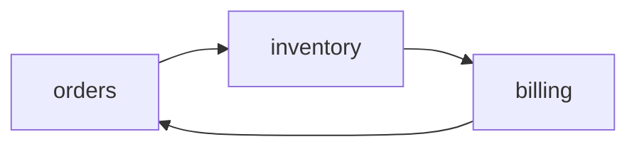
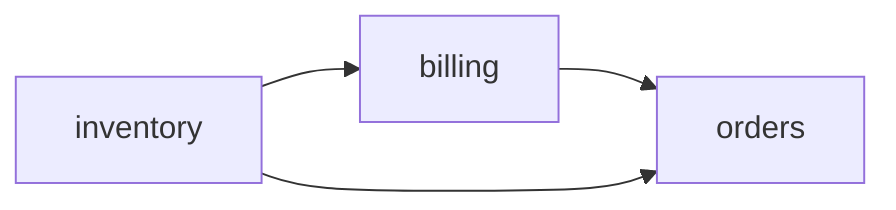

# Đưa dependency cycle ra ánh sáng

Trong giai đoạn **Refactoring an existing app**, một ứng dụng monolith lâu năm có thể vẫn chạy ổn dù các phần nghiệp vụ đã phụ thuộc vòng tròn vào nhau. Khi tách những phần đó thành application module, các vòng phụ thuộc trở thành rào cản đối với việc thay đổi, kiểm thử độc lập và xác định ai sở hữu dữ liệu.

Bài học thuộc phạm vi **SPRING_MODULITH_VERIFICATION_TESTING**: sử dụng `ApplicationModules` để kiểm chứng ranh giới kiến trúc của Spring Modulith, lần theo các phụ thuộc sai và bảo vệ kết quả refactor bằng Java/JUnit cùng quality gate trong CI. Trọng tâm là **phát hiện và xử lý dependency cycle trong mã nguồn hiện có**, không phải thiết kế lại toàn bộ hệ thống ngay từ đầu.

**Sau bài này, bạn có thể:**

- Phân biệt vòng phụ thuộc **giữa các module** với vòng khởi tạo Spring bean hoặc phụ thuộc Maven/Gradle.
- Viết kiểm thử JUnit 5 khiến vòng phụ thuộc hiện hữu lộ ra dưới dạng lỗi có thể tái tạo.
- Đọc đồ thị phụ thuộc, tìm đường đi tạo vòng và chọn một cạnh cần cắt theo ngữ nghĩa nghiệp vụ.
- Refactor bằng sự kiện hoặc module điều phối, rồi kiểm chứng kiến trúc, dữ liệu, tích hợp và CI.

## 1. Nhận diện dependency cycle trong một legacy monolith

Giả sử ứng dụng bán hàng có ba phần nghiệp vụ:

- `orders` tạo và quản lý đơn hàng.
- `inventory` kiểm tra, giữ và xuất tồn kho.
- `billing` đánh giá và ghi nhận thanh toán.

Sau nhiều năm bổ sung tính năng, các lớp trong `orders` gọi trực tiếp kiểu dữ liệu của `inventory`; `inventory` lại cần kiểu của `billing`; còn `billing` dùng kiểu của `orders`. Đồ thị phụ thuộc tĩnh trở thành:



Chuỗi `orders → inventory → billing → orders` là **directed cycle**: bắt đầu từ một module, đi theo hướng phụ thuộc và quay về module đó. Một vòng chỉ cần một vài import hoặc chữ ký phương thức là đủ; không nhất thiết phải có chuỗi gọi hàm lặp vô hạn khi chạy chương trình.

Dấu hiệu thường gặp khi bảo trì:

1. Sửa cấu trúc `Order` khiến cả mã kho và thanh toán phải biên dịch, cập nhật theo.
2. Kiểm thử một chức năng nhỏ phải dựng thêm nhiều Spring bean của module khác.
3. Không thể nói rõ module nào sở hữu một quy tắc nghiệp vụ hoặc một kiểu dữ liệu.
4. Phải thêm nhiều lớp `*Helper`, `*Util` hoặc gọi sang gói `internal` để né việc thiết kế API.

Cần phân biệt ba loại vấn đề:

| Hiện tượng | Cấp độ phát hiện | Ý nghĩa |
| --- | --- | --- |
| `orders → inventory → billing → orders` | Đồ thị phụ thuộc giữa package/module | Vòng kiến trúc mà Spring Modulith cần phơi bày |
| Bean A inject B và B inject A | Quá trình tạo Spring application context | Vòng khởi tạo bean; có thể làm ứng dụng không khởi động |
| Module Maven A khai báo dependency B và B khai báo A | Công cụ build | Vòng ở cấp dự án/artifact; khác với module nghiệp vụ cùng một ứng dụng |

**Điểm quan trọng:** ứng dụng khởi động thành công không chứng minh rằng kiến trúc không có dependency cycle. Vì thế ta cần một kiểm thử cấu trúc chạy trên mã nguồn đã biên dịch.

## 2. Xác định ranh giới module trước khi đo phụ thuộc

Spring Modulith cần biết các application module nằm ở đâu. Với bố cục mặc định, các package con trực tiếp dưới package gốc của ứng dụng được xem là ứng viên application module.

```text
src/main/java/com/acme/shop/
├── ShopApplication.java
├── orders/
│   ├── OrderService.java
│   └── internal/
├── inventory/
│   ├── InventoryService.java
│   └── internal/
└── billing/
    ├── BillingService.java
    └── internal/
```

`ShopApplication` nằm trong `com.acme.shop`, là class gốc có `@SpringBootApplication`. Với cách tổ chức này, `orders`, `inventory` và `billing` là ba module cần kiểm tra. Tên module trong ví dụ được lấy từ tên package; cấu hình phát hiện module có thể được tùy chỉnh trong dự án thực tế.

Một module không đồng nghĩa với một thư viện Maven riêng, cũng không bắt buộc có `module-info.java` của Java Platform Module System. Spring Modulith mô hình hóa **module nghiệp vụ trong cùng một Spring Boot application**.

Trước khi viết test, hãy chốt ba câu hỏi:

- **Biên ở đâu?** Ví dụ `com.acme.shop.inventory` là một module, còn `com.acme.shop.inventory.internal` là phần triển khai bên trong nó.
- **API nào được phép dùng từ bên ngoài?** Mặc định, kiểu công khai ở package gốc của module là phần API; các gói con nội bộ không tự động trở thành API công khai cho module khác. Có thể khai báo các named interface khi cần.
- **Quan hệ nào thực sự có ý nghĩa nghiệp vụ?** Ghi nhận một phụ thuộc cần xem xét khác với việc giả định mọi import đều phải xóa.

Đừng bắt đầu bằng cách dồn các lớp gây lỗi vào package `common`. Cách đó dễ làm đồ thị trông đơn giản hơn nhưng khiến quyền sở hữu nghiệp vụ mờ đi.

## 3. Tái hiện vòng phụ thuộc bằng các tham chiếu Java

Ta có thể biểu diễn vòng trong mục 1 chỉ bằng kiểu dữ liệu. Những đoạn dưới đây là ba file riêng, đặt ở đúng package tương ứng; chúng nhằm minh họa **phụ thuộc lúc biên dịch**, không tạo vòng inject Spring bean.

**`orders/OrderQuote.java`**

```java
package com.acme.shop.orders;

import com.acme.shop.inventory.StockSnapshot;

public record OrderQuote(StockSnapshot stock) {
}
```

**`inventory/StockSnapshot.java`**

```java
package com.acme.shop.inventory;

import com.acme.shop.billing.CreditDecision;

public record StockSnapshot(CreditDecision creditDecision) {
}
```

**`billing/CreditDecision.java`**

```java
package com.acme.shop.billing;

import com.acme.shop.orders.OrderQuote;

public final class CreditDecision {

    public boolean canCharge(OrderQuote quote) {
        return quote != null;
    }
}
```

Đọc theo **module chứa lớp → module chứa kiểu được tham chiếu**:

| Lớp nguồn | Kiểu được dùng | Cạnh đồ thị |
| --- | --- | --- |
| `OrderQuote` | `StockSnapshot` | `orders → inventory` |
| `StockSnapshot` | `CreditDecision` | `inventory → billing` |
| `CreditDecision` | `OrderQuote` | `billing → orders` |

Ba lớp này có thể biên dịch vì Java cho phép các kiểu tham chiếu chéo trong cùng một project. Chúng không cần được khởi tạo để tạo nên vòng ở cấp kiến trúc. Trong dự án thật, cạnh phụ thuộc còn có thể xuất hiện qua constructor parameter, method return type, annotation, implementation interface hoặc lời gọi tới lớp ở module khác.

Đây là lý do cần phân tích đồ thị kiểu và package. Việc chỉ chạy ứng dụng rồi quan sát log không đảm bảo phát hiện được chuỗi tham chiếu kiểu như trên.

## 4. Biến kiến trúc thành một bài kiểm thử JUnit 5

Tạo một bài kiểm thử trong `src/test/java/com/acme/shop/ArchitectureVerificationTests.java`:

```java
package com.acme.shop;

import org.junit.jupiter.api.Test;
import org.springframework.modulith.core.ApplicationModules;

class ArchitectureVerificationTests {

    @Test
    void verifiesApplicationModuleBoundaries() {
        ApplicationModules
                .of(ShopApplication.class)
                .verify();
    }
}
```

Phương thức `ApplicationModules.of(ShopApplication.class)` dựng mô hình module từ ứng dụng. `verify()` kiểm tra các quy tắc kiến trúc được Spring Modulith hỗ trợ, trong đó có **không có vòng phụ thuộc giữa application module**, truy cập hợp lệ qua API module và các giới hạn phụ thuộc đã khai báo.

Nếu dùng Maven và chưa khai báo test support của Spring Modulith, một dependency phổ biến là:

```xml
<dependency>
    <groupId>org.springframework.modulith</groupId>
    <artifactId>spring-modulith-starter-test</artifactId>
    <scope>test</scope>
</dependency>
```

Phiên bản dependency nên được quản lý cùng bộ Spring Boot/Spring Modulith tương thích của dự án. Test kiến trúc này dùng JUnit trực tiếp; nó **không cần** `@SpringBootTest`, không cần khởi động toàn bộ Spring context và không cần kết nối cơ sở dữ liệu để nhận ra vòng phụ thuộc tĩnh.

Khi chạy bài test trên trạng thái mã ở mục 3, kết quả mong đợi là **đỏ**: `verify()` phát hiện dependency cycle. Khi refactor xong, test phải **xanh**. Hãy giữ bài kiểm thử này trong repository để vòng mới không âm thầm quay trở lại.

## 5. Đọc lỗi theo đồ thị, không chỉ theo dòng báo lỗi

Thông báo vi phạm cụ thể có thể khác nhau giữa các phiên bản Spring Modulith và bộ mã được phân tích. Khi nhận lỗi từ `verify()`, cần rút ra ba thông tin:

1. **Các module tham gia:** ví dụ `orders`, `inventory`, `billing`.
2. **Hướng của từng cạnh:** module nào đang biết tới kiểu hoặc API của module nào.
3. **Bằng chứng trong mã:** import, method signature, field hoặc lời gọi cụ thể tạo ra mỗi cạnh.

Có thể dùng bảng truy vết đơn giản trong pull request:

| Cạnh | Bằng chứng trong mã | Câu hỏi cần trả lời |
| --- | --- | --- |
| `orders → inventory` | `OrderQuote` chứa `StockSnapshot` | Đơn hàng thực sự cần toàn bộ mô hình kho hay chỉ cần kết quả xác nhận? |
| `inventory → billing` | `StockSnapshot` chứa `CreditDecision` | Quyết định tín dụng có đúng là trách nhiệm của kho không? |
| `billing → orders` | `CreditDecision` nhận `OrderQuote` | Thanh toán cần đối tượng đơn hàng hay một snapshot tối thiểu? |

Thứ tự hợp lý là **từ module → kiểu Java → nhu cầu nghiệp vụ**. Có thể tìm bằng IDE “Find Usages” hoặc tìm import trong source tree, nhưng cần kiểm tra cả chữ ký, inheritance, annotation và các phụ thuộc gián tiếp mà import đơn thuần không kể hết.

Đừng chữa lỗi chỉ bằng thay tên package. Hãy xác nhận cạnh nào biến mất sau thay đổi bằng cách chạy lại `ApplicationModules.verify()`. Cũng đừng nhầm kết quả kiểm tra kiến trúc với kết quả kiểm thử nghiệp vụ: một đồ thị không còn cycle vẫn có thể có lỗi giao dịch hoặc dữ liệu.

Nếu test báo đồng thời truy cập `internal` không hợp lệ và cycle, hãy xử lý từng vi phạm theo ý nghĩa của nó. Việc đưa một kiểu nội bộ ra public API không mặc nhiên cắt được vòng.

## 6. Chọn cạnh cắt dựa trên quyền sở hữu và tính nhất quán

Một vòng có ba cạnh không đòi hỏi phải xóa cả ba; về mặt đồ thị, **cắt ít nhất một cạnh phù hợp** có thể làm vòng biến mất. Vấn đề khó hơn là chọn cạnh nào mà vẫn bảo vệ đúng hành vi nghiệp vụ.

Trước khi sửa, hãy ghi lại hợp đồng của luồng đặt hàng:

- **Ai sở hữu dữ liệu?** `orders` sở hữu đơn hàng, `inventory` sở hữu số lượng tồn và việc giữ hàng, `billing` sở hữu quyết định thanh toán.
- **Kết quả có cần ngay lập tức?** Nếu không được chấp nhận đơn khi hết hàng, việc giữ hàng có thể cần hoàn tất đồng bộ trước khi chốt đơn.
- **Có thể chấp nhận xử lý sau commit không?** Nếu đơn có trạng thái `PENDING` trước khi kho xác nhận, sự kiện bất đồng bộ có thể phù hợp.
- **Có bao nhiêu luồng đang dùng cạnh này?** Đôi khi một kiểu được tái sử dụng quá rộng, và việc thay bằng DTO hoặc contract nhỏ sẽ ít ảnh hưởng hơn.

Hai hướng refactor thực tế:

| Ràng buộc nghiệp vụ | Hướng cắt cạnh | Điều phải kiểm thử |
| --- | --- | --- |
| Kho có thể xử lý sau khi đơn được tạo | `orders` phát sự kiện, `inventory` nhận sự kiện | Event được phát, xử lý sau commit, chống xử lý lặp và xử lý lỗi |
| Cần xác nhận tồn kho trước khi hoàn tất đặt hàng | Đưa orchestration sang module `checkout` phụ thuộc vào `orders` và `inventory` | Thứ tự gọi, rollback/compensation, kết quả khi hết hàng |

Cũng có thể cắt `billing → orders` bằng cách thay việc truyền cả `OrderQuote` bằng dữ liệu bất biến thuộc hợp đồng phù hợp. Tuy nhiên, chỉ chuyển các kiểu sang `shared` để đạt test xanh thường tạo thêm coupling và chưa giải quyết được câu hỏi ai sở hữu mô hình dữ liệu.

**Không dùng `@ApplicationModule(allowedDependencies = …)` để “chữa” cycle.** Annotation này bổ sung hạn chế về **cạnh được phép tồn tại**, không xóa cạnh đã phát sinh. Giữ khai báo phụ thuộc nhất quán sau khi đã thiết kế lại luồng.

## 7. Cắt `orders → inventory` bằng domain event khi phù hợp

Giả sử nghiệp vụ chấp nhận trạng thái đơn hàng đang chờ kho xử lý. Thay vì `orders` giữ hoặc gọi trực tiếp `StockSnapshot`/`InventoryService`, `orders` phát sự kiện mô tả một sự thật nghiệp vụ. `inventory` đăng ký nhận và thực hiện giữ hàng.

**Bước 1 — Công bố event của module `orders`.** Đặt event trong API của module để các module khác có thể sử dụng.

```java
package com.acme.shop.orders;

import java.util.UUID;

public record OrderPlaced(UUID orderId) {
}
```

**Bước 2 — Phát event trong giao dịch tạo đơn.**

```java
package com.acme.shop.orders;

import java.util.UUID;
import org.springframework.context.ApplicationEventPublisher;
import org.springframework.stereotype.Service;
import org.springframework.transaction.annotation.Transactional;

@Service
public class OrderService {

    private final ApplicationEventPublisher events;

    public OrderService(ApplicationEventPublisher events) {
        this.events = events;
    }

    @Transactional
    public UUID place() {
        UUID orderId = UUID.randomUUID();

        // Trong ứng dụng thực: lưu đơn ở trạng thái PENDING
        // thông qua repository thuộc module orders.
        events.publishEvent(new OrderPlaced(orderId));

        return orderId;
    }
}
```

**Bước 3 — Module `inventory` nhận event.**

```java
package com.acme.shop.inventory;

import com.acme.shop.orders.OrderPlaced;
import java.util.UUID;
import org.springframework.modulith.events.ApplicationModuleListener;
import org.springframework.stereotype.Component;
import org.springframework.stereotype.Service;

@Component
class ReserveStockOnOrderPlaced {

    private final InventoryService inventory;

    ReserveStockOnOrderPlaced(InventoryService inventory) {
        this.inventory = inventory;
    }

    @ApplicationModuleListener
    void on(OrderPlaced event) {
        inventory.reserve(event.orderId());
    }
}

@Service
class InventoryService {

    void reserve(UUID orderId) {
        // Trong ứng dụng thực: ghi reservation theo orderId,
        // kiểm tra tồn kho và bảo đảm xử lý lặp an toàn.
    }
}
```

Ví dụ trên là **khung luồng kiến trúc**: các thao tác lưu đơn và lưu reservation phải được hiện thực theo mô hình dữ liệu thực tế. `@ApplicationModuleListener` cung cấp mô hình listener sự kiện giao dịch của Spring Modulith, thường xử lý bất đồng bộ sau khi giao dịch phát sự kiện commit. Nó không biến việc giữ hàng thành thao tác đồng bộ có kết quả tức thì.

Khi đổi sang hướng này, bắt buộc **xóa các tham chiếu `orders → inventory` cũ**, bao gồm chữ ký `OrderQuote(StockSnapshot)` trong ví dụ mục 3 nếu chúng còn tồn tại. Chỉ thêm event listener mà vẫn giữ import cũ thì cycle vẫn còn.

Đồ thị mục tiêu trở thành:



Giờ `inventory` biết tới event API của `orders`, còn `orders` không cần biết implementation của `inventory`. Cạnh `orders → inventory` đã bị cắt; không còn đường đi nào quay về điểm xuất phát trong đồ thị trên.

Khi dùng event trong hệ thống thực, cần thống nhất rõ: đơn đang `PENDING` cho tới khi xử lý kho xong; event handler phải **idempotent** theo ID nghiệp vụ; sự kiện lỗi cần chiến lược retry/recovery; luồng đọc trạng thái phải chịu được tính nhất quán cuối cùng. Không thay một thao tác bắt buộc đồng bộ bằng event chỉ vì nó làm architecture test xanh.

## 8. Nếu phải đồng bộ: tách điều phối khỏi module nghiệp vụ

Với luồng “chỉ được tạo đơn sau khi giữ hàng thành công”, đồng bộ có thể là hợp đồng bắt buộc. Một phương án là chuyển orchestration sang module chuyên trách `checkout`:

```text
checkout ──────> inventory ──────> billing ──────> orders
    │                                          ▲
    └──────────────────────────────────────────┘
```

Module `checkout` gọi API công khai của `inventory` để giữ hàng, sau đó gọi API công khai của `orders` để tạo đơn. `orders` không gọi ngược `inventory`. `inventory` và `billing` giữ những quan hệ được xác nhận là cần thiết; **không module nào phụ thuộc ngược vào `checkout`**.

Có thể hình dung orchestration bằng mã giả Java sau, với `InventoryApi` và `OrdersApi` là những contract công khai do từng module sở hữu:

```java
@Service
public class CheckoutService {

    private final InventoryApi inventory;
    private final OrdersApi orders;

    public CheckoutService(InventoryApi inventory, OrdersApi orders) {
        this.inventory = inventory;
        this.orders = orders;
    }

    public OrderId checkout(CheckoutCommand command) {
        inventory.reserve(command.sku(), command.quantity());
        return orders.create(command.customerId(), command.sku());
    }
}
```

Các kiểu `InventoryApi`, `OrdersApi`, `OrderId` và `CheckoutCommand` ở đây là **contract minh họa**, cần định nghĩa theo domain của dự án trước khi biên dịch. Mã này minh họa chiều phụ thuộc của orchestration, không đưa ra cam kết transaction phân tán hoặc chính sách rollback. Trong hệ thống thực, hãy xác định rõ quy tắc hoàn tác reservation nếu tạo đơn thất bại và kiểm thử các nhánh lỗi.

Dù chọn event hay orchestration, nguyên tắc chung là: **module chứa use case điều phối được phép phụ thuộc vào module nghiệp vụ, nhưng module nghiệp vụ không biết ngược người đang điều phối nó**.

## 9. Khóa kết quả refactor bằng kiểm thử kiến trúc, module và tích hợp

Sau khi sửa mã, chạy lại `ArchitectureVerificationTests`. Đó là phép kiểm tra trực tiếp rằng đường vòng đã biến mất. Tiếp theo cần kiểm thử hành vi vì thay đổi chiều phụ thuộc thường làm thay đổi giao dịch, sự kiện hoặc thứ tự thực thi.

Với cách refactor bằng event ở mục 7, tạo `src/test/java/com/acme/shop/orders/OrdersModuleTests.java`:

```java
package com.acme.shop.orders;

import static org.assertj.core.api.Assertions.assertThat;

import java.util.UUID;
import org.junit.jupiter.api.Test;
import org.springframework.beans.factory.annotation.Autowired;
import org.springframework.modulith.test.ApplicationModuleTest;
import org.springframework.modulith.test.PublishedEvents;

@ApplicationModuleTest
class OrdersModuleTests {

    @Autowired
    OrderService orders;

    @Test
    void publishesOrderPlaced(PublishedEvents publishedEvents) {
        UUID id = orders.place();

        assertThat(publishedEvents.ofType(OrderPlaced.class))
                .anySatisfy(event ->
                        assertThat(event.orderId()).isEqualTo(id));
    }
}
```

`@ApplicationModuleTest` bootstrap phạm vi module dựa trên package của lớp test. Với mặc định, nó hướng tới kiểm thử module đang xét một cách tập trung; có thể lựa chọn mode mở rộng phạm vi khi test thực sự cần module phụ thuộc.

Ví dụ, trong test của `inventory` có thể dùng:

```java
package com.acme.shop.inventory;

import static org.assertj.core.api.Assertions.assertThat;

import java.util.UUID;
import org.junit.jupiter.api.Test;
import org.springframework.beans.factory.annotation.Autowired;
import org.springframework.modulith.test.ApplicationModuleTest;
import org.springframework.modulith.test.ApplicationModuleTest.BootstrapMode;

@ApplicationModuleTest(mode = BootstrapMode.DIRECT_DEPENDENCIES)
class InventoryPersistenceTests {

    @Autowired InventoryService inventory;
    @Autowired ReservationRepository reservations;

    @Test
    void persistsReservation() {
        UUID orderId = UUID.randomUUID();

        inventory.reserve(orderId);

        assertThat(reservations.existsByOrderId(orderId)).isTrue();
    }
}
```

Test thứ hai giả định dự án đã có `ReservationRepository` và implementation ghi reservation; hãy điều chỉnh theo entity/repository thật. `DIRECT_DEPENDENCIES` khởi động thêm các module phụ thuộc trực tiếp, hữu ích khi sự hợp tác đó là một phần phạm vi test. Nếu nghiệp vụ reservation chạy độc lập, dùng mode mặc định để giới hạn fixture và khuyến khích API module rõ ràng.

Ma trận kiểm thử sau giúp không bỏ sót hồi quy:

| Lớp kiểm chứng | Tình huống cần bao phủ | Dấu hiệu đạt |
| --- | --- | --- |
| Kiến trúc | Chạy `ApplicationModules.verify()` | Không còn cycle hoặc vi phạm API/allowed dependencies |
| Publisher | Đặt đơn phát một `OrderPlaced` mang đúng ID | `PublishedEvents` ghi nhận event mong đợi |
| Database | Giữ hàng thành công, không đủ tồn, trùng `orderId` | Reservation và transaction đúng kỳ vọng; không nhân đôi khi retry |
| Listener/tích hợp | Publish event rồi quan sát dữ liệu sau commit | Event được xử lý, trạng thái cuối cùng đúng, có timeout hợp lý |
| Luồng lỗi | Listener lỗi, publish lại, hoàn tác hoặc retry | Không mất trạng thái nghiệp vụ; thông báo/trạng thái lỗi có thể xử lý |

Vì `@ApplicationModuleListener` có thể xử lý bất đồng bộ, test tích hợp end-to-end nên **đợi điều kiện nghiệp vụ xuất hiện trong giới hạn thời gian** thay vì `Thread.sleep(...)` một khoảng cố định. Không giả định event đã hoàn tất ngay khi `orders.place()` trả về. Với kiểm thử giao dịch, đặc biệt lưu ý rằng test tự rollback có thể ngăn listener kiểu “sau commit” được kích hoạt đúng ngữ cảnh.

## 10. Chuyển kiểm chứng thành quality gate trong CI

Bài test kiến trúc chỉ ngăn hồi quy khi nó được thực thi đều đặn. Đặt nó trong tập JUnit chạy trên pull request. Một lệnh Maven ví dụ:

```bash
./mvnw -B -Dtest=ArchitectureVerificationTests test
```

Trên Gradle có thể lọc class test tương ứng:

```bash
./gradlew test --tests "*ArchitectureVerificationTests"
```

Ví dụ bước GitHub Actions cho dự án dùng Maven Wrapper:

```yaml
- name: Verify Spring Modulith boundaries
  run: ./mvnw -B -Dtest=ArchitectureVerificationTests test
```

Những lệnh này là **mẫu**, cần khớp build tool, đường dẫn module con và cách pipeline hiện tại chạy test. Quality gate phù hợp thường gồm hai tầng:

1. **Architecture gate nhanh:** chạy JUnit có `ApplicationModules.verify()` ở mỗi pull request. Bất kỳ cycle mới hoặc dependency trái với giao diện module sẽ làm build thất bại.
2. **Behavior gate:** chạy module test, test cơ sở dữ liệu và kiểm thử tích hợp để phát hiện hồi quy sau khi thay đổi giao tiếp giữa các module.

Với legacy app đang có sẵn cycle, bước đầu nên lưu bằng chứng lỗi và định nghĩa một thay đổi refactor có phạm vi rõ. Sau khi xử lý và test xanh, bật gate bắt buộc cho các thay đổi tiếp theo. Tránh vô hiệu hóa `verify()` trên toàn ứng dụng chỉ để pipeline xanh; như vậy vòng phụ thuộc sẽ trở nên vô hình lần nữa.

Nếu dự án khai báo `@ApplicationModule(allowedDependencies = ...)`, cập nhật danh sách theo **đồ thị mục tiêu sau refactor**. Hạn chế phụ thuộc có giá trị phòng ngừa nhưng không thay thế bài kiểm chứng cycle.

## 11. Checklist và bài thực hành tự đánh giá

Dùng checklist này khi review một pull request refactor legacy application:

- [ ] Đã xác định package gốc và tên các application module thực sự được Spring Modulith nhận diện.
- [ ] Có đồ thị trước refactor, với ít nhất một đường đi khép kín và bằng chứng Java tạo từng cạnh.
- [ ] Có JUnit `ApplicationModules.of(...).verify()` tái tạo được lỗi trước khi sửa.
- [ ] Đã phân biệt vi phạm phụ thuộc module với lỗi tạo Spring bean và lỗi dependency của build tool.
- [ ] Đã xác định module sở hữu dữ liệu, yêu cầu đồng bộ/bất đồng bộ và cạnh sẽ cắt.
- [ ] Đã **xóa tham chiếu Java cũ** gây vòng, không chỉ thêm event, đổi package hoặc nới `allowedDependencies`.
- [ ] Có đồ thị sau refactor; chạy lại architecture test và thấy kết quả xanh.
- [ ] Có test `@ApplicationModuleTest` cho contract mới, gồm nội dung event hoặc API điều phối.
- [ ] Có test database, retry/idempotency hoặc rollback/compensation phù hợp với ngữ nghĩa giao dịch.
- [ ] CI thực thi architecture gate và các test hành vi cần thiết trên pull request.

**Bài tập 30–45 phút:** Trên một sample app gồm `orders`, `inventory`, `billing`, triển khai ba kiểu minh họa ở mục 3. Viết JUnit ở mục 4 và xác nhận test thất bại với vòng `orders → inventory → billing → orders`. Sau đó xóa tham chiếu `orders → inventory`, cho `orders` phát `OrderPlaced` và cho `inventory` xử lý event như mục 7. Chạy lại architecture test, viết test `PublishedEvents` và giải thích vì sao thiết kế mới không đòi `orders` gọi ngược kho.

**Tiêu chí hoàn thành:** bạn chỉ ra được **trước và sau** bằng hai đồ thị có hướng; bài test kiến trúc từ đỏ sang xanh; test sự kiện chứng minh contract mới hoạt động; và quyết định event hay orchestration có lý do từ tính nhất quán của nghiệp vụ. Đó là bằng chứng cụ thể rằng dependency cycle đã được đưa ra ánh sáng và được xử lý, thay vì chỉ che đi trong một đợt đổi package.

