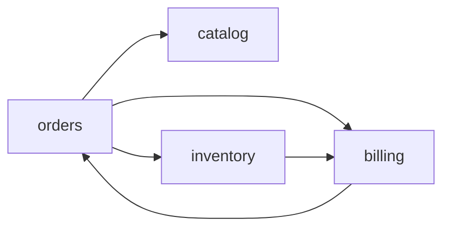

# Chọn một module có ranh giới dễ kiểm chứng

Trong giai đoạn **Refactoring an existing app**, việc tách một monolith lâu năm thành các application module thường thất bại khi nhóm bắt đầu từ phần nghiệp vụ lớn nhất hoặc có nhiều phụ thuộc nhất. Một cách thực tế hơn là **chọn trước một module đủ nhỏ, có trách nhiệm rõ và có hành vi quan sát được**. Module đầu tiên này trở thành mẫu để nhóm áp dụng cùng cách thiết kế, xác minh và kiểm thử cho các phần khó hơn.

Bài học thuộc **SPRING_MODULITH_VERIFICATION_TESTING**, với mục tiêu rèn kỹ năng kiểm chứng ranh giới Spring Modulith bằng `ApplicationModules` và các quy tắc phụ thuộc giữa module; kiểm thử module bằng `@ApplicationModuleTest`; đối chiếu kết quả qua sự kiện, cơ sở dữ liệu và tích hợp; cuối cùng đặt quality gate trong CI để tránh phụ thuộc sai hoặc hồi quy.

**Đầu ra mong đợi:** bạn chọn được **một module cụ thể** với lý do kiểm chứng được, định nghĩa API và phần triển khai nội bộ, viết Java/JUnit minh họa, chứng minh ranh giới của module qua bài test và có checklist để quyết định khi nào mở rộng refactor.

## 1. “Dễ kiểm chứng” nghĩa là gì trong ứng dụng cũ?

Một module dễ kiểm chứng không nhất thiết là module chỉ có vài lớp. Điều quan trọng là có thể diễn đạt và kiểm tra các bất biến của ranh giới đó:

1. **Một trách nhiệm nghiệp vụ rõ:** có thể mô tả module bằng một câu, chẳng hạn “quản lý thông tin sản phẩm được bán”.
2. **API công khai nhỏ:** module khác dùng các thao tác hoặc dữ liệu có ý nghĩa nghiệp vụ, không truy cập repository/entity nội bộ.
3. **Ít phụ thuộc đi ra ngoài:** module không cần biết nhiều module khác để thực hiện phần việc cốt lõi.
4. **Dữ liệu có chủ sở hữu:** các bảng hoặc bản ghi của module có quy tắc cập nhật rõ; không bị truy cập ghi trực tiếp từ nhiều nơi.
5. **Kết quả quan sát được:** test có thể xác nhận giá trị trả về, thay đổi dữ liệu hoặc sự kiện xuất bản.
6. **Fixture dựng được:** test cần ít dịch vụ bên ngoài, ít dữ liệu lớn và ít cấu hình không liên quan.

Đừng nhầm **phụ thuộc vào module** (*incoming dependency*) với **phụ thuộc từ module đi ra** (*outgoing dependency*). Một module có nhiều nơi gọi đến vẫn có thể là ứng viên tốt nếu cung cấp API ổn định và bản thân nó ít phụ thuộc ngược vào những nơi gọi đó.

Ví dụ: nhiều luồng đặt hàng sử dụng `catalog` để tra cứu sản phẩm, nhưng `catalog` không cần biết `orders`, `billing` hoặc `inventory`. Đó là một hướng phụ thuộc dễ giải thích và dễ kiểm chứng.

## 2. Lập tiêu chí chọn module trước khi đổi package

Để tránh chọn theo cảm tính, dùng thang điểm **0–2** cho từng tiêu chí. Đây là rubric thực hành của bài học, **không phải quy tắc chấm điểm của Spring Modulith**.

| Tiêu chí | 0 điểm: khó | 1 điểm: trung bình | 2 điểm: dễ |
| --- | --- | --- | --- |
| Quyền sở hữu nghiệp vụ | Trách nhiệm trộn nhiều domain | Phần lớn rõ, còn ngoại lệ | Một domain rõ ràng |
| Phụ thuộc đi ra | Nhiều module và cycle | Một vài module cần thiết | Không có hoặc rất ít |
| API và mã nội bộ | Khó phân tách | Có thể tách bằng refactor nhỏ | Hợp đồng công khai nhỏ, ổn định |
| Dữ liệu và giao dịch | Nhiều module cùng ghi, giao dịch dài | Có một vài giao dịch chéo | Dữ liệu sở hữu rõ và test được |
| Độ khó dựng test | Nhiều hệ thống ngoài, fixture phức tạp | Có một số mock/container | Test tại chỗ với ít fixture |

Tổng điểm tối đa là **10**. Có thể dùng `8–10` làm ưu tiên thử trước, `5–7` để xem xét refactor bổ sung và `0–4` để trì hoãn; đây chỉ là **ngưỡng gợi ý nội bộ** nhằm thảo luận, không phải điều kiện pass/fail chính thức.

Khi chấm điểm, cần ghi **bằng chứng** bên cạnh con số: import nào tạo phụ thuộc, bảng nào bị module khác ghi, service ngoài nào phải chạy và API nào được dùng. Nếu chưa có bằng chứng, đánh dấu “chưa biết” thay vì tự cho điểm cao.

Một module có điểm tốt vẫn cần phù hợp với mục tiêu kinh doanh: nếu thay đổi gây rủi ro vận hành không chấp nhận được, có thể chọn một module khác dễ triển khai hơn.

## 3. Lập bản đồ phụ thuộc hiện tại, giữ nguyên bằng chứng

Giả sử `ShopApplication` nằm tại `com.acme.shop`, với các package cấp một:

```text
com.acme.shop
├── ShopApplication.java
├── catalog
├── orders
├── inventory
└── billing
```

Theo cách phát hiện mặc định của Spring Modulith, các package trực tiếp dưới package gốc ứng dụng có thể được mô hình hóa thành application module. Nếu dự án tùy chỉnh cách phát hiện module thì phải kiểm tra theo cấu hình thực tế.

Hãy phác họa quan hệ bằng hướng **module sử dụng → module cung cấp**:



Đồ thị ví dụ này cho thấy:

- `orders → catalog` là cách `orders` tra cứu sản phẩm qua `catalog`.
- `catalog` hiện **không có cạnh đi ra** nên có thể kiểm tra độc lập dễ hơn.
- `orders → billing → orders` là cycle của một vùng khác trong hệ thống, cần xử lý sau.

**Không được suy ra đồ thị thật chỉ từ sơ đồ package.** Cần lần theo các phụ thuộc tĩnh trong mã: kiểu ở method signature, field, constructor, kế thừa, annotation và lời gọi. Đối với liên kết ở cấp dữ liệu hoặc HTTP, cần kiểm tra thêm luồng runtime vì không phải phụ thuộc nào cũng hiện ra trong đồ thị kiểu Java.

Một nguyên tắc khi chọn ứng viên: **đừng buộc cả hệ thống phải sạch rồi mới kiểm tra hành vi của module đầu tiên**. Có thể bắt đầu với một module test độc lập, đồng thời ghi nhận các vi phạm kiến trúc toàn cục như backlog cần xử lý. Bài kiểm thử `ApplicationModules.verify()` vẫn phải phản ánh trung thực tình trạng của toàn ứng dụng.

## 4. So sánh các ứng viên và quyết định chọn `catalog`

Bảng dưới đây là **đánh giá giả định cho ứng dụng minh họa**, dùng để chỉ cách lập luận; điểm thực tế phải được xác minh bằng mã và dữ liệu của dự án:

| Ứng viên | Quan sát giả định | Đánh giá | Quyết định |
| --- | --- | --- | --- |
| `catalog` | API tra cứu nhỏ, dữ liệu riêng, không gọi module nghiệp vụ khác | Dễ kiểm chứng | **Chọn làm module đầu tiên** |
| `orders` | Điều phối nhiều luồng, gọi kho/thanh toán, đang tham gia cycle | Rủi ro cao | Để sau khi có mẫu refactor |
| `inventory` | Có giữ hàng, đồng thời và transaction quan trọng | Phức tạp vừa/cao | Cần thêm test đồng thời, rollback |
| `billing` | Tích hợp provider thanh toán, xử lý lỗi và retry | Phức tạp cao | Cần môi trường tích hợp riêng |
| `common` | Chứa tiện ích lẫn kiểu nghiệp vụ của nhiều nơi | Quyền sở hữu không rõ | **Không coi là module nghiệp vụ mẫu** |

`catalog` được chọn vì có thể phát biểu ranh giới ngắn gọn:

> Module `catalog` sở hữu thông tin sản phẩm. Module khác chỉ đọc và yêu cầu thay đổi sản phẩm thông qua API công khai; không module khác truy cập trực tiếp entity hoặc repository của `catalog`.

Quyết định trên cần được xác nhận bằng ba phép thử: **API có giới hạn được không**, **test trong phạm vi module có chạy được không**, và **kiểm chứng kiến trúc có phát hiện được khi ai đó vượt ranh giới không**.

Độ dễ kiểm chứng là một đặc tính có thể kiểm tra. Không thể kết luận chỉ vì package tên đẹp hoặc ít file.

## 5. Thiết kế API bên ngoài và implementation bên trong

Đặt các kiểu cần công khai ở package gốc `catalog`; đặt persistence và nghiệp vụ triển khai trong `catalog.internal`.

```text
src/main/java/com/acme/shop/
├── ShopApplication.java
├── catalog/
│   ├── ProductCatalog.java
│   ├── ProductView.java
│   ├── ProductDeactivated.java
│   └── internal/
│       ├── ProductEntity.java
│       ├── ProductRepository.java
│       └── JpaProductCatalog.java
├── orders/
├── inventory/
└── billing/
```

API của `catalog` chỉ bộc lộ dữ liệu mà module khác cần:

**`catalog/ProductCatalog.java`**

```java
package com.acme.shop.catalog;

import java.util.Optional;

public interface ProductCatalog {

    Optional<ProductView> findBySku(String sku);

    void deactivate(String sku);
}
```

**`catalog/ProductView.java`**

```java
package com.acme.shop.catalog;

public record ProductView(
        String sku,
        String displayName,
        boolean active
) {
}
```

**`catalog/ProductDeactivated.java`**

```java
package com.acme.shop.catalog;

public record ProductDeactivated(String sku) {
}
```

`ProductCatalog` là contract nghiệp vụ, `ProductView` là DTO bất biến và `ProductDeactivated` là event công khai khi sản phẩm bị vô hiệu hóa. Ba kiểu này đều nằm ở package gốc của module; chúng không bộc lộ `JpaRepository` hoặc entity JPA.

Trong bố cục mặc định của Spring Modulith, package gốc của một module là API mặc định, còn các gói con như `internal` không tự động được coi là API cho module khác. Nếu dự án có named interfaces, hãy kiểm tra chúng riêng; **không chuyển toàn bộ `internal` thành API chỉ để test qua**.

Module `orders` có thể gọi `ProductCatalog.findBySku(...)`. Nó không nên import `com.acme.shop.catalog.internal.ProductRepository` hay `ProductEntity`. Quy tắc này là một ranh giới cụ thể để `ApplicationModules.verify()` phát hiện vi phạm.

## 6. Hiện thực phần nội bộ đủ nhỏ để có thể kiểm thử

Ví dụ dưới đây dùng Spring Data JPA và application events. Các file ở package `catalog.internal` chỉ phục vụ module `catalog`.

**`catalog/internal/ProductEntity.java`**

```java
package com.acme.shop.catalog.internal;

import jakarta.persistence.Column;
import jakarta.persistence.Entity;
import jakarta.persistence.Id;
import jakarta.persistence.Table;

@Entity
@Table(name = "catalog_product")
class ProductEntity {

    @Id
    private String sku;

    @Column(name = "display_name", nullable = false)
    private String displayName;

    @Column(nullable = false)
    private boolean active;

    protected ProductEntity() {
    }

    ProductEntity(String sku, String displayName, boolean active) {
        this.sku = sku;
        this.displayName = displayName;
        this.active = active;
    }

    String sku() {
        return sku;
    }

    String displayName() {
        return displayName;
    }

    boolean active() {
        return active;
    }

    void deactivate() {
        this.active = false;
    }
}
```

**`catalog/internal/ProductRepository.java`**

```java
package com.acme.shop.catalog.internal;

import org.springframework.data.jpa.repository.JpaRepository;

interface ProductRepository extends JpaRepository<ProductEntity, String> {
}
```

**`catalog/internal/JpaProductCatalog.java`**

```java
package com.acme.shop.catalog.internal;

import com.acme.shop.catalog.ProductCatalog;
import com.acme.shop.catalog.ProductDeactivated;
import com.acme.shop.catalog.ProductView;
import java.util.NoSuchElementException;
import java.util.Optional;
import org.springframework.context.ApplicationEventPublisher;
import org.springframework.stereotype.Service;
import org.springframework.transaction.annotation.Transactional;

@Service
class JpaProductCatalog implements ProductCatalog {

    private final ProductRepository repository;
    private final ApplicationEventPublisher events;

    JpaProductCatalog(
            ProductRepository repository,
            ApplicationEventPublisher events
    ) {
        this.repository = repository;
        this.events = events;
    }

    @Override
    @Transactional(readOnly = true)
    public Optional<ProductView> findBySku(String sku) {
        return repository.findById(sku)
                .map(product -> new ProductView(
                        product.sku(),
                        product.displayName(),
                        product.active()));
    }

    @Override
    @Transactional
    public void deactivate(String sku) {
        ProductEntity product = repository.findById(sku)
                .orElseThrow(() -> new NoSuchElementException(
                        "Unknown product: " + sku));

        product.deactivate();
        events.publishEvent(new ProductDeactivated(sku));
    }
}
```

Mã này cố ý giữ ứng viên đơn giản: một repository sở hữu một bảng, một service triển khai một interface công khai, sự kiện được phát trong giao dịch. Trong sản phẩm thực tế cần định nghĩa rõ chính sách khi `deactivate` được gọi lặp, kiểm tra quyền và xác nhận nghiệp vụ có thực sự cần event hay không. Không phải module nào cũng cần phát sự kiện.

**Điều kiện chạy ví dụ:** dự án đã có Spring Boot, Spring Data JPA, Jakarta Persistence, cấu hình database/schema cho bảng `catalog_product` và dependency Spring Modulith thích hợp. Nếu dùng migration Flyway/Liquibase, hãy quản lý schema qua migration; ví dụ này không giả định JPA tự tạo bảng ở production.

## 7. Đặt kiểm thử kiến trúc bằng `ApplicationModules`

Tạo kiểm thử JUnit 5 ở package gốc ứng dụng:

**`src/test/java/com/acme/shop/ArchitectureVerificationTests.java`**

```java
package com.acme.shop;

import org.junit.jupiter.api.Test;
import org.springframework.modulith.core.ApplicationModules;

class ArchitectureVerificationTests {

    @Test
    void modulesRespectTheirBoundaries() {
        ApplicationModules.of(ShopApplication.class).verify();
    }
}
```

`ShopApplication` là lớp có `@SpringBootApplication` trong `com.acme.shop`. `verify()` phân tích mô hình application module và kiểm tra các ràng buộc Spring Modulith hỗ trợ, đặc biệt là **không có dependency cycle**, **không truy cập sai qua API module** và **không vượt giới hạn phụ thuộc đã khai báo**.

Lưu ý quan trọng: **`verify()` kiểm tra kiến trúc của tập module được phát hiện, không phải chỉ module `catalog`.** Nếu `orders` và `billing` vẫn còn cycle, test toàn cục có thể đỏ ngay cả khi `catalog` có ranh giới rất tốt. Không nên diễn giải lỗi toàn cục đó thành “`catalog` không thể kiểm thử được”.

Cách triển khai cho legacy app:

1. Chạy `verify()` để lưu **baseline** về các vi phạm hiện có.
2. Đánh dấu những vi phạm liên quan trực tiếp đến `catalog` và những vi phạm ở module khác.
3. Xóa các import từ `catalog` sang module khác nếu không có lý do nghiệp vụ; di chuyển những hợp đồng được phép dùng về API đúng chủ sở hữu.
4. Viết test `catalog` ở phạm vi module và làm nó xanh.
5. Tiếp tục xử lý các cycle còn lại để `verify()` có thể trở thành gate xanh và bắt buộc cho toàn bộ ứng dụng.

Không nên tắt hẳn `verify()`, đưa mọi kiểu ra package gốc, hoặc thêm `allowedDependencies` tùy tiện để che vi phạm. `@ApplicationModule(allowedDependencies = …)` chỉ bổ sung quy tắc về **phụ thuộc được cho phép**, không tự cắt cycle.

## 8. Kiểm thử chính module được chọn bằng `@ApplicationModuleTest`

Một bài kiểm thử `@ApplicationModuleTest` đặt trong package `com.acme.shop.catalog` giúp bootstrap phạm vi module theo cách Spring Modulith hỗ trợ. Nó là bước xác nhận thực dụng rằng phần lõi `catalog` có thể chạy với các thành phần của chính mình mà không cần dựng toàn bộ các module khác.

Ví dụ dưới đây kiểm tra **cơ sở dữ liệu**, **hợp đồng API** và **event được xuất bản**:

**`src/test/java/com/acme/shop/catalog/CatalogModuleTests.java`**

```java
package com.acme.shop.catalog;

import static org.assertj.core.api.Assertions.assertThat;

import org.junit.jupiter.api.Test;
import org.springframework.beans.factory.annotation.Autowired;
import org.springframework.jdbc.core.JdbcTemplate;
import org.springframework.modulith.test.ApplicationModuleTest;
import org.springframework.modulith.test.PublishedEvents;
import org.springframework.transaction.annotation.Transactional;

@ApplicationModuleTest
@Transactional
class CatalogModuleTests {

    @Autowired ProductCatalog catalog;
    @Autowired JdbcTemplate jdbc;

    @Test
    void returnsProductThroughItsPublicApi() {
        insertProduct("SKU-101", "Sổ tay", true);

        assertThat(catalog.findBySku("SKU-101"))
                .contains(new ProductView("SKU-101", "Sổ tay", true));
    }

    @Test
    void publishesEventWhenProductIsDeactivated(
            PublishedEvents publishedEvents
    ) {
        insertProduct("SKU-202", "Bút mực", true);

        catalog.deactivate("SKU-202");

        assertThat(catalog.findBySku("SKU-202"))
                .contains(new ProductView("SKU-202", "Bút mực", false));

        assertThat(publishedEvents.ofType(ProductDeactivated.class))
                .anySatisfy(event ->
                        assertThat(event.sku()).isEqualTo("SKU-202"));
    }

    private void insertProduct(
            String sku,
            String displayName,
            boolean active
    ) {
        jdbc.update(
                "insert into catalog_product " +
                "(sku, display_name, active) values (?, ?, ?)",
                sku, displayName, active);
    }
}
```

Vì các test có `@Transactional`, dữ liệu được ghi trong giao dịch test và thông thường rollback sau mỗi test. Chạy chúng trên **database test riêng** có schema tương thích với entity; cấu hình bằng H2, Testcontainers hoặc môi trường test của dự án. Không dùng database production. Nếu schema được tạo bởi migration, migration phải chạy trong test context.

`PublishedEvents` xác minh rằng event `ProductDeactivated` đã được publish cùng dữ liệu đúng. **Nó không chứng minh một listener chạy bất đồng bộ sau commit đã xử lý thành công.** Thậm chí rollback của test giao dịch có thể ngăn listener phụ thuộc vào after-commit được chạy. Kiểm tra listener phải được thiết kế riêng trong integration test.

Khi module cần các module mà nó trực tiếp phụ thuộc, Spring Modulith cho phép mở rộng phạm vi test bằng:

```java
@ApplicationModuleTest(
        mode = ApplicationModuleTest.BootstrapMode.DIRECT_DEPENDENCIES
)
```

Với `catalog` không có phụ thuộc đi ra, hãy ưu tiên cấu hình mặc định để giữ test gọn. Việc tăng bootstrap mode chỉ có lý do nếu tình huống kiểm thử cần thêm module; nó không sửa kiến trúc sai.

## 9. Phân biệt ba lớp bằng chứng: ranh giới, dữ liệu, tích hợp

Một module “dễ kiểm chứng” cần có **bằng chứng tương ứng với từng cam kết**:

| Câu hỏi | Công cụ kiểm chứng | Kết luận có thể đưa ra |
| --- | --- | --- |
| Có cycle và truy cập API không hợp lệ không? | `ApplicationModules.of(...).verify()` | Phụ thuộc tĩnh ở cấp module hợp lệ theo quy tắc được áp dụng |
| Module có tự bootstrap và trả đúng API không? | `@ApplicationModuleTest` + JUnit | Contract của module chạy đúng trong phạm vi đã thiết lập |
| Thao tác có ghi/đọc đúng bảng không? | Module test với DB thực cho test | Mapping, truy vấn và transaction cục bộ đáp ứng kỳ vọng |
| Event đã được publish đúng payload chưa? | `PublishedEvents` | Publisher phát event mong đợi |
| Listener sau commit và module khác có xử lý thành công không? | Integration test có commit thật + quan sát kết quả | Luồng phối hợp runtime đạt trạng thái cuối cùng mong đợi |

Nếu `ProductDeactivated` được một module khác tiêu thụ qua `@ApplicationModuleListener`, cần một integration test với **giao dịch thực sự commit**, phần nhận event đã được bootstrap và kiểm tra thay đổi observable trong database hoặc API của consumer. Với xử lý bất đồng bộ, đợi một điều kiện kết thúc trong khoảng thời gian có giới hạn, chẳng hạn bằng Awaitility; tránh `Thread.sleep(...)` cố định.

Một mẫu JUnit **định hướng tích hợp**, chỉ áp dụng khi dự án đã có `SearchIndexProbe` và fixture sản phẩm phù hợp:

```java
@Test
void consumerEventuallyObservesDeactivation() {
    // Fixture phải được lưu/commit trước khi thao tác cần kiểm tra.
    transactions.executeWithoutResult(status ->
            catalog.deactivate("SKU-303"));

    await().atMost(Duration.ofSeconds(5))
            .untilAsserted(() ->
                    assertThat(searchIndex.isInactive("SKU-303"))
                            .isTrue());
}
```

Ở đây `transactions` là `TransactionTemplate`, `searchIndex` là API quan sát kết quả của consumer và `await()` từ thư viện Awaitility; **đây là khung test cần gắn với implementation thật**, không phải test có thể chạy độc lập chỉ bằng copy. Dùng `@SpringBootTest` hoặc cấu hình tích hợp phù hợp để bảo đảm consumer thật được khởi động.

Ngay cả khi static architecture test xanh, các phụ thuộc ẩn qua truy vấn trực tiếp vào bảng `catalog_product` từ module khác, HTTP, message broker hoặc truy cập qua reflection có thể cần kiểm tra bổ sung. Spring Modulith không thay thế việc đánh giá quyền sở hữu dữ liệu và giao tiếp runtime.

## 10. Gặp lỗi ở đâu thì sửa ở đúng ranh giới đó

Sau khi chọn `catalog`, những kết quả sau đều cung cấp thông tin hữu ích:

| Kết quả kiểm tra | Khả năng nguyên nhân | Cách xử lý |
| --- | --- | --- |
| `verify()` báo `orders` truy cập `catalog.internal` | Module ngoài dùng entity/repository nội bộ | Chuyển consumer sang `ProductCatalog`/`ProductView` |
| `verify()` báo cycle không liên quan `catalog` | Vòng cũ ở vùng nghiệp vụ khác | Ghi baseline và refactor đúng các cạnh của vòng; không đổ lỗi cho `catalog` |
| `@ApplicationModuleTest` không tạo được bean | Service yêu cầu phụ thuộc ngoài phạm vi hoặc auto-config thiếu | Kiểm tra constructor, API, datasource và mode test; không mở rộng context theo quán tính |
| Test DB đỏ | Schema/fixture không khớp hoặc sai mapping | Chạy migration test, kiểm tra transaction và dữ liệu đầu vào |
| `PublishedEvents` xanh nhưng consumer không cập nhật | Listener chưa được tải, after-commit chưa xảy ra, lỗi async/retry | Viết integration test có commit và quan sát trạng thái cuối |
| Test module chỉ chạy khi bootstrap cả app | Ranh giới còn mờ hoặc test setup gắn quá chặt | Đọc phụ thuộc cụ thể và đưa hợp đồng đúng chỗ |

Khi refactor, nên ghi lại **trước → sau** của từng thay đổi có chủ đích. Ví dụ:

- Trước: `orders` import `catalog.internal.ProductEntity` và đọc field.
- Sau: `orders` gọi `ProductCatalog.findBySku`, nhận `ProductView`.
- Bằng chứng: `CatalogModuleTests` xanh; kiểm tra kiến trúc không còn vi phạm truy cập API ở cạnh này; test nghiệp vụ `orders` vẫn xác nhận hành vi tra cứu.

Không phải mọi cảnh báo đều giải quyết bằng cách thêm abstraction. Chỉ tạo interface, event hoặc module điều phối khi chúng diễn đạt một hợp đồng nghiệp vụ có chủ sở hữu và làm giảm coupling thực sự.

## 11. Checklist bàn giao module đầu tiên và quality gate CI

Đánh dấu các mục dưới đây khi đưa module `catalog` vào pull request:

- [ ] Có một câu mô tả trách nhiệm module và danh sách chức năng **ngoài phạm vi** của nó.
- [ ] Có bảng chấm điểm ứng viên dựa trên bằng chứng import, API, database và fixture; lựa chọn được thống nhất.
- [ ] Package gốc ứng dụng và cách Spring Modulith phát hiện module đã được xác minh.
- [ ] API ở package `catalog` nhỏ, chỉ công khai contract cần thiết; entity/repository ở `internal`.
- [ ] Không có import trực tiếp từ module khác vào `catalog.internal` và không có phụ thuộc ngược vô cớ từ `catalog`.
- [ ] Có `ApplicationModules.verify()` và đã hiểu vi phạm toàn cục nào còn tồn tại.
- [ ] Có `@ApplicationModuleTest` chạy được với fixture nhỏ, kiểm tra cả giá trị trả về và dữ liệu.
- [ ] Nếu có event, `PublishedEvents` kiểm tra payload; consumer sau commit có integration test riêng khi cần.
- [ ] Có kiểm thử nhánh lỗi quan trọng: SKU không tồn tại, gọi lặp, constraint database, lỗi cập nhật.
- [ ] CI chạy architecture test và test module/integration theo cấp độ phù hợp; mọi bước gate đều có tiêu chí đạt rõ ràng.

Ví dụ lệnh cho dự án dùng Maven Wrapper:

```bash
./mvnw -B -Dtest=CatalogModuleTests test
./mvnw -B -Dtest=ArchitectureVerificationTests test
```

Với dự án dùng Gradle:

```bash
./gradlew test --tests "*CatalogModuleTests"
./gradlew test --tests "*ArchitectureVerificationTests"
```

Khi hệ thống **đang còn vi phạm kiến trúc toàn cục**, lệnh thứ hai dự kiến vẫn có thể đỏ. Nhóm cần ghi nhận và xử lý baseline để đưa nó thành quality gate bắt buộc; không tuyên bố kiến trúc toàn ứng dụng đã sạch chỉ vì test riêng `catalog` xanh. Nếu CI đã đòi gate toàn cục xanh, phải xử lý những cycle hiện tại trước khi kích hoạt điều kiện chặn merge.

**Bài thực hành 45–60 phút:** Chọn một module nhỏ trong ứng dụng hiện có, lập bảng điểm theo mục 2 và vẽ đồ thị phụ thuộc của nó. Tách ít nhất một API công khai khỏi implementation nội bộ, viết một test `@ApplicationModuleTest` có kiểm tra database hoặc kết quả nghiệp vụ, rồi cố tình tạo một import từ module khác vào package `internal` để xác nhận `verify()` bắt được vi phạm. Sau khi bỏ import trái phép, chạy lại test và ghi nhận kết quả.

**Tiêu chí hoàn thành:** bạn có **một module được chọn với bằng chứng**, ranh giới API/internal rõ ràng, test module chạy độc lập ở phạm vi hợp lý, hiểu chính xác phạm vi của `ApplicationModules.verify()` và có đường đi cụ thể để đưa kiểm tra vào CI. Như vậy việc chọn module đầu tiên trở thành một quyết định kỹ thuật kiểm chứng được, thay vì một cuộc đổi package mang tính hình thức.

