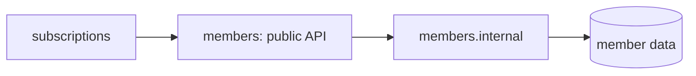
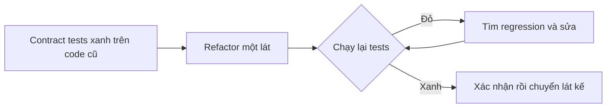

# Viết test public API trước khi tái cấu trúc

Trong giai đoạn **Refactoring an existing app**, thay đổi cấu trúc package, tách repository hay chuyển lời gọi sang sự kiện đều có thể làm ứng dụng biên dịch thành công nhưng thay đổi hành vi mà các module khác đang phụ thuộc. Trước khi dịch chuyển implementation, hãy đặt một lớp kiểm thử ở **public API của module**: cùng đầu vào và cùng điều kiện nghiệp vụ phải tạo ra kết quả, lỗi và sự kiện đã được thỏa thuận.

Bài thuộc **SPRING_MODULITH_VERIFICATION_TESTING**. Ta dùng **`@ApplicationModuleTest` với JUnit** để cố định hành vi; dùng kiểm thử dữ liệu, sự kiện và tích hợp khi hành vi đi qua giao dịch; sau đó dùng **`ApplicationModules.verify()`** để bảo vệ ranh giới phụ thuộc và đưa các bài test phù hợp vào quality gate CI. Trọng tâm ở đây là **viết phép đo trước rồi mới refactor**, không phải tối ưu tất cả các module hay kiểm thử mọi dòng implementation.

Ví dụ xuyên suốt là module `members` của ứng dụng quản lý hội viên. Public API cho phép đăng ký, tra cứu hội viên và phát sự kiện khi đăng ký. Mọi mã minh họa giả định ứng dụng hiện có hành vi được xác nhận trong mục 3; cần điều chỉnh tên lớp, quy tắc và fixture theo hệ thống thực tế.

## 1. Khóa hợp đồng trước khi thay đổi mã nội bộ

**Public API** trong bài này là tập kiểu và thao tác mà module khác được phép sử dụng: interface/service công khai, tham số, kiểu trả về, ngoại lệ nghiệp vụ và sự kiện công khai. Với Spring Modulith và cách phát hiện module mặc định, các kiểu ở package gốc của application module thường tạo nên API của module; package con như `internal` được dành cho triển khai trừ khi được công bố thành named interface có chủ đích.

Một test bảo vệ public API phải trả lời được những câu hỏi quan sát được:

- **Thành công:** gọi API trả về gì và trạng thái nào có thể được truy vấn qua API sau đó?
- **Thất bại:** input không hợp lệ hoặc trùng dữ liệu tạo ngoại lệ hay giá trị kết quả nào? Có ghi dữ liệu ngoài dự kiến không?
- **Sự kiện:** khi nào publish, kiểu sự kiện và payload công khai có giữ nguyên không?
- **Giao dịch:** kết quả đã tồn tại sau commit hay chỉ thấy trong một persistence context đang mở?
- **Phụ thuộc:** caller có cần import entity, repository hoặc service trong `internal` không?

Test characterization thường phải **xanh trên code cũ** để tạo mốc hành vi trước khi refactor. Khi phát hiện hành vi cũ không rõ hoặc có lỗi, cần xác nhận với yêu cầu nghiệp vụ rồi mới xác định kỳ vọng. Không nên vô tình “đóng băng” một bug chỉ vì chạy lại hệ thống cũ thấy nó như vậy.

Ví dụ: nếu yêu cầu đã thống nhất rằng email hội viên được chuẩn hóa về chữ thường, hãy viết assertion cho email chuẩn hóa. Nếu chưa có quy tắc đó, ghi lại câu hỏi cần quyết định; đừng tự đổi chuẩn hóa cùng lúc với refactor package.

## 2. Khoanh đúng điểm vào public API

Giả sử hệ thống ban đầu có một service lớn chứa cả xử lý đăng ký, SQL và thông báo:

```text
com.example.club
├── ClubApplication.java
├── members
│   ├── MemberDirectory.java       ← API mà caller được phép dùng
│   ├── MemberView.java
│   ├── MemberRegistered.java
│   └── internal
│       ├── LegacyMemberService.java
│       ├── MemberEntity.java
│       └── MemberRepository.java
└── subscriptions
    └── ...
```

Nếu ứng dụng cũ chưa có `MemberDirectory`, có thể tạo **một facade mỏng chỉ chuyển tiếp đến code cũ**, vẫn giữ nguyên hành vi; sau đó viết test qua facade và chưa vội chuyển logic. Đó là một thay đổi nhỏ để tạo đường vào ổn định.

Đồ thị mong muốn:



Từ module `subscriptions`, việc dùng `MemberDirectory` và `MemberView` là hợp lệ về mục tiêu thiết kế. Import `members.internal.MemberRepository` hoặc `MemberEntity` làm caller bị ràng buộc vào chi tiết persistence và sẽ dễ hỏng khi refactor.

Để biết API nào cần khóa trước, tìm các caller thực tế của module và lập danh sách chữ ký mà họ đang dùng. Ưu tiên điểm vào có giao dịch hoặc sự kiện quan trọng; không cần đưa mọi helper nội bộ vào test contract. Nếu có HTTP endpoint là API bên ngoài hệ thống, bổ sung request/response contract test cho endpoint đó, nhưng không thay thế test ranh giới application module bên dưới.

## 3. Chốt ma trận hành vi có thể kiểm chứng

Với module `members` minh họa, nhóm đã xác nhận những kỳ vọng nghiệp vụ sau:

| Trường hợp | Đầu vào / điều kiện | Kỳ vọng public API |
| --- | --- | --- |
| Đăng ký mới | Email có khoảng trắng và chữ hoa | Trả ID mới, lưu email đã trim và chuyển chữ thường |
| Tra cứu tồn tại | ID vừa đăng ký | Trả `MemberView` với ID, email chuẩn hóa, `active=true` |
| Tra cứu không tồn tại | ID chưa tạo | Trả `Optional.empty()` |
| Đăng ký trùng | Email đã đăng ký | Ném `DuplicateMemberException`, không tạo hội viên thứ hai |
| Xuất bản event | Đăng ký thành công | Có `MemberRegistered` chứa đúng ID và email chuẩn hóa |
| Độ bền dữ liệu | Đăng ký đã commit | Một giao dịch mới vẫn đọc được hội viên qua API |

Đây là **hợp đồng giả định của ví dụ**, không phải chuẩn bắt buộc cho mọi ứng dụng Spring Modulith. Khi làm với dự án thật, đổi mỗi hàng thành điều kiện và đầu ra đã được chấp thuận, nêu rõ trường hợp nào chưa thống nhất và lấy ví dụ dữ liệu tối thiểu có thể tái lập.

Chia test thành hai nhóm:

1. **Contract tests:** gọi qua public API và chỉ assert các kết quả được công khai; được giữ nguyên khi implementation chuyển từ service cũ sang repository hoặc adapter mới.
2. **Kiểm thử dữ liệu/tích hợp:** xác nhận commit, schema, event consumer và tương tác ngoài module; chúng chứng minh các giả định mà contract test trong một giao dịch chưa thể chứng minh.

Một test có hàng chục assertion vào bảng nội bộ hoặc phương thức private rất dễ bị phá vỡ bởi chính refactor mà nó cần hỗ trợ. Hãy đo **hành vi được bảo đảm**, không đo chi tiết chỉ tình cờ đúng.

## 4. Định nghĩa contract Java tối thiểu và ổn định

Ở package `com.example.club.members`, các file public API của ví dụ có thể là:

**`MemberDirectory.java`**

```java
package com.example.club.members;

import java.util.Optional;
import java.util.UUID;

public interface MemberDirectory {

    UUID register(String email);

    Optional<MemberView> find(UUID memberId);
}
```

**`MemberView.java`**

```java
package com.example.club.members;

import java.util.UUID;

public record MemberView(
        UUID id,
        String email,
        boolean active
) {
}
```

**`MemberRegistered.java`**

```java
package com.example.club.members;

import java.util.UUID;

public record MemberRegistered(
        UUID memberId,
        String email
) {
}
```

**`DuplicateMemberException.java`**

```java
package com.example.club.members;

public class DuplicateMemberException extends RuntimeException {

    public DuplicateMemberException(String email) {
        super("Member already exists: " + email);
    }
}
```

Ví dụ giả định trong module đã có một Spring bean triển khai `MemberDirectory`, hiện đang gọi logic của `LegacyMemberService`. **Bốn kiểu trên là hợp đồng; không tự tạo implementation mới chỉ để làm test xanh.** Khi refactor, ta thay đổi lớp triển khai nằm trong `internal`, còn những kiểu mà caller đã dùng sẽ được giữ ổn định trừ khi có quyết định thay đổi API có chủ đích.

Lưu ý `MemberView` là DTO của module, không phải JPA entity; việc đưa entity vào chữ ký API sẽ làm migration persistence lan sang consumer. Ngoại lệ `DuplicateMemberException` cũng là một phần contract nếu caller có xử lý nó; nên kiểm tra kiểu ngoại lệ, không phụ thuộc nguyên văn message trừ khi message được cam kết là API.

## 5. Viết JUnit test qua API khi implementation vẫn còn nguyên

Tạo test trong `src/test/java/com/example/club/members/MemberDirectoryContractTests.java`. Đặt nó trong package của module giúp Spring Modulith xác định module cần bootstrap.

```java
package com.example.club.members;

import static org.assertj.core.api.Assertions.assertThat;
import static org.assertj.core.api.Assertions.assertThatThrownBy;

import java.util.Locale;
import java.util.UUID;
import org.junit.jupiter.api.Test;
import org.springframework.beans.factory.annotation.Autowired;
import org.springframework.modulith.test.ApplicationModuleTest;

@ApplicationModuleTest
class MemberDirectoryContractTests {

    @Autowired MemberDirectory members;

    @Test
    void registerReturnsPublicViewWithCanonicalEmail() {
        String email = freshEmail();

        UUID id = members.register(
                "  " + email.toUpperCase(Locale.ROOT) + "  ");

        assertThat(id).isNotNull();
        assertThat(members.find(id))
                .contains(new MemberView(id, email, true));
    }

    @Test
    void cannotRegisterSameEmailTwice() {
        String email = freshEmail();
        members.register(email);

        assertThatThrownBy(() -> members.register(email))
                .isInstanceOf(DuplicateMemberException.class);
    }

    @Test
    void unknownMemberIsAbsent() {
        assertThat(members.find(UUID.randomUUID())).isEmpty();
    }

    private static String freshEmail() {
        return "member-" + UUID.randomUUID() + "@example.test";
    }
}
```

Các bài test chỉ nhìn qua `MemberDirectory`, `MemberView` và `DuplicateMemberException`. Chúng không gọi `MemberRepository`, không assert tên bảng và không mock phương thức nội bộ. Email chứa UUID ngẫu nhiên để hạn chế xung đột khi test DB có dữ liệu cũ; trong môi trường test chia sẻ, vẫn cần cách ly dữ liệu hoặc cleanup phù hợp.

`@ApplicationModuleTest` khởi tạo Spring context cho phạm vi application module; với mode mặc định, test hướng đến module riêng thay vì bootstrap mọi module phụ thuộc. Nó có thể vẫn dùng auto-configuration cần thiết như datasource/JPA, và **không có nghĩa là một unit test không cần Spring**.

Nếu code cũ chưa boot được ở phạm vi này vì inject trực tiếp service của module khác, hãy ghi lại phụ thuộc làm test thất bại. Có thể tạm thời khai báo fake adapter ở cấu hình test hoặc mở rộng phạm vi test có chủ đích, nhưng đó là nợ cần giải quyết trong refactor; tránh mở toàn bộ app chỉ để che nguyên nhân.

Một bài test characterization có giá trị trước refactor khi nó **đã chạy xanh ít nhất một lần trên implementation cũ**. Test mới viết mà chưa chạy không phải bằng chứng giữ hành vi.

## 6. Kiểm tra dữ liệu đã tồn tại qua ranh giới giao dịch

Test vừa đăng ký xong rồi gọi `find` trong cùng một transaction có thể chỉ thấy dữ liệu đang nằm trong persistence context. Để bảo vệ hành vi “đăng ký thành công thì có thể đọc lại sau commit”, hãy thực thi hai giao dịch khác nhau và gọi **cùng public API**.

```java
package com.example.club.members;

import static org.assertj.core.api.Assertions.assertThat;

import java.util.Optional;
import java.util.UUID;
import org.junit.jupiter.api.Test;
import org.springframework.beans.factory.annotation.Autowired;
import org.springframework.modulith.test.ApplicationModuleTest;
import org.springframework.transaction.PlatformTransactionManager;
import org.springframework.transaction.support.TransactionTemplate;

@ApplicationModuleTest
class MemberPersistenceContractTests {

    @Autowired MemberDirectory members;
    @Autowired PlatformTransactionManager transactionManager;

    @Test
    void committedRegistrationIsReadableInAnotherTransaction() {
        String email = "persist-" + UUID.randomUUID()
                + "@example.test";
        TransactionTemplate transactions =
                new TransactionTemplate(transactionManager);

        UUID id = transactions.execute(
                status -> members.register(email));

        assertThat(id).isNotNull();

        Optional<MemberView> observed = transactions.execute(
                status -> members.find(id));

        assertThat(observed)
                .contains(new MemberView(id, email, true));
    }
}
```

Bài test này **không đặt `@Transactional` trên class hoặc method test**, vì transaction bao ngoài do framework test tạo có thể khiến `TransactionTemplate` tham gia cùng giao dịch chưa commit. Với đoạn mã trên và transaction manager thông thường, mỗi lần `execute` tạo một giao dịch mới và hoàn tất trước lần tiếp theo.

Để chạy được test cần datasource kiểm thử riêng, schema/migration và repository thực của module; với JPA có thể dùng database test qua Testcontainers hoặc cấu hình database tương thích. Test này chứng minh khả năng đọc lại **qua API sau transaction boundary**, không chứng minh mọi tình huống đồng thời, isolation level hoặc chính sách retry.

Nếu nghiệp vụ yêu cầu rằng đăng ký trùng **không ghi thêm bản ghi**, hãy bổ sung kiểm thử riêng có assertion ổn định ở mức dữ liệu/aggregate mà module sở hữu; không nên chỉ suy ra từ exception. Những kiểm tra liên quan đến số dòng SQL hoặc tên bảng thuộc bộ kiểm thử persistence nội bộ, có thể cần cập nhật khi schema thay đổi có chủ đích.

## 7. Khóa hợp đồng sự kiện mà không lẫn với hiệu ứng sau commit

Một hệ thống legacy có thể publish event đồng bộ trong transaction, còn module khác nhận event sau commit. Hai hành vi này cần hai phép thử khác nhau.

**Kiểm tra event được publish** qua `PublishedEvents`:

```java
package com.example.club.members;

import static org.assertj.core.api.Assertions.assertThat;

import java.util.UUID;
import org.junit.jupiter.api.Test;
import org.springframework.beans.factory.annotation.Autowired;
import org.springframework.modulith.test.ApplicationModuleTest;
import org.springframework.modulith.test.PublishedEvents;

@ApplicationModuleTest
class MemberEventsContractTests {

    @Autowired MemberDirectory members;

    @Test
    void registerPublishesStableEventPayload(
            PublishedEvents publishedEvents
    ) {
        String email = "event-" + UUID.randomUUID()
                + "@example.test";

        UUID id = members.register(email);

        assertThat(publishedEvents.ofType(MemberRegistered.class))
                .anySatisfy(event -> {
                    assertThat(event.memberId()).isEqualTo(id);
                    assertThat(event.email()).isEqualTo(email);
                });
    }
}
```

`PublishedEvents` là công cụ test của Spring Modulith để quan sát những application event đã được publish trong quá trình test. Assertion trên chỉ chứng minh **event có kiểu và payload kỳ vọng đã được phát**. Nó chưa chứng minh rằng một `@ApplicationModuleListener` trong module khác đã xử lý thành công, hoặc event đã đi qua broker tới một hệ thống ngoài.

Nếu thực tế có listener sau commit, integration test nên:

1. Bootstrap cả publisher và consumer cần kiểm chứng.
2. Chạy thao tác qua API trong transaction **thực sự commit**.
3. Quan sát trạng thái cuối cùng ở API/DB của consumer.
4. Chờ có giới hạn nếu xử lý bất đồng bộ, rồi assert cả nhánh lỗi/retry khi cần.

Không dùng `Thread.sleep(...)` cố định làm bằng chứng. Test có `@Transactional` và tự rollback có thể ngăn listener phụ thuộc vào after-commit chạy; dùng transaction rõ ràng hoặc test context thích hợp. Để kiểm tra listener ổn định có thể dùng Awaitility hoặc hỗ trợ scenario của Spring Modulith theo phiên bản dự án.

## 8. Refactor từng lát mỏng, luôn chạy lại bài test ban đầu

Khi bộ contract test đã xanh trên code cũ, tiến hành refactor theo lát nhỏ. Ví dụ:

| Lát refactor | Thay đổi được phép | Điều phải giữ |
| --- | --- | --- |
| 1. Tách facade | Đưa route gọi hiện tại vào `MemberDirectory` | Giá trị trả về và ngoại lệ |
| 2. Cô lập persistence | Chuyển SQL/JPA sang `members.internal` | Độ bền dữ liệu và trạng thái qua API |
| 3. Loại phụ thuộc sai | Đổi caller sang DTO/contract API | Caller không import `internal` |
| 4. Chuẩn hóa sự kiện | Tập trung publish `MemberRegistered` | Thời điểm nghiệp vụ, payload và số lần phát theo yêu cầu |
| 5. Dọn code cũ | Xóa lớp/đường gọi không còn ai dùng | Contract test và integration test vẫn xanh |

Quy trình mỗi lát:



Nếu test đỏ, phân biệt:

- **Regression không chủ đích:** sửa implementation để quay lại contract.
- **Thay đổi nghiệp vụ có chủ đích:** xác nhận yêu cầu, sửa contract/test với lý do và xem xét consumer bị ảnh hưởng.
- **Test gắn chặt vào implementation:** chỉnh test nếu nó assert một chi tiết không thuộc public API, nhưng vẫn giữ assertion về kết quả nghiệp vụ.

Không sửa assertion chỉ để build xanh. Cũng không mở rộng chữ ký public API theo tình cờ của lớp JPA mới khi không có nhu cầu từ caller.

## 9. Ghép kiểm thử hành vi với kiểm chứng kiến trúc

Các test ở mục 5–7 xác nhận **module làm đúng việc**. Spring Modulith còn có một câu hỏi khác: **các module có gọi nhau qua ranh giới hợp lệ hay không?**

Tạo JUnit 5 test trong package gốc ứng dụng:

```java
package com.example.club;

import org.junit.jupiter.api.Test;
import org.springframework.modulith.core.ApplicationModules;

class ModuleArchitectureTests {

    @Test
    void verifiesApplicationModuleBoundaries() {
        ApplicationModules.of(ClubApplication.class).verify();
    }
}
```

`ClubApplication` là class `@SpringBootApplication` của ví dụ. `ApplicationModules.verify()` kiểm chứng các quy tắc Spring Modulith hỗ trợ trên **tập application module được phát hiện**, bao gồm cycle, sử dụng API module và những giới hạn phụ thuộc được khai báo. Test này không khởi động Spring context đầy đủ để chạy nghiệp vụ.

Giả sử `subscriptions` import `members.internal.MemberRepository`: public API contract test có thể xanh nhưng architecture test cần phát hiện vi phạm truy cập ranh giới. Ngược lại, nếu refactor làm mất email chuẩn hóa mà không đổi hướng phụ thuộc, architecture test có thể vẫn xanh; contract test mới phát hiện lỗi hành vi.

Trong legacy app, `verify()` có thể đỏ vì cycle ở module khác không liên quan. Hãy lưu baseline và xử lý từng vi phạm; không coi test module xanh là bằng chứng architecture toàn hệ thống đã sạch. `@ApplicationModule(allowedDependencies = ...)` dùng để siết phụ thuộc được phép, **không xóa cycle và không thay thế kiểm thử hành vi**.

## 10. Đưa test vào CI theo mức độ phản hồi

Để mỗi pull request có kết quả nhanh, chạy contract tests cho module trước. Ví dụ dự án dùng Maven Wrapper và các class đúng như mã ở trên:

```bash
./mvnw -B \
  -Dtest=MemberDirectoryContractTests,MemberPersistenceContractTests,MemberEventsContractTests \
  test
```

Bước GitHub Actions tương ứng có thể viết thành:

```yaml
- name: Members public API contract
  run: >
    ./mvnw -B
    -Dtest=MemberDirectoryContractTests,MemberPersistenceContractTests,MemberEventsContractTests
    test
```

Với Gradle, chỉ rõ các class cần chạy:

```bash
./gradlew test --tests "*MemberDirectoryContractTests" \
  --tests "*MemberPersistenceContractTests" \
  --tests "*MemberEventsContractTests"
```

Sau khi xử lý các vi phạm kiến trúc hiện hữu, bổ sung architecture gate:

```bash
./mvnw -B -Dtest=ModuleArchitectureTests test
```

Trong hệ thống vẫn đang có cycle cũ, có thể chạy architecture test để **ghi nhận lỗi đang tồn tại**, rồi đưa vào điều kiện chặn merge sau khi đã sửa và có baseline xanh. Không báo gate kiến trúc thành công chỉ vì tạm bỏ test khỏi pipeline.

Đối với module kết nối broker, DB ngoài hoặc listener sau commit, bổ sung nhóm integration test chạy trên môi trường kiểm thử có đủ phụ thuộc. Một pull request lý tưởng thể hiện được cả **khả năng giữ hợp đồng public API** và **không thêm vi phạm ranh giới**.

## 11. Checklist thực hành và tiêu chí nghiệm thu

Trước khi bắt đầu thay đổi implementation, kiểm tra:

- [ ] Đã xác định các caller thực tế của module, chữ ký public API, ngoại lệ và event mà họ sử dụng.
- [ ] Đã xác nhận bảng hành vi với nghiệp vụ; các trường hợp chưa rõ được ghi nhận, không tự suy đoán.
- [ ] `MemberDirectory` hoặc API tương đương đã có implementation hiện hữu hoặc facade mỏng chuyển tiếp; chưa thay logic nghiệp vụ.
- [ ] `@ApplicationModuleTest` đặt trong package đúng module và bootstrapping với phạm vi có lý do.
- [ ] Contract test bao phủ thành công, tra cứu thiếu và ít nhất một nhánh lỗi quan trọng.
- [ ] Có test kiểm tra dữ liệu được đọc qua giao dịch mới sau commit, khi persistence là phần của contract.
- [ ] Có `PublishedEvents` nếu module cam kết phát event; consumer sau commit có integration test riêng khi cần.
- [ ] Bộ test đã được chạy **xanh trên implementation cũ** trước khi refactor.
- [ ] Sau mỗi lát refactor, chạy lại test; thay đổi contract có chủ đích được review riêng.
- [ ] `ApplicationModules.verify()` được chạy và các vi phạm kiến trúc liên quan được xử lý; CI có gate phù hợp.

**Bài thực hành 40–60 phút:** Chọn một public method đang được module khác dùng. Ghi lại 3 tình huống (thành công, không tồn tại, lỗi nghiệp vụ), xây dựng `@ApplicationModuleTest` chỉ gọi API đó và chạy trên code cũ. Nếu phương thức ghi dữ liệu, bổ sung test giao dịch mới; nếu phát event, kiểm tra payload qua `PublishedEvents`. Sau đó đưa một câu truy vấn hoặc xử lý nội bộ sang lớp mới trong package `internal`, chạy lại toàn bộ test và `ApplicationModules.verify()`.

**Tiêu chí hoàn thành:** có bằng chứng test **xanh trước và sau refactor** cho cùng public API, một case thất bại được giữ nguyên, và ranh giới module không bị phá vỡ. Kết quả không chỉ là mã nguồn được tổ chức lại mà còn là hành vi được bảo vệ bằng kiểm thử có thể lặp lại và đưa vào CI.

