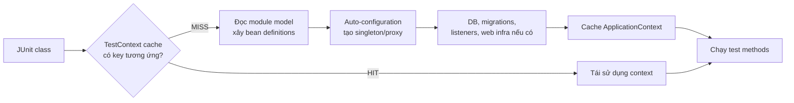
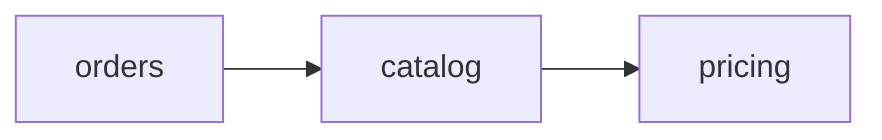

# Chi phí tạo ApplicationContext cho từng module test

## Mục tiêu học tập

Sau bài học, bạn có thể:

1. Phân biệt **chi phí khởi tạo lạnh** (cold bootstrap) với **chi phí thực thi test trên context đã cache** (warm reuse).
2. Giải thích vì sao 30 lớp `@ApplicationModuleTest` **không nhất thiết** khởi tạo 30 `ApplicationContext`, và vì sao chỉ vài lớp cũng có thể gây nhiều cache miss.
3. Đọc log `org.springframework.test.context.cache`, xác định `hitCount`, `missCount`, `size`, `maxSize`, rồi xây một phép đo có thể lặp lại.
4. Viết Java/JUnit cho **hai lớp test cùng module, cùng cấu hình** để thuận lợi cho Spring TestContext cache reuse.
5. Dự đoán ảnh hưởng của `BootstrapMode.STANDALONE`, `DIRECT_DEPENDENCIES`, `ALL_DEPENDENCIES` và `webEnvironment` tới số bean/hạ tầng được khởi tạo.
6. Nhận diện các nguyên nhân làm phân mảnh cache: `@MockitoBean` khác tên/qualifier, `@ActiveProfiles`, `@TestPropertySource`, `@DynamicPropertySource`, `@DirtiesContext` và fork JVM.
7. Tối ưu context startup **không** tắt `ApplicationModules.verify()`, không mock mất nghiệp vụ và không làm sai mục tiêu kiểm thử.
8. Lập quality gate CI đo thời gian chạy và dấu hiệu hồi quy theo baseline, thay vì kiểm tra một con số mili-giây cứng trong JUnit.

Bài thuộc chương **Performance tests** của lộ trình **SPRING_MODULITH_VERIFICATION_TESTING**: kiểm chứng ranh giới kiến trúc với `ApplicationModules`, `@ApplicationModuleTest`, kiểm thử event/database/integration và CI quality gate. **Câu hỏi trực tiếp** của bài là: *một module test phải trả chi phí tạo Spring `ApplicationContext` bao nhiêu lần, và làm gì để đo/giảm chi phí ấy mà không đánh đổi kiểm chứng module?*

> **Phiên bản ví dụ:** Java 17+, Spring Boot 3.4–3.5, Spring Framework 6.2, Spring Modulith 1.3–1.4, JUnit 5 và Mockito. Ví dụ không đưa ra số mili-giây “chuẩn” cho mọi máy. Những đường dẫn tài liệu cuối bài dùng API chính thức Spring Framework 6.2 và Spring Modulith 1.4.

## 1. Chi phí thật không tỷ lệ trực tiếp với số phương thức test

Mỗi lần một `@ApplicationModuleTest` cần **một Spring context mới**, Spring phải thực hiện nhiều công việc:



Một mô hình chi phí hữu ích:

\[
T_{\text{suite}} \approx
\sum_{k \in K_{\text{loaded}}} T_{\text{cold}}(k)
+ \sum_{i \in \text{tests}} T_{\text{case}}(i)
+ T_{\text{process/setup}}
\]

Trong đó:

- `K_loaded`: tập **cấu hình context thực sự phải load**, tính cả việc context bị evict hoặc đánh dấu dirty.
- `T_cold(k)`: thời gian khởi tạo context lần đầu hoặc sau khi bị loại khỏi cache.
- `T_case(i)`: thời gian chạy fixture, HTTP request, SQL, assertion, listener... của từng test.
- `T_process/setup`: thời gian khởi động JVM test worker, test engine, container, migration tooling và hạ tầng khác chưa quy về một context cụ thể.

**Không phải công thức dự báo chính xác**: các phần có thể giao thoa, ví dụ database container được chia sẻ, lazy initialization hay parallel execution. Nhưng nó giúp tránh nhận định sai rằng “thêm một lớp test luôn làm khởi động thêm một application”.

### Ví dụ diễn giải, không phải số đo

Giả sử cùng một JVM:

| Kịch bản | Số lớp test | Số cấu hình context khác nhau | Số cold load có thể xảy ra |
| --- | ---: | ---: | ---: |
| A: 20 lớp chung cấu hình `orders` | 20 | 1 | 1 nếu cache không bị loại |
| B: 5 lớp, mỗi lớp thêm properties/mocks riêng | 5 | 5 | 5 |
| C: 12 lớp, cùng cấu hình nhưng mỗi lớp có `@DirtiesContext` sau class | 12 | 1 | Có thể 12 lần load do invalidation |
| D: 12 lớp, cùng cấu hình nhưng chạy mỗi lớp trong một JVM riêng | 12 | 1 về mặt cấu hình | Có thể 12 lần load vì cache không chung process |

**Điều cần tối ưu trước:** số lần context thực sự **miss**, chứ không chỉ số lớp `@ApplicationModuleTest` xuất hiện trong dự án.

## 2. Ví dụ module đủ nhỏ để đo chi phí context

Ta dùng ứng dụng `com.acme.shop` với hai module `orders` và `catalog`:

```text
src/main/java/com/acme/shop/
├── ShopApplication.java
├── catalog/
│   ├── StockLookup.java
│   └── internal/
│       └── DemoStockLookup.java
└── orders/
    ├── PlaceOrder.java
    ├── OrderReceipt.java
    ├── OrderPlacement.java
    ├── StockUnavailableException.java
    ├── internal/
    │   └── DefaultOrderPlacement.java
    └── web/
        └── OrderController.java

src/test/java/com/acme/shop/
├── ModuleArchitectureTests.java
└── orders/
    ├── OrdersHappyPathTests.java
    ├── OrdersRejectionTests.java
    └── OrdersWebModuleTests.java
```

```java
// src/main/java/com/acme/shop/ShopApplication.java
package com.acme.shop;

import org.springframework.boot.SpringApplication;
import org.springframework.boot.autoconfigure.SpringBootApplication;

@SpringBootApplication
public class ShopApplication {

    public static void main(String[] args) {
        SpringApplication.run(ShopApplication.class, args);
    }
}
```

API bên ngoài module:

```java
// src/main/java/com/acme/shop/catalog/StockLookup.java
package com.acme.shop.catalog;

public interface StockLookup {
    boolean hasEnough(String sku, int quantity);
}
```

```java
// src/main/java/com/acme/shop/catalog/internal/DemoStockLookup.java
package com.acme.shop.catalog.internal;

import com.acme.shop.catalog.StockLookup;
import org.springframework.stereotype.Service;

@Service
class DemoStockLookup implements StockLookup {

    @Override
    public boolean hasEnough(String sku, int quantity) {
        return "BK-42".equals(sku) && quantity <= 5;
    }
}
```

Application API của `orders`:

```java
// src/main/java/com/acme/shop/orders/PlaceOrder.java
package com.acme.shop.orders;

public record PlaceOrder(String sku, int quantity) {
}
```

```java
// src/main/java/com/acme/shop/orders/OrderReceipt.java
package com.acme.shop.orders;

public record OrderReceipt(String id, String sku, String status) {
}
```

```java
// src/main/java/com/acme/shop/orders/OrderPlacement.java
package com.acme.shop.orders;

public interface OrderPlacement {
    OrderReceipt place(PlaceOrder command);
}
```

```java
// src/main/java/com/acme/shop/orders/StockUnavailableException.java
package com.acme.shop.orders;

public class StockUnavailableException extends RuntimeException {

    public StockUnavailableException() {
        super("Requested stock is unavailable");
    }
}
```

Service thật trong module:

```java
// src/main/java/com/acme/shop/orders/internal/DefaultOrderPlacement.java
package com.acme.shop.orders.internal;

import com.acme.shop.catalog.StockLookup;
import com.acme.shop.orders.OrderPlacement;
import com.acme.shop.orders.OrderReceipt;
import com.acme.shop.orders.PlaceOrder;
import com.acme.shop.orders.StockUnavailableException;
import org.springframework.stereotype.Service;

@Service
class DefaultOrderPlacement implements OrderPlacement {

    private final StockLookup stockLookup;

    DefaultOrderPlacement(StockLookup stockLookup) {
        this.stockLookup = stockLookup;
    }

    @Override
    public OrderReceipt place(PlaceOrder command) {
        if (!stockLookup.hasEnough(
                command.sku(), command.quantity())) {
            throw new StockUnavailableException();
        }

        return new OrderReceipt(
                "order-" + command.sku(),
                command.sku(),
                "PLACED");
    }
}
```

Ví dụ **không dùng JPA hay sự kiện** để phép quan sát context không bị chi phối bởi migration, database connection hoặc async listeners. Nó vẫn thực thi **service thật** của `orders`, nhưng dùng `@MockitoBean StockLookup` ở API của module `catalog` bị loại khỏi `STANDALONE`.

Gradle Groovy DSL — giả định đã có BOM/dependency management tương thích:

```groovy
dependencies {
    implementation 'org.springframework.modulith:spring-modulith-starter-core'
    implementation 'org.springframework.boot:spring-boot-starter-web'
    testImplementation 'org.springframework.modulith:spring-modulith-starter-test'
    testImplementation 'org.springframework.boot:spring-boot-starter-test'
}
```

Vì ví dụ đầy đủ ở mục 7 có `OrderController` trong mã nguồn chính, starter web cần có trên classpath **để biên dịch**. Chọn `webEnvironment = NONE` cho test use case ở mục 3 sẽ **không khởi tạo web environment** dù starter web đã có. Đừng thêm database, broker hoặc nhiều starter production chỉ để làm phép đo minh họa đơn giản.

## 3. Hai lớp JUnit cùng cấu hình để tận dụng context cache

Với phép đo **không cần web server**, ta chủ động chọn `webEnvironment = NONE`. Hai lớp sau được đặt cùng base package module `orders`, cùng mode, cùng mock type và **cùng tên field**.

### Lớp thứ nhất — nhánh thành công

```java
// src/test/java/com/acme/shop/orders/OrdersHappyPathTests.java
package com.acme.shop.orders;

import static org.assertj.core.api.Assertions.assertThat;
import static org.mockito.BDDMockito.given;
import static org.mockito.BDDMockito.then;

import com.acme.shop.catalog.StockLookup;
import org.junit.jupiter.api.Test;
import org.springframework.beans.factory.annotation.Autowired;
import org.springframework.boot.test.context.SpringBootTest;
import org.springframework.context.ApplicationContext;
import org.springframework.modulith.test.ApplicationModuleTest;
import org.springframework.test.context.bean.override.mockito.MockitoBean;

@ApplicationModuleTest(
        webEnvironment = SpringBootTest.WebEnvironment.NONE)
class OrdersHappyPathTests {

    @Autowired
    OrderPlacement orders;

    @Autowired
    ApplicationContext context;

    @MockitoBean
    StockLookup stockLookup;

    @Test
    void placesOrderWhenStockAvailable() {
        given(stockLookup.hasEnough("BK-42", 2))
                .willReturn(true);

        var receipt = orders.place(new PlaceOrder("BK-42", 2));

        assertThat(receipt.status()).isEqualTo("PLACED");
        assertThat(receipt.id()).isEqualTo("order-BK-42");
        then(stockLookup).should().hasEnough("BK-42", 2);
    }

    @Test
    void diagnosticsOnlyNotLatencyAssertion() {
        System.out.printf(
                "orders contextRef=%x beanDefinitions=%d%n",
                System.identityHashCode(context),
                context.getBeanDefinitionCount());
    }
}
```

`context.getBeanDefinitionCount()` giúp quan sát **quy mô đăng ký bean**. Nó **không** đếm bean thực đã được khởi tạo, không đo heap, và **không** đại diện trực tiếp cho số mili-giây startup.

`System.identityHashCode(context)` chỉ dùng để **so sánh tham chiếu trong một lần chạy**, không phải ID bảo đảm duy nhất giữa các process/JVM. Không biến giá trị đó thành assertion liên máy.

### Lớp thứ hai — nhánh từ chối

```java
// src/test/java/com/acme/shop/orders/OrdersRejectionTests.java
package com.acme.shop.orders;

import static org.assertj.core.api.Assertions.assertThatThrownBy;
import static org.mockito.BDDMockito.given;

import com.acme.shop.catalog.StockLookup;
import org.junit.jupiter.api.Test;
import org.springframework.beans.factory.annotation.Autowired;
import org.springframework.boot.test.context.SpringBootTest;
import org.springframework.modulith.test.ApplicationModuleTest;
import org.springframework.test.context.bean.override.mockito.MockitoBean;

@ApplicationModuleTest(
        webEnvironment = SpringBootTest.WebEnvironment.NONE)
class OrdersRejectionTests {

    @Autowired
    OrderPlacement orders;

    // Cùng tên field với OrdersHappyPathTests.
    @MockitoBean
    StockLookup stockLookup;

    @Test
    void rejectsOrderWhenStockUnavailable() {
        given(stockLookup.hasEnough("BK-42", 8))
                .willReturn(false);

        assertThatThrownBy(() ->
                orders.place(new PlaceOrder("BK-42", 8)))
                .isInstanceOf(StockUnavailableException.class);
    }
}
```

Hai lớp dùng cùng cấu hình module test, cùng tên mock `stockLookup`, nên **có cơ hội tái sử dụng một context** qua Spring TestContext cache khi chúng chạy trong **cùng JVM**, không có thay đổi cache key hoặc invalidation khác.

Nhớ rằng:

- `@MockitoBean` là **Spring bean override**, không phải `@Mock` Mockito thuần.
- Mock state được reset theo chính sách Spring test support; đừng để test phụ thuộc stub của lớp khác.
- **Không thêm `@DirtiesContext`** nếu test chỉ thay đổi Mockito stubbing; dùng cleanup/rollback thích hợp cho state thực.
- **Không giả định reuse** chỉ vì hai lớp cùng package; phải kiểm tra cache logs. Cấu hình ẩn từ superclass/meta-annotation hoặc customizers có thể khác.

Đây là ví dụ tối thiểu cho thấy **hai lớp JUnit không có nghĩa hai cold context**.

## 4. Đo cold bootstrap và cache hit/miss đúng cách

### Bước 1 — bật log quan sát

Đưa cấu hình sau vào **test logging configuration chung** của dự án, ví dụ `src/test/resources/application.properties` nếu đang dùng Spring Boot:

```properties
logging.level.org.springframework.test.context.cache=DEBUG
logging.level.org.springframework.modulith=DEBUG
```

Đây là **đoạn cấu hình minh họa**, không yêu cầu sửa thêm file trong nhiệm vụ viết bài hiện tại.

Khi chạy test, chú ý:

- Log Modulith cho biết module nào được bootstrap và mode `STANDALONE`, `DIRECT_DEPENDENCIES` hay `ALL_DEPENDENCIES`.
- Log `org.springframework.test.context.cache` có các số như `size`, `maxSize`, `hitCount`, `missCount`.
- Log Spring Boot thường báo context được **Started ... in ... seconds** khi có một lần khởi tạo.

**Không kết luận** cứ có một dòng log cache `hitCount` tăng là một lớp test mới đã chạy: cùng lớp có thể truy cập context nhiều lần ở các phase. Hãy dùng xu hướng **miss count**, số cold startup và cấu hình context để phân tích.

### Bước 2 — chạy riêng một lớp để lấy cold baseline

Lệnh minh họa Gradle:

```bash
./gradlew test \
  --tests 'com.acme.shop.orders.OrdersHappyPathTests' \
  --rerun-tasks --no-build-cache
```

Chạy vài lần trong **những lượt test worker JVM riêng biệt** và ghi lại wall-clock time cùng log startup. `--rerun-tasks` buộc Gradle chạy lại task test thay vì dùng kết quả task cũ; `--no-build-cache` tránh nhận đầu ra test từ build cache. Tuy vậy tổng thời gian CLI còn có JIT/classloading/Gradle overhead, nên **không gọi đó là thời gian tạo ApplicationContext thuần**.

Nếu bản build dùng Maven Surefire/Failsafe thay vì Gradle, điều chỉnh filter test và cơ chế fork tương ứng. Không lấy một run duy nhất làm chuẩn hiệu năng.

### Bước 3 — chạy cả hai lớp trong cùng test worker

```bash
./gradlew test \
  --tests 'com.acme.shop.orders.OrdersHappyPathTests' \
  --tests 'com.acme.shop.orders.OrdersRejectionTests' \
  --rerun-tasks --no-build-cache
```

Ở lần chạy này, kiểm tra:

1. JVM test worker có giữ nguyên giữa hai lớp hay không.
2. Có **một** context được tạo cho cấu hình giống nhau thay vì hai context tách biệt không.
3. Cache stats có `missCount` khi load đầu tiên và các `hitCount` ở lượt test sau không.
4. Kết quả của **cả hai** bài test nghiệp vụ vẫn đúng không.

Nếu máy/chạy CI cấu hình `forkEvery=1`, mỗi lớp test có thể chạy trong một JVM khác, khiến static context cache **không chia sẻ** được dù annotation giống nhau. Cũng có thể phát sinh nhiều process khi `maxParallelForks` lớn; song song có thể giảm wall-clock nhưng **tăng số cold boot** trên toàn pipeline.

### Bước 4 — không dùng JUnit timing assertion cứng

Tránh:

```java
// KHÔNG dùng làm test pass/fail cho startup:
// assertThat(elapsedMillis).isLessThan(500);
```

Một lần startup phụ thuộc CPU, CI runner, JIT, filesystem cache, database, Docker và thứ tự load test. Threshold mili-giây tự đặt không có baseline sẽ tạo **flaky performance gate**. Hãy ghi nhận số context misses, profile chạy và phân phối thời gian qua nhiều lần chạy trong điều kiện ổn định.

## 5. Vì sao cùng một module vẫn có nhiều context?

Spring TestContext cache dùng **khóa cấu hình**, không dùng tên module hoặc tên lớp test làm khóa duy nhất.

Những thành phần của cache key theo Spring Framework 6.2 gồm:

| Thành phần | Thay đổi nào có thể khiến key khác? |
| --- | --- |
| `classes`, `locations` | Thay `@ContextConfiguration` hoặc cấu hình gốc |
| `contextInitializerClasses` | Dùng initializer khác |
| `contextCustomizers` | `@MockitoBean`, `@MockitoSpyBean`, `@TestBean`, `@DynamicPropertySource`, customizers Spring Boot |
| `activeProfiles` | `@ActiveProfiles("test")` so với `@ActiveProfiles("ci")` |
| `propertySourceDescriptors`, `propertySourceProperties` | `@TestPropertySource` khác file hoặc khác giá trị |
| `contextLoader`, `parent` | Context loader hoặc hierarchy khác |
| `resourceBasePath` | Khác `@WebAppConfiguration` |

Trong Spring Modulith, **module được chọn và bootstrap mode** còn ảnh hưởng phạm vi context. Không kỳ vọng `orders` và `catalog` tái sử dụng cùng một context chỉ vì đều có `@ApplicationModuleTest`.

### Bẫy tên field `@MockitoBean`

Hai lớp sau trông tương đương về hành vi:

```java
// Test A:
@MockitoBean
StockLookup stockLookup;

// Test B:
@MockitoBean
StockLookup inventory;
```

Nhưng **tên field có thể được Spring dùng làm fallback qualifier**. Theo Spring Framework 6.2, qualifier (kể cả tên field) tham gia quyết định cấu hình bean override và khả năng chia sẻ `ApplicationContext`.

Vì vậy, nếu hai lớp test cùng mock một cổng công khai, **đặt tên nhất quán**:

```java
@MockitoBean
StockLookup stockLookup;
```

Đừng đổi tên mock tùy hứng chỉ vì thích style khác ở mỗi lớp. Khi thật sự có nhiều implementation cùng interface, cần `@Qualifier` hoặc bean name **đúng nghĩa nghiệp vụ**; không tối ưu cache bằng cách bỏ qualifier cần thiết.

### Bẫy profile và properties chỉ khác một chữ

```java
// Test A
@ActiveProfiles("test")
@ApplicationModuleTest
class A {}

// Test B
@ActiveProfiles("test")
@TestPropertySource(properties =
        "feature.orders.enabled=true")
@ApplicationModuleTest
class B {}
```

Ngay cả khi `feature.orders.enabled` đang có giá trị `true` theo mặc định, khai báo `@TestPropertySource` thêm vào test B vẫn có thể tạo **một cache key khác**. Nếu nhiều lớp cần cùng một property, tập trung nó vào cấu hình test được chia sẻ hoặc annotation chung để giảm biến thể không cần thiết.

**Không đồng nhất tất cả test bằng một profile** nếu các bài cần cấu hình thật sự khác nhau. Đó là hai bối cảnh nghiệp vụ khác và việc có hai context đôi khi là **đúng đắn**.

## 6. BootstrapMode và webEnvironment tác động tới chi phí thế nào?

`@ApplicationModuleTest` Spring Modulith 1.4 có ba mode:

| Mode | Phạm vi bootstrap | Xu hướng chi phí có thể gặp |
| --- | --- | --- |
| `STANDALONE` *(mặc định)* | Module hiện tại | Ít bean hơn, cô lập tốt hơn nếu dependency ngoài được mock đúng |
| `DIRECT_DEPENDENCIES` | Module hiện tại + các module trực tiếp được phụ thuộc | Có thể phải tạo thêm service, repository, connection/hạ tầng của dependency |
| `ALL_DEPENDENCIES` | Module hiện tại + toàn cây dependency bắc cầu | Có thể khởi tạo nhiều module hơn, tăng startup và state cần dọn |

**Không coi thứ tự trên là benchmark chắc chắn.** Số module không tỷ lệ tuyến tính với chi phí: một module có Flyway migration, JPA/Redis/Kafka có thể đắt hơn nhiều module chỉ chứa service Java thuần.

Khi module `orders` phụ thuộc `catalog`, phép đo cơ bản:

```java
import org.springframework.modulith.test.ApplicationModuleTest;
import org.springframework.boot.test.context.SpringBootTest;

// Cấu hình test 1 — ưu tiên cô lập.
@ApplicationModuleTest(
        mode = ApplicationModuleTest.BootstrapMode.STANDALONE,
        webEnvironment = SpringBootTest.WebEnvironment.NONE)
class OrdersStandaloneTests {

    @MockitoBean
    StockLookup stockLookup;
}
```

Lưu ý `OrdersStandaloneTests` trên là **khung cấu hình minh họa**; khi dùng thực tế phải đặt đúng package `orders`, thêm imports và test methods. Hai lớp hoàn chỉnh ở mục 3 đã chạy cùng chiến lược.

Muốn đo tích hợp catalog thật, tạo lớp riêng:

```java
// Cấu hình test 2 — mở module phụ thuộc trực tiếp.
@ApplicationModuleTest(
        mode = ApplicationModuleTest.BootstrapMode.DIRECT_DEPENDENCIES,
        webEnvironment = SpringBootTest.WebEnvironment.NONE)
class OrdersWithCatalogTests {
    // Không dùng @MockitoBean StockLookup ở đây nếu
    // mục tiêu là chạy DemoStockLookup thật.
}
```

Với mô hình mẫu chỉ có một cạnh `orders → catalog`, `DIRECT_DEPENDENCIES` và `ALL_DEPENDENCIES` có thể bootstrap **cùng một tập module**. Để thấy chênh lệch, cần một đồ thị có dependency bắc cầu thực tế:



Khi `catalog` **thực sự có dependency Java/module** tới `pricing`, thì từ test `orders`:

- `STANDALONE`: `orders`.
- `DIRECT_DEPENDENCIES`: `orders` + `catalog`.
- `ALL_DEPENDENCIES`: `orders` + `catalog` + `pricing`.

Đồ thị `pricing` là **tình huống mở rộng giả định**, chưa có implementation trong mã mẫu.

### WebEnvironment là một trục khác

```java
// Không cần Servlet web context cho test use case thuần:
@ApplicationModuleTest(
        webEnvironment = SpringBootTest.WebEnvironment.NONE)
```

so với:

```java
// Test HTTP MVC cần web context nhưng không cần cổng server thật:
@ApplicationModuleTest(
        webEnvironment = SpringBootTest.WebEnvironment.MOCK)
@AutoConfigureMockMvc
```

và:

```java
// Đo HTTP server thật là một bối cảnh kiểm thử KHÁC:
@ApplicationModuleTest(
        webEnvironment = SpringBootTest.WebEnvironment.RANDOM_PORT)
```

`MOCK` là **mặc định** của `@ApplicationModuleTest` ở nhánh 1.4. Nó tạo mock web environment khi web stack có mặt, **không khởi động embedded HTTP server**. `NONE` không tạo web environment, có thể giảm hạ tầng cần load cho test application service. `RANDOM_PORT` mở server thật, thường có chi phí và cache key khác, nhưng cần thiết khi phải kiểm tra network, filter hoặc giao thức thật.

**Không chuyển mọi web test sang `NONE` chỉ vì nhanh.** Nếu bài test cần `MockMvc`, mapping/controller hoặc security filter chain, phải chọn đúng web environment và cấu hình MVC.

## 7. Cùng module nhưng test web sẽ có context khác là điều bình thường

Để thấy chi phí của một **mục tiêu kiểm thử khác**, bổ sung controller đơn giản cho `orders`:

```java
// src/main/java/com/acme/shop/orders/web/OrderController.java
package com.acme.shop.orders.web;

import com.acme.shop.orders.OrderPlacement;
import com.acme.shop.orders.OrderReceipt;
import com.acme.shop.orders.PlaceOrder;
import org.springframework.http.MediaType;
import org.springframework.http.ResponseEntity;
import org.springframework.web.bind.annotation.PostMapping;
import org.springframework.web.bind.annotation.RequestBody;
import org.springframework.web.bind.annotation.RequestMapping;
import org.springframework.web.bind.annotation.RestController;

@RestController
@RequestMapping("/orders")
public class OrderController {

    private final OrderPlacement orders;

    public OrderController(OrderPlacement orders) {
        this.orders = orders;
    }

    @PostMapping(
            consumes = MediaType.APPLICATION_JSON_VALUE,
            produces = MediaType.APPLICATION_JSON_VALUE)
    public ResponseEntity<OrderReceipt> create(
            @RequestBody PlaceOrder command) {

        return ResponseEntity.ok(orders.place(command));
    }
}
```

Ở ví dụ đo context, controller trả `200 OK` để giữ mã ngắn; không nên suy điều này là hợp đồng HTTP tạo đơn đầy đủ trong production. Mục đích là **đặt HTTP controller thật vào test context**.

Lớp module test dùng MVC:

```java
// src/test/java/com/acme/shop/orders/OrdersWebModuleTests.java
package com.acme.shop.orders;

import static org.mockito.BDDMockito.given;
import static org.springframework.test.web.servlet.request
        .MockMvcRequestBuilders.post;
import static org.springframework.test.web.servlet.result
        .MockMvcResultMatchers.jsonPath;
import static org.springframework.test.web.servlet.result
        .MockMvcResultMatchers.status;

import com.acme.shop.catalog.StockLookup;
import org.junit.jupiter.api.Test;
import org.springframework.beans.factory.annotation.Autowired;
import org.springframework.boot.test.autoconfigure.web.servlet.AutoConfigureMockMvc;
import org.springframework.http.MediaType;
import org.springframework.modulith.test.ApplicationModuleTest;
import org.springframework.test.context.bean.override.mockito.MockitoBean;
import org.springframework.test.web.servlet.MockMvc;

@ApplicationModuleTest
@AutoConfigureMockMvc
class OrdersWebModuleTests {

    @Autowired
    MockMvc mvc;

    @MockitoBean
    StockLookup stockLookup;

    @Test
    void webAdapterAndRealServiceWorkTogether()
            throws Exception {

        given(stockLookup.hasEnough("BK-42", 2))
                .willReturn(true);

        mvc.perform(post("/orders")
                .contentType(MediaType.APPLICATION_JSON)
                .content("""
                        {"sku":"BK-42","quantity":2}
                        """))
                .andExpect(status().isOk())
                .andExpect(jsonPath("$.status").value("PLACED"));
    }
}
```

Lớp này **được phép** làm phát sinh một context khác `OrdersHappyPathTests` vì:

- Nó dùng web environment mặc định `MOCK` chứ không phải `NONE`.
- Nó có `@AutoConfigureMockMvc`, tạo MVC test infrastructure và context customizers tương ứng.
- Nó kiểm tra **một hợp đồng khác**: request MVC → controller thật → service thật.

**Đây không phải fragmentation vô ích.** Tối ưu startup phải đi cùng yêu cầu kiểm chứng. Gộp hai ngữ cảnh `NONE` và `MOCK` thành một chỉ để “tăng cache hit” có thể làm test use case thuần phải load web infrastructure không cần thiết, hoặc làm mất kiểm chứng HTTP.

## 8. Những yếu tố khiến context chậm và các phản tác dụng khi tối ưu

### Chi phí theo thành phần thật được khởi tạo

| Thành phần | Chi phí có thể phát sinh | Cách cải thiện khi mục tiêu cho phép |
| --- | --- | --- |
| Component scanning và Spring auto-configuration | Quét classpath, điều kiện cấu hình, tạo bean definitions | Chọn module/bootstrap mode vừa đủ |
| AOP/security/transaction proxies | Tạo proxy, metadata và interceptor | Không bật hạ tầng không cần cho test, nhưng phải giữ khi đó là hợp đồng cần kiểm tra |
| MVC/Servlet infrastructure | Handler mappings, converters, filters | Dùng `NONE` cho module use case test không có HTTP |
| JPA + datasource | Entity scan, metadata Hibernate, connection pool | Dùng DB fixture phù hợp; không mock repository nếu đang test persistence |
| Flyway/Liquibase migrations | Đọc và chạy migrations theo schema | Tái sử dụng DB test/container khi an toàn; không tắt migration trong test schema production compatibility |
| Broker/Redis/external client | Connection, handshake, startup container | Mock **public API module ngoài** khi chỉ cần isolated module test |
| `@DirtiesContext` | Context bị loại khỏi cache và phải tạo lại | Dọn dữ liệu/mock state thay vì reset cả context |
| Gradle/Maven fork | JVM mới, static cache trống | Tổ chức test worker/forks hợp lý theo mục tiêu |

### Bẫy `@DirtiesContext` cho mỗi bài

```java
// ANTI-PATTERN nếu chỉ muốn reset Mockito interactions.
@DirtiesContext(classMode =
        DirtiesContext.ClassMode.AFTER_CLASS)
@ApplicationModuleTest
class OrdersEveryTimeColdTests {
    // ...
}
```

`@DirtiesContext` báo cho Spring TestContext rằng context đã “bẩn”, cần bị evict/recreate. Nếu chỉ cần thiết lập lại behavior của `@MockitoBean`, cách này thường **quá đắt và không cần thiết**. Nếu test có database thì dùng transaction rollback hoặc fixture cleanup **phù hợp mục tiêu**, thay vì mặc định vứt toàn bộ context.

Tuy nhiên, khi test thật sự sửa bean definition, application state không thể khôi phục, hay có side effect khiến context không an toàn để tái sử dụng, `@DirtiesContext` có thể **đúng về tính cô lập**. Đừng bỏ nó chỉ vì giảm startup mà làm sai test.

### Chi phí cache churn và ngưỡng mặc định

Spring Framework 6.2 đặt **kích thước cache tối đa mặc định là 32 context** trong một JVM; khi vượt giới hạn, cache dùng **LRU eviction**. Có thể tùy chỉnh bằng system property:

```properties
spring.test.context.cache.maxSize=32
```

Ví dụ trên mô tả **JVM system property/SpringProperties**, không phải cấu hình nghiệp vụ của một module. Tăng maxSize có thể giảm eviction nhưng tốn **RAM**; trong CI ít bộ nhớ, tăng quá cao có thể làm chậm hoặc gây out-of-memory. Hãy nhìn `size`, `missCount`, eviction và heap trước khi thay đổi.

Trong Gradle, nếu thật sự cần thử nghiệm một giá trị:

```groovy
tasks.named('test', Test) {
    systemProperty 'spring.test.context.cache.maxSize', '32'
}
```

Đo lại cả **thời gian** và **bộ nhớ** sau khi thay đổi; đừng tăng cache size như một “mẹo tối ưu mặc định”.

### Đừng vô hiệu module verification

`@ApplicationModuleTest` ở Spring Modulith 1.4 có:

```java
verifyAutomatically = true
```

theo mặc định. Tắt cấu hình đó vì muốn rút ngắn startup có thể bỏ qua **kiểm tra dependency/cycle/internal API**. Nếu profiling cho thấy structural verification gây chi phí đáng kể, hãy ghi nhận và tổ chức architecture gate riêng có chủ đích — **không được chỉ tắt để web/module tests xanh hoặc bỏ hết kiểm chứng kiến trúc**.

Một kiểm tra tĩnh độc lập, không cần tạo web context:

```java
// src/test/java/com/acme/shop/ModuleArchitectureTests.java
package com.acme.shop;

import org.junit.jupiter.api.Test;
import org.springframework.modulith.core.ApplicationModules;

class ModuleArchitectureTests {

    @Test
    void boundariesAreStillValid() {
        ApplicationModules.of(ShopApplication.class).verify();
    }
}
```

Gate này kiểm tra ranh giới **giữa các module**; nó không thay thế HTTP, database/event hoặc quy tắc phân tầng nội module do nhóm tự định nghĩa.

## 9. Thiết kế thí nghiệm và quality gate CI

Một phép đo hiệu năng test đáng tin cậy cần **cố định phần lớn biến số**, rồi thay một yếu tố tại một thời điểm.

### Ma trận thí nghiệm tối thiểu

| Lượt | Phạm vi | Các thay đổi có chủ đích | Quan sát cần ghi |
| --- | --- | --- | --- |
| A | `orders`, `STANDALONE`, `NONE` | Hai JUnit class chung `@MockitoBean StockLookup stockLookup` | Cold startup, cache hits/misses, wall-clock |
| B | `orders`, `STANDALONE`, `MOCK` + MockMvc | Có controller/MVC infrastructure | Chênh lệch startup và bean definitions |
| C | `orders`, `DIRECT_DEPENDENCIES`, `NONE` | Không mock StockLookup; tạo `catalog` thật | Chênh lệch bean count, startup và behavior |
| D | Giống A nhưng đổi một field mock thành `inventory` | Khác fallback qualifier/cache customizer | Kiểm tra có thêm cache miss không |
| E | Giống A nhưng `@DirtiesContext` | Cố ý invalidation sau mỗi class | Kiểm tra context bị rebuild |
| F | Giống A nhưng tăng test JVM forks | Static cache tách theo process | Tổng cold loads so với wall-clock |

**Chú ý về so sánh:** các lượt B/C kiểm tra **hợp đồng khác nhau**, nên không kết luận mode nhanh nhất là mode cần dùng cho mọi bài. Mục tiêu là hiểu chi phí để bố trí test hợp lý, không làm mất coverage.

### Thông tin cần lưu trong kết quả đo

- Commit/nhánh code, JDK, Spring Boot/Modulith version.
- Cấu hình CPU/RAM CI runner; Gradle/Maven version và fork/parallel settings.
- Số test classes/methods chạy và số **unique context configurations** nếu phân tích được.
- Spring cache `hitCount`, `missCount`, `size`, `maxSize`.
- Cold application startup log, tổng test wall-clock, số lần chạy và mức biến thiên.
- Có/không Testcontainers, Flyway/Liquibase, database/broker thật.

**Không so sánh** một run local IDE warm-cache với một run CI cold-cache rồi quy tất cả chênh lệch cho `BootstrapMode`.

### Nguyên tắc đặt performance gate

1. Dùng nhiều lượt đo ổn định để có baseline cho nhóm test tương đương.
2. Cảnh báo khi **số context misses tăng bất thường** hoặc thời gian suite tăng kéo dài qua nhiều build.
3. Khi có hồi quy, kiểm tra thay đổi `@MockitoBean`, profile, `@DirtiesContext`, task forks trước khi tối ưu code production.
4. Không dùng threshold milliseconds cố định trong JUnit làm thay thế phép đo; dành JUnit cho **assertion chức năng/kiến trúc**.
5. Giữ các required checks: `ApplicationModules.verify()`, module tests, web tests và integration tests dùng DB/event khi tính năng yêu cầu.

Nếu dùng test selection/change-aware execution của Spring Modulith, nhớ rằng **giảm số test được chọn chạy** là một chiến lược khác với **giảm chi phí khởi tạo mỗi context**. Trong môi trường CI, việc chọn test theo thay đổi còn cần reference commit và cấu hình lịch sử phù hợp; không mặc định nó sẽ cắt test khi build không có diff hoặc khi build logic thay đổi.

## 10. Bài thực hành và câu hỏi kiểm chứng

### Thực hành: chứng minh chi phí context bằng dữ liệu

**Mục tiêu:** Thay vì trả lời “mỗi `@ApplicationModuleTest` mất bao nhiêu giây?”, hãy chứng minh **context được tạo lại khi nào** và **cấu hình nào đáng tách/gom**.

1. Tạo ví dụ `com.acme.shop` ở mục 2 và hai lớp `OrdersHappyPathTests`, `OrdersRejectionTests` ở mục 3.
2. Chạy riêng `OrdersHappyPathTests` trong một lượt cold và ghi tổng thời gian, số cold startup, số cache miss.
3. Chạy cả hai lớp trong **một test JVM**; xác minh chức năng của cả hai đều xanh và quan sát cache hit/miss. **Không** dùng trùng `System.identityHashCode` làm bằng chứng duy nhất.
4. Đổi field `StockLookup stockLookup` thành `StockLookup inventory` **chỉ ở lớp thứ hai**; chạy lại cả hai và xem cache có phân mảnh không. Khôi phục tên chung.
5. Thử `@DirtiesContext(classMode = AFTER_CLASS)` ở lớp đầu; quan sát chi phí tạo lại context cho test class tiếp theo. Xóa annotation sau thí nghiệm.
6. Bổ sung `spring-boot-starter-web`, `OrderController` và `OrdersWebModuleTests` ở mục 7. So sánh `NONE` với `MOCK + @AutoConfigureMockMvc`, đồng thời nêu rõ **mục tiêu kiểm thử khác nhau**.
7. Tạo một lớp test `DIRECT_DEPENDENCIES` để dùng `DemoStockLookup` thật, **không đặt `@MockitoBean StockLookup`**. Quan sát chi phí và kết quả nghiệm vụ.
8. Thử cấu hình Gradle/Maven tách test classes sang các JVM khác nhau và ghi nhận static cache không chia sẻ; khôi phục cấu hình test đáng tin cậy.
9. Giữ `ModuleArchitectureTests` gọi `ApplicationModules.verify()` và tất cả test assertions nghiệp vụ trong CI. Không đổi `verifyAutomatically` thành `false` chỉ để lấy chỉ số đẹp.
10. Ghi kết luận theo bảng: **giả thuyết → thay đổi cấu hình → cache miss/hit → thời gian và RAM → quyết định**.

### Câu hỏi tự kiểm tra

1. Vì sao 20 lớp `@ApplicationModuleTest` có thể chỉ cần một lần cold bootstrap?
2. Điều kiện quan trọng để context cache dùng chung giữa hai lớp JUnit là gì? “Cùng package” có đủ không?
3. Tên field `@MockitoBean` có thể khiến context cache key khác như thế nào?
4. `@DirtiesContext` giúp ích cho trường hợp nào và gây chi phí gì?
5. Vì sao cache mặc định giới hạn **32 context**, và có nên luôn tăng giới hạn đó lên 128 không?
6. `STANDALONE` và `DIRECT_DEPENDENCIES` khác nhau ở module bootstrap; chúng có tạo ra các hợp đồng kiểm thử khác nhau không?
7. `WebEnvironment.NONE` phù hợp cho test nào? Vì sao không dùng cho test `MockMvc`?
8. Vì sao một `System.currentTimeMillis()` bọc quanh method JUnit **không đo được cold context startup**?
9. Nếu Gradle khởi tạo JVM mới cho mỗi lớp test, việc đặt `@MockitoBean` giống nhau có giúp reuse context giữa các process không?
10. Vì sao test trả HTTP 200 không bảo đảm service thật, database/event hoặc module verification đã được kiểm tra?
11. Khi một test module chậm sau khi thêm Flyway/Testcontainers, nên điều tra hạ tầng nào trước?
12. Chiến lược CI nào giúp phát hiện **hồi quy startup**, nhưng không biến độ dao động máy CI thành flaky JUnit tests?

## Tổng kết

Chi phí tạo `ApplicationContext` cho **từng module test** không phải một khoản cố định trả theo **từng class hoặc method**. Spring TestContext cache tái sử dụng context theo **khóa cấu hình** trong cùng JVM: nhiều lớp `@ApplicationModuleTest` cùng module, cùng bootstrap mode, mock, profile, properties và customizers có thể chia sẻ một lần cold startup. Ngược lại, `@MockitoBean` khác tên/qualifier, `@TestPropertySource` riêng, `@DirtiesContext`, web environment khác hoặc test JVM forks có thể làm xuất hiện nhiều cold loads. Muốn tối ưu, trước tiên **đo cache hits/misses và thời gian cold/warm một cách lặp lại**, sau đó thu hẹp bootstrap vừa đủ, giữ tên/config mock nhất quán và tránh invalidation không cần thiết. Tuyệt đối **không đánh đổi** việc kiểm chứng application service, database/event hoặc `ApplicationModules.verify()` chỉ để giảm số context; CI phải bảo vệ đồng thời **chi phí kiểm thử** và **độ tin cậy kiến trúc**.

### Tài liệu tham khảo

- [Spring Modulith 1.4 — Integration Testing Application Modules](https://docs.spring.io/spring-modulith/reference/1.4/testing.html)
- [Spring Modulith 1.4 — `@ApplicationModuleTest` API](https://docs.spring.io/spring-modulith/docs/1.4.0/api/org/springframework/modulith/test/ApplicationModuleTest.html)
- [Spring Framework 6.2 — TestContext Context Caching](https://docs.spring.io/spring-framework/reference/6.2/testing/testcontext-framework/ctx-management/caching.html)
- [Spring Framework 6.2 — `@MockitoBean` and `@MockitoSpyBean`](https://docs.spring.io/spring-framework/reference/6.2/testing/annotations/integration-spring/annotation-mockitobean.html)
- [Spring Boot 3.5 — Testing Spring Boot Applications](https://docs.spring.io/spring-boot/3.5/reference/testing/spring-boot-applications.html)
- [Spring Modulith 1.4 — Verifying Application Module Structure](https://docs.spring.io/spring-modulith/reference/1.4/verification.html)
