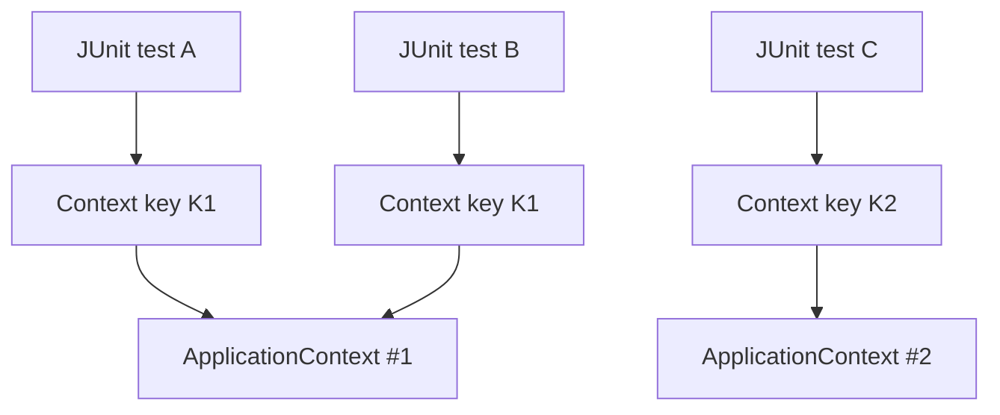

# Context caching và cấu hình làm cache bị tách

## Mục tiêu học tập

Sau bài học, bạn có thể:

1. Giải thích vì sao Spring TestContext **tái sử dụng `ApplicationContext` theo khóa cấu hình**, không theo tên bài test hay số phương thức JUnit.
2. Nhận diện được ba hiện tượng khác nhau: **cache key khác nhau**, **context bị đánh dấu dirty/loại khỏi LRU**, và **cache không thể chia sẻ vì JVM khác nhau**.
3. Viết hai `@ApplicationModuleTest` của cùng module có cấu hình tương đương, kiểm tra nghiệp vụ bằng service thật và `@MockitoBean` tại ranh giới module ngoài.
4. Tái hiện một lần **tách cache không cần thiết** bằng tên field `@MockitoBean` khác nhau; phân biệt fallback qualifier với bean name có chủ đích.
5. Phân tích tác động của `@ActiveProfiles`, `@TestPropertySource`, `@Import`, `@DynamicPropertySource`, `webEnvironment` và `BootstrapMode` lên cấu hình context.
6. Hiểu bẫy ngược: **cùng cache key không bảo đảm an toàn tái sử dụng** nếu một tài nguyên bên ngoài, chẳng hạn database container, đã đổi vòng đời hoặc endpoint.
7. Đọc thống kê `hitCount`, `missCount`, `size`, `maxSize` từ logger `org.springframework.test.context.cache` và thiết kế thí nghiệm có đối chứng.
8. Đề xuất cách chuẩn hóa cấu hình test và CI mà **không** tắt `ApplicationModules.verify()`, bỏ mock sai ranh giới hay làm suy yếu tính cô lập.

Bài thuộc chương **Performance tests** của lộ trình **SPRING_MODULITH_VERIFICATION_TESTING**. Trong lộ trình này, Spring Modulith được dùng để kiểm chứng ranh giới kiến trúc qua `ApplicationModules`, các quy tắc phụ thuộc, `@ApplicationModuleTest`, kiểm thử sự kiện, database và tích hợp, cùng quality gate trong CI. Trọng tâm ở đây **không** phải đo hiệu năng endpoint: ta nghiên cứu **vì sao test suite tạo nhiều Spring context hơn cần thiết** và cách sửa **cấu hình gây tách cache**.

> **Phiên bản minh họa:** Java 17+, JUnit Jupiter, Spring Boot 3.4–3.5, Spring Framework 6.2, Spring Modulith 1.3–1.4. Ví dụ dùng `@MockitoBean` từ `org.springframework.test.context.bean.override.mockito`. Với Spring Boot/Spring Framework mới hơn, hãy kiểm tra API và khả năng thay đổi cấu hình test theo BOM của dự án.

## 1. Chính xác thứ gì được cache và điều gì làm cache bị tách?

Spring TestContext giữ những `ApplicationContext` đã tải trong một **static cache của JVM thực thi test**. Hai lớp JUnit có thể dùng chung context khi chúng khai báo **cùng cấu hình context hiệu dụng**; việc chúng là hai class khác nhau **không tự tạo hai key**.



Trong sơ đồ, A và B **có thể** tái sử dụng context, trong khi C đã thay đổi một thành phần key nên cần context khác. Đây không phải cơ chế cache theo Java class name hay package.

### Thành phần khóa theo Spring Framework 6.2

| Thành phần cache key | Nguồn cấu hình điển hình | Hậu quả khi khác |
| --- | --- | --- |
| `locations` và `classes` | `@ContextConfiguration` hoặc cấu hình lớp ứng dụng | Có thể sinh key khác |
| `contextInitializerClasses` | Context initializer được khai báo | Có thể sinh key khác |
| `contextCustomizers` | `@MockitoBean`, `@MockitoSpyBean`, `@TestBean`, method `@DynamicPropertySource`, Spring Boot customizers | **Nguyên nhân tách cache phổ biến** |
| `contextLoader` | Context loader khác | Có thể sinh key khác |
| `parent` | `@ContextHierarchy` | Phụ thuộc context cha |
| `activeProfiles` | `@ActiveProfiles` | Profile khác tạo context khác |
| `propertySourceDescriptors` | Vị trí resource trong `@TestPropertySource` | Đường dẫn resource khác có thể sinh key khác |
| `propertySourceProperties` | Properties khai báo trực tiếp trong test | Khai báo khác có thể sinh key khác |
| `resourceBasePath` | `@WebAppConfiguration` | Web resource base khác có thể sinh key khác |

**Phải tách hai khái niệm:**

- **Cache key khác:** Spring có lý do coi test context là một cấu hình khác và tạo entry mới.
- **Cache hit nhưng trạng thái sai:** key không đổi, nhưng database/container/shared singleton đã đổi bên ngoài; tái sử dụng context lúc này **có thể không an toàn**.

Đừng tối ưu bằng cách ép mọi test dùng một key nếu chúng thật sự yêu cầu cấu hình hoặc trạng thái độc lập.

### Vì sao câu “mỗi `@ApplicationModuleTest` tốn một context” sai?

Trong Spring Modulith, annotation này mở rộng Spring Boot testing nhưng giới hạn component scanning, auto-configuration và entity scanning theo application module được chọn. Nếu hai test cùng module, cùng `BootstrapMode`, `webEnvironment`, beans bị mock, properties và những context customizers khác, **một lần bootstrap có thể phục vụ nhiều class**.

Ngược lại, chỉ cần hai lớp cùng module nhưng một lớp dùng `@MockitoBean` ở kiểu khác, chúng có thể cần hai context. Vậy cần nhìn **cấu hình key** trước khi đếm lớp test.

## 2. Dựng một module mẫu đủ nhỏ để kiểm chứng cache

Để tập trung vào caching, ví dụ dùng một module `orders` có service thật và một cổng công khai thuộc `catalog`. Chúng ta **không** đưa web server, JPA hay broker vào hai test nền.

```text
com.acme.store/
├── StoreApplication.java
├── catalog/
│   ├── StockGateway.java                  <-- public module API
│   └── internal/
│       └── DemoStockGateway.java
└── orders/
    ├── OrderApplication.java             <-- public module API
    ├── StockRejectedException.java
    └── internal/
        └── DefaultOrderApplication.java  <-- bean thật

src/test/java/com/acme/store/orders/
├── OrdersAcceptedTests.java
└── OrdersRejectedTests.java
```

### Ứng dụng Spring Boot

```java
// src/main/java/com/acme/store/StoreApplication.java
package com.acme.store;

import org.springframework.boot.SpringApplication;
import org.springframework.boot.autoconfigure.SpringBootApplication;

@SpringBootApplication
public class StoreApplication {
    public static void main(String[] args) {
        SpringApplication.run(StoreApplication.class, args);
    }
}
```

### API và implementation module catalog

```java
// src/main/java/com/acme/store/catalog/StockGateway.java
package com.acme.store.catalog;

public interface StockGateway {
    boolean canReserve(String sku, int quantity);
}
```

```java
// src/main/java/com/acme/store/catalog/internal/DemoStockGateway.java
package com.acme.store.catalog.internal;

import com.acme.store.catalog.StockGateway;
import org.springframework.stereotype.Service;

@Service
class DemoStockGateway implements StockGateway {

    @Override
    public boolean canReserve(String sku, int quantity) {
        return "BK-42".equals(sku) && quantity <= 5;
    }
}
```

### API và service thật của module orders

```java
// src/main/java/com/acme/store/orders/OrderApplication.java
package com.acme.store.orders;

public interface OrderApplication {
    String place(String sku, int quantity);
}
```

```java
// src/main/java/com/acme/store/orders/StockRejectedException.java
package com.acme.store.orders;

public class StockRejectedException extends RuntimeException {
    public StockRejectedException() {
        super("Insufficient stock");
    }
}
```

```java
// src/main/java/com/acme/store/orders/internal/DefaultOrderApplication.java
package com.acme.store.orders.internal;

import com.acme.store.catalog.StockGateway;
import com.acme.store.orders.OrderApplication;
import com.acme.store.orders.StockRejectedException;
import org.springframework.stereotype.Service;

@Service
class DefaultOrderApplication implements OrderApplication {

    private final StockGateway stockGateway;

    DefaultOrderApplication(StockGateway stockGateway) {
        this.stockGateway = stockGateway;
    }

    @Override
    public String place(String sku, int quantity) {
        if (!stockGateway.canReserve(sku, quantity)) {
            throw new StockRejectedException();
        }
        return "order-" + sku + "-" + quantity;
    }
}
```

Với `@ApplicationModuleTest` mặc định `STANDALONE`, module `orders` được bootstrap nhưng implementation `catalog.internal.DemoStockGateway` **không** được đưa vào context. Ta cung cấp `@MockitoBean StockGateway` cho cổng API bên ngoài và giữ `DefaultOrderApplication` thật. Nhờ vậy, hành vi nghiệp vụ vẫn được kiểm chứng mà không cần tạo toàn bộ module `catalog`.

Dependencies tối thiểu với BOM tương thích:

```groovy
dependencies {
    implementation 'org.springframework.boot:spring-boot-starter'
    implementation 'org.springframework.modulith:spring-modulith-starter-core'

    testImplementation 'org.springframework.boot:spring-boot-starter-test'
    testImplementation 'org.springframework.modulith:spring-modulith-starter-test'
}
```

Đây là ví dụ **không có web adapter** để cô lập nguyên nhân tách cache. Nếu test thực tế có MVC, database hoặc sự kiện, hãy giữ những dependency đúng chức năng ấy và đo cache theo cùng phương pháp.

## 3. Baseline JUnit: hai class dùng chung cấu hình

Hai class dưới đây nằm trong **cùng package `com.acme.store.orders`**, khai báo **cùng annotation**, **cùng kiểu và tên field `@MockitoBean`**, nhưng kiểm chứng **hai nhánh nghiệp vụ khác nhau**.

### Lớp A: request hợp lệ về mặt nghiệp vụ

```java
// src/test/java/com/acme/store/orders/OrdersAcceptedTests.java
package com.acme.store.orders;

import static org.assertj.core.api.Assertions.assertThat;
import static org.mockito.BDDMockito.given;
import static org.mockito.BDDMockito.then;

import com.acme.store.catalog.StockGateway;
import org.junit.jupiter.api.Test;
import org.springframework.beans.factory.annotation.Autowired;
import org.springframework.boot.test.context.SpringBootTest;
import org.springframework.context.ApplicationContext;
import org.springframework.modulith.test.ApplicationModuleTest;
import org.springframework.test.context.bean.override.mockito.MockitoBean;

@ApplicationModuleTest(
        webEnvironment = SpringBootTest.WebEnvironment.NONE)
class OrdersAcceptedTests {

    @Autowired
    OrderApplication orders;

    @Autowired
    ApplicationContext context;

    @MockitoBean
    StockGateway stockGateway;

    @Test
    void acceptedOrderUsesRealOrdersService() {
        given(stockGateway.canReserve("BK-42", 2))
                .willReturn(true);

        String result = orders.place("BK-42", 2);

        assertThat(result).isEqualTo("order-BK-42-2");
        then(stockGateway).should().canReserve("BK-42", 2);
    }

    @Test
    void printsContextIdentityForDiagnosisOnly() {
        System.out.printf(
                "A contextIdentity=%x%n",
                System.identityHashCode(context));
    }
}
```

### Lớp B: bị từ chối khi thiếu hàng

```java
// src/test/java/com/acme/store/orders/OrdersRejectedTests.java
package com.acme.store.orders;

import static org.assertj.core.api.Assertions.assertThatThrownBy;
import static org.mockito.BDDMockito.given;
import static org.mockito.BDDMockito.then;

import com.acme.store.catalog.StockGateway;
import org.junit.jupiter.api.Test;
import org.springframework.beans.factory.annotation.Autowired;
import org.springframework.boot.test.context.SpringBootTest;
import org.springframework.context.ApplicationContext;
import org.springframework.modulith.test.ApplicationModuleTest;
import org.springframework.test.context.bean.override.mockito.MockitoBean;

@ApplicationModuleTest(
        webEnvironment = SpringBootTest.WebEnvironment.NONE)
class OrdersRejectedTests {

    @Autowired
    OrderApplication orders;

    @Autowired
    ApplicationContext context;

    @MockitoBean
    StockGateway stockGateway;

    @Test
    void rejectedOrderUsesRealOrdersService() {
        given(stockGateway.canReserve("BK-42", 9))
                .willReturn(false);

        assertThatThrownBy(() ->
                orders.place("BK-42", 9))
                .isInstanceOf(StockRejectedException.class);
        then(stockGateway).should().canReserve("BK-42", 9);

        System.out.printf(
                "B contextIdentity=%x%n",
                System.identityHashCode(context));
    }
}
```

**Dự đoán có kiểm chứng:** Nếu test runner thực thi hai lớp trong **cùng JVM**, không thêm profile/properties/customizer khác và context không bị dirty/evict, Spring **có thể tái sử dụng** cùng context. Để xác nhận, đọc **log cache** ở mục 8, không chỉ nhìn hai giá trị `identityHashCode`: hash không phải định danh toàn cục bảo đảm duy nhất.

**Không assert bằng biến static rằng “lớp B phải được chạy sau A”**. JUnit không bảo đảm thứ tự giữa các lớp trong mọi build; test nghiệp vụ phải độc lập và luôn đúng ngay cả khi lớp B chạy trước A.

### Tại sao mock không làm rò dữ liệu giữa hai test?

Theo chính sách mặc định của bean override Mockito trong Spring Framework 6.2, mock được reset giữa các test methods. Vì thế `given(...)` và interaction của A không nên trở thành tiền điều kiện của B, ngay cả khi context và mock bean có thể được tái sử dụng.

**Nhưng chỉ mock được reset:** singleton mutable, cache dữ liệu, database, static fields và kết nối đến tài nguyên ngoài không tự động được dọn theo cùng cơ chế. Một test đổi trạng thái của chúng phải có cleanup hoặc isolation rõ ràng.

## 4. Tái hiện tách cache bằng `@MockitoBean`

Đây là tình huống khó nhận thấy nhất: các test vẫn chạy **cùng module**, cùng test data, nhưng cách khai báo mock làm `contextCustomizers` khác.

### 4.1. Đổi tên field mock

Trong lớp A:

```java
@MockitoBean
StockGateway stockGateway;
```

Trong lớp B, developer đổi thành:

```java
@MockitoBean
StockGateway inventory;
```

Theo Spring Framework 6.2, khi không có `@Qualifier` tường minh, **tên field được dùng làm fallback qualifier**. Qualifier tham gia xác định cấu hình bean override, từ đó **có thể khiến test context cache tách thành hai key**.

Đáng chú ý:

- Cả hai field đều có kiểu `StockGateway`.
- Cả hai có thể mock đúng một cổng API và cho test xanh.
- Sự khác biệt **không nằm trong yêu cầu nghiệp vụ**.
- Nhưng test runner có thể phải tạo context thứ hai, nhất là khi mock override configuration khác nhau.

Giải pháp đơn giản khi chỉ có **một cổng rõ ràng**: dùng cùng tên field `stockGateway` trên những test cùng cấu hình.

### 4.2. Qualifier là chính sách wiring, không phải “mẹo cache”

Nếu một context thật sự có hai bean `StockGateway`, ví dụ bean `regionalStock` và `globalStock`, dùng:

```java
@MockitoBean
@org.springframework.beans.factory.annotation.Qualifier(
        "regionalStock")
StockGateway regionalStock;
```

hoặc:

```java
@MockitoBean(name = "regionalStock")
StockGateway regionalStock;
```

Chỉ dùng những tên này **khi bean thật/điểm inject thực sự có cấu hình tương ứng**. Không đổi qualifier chỉ để hai context trông giống nhau vì điều đó có thể thay **bean được mock**, dẫn đến test sai logic.

Trong chế độ `STANDALONE` của ví dụ, module catalog bị loại khỏi context; `@MockitoBean StockGateway stockGateway` mặc định sử dụng chiến lược **REPLACE_OR_CREATE** để cung cấp mock mới. **Không dùng `enforceOverride = true`** khi chủ đích là tạo mock cho bean ngoài module không có sẵn.

### 4.3. Khác tập mock, khác cấu hình test

Một lớp thêm:

```java
@MockitoBean
PaymentClient payments;
```

trong khi lớp kia không có, thì đó là **cấu hình bean override khác nhau**, kể cả `PaymentClient` thực sự không được sử dụng trong test method. `PaymentClient` là **kiểu ví dụ giả định**, không thuộc mã mẫu ở mục 2.

Trước khi thêm mock, hỏi: *module test thật sự cần cổng đó để bootstrap hoặc kiểm tra hợp đồng không?* Mock thừa vừa che coupling, vừa có thể làm giảm cache reuse.

### 4.4. Chuẩn hóa bằng annotation dùng chung

Spring Framework cho phép `@MockitoBean` làm **meta-annotation**. Nếu nhiều lớp dùng đúng **một tập mock boundary**:

```java
// src/test/java/com/acme/store/orders/MockCatalogStock.java
package com.acme.store.orders;

import com.acme.store.catalog.StockGateway;
import java.lang.annotation.ElementType;
import java.lang.annotation.Retention;
import java.lang.annotation.RetentionPolicy;
import java.lang.annotation.Target;
import org.springframework.test.context.bean.override.mockito.MockitoBean;

@Target(ElementType.TYPE)
@Retention(RetentionPolicy.RUNTIME)
@MockitoBean(types = StockGateway.class)
public @interface MockCatalogStock {
}
```

Sử dụng trong các lớp test có **cùng bộ test configuration**:

```java
@ApplicationModuleTest(
        webEnvironment = SpringBootTest.WebEnvironment.NONE)
@MockCatalogStock
class OrdersAcceptedTests {
    // Inject StockGateway qua @Autowired nếu cần stub trực tiếp;
    // không khai báo thêm @MockitoBean cùng kiểu ở field.
}
```

Nếu chọn cách này, **thay** các field `@MockitoBean` trong lớp A/B bằng:

```java
@Autowired
StockGateway stockGateway;
```

và gắn `@MockCatalogStock` cho **cả hai lớp**. Đừng đồng thời đặt type-level và field-level `@MockitoBean` cho cùng kiểu mà chưa xem cơ chế bean override, vì có thể sinh cấu hình trùng hoặc không như mong đợi.

**Lợi ích:** một “mock contract” dùng chung, giảm những khác biệt tên field/qualifier vô tình. **Giới hạn:** các lớp test thật sự cần tập mock khác nhau vẫn nên được phép tạo context khác, thay vì ép tất cả dùng annotation lớn bao gồm nhiều mock không cần thiết.

## 5. Profile, property và test configuration làm key thay đổi

Mock không phải nguồn duy nhất gây tách cache. Spring TestContext đưa **active profiles, test property sources và context customizers** vào key.

### 5.1. Một property thừa có thể là key mới

Giả sử cả hai lớp trong mục 3 đều dùng `@ApplicationModuleTest(webEnvironment = NONE)`. Một developer thêm ở lớp B:

```java
@TestPropertySource(properties =
        "orders.confirmation.enabled=true")
```

Ngay cả khi ứng dụng vốn đã mặc định coi flag đó là `true`, cấu hình `propertySourceProperties` của lớp B **khác lớp A**. Spring có thể tạo thêm một context vì nó so sánh **khai báo cấu hình**, không chứng minh rằng toàn bộ effective environment của hai lớp cuối cùng có cùng giá trị.

**Sửa đúng:** Nếu property cần chung cho mọi test của nhóm, đưa nó vào một cấu hình test được chia sẻ, hoặc kế thừa từ base class/annotation chung. Nếu test B phải chạy với flag khác A để kiểm tra behavior, **giữ hai context**.

### 5.2. `@ActiveProfiles`

```java
// Test A
@ActiveProfiles("module-test")

// Test B
@ActiveProfiles("integration-test")
```

Hai profile có thể nạp bean và property khác nhau; do đó việc context tách là **hợp lý**. Đừng đổi profile chỉ vì muốn tăng hit count nếu các test đang kiểm tra chính sách khác nhau.

Nếu thực sự cần cùng profile `module-test`, đặt ở một cấu hình được kế thừa thống nhất và kiểm tra những profile bị kế thừa/chồng thêm. Một lớp khai báo `@ActiveProfiles("module-test")` còn lớp kia **không khai báo** có thể tạo key khác dù cả hai tình cờ có effective property tương tự.

### 5.3. `@Import` và `@TestConfiguration`

```java
// Test A
@Import(FakeTimeConfiguration.class)

// Test B
@Import(FakeIdConfiguration.class)
```

Hai cấu hình test-only khác nhau thay đổi tập bean/customizer/context configuration. Nếu test A thật sự cần clock giả, B cần ID generator giả để kiểm chứng nghiệp vụ khác, không nên gộp tất cả chỉ vì startup.

Nếu cả hai cần cùng cấu hình, dùng **chính cùng một test configuration class** thay vì mỗi lớp tự tạo một nested `@TestConfiguration` có code gần như trùng nhau.

| Khác biệt giữa hai lớp | Có thể tách cache? | Nên làm gì? |
| --- | --- | --- |
| Thêm `@TestPropertySource` chỉ ở một lớp | Có | Chỉ khai báo khi cần, dùng cấu hình chung nếu thật sự giống |
| `@ActiveProfiles` khác | Có | Giữ khác biệt nếu mỗi profile là hợp đồng riêng |
| `@Import` config class khác | Có | Tái sử dụng một config class nếu semantics giống hệt |
| Mock cùng kiểu nhưng field name/qualifier khác | Có | Chuẩn hóa tên hoặc dùng meta-annotation đúng boundary |
| Một lớp `@AutoConfigureMockMvc`, một lớp không | Có | Chỉ tải MVC cho test cần HTTP |
| Một lớp `@ApplicationModuleTest(STANDALONE)`, lớp kia `DIRECT_DEPENDENCIES` | Có/khác scope bootstrap | Không gộp nếu cần dependency thật |

**Không khẳng định mọi annotation chênh lệch luôn tạo key khác trong mọi version.** Hãy nhìn **những cấu hình sau khi framework và context customizers xử lý** và xác nhận bằng cache logs.

## 6. `@DynamicPropertySource`: vừa có thể tách cache, vừa có thể dùng nhầm context cũ

`@DynamicPropertySource` được thiết kế cho các giá trị runtime như URL/port từ Testcontainers. Ở Spring Framework 6.2, **những method được đánh dấu annotation này tham gia `contextCustomizers`**, nên hai lớp dùng **hai method khác nhau** có thể tạo hai cache key dù đăng ký cùng tên property và giá trị.

### 6.1. Hai method khác nhau — hai cấu hình

```java
// Ví dụ minh họa, không phải các lớp test hoàn chỉnh.
class OrdersPostgresATests {
    @DynamicPropertySource
    static void databaseA(DynamicPropertyRegistry registry) {
        registry.add(
                "demo.catalog.url",
                () -> "http://127.0.0.1:18081");
    }
}

class OrdersPostgresBTests {
    @DynamicPropertySource
    static void databaseB(DynamicPropertyRegistry registry) {
        registry.add(
                "demo.catalog.url",
                () -> "http://127.0.0.1:18081");
    }
}
```

Hai snippet trên minh họa **đường xác định key theo method**, không phải hai JUnit test biên dịch độc lập (còn thiếu package, imports và annotations test). Dù value giống nhau, **`databaseA` và `databaseB` là hai method khác nhau** trong cấu hình context.

Khi thực sự dùng cùng một external resource có **vòng đời được chia sẻ an toàn**, có thể kế thừa cùng một method:

```java
// src/test/java/com/acme/store/orders/SharedEndpointProperties.java
package com.acme.store.orders;

import org.springframework.test.context.DynamicPropertyRegistry;
import org.springframework.test.context.DynamicPropertySource;

abstract class SharedEndpointProperties {

    @DynamicPropertySource
    static void sharedProperties(DynamicPropertyRegistry registry) {
        registry.add(
                "demo.catalog.url",
                () -> "http://127.0.0.1:18081");
    }
}
```

Lúc này cả hai lớp `OrdersAcceptedTests` và `OrdersRejectedTests` **có thể kế thừa `SharedEndpointProperties` theo một thiết kế test chung**, nhưng vẫn phải giữ `@ApplicationModuleTest` và mock config đồng nhất. Ví dụ endpoint là **giá trị minh họa**, không cần mở server ở port này trong mã mẫu.

### 6.2. Bẫy ngược: cùng method nhưng external value thay đổi

Giả sử một base class giữ:

```java
// Minh họa nguy cơ, không khuyến khích triển khai theo cách này.
static final java.util.concurrent.atomic.AtomicReference<String>
        CURRENT_URL = new java.util.concurrent.atomic.AtomicReference<>(
                "http://127.0.0.1:18081");

@DynamicPropertySource
static void catalogEndpoint(DynamicPropertyRegistry registry) {
    registry.add("demo.catalog.url", CURRENT_URL::get);
}
```

Nếu test subclass A tạo context khi `CURRENT_URL` trỏ sang server 18081, rồi subclass B đổi `CURRENT_URL` sang server khác, **cache key vẫn có thể giống nhau** vì nó cùng tham chiếu một method `catalogEndpoint`. Một singleton đã bind `demo.catalog.url` trong constructor lúc startup có thể vẫn giữ **URL cũ**, trong khi một lần `Environment.getProperty(...)` khác có thể lấy giá trị supplier mới.

Đó là **lỗi test isolation nguy hiểm hơn cache miss**: test dùng context cũ với một external resource đã thay đổi. Spring Framework 6.2 lưu ý rằng khi dynamic properties của các subclass khác nhau, có thể cần **`@DirtiesContext` ở base class** để không tái sử dụng context sai.

**Cách chọn:**

- Nếu database/container **thực sự cùng vòng đời và endpoint ổn định** cho tất cả lớp test, chia sẻ method `@DynamicPropertySource` và tài nguyên tương ứng.
- Nếu từng test class có container/endpoint/credentials khác nhau, **không ép dùng chung context**; tạo context riêng hoặc quản lý lifecycle của external resource đúng phạm vi.
- Đừng thay đổi giá trị của một shared dynamic property sau khi context đã được tạo rồi giả định mọi bean tự rebind.

### 6.3. Với Testcontainers phải nghĩ đến vòng đời, không chỉ cache key

Nếu dùng `PostgreSQLContainer` hoặc broker container cho integration test, cần đối chiếu:

1. Container **có được dùng chung thực sự** giữa các lớp không?
2. Nó có bị dừng bởi extension `@Testcontainers` sau class A trước khi class B tái sử dụng context không?
3. `@DynamicPropertySource` đang trỏ đến cùng method nhưng một container **đã được khởi động lại** với port mới không?
4. Datasource hoặc client singleton đã giữ endpoint từ lúc context khởi tạo chưa?

**Tối ưu cache không được làm context trỏ vào container đã chết.** Nếu vòng đời context dài hơn vòng đời tài nguyên, phải thay đổi cách chia sẻ tài nguyên hoặc chủ động tách/invalidate context.

## 7. Ba nguyên nhân nhìn giống “cache miss” nhưng thực tế khác nhau

Ngay cả khi cấu hình key giống hệt, Spring vẫn có thể **tạo context mới** vì entry cũ không còn trong cache.

| Hiện tượng | Nguyên nhân | Biểu hiện | Cách xử lý |
| --- | --- | --- | --- |
| **Key phân mảnh** | Profiles, mock overrides, properties, config classes khác | Cache có nhiều entry cùng module nhưng key khác | Chuẩn hóa cấu hình tương đương |
| **Invalidation** | `@DirtiesContext` | Entry bị loại; test sau phải load lại | Dọn state thay vì dirties khi an toàn |
| **LRU eviction** | Số context vượt `maxSize` | Context cũ bị close để nhường chỗ | Giảm key variants hoặc điều chỉnh cache budget |
| **Process isolation** | Gradle/Maven fork JVM khác | Không thể chia sẻ static cache dù cấu hình giống | Điều chỉnh fork/parallel policy theo nhu cầu |

### 7.1. `@DirtiesContext` không phải công cụ reset mock thông thường

```java
// Chỉ minh họa tác động cache; không nên mặc định dùng cho mọi test.
@ApplicationModuleTest
@org.springframework.test.annotation.DirtiesContext(
        classMode = org.springframework.test.annotation
                .DirtiesContext.ClassMode.AFTER_CLASS)
class OrdersRebuildContextTests {
    // ...
}
```

**Lưu ý import:** annotation `@DirtiesContext` thuộc package **`org.springframework.test.annotation`**, còn trong code trên tên fully qualified được xuống dòng để làm rõ ý nghĩa; đây là **khung minh họa**, không phải class độc lập hoàn chỉnh. Nếu viết code thật, import:

```java
import org.springframework.test.annotation.DirtiesContext;

@DirtiesContext(
        classMode = DirtiesContext.ClassMode.AFTER_CLASS)
```

Một test có thể cần dirty context khi nó sửa state không thể reset hoặc thay đổi bean definitions. Nhưng khi chỉ stub Mockito:

```java
given(stockGateway.canReserve("BK-42", 2))
        .willReturn(true);
```

thì **mock reset mặc định đã phục vụ cô lập interaction**. Dùng `@DirtiesContext` để xóa mỗi stub thường khiến cold boot bị lặp mà không tăng chất lượng kiểm thử.

### 7.2. LRU eviction và giới hạn cache

Spring TestContext cache có **giới hạn mặc định 32 context** trong một JVM, sử dụng chính sách **least recently used (LRU)** khi phải loại entry. Một suite tạo quá nhiều context key sẽ có hiện tượng *cache churn*: key cũ bị đẩy ra, rồi một lớp khác cần key ấy phải load lại.

Thuộc tính hệ thống để thí nghiệm:

```properties
spring.test.context.cache.maxSize=32
```

**Đây là JVM system property hoặc `SpringProperties`**, không phải “application business property” để chuyển bằng mọi test class riêng lẻ. Tăng max size chỉ có ý nghĩa khi RAM cho phép và số context bị evict là một vấn đề có số đo; đặt 128 bừa bãi có thể làm suite tốn bộ nhớ, GC hoặc OOM.

### 7.3. Fork của build tool không cùng cache

Spring TestContext cache là **static trong mỗi test JVM**, không phải một bộ nhớ dùng chung giữa các process. Khi `forkEvery = 1` hoặc mỗi module/test group chạy trong JVM riêng, các context có key giống nhau **vẫn phải bootstrap lại**.

Ví dụ một cấu hình Gradle cần được **đánh giá bằng số liệu**, không phải lời khuyên áp dụng mặc định:

```groovy
tasks.named('test', Test) {
    useJUnitPlatform()
    // forkEvery = 0 là thiết lập chia sẻ worker lâu dài thường dùng.
    forkEvery = 0
}
```

Khi tăng `maxParallelForks`, một suite có thể chạy nhanh hơn về **wall-clock** nhưng sẽ dùng **nhiều cache JVM riêng** và tiêu tốn nhiều RAM/container hơn. Vì thế phải đo cả thời gian lẫn tài nguyên; “ít cache miss tổng cộng” không phải mục tiêu duy nhất.

## 8. Quy trình đo và quy kết đúng nguyên nhân

Muốn kết luận “đã tối ưu được context caching”, cần **đo trước/sau cùng điều kiện** và phân biệt miss do key mới với miss do eviction hoặc JVM mới.

### Bước 1: bật log đúng nguồn

Đưa vào cấu hình logging **chung của bộ test**, chẳng hạn `src/test/resources/application.properties`:

```properties
logging.level.org.springframework.test.context.cache=DEBUG
logging.level.org.springframework.modulith=DEBUG
```

Đây là cấu hình **đề xuất cho dự án khi thực hành**, không phải tệp mới phải tạo trong nhiệm vụ viết bài này.

Thống kê quan trọng:

- `size`: số entry context đang ở cache.
- `maxSize`: giới hạn cache của JVM.
- `hitCount`: số lần tra cứu lại được cache đáp ứng.
- `missCount`: số lần tra cứu phải load context mới.
- Log Modulith: module và `BootstrapMode` được chọn.

**Không suy trực tiếp “một hit = một JUnit class”.** TestContext có thể tra cứu cache nhiều lần trong vòng đời một class/method. Hãy nhìn **các lần context thực sự bootstrap** và **sự thay đổi missCount** trong cùng worker JVM.

### Bước 2: tạo baseline hai test cùng cấu hình

Ví dụ với Gradle và test classes ở mục 3:

```bash
./gradlew test \
  --tests 'com.acme.store.orders.OrdersAcceptedTests' \
  --tests 'com.acme.store.orders.OrdersRejectedTests' \
  --rerun-tasks --no-build-cache
```

Lặp lại thí nghiệm ở cùng máy/CI runner, JDK, fork config và test selection. `--rerun-tasks` giúp tránh dùng kết quả task cũ; `--no-build-cache` tránh Gradle build cache phục hồi test outputs. **Đây không phải lệnh “tắt Spring context cache”**: cache TestContext vẫn hoạt động trong test JVM.

Mức baseline mong muốn khi cùng key và không bị eviction: một context được khởi tạo rồi tái sử dụng. Số `hitCount` vẫn tùy số lần framework truy vấn cache.

### Bước 3: tạo một thay đổi có kiểm soát

Lần lượt thử **mỗi lần chỉ một thay đổi**:

1. Đổi tên field mock của lớp B từ `stockGateway` thành `inventory`.
2. Khôi phục tên; thêm `@TestPropertySource(properties = "orders.confirmation.enabled=true")` chỉ ở lớp B.
3. Khôi phục; thêm profile khác ở B.
4. Khôi phục; dùng `@DirtiesContext` để xem invalidation.
5. Giữ lại cấu hình gốc nhưng chạy hai lớp trong **hai test JVM khác nhau**.

Ghi lại:

| Lượt | Thay đổi | `missCount` / cold startup | Kết luận về nguyên nhân |
| --- | --- | --- | --- |
| Baseline | Hai lớp cùng config | Ghi số liệu thực | Có reuse không? |
| Mock field name | Đổi `stockGateway` → `inventory` | Ghi số liệu thực | Có phân mảnh do qualifier không? |
| Test property | Thêm property riêng | Ghi số liệu thực | Có key mới không? |
| Dirty context | `AFTER_CLASS` | Ghi số liệu thực | Context bị invalidation không? |
| Fork | Hai JVM | Ghi số liệu thực theo process | Không có shared static cache |

**Không bịa số liệu ví dụ** rồi đặt ngưỡng cứng trong JUnit. Thời gian startup chịu ảnh hưởng của CPU, filesystem cache, JIT, Maven/Gradle worker, Spring auto-configuration và tài nguyên ngoài.

### Bước 4: đọc đúng kết quả

Nếu thấy miss tăng, tự hỏi theo thứ tự:

1. **Key có khác không?** So annotation, mock types/qualifiers, test properties, profiles, context customizers.
2. **Cùng key nhưng entry bị loại không?** Xem `@DirtiesContext`, `maxSize`, LRU eviction.
3. **Có chuyển JVM không?** Xem Gradle forks, Maven Surefire forks, IDE runner và parallel workers.
4. **Context có đúng chức năng không?** Một context nhanh nhưng thiếu method security/transaction/module implementation có thể làm test “xanh giả”.

Không quy tất cả miss cho `@MockitoBean` khi dữ liệu chỉ cho thấy “thêm context”; phải chỉ ra chính xác **khác biệt nào gây ra context configuration mới**.

## 9. Chuẩn hóa cấu hình mà không làm sai module test

Một cách giảm tách cache là đặt những thành phần **thật sự dùng chung** ở một test base class. Ví dụ đây là **phương án thay thế** cho hai lớp ở mục 3, không dùng đồng thời các bản test trùng tên.

```java
// src/test/java/com/acme/store/orders/OrdersModuleTestBase.java
package com.acme.store.orders;

import com.acme.store.catalog.StockGateway;
import org.springframework.beans.factory.annotation.Autowired;
import org.springframework.boot.test.context.SpringBootTest;
import org.springframework.modulith.test.ApplicationModuleTest;
import org.springframework.test.context.bean.override.mockito.MockitoBean;

@ApplicationModuleTest(
        webEnvironment = SpringBootTest.WebEnvironment.NONE)
abstract class OrdersModuleTestBase {

    @Autowired
    protected OrderApplication orders;

    @MockitoBean
    protected StockGateway stockGateway;
}
```

Hai lớp JUnit kế thừa:

```java
// src/test/java/com/acme/store/orders/OrdersAcceptedTests.java
package com.acme.store.orders;

import static org.assertj.core.api.Assertions.assertThat;
import static org.mockito.BDDMockito.given;
import org.junit.jupiter.api.Test;

class OrdersAcceptedTests extends OrdersModuleTestBase {
    @Test
    void acceptsStock() {
        given(stockGateway.canReserve("BK-42", 1))
                .willReturn(true);

        assertThat(orders.place("BK-42", 1))
                .isEqualTo("order-BK-42-1");
    }
}
```

```java
// src/test/java/com/acme/store/orders/OrdersRejectedTests.java
package com.acme.store.orders;

import static org.assertj.core.api.Assertions.assertThatThrownBy;
import static org.mockito.BDDMockito.given;
import org.junit.jupiter.api.Test;

class OrdersRejectedTests extends OrdersModuleTestBase {
    @Test
    void rejectsStock() {
        given(stockGateway.canReserve("BK-42", 10))
                .willReturn(false);

        assertThatThrownBy(() -> orders.place("BK-42", 10))
                .isInstanceOf(StockRejectedException.class);
    }
}
```

Trong Spring Modulith 1.4, `@ApplicationModuleTest` được khai báo với ngữ nghĩa inheritance phù hợp cho test class; Spring TestContext cũng xét annotation/field trong hierarchy. Base class được đặt **cùng package module `orders`**, tránh mơ hồ module được nhận diện. Khi áp dụng ở một framework version khác, xác minh bootstrap module thực bằng log trước khi chuẩn hóa toàn suite.

**Không dùng một base class “God Test Configuration”:** Nếu một nhóm cần JPA/Testcontainers thật còn nhóm khác chỉ cần service thuần, ép hai nhóm cùng một context làm startup đắt hơn và giảm tính độc lập. Nên chia thành **những nhóm cấu hình đồng nhất về trách nhiệm**, ví dụ:

| Nhóm | Phạm vi | Nên chia sẻ gì? |
| --- | --- | --- |
| Module logic | `STANDALONE` + `NONE` | Public external port mocks, profile chung |
| Module web | `STANDALONE` + `MOCK` + MockMvc | MVC/security policy cần kiểm tra |
| Module DB | JPA và database test | Datasource/container/migrations có vòng đời phù hợp |
| Cross-module integration | `DIRECT_DEPENDENCIES` hoặc phạm vi rộng hơn | Các module và resources thực cần thiết |

### Không đánh đổi architecture verification

Mục tiêu của `SPRING_MODULITH_VERIFICATION_TESTING` không chỉ là rút thời gian test. `@ApplicationModuleTest` mặc định còn kiểm chứng cấu trúc module (`verifyAutomatically = true` trong Spring Modulith 1.4). Vì muốn tăng cache hit mà:

- Mock cả application service đang kiểm tra.
- Chuyển `STANDALONE` thành `ALL_DEPENDENCIES` ở mọi lớp để né thiếu bean.
- Tắt `verifyAutomatically` rồi không còn gate cấu trúc nào khác.
- Tắt security filters hoặc JPA để test xanh không đúng hợp đồng.

... là **tối ưu sai mục tiêu**.

Giữ kiểm chứng kiến trúc độc lập trong CI:

```java
// src/test/java/com/acme/store/ModuleArchitectureTests.java
package com.acme.store;

import org.junit.jupiter.api.Test;
import org.springframework.modulith.core.ApplicationModules;

class ModuleArchitectureTests {

    @Test
    void moduleRulesStillHold() {
        ApplicationModules.of(StoreApplication.class).verify();
    }
}
```

Test này không tạo web context; nó kiểm tra các rule dependency/module được Spring Modulith hỗ trợ. Nếu suite còn cần kiểm tra database transaction, event publication hay listener, hãy duy trì các integration tests chuyên biệt thay vì rút hết về một fake context.

## 10. Bài thực hành, tiêu chí nghiệm thu và tự kiểm tra

### Thực hành có đối chứng

**Mục tiêu:** chứng minh bằng cache logs rằng một thay đổi annotation không cần thiết có thể phân mảnh context, đồng thời nhận biết lúc **không nên** cố gộp chúng.

1. Dùng mã nguồn `orders` và `catalog` ở mục 2. Tạo hai lớp JUnit độc lập ở mục 3, cùng `@ApplicationModuleTest(webEnvironment = NONE)`, cùng field mock `StockGateway stockGateway`.
2. Bật log `org.springframework.test.context.cache=DEBUG`, chạy cả hai lớp trong **cùng một test JVM**. Ghi lại cache `missCount` và các lần Spring Boot khởi tạo context.
3. Đổi tên field mock **chỉ trong lớp B** thành `inventory`; cập nhật references trong test để nó vẫn biên dịch. Chạy lại và so sánh context bootstrap/cache misses với baseline.
4. Khôi phục field name; thử `@TestPropertySource` chỉ trên lớp B. Xác định **thành phần key** nào đã thay đổi.
5. Khôi phục; thử `@ActiveProfiles("slow")` chỉ trên B. Không kết luận lỗi hiệu năng nếu profile thực sự phải tạo bean/config khác.
6. Tạo một ví dụ dùng `@DynamicPropertySource` chung. Phân biệt **hai method khác nhau** với **một method chung nhưng endpoint bên ngoài thay đổi**.
7. Gắn `@DirtiesContext(classMode = AFTER_CLASS)` lên một lớp và quan sát invalidation; khôi phục annotation sau thí nghiệm.
8. Nếu có Testcontainers, thử kiểm tra lifecycle container khi context được reuse. Không ép reuse khi container đã bị dừng hoặc port thay đổi.
9. Chuẩn hóa hai test bằng `OrdersModuleTestBase` hoặc annotation mock dùng chung, rồi đo lại cache. Xác nhận **nhánh thành công và nhánh từ chối vẫn chạy service thật**.
10. Chạy `ModuleArchitectureTests` cùng những test được chọn vào CI; nếu build dùng fork JVM hoặc các task integration riêng, ghi rõ cách cache và required checks được tổ chức.

### Mẫu báo cáo kết quả

| Thí nghiệm | Có cùng context configuration? | Số cold loads quan sát | Hệ quả | Hành động |
| --- | --- | --- | --- | --- |
| Baseline hai lớp | Kỳ vọng có | Điền từ log | Reuse hay không? | Giữ cấu hình nếu đúng |
| Đổi mock field name | Có thể không | Điền từ log | Qualifier/customizer khác | Chuẩn hóa nếu cùng mục đích |
| Thêm property/profile | Không tương đương | Điền từ log | Cấu hình khác | Xem khác biệt có cần thiết không |
| `@DirtiesContext` | Key có thể giống nhưng entry bị loại | Điền từ log | Load lại context | Dọn state an toàn hoặc chấp nhận chi phí |
| JVM fork khác | Không chia sẻ static cache | Điền theo từng worker | Cold load theo process | Cân bằng tốc độ và bộ nhớ |

### Câu hỏi tự kiểm tra

1. Spring TestContext cache sử dụng **test class name** hay **tập thuộc tính cấu hình context** để xác định key?
2. `@MockitoBean StockGateway stockGateway` và `@MockitoBean StockGateway inventory` có thể khiến cache tách như thế nào?
3. Vì sao **hai dynamic property methods khác nhau** có thể tạo key khác dù trả cùng URL?
4. Khi dùng **cùng** method `@DynamicPropertySource` nhưng container bị restart, chuyện gì có thể xảy ra nếu context được reuse?
5. `@DirtiesContext` là một thay đổi **cache key** hay một cơ chế **invalidation**?
6. Tại sao tăng `spring.test.context.cache.maxSize` không phải giải pháp mặc định cho mọi suite?
7. Vì sao hai lớp JUnit chạy ở **hai JVM khác nhau** không chia sẻ context cache?
8. Khi nào nên giữ hai context khác nhau dù chúng làm tăng thời gian suite?
9. `hitCount` có phải là số lớp JUnit đã dùng lại context không?
10. Làm thế nào để tối ưu `@ApplicationModuleTest` mà vẫn giữ `ApplicationModules.verify()`, service thật trong module và mock đúng API ngoài module?

## Tổng kết

**Context caching** của Spring TestContext dựa trên **khóa cấu hình**, không dựa vào việc các bài kiểm thử nằm cùng package hoặc cùng application module. Trong Spring Modulith, những test `@ApplicationModuleTest` cùng module, mode, web environment, bean overrides, profiles và property sources có thể tái sử dụng một context **trong cùng JVM**. Nhưng `@MockitoBean` khác tên/qualifier, `@TestPropertySource`, `@ActiveProfiles`, `@Import` hoặc `@DynamicPropertySource` khác phương thức có thể làm **tách key**; `@DirtiesContext`, LRU eviction và JVM fork lại tạo **cold boot vì các cơ chế khác**. Điều quan trọng không phải tối đa hóa cache hits bằng mọi giá: context cần **đúng chính sách và tài nguyên của test**. Hãy đo cache misses, chuẩn hóa những cấu hình thật sự tương đương, quản lý vòng đời Testcontainers/database an toàn và giữ nguyên quality gate `ApplicationModules.verify()` cùng các bài kiểm thử nghiệp vụ của module.

### Tài liệu tham khảo

- [Spring Framework 6.2 — TestContext Context Caching](https://docs.spring.io/spring-framework/reference/6.2/testing/testcontext-framework/ctx-management/caching.html)
- [Spring Framework 6.2 — `@MockitoBean` và `@MockitoSpyBean`](https://docs.spring.io/spring-framework/reference/6.2/testing/annotations/integration-spring/annotation-mockitobean.html)
- [Spring Framework 6.2 — Dynamic Property Sources](https://docs.spring.io/spring-framework/reference/6.2/testing/testcontext-framework/ctx-management/dynamic-property-sources.html)
- [Spring Framework 6.2 — `@DirtiesContext`](https://docs.spring.io/spring-framework/reference/6.2/testing/annotations/integration-spring/annotation-dirtiescontext.html)
- [Spring Modulith 1.4 — Integration Testing Application Modules](https://docs.spring.io/spring-modulith/reference/1.4/testing.html)
- [Spring Modulith 1.4 — Verifying Application Module Structure](https://docs.spring.io/spring-modulith/reference/1.4/verification.html)
- [Spring Boot 3.5 — Testing Spring Boot Applications](https://docs.spring.io/spring-boot/3.5/reference/testing/spring-boot-applications.html)
