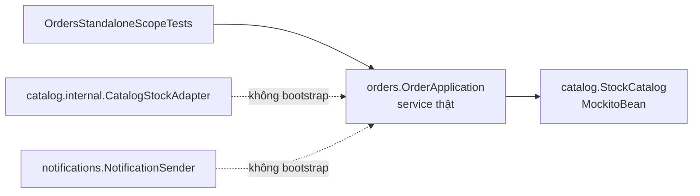

# Giảm bean ngoài phạm vi module

## Mục tiêu học tập

Sau bài học, bạn có thể:

1. Xác định **bean ứng dụng nằm ngoài module mục tiêu** và phân biệt chúng với Spring infrastructure bean, mock ở API boundary và những bean thực sự cần cho test.
2. Giải thích vì sao `@ApplicationModuleTest(mode = STANDALONE)` thường khởi động gọn hơn `DIRECT_DEPENDENCIES`/`ALL_DEPENDENCIES`, nhưng **không bảo đảm số bean bằng số class trong module**.
3. Viết một bài JUnit chạy **service thật trong module `orders`**, chỉ dùng `@MockitoBean` cho public API của `catalog` ở ngoài module.
4. Dùng `ApplicationContext.containsBean(...)`, `getBeanNamesForType(...)` và `getBeanDefinitionCount()` để tạo bằng chứng cụ thể cho phạm vi bootstrap.
5. So sánh **cùng một use case** chạy ở `STANDALONE` và `DIRECT_DEPENDENCIES` mà không vô tình mock implementation cần kiểm thử.
6. Nhận diện các cách bean ngoài module lọt vào context: `@Import`, cấu hình test dùng `@ComponentScan` quá rộng, `@Bean` được khai báo ở cấu hình gốc hoặc bootstrap scope mở rộng.
7. Phân biệt **loại bỏ bean ngoài phạm vi** với **tắt auto-configuration**, **tăng cache hit** và **giảm chi phí của một bean nội module** — ba bài toán khác nhau.
8. Xây kiểm thử hồi quy và quality gate CI vừa giữ context gọn, vừa không bỏ qua `ApplicationModules.verify()`, transaction, event và các integration test cần thiết.

Bài thuộc chương **Performance tests** trong lộ trình **SPRING_MODULITH_VERIFICATION_TESTING**: rèn kỹ năng kiểm chứng ranh giới kiến trúc bằng `ApplicationModules`, quy tắc phụ thuộc, `@ApplicationModuleTest`, kiểm thử sự kiện, cơ sở dữ liệu, tích hợp và quality gate CI. Trọng tâm bài này là **giảm bean ứng dụng không thuộc phạm vi kiểm thử**, chứ không lặp phần nhập môn về Spring TestContext cache hoặc tìm cách làm mọi bài test khởi động nhanh bằng cách mock hết logic.

> **Mã minh họa:** Java 17+, Spring Boot 3.4–3.5, Spring Framework 6.2, Spring Modulith 1.3–1.4, JUnit Jupiter, AssertJ và Mockito. Các ví dụ dùng `@MockitoBean` từ Spring Framework 6.2; với Spring Boot 4/Modulith 2.x cần cập nhật starter và import phù hợp với BOM thực tế.

## 1. Định nghĩa đúng “bean ngoài phạm vi” trước khi tối ưu

Giả sử một ứng dụng có ba application module:

- `orders`: nhận yêu cầu đặt hàng và điều phối use case.
- `catalog`: kiểm tra khả năng cung ứng sách, có adapter tới dữ liệu hàng tồn.
- `notifications`: gửi thông báo, có thể có client email hoặc message broker.

Để kiểm thử riêng nghiệp vụ của `orders`, ta **không cần** tạo adapter thật của `catalog` hay client gửi thông báo của `notifications`. Nhưng `orders` vẫn cần một đối tượng thực hiện **hợp đồng `StockCatalog`**. Giải pháp phù hợp thường là:



**Phân loại trước khi loại bỏ:**

| Thành phần | Ví dụ | Có nên có trong test `orders STANDALONE`? |
| --- | --- | --- |
| Bean nghiệp vụ thuộc `orders` | `DefaultOrderApplication` | **Có**, để kiểm chứng logic thật |
| Public API của module ngoài, dưới dạng mock | `StockCatalog` | **Có**, khi use case cần cổng đó |
| Implementation nội bộ của module ngoài | `CatalogStockAdapter` | **Không**, khi mục tiêu là cô lập orders |
| Bean ứng dụng ngoài không có dependency trực tiếp | `NotificationSender` | **Không** |
| Spring Boot/Framework infrastructure | Environment, configuration processor, transaction/security infrastructure khi cần | **Tùy chức năng**, không cấm theo tên package |
| Configuration được import có chủ đích | Test fixture, converter, security config thật | Xem lý do và phạm vi cụ thể |

**Không được đặt quy tắc “context chỉ chứa bean trong package `orders`”.** Một module test hợp lệ vẫn có thể có bean do Spring Boot auto-configuration cung cấp, bean override Mockito, và các shared/test infrastructure phù hợp. Thứ cần loại bỏ là **implementation ứng dụng ngoài scope không phục vụ hợp đồng đang kiểm tra**.

### Hai loại chi phí khác nhau

Một bean có thể gây thêm:

1. **Startup cost:** quét, đăng ký bean definition, xử lý auto-configuration, tạo singleton, tạo proxy, mở kết nối và tải metadata.
2. **Test runtime cost:** truy vấn DB/broker, scheduler, event listeners hoặc background task tác động tới test dù bản thân bean khởi tạo nhanh.

Việc bỏ một bean không cần thiết có thể giúp cả hai, nhưng **số bean ít hơn không phải lúc nào cũng đồng nghĩa tổng thời gian nhỏ hơn**. Kết quả cuối cùng phải được đo trên cùng điều kiện và phải giữ test coverage cần thiết.

## 2. Ví dụ tự chứa: orders, catalog và notifications

Thiết kế một demo nhỏ có đủ **bean thật trong module**, **bean ngoài scope có tên xác định**, và **public API dùng để mock**:

```text
src/main/java/com/acme/store/
├── StoreApplication.java
├── orders/
│   ├── OrderApplication.java
│   ├── OrderReceipt.java
│   ├── StockRejectedException.java
│   └── internal/
│       └── DefaultOrderApplication.java
├── catalog/
│   ├── StockCatalog.java
│   └── internal/
│       └── CatalogStockAdapter.java      <- bean tên catalogStockAdapter
└── notifications/
    └── NotificationSender.java           <- bean tên notificationSender

src/test/java/com/acme/store/
├── ModuleArchitectureTests.java
└── orders/
    ├── OrdersStandaloneScopeTests.java
    └── OrdersWithCatalogScopeTests.java
```

### Ứng dụng Spring Boot

```java
// src/main/java/com/acme/store/StoreApplication.java
package com.acme.store;

import org.springframework.boot.SpringApplication;
import org.springframework.boot.autoconfigure.SpringBootApplication;

@SpringBootApplication
public class StoreApplication {

    public static void main(String[] args) {
        SpringApplication.run(StoreApplication.class, args);
    }
}
```

### Catalog công bố cổng thay vì implementation

```java
// src/main/java/com/acme/store/catalog/StockCatalog.java
package com.acme.store.catalog;

public interface StockCatalog {
    boolean hasStock(String sku, int quantity);
}
```

```java
// src/main/java/com/acme/store/catalog/internal/CatalogStockAdapter.java
package com.acme.store.catalog.internal;

import com.acme.store.catalog.StockCatalog;
import org.springframework.stereotype.Service;

@Service("catalogStockAdapter")
public class CatalogStockAdapter implements StockCatalog {

    @Override
    public boolean hasStock(String sku, int quantity) {
        return "BK-42".equals(sku) && quantity <= 5;
    }
}
```

Tên bean `catalogStockAdapter` được khai báo **tường minh** để bài test có thể hỏi context xem implementation này có được bootstrap không. Class là `public` vì mục đích trình bày; điều đó **không biến nó thành public API của application module**: nó vẫn nằm trong `catalog.internal`.

### Notifications không tham gia use case đặt hàng

```java
// src/main/java/com/acme/store/notifications/NotificationSender.java
package com.acme.store.notifications;

import org.springframework.stereotype.Component;

@Component("notificationSender")
public class NotificationSender {

    public String channel() {
        return "email";
    }
}
```

Trong demo, `orders` **không import, inject hoặc gọi** `NotificationSender`. Bean này tồn tại để chứng minh `STANDALONE` loại bỏ những component ứng dụng khác, thay vì chỉ kiểm tra việc mock catalog.

Trong production, sender này có thể phụ thuộc SMTP/Kafka client, scheduler hoặc connection pool. Không đưa các dependency nặng ấy vào demo chỉ để tạo ra thời gian chờ nhân tạo.

### API và service thật trong orders

```java
// src/main/java/com/acme/store/orders/OrderReceipt.java
package com.acme.store.orders;

public record OrderReceipt(
        String orderId, String sku, int quantity) {
}
```

```java
// src/main/java/com/acme/store/orders/OrderApplication.java
package com.acme.store.orders;

public interface OrderApplication {
    OrderReceipt place(String sku, int quantity);
}
```

```java
// src/main/java/com/acme/store/orders/StockRejectedException.java
package com.acme.store.orders;

public class StockRejectedException extends RuntimeException {

    public StockRejectedException() {
        super("Insufficient stock");
    }
}
```

```java
// src/main/java/com/acme/store/orders/internal/DefaultOrderApplication.java
package com.acme.store.orders.internal;

import com.acme.store.catalog.StockCatalog;
import com.acme.store.orders.OrderApplication;
import com.acme.store.orders.OrderReceipt;
import com.acme.store.orders.StockRejectedException;
import org.springframework.stereotype.Service;

@Service
class DefaultOrderApplication implements OrderApplication {

    private final StockCatalog stockCatalog;

    DefaultOrderApplication(StockCatalog stockCatalog) {
        this.stockCatalog = stockCatalog;
    }

    @Override
    public OrderReceipt place(String sku, int quantity) {
        if (!stockCatalog.hasStock(sku, quantity)) {
            throw new StockRejectedException();
        }

        return new OrderReceipt(
                "order-" + sku + "-" + quantity,
                sku,
                quantity);
    }
}
```

Service trong `orders.internal` chạy thật. Dependency **duy nhất sang module khác** là `StockCatalog`, được công bố tại base package `catalog`, nên không làm lộ `catalog.internal.CatalogStockAdapter`.

### Dependency của dự án mẫu

Gradle Groovy DSL, giả định Spring Boot và Spring Modulith BOM đã quản lý phiên bản tương thích:

```groovy
dependencies {
    implementation 'org.springframework.boot:spring-boot-starter'
    implementation 'org.springframework.modulith:spring-modulith-starter-core'

    testImplementation 'org.springframework.boot:spring-boot-starter-test'
    testImplementation 'org.springframework.modulith:spring-modulith-starter-test'
}
```

Ví dụ **không cần** starter web, JPA, RabbitMQ hay Kafka. Khi bài kiểm thử thật phải xử lý HTTP, transaction, event hoặc database, hãy bổ sung đúng starter theo tính năng đó; **đừng loại hạ tầng thực sự cần để làm context nhỏ hơn**.

## 3. `STANDALONE`: giữ service orders thật, loại implementation ngoài module

Đây là bài JUnit trọng tâm. Đặt test trong **base package của module `orders`**:

```java
// src/test/java/com/acme/store/orders/OrdersStandaloneScopeTests.java
package com.acme.store.orders;

import static org.assertj.core.api.Assertions.assertThat;
import static org.assertj.core.api.Assertions.assertThatThrownBy;
import static org.mockito.BDDMockito.given;
import static org.mockito.BDDMockito.then;

import com.acme.store.catalog.StockCatalog;
import org.junit.jupiter.api.Test;
import org.mockito.Mockito;
import org.springframework.beans.factory.annotation.Autowired;
import org.springframework.boot.test.context.SpringBootTest;
import org.springframework.context.ConfigurableApplicationContext;
import org.springframework.modulith.test.ApplicationModuleTest;
import org.springframework.test.context.bean.override.mockito.MockitoBean;

@ApplicationModuleTest(
        mode = ApplicationModuleTest.BootstrapMode.STANDALONE,
        webEnvironment = SpringBootTest.WebEnvironment.NONE)
class OrdersStandaloneScopeTests {

    @Autowired
    ConfigurableApplicationContext context;

    @Autowired
    OrderApplication orders;

    @MockitoBean
    StockCatalog stockCatalog;

    @Test
    void loadsOnlyRequiredApplicationCollaborators() {
        // Service thuộc orders có mặt như bean thật.
        assertThat(context.getBeanNamesForType(
                OrderApplication.class)).hasSize(1);
        assertThat(Mockito.mockingDetails(orders).isMock())
                .isFalse();

        // Cổng catalog có đúng một mock để thỏa dependency.
        assertThat(context.getBeanNamesForType(
                StockCatalog.class)).hasSize(1);
        assertThat(Mockito.mockingDetails(stockCatalog).isMock())
                .isTrue();

        // Hai implementation ứng dụng ở ngoài scope không được load.
        assertThat(context.containsBean("catalogStockAdapter"))
                .isFalse();
        assertThat(context.containsBean("notificationSender"))
                .isFalse();
    }

    @Test
    void executesOrdersBusinessLogicNotJustMockResponse() {
        given(stockCatalog.hasStock("BK-42", 2))
                .willReturn(true);

        OrderReceipt receipt = orders.place("BK-42", 2);

        assertThat(receipt.orderId())
                .isEqualTo("order-BK-42-2");
        assertThat(receipt.quantity()).isEqualTo(2);
        then(stockCatalog).should().hasStock("BK-42", 2);
    }

    @Test
    void rejectsWhenExternalPortSaysNoStock() {
        given(stockCatalog.hasStock("BK-42", 8))
                .willReturn(false);

        assertThatThrownBy(() ->
                orders.place("BK-42", 8))
                .isInstanceOf(StockRejectedException.class);
        then(stockCatalog).should().hasStock("BK-42", 8);
    }
}
```

**Điều bài test chứng minh được:**

1. Spring tạo `OrderApplication` từ **`DefaultOrderApplication` thật** trong `orders`, không phải một mock của service.
2. `StockCatalog` có một bean mock do `@MockitoBean` cung cấp; `catalogStockAdapter` thật **không hiện diện**.
3. `notificationSender`, vốn không cần cho use case này, cũng **không hiện diện**.
4. Hai nhánh thành công/từ chối vẫn thực thi **business logic của orders** và gọi cổng `StockCatalog` đúng tham số.

Ở bài học này, `Mockito.mockingDetails(orders).isMock()` giúp ngăn một hồi quy test thường gặp: ai đó vô tình đổi `OrderApplication` thật thành mock rồi test chỉ còn kiểm tra stubbing. Dấu hiệu “không phải Mockito mock” **chưa chứng minh toàn bộ hành vi đúng**; vì vậy vẫn cần hai assertion nghiệp vụ.

### `@MockitoBean` không đồng nghĩa “mọi bean catalog được load”

Theo Spring Framework 6.2, `@MockitoBean` mặc định dùng cơ chế **REPLACE_OR_CREATE**: nếu context không có bean tương ứng, framework tạo một mock mới. Ở `STANDALONE`, implementation catalog cố tình không được scan, nên mock chính là bean cần để inject vào service.

Không dùng:

```java
// CẤU HÌNH KHÔNG PHÙ HỢP CHO STANDALONE CỦA DEMO:
@MockitoBean(enforceOverride = true)
StockCatalog stockCatalog;
```

`enforceOverride = true` yêu cầu một bean đích **đã có sẵn để thay thế**; trong test này ta cần **tạo mock do bean ngoài module không được bootstrap**.

### Đừng hiểu sai assertion scope

`context.containsBean("catalogStockAdapter") == false` khẳng định **bean ứng dụng có tên xác định** không có trong context. Nó không tuyên bố toàn bộ `com.acme.store.catalog` biến mất khỏi **classpath**: `StockCatalog.class` và bytecode của adapter vẫn có mặt trong quá trình biên dịch.

Spring Modulith đang giới hạn **những component được bootstrap**, không tách mỗi module thành một Java process hay classloader độc lập.

## 4. So sánh `DIRECT_DEPENDENCIES`: bean ngoài module có thể trở thành chủ đích

Nếu mục tiêu đổi thành “kiểm tra orders phối hợp với **implementation thật** của catalog”, ta phải mở scope đúng hướng và **bỏ mock**:

```java
// src/test/java/com/acme/store/orders/OrdersWithCatalogScopeTests.java
package com.acme.store.orders;

import static org.assertj.core.api.Assertions.assertThat;

import org.junit.jupiter.api.Test;
import org.springframework.beans.factory.annotation.Autowired;
import org.springframework.boot.test.context.SpringBootTest;
import org.springframework.context.ApplicationContext;
import org.springframework.modulith.test.ApplicationModuleTest;

@ApplicationModuleTest(
        mode = ApplicationModuleTest.BootstrapMode.DIRECT_DEPENDENCIES,
        webEnvironment = SpringBootTest.WebEnvironment.NONE)
class OrdersWithCatalogScopeTests {

    @Autowired
    ApplicationContext context;

    @Autowired
    OrderApplication orders;

    @Test
    void includesRealCatalogButStillExcludesNotifications() {
        assertThat(context.containsBean("catalogStockAdapter"))
                .isTrue();
        assertThat(context.containsBean("notificationSender"))
                .isFalse();

        assertThat(orders.place("BK-42", 2).orderId())
                .isEqualTo("order-BK-42-2");
    }

    @Test
    void catalogRejectsUnavailableQuantityForReal() {
        org.assertj.core.api.Assertions.assertThatThrownBy(
                () -> orders.place("BK-42", 9))
                .isInstanceOf(StockRejectedException.class);
    }
}
```

Với đồ thị `orders → catalog`, mode `DIRECT_DEPENDENCIES` bootstrap **orders + catalog**. Implementation `CatalogStockAdapter` giờ trở thành một bean **nằm trong phạm vi kiểm thử có chủ đích**. `notifications` vẫn không thuộc dependency tree của orders nên không cần khởi tạo.

| Test | Module nghiệp vụ được bootstrap | `catalogStockAdapter` | `notificationSender` |
| --- | --- | --- | --- |
| `STANDALONE` + mock public `StockCatalog` | `orders` | **Không** | **Không** |
| `DIRECT_DEPENDENCIES`, không mock `StockCatalog` | `orders` + `catalog` | **Có** | **Không** |
| `ALL_DEPENDENCIES`, với đồ thị demo hiện tại | `orders` + `catalog` | **Có** | **Không** |
| Full application context | Tùy configuration của toàn ứng dụng | Thường có | Thường có |

Ở demo hiện tại, `ALL_DEPENDENCIES` **không mở thêm module nào** so với `DIRECT_DEPENDENCIES`, vì `catalog` không phụ thuộc module thứ ba. Một dự án có dependency bắc cầu như `orders → catalog → pricing` sẽ khác: `ALL_DEPENDENCIES` có thể bootstrap thêm `pricing`, kèm hạ tầng của nó.

### Một anti-pattern: mở scope nhưng vẫn mock implementation cần kiểm tra

```java
@ApplicationModuleTest(
        mode = ApplicationModuleTest.BootstrapMode.DIRECT_DEPENDENCIES)
class MisleadingCrossModuleTests {

    @MockitoBean
    StockCatalog stockCatalog;
}
```

Đoạn này là **khung minh họa**, chưa chứa test method/import đầy đủ. Khi đã mở rộng để chạy catalog thật nhưng vẫn giữ `@MockitoBean StockCatalog`, bean implementation có thể bị **thay bằng mock**. Khi đó bài test **không còn chứng minh** phần xử lý thật của catalog, dù `DIRECT_DEPENDENCIES` đã chọn.

**Quyết định trước khi chỉnh annotation:** “Đang kiểm tra hợp đồng orders với catalog qua mock” hay “đang kiểm tra implementation catalog thật”? Mỗi mục tiêu cần một test khác nhau.

## 5. Loại bean ngoài module bằng đúng API boundary, không mock cả module

Nếu `orders` phụ thuộc `catalog.StockCatalog`, giải pháp `STANDALONE` chuẩn là **mock một cổng nhỏ**, không phải mock hàng loạt concrete service hoặc thay toàn bộ service `orders`.

```text
Nên:
orders.internal.DefaultOrderApplication
  -> catalog.StockCatalog           [public API; MockitoBean ở test]

Không nên:
orders.internal.DefaultOrderApplication
  -> catalog.internal.CatalogStockAdapter [implementation internal]

Không giúp chứng minh service thật:
OrderApplication                      [MockitoBean ngay trong orders]
```

### Một mock đúng phải thỏa ba điều

| Tiêu chí | Kiểm tra |
| --- | --- |
| Đúng **owner** | Interface thuộc API công khai của một module khác, không thuộc service đang kiểm tra |
| Đúng **contract** | Mock trả kịch bản cần thiết, test vẫn kiểm tra nhánh của service thật |
| Đúng **scope** | Chỉ thay cộng tác viên ngoài module; không kéo bean implementation của toàn bộ module |

Khi tên/tập `@MockitoBean` thay đổi giữa nhiều lớp test, Spring TestContext **có thể tạo các cache key khác nhau**. Do đó trong cùng nhóm `STANDALONE`, hãy chuẩn hóa tập mock/qualifier nếu chúng thật sự tương đương. Tuy nhiên, **cache reuse là vấn đề khác** với quyết định bean nào được đưa vào context: một context nhỏ nhưng có hàng chục cấu hình mock riêng vẫn có thể làm test suite chậm.

### Khi nào cần thay vì mock?

Nếu module `orders` có nhiều lệnh gọi sâu vào implementation của `catalog`, hoặc test phải khai báo hàng loạt mocks cho nhiều module:

1. Kiểm tra các dependency tĩnh với `ApplicationModules.verify()`.
2. Xem có vi phạm public API hoặc `allowedDependencies` không.
3. Cân nhắc gom interaction thành **một public facade/port** có nghĩa nghiệp vụ.
4. Nếu chỉ cần thông báo kết quả cho module khác, cân nhắc **domain event** để giảm coupling trực tiếp.
5. Nếu cần thật nhiều module để xác minh workflow, chuyển sang **integration test có chủ đích**, đừng giả rằng cô lập `STANDALONE` là bắt buộc cho mọi kịch bản.

Số mock ngoài module lớn là **tín hiệu coupling cần review**, không phải lý do tự động tạo một test super-context hoặc tự động ẩn vi phạm kiến trúc.

## 6. Vì sao bean ngoài phạm vi vẫn lọt vào context?

`@ApplicationModuleTest` của Spring Modulith 1.4 giới hạn **component scanning** và điều chỉnh **auto-configuration/entity scan packages** theo module bootstrap. Nhưng filtering component scanning **không phải** một sandbox có quyền ngăn mọi bean definition được đăng ký bằng con đường khác.

### 6.1. `@Import` có thể đăng ký bean nằm ngoài scope

Một test cố ý import component `NotificationSender`:

```java
// CHỈ DÙNG LÀ THÍ NGHIỆM PHÁT HIỆN RÒ SCOPE.
// src/test/java/com/acme/store/orders/OrdersLeakyImportTests.java
package com.acme.store.orders;

import static org.assertj.core.api.Assertions.assertThat;

import com.acme.store.catalog.StockCatalog;
import com.acme.store.notifications.NotificationSender;
import org.junit.jupiter.api.Test;
import org.springframework.beans.factory.annotation.Autowired;
import org.springframework.boot.test.context.SpringBootTest;
import org.springframework.context.ApplicationContext;
import org.springframework.context.annotation.Import;
import org.springframework.modulith.test.ApplicationModuleTest;
import org.springframework.test.context.bean.override.mockito.MockitoBean;

@ApplicationModuleTest(
        webEnvironment = SpringBootTest.WebEnvironment.NONE)
@Import(NotificationSender.class)
class OrdersLeakyImportTests {

    @Autowired
    ApplicationContext context;

    @MockitoBean
    StockCatalog stockCatalog;

    @Test
    void explicitImportAddsUnrelatedComponent() {
        assertThat(context.containsBean("notificationSender"))
                .isTrue();
    }
}
```

Test minh họa rằng một **explicit import** có thể đưa component thuộc module khác vào context, dù `STANDALONE` đã giới hạn quá trình quét mặc định. Đây là **thí nghiệm chẩn đoán**, không phải test nên duy trì trong quality gate gọn. Sau khi quan sát, xóa `@Import` (hoặc bỏ lớp thí nghiệm) và xác nhận `notificationSender` lại vắng mặt.

Trong ứng dụng thực, có trường hợp `@Import` là **đúng đắn**: ví dụ import một test-specific configuration không thuộc module production hoặc security policy thật cần cho use case. Điều cần hỏi là **tại sao bean đó cần được đăng ký**, không phải tuyệt đối cấm `@Import`.

### 6.2. `@ComponentScan` quá rộng và cấu hình root

Ví dụ những thay đổi cần review:

```java
// ANTI-PATTERN KHI CHỈ MUỐN CHẠY RIÊNG ORDERS:
@org.springframework.context.annotation.ComponentScan(
        basePackages = "com.acme.store")
class OverlyBroadTestConfiguration {
}
```

Một `@ComponentScan` tự khai báo có thể **không giữ đầy đủ các exclude filters mà Boot/Modulith áp dụng cho scanning chuẩn**, tùy cách nó được ghép vào context; kết quả là bean ngoài module bị đưa vào. Không thêm một scanner toàn ứng dụng chỉ để khắc phục `NoSuchBeanDefinitionException` trong `STANDALONE`.

Cũng kiểm tra:

- `@Bean` đặt trực tiếp trong `StoreApplication` hoặc configuration gốc, được xử lý qua **explicit configuration**, không giống một `@Service` tình cờ được component scan.
- `@ImportAutoConfiguration`, auto-configuration bên thứ ba và shared infrastructure có thể tạo bean không thuộc package ứng dụng mục tiêu.
- Test configuration có `@Import` hàng loạt integration adapters hoặc một `@SpringBootTest(classes = ...)` tùy biến có thể làm bootstrap rộng hơn ý định.

**Không sửa production `@SpringBootApplication(scanBasePackages=...)` chỉ để một test nhanh hơn.** Nếu đúng là vấn đề của test, trước hết xem scope `@ApplicationModuleTest` và các configuration được import trong test.

### 6.3. Vì sao không assert mọi bean có class package `orders`?

```java
// ĐÂY LÀ Ý TƯỞNG SAI — không dùng làm architecture assertion:
// assertThat(context.getBeanDefinitionNames())
//     .allMatch(name -> beanType(name).getPackageName()
//         .startsWith("com.acme.store.orders"));
```

Đoạn minh họa trên không biên dịch độc lập; mục đích là làm rõ **anti-pattern**. Một context hợp lệ có:

- Bean Framework từ `org.springframework.*`.
- Proxy/AOP class với kiểu runtime không thuộc package của service.
- `StockCatalog` mock có **type được khai báo ở `catalog`** nhưng không bootstrap `CatalogStockAdapter` thật.
- `@Bean` có implementation type từ thư viện hoặc module infrastructure khác.

Do đó assertion chuẩn hơn là **danh sách hẹp những application components không được xuất hiện** và danh sách bean thật **bắt buộc phải có**.

## 7. Kiểm tra và chẩn đoán bean ngoài scope bằng Java/JUnit

### 7.1. Khóa những bean ứng dụng phải vắng mặt

Test ở mục 3 đã dùng hai marker có chủ đích:

```java
assertThat(context.containsBean("catalogStockAdapter"))
        .isFalse();
assertThat(context.containsBean("notificationSender"))
        .isFalse();
```

Cách này có ưu điểm là **không tạo instance bean chỉ để đếm hoặc kiểm tra scope**: `containsBean` hỏi về bean registration. Khi project đổi tên bean, phải cập nhật assertions hoặc chuyển sang **test theo type ổn định**; tránh biến test scope thành một bảng hardcode mọi component.

Nếu các bean không có tên xác định, bạn có thể tra cứu:

```java
// Đoạn minh họa đặt bên trong test đã inject ApplicationContext.
String[] orderBeans =
        context.getBeanNamesForType(OrderApplication.class);
assertThat(orderBeans).hasSize(1);
```

Nhưng test đó không tự chứng minh service thực sự là **non-mock**; nên bổ sung:

```java
assertThat(org.mockito.Mockito.mockingDetails(orders).isMock())
        .isFalse();
```

Trong hệ thống có AOP proxies (`@Transactional`, `@PreAuthorize`) hoặc nhiều implementation, cần xem **type được expose bởi proxy** và injection contract thay vì mặc định bean concrete class luôn tìm được qua một câu `getBeanNamesForType` bất kỳ.

### 7.2. So sánh scope với mô hình `ApplicationModules`

Một test **kiến trúc tĩnh** riêng:

```java
// src/test/java/com/acme/store/ModuleArchitectureTests.java
package com.acme.store;

import static org.assertj.core.api.Assertions.assertThat;

import com.acme.store.catalog.StockCatalog;
import com.acme.store.orders.OrderApplication;
import org.junit.jupiter.api.Test;
import org.springframework.modulith.core.ApplicationModules;

class ModuleArchitectureTests {

    @Test
    void moduleOwnershipAndDependenciesRemainValid() {
        ApplicationModules modules =
                ApplicationModules.of(StoreApplication.class);

        var orders = modules.getModuleByName("orders")
                .orElseThrow();
        var catalog = modules.getModuleByName("catalog")
                .orElseThrow();

        assertThat(orders.contains(OrderApplication.class))
                .isTrue();
        assertThat(catalog.contains(StockCatalog.class))
                .isTrue();

        modules.verify();
    }
}
```

Ở đây:

- `ApplicationModules` trả lời **kiểu Java thuộc module nào** và dependency có hợp lệ không.
- `ApplicationContext` trả lời **bean nào đã được đăng ký ở một context đang chạy**.
- Hai tập thông tin **không giống nhau**: một kiểu thuộc module catalog vẫn có mặt trên classpath khi test STANDALONE chỉ bootstrap orders, và một mock `StockCatalog` vẫn được phép tồn tại trong context test.

**Không thay `ApplicationModules.verify()` bằng cách so `getBeanDefinitionCount()`.** Số lượng bean không thể phát hiện truy cập internal, vòng dependency hoặc vi phạm `allowedDependencies`.

### 7.3. Đếm bean để quan sát, không biến thành luật tuyệt đối

```java
// Đặt trong test có @Autowired ConfigurableApplicationContext context.
int definitions =
        context.getBeanFactory().getBeanDefinitionCount();

System.out.printf(
        "scope=%s, beanDefinitions=%d%n",
        "orders-standalone", definitions);
```

`getBeanDefinitionCount()` phản ánh **số bean definitions tại thời điểm quan sát**, không đồng nghĩa:

- Tất cả singleton đã được khởi tạo.
- Tất cả bean đều do application module tự định nghĩa.
- Từng bean có chi phí startup tương đương nhau.
- Một lần giảm 10 bean definitions chắc chắn giảm bao nhiêu mili-giây.

Một bộ tiêu chí vững hơn là **scope đúng + business test xanh + số đo cold startup có đối chứng**.

### 7.4. Khi cần điều tra nhiều bean, không tạo thêm side effect

Có thể dùng metadata của bean factory để lấy **danh sách định nghĩa**:

```java
import java.util.Arrays;

String[] definitions = context.getBeanFactory()
        .getBeanDefinitionNames();

Arrays.stream(definitions)
        .filter(name -> name.contains("catalog")
                || name.contains("notification"))
        .sorted()
        .forEach(System.out::println);
```

Đây là **đoạn chẩn đoán** theo tên bean ở demo. Trong ứng dụng thật, tên không nhất thiết chứa tên module. Nếu muốn kiểm tra type, dùng `getType(..., false)`/bean definition metadata với lưu ý về `FactoryBean`, `@Bean` factory methods, proxy classes và bean chưa xác định được type. Không gọi `getBeansOfType(...)` trên toàn context chỉ để in danh sách: việc truy vấn instance có thể **khởi tạo bean hoặc gây tác động phụ** mà bạn đang cố giảm.

## 8. Đo ảnh hưởng tới thời gian khởi tạo mà không suy từ bean count

Một thử nghiệm có giá trị cần so sánh **hai phạm vi với cùng hành vi nghiệp vụ**, tránh cùng lúc đổi cả công thức stub, database và JDK.

### Ma trận so sánh

| Chạy test | Phạm vi | Bean ngoài có chủ đích | Quan sát bắt buộc |
| --- | --- | --- | --- |
| A | `STANDALONE` | Mock `StockCatalog`; không load catalog/notifications implementation | Đúng kết quả nghiệp vụ, các marker bean vắng mặt |
| B | `DIRECT_DEPENDENCIES` | Catalog thật; notifications vẫn vắng mặt | Đúng kết quả nghiệp vụ, `catalogStockAdapter` có mặt |
| C | Một **full application** integration test riêng, nếu thực sự cần | Catalog và notifications có thể cùng được bootstrap | Dùng cho workflow xuyên module, không phải baseline của cô lập orders |

Đo hai dạng số liệu khác nhau:

1. **Phạm vi:** `getBeanDefinitionCount()`, các marker app bean có/không, số module được chọn.
2. **Chi phí:** thời gian cold startup, tổng wall-clock test, heap và các kết nối/hạ tầng được mở.

Để quan sát module slicing, bật:

```properties
logging.level.org.springframework.modulith=DEBUG
logging.level.org.springframework.test.context.cache=DEBUG
```

Log Modulith thể hiện module bootstrap và mode; TestContext cache log giúp bạn nhận ra đang đo **cold load** hay **reuse của context đã cache**.

Gradle commands minh họa:

```bash
./gradlew test \
  --tests 'com.acme.store.orders.OrdersStandaloneScopeTests' \
  --rerun-tasks --no-build-cache
```

```bash
./gradlew test \
  --tests 'com.acme.store.orders.OrdersWithCatalogScopeTests' \
  --rerun-tasks --no-build-cache
```

**Cách dùng:** chạy nhiều lượt dưới cùng JDK/CI runner/fork config, ghi log startup và cache stats. `--rerun-tasks` tránh Gradle bỏ qua task vì up-to-date; `--no-build-cache` không tắt TestContext cache của Spring. Nếu hai test chạy cùng JVM, mỗi mode có thể vẫn có **cache key riêng**, nên thời gian lần đầu và lần sau cần được tách trong phân tích.

Không đặt assertion:

```java
// KHÔNG DÙNG làm quality gate trên CI runner biến động:
// assertThat(startupMillis).isLessThan(500);
```

**Kết luận hiệu năng chỉ hợp lệ khi có số đo.** Việc loại những bean không cần thiết thường là hướng tối ưu hợp lý, nhưng độ lớn cải thiện còn tùy bean đó có thực sự khởi tạo I/O, migration, proxy hay chỉ là một component nhẹ.

### Đừng biến việc giảm bean thành một `@WebMvcTest`

`@WebMvcTest` chỉ bootstrap MVC slice và thường **mock service nghiệp vụ**. Nó có thể nhanh hơn, nhưng **kiểm tra một hợp đồng khác**. Nếu bài cần service thật trong module `orders`, hãy giữ `@ApplicationModuleTest` với scope nhỏ đúng mục tiêu; đừng thay annotation rồi tuyên bố vẫn có cùng integration coverage.

## 9. Những giới hạn không được bỏ qua khi tối ưu

| Tình huống | Cách nghĩ sai | Cách xử lý đúng |
| --- | --- | --- |
| Module test thiếu bean `StockCatalog` | Mở ngay `ALL_DEPENDENCIES` | Mock **public API** trong STANDALONE nếu catalog thật không phải mục tiêu |
| Nhiều bean catalog xuất hiện | Modulith `STANDALONE` chắc chắn hỏng | Kiểm tra `@Import`, `@Bean`, custom scanning và mode thực tế |
| Bean framework ngoài package `orders` | Cấm toàn bộ vì muốn scope “sạch” | Giữ infrastructure cần cho hợp đồng đang test |
| Context ít bean nhưng vẫn chậm | Tự động cắt thêm module | Profiling migration, datasource, container, context cache/forks |
| Test có `@MockitoBean OrderApplication` | Vẫn gọi là module integration | Bỏ mock nội module để chạy service thật |
| `DIRECT_DEPENDENCIES` và mock `StockCatalog` | Đã kiểm thử implementation catalog | Bỏ mock để quan sát adapter thật |
| Tắt `verifyAutomatically` | Tăng hiệu năng không có tác dụng phụ | Giữ verification; tối ưu scope và số cấu hình test trước |
| Bỏ JPA config vì test khởi động chậm | Vẫn kiểm thử transaction/commit thật | Không; test cần DB thực hoặc chuyển sang loại test khác có ghi rõ giới hạn |
| Bỏ security filter | Web test 200 là đủ | Không; giữ security policy khi đây là hợp đồng bảo vệ |
| Bỏ event listener ngoài module | Subscriber đã được kiểm tra bằng producer test | Không; dùng test consumer/`Scenario` riêng khi cần |
| Một bean có tên khác sau refactor | Không còn vi phạm vì marker false | Cập nhật contract scope theo type/owner/metadata và review thay đổi |

### Một giới hạn quan trọng của runtime assertion

Nếu `notifications.NotificationSender` bị đổi tên bean hoặc được tạo bằng `@Bean` ở configuration khác, assertion `containsBean("notificationSender") == false` **có thể xanh dù vẫn có một sender khác**. Vì thế marker tên bean phù hợp nhất cho **fixture có cấu trúc cố định**.

Với dự án lớn, có thể lập báo cáo nhiều bean bằng bean factory metadata và liên hệ `ApplicationModules.getModuleByType(...)` cho những kiểu đã xác định. Nhưng:

- Mock `StockCatalog` có **owner type là catalog**, trong khi instance không phải adapter thật: phải xem mock là ngoại lệ chủ đích.
- `FactoryBean`, `@Bean` từ auto-configuration, AOP proxy và shared module khiến phân loại theo package class runtime **không tuyệt đối**.
- Một số bean test configuration không thuộc application module nào nhưng vẫn cần thiết.

Do đó **không đặt một quy tắc cứng “zero foreign-type beans”**. Hãy kiểm tra **những app implementation không được bootstrap**, cộng với kiểm thử behavior và `verify()`.

### Không nhầm tối ưu context với tối ưu production

Loại catalog/notifications adapters khỏi `orders STANDALONE` **không loại chúng khỏi production application**. Khi chạy application đầy đủ, các bean vẫn có thể được khởi tạo và phải đạt tiêu chí hiệu năng production riêng.

**Không dùng kết quả “module test nhanh hơn” để kết luận startup production nhanh hơn**. Đây là tối ưu **phạm vi test**, không phải một thay đổi production runtime.

## 10. Quality gate CI và bài thực hành có đối chứng

### Gate tối thiểu

| Gate | Bài kiểm tra | Điều kiện |
| --- | --- | --- |
| Scope module orders | `OrdersStandaloneScopeTests` | Service thật có mặt, catalog adapter và notifications sender vắng mặt |
| Nghiệp vụ orders | `OrdersStandaloneScopeTests` | Nhánh đủ hàng và không đủ hàng xử lý đúng |
| Tích hợp với catalog | `OrdersWithCatalogScopeTests` | Adapter catalog thật được bootstrap và use case đúng |
| Kiến trúc tĩnh | `ModuleArchitectureTests` | `ApplicationModules.verify()` không báo violation |
| Hiệu năng test | Lượt đo cold startup có log/cấu hình nhất quán | Số liệu được so với baseline, không dùng JUnit threshold cứng |
| DB/event/security nếu có | Module/integration test chuyên biệt | Không bị loại chỉ để giảm bean |

Chạy các nhóm bắt buộc với:

```bash
./gradlew test
```

hoặc:

```bash
./mvnw test
```

Nếu test tích hợp được tách sang task/profile riêng, CI phải **chạy cả những task được yêu cầu**. Một báo cáo “tất cả module tests xanh” không có ý nghĩa nếu pipeline chỉ lọc `*Standalone*` rồi bỏ qua integration và architecture test.

### Bài thực hành: giảm bean ngoài phạm vi nhưng giữ bằng chứng

1. Tạo đúng ba module `orders`, `catalog`, `notifications` như ở mục 2. Xác nhận `OrderApplication` chỉ phụ thuộc `StockCatalog`.
2. Chạy `OrdersStandaloneScopeTests`: xác nhận `OrderApplication` thật, `StockCatalog` mock, `catalogStockAdapter` và `notificationSender` không có.
3. Ghi lại số bean definitions qua `getBeanDefinitionCount()` cùng log `org.springframework.modulith=DEBUG`.
4. Chạy `OrdersWithCatalogScopeTests`: xác nhận adapter catalog thật xuất hiện, notifications vẫn không có và use case hoạt động.
5. So sánh hai tập context và thời gian cold startup trên cùng môi trường. Chú ý rằng kết quả thời gian là **dữ liệu quan sát**, không phải ngưỡng phải đạt.
6. Trên **nhánh thí nghiệm**, thêm `@Import(NotificationSender.class)` vào test `STANDALONE`. Quan sát marker `notificationSender` xuất hiện; bỏ import và xác minh nó vắng mặt lại.
7. Thử thay `@MockitoBean StockCatalog` bằng `@MockitoBean OrderApplication`. Giải thích vì sao tuy có thể giảm mức phối hợp thật nhưng **không còn bảo vệ nghiệp vụ orders**; khôi phục đúng mock boundary.
8. Thử `DIRECT_DEPENDENCIES` nhưng giữ `@MockitoBean StockCatalog`. Giải thích vì sao không thể coi đó là kiểm thử catalog implementation thật; khôi phục test đúng.
9. Mở rộng demo bằng một adapter có database hoặc broker **chỉ trong integration test cần thiết**. Đánh giá startup, resource lifecycle và cleanup thay vì chỉ giảm số bean.
10. Giữ `ModuleArchitectureTests` trong required CI checks và ghi lại nguyên nhân của mọi exception scope có chủ đích.

**Tiêu chí hoàn thành:** Bạn phân biệt được **bean ứng dụng ngoài phạm vi** với mock API cần thiết và Spring infrastructure; có JUnit xác minh **service orders thật + implementation catalog/notifications vắng mặt** trong `STANDALONE`; so sánh được `DIRECT_DEPENDENCIES` với implementation catalog thật; nhận diện `@Import` gây rò scope và có số đo startup hợp lệ trước khi tuyên bố cải thiện.

### Câu hỏi tự kiểm tra

1. Vì sao không thể yêu cầu mọi bean type trong `@ApplicationModuleTest(STANDALONE)` có package bắt đầu bằng `orders`?
2. Vì sao `@MockitoBean StockCatalog` hợp lệ trong `STANDALONE`, còn `@MockitoBean(enforceOverride = true)` không phù hợp cho ví dụ này?
3. Assertion `containsBean("catalogStockAdapter") == false` khác gì với việc một class catalog vẫn nằm trên classpath?
4. Khi chuyển sang `DIRECT_DEPENDENCIES`, tại sao nên bỏ `@MockitoBean StockCatalog` nếu cần kiểm tra adapter thật?
5. `@Import` và một `@ComponentScan` tự cấu hình quá rộng có thể làm bean ngoài module xuất hiện bằng cách nào?
6. Vì sao `getBeanDefinitionCount()` không phải số lượng bean đã khởi tạo hay thước đo latency?
7. Nếu module test có quá nhiều mock từ module khác, bạn cần đặt câu hỏi kiến trúc nào?
8. Vì sao test cô lập `orders` không chứng minh notifications subscriber hay broker thật hoạt động?
9. Khi nào một bean ngoài module **nên** được bootstrap trong test?
10. Cần giữ những gate nào trong CI để tối ưu tốc độ test không làm mất ranh giới kiến trúc và hành vi runtime?

## Tổng kết

**Giảm bean ngoài phạm vi module** là **giảm những implementation ứng dụng không cần cho mục tiêu kiểm thử**, chứ không phải xóa mọi bean không thuộc package module. Dùng `@ApplicationModuleTest(STANDALONE)` để khởi tạo **service thật của module mục tiêu**, rồi cấp `@MockitoBean` cho **public API của module ngoài** khi cần cô lập. Kiểm chứng bằng JUnit rằng bean nghiệp vụ bắt buộc tồn tại, còn những adapter ứng dụng ngoài scope **không** xuất hiện; kết hợp `ApplicationModules.verify()` để bảo vệ dependency rules. Khi muốn kiểm tra module phụ thuộc thật, mở `DIRECT_DEPENDENCIES` và **bỏ mock implementation cần kiểm thử**. Đồng thời rà soát các `@Import`, custom `@ComponentScan`, root configurations và auto-configuration; không suy số bean thành thời gian nếu chưa đo cold startup. Giữ các integration tests database, event và security cần thiết, để tối ưu performance **không đánh đổi chất lượng kiểm chứng Spring Modulith**.

### Tài liệu tham khảo

- [Spring Modulith 1.4 — Integration Testing Application Modules](https://docs.spring.io/spring-modulith/reference/1.4/testing.html)
- [Spring Modulith 1.4 — `@ApplicationModuleTest` API](https://docs.spring.io/spring-modulith/docs/1.4.x/api/org/springframework/modulith/test/ApplicationModuleTest.html)
- [Spring Modulith 1.4 — `ApplicationModules` API](https://docs.spring.io/spring-modulith/docs/1.4.x/api/org/springframework/modulith/core/ApplicationModules.html)
- [Spring Modulith 1.4 — Verifying Application Module Structure](https://docs.spring.io/spring-modulith/reference/1.4/verification.html)
- [Spring Framework 6.2 — `@MockitoBean` và bean override strategy](https://docs.spring.io/spring-framework/reference/6.2/testing/annotations/integration-spring/annotation-mockitobean.html)
- [Spring Framework 6.2 — Context Caching](https://docs.spring.io/spring-framework/reference/6.2/testing/testcontext-framework/ctx-management/caching.html)
- [Spring Boot 3.5 — Test Configuration và Excluding Test Configuration](https://docs.spring.io/spring-boot/3.5/reference/testing/spring-boot-applications.html)
