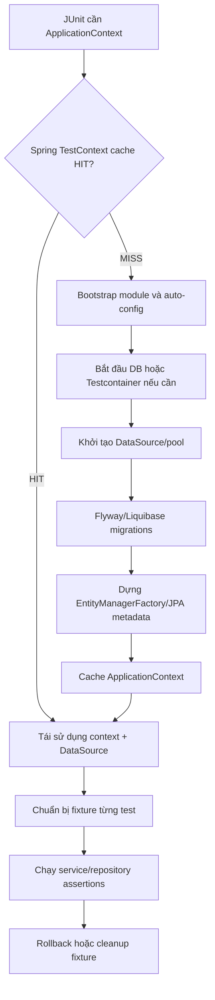

# Giảm thời gian chuẩn bị database

## Mục tiêu học tập

Sau bài học, bạn có thể:

1. Phân rã **thời gian chuẩn bị database cho `@ApplicationModuleTest`** thành khởi động database/container, tạo `DataSource`, chạy migration, dựng JPA metadata, seed fixture và cleanup.
2. Chọn **cấp độ database phù hợp hợp đồng**: không cần DB, H2 in-memory với service/repository thật, hoặc PostgreSQL Testcontainers để kiểm chứng SQL và hành vi đặc thù engine.
3. Viết JUnit dùng `@ApplicationModuleTest(STANDALONE)` với **JPA repository thật và Flyway migration**, kiểm tra row được commit và row bị rollback mà không nhầm `flush` với `commit`.
4. Tránh chạy lại migration và mở container không cần thiết do context fragmentation, `@DirtiesContext`, khác profile, bean override hoặc JVM fork.
5. Dùng test data **nhỏ, cục bộ, deterministic** thay cho một bộ seed toàn hệ thống; chọn `@Sql`, transaction rollback hay cleanup đã commit theo ý nghĩa test.
6. Cấu hình Testcontainers có **lifecycle tương thích với Spring context cache**, tránh tái sử dụng `DataSource` trỏ tới container đã dừng.
7. Đo riêng cold startup, migrations và per-test cleanup trên cùng môi trường trước khi tuyên bố đã cải thiện performance.
8. Thiết lập checklist/quality gate CI mà không hy sinh kiểm chứng cấu trúc `ApplicationModules.verify()`, transaction, event hoặc integration với database thật.

Bài thuộc chương **Performance tests** của lộ trình **SPRING_MODULITH_VERIFICATION_TESTING**: kiểm chứng ranh giới kiến trúc bằng `ApplicationModules`, các quy tắc phụ thuộc, `@ApplicationModuleTest`, sự kiện, cơ sở dữ liệu và tích hợp, kết hợp quality gate CI để ngăn phụ thuộc sai và hồi quy. **Trọng tâm duy nhất của bài là tối ưu thời gian chuẩn bị database**, không tối ưu câu SQL production hay làm benchmark tải HTTP.

> **Phạm vi phiên bản:** Java 17+, Spring Boot 3.4–3.5, Spring Framework 6.2, Spring Modulith 1.3–1.4, Spring Data JPA, Flyway, JUnit Jupiter, H2 và Testcontainers. Mã dùng import Spring Boot 3.x; dự án Spring Boot 4/Modulith 2.x cần đối chiếu starter/import với BOM thực tế.

## 1. Xác định database đang tốn thời gian ở giai đoạn nào

Một `@ApplicationModuleTest` có JPA thường phải chuẩn bị nhiều hơn một kết nối JDBC:



Có thể mô hình hóa chi phí tương đối:

\[
T_{\mathrm{suite}} \approx
T_{\mathrm{container}} +
\sum_{\mathrm{context\ misses}}
  (T_{\mathrm{datasource}}+T_{\mathrm{migration}}+T_{\mathrm{JPA}})
+ \sum_{\mathrm{test\ cases}}
  (T_{\mathrm{fixture}}+T_{\mathrm{case}}+T_{\mathrm{cleanup}})
\]

Đây là **mô hình để điều tra**, không phải công thức cộng thời gian chính xác: container có thể được chia sẻ, migration chỉ làm việc khi DB có schema tương thích và các bước có thể xảy ra xen kẽ.

| Thành phần | Dấu hiệu chi phí | Việc nên đo |
| --- | --- | --- |
| Image pull / Docker / container startup | Chậm rõ ở cold run, nhanh hơn ở run sau | Thời gian tạo PostgreSQL container, số container được tạo |
| `DataSource` / connection pool | Connection timeouts, mở kết nối lặp | Thời gian connection đầu tiên, pool logs |
| Flyway/Liquibase | Context khởi tạo bị giữ lâu ở `migrate()` | Số version và thời gian migration, số lần thực thi |
| Hibernate/JPA metadata | Mỗi context phải xây `EntityManagerFactory` | Thời gian JPA initialization và số entity được scan |
| Fixture | `@BeforeEach` hoặc `@Sql` tải hàng nghìn row mỗi method | Tổng số row insert/delete và thời gian fixture |
| Cleanup | `TRUNCATE`, recreate schema, `@DirtiesContext` mỗi test | Chi phí mỗi lượt cleanup và cold rebootstrap |

**Nguyên tắc đầu tiên:** xác định phần nào chậm trước khi tối ưu. Nếu chậm vì migration chạy lại 20 lần, đổi Hikari pool size không giải quyết căn nguyên; nếu chậm vì mỗi test nạp 100.000 row, tăng TestContext cache cũng không giúp nhiều.

## 2. Mô hình JPA nhỏ, nhưng kiểm chứng persistence thật

Giả sử có module `orders`, còn `catalog` và `notifications` không cần bootstrap trong bài kiểm thử database của orders:

```text
src/main/java/com/acme/shop/
├── ShopApplication.java
└── orders/
    ├── OrderPlacement.java
    └── internal/
        ├── PurchaseOrder.java
        ├── PurchaseOrderRepository.java
        └── DefaultOrderPlacement.java

src/main/resources/db/migration/
└── V1__create_purchase_orders.sql

src/test/java/com/acme/shop/
├── ModuleArchitectureTests.java
└── orders/
    ├── OrdersDatabaseTests.java
    ├── OrdersRollbackOnlyTests.java
    └── OrdersPostgresCompatibilityTests.java

src/test/resources/
├── application-module-db.properties
└── application-postgres-db.properties
```

Trong `@ApplicationModuleTest(STANDALONE)`, Spring Modulith giới hạn component scanning và entity scanning theo module `orders`; **repository và entity của orders vẫn là thật**, còn implementation ở module không được chọn không cần khởi tạo. **Không** dùng `@MockBean` hoặc `@MockitoBean` cho repository đang được kiểm chứng.

### Ứng dụng và dependency

```java
// src/main/java/com/acme/shop/ShopApplication.java
package com.acme.shop;

import org.springframework.boot.SpringApplication;
import org.springframework.boot.autoconfigure.SpringBootApplication;

@SpringBootApplication
public class ShopApplication {

    public static void main(String[] args) {
        SpringApplication.run(ShopApplication.class, args);
    }
}
```

Gradle Groovy DSL; giả định Spring Boot và Spring Modulith BOM đang quản lý phiên bản tương thích:

```groovy
dependencies {
    implementation 'org.springframework.boot:spring-boot-starter-data-jpa'
    implementation 'org.springframework.modulith:spring-modulith-starter-core'
    implementation 'org.flywaydb:flyway-core'

    testImplementation 'org.springframework.boot:spring-boot-starter-test'
    testImplementation 'org.springframework.modulith:spring-modulith-starter-test'
    testRuntimeOnly 'com.h2database:h2'

    // Chỉ cần nếu chạy biến thể PostgreSQL Testcontainers ở mục 7:
    testImplementation 'org.springframework.boot:spring-boot-testcontainers'
    testImplementation 'org.testcontainers:postgresql'
    testRuntimeOnly 'org.postgresql:postgresql'
    testRuntimeOnly 'org.flywaydb:flyway-database-postgresql'
}
```

H2 phục vụ **database test nhanh**; Testcontainers và PostgreSQL driver là dependency cho **nhóm compatibility/integration**. Không cần đưa PostgreSQL container vào mọi test chỉ vì production dùng PostgreSQL, nhưng không được dùng H2 làm bằng chứng cho mọi đặc tính SQL của PostgreSQL.

### Schema migration tối thiểu

```sql
-- src/main/resources/db/migration/V1__create_purchase_orders.sql
CREATE TABLE purchase_orders (
    id BIGINT GENERATED BY DEFAULT AS IDENTITY PRIMARY KEY,
    sku VARCHAR(64) NOT NULL,
    quantity INTEGER NOT NULL,
    state VARCHAR(16) NOT NULL
);
```

DDL này được chọn để minh họa trên H2 và PostgreSQL. Khi production có kiểu dữ liệu, index, collation hoặc function riêng, migration cần được kiểm chứng trên **engine production**, không chỉ H2.

### Entity và repository

```java
// src/main/java/com/acme/shop/orders/internal/PurchaseOrder.java
package com.acme.shop.orders.internal;

import jakarta.persistence.Column;
import jakarta.persistence.Entity;
import jakarta.persistence.GeneratedValue;
import jakarta.persistence.GenerationType;
import jakarta.persistence.Id;
import jakarta.persistence.Table;

@Entity
@Table(name = "purchase_orders")
public class PurchaseOrder {

    @Id
    @GeneratedValue(strategy = GenerationType.IDENTITY)
    private Long id;

    @Column(nullable = false, length = 64)
    private String sku;

    @Column(nullable = false)
    private int quantity;

    @Column(nullable = false, length = 16)
    private String state;

    protected PurchaseOrder() {
    }

    PurchaseOrder(String sku, int quantity) {
        this.sku = sku;
        this.quantity = quantity;
        this.state = "PLACED";
    }

    public Long getId() {
        return id;
    }
}
```

```java
// src/main/java/com/acme/shop/orders/internal/
// PurchaseOrderRepository.java
package com.acme.shop.orders.internal;

import org.springframework.data.jpa.repository.JpaRepository;

interface PurchaseOrderRepository
        extends JpaRepository<PurchaseOrder, Long> {
}
```

Repository ở `orders.internal`, không bị đưa thành API liên module. Test sẽ dùng `JdbcTemplate` **chỉ để quan sát DB sau khi use case kết thúc**, không khiến controller/application service phụ thuộc JDBC.

### Transactional application service

```java
// src/main/java/com/acme/shop/orders/OrderPlacement.java
package com.acme.shop.orders;

public interface OrderPlacement {
    Long place(String sku, int quantity);
}
```

```java
// src/main/java/com/acme/shop/orders/internal/
// DefaultOrderPlacement.java
package com.acme.shop.orders.internal;

import com.acme.shop.orders.OrderPlacement;
import org.springframework.stereotype.Service;
import org.springframework.transaction.annotation.Transactional;

@Service
class DefaultOrderPlacement implements OrderPlacement {

    private final PurchaseOrderRepository orders;

    DefaultOrderPlacement(PurchaseOrderRepository orders) {
        this.orders = orders;
    }

    @Override
    @Transactional
    public Long place(String sku, int quantity) {
        PurchaseOrder saved = orders.saveAndFlush(
                new PurchaseOrder(sku, quantity));

        // Fault injection CHỈ cho ví dụ rollback, không phải
        // business rule nên giữ trong code production thật.
        if ("ROLLBACK-DEMO".equals(sku)) {
            throw new IllegalStateException("ROLLBACK_DEMO");
        }

        return saved.getId();
    }
}
```

`saveAndFlush()` buộc Hibernate đồng bộ SQL xuống database trong transaction; **flush không phải commit**. Khi service trả bình thường và không có transaction bao quanh từ phía test, Spring transaction interceptor mới commit. Khi ném unchecked exception sau flush, transaction **rollback** và row không được lưu bền vững.

**Giới hạn học thuật:** fault injection qua SKU là mô phỏng để dễ kiểm tra rollback, không phải thiết kế production. Trong dự án thật, thay bằng lỗi nghiệp vụ/adapter có thể gây rollback theo use case và kiểm tra quy tắc rollback tương ứng.

## 3. Tạo schema một lần theo context, không tạo lại theo từng test

Với Spring Boot, Flyway là cơ chế migration ở thời điểm application context chuẩn bị database. Cách tổ chức cho test nhanh:

1. **Migration có version** mô tả schema ứng dụng.
2. `spring.jpa.hibernate.ddl-auto=validate` xác minh entity và schema tương thích ở mức Hibernate hỗ trợ, thay vì âm thầm tạo lại bảng bằng `create-drop`.
3. Test context được **cache khi cùng cấu hình**; database H2 in-memory của context được giữ cùng `DataSource`.
4. Mỗi test chỉ chuẩn bị **dữ liệu tối thiểu cần thiết**, không chạy lại toàn bộ DDL.

Ví dụ profile:

```properties
# src/test/resources/application-module-db.properties
spring.datasource.generate-unique-name=true
spring.flyway.enabled=true
spring.jpa.hibernate.ddl-auto=validate
spring.sql.init.mode=never

logging.level.org.springframework.test.context.cache=DEBUG
logging.level.org.flywaydb=INFO
```

`spring.datasource.generate-unique-name=true` giúp embedded datasource được đặt tên riêng theo cấu hình khởi tạo thay vì cùng trỏ vào một database H2 cố định không mong muốn. **Trong cùng cached context**, các test vẫn nhìn **cùng database**, do đó cần isolation/cleanup ở mục 5. Đây là cách tránh nguy cơ hai **context khác nhau** đụng vào cùng tên H2 trong bộ test minh họa; nó không thay thế transaction isolation.

### Không kết hợp hai công cụ sinh schema một cách mù quáng

Tránh cấu hình kiểu:

```properties
# Cấu hình cần review, không dùng trong profile minh họa:
# spring.jpa.hibernate.ddl-auto=create-drop
# spring.flyway.enabled=true
# spring.sql.init.mode=always
```

Khi vừa có Flyway, Hibernate schema generation và `schema.sql`, rất dễ gặp chi phí lặp, khác biệt thứ tự chạy và schema test không giống production. Spring Boot khuyến nghị không trộn nhiều cơ chế khởi tạo database nếu không có lý do cụ thể.

**Không tắt Flyway trên toàn bộ integration tests chỉ để nhanh**. Nếu mục tiêu là chứng minh migration production chạy được, Flyway bắt buộc phải hiện diện. Nếu một nhóm test chỉ kiểm tra algorithm không liên quan DB, hãy chuyển nhóm đó sang **unit/module test không bootstrap database**, thay vì để một context database nhưng vô hiệu migration một cách không được kiểm soát.

### Modulith giới hạn module, nhưng migration script có phạm vi riêng

`STANDALONE` giới hạn Spring components/entity scan theo module được chọn. Nó **không tự động đảm bảo** Flyway chỉ chạy SQL migration của `orders`: Flyway đọc các location được cấu hình, ví dụ `classpath:db/migration`.

Nếu ứng dụng lớn đặt migration của mọi module cùng một location, test `orders` vẫn có thể phải kiểm tra/chạy nhiều migration không cần cho entities của orders. Những lựa chọn **cần thiết kế nhất quán**:

- Duy trì migration của toàn ứng dụng và trả chi phí cho các test kiểm tra schema production.
- Phân chia migration locations theo module/schema **khi kiến trúc database thực sự hỗ trợ**, đồng thời khai báo location test/production có chủ đích.
- Dùng một schema fixture nhỏ cho test cấp thấp không có trách nhiệm kiểm tra migration, **nhưng giữ một nhóm migration integration tests riêng trong CI**.

Không tự gán `spring.flyway.locations` trỏ chỉ vào `orders` nếu repository thực đang có khóa ngoại hoặc shared tables ở module khác; làm vậy có thể tạo **test database không đại diện hệ thống**.

## 4. JUnit kiểm chứng commit và rollback với chi phí setup tối thiểu

Đặt `OrdersDatabaseTests` trong package `com.acme.shop.orders`, để `@ApplicationModuleTest` chọn đúng module. Test **không dùng `@Transactional` ở cấp class**, bởi mục tiêu là quan sát transaction của **service**, không phải một test transaction chưa commit.

```java
// src/test/java/com/acme/shop/orders/OrdersDatabaseTests.java
package com.acme.shop.orders;

import static org.assertj.core.api.Assertions.assertThat;
import static org.assertj.core.api.Assertions.assertThatThrownBy;

import org.junit.jupiter.api.Test;
import org.springframework.beans.factory.annotation.Autowired;
import org.springframework.boot.test.context.SpringBootTest;
import org.springframework.jdbc.core.JdbcTemplate;
import org.springframework.modulith.test.ApplicationModuleTest;
import org.springframework.test.context.ActiveProfiles;
import org.springframework.test.context.jdbc.Sql;
import org.springframework.test.context.jdbc.SqlConfig;

@ApplicationModuleTest(
        mode = ApplicationModuleTest.BootstrapMode.STANDALONE,
        webEnvironment = SpringBootTest.WebEnvironment.NONE)
@ActiveProfiles("module-db")
@Sql(
        statements = "DELETE FROM purchase_orders",
        executionPhase = Sql.ExecutionPhase.BEFORE_TEST_METHOD,
        config = @SqlConfig(
                transactionMode = SqlConfig.TransactionMode.ISOLATED))
@Sql(
        statements = "DELETE FROM purchase_orders",
        executionPhase = Sql.ExecutionPhase.AFTER_TEST_METHOD,
        config = @SqlConfig(
                transactionMode = SqlConfig.TransactionMode.ISOLATED))
class OrdersDatabaseTests {

    @Autowired
    OrderPlacement orders;

    @Autowired
    JdbcTemplate jdbc;

    @Test
    void committedServiceCallCreatesExactlyOneRow() {
        Long id = orders.place("BK-42", 2);

        Integer count = jdbc.queryForObject(
                "SELECT COUNT(*) FROM purchase_orders WHERE id = ?",
                Integer.class, id);
        String sku = jdbc.queryForObject(
                "SELECT sku FROM purchase_orders WHERE id = ?",
                String.class, id);
        Integer quantity = jdbc.queryForObject(
                "SELECT quantity FROM purchase_orders WHERE id = ?",
                Integer.class, id);

        assertThat(count).isEqualTo(1);
        assertThat(sku).isEqualTo("BK-42");
        assertThat(quantity).isEqualTo(2);
    }

    @Test
    void uncheckedFailureRollsBackEvenAfterFlush() {
        assertThatThrownBy(() ->
                orders.place("ROLLBACK-DEMO", 1))
                .isInstanceOf(IllegalStateException.class)
                .hasMessage("ROLLBACK_DEMO");

        Integer remaining = jdbc.queryForObject(
                "SELECT COUNT(*) FROM purchase_orders",
                Integer.class);

        assertThat(remaining).isZero();
    }
}
```

Trong test:

1. Database/schema được tạo và migrate **khi context khởi tạo**, không tạo bảng trong `@BeforeEach`.
2. `@Sql` trước test dọn dữ liệu còn sót, giúp mỗi method có baseline xác định.
3. Service thật sử dụng `@Transactional`; test không bọc ngoài bởi test-managed transaction nên một lời gọi thành công có thể commit trước khi test đọc JDBC.
4. `@Sql` sau test dọn fixture, hạn chế dữ liệu rò sang lớp test khác dùng chung context.
5. `SqlConfig.TransactionMode.ISOLATED` yêu cầu các script cleanup chạy trong transaction riêng được commit; điều này **khác** với việc cleanup vô tình tham gia một test transaction sắp rollback.

**Có một đánh đổi có chủ đích:** hai câu `DELETE` mỗi test là dễ hiểu và ổn định với bảng nhỏ, nhưng không phải công thức nhanh nhất cho mọi dự án. Nếu mỗi method cần transaction rollback thuần túy, có thể chọn phương án ở mục 5. Nếu nhiều bảng có khóa ngoại, cần cleanup có thứ tự hoặc dùng fixture builder/transaction phù hợp.

### Vì sao không assert một ID cố định?

Với identity column, ID có thể tiếp tục tăng ngay cả khi row bị rollback hoặc bảng bị xóa dữ liệu. Đừng viết `assertThat(id).isEqualTo(1L)` trừ khi test đang kiểm tra **chính sách ID generation**. Hãy dùng ID thực sự trả về để truy vấn row tương ứng.

### Khi nào bài test trên không nên chạy song song?

Hai method dùng cùng schema và `DELETE FROM purchase_orders`; nếu chúng chạy song song trong cùng context, một test có thể xóa row của test khác. Với kiểu cleanup này hãy **chạy tuần tự**, hoặc dùng dataset partition/schema/database riêng cho từng test khi thực sự cần parallelism.

## 5. Dọn dữ liệu rẻ hơn: rollback test transaction hay cleanup đã commit?

Không có một phương pháp cleanup đúng cho mọi loại kiểm thử. Quan trọng là **điều bạn cần chứng minh**.

| Mục tiêu | Cách thường phù hợp | Rủi ro cần nhớ |
| --- | --- | --- |
| Kiểm tra repository query, mapping, validation trong một thread | Test `@Transactional` + rollback mặc định | Không chứng minh commit thật hoặc callback `AFTER_COMMIT` |
| Kiểm tra transaction của service commit/rollback | Test không `@Transactional`; fixture cleanup độc lập | Cần chủ động xóa dữ liệu sau method |
| Kiểm tra HTTP qua `RANDOM_PORT` | Database cleanup thật/fixture cô lập | Test thread transaction **không truyền** sang server thread |
| Kiểm tra PostgreSQL constraints, locks, sequence, isolation level | PostgreSQL Testcontainers và các transaction riêng | Chạy chậm hơn H2; cần cleanup và lifecycle đúng |
| Kiểm tra event `AFTER_COMMIT` | Transaction của use case commit thực, quan sát listener/outcome | Test `@Transactional` rollback có thể ngăn listener chạy |

### Phương án nhanh cho test **chỉ cần rollback cuối method**

```java
// src/test/java/com/acme/shop/orders/OrdersRollbackOnlyTests.java
package com.acme.shop.orders;

import static org.assertj.core.api.Assertions.assertThat;

import org.junit.jupiter.api.Test;
import org.springframework.beans.factory.annotation.Autowired;
import org.springframework.boot.test.context.SpringBootTest;
import org.springframework.jdbc.core.JdbcTemplate;
import org.springframework.modulith.test.ApplicationModuleTest;
import org.springframework.test.context.ActiveProfiles;
import org.springframework.transaction.annotation.Transactional;

@ApplicationModuleTest(
        webEnvironment = SpringBootTest.WebEnvironment.NONE)
@ActiveProfiles("module-db")
@Transactional
class OrdersRollbackOnlyTests {

    @Autowired
    OrderPlacement orders;

    @Autowired
    JdbcTemplate jdbc;

    @Test
    void validatesRepositoryWriteWithinTestTransaction() {
        Long id = orders.place("BK-42", 1);

        Integer count = jdbc.queryForObject(
                "SELECT COUNT(*) FROM purchase_orders WHERE id = ?",
                Integer.class, id);

        assertThat(count).isEqualTo(1);
        // Spring TestContext rollback test transaction
        // khi method kết thúc theo mặc định.
    }
}
```

Đây là bài test **hợp lệ cho nghiệp vụ/persistence trong transaction hiện tại**, nhưng **không chứng minh service đã commit**. `OrderPlacement.place(...)` thường dùng propagation `REQUIRED` và **join test-managed transaction**; JDBC trong cùng transaction có thể thấy row chưa commit. Cuối method, TestContext rollback.

Đừng dùng test này để khẳng định listener `AFTER_COMMIT`, outbox event registry hoặc HTTP request qua server thread đã hoàn tất.

### Tối ưu fixture thay vì khởi tạo database lại

Thứ tự lựa chọn thường nên là:

1. **Không cần seed:** tạo dữ liệu cần test bằng một lời gọi service hoặc repository.
2. **Seed 1–10 row:** dùng `@Sql` hoặc fixture builder đơn giản và khóa chính/unique keys rõ ràng.
3. **Dataset có nhiều quan hệ:** dùng builder có transaction/batch insert hoặc một SQL script nhỏ theo test class.
4. **Dataset rất lớn để benchmark:** tách thành **performance/scale test riêng**; không nạp vào mọi `@ApplicationModuleTest`.

Tránh pattern sau:

```java
// ANTI-PATTERN: mỗi method nạp lại cả dữ liệu công ty.
@BeforeEach
void seedAllModules() {
    loadAllOrders();
    loadAllCustomers();
    loadAllPayments();
    loadAllInventory();
}
```

Đoạn trên là **pseudocode**, không thuộc mã mẫu. Nó làm chi phí fixture tỷ lệ với số method và kéo nhiều module không liên quan vào một bài test `orders`.

**Không bỏ migration chỉ vì seed đã có DDL trong SQL file.** Phân chia rõ **schema migration** (versioned, ở context setup) và **test data fixture** (nhỏ, có thể cleanup).

## 6. Tránh migration/container khởi động lặp vì context fragmentation

Spring TestContext cache lưu `ApplicationContext` trong **cùng JVM test worker**, dựa trên cấu hình hiệu dụng. Với JPA, mỗi context khác có thể phải tạo pool, Hibernate metadata và migration state riêng; nếu container được quản lý theo context, nó cũng có thể khởi động lại.

Những nguyên nhân thường gặp:

| Thay đổi ở test | Hệ quả có thể xảy ra | Biện pháp |
| --- | --- | --- |
| `@ActiveProfiles("module-db")` ở A, profile khác ở B | Context cache key khác | Dùng profile chung cho các test thật sự tương đương |
| `@TestPropertySource` riêng từng class | Mỗi class có thể có context khác | Chuyển cấu hình chung vào một profile/file dùng chung |
| `@MockitoBean` khác kiểu/tên field/qualifier | `contextCustomizers` khác | Chuẩn hóa mock ở **đúng API boundary** |
| `@DirtiesContext` sau mỗi test | Context đóng/mở lại; database in-memory có thể mất state | Dùng transaction rollback hoặc cleanup fixture |
| Chạy mỗi class ở một JVM fork | Cache không chia sẻ giữa process | Cân đối fork/parallel policy |
| `@Import` cấu hình Testcontainers khác nhau | Context + container lifecycle có thể tách | Dùng một test configuration chung khi hợp đồng giống nhau |
| `STANDALONE` so với `ALL_DEPENDENCIES` | Nhiều module/repository/entity, tăng setup | Chỉ mở scope khi đang kiểm tra integration thực |

### Đừng dùng `@DirtiesContext` như nút “reset database”

```java
// TRÁNH khi chỉ cần xóa vài row test:
@org.springframework.test.annotation.DirtiesContext(
        classMode = org.springframework.test.annotation
                .DirtiesContext.ClassMode.AFTER_CLASS)
```

Context invalidation có thể dẫn đến **khởi tạo lại `DataSource`, JPA và Flyway**, đắt hơn rất nhiều so với xóa vài row. `@DirtiesContext` chỉ nên dùng khi **toàn context thật sự không còn an toàn để tái sử dụng**.

### Chú ý tên H2 database

Một anti-pattern:

```properties
# Có thể gây state bleed nếu nhiều context cùng tên DB trong cùng JVM:
spring.datasource.url=jdbc:h2:mem:orders_shared;DB_CLOSE_DELAY=-1
```

Nếu nhiều context khác nhau dùng cùng named in-memory H2 database, và connection close không làm database biến mất, migrations/schema/fixtures có thể chia sẻ state ngoài ý muốn. Không “tăng reuse” bằng cách gắn mọi test vào một URL H2 cố định nếu các test không thống nhất lifecycle và cleanup.

Ở ví dụ chính, `spring.datasource.generate-unique-name=true` là giải pháp thuận tiện để từng embedded DB context nhận tên riêng, còn **reuse trong cùng context** do TestContext cache đảm trách.

## 7. PostgreSQL Testcontainers: trả chi phí khi cần engine thật

H2 có thể kiểm tra JPA mapping và phần lớn luồng dữ liệu cơ bản nhanh, nhưng **không thay thế** PostgreSQL khi dùng:

- PostgreSQL-specific data types (`jsonb`, array, enum), functions, constraints, indexes.
- Native SQL, transaction isolation, locking, `ON CONFLICT`, `RETURNING`.
- Flyway migration có SQL chỉ chạy trên PostgreSQL.
- Kịch bản event/outbox hoặc concurrent transactions phụ thuộc hành vi engine.

Khi cần, viết một **integration test nhóm riêng** với container sống cùng `ApplicationContext`, thay vì tạo một container PostgreSQL mới cho mỗi test method.

### Container là Spring test bean

```java
// src/test/java/com/acme/shop/orders/PostgresTestConfig.java
package com.acme.shop.orders;

import org.springframework.boot.test.context.TestConfiguration;
import org.springframework.boot.testcontainers.service.connection
        .ServiceConnection;
import org.springframework.context.annotation.Bean;
import org.testcontainers.containers.PostgreSQLContainer;

@TestConfiguration(proxyBeanMethods = false)
class PostgresTestConfig {

    @Bean
    @ServiceConnection
    PostgreSQLContainer<?> postgresContainer() {
        return new PostgreSQLContainer<>("postgres:16-alpine")
                .withDatabaseName("orders_test");
    }
}
```

Spring Boot 3.5 có hỗ trợ quản lý container dưới dạng Spring bean: container bean được khởi động trước những bean phụ thuộc và được dừng sau khi Spring context bị đóng. `@ServiceConnection` cấp connection details cho `DataSource`, tránh hardcode port/password hoặc tự viết `@DynamicPropertySource` cho ví dụ này.

### JUnit integration sử dụng PostgreSQL thật

```java
// src/test/java/com/acme/shop/orders/
// OrdersPostgresCompatibilityTests.java
package com.acme.shop.orders;

import static org.assertj.core.api.Assertions.assertThat;

import org.junit.jupiter.api.Test;
import org.springframework.beans.factory.annotation.Autowired;
import org.springframework.boot.test.context.SpringBootTest;
import org.springframework.context.annotation.Import;
import org.springframework.jdbc.core.JdbcTemplate;
import org.springframework.modulith.test.ApplicationModuleTest;
import org.springframework.test.context.ActiveProfiles;
import org.springframework.test.context.jdbc.Sql;
import org.springframework.test.context.jdbc.SqlConfig;

@ApplicationModuleTest(
        mode = ApplicationModuleTest.BootstrapMode.STANDALONE,
        webEnvironment = SpringBootTest.WebEnvironment.NONE)
@ActiveProfiles("postgres-db")
@Import(PostgresTestConfig.class)
@Sql(
        statements = "DELETE FROM purchase_orders",
        executionPhase = Sql.ExecutionPhase.BEFORE_TEST_METHOD,
        config = @SqlConfig(
                transactionMode = SqlConfig.TransactionMode.ISOLATED))
@Sql(
        statements = "DELETE FROM purchase_orders",
        executionPhase = Sql.ExecutionPhase.AFTER_TEST_METHOD,
        config = @SqlConfig(
                transactionMode = SqlConfig.TransactionMode.ISOLATED))
class OrdersPostgresCompatibilityTests {

    @Autowired
    OrderPlacement orders;

    @Autowired
    JdbcTemplate jdbc;

    @Test
    void migratedPostgresSchemaPersistsOrder() {
        Long id = orders.place("BK-42", 2);

        assertThat(jdbc.queryForObject(
                "SELECT sku FROM purchase_orders WHERE id = ?",
                String.class, id))
                .isEqualTo("BK-42");
    }
}
```

Profile:

```properties
# src/test/resources/application-postgres-db.properties
spring.jpa.hibernate.ddl-auto=validate
spring.flyway.enabled=true
spring.sql.init.mode=never
```

**Điểm thực tiễn:** `org.flywaydb:flyway-database-postgresql` có thể cần cho Flyway bản mới khi dùng PostgreSQL. Container phải có Docker/compatible container runtime trên máy/CI runner. Chọn image đã được kiểm thử và có chính sách cập nhật bảo mật; đừng lấy image version chỉ theo ví dụ nếu production đang dùng major version khác.

### Tránh lifecycle container ngắn hơn cached context

Một cấu hình như:

```java
// DỄ GÂY LỖI khi cache context sống qua nhiều lớp:
@Testcontainers
class SomeTest {
    @Container
    static PostgreSQLContainer<?> postgres = /* ... */;
}
```

được Testcontainers JUnit extension quản lý theo vòng đời class, trong khi Spring có thể **cache ApplicationContext lâu hơn lớp đó**. Lớp test kế tiếp tái sử dụng context có `DataSource` trỏ đến container đã dừng.

Với nhiều lớp chia sẻ một database integration context, ưu tiên **container Spring-managed `@Bean` + `@ServiceConnection`** hoặc cấu hình `@ImportTestcontainers` phù hợp theo Spring Boot. Đừng tự giữ một static container “vĩnh viễn” mà không có cleanup hoặc phụ thuộc vào cơ chế reusable containers cho CI.

### Có nên bật `withReuse(true)`?

Testcontainers có cơ chế container reuse phục vụ phát triển cục bộ tùy cấu hình, nhưng **không phải chiến lược isolation mặc định cho CI**. Dùng lại container giữa nhiều lần build có thể giữ schema, data và publication state của build trước; cần chính sách reset/bảo mật rõ ràng. Trước hết hãy tận dụng **context cache trong cùng test run** và cleanup fixture, rồi mới cân nhắc reuse ngoài process khi có bằng chứng và kiểm soát chặt.

## 8. Đo và tối ưu có đối chứng, không đặt ngưỡng ms tùy ý

### Đo bốn kịch bản

| Kịch bản | Setup | Điều cần quan sát |
| --- | --- | --- |
| A: H2 cold | `STANDALONE`, profile `module-db`, context mới | Flyway + JPA startup, số migration, wall-clock |
| B: H2 warm | Nhiều test method/class dùng cùng cached context | Context cache hit, không dựng lại JPA/Flyway |
| C: PostgreSQL cold | Container bean + `@ServiceConnection` | Thời gian container + connection + migration + JPA |
| D: PostgreSQL warm | Nhiều method/class dùng cùng container-context | Container còn sống, không bootstrap lại mỗi method |

Để quan sát, cấu hình logger:

```properties
logging.level.org.springframework.test.context.cache=DEBUG
logging.level.org.flywaydb=INFO
logging.level.com.zaxxer.hikari=DEBUG
```

**Cẩn trọng với log:** Hikari DEBUG có thể hiển thị cấu hình connection/pool; không để lộ credentials hoặc URL nhạy cảm trên CI logs công khai.

Các lệnh Gradle minh họa:

```bash
./gradlew test \
  --tests 'com.acme.shop.orders.OrdersDatabaseTests' \
  --rerun-tasks --no-build-cache
```

```bash
./gradlew test \
  --tests 'com.acme.shop.orders.OrdersPostgresCompatibilityTests' \
  --rerun-tasks --no-build-cache
```

Chạy vài lượt cùng JDK, CPU/RAM, Gradle forks, Docker image cache và test selection. Ghi riêng:

- Thời gian cold `ApplicationContext` (Spring Boot startup log).
- Flyway migration count/time và có chạy lại do database mới hay không.
- Số context cache miss/hit.
- Thời gian chuẩn bị `@Sql` hoặc fixture scripts mỗi method.
- Tổng test wall-clock, số container đã tạo, độ biến thiên giữa các lượt.

`--rerun-tasks` và `--no-build-cache` tránh Gradle bỏ qua task hoặc khôi phục output; **không vô hiệu hóa Spring TestContext cache** bên trong test JVM.

### Đừng đo context startup bằng đồng hồ bên trong `@Test`

```java
// MINH HỌA CHỖ ĐO SAI:
// long start = System.nanoTime();
// orders.place("BK-42", 2);
// long elapsed = System.nanoTime() - start;
```

Đồng hồ ở body `@Test` thường chỉ đo lời gọi service/repository sau khi **Spring context và schema đã chuẩn bị xong**, nên không trả lời câu hỏi “database setup chậm vì đâu?”. Tách phép đo startup/context, fixture và execution ra khỏi nhau.

### Không tối ưu bằng cách tắt migration rồi gọi test là đủ

Nếu một test chỉ cần repository hoạt động trên schema đơn giản, có thể có một nhóm H2 nhẹ với fixture phù hợp. Nhưng phải có **ít nhất một nhóm integration test** áp dụng **migrations thật** lên database phù hợp với production và kiểm tra tương thích. Tránh tạo “đường tắt nhanh” khiến migration hỏng chỉ bị phát hiện sau deploy.

## 9. Checklist khắc phục khi database setup chậm

| Hiện tượng | Kiểm tra nguyên nhân | Biện pháp đúng mục tiêu |
| --- | --- | --- |
| Mọi test method mở DB/schema mới | Context bị dirtied, datasource per method, container per method | Cache context, rollback hoặc cleanup fixture |
| Flyway chạy lại nhiều lần trong suite | Nhiều context, H2 DB khác nhau, container recreation | Chuẩn hóa test config; không invalidation tùy tiện |
| H2 test xanh nhưng migration PostgreSQL lỗi | SQL dialect/type/index khác | Chạy PostgreSQL migration integration |
| `@BeforeEach` import dữ liệu quá lớn | Fixture toàn hệ thống | Dữ liệu tối thiểu, row-level seed |
| Cleanup quá tốn kém | Truncate/recreate schema nhiều bảng, FK cascade | Transaction rollback cho test phù hợp, delete có thứ tự khi cần |
| CI tạo container mỗi class | JUnit `@Container` lifecycle, context key khác | Container Spring-managed và context config chung khi an toàn |
| Cached context trỏ tới container đã stop | JUnit extension dừng container trước context | Ghép lifecycle container với context |
| H2 DB bị “bẩn” từ lớp khác | DB cùng tên, không cleanup, chạy song song | Unique DB per context và fixture isolation |
| Test `@Transactional` “chứng minh commit” | Test-managed transaction chưa commit | Tách test commit không gắn `@Transactional` |
| Test `AFTER_COMMIT` không chạy | Test transaction rollback hoặc service không có txn | Test transaction boundary đúng và listener riêng |
| Hibernate tạo bảng lại dù Flyway tồn tại | `ddl-auto=create-drop` cùng migration | Dùng `validate` ở migration integration |
| `ALL_DEPENDENCIES` load nhiều repository ngoài module | Bootstrap quá rộng | `STANDALONE` và mock API module ngoài nếu mục tiêu cho phép |
| Tăng cache size làm CI OOM | Quá nhiều context/pools/containers giữ trong RAM | Đo heap/eviction trước khi tăng |

### Checklist trước khi gộp pull request

- [ ] Có thể chỉ rõ **phần chậm**: container, pool, migration, JPA hay fixture/cleanup?
- [ ] `@ApplicationModuleTest` chọn đúng `BootstrapMode`, không kéo module ngoài cần thiết?
- [ ] Repository/transaction của module đang kiểm thử là **bean thật**, không bị mock để lấy kết quả đẹp?
- [ ] Schema migration được kiểm chứng ở nhóm test phù hợp, không bị vô hiệu hóa âm thầm?
- [ ] Test chỉ dùng H2 không bị diễn giải thành bằng chứng cho SQL/dialect PostgreSQL đặc thù?
- [ ] Test có commit/rollback/event thì chọn cleanup và `@Transactional` theo **đúng ngữ nghĩa**?
- [ ] Không có `@DirtiesContext` hoặc per-method container restart không cần thiết?
- [ ] Các test chia sẻ context/database có cleanup xác định và **không xóa dữ liệu lẫn nhau khi chạy song song**?
- [ ] Container lifecycle có tương thích với context cache?
- [ ] Có số liệu cold/warm **trước và sau** khi đổi cấu hình trên cùng môi trường?
- [ ] Architecture gate `ApplicationModules.verify()` và database compatibility gate còn trong CI?

## 10. Bài thực hành và quality gate CI

### Bài thực hành: giảm setup nhưng giữ đúng bằng chứng

**Bối cảnh:** Một CI pipeline phải chạy nhiều bài `@ApplicationModuleTest` của module `orders`. Nhóm nghi database preparation quá chậm, trong khi một số bài chỉ cần kiểm tra service, một số khác cần transaction và PostgreSQL thật.

1. Tạo `orders` như mục 2, schema Flyway `V1__create_purchase_orders.sql` và profile H2 `module-db`.
2. Chạy `OrdersDatabaseTests`: xác minh row sau lời gọi thành công được commit và row sau `ROLLBACK-DEMO` không tồn tại, dù `saveAndFlush()` đã xảy ra.
3. Chạy `OrdersRollbackOnlyTests` với test `@Transactional`; giải thích vì sao test thấy row nhưng **không chứng minh service commit**.
4. Ghi log cache/Flyway; chạy hai lớp trong cùng worker để quan sát context reuse và migration frequency. Không giả định hitCount bằng số lớp.
5. Thử thêm `@DirtiesContext` trên một lớp **ở nhánh thí nghiệm**; đo có thêm cold load/migration không. Khôi phục annotation sau thử nghiệm.
6. Thay `@Sql` cleanup bằng fixture nhỏ theo `@BeforeEach`/rollback nếu tương đương về ngữ nghĩa; so sánh **per-test setup cost** nhưng phải giữ data isolation.
7. Tạo `PostgresTestConfig` và `OrdersPostgresCompatibilityTests`; chạy migration thật trên PostgreSQL và xác nhận `DataSource`/container sống trong suốt bài test.
8. Thử một scenario dùng `@Container` theo class rồi tái sử dụng cached context ở lớp khác; mô tả nguy cơ connection trỏ tới container dừng. Không giữ cấu hình lỗi này trong branch chính.
9. Chỉ giữ những test thật sự cần PostgreSQL ở nhóm integration. Những bài về business logic không cần DB có thể chạy unit/module no-DB theo thiết kế phù hợp.
10. Chạy `ApplicationModules.of(ShopApplication.class).verify()` và các nhóm DB/migration/event cần thiết trong CI. Báo cáo kết quả **thời gian và bằng chứng đúng**, không chỉ báo “suite đã nhanh hơn”.

### Architecture gate JUnit

```java
// src/test/java/com/acme/shop/ModuleArchitectureTests.java
package com.acme.shop;

import org.junit.jupiter.api.Test;
import org.springframework.modulith.core.ApplicationModules;

class ModuleArchitectureTests {

    @Test
    void moduleBoundariesRemainValid() {
        ApplicationModules.of(ShopApplication.class).verify();
    }
}
```

Chạy các required tests qua Gradle:

```bash
./gradlew test
```

Nếu dự án tách PostgreSQL/Testcontainers, database migration hoặc event-driven integration vào task riêng, phải chạy **những task được yêu cầu** trong CI; chỉ chạy nhóm H2 nhanh không đủ bảo vệ tương thích database production.

### Tiêu chí nghiệm thu

| Trục | Bằng chứng cần có |
| --- | --- |
| Chức năng | Service `orders` thật và repository JPA thật xử lý đúng |
| Transaction | Test commit/rollback quan sát DB sau khi service proxy hoàn tất |
| Database schema | Flyway migration được áp dụng và Hibernate validate qua test |
| Isolation | Test data cleanup/rollback phù hợp, không rò giữa các test |
| Performance | Cold/warm startup, migration/setup time đo được trên cùng cấu hình |
| Production compatibility | Test PostgreSQL cho logic/dialect cần engine thật |
| Architecture | `ApplicationModules.verify()` không báo vi phạm |

### Câu hỏi tự kiểm tra

1. Những công đoạn nào tạo nên thời gian chuẩn bị database, và công đoạn nào lặp theo context so với theo method?
2. Vì sao `@ApplicationModuleTest(STANDALONE)` không tự động khiến Flyway bỏ qua migration của module khác?
3. `ddl-auto=validate` có ý nghĩa khác gì với `create-drop` khi cần kiểm chứng migration?
4. Vì sao `saveAndFlush()` không đủ chứng minh row đã commit?
5. Trong test `@Transactional`, `JdbcTemplate` thấy row chưa commit có mâu thuẫn với rollback cuối method không?
6. Tại sao `@Sql(transactionMode=ISOLATED)` giúp cleanup sau test không phụ thuộc test-managed transaction?
7. Khi nào chọn H2 và khi nào cần Testcontainers PostgreSQL?
8. Vì sao vòng đời `@Container` của JUnit có thể không khớp vòng đời cached Spring context?
9. Context cache hit có bảo đảm dữ liệu giữa các test được cô lập không?
10. Việc giảm một container/database test không liên quan có thể hợp lý hơn việc làm nhỏ pool connection như thế nào?
11. Nếu setup nhanh hơn nhưng migration và transaction tests bị bỏ khỏi CI, còn có thể gọi đó là tối ưu chất lượng kiểm thử không?

## Tổng kết

**Giảm thời gian chuẩn bị database** trong Spring Modulith không có nghĩa phải bỏ JPA, Flyway hoặc Testcontainers khỏi mọi test. Hãy **đo đúng chỗ tốn thời gian**, chạy `@ApplicationModuleTest(STANDALONE)` với repository/service thật khi cần chứng minh persistence, **tận dụng cached context** để không khởi tạo lại datasource/migration/JPA vô ích, và giữ fixture **nhỏ, có cleanup rõ ràng**. Dùng test transaction rollback cho kiểm chứng trong transaction; dùng test **không có `@Transactional`** khi cần chứng minh service commit, rollback và `AFTER_COMMIT`. H2 phù hợp cho nhiều bài test nhanh, còn PostgreSQL Testcontainers cần thiết cho migration, SQL và hành vi engine đặc thù — với vòng đời container tương thích context cache. Cuối cùng, giữ architecture gate `ApplicationModules.verify()` cùng những database/event integration tests cần thiết trong CI, để cải thiện tốc độ **không đánh đổi độ tin cậy của hệ thống**.

### Tài liệu tham khảo

- [Spring Modulith 1.4 — Integration Testing Application Modules](https://docs.spring.io/spring-modulith/reference/1.4/testing.html)
- [Spring Modulith 1.4 — `@ApplicationModuleTest` API](https://docs.spring.io/spring-modulith/docs/1.4.0/api/org/springframework/modulith/test/ApplicationModuleTest.html)
- [Spring Framework 6.2 — Executing SQL Scripts in Tests](https://docs.spring.io/spring-framework/reference/6.2/testing/testcontext-framework/executing-sql.html)
- [Spring Framework 6.2 — Transaction Management in Tests](https://docs.spring.io/spring-framework/reference/6.2/testing/testcontext-framework/tx.html)
- [Spring Framework 6.2 — Context Caching](https://docs.spring.io/spring-framework/reference/6.2/testing/testcontext-framework/ctx-management/caching.html)
- [Spring Boot 3.5 — Database Initialization](https://docs.spring.io/spring-boot/3.5/how-to/data-initialization.html)
- [Spring Boot 3.5 — Testcontainers / `@ServiceConnection` / Container Lifecycle](https://docs.spring.io/spring-boot/3.5/reference/testing/testcontainers.html)
- [Testcontainers Java — Container Lifecycle](https://java.testcontainers.org/test_framework_integration/junit_5/)
