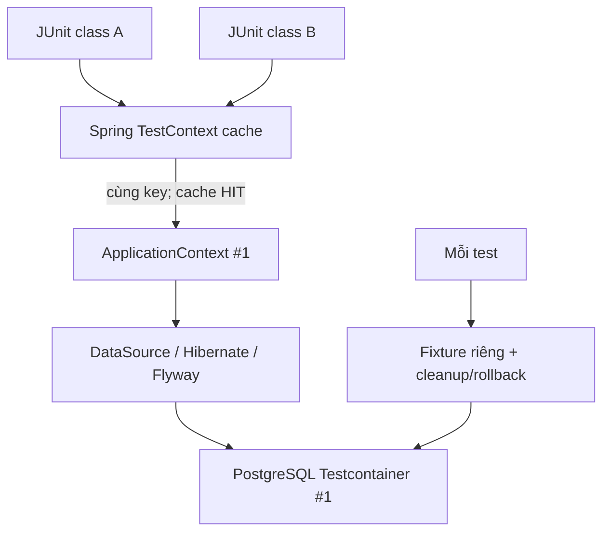
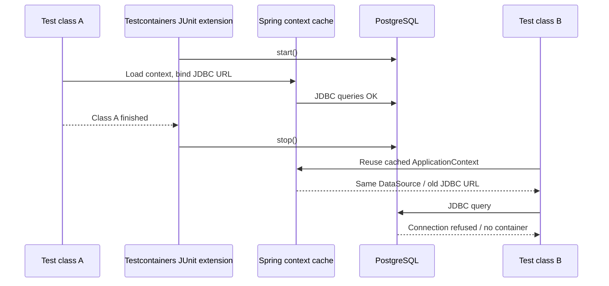

# Tái sử dụng container an toàn

## Mục tiêu học tập

Sau bài học, bạn có thể:

1. Phân biệt **tái sử dụng container giữa các test method**, **giữa các test class trong một JVM** và **giữa các lần chạy build** — ba chính sách có vòng đời và rủi ro khác nhau.
2. Giải thích vì sao `@Testcontainers` + `@Container` trên static field có thể gây lỗi khi Spring **tái sử dụng `ApplicationContext` đã cache** ở lớp test tiếp theo.
3. Tạo **PostgreSQL Testcontainers do Spring quản lý** bằng `@TestConfiguration`, `@Bean`, `@ServiceConnection` và dùng nó trong `@ApplicationModuleTest(STANDALONE)`.
4. Viết hai lớp Java/JUnit kiểm tra **cùng một service/JPA repository thật**, sử dụng cùng cấu hình context, xác minh container còn chạy và dữ liệu được lưu/đọc đúng.
5. Cô lập dữ liệu giữa các bài test dùng chung PostgreSQL bằng **business key riêng**, cleanup có phạm vi, transaction phù hợp; tránh `TRUNCATE` toàn schema khi test chạy song song.
6. Hiểu khi nào **singleton container khởi động thủ công** + `@DynamicPropertySource` là lựa chọn hợp lệ, và tại sao không trộn mẫu singleton đó với extension tự đóng container.
7. Đánh giá `withReuse(true)` của Testcontainers: **tính năng thử nghiệm**, phù hợp một số môi trường local, không phải chiến lược mặc định cho CI.
8. Nhận diện context cache fragmentation, JVM forks, container restart, stale JDBC URL, migration/schema state, mất isolation và rò thông tin truy cập.
9. Xây checklist/quality gate đo cold/warm startup, số container thực sự được tạo, cache hit/miss, đồng thời giữ `ApplicationModules.verify()` và integration test cần thiết.

Bài thuộc chương **Performance tests** của lộ trình **SPRING_MODULITH_VERIFICATION_TESTING**: thực hành kiểm chứng ranh giới Spring Modulith qua `ApplicationModules`, các quy tắc phụ thuộc, `@ApplicationModuleTest`, sự kiện, database và tích hợp, kết hợp quality gate CI để ngăn vi phạm kiến trúc và hồi quy. Câu hỏi trọng tâm của bài: **làm sao tái sử dụng container để giảm startup mà không làm datasource trỏ vào container đã chết hoặc làm dữ liệu test rò rỉ?**

> **Phạm vi phiên bản:** Java 17+, Spring Boot 3.4–3.5, Spring Framework 6.2, Spring Modulith 1.3–1.4, JUnit Jupiter, Spring Data JPA, Flyway và Testcontainers Java. Mã `@ServiceConnection` minh họa Spring Boot 3.x; với Boot 4/Modulith 2.x cần đối chiếu BOM và package import tương ứng. Các mốc thời gian performance trong bài là **cách đo**, không phải ngưỡng mili-giây cố định.

## 1. Ba kiểu “reuse” có ý nghĩa khác nhau

Nói “reuse PostgreSQL container” mà không nói rõ **vòng đời** rất dễ dẫn đến test chỉ xanh khi chạy một mình.

| Phạm vi tái sử dụng | Ai thường giữ vòng đời? | Lợi ích | Điều kiện an toàn |
| --- | --- | --- | --- |
| Nhiều **test methods** trong một class | JUnit `@Container static` **hoặc** Spring container bean | Không restart trước mỗi method | Fixture/transaction cleanup giữa methods |
| Nhiều **test classes** dùng cùng cached context | **Spring-managed `@Bean`** hoặc singleton quản lý thủ công | Một container có thể phục vụ nhiều class | Container phải sống **ít nhất bằng** context, cùng cấu hình kết nối |
| Nhiều **context khác nhau** nhưng cùng JVM | Singleton container riêng được quản lý ngoài context | Giảm container startups nếu nhiều context thật sự cần chung DB | Cô lập schema/data, quản lý shutdown và concurrency cẩn thận |
| Nhiều **lần chạy Gradle/Maven/IDE** | Testcontainers **reusable containers** (experimental) | Tránh tạo lại container giữa lần chạy | Opt-in local, reset state; **không mặc định dùng cho CI** |

Hai nguyên tắc bất biến:

1. **Resource lifetime ≥ consumer lifetime.** Nếu `DataSource`, `EntityManagerFactory` hoặc broker client còn nằm trong cached `ApplicationContext`, container mà chúng dùng **không được bị dừng trước context**.
2. **Reuse hạ tầng ≠ reuse dữ liệu nghiệp vụ.** Có thể giữ cùng một PostgreSQL process nhưng mỗi test vẫn phải có baseline dữ liệu xác định, không được phụ thuộc kết quả của test trước.



**Không suy từ số lớp test ra số container.** Nếu mỗi lớp có context khác hoặc một `@DirtiesContext` làm context bị loại, Spring-managed container có thể được tạo lại; nếu dùng singleton thủ công, container có thể còn sống dù nhiều context được tạo. Cần biết chính xác loại reuse nào đang được đo.

## 2. Anti-pattern: JUnit đóng container trước khi cached context kết thúc

Lỗi điển hình có vẻ hợp lý khi chỉ chạy một lớp:

```java
// MINH HỌA CẤU HÌNH NGUY HIỂM KHI CHIA SẺ SPRING CONTEXT.
// Không sử dụng nguyên xi làm cấu hình chung nhiều lớp.
@Testcontainers
@ApplicationModuleTest
abstract class IncorrectSharedPostgresTests {

    @Container
    static PostgreSQLContainer<?> postgres =
            new PostgreSQLContainer<>("postgres:16-alpine");

    @DynamicPropertySource
    static void db(DynamicPropertyRegistry registry) {
        registry.add(
                "spring.datasource.url", postgres::getJdbcUrl);
        registry.add(
                "spring.datasource.username", postgres::getUsername);
        registry.add(
                "spring.datasource.password", postgres::getPassword);
    }
}
```

Trong một lớp test, `@Container static` được Testcontainers JUnit Jupiter extension khởi động **trước các test methods** và dừng **sau lớp**. Nhưng Spring TestContext cache có vòng đời **lâu hơn một lớp** nếu lớp sau có cùng context key.



**Hậu quả:** lớp A xanh, lớp B đỏ; chạy B riêng lẻ lại xanh. Log có thể chỉ báo `Connection refused`, `PSQLException`, `HikariPool` timeout hoặc lỗi khi Spring đóng `EntityManagerFactory`, khiến người đọc nhầm đó là lỗi SQL/transaction.

Các trường hợp liên quan:

- `@Container` trên **instance field** được JUnit extension quản lý theo **mỗi test method** — còn không phù hợp hơn cho cached datasource cần dùng qua nhiều methods.
- `@Container static` trên **base class** và các subclass JUnit dùng `@Testcontainers` **không** tự biến nó thành singleton sống qua toàn suite.
- Tương tự với Kafka/RabbitMQ/Redis nếu một Spring client bean giữ bootstrap URL/credentials của container đã bị dừng.

**Cách sửa ưu tiên cho Spring Boot 3.4–3.5:** đăng ký container làm **Spring bean** hoặc import container declaration theo Spring Boot, để Spring quản lý thứ tự khởi động/đóng và thời gian sống phù hợp cached context.

## 3. Thiết kế an toàn mặc định: container là Spring-managed bean

Spring Boot hỗ trợ `@ServiceConnection` để sinh `JdbcConnectionDetails` từ một `PostgreSQLContainer` có kiểu cụ thể. **Không cần tự nối URL/username/password** thành properties riêng và không cần tự gọi `container.start()` trong test method.

### 3.1. Dependencies đúng phạm vi

Gradle Groovy DSL, giả định BOM Spring Boot/Modulith tương thích đã được cấu hình:

```groovy
dependencies {
    implementation 'org.springframework.boot:spring-boot-starter-data-jpa'
    implementation 'org.springframework.modulith:spring-modulith-starter-core'
    implementation 'org.flywaydb:flyway-core'

    testImplementation 'org.springframework.boot:spring-boot-starter-test'
    testImplementation 'org.springframework.modulith:spring-modulith-starter-test'
    testImplementation 'org.springframework.boot:spring-boot-testcontainers'
    testImplementation 'org.testcontainers:postgresql'

    testRuntimeOnly 'org.postgresql:postgresql'
    testRuntimeOnly 'org.flywaydb:flyway-database-postgresql'
}
```

Ở đây **không khai báo `org.testcontainers:junit-jupiter`** vì phương án chính dùng Spring-managed bean, không dùng `@Testcontainers`/`@Container` extension. Nếu project còn có những test JUnit container lifecycle riêng, dependency extension phải được khai báo cho **những test đó**, không phải để hỗ trợ `@ServiceConnection` của bean.

`flyway-database-postgresql` cần cho nhiều phiên bản Flyway hiện đại khi hỗ trợ PostgreSQL được tách module. Nếu project dùng một cơ chế migration khác, thay theo đúng schema/migration policy thực tế.

### 3.2. Test configuration dùng chung

```java
// src/test/java/com/acme/shop/orders/PostgresModuleTestConfig.java
package com.acme.shop.orders;

import org.springframework.boot.test.context.TestConfiguration;
import org.springframework.boot.testcontainers.service.connection
        .ServiceConnection;
import org.springframework.context.annotation.Bean;
import org.testcontainers.containers.PostgreSQLContainer;

@TestConfiguration(proxyBeanMethods = false)
public class PostgresModuleTestConfig {

    @Bean
    @ServiceConnection
    PostgreSQLContainer<?> ordersPostgres() {
        return new PostgreSQLContainer<>("postgres:16-alpine")
                .withDatabaseName("orders_it")
                .withUsername("it_user")
                .withPassword("it_password");
    }
}
```

**Cơ chế:**

1. Spring Boot nhận diện `PostgreSQLContainer<?>` từ kiểu trả về method `@Bean`.
2. `@ServiceConnection` tạo connection details cho datasource và các integration phù hợp, thay vì hardcode `localhost:5432`.
3. Spring **khởi động container bean trước** các bean cần kết nối.
4. Container được dừng **sau khi các bean phụ thuộc đã được destroy** khi `ApplicationContext` thật sự đóng.
5. Nếu Spring TestContext cache **tái sử dụng cùng context**, container bean và datasource tiếp tục dùng được.

**Không gọi** `ordersPostgres().start()` trong test code. Cũng không khai báo cùng container vừa là `@Bean`, vừa là `@Container`; như vậy tạo **hai cơ chế quản lý vòng đời cạnh tranh nhau**.

Trong ví dụ test này, thông tin username/password là **test-only credentials** nằm trong môi trường container cô lập; không dùng lại credentials production và không ghi connection secrets thật vào tài liệu/log.

### 3.3. Vì sao chọn typed container?

Với `@Bean` trả `PostgreSQLContainer<?>`, Spring Boot có đủ thông tin type để nhận diện service connection. Với `GenericContainer<?>` dành cho công nghệ như Redis, method `@Bean` có thể cần:

```java
// MINH HỌA KHI DÙNG GenericContainer:
@ServiceConnection(name = "redis")
```

để xác định công nghệ được kết nối; Spring Boot không phải lúc nào cũng có thể suy từ một kiểu chung `GenericContainer` ở thời điểm đăng ký bean.

**Ưu tiên bean typed** và không giả định mọi container có cùng cách auto-detect connection details.

## 4. Mã nghiệp vụ nhỏ để chứng minh PostgreSQL và transaction thật

Không cần thiết kế lại toàn bộ hệ thống. Ta sử dụng module `orders` có JPA thật; Spring Modulith dùng package `com.acme.shop.orders` làm module mục tiêu. `catalog` và `notifications` không cần bootstrap trong ví dụ tái sử dụng container này.

```text
src/main/java/com/acme/shop/
├── ShopApplication.java
└── orders/
    ├── OrderApplication.java
    └── internal/
        ├── PurchaseOrder.java
        ├── PurchaseOrderRepository.java
        └── DefaultOrderApplication.java

src/main/resources/db/migration/
└── V1__create_purchase_orders.sql

src/test/java/com/acme/shop/
├── ModuleArchitectureTests.java
└── orders/
    ├── PostgresModuleTestConfig.java
    ├── OrdersPostgresTestBase.java
    ├── OrdersPostgresWriteTests.java
    └── OrdersPostgresIsolationTests.java
```

### 4.1. Spring Boot app

```java
// src/main/java/com/acme/shop/ShopApplication.java
package com.acme.shop;

import org.springframework.boot.SpringApplication;
import org.springframework.boot.autoconfigure.SpringBootApplication;

@SpringBootApplication
public class ShopApplication {

    public static void main(String[] args) {
        SpringApplication.run(ShopApplication.class, args);
    }
}
```

### 4.2. Migration áp dụng lên PostgreSQL container

```sql
-- src/main/resources/db/migration/V1__create_purchase_orders.sql
CREATE TABLE purchase_orders (
    id BIGINT GENERATED BY DEFAULT AS IDENTITY PRIMARY KEY,
    business_key VARCHAR(100) NOT NULL UNIQUE,
    state VARCHAR(24) NOT NULL
);
```

Migration là **source of truth của schema**. Trong test dùng `spring.jpa.hibernate.ddl-auto=validate`, Hibernate kiểm tra mapping trên schema Flyway đã chuẩn bị, không tự `create-drop` bảng trước mỗi test class.

### 4.3. Entity và repository nội module

```java
// src/main/java/com/acme/shop/orders/internal/PurchaseOrder.java
package com.acme.shop.orders.internal;

import jakarta.persistence.Column;
import jakarta.persistence.Entity;
import jakarta.persistence.GeneratedValue;
import jakarta.persistence.GenerationType;
import jakarta.persistence.Id;
import jakarta.persistence.Table;

@Entity
@Table(name = "purchase_orders")
public class PurchaseOrder {

    @Id
    @GeneratedValue(strategy = GenerationType.IDENTITY)
    private Long id;

    @Column(name = "business_key",
            nullable = false, length = 100, unique = true)
    private String businessKey;

    @Column(nullable = false, length = 24)
    private String state;

    protected PurchaseOrder() {
    }

    PurchaseOrder(String businessKey) {
        this.businessKey = businessKey;
        this.state = "PLACED";
    }

    public Long getId() {
        return id;
    }
}
```

```java
// src/main/java/com/acme/shop/orders/internal/
// PurchaseOrderRepository.java
package com.acme.shop.orders.internal;

import org.springframework.data.jpa.repository.JpaRepository;

interface PurchaseOrderRepository
        extends JpaRepository<PurchaseOrder, Long> {
}
```

### 4.4. Application service thật

```java
// src/main/java/com/acme/shop/orders/OrderApplication.java
package com.acme.shop.orders;

public interface OrderApplication {
    Long place(String businessKey);
}
```

```java
// src/main/java/com/acme/shop/orders/internal/
// DefaultOrderApplication.java
package com.acme.shop.orders.internal;

import com.acme.shop.orders.OrderApplication;
import org.springframework.stereotype.Service;
import org.springframework.transaction.annotation.Transactional;

@Service
class DefaultOrderApplication implements OrderApplication {

    private final PurchaseOrderRepository repository;

    DefaultOrderApplication(PurchaseOrderRepository repository) {
        this.repository = repository;
    }

    @Override
    @Transactional
    public Long place(String businessKey) {
        PurchaseOrder saved =
                repository.saveAndFlush(new PurchaseOrder(businessKey));
        return saved.getId();
    }
}
```

`OrderApplication` nằm ở **public API của orders**; repository/entity nằm trong `orders.internal`. Trong test dưới đây, service/repository/Flyway/PostgreSQL đều là **thật**, không bị Mockito thay thế. Vì không có test-managed transaction bao quanh, lời gọi `place(...)` kết thúc bình thường sẽ **commit transaction của service** trước khi test dùng JDBC để đọc row.

**Lưu ý:** `saveAndFlush()` thực hiện SQL trong transaction, nhưng riêng lệnh flush **không chứng minh commit**; ở ví dụ, bằng chứng commit đến từ transaction proxy đã hoàn tất và truy vấn JDBC sau đó, không phải từ tên method.

## 5. Hai lớp JUnit dùng chung container mà không phụ thuộc thứ tự chạy

Chọn một **test base class** để giữ `@ApplicationModuleTest`, `@Import` và các profile/properties **giống hệt nhau**. Đây là phương án kế thừa cấu hình test, không tạo một superclass quản lý container bằng JUnit `@Container`.

### 5.1. Cấu hình chung và fixture riêng theo test

```java
// src/test/java/com/acme/shop/orders/OrdersPostgresTestBase.java
package com.acme.shop.orders;

import java.util.UUID;
import org.junit.jupiter.api.AfterEach;
import org.junit.jupiter.api.BeforeEach;
import org.springframework.beans.factory.annotation.Autowired;
import org.springframework.boot.test.context.SpringBootTest;
import org.springframework.context.ApplicationContext;
import org.springframework.context.annotation.Import;
import org.springframework.jdbc.core.JdbcTemplate;
import org.springframework.modulith.test.ApplicationModuleTest;
import org.springframework.test.context.TestPropertySource;
import org.testcontainers.containers.PostgreSQLContainer;

@ApplicationModuleTest(
        mode = ApplicationModuleTest.BootstrapMode.STANDALONE,
        webEnvironment = SpringBootTest.WebEnvironment.NONE)
@Import(PostgresModuleTestConfig.class)
@TestPropertySource(properties = {
        "spring.flyway.enabled=true",
        "spring.jpa.hibernate.ddl-auto=validate",
        "spring.sql.init.mode=never"
})
abstract class OrdersPostgresTestBase {

    @Autowired
    protected OrderApplication orders;

    @Autowired
    protected JdbcTemplate jdbc;

    @Autowired
    protected PostgreSQLContainer<?> postgres;

    @Autowired
    protected ApplicationContext context;

    protected String businessKey;

    @BeforeEach
    void uniqueFixtureKey() {
        businessKey = "it-" + UUID.randomUUID();
    }

    @AfterEach
    void cleanupOnlyThisTestRow() {
        jdbc.update(
                "DELETE FROM purchase_orders WHERE business_key = ?",
                businessKey);
    }
}
```

**Tại sao cleanup theo key?**

- Mỗi test có `businessKey` khác nhau, không cần dọn cả schema.
- Không phụ thuộc ID sequence (PostgreSQL identity không nhất thiết reset khi rollback/xóa row).
- Nếu hai test khác nhau cùng dùng DB chạy song song, chúng không `DELETE` nhầm **row của nhau** khi key được cấp độc lập.
- `@AfterEach` chạy cả sau khi assertion thất bại theo vòng đời thông thường của JUnit, giảm rò fixture.

Trong ví dụ tối giản, `businessKey` chỉ tạo một row; nếu use case thật phát event, outbox, notification hoặc ghi nhiều bảng, cleanup cần bao phủ **toàn bộ side effects** hoặc dùng transaction/schema isolation phù hợp. Không coi một câu `DELETE` là chiến lược universal cho production-like integration.

Nếu test cố ý làm hỏng kết nối/container, cleanup qua JDBC có thể thất bại; đó là **tín hiệu tài nguyên không còn sẵn sàng**, cần điều tra chứ không được nuốt exception tùy tiện.

### 5.2. Lớp A: ghi và đọc row đã commit

```java
// src/test/java/com/acme/shop/orders/OrdersPostgresWriteTests.java
package com.acme.shop.orders;

import static org.assertj.core.api.Assertions.assertThat;

import java.sql.Connection;
import javax.sql.DataSource;
import org.junit.jupiter.api.Test;
import org.springframework.beans.factory.annotation.Autowired;

class OrdersPostgresWriteTests extends OrdersPostgresTestBase {

    @Autowired
    DataSource dataSource;

    @Test
    void commitsUsingPostgresNotEmbeddedH2() throws Exception {
        assertThat(postgres.isRunning()).isTrue();

        try (Connection connection = dataSource.getConnection()) {
            assertThat(connection.getMetaData()
                    .getDatabaseProductName())
                    .isEqualTo("PostgreSQL");
        }

        Long id = orders.place(businessKey);

        assertThat(jdbc.queryForObject(
                "SELECT business_key FROM purchase_orders WHERE id = ?",
                String.class, id))
                .isEqualTo(businessKey);
    }
}
```

Test xác minh **container sống, datasource dùng PostgreSQL thật**, và service `orders` đã ghi dữ liệu. Khác với một test dùng `@MockBean` repository, truy vấn `JdbcTemplate` đọc dữ liệu persisted trong container thật.

### 5.3. Lớp B: độc lập với state của lớp A

```java
// src/test/java/com/acme/shop/orders/
// OrdersPostgresIsolationTests.java
package com.acme.shop.orders;

import static org.assertj.core.api.Assertions.assertThat;

import org.junit.jupiter.api.Test;

class OrdersPostgresIsolationTests extends OrdersPostgresTestBase {

    @Test
    void startsWithNoRowForItsOwnBusinessKey() {
        assertThat(postgres.isRunning()).isTrue();

        Integer before = jdbc.queryForObject(
                "SELECT COUNT(*) FROM purchase_orders "
                + "WHERE business_key = ?",
                Integer.class, businessKey);

        assertThat(before).isZero();

        Long id = orders.place(businessKey);

        assertThat(jdbc.queryForObject(
                "SELECT COUNT(*) FROM purchase_orders WHERE id = ?",
                Integer.class, id))
                .isEqualTo(1);
    }
}
```

**Hai lớp được thiết kế để**:

1. Dùng cùng module `orders`, cùng config `@ApplicationModuleTest`, cùng `@Import` và properties.
2. Không khai báo `@DirtiesContext` hoặc mock override riêng.
3. Tái sử dụng **một `ApplicationContext` và Spring-managed PostgreSQL bean** khi chạy trong cùng test JVM và không có eviction/invalidation.
4. Không dựa vào **thứ tự class A/B** hoặc một row được tạo ở class khác.

Đừng biến cache reuse thành assertion kiểu “test A phải chạy trước test B”. **Context cache là tối ưu hạ tầng**, không phải một tiền điều kiện nghiệp vụ của test. Đo cache hit/miss bằng log ở mục 9.

### 5.4. Spring Modulith đang kiểm tra gì?

`@ApplicationModuleTest(STANDALONE)` chỉ bootstrap **module orders** và infrastructure mà nó cần, không đưa mọi component ở module `catalog`, `notifications` vào context. Nhưng Spring-managed PostgreSQL container là một **test infrastructure bean được import có chủ đích**; nó không phải một application module cần được mô hình Modulith công bố.

`verifyAutomatically = true` (mặc định ở Spring Modulith 1.4) vẫn giữ việc kiểm chứng ranh giới/module dependency khi module test khởi tạo. Container reuse **không phải lý do** để tắt bước này.

## 6. Reuse container an toàn đòi hỏi isolation dữ liệu và transaction đúng

Container có thể được giữ sống suốt test suite trong khi dữ liệu cần được làm sạch **sau từng test**. Khi tái sử dụng cùng database, hãy chọn chiến lược isolation dựa theo **điều test cần chứng minh**:

| Mục tiêu | Cách isolation | Rủi ro |
| --- | --- | --- |
| Test repository/service trong test-managed transaction | `@Transactional` trên test + rollback | Không chứng minh service **commit thật** hoặc listener `AFTER_COMMIT` |
| Test service commit/rollback thật | Không `@Transactional` trên test, cleanup có phạm vi sau method | Cần xử lý nhiều bảng/side effects khi use case ghi rộng |
| Test HTTP `RANDOM_PORT` | Fixture riêng + cleanup/schema riêng | Transaction ở test thread không rollback transaction ở server thread |
| Nhiều class/test chạy song song | Key/schema/tenant riêng; transaction isolation phù hợp | `DELETE FROM table` hoặc `TRUNCATE` chung gây race |
| Event/outbox/async listener | Correlation ID + chờ outcome, cleanup publication state | Listener có thể chạy **sau** test nếu không chờ |

### 6.1. Không dùng `TRUNCATE` toàn bảng để “dọn nhanh” trong mọi test

Tránh trong suite có test chạy song song:

```sql
-- ANTI-PATTERN nếu các test cùng chia sẻ schema:
TRUNCATE TABLE purchase_orders RESTART IDENTITY CASCADE;
```

`TRUNCATE` có thể đụng dữ liệu test khác, ảnh hưởng FK và reset sequence. Trên PostgreSQL, câu lệnh còn có lock semantics riêng; đừng coi nó là tương đương an toàn với `DELETE WHERE business_key = ?`.

Trong ví dụ ở mục 5, cleanup chỉ xóa đúng `businessKey` của test; đây là đánh đổi hợp lý cho bài test nhỏ. Với dữ liệu phức tạp, **schema riêng/test class**, disposable database, hoặc cleanup theo aggregate ID/correlation ID có thể phù hợp hơn.

### 6.2. `@Transactional` trong JUnit không luôn là biện pháp thích hợp

```java
// Chỉ minh họa ngữ nghĩa, không gắn vào hai lớp ở mục 5.
@Transactional
@Test
void testInsideRollbackOnlyTransaction() {
    // service với propagation REQUIRED có thể join transaction của test.
    // TestContext thường rollback khi method kết thúc.
}
```

Khi service join transaction do test quản lý, test có thể đọc row đã flush nhưng **chưa commit**. Nếu application phát `OrderPlaced` và subscriber dùng `@TransactionalEventListener(AFTER_COMMIT)`, callback có thể không chạy do test transaction bị rollback. Vì vậy:

- Dùng `@Transactional` test **khi chủ đích là kiểm tra logic trong transaction và rollback sau test**.
- Dùng transaction độc lập và cleanup thủ công khi phải kiểm tra **commit, AFTER_COMMIT hoặc event publication registry**.
- Với async side effects, chờ bằng điều kiện có timeout và correlation key trước khi cleanup để tránh race.

### 6.3. Giữ schema/migration có nghĩa

`flyway-core` và `ddl-auto=validate` trong demo giúp test dùng **migration thật**, nhưng chính việc context được cache mới giúp tránh startup schema lặp khi cấu hình tương đương. Tái sử dụng container **không tự động** bảo đảm database schema đúng: nếu container đã chứa version migration cũ từ lần chạy khác, phải xem trạng thái Flyway/schema history.

**Đừng bỏ migrations khỏi tất cả tests chỉ để container warm.** Có thể tách những test không cần DB sang unit/module no-DB, nhưng phải giữ ít nhất nhóm integration chạy migrations trên engine production phù hợp trong CI.

## 7. Phương án thứ hai: singleton container khởi động thủ công

Đôi khi nhiều `ApplicationContext` **khác nhau** (ví dụ profile hoặc mock configuration khác) cần chia sẻ **một PostgreSQL process** trong cùng test JVM. Spring-managed container mặc định là **một bean trên mỗi context**, nên mỗi context có thể tạo một container khác. Khi đo được việc đó là bottleneck và có chiến lược isolation đủ mạnh, có thể dùng **singleton container do test suite tự quản lý**.

```java
// src/test/java/com/acme/shop/orders/
// SharedPostgresSingletonBase.java
package com.acme.shop.orders;

import org.springframework.test.context.DynamicPropertyRegistry;
import org.springframework.test.context.DynamicPropertySource;
import org.testcontainers.containers.PostgreSQLContainer;

abstract class SharedPostgresSingletonBase {

    private static final PostgreSQLContainer<?> POSTGRES =
            new PostgreSQLContainer<>("postgres:16-alpine")
                    .withDatabaseName("orders_shared_it");

    static {
        POSTGRES.start();
    }

    @DynamicPropertySource
    static void postgresProperties(
            DynamicPropertyRegistry registry) {
        registry.add(
                "spring.datasource.url", POSTGRES::getJdbcUrl);
        registry.add(
                "spring.datasource.username", POSTGRES::getUsername);
        registry.add(
                "spring.datasource.password", POSTGRES::getPassword);
    }
}
```

Để sử dụng theo cách này, các lớp test phải kế thừa **cùng base class** chứa `@DynamicPropertySource`, dùng context config phù hợp, và **không** còn `@Import(PostgresModuleTestConfig.class)` tạo container thứ hai. Khi dùng Flyway, test vẫn cần profile/property `ddl-auto=validate` và migration configuration riêng.

**Quy tắc tuyệt đối của mẫu singleton thủ công:**

- **Không gắn** `@Testcontainers` hoặc `@Container` lên singleton đó, vì JUnit extension có thể dừng nó khi một test class kết thúc.
- Không gọi `POSTGRES.stop()` trong `@AfterAll` của một class khi class khác vẫn có thể dùng cached Spring context.
- Đảm bảo shutdown/cleanup phù hợp sau toàn test JVM; với Testcontainers mặc định, resource reaper quản lý container khi process kết thúc. Không giả định đây là persistent database.
- Nếu chạy test trong **nhiều JVM forks**, mỗi JVM có một static singleton riêng. Không tuyên bố “một container cho cả CI build” khi có nhiều worker processes.
- Vì cùng PostgreSQL process có thể được dùng bởi **nhiều context**, cần phân biệt rõ mỗi context có cùng schema/migration/fixtures hay không; một context không thể tự nhận toàn bộ database là “của riêng nó”.

### Khi nào nên chọn cái nào?

| Chiến lược | Dùng khi | Đánh đổi |
| --- | --- | --- |
| **Spring-managed `@Bean` + `@ServiceConnection`** | Nhiều class chia sẻ **cùng cached context** | Quản lý lifecycle tự động, ưu tiên mặc định |
| **Manual static singleton + `@DynamicPropertySource`** | Nhiều context khác nhau cần dùng cùng container **trong một JVM** | Tự chịu trách nhiệm về vòng đời, state, cache key và shutdown |
| **JUnit `@Container static`** | Test thuần JUnit hoặc một class có lifecycle độc lập, không cần Spring cache sống qua class | Extension dừng container cuối class |
| **Reusable containers qua nhiều lần build** | Thử nghiệm local, môi trường do developer kiểm soát | State bền qua lần chạy; không phù hợp CI mặc định |

### Nguy cơ “stale endpoint” với `@DynamicPropertySource`

Spring TestContext đưa **method `@DynamicPropertySource`** vào context cache key. Nếu hai lớp cùng kế thừa một method nhưng code lại thay container/port/url phía sau method đó, context cũ có thể được reuse trong khi `DataSource` đã bind JDBC URL **trước đó**.

Không thay một static container sau khi context được tạo rồi mong Spring tự rebind mọi bean. Nếu endpoint/lifecycle thực sự khác theo subclass, phải **tách context có chủ đích**, có thể dùng `@DirtiesContext` khi đúng lý do hoặc đổi mô hình quản lý resource. Cache hit **không phải mục tiêu** nếu kết nối trỏ nhầm tài nguyên.

## 8. Reuse qua nhiều lần chạy: `withReuse(true)` chỉ là opt-in local

Testcontainers có **Reusable Containers (Experimental)**. Nó khác hẳn cache Spring TestContext:

- TestContext cache chỉ tồn tại **trong JVM test**.
- Reusable container có thể **tiếp tục chạy sau khi JVM test kết thúc** và được lần chạy sau kết nối lại nếu cấu hình tương thích.
- Container reuse có thể giữ lại **database state**, schema, users, topics hoặc message backlog từ lần chạy trước.
- Testcontainers cảnh báo tính năng này **không phù hợp cho CI mặc định**.

Một ví dụ **chỉ nên dùng trong môi trường local được kiểm soát**:

```properties
# ~/.testcontainers.properties (cấu hình user LOCAL, không phải file
# project test resources dùng chung cho CI)
testcontainers.reuse.enable=true
```

```java
// CHỈ MINH HỌA opt-in local. Không dùng @Container / @Testcontainers.
PostgreSQLContainer<?> localPostgres =
        new PostgreSQLContainer<>("postgres:16-alpine")
                .withDatabaseName("orders_local_it")
                .withReuse(true);
localPostgres.start();
```

Trong một số môi trường có thể opt-in qua biến `TESTCONTAINERS_REUSE_ENABLE=true`. Không gọi `stop()` khi chủ đích là reuse giữa các run; không bọc container vào `try-with-resources` vốn tự đóng. Các dòng trên **không được ghép** vào `PostgresModuleTestConfig` của phương án mặc định mà không thiết kế lại lifecycle.

**Rủi ro phải giải quyết nếu dùng local reuse:**

1. **Dirty state:** order từ buổi chạy trước vẫn có mặt; schema/migration history có thể khác branch hiện tại.
2. **Data privacy:** không dùng dữ liệu cá nhân/production dump thật nếu không có kiểm soát; container tồn tại lâu hơn một lần test.
3. **Schema drift:** cùng tên database nhưng migration branch A/B khác nhau có thể gây conflict, checksum mismatch hoặc false green.
4. **Resource cleanup:** container không tự dừng sau suite; cần chính sách quản lý và dọn container local.
5. **Port/network/resource:** không giả định mapped port cố định giữa các lần chạy hoặc mọi tính năng Testcontainers đều tương thích reuse experimental.

**Không dùng `withReuse(true)` như cách “sửa” lỗi container bị đóng sớm bởi `@Container`.** Lỗi đó phải được sửa **ở lifecycle owner** trước tiên. Trong CI, ưu tiên container ephemeral, fixtures xác định và một test run tự dọn.

## 9. Chứng minh reuse bằng log và test, không bằng phỏng đoán

### 9.1. Đo cùng một run với hai lớp test

Bật logging ở cấu hình test:

```properties
logging.level.org.springframework.test.context.cache=DEBUG
logging.level.org.testcontainers=INFO
logging.level.org.flywaydb=INFO
```

Sau đó chạy các lớp ở mục 5 trong **cùng Gradle test task**:

```bash
./gradlew test \
  --tests 'com.acme.shop.orders.OrdersPostgresWriteTests' \
  --tests 'com.acme.shop.orders.OrdersPostgresIsolationTests' \
  --rerun-tasks --no-build-cache
```

Kiểm tra bốn bằng chứng:

1. Cả hai lớp đều **PASS**, kể cả khi đổi thứ tự chạy.
2. Trong cùng test JVM và cùng context key, cache thống kê **một cold load** rồi tái sử dụng context (khi không có eviction/dirty).
3. Log Testcontainers cho biết PostgreSQL container **được tạo/khởi động một lần cho context đó**.
4. Dữ liệu hai tests không gây nhiễm: mỗi test dùng key riêng, cleanup không ảnh hưởng row của test khác.

**Không dùng** `System.identityHashCode(context)` làm bằng chứng duy nhất: hash không bảo đảm duy nhất và không giúp kiểm tra lifecycle container. Cũng không suy “một cache hit = một test class”; Spring có thể tra cứu context nhiều lần trong vòng đời một test class.

### 9.2. Chủ động chứng minh lỗi lifecycle và cách sửa

Trên một nhánh thí nghiệm không đưa lên CI chính:

1. Tạo một base class `@Testcontainers` + `@Container static` + `@DynamicPropertySource` như mục 2, rồi hai class dùng chung config/context.
2. Quan sát lớp A có thể PASS nhưng lớp B gặp lỗi kết nối vì container của JUnit đã dừng; nếu runner/framework thực tế không reuse key, ghi nhận nguyên nhân thay vì ép giả định.
3. Chuyển sang `@Bean` + `@ServiceConnection` như mục 3 và bỏ `@Testcontainers`/`@Container`.
4. Chạy lại cả hai lớp trong cùng worker; kiểm tra cache log, container startup và truy vấn JDBC.

Đây là **thí nghiệm về vòng đời**, không phải bài performance benchmark thuần. Mục tiêu là chứng minh **reuse không làm hỏng test độc lập**.

### 9.3. Những yếu tố khiến tưởng reuse đã hỏng

| Triệu chứng | Có thể do | Chẩn đoán / xử lý |
| --- | --- | --- |
| PostgreSQL khởi động lại ở mỗi class | Context keys khác, `@DirtiesContext`, fork JVM | Đọc cache miss/eviction, compare profiles/properties/overrides |
| Cùng context nhưng lớp B `Connection refused` | JUnit extension đã stop container | Dùng Spring-managed container hoặc singleton thủ công đúng vòng đời |
| `@ServiceConnection` không tạo JDBC connection | Thiếu `spring-boot-testcontainers` hoặc bean `GenericContainer` không có type/name phù hợp | Dùng `PostgreSQLContainer<?>` typed và kiểm tra connection details |
| Flyway chạy lại nhiều lần | Context/container mới hoặc database riêng | Chuẩn hóa context khi semantics tương đương; không tắt migration vô cớ |
| H2 được auto-configure thay PostgreSQL | Connection details/driver/datasource test setup sai | Test `DatabaseMetaData.getDatabaseProductName()` |
| Test khác xóa row đang kiểm tra | `TRUNCATE` hoặc cleanup toàn bảng khi chạy song song | Dùng key riêng/schema riêng hoặc chạy tuần tự |
| Sequence không bắt đầu từ 1 | Identity tăng khi insert/rollback | Không hardcode ID; đọc ID thật |
| Async event listener chưa hoàn tất | Test cleanup quá sớm | Chờ outcome có timeout, dùng correlation ID |
| Hai class có `@MockitoBean` khác qualifier | Context customizers khác nên thêm context/container | Chuẩn hóa mock config nếu cùng hợp đồng |
| Container còn chạy sau kết thúc local run | Bật experimental reuse | Dọn thủ công và kiểm tra user-level opt-in |
| CI chậm khi tăng `maxParallelForks` | Nhiều JVM/container độc lập tranh CPU/RAM | Đo throughput, số container, memory, không tối ưu mỗi con số riêng |

### 9.4. Vì sao không viết JUnit assertion `startupMs < 500`?

Thời gian container cold start phụ thuộc Docker image cache, CPU/RAM, storage, network, JIT, số migration và sức tải CI runner. Một threshold milliseconds tuyệt đối có thể tạo flaky build. Nên:

- Dùng JUnit để **assert chức năng, data isolation và container readiness**.
- Ghi **số context cache misses**, **số container startups**, **cold/warm wall-clock**, **Flyway migration time**, **RAM** trong báo cáo performance.
- So nhiều lượt đo có baseline và độ biến thiên tương đương; cảnh báo khi regressions kéo dài, không thất bại CI vì một dao động nhỏ đơn lẻ.

`--rerun-tasks` và `--no-build-cache` của Gradle chỉ tránh reuse output build; chúng **không tắt Spring TestContext cache** bên trong JVM test.

## 10. Checklist vận hành và quality gate CI

### Checklist trước khi chọn chiến lược reuse

- [ ] Đã xác định cần chia sẻ container qua **methods, classes, contexts hay runs**?
- [ ] Đã xác định lifecycle owner duy nhất: **Spring bean**, **manual singleton** hay JUnit extension?
- [ ] Container luôn sống **ít nhất bằng** cached `ApplicationContext` và các dependent beans?
- [ ] Không có `@Container`/`@Testcontainers` trên container do Spring quản lý hay singleton thủ công?
- [ ] Các lớp muốn reuse context dùng **cùng module, mode, imports, profiles, test properties và bean overrides**?
- [ ] Test đọc `DatabaseMetaData` để xác minh datasource đang dùng **engine được mong đợi**, không âm thầm fallback H2?
- [ ] Flyway migrations chạy trên database test phù hợp; không bật `create-drop` cạnh migrations ngoài chủ đích?
- [ ] Dữ liệu fixture dùng key/schema riêng, cleanup có phạm vi và không giả định thứ tự lớp test?
- [ ] Có chính sách khi test chạy song song, khi transaction rollback, khi listener bất đồng bộ còn xử lý?
- [ ] Không trộn experimental `withReuse(true)` vào CI, không dùng dữ liệu production nhạy cảm trong reusable DB?
- [ ] Có log/metrics cho **cache hit/miss, container startup, migrations, test wall-clock và memory**?
- [ ] Architecture gate `ApplicationModules.verify()` và kiểm thử database/event/integration cần thiết còn được CI thực thi?

### Quality gate kiến trúc

```java
// src/test/java/com/acme/shop/ModuleArchitectureTests.java
package com.acme.shop;

import org.junit.jupiter.api.Test;
import org.springframework.modulith.core.ApplicationModules;

class ModuleArchitectureTests {

    @Test
    void modulesRespectDeclaredBoundaries() {
        ApplicationModules.of(ShopApplication.class).verify();
    }
}
```

Không lấy việc test dùng một container thật làm bằng chứng **module dependencies hợp lệ**. `ApplicationModules.verify()` giải quyết **kiến trúc tĩnh**, còn JPA/PostgreSQL integration test giải quyết **wiring, transaction, migration và runtime behavior**; hai nhóm bổ sung nhau.

### Bài thực hành có đối chứng

1. Tạo `ShopApplication`, module `orders`, entity/repository/service và Flyway migration ở mục 4.
2. Tạo `PostgresModuleTestConfig` với `@Bean` + `@ServiceConnection` như mục 3, **không `@Testcontainers`**.
3. Tạo `OrdersPostgresTestBase` và hai lớp JUnit ở mục 5, chạy cả hai trong cùng JVM test worker.
4. Xác nhận metadata database là **PostgreSQL**, service thật commit row và mỗi test xóa riêng fixture của mình.
5. Bật Spring cache logging; xác nhận hai class **có thể reuse cùng context/container** và không phụ thuộc thứ tự thực thi.
6. Đổi một test class sang profile khác ở nhánh thí nghiệm: quan sát có cache miss và Spring-managed container thứ hai hay không. Khôi phục khi không cần khác biệt cấu hình.
7. Tạo một biến thể dùng `@Container static` và `@DynamicPropertySource`; quan sát lỗi tiềm tàng khi JUnit stop container nhưng Spring reuse context. Bỏ biến thể lỗi sau khi hiểu nguyên nhân.
8. Đọc phương án singleton thủ công ở mục 7; chỉ dùng nếu thật sự có nhiều context cần chung container và đã xử lý isolation/schema/lifecycle.
9. Thảo luận `withReuse(true)` cho local dev, mô tả cách reset DB và lý do **không bật mặc định trong CI**.
10. Chạy `ApplicationModules.verify()` và những DB/event integration tests bắt buộc. Báo cáo **cả độ tin cậy lẫn thời gian chạy**, không chỉ “giảm startup”.

### Câu hỏi tự kiểm tra

1. `@Container static` có nghĩa container sống đến khi JVM test kết thúc không? Vì sao?
2. Tại sao lớp A xanh, lớp B lỗi connection dù cả hai dùng cùng `@SpringBootTest`/`@ApplicationModuleTest` configuration?
3. `@ServiceConnection` làm gì khi được gắn lên method `@Bean` trả `PostgreSQLContainer<?>`?
4. Ai dừng container bean khi Spring TestContext cache đóng `ApplicationContext`?
5. Hai lớp test dùng chung DB có thể độc lập không, và phải quản lý dữ liệu như thế nào?
6. Vì sao không dùng `TRUNCATE TABLE` trên shared schema khi có parallel tests?
7. `@Transactional` trên test có thể làm sai suy luận về service commit hoặc event `AFTER_COMMIT` như thế nào?
8. Khi nào manual static singleton + `@DynamicPropertySource` cần thiết hơn Spring-managed `@Bean`?
9. Vì sao không được trộn singleton container với `@Testcontainers`/`@Container`?
10. `withReuse(true)` khác Spring TestContext cache như thế nào và vì sao không dùng mặc định cho CI?
11. Nếu Gradle dùng hai test JVM, hai lớp có cùng static container không?
12. Những bằng chứng nào cần có để tuyên bố reuse an toàn mà **không làm mất module verification**?

## Tổng kết

**Tái sử dụng container an toàn** là đồng bộ **vòng đời PostgreSQL/Kafka/Redis container với những Spring beans đang sử dụng nó**, đồng thời duy trì **isolation dữ liệu test**. Trong Spring Boot 3.4–3.5, lựa chọn mặc định đáng ưu tiên là **`@TestConfiguration` + Spring-managed `@Bean` + `@ServiceConnection`**: container khởi động trước các bean phụ thuộc và dừng sau khi cached `ApplicationContext` đóng. Tránh dùng `@Testcontainers` + static `@Container` như một singleton chia sẻ qua nhiều lớp có Spring context cache, vì JUnit có thể dừng resource sau class trong khi context vẫn sống. Khi nhiều context khác nhau thật sự cần một container, có thể dùng singleton khởi động thủ công với `@DynamicPropertySource`, nhưng phải quản lý state/lifecycle/cleanup rõ ràng. `withReuse(true)` là **experimental opt-in cho local**, không phải phép tối ưu CI mặc định. Cuối cùng, kiểm chứng **PostgreSQL thật, fixture độc lập, cache/container logs, migrations** và giữ `ApplicationModules.verify()` cùng các test giao dịch/sự kiện cần thiết, để giảm startup mà không đánh đổi độ tin cậy của Spring Modulith.

### Tài liệu tham khảo

- [Spring Boot 3.5 — Testcontainers, service connections và managed container lifecycle](https://docs.spring.io/spring-boot/3.5/reference/testing/testcontainers.html)
- [Spring Framework 6.2 — TestContext Context Caching](https://docs.spring.io/spring-framework/reference/6.2/testing/testcontext-framework/ctx-management/caching.html)
- [Spring Framework 6.2 — Dynamic Property Sources](https://docs.spring.io/spring-framework/reference/6.2/testing/testcontext-framework/ctx-management/dynamic-property-sources.html)
- [Spring Modulith 1.4 — Integration Testing Application Modules](https://docs.spring.io/spring-modulith/reference/1.4/testing.html)
- [Spring Modulith 1.4 — Verifying Application Module Structure](https://docs.spring.io/spring-modulith/reference/1.4/verification.html)
- [Testcontainers Java — JUnit 5 Container Lifecycle](https://java.testcontainers.org/test_framework_integration/junit_5/)
- [Testcontainers — Singleton Containers](https://java.testcontainers.org/test_framework_integration/manual_lifecycle_control/#singleton-containers)
- [Testcontainers Java — Reusable Containers (Experimental)](https://java.testcontainers.org/features/reuse/)
