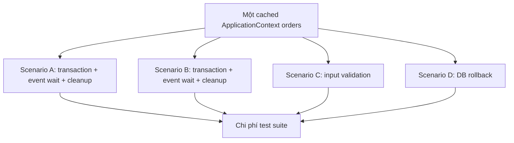
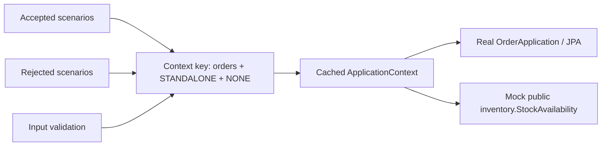

# Giới hạn số scenario trong một test class

## Mục tiêu học tập

Sau bài học, bạn có thể:

1. Phân biệt **scenario nghiệp vụ**, một lần gọi **Spring Modulith `Scenario` DSL**, một **JUnit test invocation** và một **Spring `ApplicationContext`**. Các đơn vị này không có tỷ lệ 1:1.
2. Giải thích vì sao một lớp `@ApplicationModuleTest` chứa quá nhiều scenario có thể chậm, khó chẩn đoán, phụ thuộc trạng thái và thiếu tin cậy dù context chỉ bootstrap một lần.
3. Chọn cách chia lớp theo **hợp đồng nghiệp vụ, fixture, transaction, timeout, bootstrap mode** thay vì một ngưỡng số test method tùy tiện.
4. Viết Java/JUnit dùng **service thật của module `orders`**, `@MockitoBean` tại public API module ngoài, và `Scenario.stimulate(...).andWaitForEventOfType(...)` để xác minh event.
5. Biết khi nào cần **`@ParameterizedTest`** cho những biến thể input đơn giản, và khi nào phải giữ scenario bất đồng bộ thành các test riêng.
6. Cô lập correlation ID, repository state và Mockito stubs giữa các lần chạy; tránh rò state do vòng đời `PER_CLASS` của `@ApplicationModuleTest` trong Spring Modulith 1.4.
7. Nhận diện chi phí **nhiều lần chờ event timeout**, database cleanup, `@DirtiesContext` và một test method chứa chuỗi dài nhiều hành vi.
8. Đo **thời gian mỗi test invocation**, context cache misses và số lần chờ/cleanup trước khi điều chỉnh kích thước lớp test.
9. Giữ architecture quality gate `ApplicationModules.verify()`, các integration test DB/event thật và độ phủ các nhánh quan trọng khi chia lại test class.

Bài thuộc chương **Performance tests** trong lộ trình **SPRING_MODULITH_VERIFICATION_TESTING**: rèn kỹ năng kiểm chứng ranh giới kiến trúc qua `ApplicationModules`, quy tắc phụ thuộc, `@ApplicationModuleTest`, sự kiện, database và tích hợp, cùng quality gate CI chống hồi quy. Trọng tâm duy nhất ở đây là **giới hạn hợp lý số scenario trong từng test class**. Các chủ đề context caching, container hoặc migration chỉ xuất hiện khi chúng giải thích quyết định **nên gộp hay tách** các scenario.

> **Môi trường ví dụ:** Java 17+, Spring Boot 3.4–3.5, Spring Framework 6.2, Spring Modulith 1.3–1.4, Spring Data JPA, H2, JUnit Jupiter 5 và Mockito. Với Boot 4 hoặc Modulith 2.x, kiểm tra lại BOM và API hiện hành. Đây là bài thiết kế test; không có một giới hạn số scenario cố định do Spring Modulith áp đặt.

## 1. Một test class nên chứa bao nhiêu scenario?

Không có quy tắc “`@ApplicationModuleTest` chỉ được chứa tối đa 5, 8 hoặc 10 test methods”. **Giới hạn là một quyết định kỹ thuật của đội**, dựa trên mức cô lập, chi phí, tính đọc được và khả năng chẩn đoán khi một kịch bản thất bại.

Hãy phân biệt bốn đơn vị:

| Thuật ngữ | Ví dụ | Có tương ứng một context mới không? |
| --- | --- | --- |
| **Scenario nghiệp vụ** | Đủ hàng, hết hàng, dữ liệu không hợp lệ | Không |
| **JUnit test invocation** | Một `@Test` hoặc một hàng dữ liệu của `@ParameterizedTest` | Không nhất thiết |
| **Modulith `Scenario` DSL** | `scenario.stimulate(...).andWaitForEventOfType(...)` | Không; nó điều khiển stimulus và chờ outcome |
| **Spring `ApplicationContext`** | Context `orders` ở `STANDALONE`, cùng profile/mocks | Có thể được nhiều class cùng reuse |

Một `@ParameterizedTest` với bảy `@CsvSource` rows nhìn như **một method** nhưng chạy **bảy invocations**. Ngược lại, hai lớp JUnit có cùng context configuration thường **có thể dùng chung một cached context** trong cùng JVM. Vì vậy **đếm dòng `@Test` không phản ánh chi phí thật**.

### Một quy ước khởi đầu có thể review

Thay vì luật cứng, nhóm có thể bắt đầu bằng những câu hỏi:

- Lớp này có **một hợp đồng nghiệp vụ chính** để mô tả không?
- Mỗi scenario có **stimulus → outcome → cleanup độc lập** không?
- Có cần quá nhiều `if`, switch, biến mutable hoặc lệnh reset giữa scenario không?
- Có kịch bản nào yêu cầu **DB, async timeout hoặc bootstrap mode khác** không?
- Khi một test đỏ, tên lớp/phương thức có nói ngay **invariant nào bị phá vỡ** không?

**Gợi ý mang tính heuristic, không phải giới hạn framework:** một lớp tích hợp event có thể giữ một vài scenario cùng mục tiêu (ví dụ 2–5) nếu chúng độc lập và có chi phí tương đồng. Lớp có 12 scenario đơn giản, deterministic vẫn có thể tốt hơn một lớp ba scenario nhưng mỗi cái chờ timeout dài và sửa shared DB state.

### Hai cách tổ chức cho cùng ba hợp đồng

```text
Khó bảo trì:
OrdersEverythingIntegrationTests
  - đặt hàng thành công
  - hết hàng
  - validation
  - lỗi database
  - listener gửi thông báo
  - retry
  - bảo mật web
  - ...

Dễ xác định phạm vi:
OrdersAcceptedScenariosTests     -> event OrderSubmitted + persisted row
OrdersRejectedScenariosTests     -> event OrderRejected + no persisted row
OrdersInputValidationTests       -> validation đồng bộ, nhiều biến thể nhỏ
OrdersDatabaseRollbackTests      -> rollback thật, khi tính năng yêu cầu
NotificationListenerTests        -> consumer ở module notifications
```

Các tên trong phần dưới tương ứng với **ba lớp test đầu tiên**; những tên rollback/listener chỉ minh họa **nhóm hợp đồng cần tách** khi ứng dụng có chức năng đó, không phải các file cần tạo thêm trong bài mẫu.

## 2. Vì sao lớp có quá nhiều scenario vẫn chậm dù cache context tốt?

Một lớp test có nhiều methods dùng cùng `@ApplicationModuleTest` có thể chỉ tạo **một** Spring context. Nhưng context reuse không loại được mọi chi phí **trên mỗi scenario**.



Phân rã thời gian để chẩn đoán:

\[
T_{\mathrm{suite}}
\approx
\sum_{\mathrm{cold\ contexts}} T_{\mathrm{bootstrap}}
+ \sum_{\mathrm{invocations}}
  \left(T_{\mathrm{setup}} + T_{\mathrm{stimulus}}
  + T_{\mathrm{wait}} + T_{\mathrm{assert}}
  + T_{\mathrm{cleanup}}\right)
\]

Đây là **mô hình tương đối**, không phải công thức đo chính xác mọi trường hợp. Dù cold context bằng 1, lớp chứa nhiều scenario có wait/DB fixture tốn kém vẫn có thể chiếm phần lớn runtime.

| Kiểu scenario | Chi phí có thể nổi bật | Nên đặt chung với loại nào? |
| --- | --- | --- |
| Validation đồng bộ | Gọi service và assertion rất ngắn | Các biến thể validation có chung fixture |
| Publish event đồng bộ | Transaction, event collector, state query | Các scenario có cùng event contract |
| Chờ listener bất đồng bộ | Scheduler/transaction, polling/timeout | Các scenario có cùng timeout và resource lifecycle |
| Giao dịch DB/rollback | Seed, commit/rollback, cleanup | Các test cùng database semantics |
| Integration module ngoài | Nhiều bean/containers/clients thật | Nhóm test cùng bootstrap scope |
| HTTP/security | Filters, MVC mapping, principal/CSRF | Nhóm web tests, không nhét vào lớp JPA-only |

Nếu năm scenario không nhận được event và mỗi scenario có timeout 5 giây, riêng chờ thất bại **có thể** đóng góp gần \(5 \times 5 = 25\) giây khi chạy tuần tự. Chia class **không tự xóa 25 giây này**; cần sửa event correlation, timeout, hoặc giảm các phép thử trùng hợp đồng.

### Phân biệt tối ưu hiệu năng với xóa coverage

Giảm 15 scenario xuống hai bằng cách xóa nhánh hết hàng, rollback hoặc retry sẽ làm suite nhanh hơn nhưng **giảm khả năng bắt hồi quy**. Mục tiêu đúng là:

- Tránh **kịch bản trùng invariant** và những wait không tạo thêm bằng chứng.
- Tách test có **setup hoặc hợp đồng khác nhau**.
- Dùng test nhẹ cho input variants, test nặng cho **đường đi thật** cần DB/event.
- Đảm bảo các nhánh thành công, lỗi nghiệp vụ và transaction vẫn có **ít nhất một bằng chứng rõ ràng**.

## 3. Ví dụ ứng dụng để giữ scenario có nghĩa và độc lập

Demo chỉ gồm **`orders` và `inventory`**. Module `orders` dùng API công khai `inventory.StockAvailability`; khi đặt đơn, service orders thật publish một trong hai event: `OrderSubmitted` hoặc `OrderRejected`.

```text
src/main/java/com/acme/store/
├── StoreApplication.java
├── inventory/
│   ├── StockAvailability.java
│   └── internal/DemoStockAvailability.java
└── orders/
    ├── OrderApplication.java
    ├── OrderSubmitted.java
    ├── OrderRejected.java
    └── internal/
        ├── PurchaseOrder.java
        ├── PurchaseOrderRepository.java
        └── DefaultOrderApplication.java

src/test/java/com/acme/store/
├── ModuleArchitectureTests.java
└── orders/
    ├── OrdersAcceptedScenariosTests.java
    ├── OrdersRejectedScenariosTests.java
    └── OrdersInputValidationTests.java
```

Trong module test `orders` dùng `STANDALONE`:

- `DefaultOrderApplication`, JPA repository/entity là **bean thật**.
- `StockAvailability` là **Mockito bean ở public API module inventory**, nên không cần bootstrap `DemoStockAvailability`.
- H2 đóng vai database test, cung cấp transaction manager cho JPA và Modulith `Scenario`.
- Event nằm ở API của module `orders` để caller/consumer khác có thể nhận theo rule module nếu cần.

### 3.1. Spring Boot và dependency

```java
// src/main/java/com/acme/store/StoreApplication.java
package com.acme.store;

import org.springframework.boot.SpringApplication;
import org.springframework.boot.autoconfigure.SpringBootApplication;

@SpringBootApplication
public class StoreApplication {
    public static void main(String[] args) {
        SpringApplication.run(StoreApplication.class, args);
    }
}
```

Gradle Groovy DSL — giả định BOM Spring Boot/Spring Modulith tương thích:

```groovy
dependencies {
    implementation 'org.springframework.boot:spring-boot-starter-data-jpa'
    implementation 'org.springframework.modulith:spring-modulith-starter-core'

    testImplementation 'org.springframework.boot:spring-boot-starter-test'
    testImplementation 'org.springframework.modulith:spring-modulith-starter-test'
    testRuntimeOnly 'com.h2database:h2'
}
```

Test ví dụ dùng Hibernate sinh schema **chỉ trong profile test**. Không dùng kết quả H2 làm bằng chứng cho migration PostgreSQL ở production; các bài DB integration riêng phải bảo vệ điều đó.

### 3.2. API inventory

```java
// src/main/java/com/acme/store/inventory/StockAvailability.java
package com.acme.store.inventory;

public interface StockAvailability {
    boolean hasEnough(String sku, int quantity);
}
```

```java
// src/main/java/com/acme/store/inventory/internal/DemoStockAvailability.java
package com.acme.store.inventory.internal;

import com.acme.store.inventory.StockAvailability;
import org.springframework.stereotype.Service;

@Service
class DemoStockAvailability implements StockAvailability {
    @Override
    public boolean hasEnough(String sku, int quantity) {
        return "BK-42".equals(sku) && quantity <= 5;
    }
}
```

**Chú ý:** Controller/service của `orders` tuyệt đối không import `DemoStockAvailability` từ `inventory.internal`. Trong module test, chỉ mock **`StockAvailability`**.

### 3.3. Application API và hai event độc lập

```java
// src/main/java/com/acme/store/orders/OrderApplication.java
package com.acme.store.orders;

public interface OrderApplication {
    void place(String correlationId, String sku, int quantity);
}
```

```java
// src/main/java/com/acme/store/orders/OrderSubmitted.java
package com.acme.store.orders;

public record OrderSubmitted(
        String correlationId, String sku, int quantity) {
}
```

```java
// src/main/java/com/acme/store/orders/OrderRejected.java
package com.acme.store.orders;

public record OrderRejected(
        String correlationId, String sku, String reason) {
}
```

`correlationId` là khóa cho **một stimulus và outcome của chính nó**. Nhờ đó, khi event collector hoặc listener xử lý nhiều event trong cùng context, test không chấp nhận nhầm một event cũ có cùng type nhưng thuộc request khác.

### 3.4. JPA entity và repository thật của orders

```java
// src/main/java/com/acme/store/orders/internal/PurchaseOrder.java
package com.acme.store.orders.internal;

import jakarta.persistence.Column;
import jakarta.persistence.Entity;
import jakarta.persistence.GeneratedValue;
import jakarta.persistence.GenerationType;
import jakarta.persistence.Id;
import jakarta.persistence.Table;

@Entity
@Table(name = "purchase_orders")
class PurchaseOrder {

    @Id
    @GeneratedValue(strategy = GenerationType.IDENTITY)
    private Long id;

    @Column(name = "correlation_id",
            nullable = false, unique = true, length = 64)
    private String correlationId;

    @Column(nullable = false, length = 64)
    private String sku;

    @Column(nullable = false)
    private int quantity;

    protected PurchaseOrder() {
    }

    PurchaseOrder(
            String correlationId, String sku, int quantity) {
        this.correlationId = correlationId;
        this.sku = sku;
        this.quantity = quantity;
    }
}
```

```java
// src/main/java/com/acme/store/orders/internal/
// PurchaseOrderRepository.java
package com.acme.store.orders.internal;

import org.springframework.data.jpa.repository.JpaRepository;

interface PurchaseOrderRepository
        extends JpaRepository<PurchaseOrder, Long> {
}
```

### 3.5. Service thật: validate, chọn nhánh, persist và phát event

```java
// src/main/java/com/acme/store/orders/internal/
// DefaultOrderApplication.java
package com.acme.store.orders.internal;

import com.acme.store.inventory.StockAvailability;
import com.acme.store.orders.OrderApplication;
import com.acme.store.orders.OrderRejected;
import com.acme.store.orders.OrderSubmitted;
import org.springframework.context.ApplicationEventPublisher;
import org.springframework.stereotype.Service;
import org.springframework.transaction.annotation.Transactional;

@Service
class DefaultOrderApplication implements OrderApplication {

    private final StockAvailability stock;
    private final PurchaseOrderRepository repository;
    private final ApplicationEventPublisher events;

    DefaultOrderApplication(
            StockAvailability stock,
            PurchaseOrderRepository repository,
            ApplicationEventPublisher events) {
        this.stock = stock;
        this.repository = repository;
        this.events = events;
    }

    @Override
    @Transactional
    public void place(
            String correlationId, String sku, int quantity) {

        if (correlationId == null
                || correlationId.isBlank()
                || sku == null
                || sku.isBlank()
                || quantity < 1) {
            throw new IllegalArgumentException(
                    "Invalid order input");
        }

        if (!stock.hasEnough(sku, quantity)) {
            events.publishEvent(new OrderRejected(
                    correlationId, sku, "OUT_OF_STOCK"));
            return;
        }

        repository.save(new PurchaseOrder(
                correlationId, sku, quantity));
        events.publishEvent(new OrderSubmitted(
                correlationId, sku, quantity));
    }
}
```

**Đọc đúng ngữ nghĩa:** Đây là demo hẹp về cách tổ chức scenario. `OrderRejected` là event nghiệp vụ được publish trong một transaction **kết thúc bình thường**; không có rollback trong nhánh hết hàng vì method trả về `void`. Nếu ứng dụng thật chọn throw exception/rollback thì phải thiết kế lại invariant/event policy tương ứng.

Không có `@ApplicationModuleListener` bất đồng bộ trong demo. `Scenario` sẽ quan sát **event được publish** bởi service; bài kiểm tra một consumer async khác module cần có **test riêng cho module đó**, không suy ra listener đã xử lý chỉ từ việc event xuất hiện.

## 4. Một scenario thành công: kiểm chứng event và row cùng correlation ID

Với lớp `OrdersAcceptedScenariosTests`, mọi method phải kiểm tra **cùng hợp đồng**: tồn kho đủ thì service thật lưu một đơn và publish `OrderSubmitted` có payload đúng.

```java
// src/test/java/com/acme/store/orders/
// OrdersAcceptedScenariosTests.java
package com.acme.store.orders;

import static org.assertj.core.api.Assertions.assertThat;
import static org.mockito.BDDMockito.given;
import static org.mockito.BDDMockito.then;

import com.acme.store.inventory.StockAvailability;
import java.util.UUID;
import org.junit.jupiter.api.AfterEach;
import org.junit.jupiter.api.BeforeEach;
import org.junit.jupiter.api.Test;
import org.springframework.beans.factory.annotation.Autowired;
import org.springframework.boot.test.context.SpringBootTest;
import org.springframework.jdbc.core.JdbcTemplate;
import org.springframework.modulith.test.ApplicationModuleTest;
import org.springframework.modulith.test.Scenario;
import org.springframework.test.context.TestPropertySource;
import org.springframework.test.context.bean.override.mockito.MockitoBean;

@ApplicationModuleTest(
        mode = ApplicationModuleTest.BootstrapMode.STANDALONE,
        webEnvironment = SpringBootTest.WebEnvironment.NONE)
@TestPropertySource(properties = {
        "spring.jpa.hibernate.ddl-auto=create-drop",
        "spring.datasource.generate-unique-name=true"
})
class OrdersAcceptedScenariosTests {

    @Autowired
    OrderApplication orders;

    @Autowired
    JdbcTemplate jdbc;

    // Cổng công khai của inventory: KHÔNG mock orders.
    @MockitoBean
    StockAvailability stock;

    private String correlationId;

    @BeforeEach
    void newScenarioIdentity() {
        correlationId = UUID.randomUUID().toString();
    }

    @AfterEach
    void cleanOnlyThisScenario() {
        jdbc.update(
                "DELETE FROM purchase_orders "
                + "WHERE correlation_id = ?",
                correlationId);
    }

    @Test
    void acceptedOrderPublishesMatchingEventAndPersists(
            Scenario scenario) {

        given(stock.hasEnough("BK-42", 2))
                .willReturn(true);

        scenario.stimulate(() ->
                orders.place(correlationId, "BK-42", 2))
            .andWaitForEventOfType(OrderSubmitted.class)
            .matching(event ->
                    correlationId.equals(event.correlationId()))
            .toArriveAndVerify(event -> {
                assertThat(event.sku()).isEqualTo("BK-42");
                assertThat(event.quantity()).isEqualTo(2);
            });

        Integer persisted = jdbc.queryForObject(
                "SELECT COUNT(*) FROM purchase_orders "
                + "WHERE correlation_id = ?",
                Integer.class, correlationId);

        assertThat(persisted).isEqualTo(1);
        then(stock).should().hasEnough("BK-42", 2);
    }
}
```

Test này có **một stimulus**, **một kỳ vọng event có correlation ID**, **một kiểm tra trạng thái DB** và cleanup đúng row. Nó không phụ thuộc lớp test nào chạy trước/sau.

**Vì sao `Scenario.stimulate(...)` thay vì tự gọi service rồi `Thread.sleep`?** Spring Modulith `Scenario` chạy stimulus trong một transaction được nó quản lý để hỗ trợ transactional event listeners, đồng thời cho phép chờ outcome có điều kiện. `Thread.sleep` đoán thời gian chờ và tạo test dễ flaky; `Scenario`/polling theo predicate cho biết chính xác trạng thái cần đợi.

### Một chi tiết transaction không được bỏ qua

Theo tài liệu Spring Modulith 1.4, `Scenario` thực hiện stimulus trong **transaction mới**, dù test đang nằm trong transaction khác. Ghi dữ liệu của stimulus **không tự rollback theo test-managed transaction**. Vì vậy:

- Không giả định gắn `@Transactional` lên lớp test sẽ dọn row do `Scenario` tạo.
- `@AfterEach` cleanup theo `correlationId` là **một phần bắt buộc** của ví dụ này.
- Nếu use case ghi nhiều bảng/outbox hoặc listener async ghi tiếp, cần cleanup toàn bộ side effects sau khi **đã đợi outcome cuối cùng**.

`Scenario` được dùng để kiểm tra hành vi event; nó **không thay thế** xác minh transaction boundary hoặc database cleanup.

## 5. Tách scenario từ chối và gom biến thể validation đúng cách

Scenario hết hàng có **invariant khác**: publish `OrderRejected`, **không tạo row**. Nó được tách lớp để tên failure nói rõ nhánh đang bị hỏng, dù hai lớp vẫn có thể chia sẻ Spring context.

### 5.1. Lớp test `OrderRejected` độc lập

```java
// src/test/java/com/acme/store/orders/
// OrdersRejectedScenariosTests.java
package com.acme.store.orders;

import static org.assertj.core.api.Assertions.assertThat;
import static org.mockito.BDDMockito.given;
import static org.mockito.BDDMockito.then;

import com.acme.store.inventory.StockAvailability;
import java.util.UUID;
import org.junit.jupiter.api.AfterEach;
import org.junit.jupiter.api.BeforeEach;
import org.junit.jupiter.api.Test;
import org.springframework.beans.factory.annotation.Autowired;
import org.springframework.boot.test.context.SpringBootTest;
import org.springframework.jdbc.core.JdbcTemplate;
import org.springframework.modulith.test.ApplicationModuleTest;
import org.springframework.modulith.test.Scenario;
import org.springframework.test.context.TestPropertySource;
import org.springframework.test.context.bean.override.mockito.MockitoBean;

@ApplicationModuleTest(
        mode = ApplicationModuleTest.BootstrapMode.STANDALONE,
        webEnvironment = SpringBootTest.WebEnvironment.NONE)
@TestPropertySource(properties = {
        "spring.jpa.hibernate.ddl-auto=create-drop",
        "spring.datasource.generate-unique-name=true"
})
class OrdersRejectedScenariosTests {

    @Autowired
    OrderApplication orders;

    @Autowired
    JdbcTemplate jdbc;

    @MockitoBean
    StockAvailability stock;

    private String correlationId;

    @BeforeEach
    void newScenarioIdentity() {
        correlationId = UUID.randomUUID().toString();
    }

    @AfterEach
    void cleanup() {
        jdbc.update(
                "DELETE FROM purchase_orders "
                + "WHERE correlation_id = ?",
                correlationId);
    }

    @Test
    void rejectedOrderPublishesReasonWithoutPersisting(
            Scenario scenario) {

        given(stock.hasEnough("BK-42", 9))
                .willReturn(false);

        scenario.stimulate(() ->
                orders.place(correlationId, "BK-42", 9))
            .andWaitForEventOfType(OrderRejected.class)
            .matching(event ->
                    correlationId.equals(event.correlationId()))
            .toArriveAndVerify(event -> {
                assertThat(event.sku()).isEqualTo("BK-42");
                assertThat(event.reason())
                        .isEqualTo("OUT_OF_STOCK");
            });

        Integer persisted = jdbc.queryForObject(
                "SELECT COUNT(*) FROM purchase_orders "
                + "WHERE correlation_id = ?",
                Integer.class, correlationId);

        assertThat(persisted).isZero();
        then(stock).should().hasEnough("BK-42", 9);
    }
}
```

Giữ `@MockitoBean StockAvailability stock` **cùng tên field** ở hai lớp. Spring Framework 6.2 có thể dùng tên field làm fallback qualifier cho bean override; đổi `stock` thành `inventory` vô cớ có thể làm khác `contextCustomizers` và giảm cơ hội cache reuse.

**Đừng hiểu việc tách hai lớp làm hai context bắt buộc.** Hai lớp cùng module, `STANDALONE`, `webEnvironment = NONE`, `@TestPropertySource` và bean override tương đương **có thể chia sẻ cùng cached `ApplicationContext` trong một JVM**.

### 5.2. Validation đồng bộ: `@ParameterizedTest` cho biến thể cùng invariant

Những input `sku` rỗng hoặc `quantity` không dương đều thuộc một hợp đồng: **từ chối trước khi gọi inventory**, không ghi DB và không phát event thành công.

```java
// src/test/java/com/acme/store/orders/
// OrdersInputValidationTests.java
package com.acme.store.orders;

import static org.assertj.core.api.Assertions.assertThat;
import static org.assertj.core.api.Assertions.assertThatThrownBy;
import static org.mockito.BDDMockito.then;

import com.acme.store.inventory.StockAvailability;
import java.util.UUID;
import org.junit.jupiter.params.ParameterizedTest;
import org.junit.jupiter.params.provider.CsvSource;
import org.springframework.beans.factory.annotation.Autowired;
import org.springframework.boot.test.context.SpringBootTest;
import org.springframework.jdbc.core.JdbcTemplate;
import org.springframework.modulith.test.ApplicationModuleTest;
import org.springframework.test.context.TestPropertySource;
import org.springframework.test.context.bean.override.mockito.MockitoBean;

@ApplicationModuleTest(
        mode = ApplicationModuleTest.BootstrapMode.STANDALONE,
        webEnvironment = SpringBootTest.WebEnvironment.NONE)
@TestPropertySource(properties = {
        "spring.jpa.hibernate.ddl-auto=create-drop",
        "spring.datasource.generate-unique-name=true"
})
class OrdersInputValidationTests {

    @Autowired
    OrderApplication orders;

    @Autowired
    JdbcTemplate jdbc;

    @MockitoBean
    StockAvailability stock;

    @ParameterizedTest(name = "sku={0}, quantity={1}")
    @CsvSource({
            "'', 2",
            "BK-42, 0",
            "BK-42, -1"
    })
    void rejectsInvalidInputBeforeCallingInventory(
            String sku, int quantity) {

        String correlationId = UUID.randomUUID().toString();

        assertThatThrownBy(() ->
                orders.place(correlationId, sku, quantity))
                .isInstanceOf(IllegalArgumentException.class)
                .hasMessage("Invalid order input");

        then(stock).shouldHaveNoInteractions();

        assertThat(jdbc.queryForObject(
                "SELECT COUNT(*) FROM purchase_orders "
                + "WHERE correlation_id = ?",
                Integer.class, correlationId))
                .isZero();
    }
}
```

Ba dòng `@CsvSource` vẫn tạo **ba JUnit invocations**. Tham số hóa giảm code lặp và làm rõ dữ liệu thay đổi, **không biến ba lượt chạy thành một lượt**. Vì validation không cần chờ event, không dùng `Scenario` DSL cho phần này: việc thêm event wait không tạo thêm bằng chứng.

**Không gộp** validation cùng một method kích hoạt ba lần `Scenario.stimulate(...)` rồi đếm tổng số outcomes. Khi fail giữa chừng, rất khó chỉ ra input nào gây lỗi và state nào đã được commit.

## 6. Cẩn trọng với trạng thái khi lớp test có nhiều scenario

Một lỗi khó thấy trong Spring Modulith 1.4: `@ApplicationModuleTest` được meta-annotate với **JUnit `@TestInstance(PER_CLASS)`**. Điều này giúp JUnit dùng cùng một test instance cho những method trong một lớp, trái với kỳ vọng mặc định `PER_METHOD` mà nhiều người quen thuộc.

**Hậu quả:** field instance mutable có thể sống xuyên nhiều method:

```java
// ANTI-PATTERN: chỉ sinh một ID cho mọi test invocation.
private final String correlationId =
        UUID.randomUUID().toString();
```

Nếu lớp có 10 scenario cùng insert một `correlationId` và database có unique constraint, test thứ hai có thể fail do row cũ; với event-based test, một event cũ có thể bị matcher quá rộng bắt nhầm. Lỗi còn phụ thuộc **thứ tự chạy** và cleanup.

### Quy tắc dùng state an toàn

```java
private String correlationId;

@BeforeEach
void allocateIdentity() {
    correlationId = UUID.randomUUID().toString();
}

@AfterEach
void cleanFixture() {
    jdbc.update(
            "DELETE FROM purchase_orders WHERE correlation_id = ?",
            correlationId);
}
```

Đây chính là mẫu trong hai lớp scenario ở mục 4–5. Nhờ vậy ID mới được tạo **trước từng invocation**, kể cả khi class instance được giữ lại.

Các lưu ý thêm:

- Mockito bean override thường được Spring reset giữa các test methods theo chính sách mặc định. Tuy vậy, **custom singleton state, static map, DB row, file hoặc message backlog không tự reset** cùng mock.
- Không lưu `Scenario`, `PublishedEvents` hay event matching result vào field rồi dùng lại cho method sau. Truyền `Scenario` qua **tham số method** của `@ApplicationModuleTest`.
- Không dùng `@TestMethodOrder` để hợp thức hóa sự phụ thuộc dữ liệu A → B. Một integration flow nhiều bước có thể có test chuyên biệt, nhưng nếu mỗi bước là hợp đồng riêng thì chuẩn bị fixture độc lập.
- Nếu test chạy song song trong cùng `PER_CLASS` instance, field mutable `correlationId` có thể bị ghi đè. **Mẫu này giả định execution tuần tự**; nếu bật concurrent test methods, chuyển ID thành biến cục bộ và quản lý cleanup theo invocation bằng cơ chế thread-safe.
- Đừng dùng `@DirtiesContext` sau từng method như cách sửa một biến field sai. Nó khởi tạo lại context tốn kém và không sửa tận gốc thiết kế fixture.

**Phân biệt hai vòng đời:** JUnit `PER_CLASS` quyết định **test object** tồn tại bao lâu; Spring TestContext cache quyết định **`ApplicationContext`** được chia sẻ bao lâu. Chúng là hai cơ chế riêng biệt.

## 7. Khi nào phải tách một lớp scenario lớn?

Hãy tách theo **ranh giới bằng chứng** và **chi phí setup**, không tách cơ học theo mỗi năm test methods.

### 7.1. Những dấu hiệu nên tách

| Tín hiệu | Vì sao là vấn đề | Cách tách phù hợp |
| --- | --- | --- |
| Một method chạy ba stimulus và ba event wait liên tiếp | Failure giữa chừng khó chẩn đoán, state dở dang | Một stimulus/outcome chính mỗi method |
| Một lớp vừa test validation, vừa chờ async delivery | Timeout và chi phí khác nhau | Validation parameterized riêng, async scenario riêng |
| Các methods cần `STANDALONE` và `DIRECT_DEPENDENCIES` khác nhau | Bootstrap contract khác, dễ import/mock sai | Hai lớp/configuration rõ mục tiêu |
| Một nhóm cần JPA/Testcontainers thật, nhóm khác không | Infrastructure đắt cho cả lớp | Nhóm DB integration riêng |
| Methods phải thay `@ActiveProfiles`/test properties qua test | Context không thể cấu hình an toàn theo từng method | Tách lớp theo profile/property |
| Quá nhiều `@BeforeEach` với `if (testName...)` | Setup bí mật, phụ thuộc tên test | Fixture builder hoặc lớp khác |
| `@DirtiesContext` chỉ dùng cho một kịch bản | Context của các test khác bị invalidate | Tách destructive scenario, dùng state cleanup nếu được |
| Nhiều event matcher không có correlation key | Có thể nhận event từ scenario khác | ID riêng, predicate rõ ràng, tách consumer test |
| Độ biến thiên runtime cao vì external service | Test ổn định bị kéo theo timeout bên ngoài | Tách slow integration nhóm có resource policy riêng |

### 7.2. Những dấu hiệu **không** đủ để tách

- Lớp có sáu phương thức thay vì năm.
- Lớp có hai scenario cùng fixture/transaction và cả hai chạy nhanh, độc lập.
- Nhóm muốn giảm số dòng code nhưng thực tế chỉ đổi tên class, không thay setup.
- Muốn làm test suite “nhanh hơn” mà không đo context misses, wait time hoặc per-test fixture.

**Tách class không đồng nghĩa giảm số scenario hay thời gian test.** Nhiều class với context khác nhau còn có thể khiến startup chậm hơn. Trước khi tách, luôn so **các yếu tố cấu hình thật sự khác nhau**.

### 7.3. Anti-pattern: một method chạy chuỗi dài

```java
// PSEUDOCODE — không phải API gọi hoàn chỉnh.
@Test
void everyOrderFlowInOneTest() {
    // Publish OrderSubmitted; wait; commit.
    // Publish OrderRejected; wait; query DB.
    // Publish PaymentAuthorized; wait for listener.
    // Retry; mutate fixture; wait.
    // Assert all outcomes at the very end.
}
```

Khi `PaymentAuthorized` không tới, test duy nhất sẽ fail và có thể **không thực hiện assertion/cleanup riêng** cho những flow trước. Một test khổng lồ **không tốt hơn** ba test độc lập chỉ vì nó khai báo một `@Test`.

Kết cấu tốt cho mỗi scenario:

```text
Given: fixture riêng, input/correlation ID mới
When:  một stimulus có ý nghĩa nghiệp vụ
Then:  một outcome chính + assertions liên quan
After: cleanup đúng scope, không phụ thuộc lớp khác
```

## 8. Tách lớp nhưng giữ context cache và module rule đúng

Spring TestContext dùng **khóa cấu hình** để quyết định cache reuse. Nếu hai lớp cùng:

- Module `orders`, `mode = STANDALONE`.
- `webEnvironment = NONE`.
- `@TestPropertySource` có **cùng** tập property.
- `@MockitoBean StockAvailability stock` cùng kiểu, fallback qualifier và reset policy.
- Boot configuration, active profiles, imports và context customizers tương đương.

... thì chúng **có thể tái sử dụng** một `ApplicationContext` trong cùng JVM. Bởi vậy chia `OrdersAcceptedScenariosTests`, `OrdersRejectedScenariosTests` và `OrdersInputValidationTests` không tự tạo ba cold boot.



### Những cách tách **sai** gây tốn hơn

```java
// Lớp A:
@MockitoBean
StockAvailability stock;

// Lớp B:
@MockitoBean
StockAvailability inventory;
```

Tuy cùng type nhưng **fallback qualifier theo tên field** có thể làm bean override configuration khác nhau ở Spring Framework 6.2.

```java
// Lớp A:
@ApplicationModuleTest(
        webEnvironment = SpringBootTest.WebEnvironment.NONE)

// Lớp B:
@ApplicationModuleTest // mặc định WebEnvironment.MOCK
```

Hai lớp này có mục tiêu bootstrap khác, nên không nên kỳ vọng chung context. Tương tự, thêm một `@TestPropertySource`, `@ActiveProfiles`, `@Import` hoặc `@DirtiesContext` riêng có thể làm cache miss/invalidation.

**Không ép chia sẻ nếu hợp đồng thực sự khác.** Một lớp cần Testcontainers thật và một lớp cần mock inventory là **hai nhóm test chính đáng**, dù tạo hai context. Nếu chỉ khác tên field mock hoặc property dư thừa, hãy chuẩn hóa.

### Vẫn cần kiến trúc tĩnh độc lập

```java
// src/test/java/com/acme/store/ModuleArchitectureTests.java
package com.acme.store;

import org.junit.jupiter.api.Test;
import org.springframework.modulith.core.ApplicationModules;

class ModuleArchitectureTests {

    @Test
    void moduleBoundariesAreValid() {
        ApplicationModules.of(StoreApplication.class).verify();
    }
}
```

`@ApplicationModuleTest` ở Spring Modulith 1.4 có `verifyAutomatically = true` mặc định. Vẫn nên giữ JUnit `verify()` riêng trong CI để kiểm chứng cấu trúc khi test selection chỉ chạy validation/web slice mà bỏ qua module integration class.

Đừng dùng việc tách các test theo scenario như một cơ hội **mock `OrderApplication` thật hoặc tắt module verification**. Thay đổi cấu trúc test chỉ hợp lệ khi bằng chứng kiến trúc và nghiệp vụ không bị suy giảm.

## 9. Đo hiệu quả giới hạn scenario bằng số liệu phù hợp

### 9.1. Đặt baseline theo nhóm test, không theo số phương thức

Theo dõi ít nhất:

| Metric | Câu hỏi nó trả lời | Không được suy ra |
| --- | --- | --- |
| JUnit invocations | Bao nhiêu scenario/test rows thực thi? | Không tự chỉ ra số context |
| Per-test duration | Kịch bản nào chiếm runtime? | Không phải cold startup của context |
| Event wait / timeout count | Có bao nhiêu outcome phải chờ? | Không tự chứng minh listener đúng |
| DB inserts/cleanup | Fixture nặng đến đâu? | Không chứng minh transaction commit |
| Context cache `hitCount`/`missCount` | Có reuse hay bootstrap thêm context? | Một hit không tương ứng đúng một JUnit class |
| Container/database startup | Hạ tầng chạy bao nhiêu lần? | Không suy từ số test methods |
| Failures/flakiness | Scenario nào dễ fail khi chạy chung/đổi thứ tự? | Không được xóa scenario để làm “xanh” |

### 9.2. Chạy theo nhóm trong cùng JVM

Bật logging test:

```properties
logging.level.org.springframework.test.context.cache=DEBUG
logging.level.org.springframework.modulith=DEBUG
```

Gradle minh họa:

```bash
./gradlew test \
  --tests 'com.acme.store.orders.OrdersAcceptedScenariosTests' \
  --tests 'com.acme.store.orders.OrdersRejectedScenariosTests' \
  --tests 'com.acme.store.orders.OrdersInputValidationTests' \
  --rerun-tasks --no-build-cache
```

Đọc JUnit/Gradle test report để xem **tổng số invocations và thời gian từng method**, rồi dùng cache log để xác định chúng có dùng lại Spring context không. `--rerun-tasks` tránh task được bỏ qua vì up-to-date; `--no-build-cache` tránh khôi phục Gradle outputs, **không tắt** Spring TestContext cache trong test JVM.

### 9.3. Thí nghiệm có đối chứng

| Lượt | Thay đổi | Điều kiện cần giữ | Kết quả cần ghi |
| --- | --- | --- | --- |
| A | Một lớp khổng lồ với cùng test invocations | Logic và assertions tương đương | Per-method duration, cache misses, tổng suite time |
| B | Chia theo accepted/rejected/validation như bài | **Không xóa** scenario/coverage | So số context, tổng thời gian và độ rõ failure |
| C | Đổi field mock ở một lớp | Hành vi test tương đương | Có tạo thêm context không? |
| D | Gom input variants bằng `@CsvSource` | Cùng tập input cases | Invocations vẫn tương ứng số rows |
| E | Bỏ `@DirtiesContext` không cần thiết | Fixture được cleanup đúng | Cold boots và tính cô lập |
| F | Tách riêng async consumer tests | Giữ subscriber/event coverage | Timeout/flakiness của nhóm async |

**Không bịa baseline** như “mỗi lớp tối đa 3 giây” hoặc `assertThat(elapsedMs).isLessThan(500)` trong JUnit. CI runner có CPU, I/O, JIT, Docker và scheduling thay đổi. Dùng nhiều lượt đo trong môi trường gần tương đương, báo cáo phương sai/percentiles và phân tích nguyên nhân hồi quy.

Một lớp có ít scenario **không phải bằng chứng performance đã tốt** nếu nó buộc phải tạo database/container mới mỗi lần. Ngược lại, lớp có nhiều validation rows đơn giản có thể được giữ nguyên khi mọi lượt chạy vẫn nhanh và dễ đọc.

## 10. Checklist, bài thực hành và tiêu chí nghiệm thu

### Checklist trước khi gộp hoặc tách scenario

- [ ] Mỗi scenario kiểm chứng **một invariant chính** hay đang gom nhiều workflow độc lập vào một `@Test`?
- [ ] Tên test báo rõ **stimulus và outcome**, không chỉ `testHappyPath`/`testAll`?
- [ ] Các scenario trong lớp dùng **cùng bootstrap mode, profile, mock boundary, database/event policy**?
- [ ] Biến thể dữ liệu đồng bộ có thể dùng `@ParameterizedTest` mà vẫn giữ số invocations rõ ràng?
- [ ] `Scenario` DSL chỉ dùng khi cần **transactional stimulus và outcome event/state**, không thêm wait vô ích?
- [ ] Mọi event wait dùng predicate/correlation ID để không nhận nhầm event của scenario khác?
- [ ] `@BeforeEach` tạo state mới và cleanup sau mỗi invocation, đặc biệt vì `@ApplicationModuleTest` 1.4 dùng `PER_CLASS`?
- [ ] Không có field mutable/shared singleton khiến test phụ thuộc thứ tự hoặc race khi parallel execution?
- [ ] Không dùng `@DirtiesContext` chỉ để che fixture rò dữ liệu?
- [ ] Việc tách lớp không làm khác `@MockitoBean` field/qualifier, properties/imports ngoài chủ đích?
- [ ] Các lỗi DB/rollback, async listener/retry, HTTP/security còn được kiểm chứng ở nhóm test phù hợp?
- [ ] Architecture gate `ApplicationModules.verify()` và các module integration tests vẫn thuộc CI required checks?
- [ ] Có per-test durations, cache hit/miss và thống kê timeout để chứng minh lợi ích thay đổi?

### Bài thực hành có kiểm chứng

1. Tạo project mẫu `orders`/`inventory` ở mục 3, dùng H2 test-only; đảm bảo `OrderApplication` và JPA repository của `orders` là **bean thật**.
2. Tạo ba lớp JUnit ở mục 4–5. Xác nhận event `OrderSubmitted` đúng `correlationId`, `sku`, `quantity` và một row; event `OrderRejected` đúng reason và không có row; validation không gọi inventory.
3. Chạy từng lớp **độc lập**, sau đó chạy tất cả cùng một test task. Kết quả phải không phụ thuộc thứ tự test class.
4. Trên một nhánh thí nghiệm, đổi `correlationId` được tạo ở `@BeforeEach` thành một `final` field và thêm scenario ghi row thứ hai. Quan sát nguy cơ trùng unique key/dirty state trong `PER_CLASS`; khôi phục sau khi kiểm chứng.
5. Tạo một `@Test` lớn gọi hai stimulus liên tiếp, cố tình làm scenario thứ hai timeout. So sánh chẩn đoán lỗi với hai test methods độc lập; không giữ lại test lỗi.
6. Thêm `@TestPropertySource` chỉ ở một lớp hoặc đổi tên field mock `stock` → `inventory`; đọc cache logs để nhận diện context mới. Khôi phục cấu hình thống nhất nếu khác biệt không cần thiết.
7. Chuyển vài biến thể validation sang `@ParameterizedTest`; ghi rõ **số invocations không giảm**, chỉ code lặp giảm.
8. Nếu dự án có consumer `@ApplicationModuleListener` bất đồng bộ, đưa test subscriber sang **module owner của listener**, dùng `Scenario.publish(...)` và wait outcome có correlation ID; cleanup dữ liệu đã commit trước khi kết thúc.
9. Ghi báo cáo trước/sau: số scenarios, số JUnit invocations, context misses, thời gian từng nhóm, failure clarity, DB cleanup và độ phủ các invariants.
10. Chạy `ApplicationModules.of(StoreApplication.class).verify()` cùng mọi required test suite trong CI; không dùng test selection chỉ chạy lớp nhanh mà bỏ qua transaction/event integration cần thiết.

### Tiêu chí nghiệm thu

| Trục | Bằng chứng tối thiểu |
| --- | --- |
| **Scenario boundaries** | Một stimulus/outcome chính mỗi method, nhánh accepted/rejected/validation rõ ràng |
| **Isolation** | Correlation ID mới, cleanup đúng row, chạy riêng hoặc chung đều xanh |
| **Module integration** | Service/repository thật trong `orders`, chỉ mock public API ngoài module |
| **Event contract** | Payload được match theo correlation ID, không nhận event cũ |
| **Performance** | Biết tách cold context khỏi per-scenario setup/wait/cleanup |
| **Context reuse** | Hai/ba lớp cấu hình giống nhau có thể reuse theo cache logs |
| **Architecture** | `ApplicationModules.verify()` xanh; không vô hiệu verification |
| **CI** | Không bỏ sót DB/async/HTTP/security group khi chúng là hợp đồng cần bảo vệ |

### Câu hỏi tự kiểm tra

1. `@ParameterizedTest` có năm CSV rows là một hay năm JUnit invocations?
2. Vì sao tách một lớp 20 methods thành bốn lớp không tự bảo đảm test suite nhanh hơn?
3. Chi phí một `Scenario.andWaitForEventOfType(...)` timeout thường phát sinh **ở giai đoạn nào**, và có cần context mới không?
4. Khác biệt giữa **JUnit `PER_CLASS`** và **Spring TestContext cache** là gì?
5. Vì sao `final String correlationId = UUID.randomUUID().toString()` có thể gây rò state giữa methods trong Modulith 1.4?
6. Tại sao `Scenario.stimulate(...)` không tự rollback dữ liệu JPA đã commit khi kết thúc một test `@Transactional`?
7. Vì sao nên match `OrderSubmitted` theo correlation ID thay vì chỉ event type?
8. Biến thể invalid input nào hợp để gom `@CsvSource`, và vì sao không cần event wait?
9. Hai lớp cùng module nhưng `@MockitoBean` khác tên field có thể ảnh hưởng cache như thế nào?
10. Khi nào cần tách test subscriber `@ApplicationModuleListener` sang module khác?
11. Bằng chứng nào cho thấy thay đổi số scenario/class giúp ích mà **không giảm coverage**?
12. Những quality gates nào phải còn lại sau khi refactor test suite?

## Tổng kết

**Giới hạn số scenario trong một test class** là giữ cho từng lớp có **một nhóm hợp đồng nhất quán, setup hợp lý và các test invocations độc lập** — không phải tuân thủ một giới hạn magic number. Với Spring Modulith, một class có nhiều methods vẫn có thể dùng một cached context; nhiều class cùng configuration cũng có thể share context. Chi phí chính của scenario event/database thường nằm ở **transaction, chờ outcome, fixture và cleanup cho mỗi invocation**. Dùng `Scenario` DSL khi cần event/state outcome, `@ParameterizedTest` cho input variants đồng bộ, và tách lớp khi khác invariant hoặc infrastructure/timeout. Đặc biệt, `@ApplicationModuleTest` 1.4 dùng JUnit `PER_CLASS`, nên state mutable phải được reset **mỗi method**, event phải match theo correlation ID và dữ liệu của `Scenario` phải được cleanup vì stimulus chạy transaction riêng. Đo per-test duration, context misses và độ rõ failures trước/sau, đồng thời giữ `ApplicationModules.verify()` và các database/event integration tests cần thiết trong CI.

### Tài liệu tham khảo

- [Spring Modulith 1.4 — Integration Testing Application Modules và Scenario DSL](https://docs.spring.io/spring-modulith/reference/1.4/testing.html)
- [Spring Modulith 1.4 — `@ApplicationModuleTest` API (`PER_CLASS`, `verifyAutomatically`)](https://docs.spring.io/spring-modulith/docs/1.4.x/api/org/springframework/modulith/test/ApplicationModuleTest.html)
- [Spring Modulith 1.4 — `Scenario` API](https://docs.spring.io/spring-modulith/docs/1.4.x/api/org/springframework/modulith/test/Scenario.html)
- [Spring Modulith 1.4 — Verifying Application Module Structure](https://docs.spring.io/spring-modulith/reference/1.4/verification.html)
- [Spring Framework 6.2 — TestContext Caching](https://docs.spring.io/spring-framework/reference/6.2/testing/testcontext-framework/ctx-management/caching.html)
- [Spring Framework 6.2 — `@MockitoBean` và bean overrides](https://docs.spring.io/spring-framework/reference/6.2/testing/annotations/integration-spring/annotation-mockitobean.html)
- [JUnit 5 — Parameterized Tests](https://docs.junit.org/5.12.2/user-guide/#writing-tests-parameterized-tests)
- [JUnit 5 — Test Instance Lifecycle](https://docs.junit.org/5.12.2/user-guide/#writing-tests-test-instance-lifecycle)
