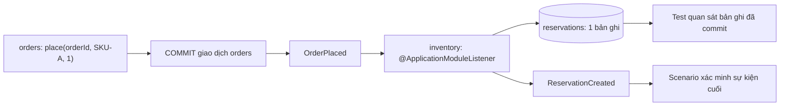

# Chạy event flow với dữ liệu tối thiểu

Trong Spring Modulith, một luồng nghiệp vụ thường bắt đầu ở module phát sự kiện và kết thúc ở module lắng nghe, có thể kèm một giao dịch cơ sở dữ liệu riêng. Để phát hiện hồi quy hiệu năng, hãy đo **một luồng hoàn chỉnh với lượng dữ liệu nhỏ nhất đủ kích hoạt đúng nhánh xử lý**. Phép thử này phù hợp làm baseline và smoke test trong CI; nó không thay thế load test ở tải cao.

## 1. Mục tiêu và giới hạn phép đo

Với chương *Performance tests*, bài thực hành tập trung vào bốn kết quả có thể kiểm chứng:

1. Một thao tác ở module `orders` tạo đúng một `OrderPlaced` cho một đơn hàng.
2. Module `inventory` nhận sự kiện sau khi giao dịch phát sự kiện được commit và ghi đúng một reservation.
3. Phép đo bắt đầu ngay trước lời gọi nghiệp vụ, kết thúc khi reservation **đã đọc được từ cơ sở dữ liệu**, ghi nhận p50/p95 cho nhiều lần chạy.
4. Test chạy được lặp lại, không cần nạp hàng nghìn đơn hàng, sản phẩm hoặc người dùng.

Chỉ số chính là **end-to-end latency** của một event flow tại tải thấp. Vì phép đo dùng cơ chế chờ trạng thái dữ liệu, nó còn chứa chi phí polling và lên lịch luồng. Không gọi con số này là thời gian xử lý thuần của listener hay thông lượng hệ thống.

## 2. Xác định luồng sự kiện và điều kiện hoàn tất

Ví dụ dùng hai application module nằm dưới package gốc `demo.shop`:



`orders` chỉ công khai kiểu sự kiện và dịch vụ đặt hàng; `inventory` phụ thuộc vào API đó để đăng ký listener. Hướng phụ thuộc này có thể kiểm chứng bằng `ApplicationModules.verify()`. Tránh để `orders` gọi trực tiếp repository hoặc service nội bộ của `inventory`, vì như vậy bài test không còn phản ánh giao tiếp bằng sự kiện.

`@ApplicationModuleListener` được thiết kế cho xử lý sự kiện theo giao dịch, thường chạy bất đồng bộ sau commit của publisher. Nếu ứng dụng chưa bật thực thi bất đồng bộ, cần cấu hình `@EnableAsync`. Sự kiện `ReservationCreated` có thể được phát **trước khi giao dịch ghi reservation commit**; vì vậy, chỉ nhìn thấy sự kiện cuối chưa đủ để khẳng định bản ghi đã bền vững.

## 3. Thiết kế fixture tối thiểu nhưng có ý nghĩa

| Thành phần | Dữ liệu mỗi lần chạy | Lý do |
| --- | --- | --- |
| SKU | Chuỗi cố định `SKU-A` | Không cần tạo cả catalog nếu flow không tra cứu catalog |
| Đơn hàng | Một `orderId` mới, `quantity = 1` | Phân biệt từng lượt và đi vào nhánh xử lý bình thường |
| `orders` | Từ 0 lên 1 bản ghi | Có giao dịch thật để kích hoạt listener sau commit |
| `reservations` | Từ 0 lên 1 bản ghi | Điều kiện kết thúc có thể quan sát qua SQL |
| Sự kiện | `OrderPlaced`; tùy chọn `ReservationCreated` | Kiểm tra đầu vào và đầu ra của consumer |

Giữ cùng SKU và số lượng ở mọi mẫu; thay `orderId` bằng `UUID.randomUUID()` để không lấy nhầm trạng thái từ lượt trước. Dọn hai bản ghi theo `orderId` **sau khi ghi nhận thời gian**, không đặt thao tác dọn trong đoạn được đo. Nếu nghiệp vụ thực tế đòi tồn kho hoặc quan hệ khóa ngoại, chỉ seed số bản ghi tối thiểu đáp ứng bất biến đó.

## 4. Cài đặt producer và consumer để thử nghiệm

Đây là ví dụ Java rút gọn dùng `JdbcTemplate` để điểm ghi dữ liệu dễ quan sát. Mỗi `public` type đặt trong file riêng tương ứng với tên type; các import thông dụng được lược bớt. Ứng dụng cần Spring Boot, Spring JDBC, Spring Modulith events và transaction manager cho datasource.

Trong module `orders`, khai báo `OrderPlaced` là API công khai và phát sự kiện **bên trong** phương thức có giao dịch:

```java
// demo/shop/orders/OrderPlaced.java
public record OrderPlaced(UUID orderId, String sku, int quantity) {}

// demo/shop/orders/OrderService.java
@Service
public class OrderService {
    private final JdbcTemplate jdbc;
    private final ApplicationEventPublisher events;

    public OrderService(JdbcTemplate jdbc, ApplicationEventPublisher events) {
        this.jdbc = jdbc;
        this.events = events;
    }

    @Transactional
    public void place(UUID id, String sku, int quantity) {
        if (quantity <= 0) {
            throw new IllegalArgumentException("quantity must be positive");
        }
        jdbc.update(
            "insert into orders (id, sku, quantity) values (?, ?, ?)",
            id, sku, quantity
        );
        events.publishEvent(new OrderPlaced(id, sku, quantity));
    }
}
```

Trong module `inventory`, consumer tiếp nhận event, ghi reservation, rồi phát event báo kết quả:

```java
// demo/shop/inventory/ReservationCreated.java
public record ReservationCreated(UUID orderId) {}

// demo/shop/inventory/ReservationHandler.java
@Component
public class ReservationHandler {
    private final JdbcTemplate jdbc;
    private final ApplicationEventPublisher events;

    public ReservationHandler(JdbcTemplate jdbc, ApplicationEventPublisher events) {
        this.jdbc = jdbc;
        this.events = events;
    }

    @ApplicationModuleListener
    void on(OrderPlaced event) {
        jdbc.update(
            "insert into reservations (order_id, sku, quantity) values (?, ?, ?)",
            event.orderId(), event.sku(), event.quantity()
        );
        events.publishEvent(new ReservationCreated(event.orderId()));
    }
}
```

`OrderPlaced` cần được import từ package công khai `demo.shop.orders`; `ReservationHandler` nằm trong `demo.shop.inventory`. Mẫu này giả định chỉ gửi **một lần** cho mỗi `orderId`. Trong hệ thống thật có retry hoặc phân phối at-least-once, consumer cần idempotency (chẳng hạn khóa duy nhất kèm chiến lược upsert phù hợp database); không dùng phép đo này để suy ra khả năng chịu trùng sự kiện.

## 5. Chuẩn bị database và phạm vi khởi động test

Tạo hai bảng tối thiểu bằng migration hoặc `schema.sql` dành cho test:

```sql
create table orders (
    id uuid primary key,
    sku varchar(40) not null,
    quantity integer not null
);

create table reservations (
    order_id uuid primary key,
    sku varchar(40) not null,
    quantity integer not null
);
```

Đặt test phát sự kiện trong package `demo.shop.orders` với `@ApplicationModuleTest` mặc định để khởi động module producer. Đặt test toàn luồng trong `demo.shop.inventory` với `BootstrapMode.DIRECT_DEPENDENCIES`: module inventory và dependency trực tiếp `orders` sẽ cùng được khởi động. Chỉ chuyển sang `@SpringBootTest` khi thật sự cần kiểm tra toàn bộ hệ thống hoặc adapter ngoài phạm vi các module này.

Ví dụ đo truy vấn bằng cơ sở dữ liệu in-memory có ích để kiểm tra logic. Muốn so sánh hiệu năng gần triển khai, dùng cùng loại database và cấu hình connection pool với môi trường mục tiêu (có thể dùng Testcontainers). Giữ chế độ logging SQL, JVM, số worker và tài nguyên CI ổn định giữa các lần so sánh.

## 6. Kiểm tra producer bằng `PublishedEvents`

Trước khi đo tốc độ, chứng minh producer phát đúng event. Test sau đặt ở package `demo.shop.orders`; `PublishedEvents` là tiện ích kiểm thử của Spring Modulith:

```java
@ApplicationModuleTest
class OrderPublicationTest {

    @Autowired OrderService orders;

    @Test
    void emits_one_event_for_one_order(PublishedEvents events) {
        UUID id = UUID.randomUUID();

        orders.place(id, "SKU-A", 1);

        assertThat(events.ofType(OrderPlaced.class)
            .matching(OrderPlaced::orderId, id))
            .hasSize(1);
    }
}
```

Kết quả mong đợi: một `OrderPlaced` có đúng `orderId` vừa tạo, không phải một event từ test trước. Test này chứng minh **phát event**, chưa chứng minh consumer đã chạy. Nếu assertion thất bại, sửa hợp đồng và transaction của publisher trước khi chạy performance test.

## 7. Kiểm tra event flow liên module bằng `Scenario`

Test sau nằm trong package `demo.shop.inventory`, dùng JUnit 5, AssertJ, Spring Modulith Test và Awaitility. Giả sử đã import `OrderService`, `ReservationCreated` và `Scenario` từ các package tương ứng:

```java
@ApplicationModuleTest(
    mode = ApplicationModuleTest.BootstrapMode.DIRECT_DEPENDENCIES
)
class InventoryFlowTest {
    @Autowired OrderService orders;
    @Autowired JdbcTemplate jdbc;
    @Autowired Scenario scenario;

    private int reservationCount(UUID id) {
        return jdbc.queryForObject(
            "select count(*) from reservations where order_id = ?",
            Integer.class, id
        );
    }

    @Test
    void handles_one_order_and_commits_one_reservation() {
        UUID id = UUID.randomUUID();

        scenario.stimulate(() -> orders.place(id, "SKU-A", 1))
            .andWaitForEventOfType(ReservationCreated.class)
            .matching(ReservationCreated::orderId, id)
            .toArriveAndVerify(event ->
                assertThat(event.orderId()).isEqualTo(id));

        await().atMost(Duration.ofSeconds(5))
            .untilAsserted(() ->
                assertThat(reservationCount(id)).isEqualTo(1));
    }
}
```

`Scenario` chờ event cuối mà không dựa vào `Thread.sleep()`. Bước `await()` riêng xác minh reservation đã có thể truy vấn **sau commit**; nó tránh race condition khi event được publish trong transaction của listener. Không thêm `@Transactional` ở cấp test toàn luồng: một transaction chưa commit ở thread test có thể làm listener after-commit không được kích hoạt như dự kiến.

## 8. Đo latency với một batch nhỏ và warmup

Sau khi test đúng chức năng, bổ sung phương thức sau vào chính `InventoryFlowTest`. Mỗi lượt dùng đúng một đơn hàng; 5 lượt đầu khởi động nóng JVM, 30 lượt tiếp theo tạo mẫu. Cần import `ArrayList`, `Duration`, `TimeUnit` và `UUID`.

```java
@Test
void measures_low_volume_event_flow() {
    int warmup = 5;
    int samples = 30;
    List<Long> durationsNs = new ArrayList<>();

    for (int i = 0; i < warmup + samples; i++) {
        UUID id = UUID.randomUUID();
        long started = System.nanoTime();

        orders.place(id, "SKU-A", 1);
        await().pollInterval(Duration.ofMillis(10))
            .atMost(Duration.ofSeconds(5))
            .untilAsserted(() ->
                assertThat(reservationCount(id)).isEqualTo(1));

        long elapsedNs = System.nanoTime() - started;
        if (i >= warmup) {
            durationsNs.add(elapsedNs);
        }

        // Dọn sau phép đo để mỗi lượt bắt đầu từ trạng thái nhỏ.
        jdbc.update("delete from reservations where order_id = ?", id);
        jdbc.update("delete from orders where id = ?", id);
    }

    durationsNs.sort(Long::compareTo);
    long p50 = TimeUnit.NANOSECONDS.toMillis(
        durationsNs.get((int) Math.ceil(samples * 0.50) - 1));
    long p95 = TimeUnit.NANOSECONDS.toMillis(
        durationsNs.get((int) Math.ceil(samples * 0.95) - 1));

    System.out.printf("samples=%d, p50=%d ms, p95=%d ms%n",
        samples, p50, p95);

    // Chỉ bật ngưỡng khi đã hiệu chuẩn baseline trong CI chuyên dụng.
    long p95LimitMs = Long.getLong("flow.p95.max.ms", -1L);
    if (p95LimitMs > 0) {
        assertThat(p95).isLessThanOrEqualTo(p95LimitMs);
    }
}
```

Đồng hồ `System.nanoTime()` thích hợp đo khoảng thời gian trong cùng JVM; không dùng `currentTimeMillis()` làm đồng hồ đo latency. Thao tác dọn nằm **ngoài** khoảng đo, timeout 5 giây là chốt kiểm tra luồng bị kẹt. Polling 10 ms có thể làm méo số đo ở quy mô vài mili giây; muốn đánh giá listener tinh hơn, thu metric ngay tại ranh giới publish/commit bằng Micrometer hoặc tracing, rồi đối chiếu với phép đo end-to-end.

## 9. Đọc số đo và loại bỏ nguồn gây nhiễu

Giả sử báo cáo *minh họa* ghi `samples=30, p50=28 ms, p95=65 ms`. Điều này chỉ nói rằng trong bộ 30 lượt ở môi trường đo cụ thể, trung vị khoảng 28 ms và ít nhất 95% mẫu không vượt mức ở vị trí p95 đã tính. Đây **không phải** cam kết 95% request production sẽ hoàn tất trong 65 ms.

| Hiện tượng | Cách kiểm tra và xử lý |
| --- | --- |
| Event phát ra nhưng không có reservation | Kiểm tra transaction commit, listener có nằm trong module đã bootstrap, `@EnableAsync` và lỗi listener |
| `ReservationCreated` xuất hiện nhưng query vẫn trả 0 | Event cuối được phát trước commit; chờ trạng thái database như mục 7 |
| Mẫu đầu chậm bất thường | Có thể là JVM warmup, mở connection hoặc khởi tạo context; giữ warmup và báo riêng |
| p95 dao động mạnh | Giảm tác vụ CI chạy chung, khóa cấu hình tài nguyên, tăng số mẫu ở job hiệu năng |
| Mẫu sau tăng dần độ trễ | Kiểm tra dữ liệu không được dọn, connection pool, backlog của executor và event publication registry |
| Test chạy qua nhưng production chậm | So sánh engine DB, I/O, event broker, dataset và concurrency; test tối thiểu chỉ là baseline tải thấp |

Không dùng `Thread.sleep(1000)` để “đợi đủ lâu”; nó vừa kéo dài thời gian vừa không xác nhận trạng thái đích. Không đánh giá throughput bằng vòng lặp tuần tự ở trên: muốn đo số event/giây và backlog, cần load test riêng với số producer đồng thời, số consumer và tốc độ phát được kiểm soát.

## 10. Quality gate trong CI và tiêu chí hoàn thành

Thiết lập các tầng kiểm chứng theo thứ tự: **kiến trúc → phát event → hoàn tất flow → baseline độ trễ**. Có thể thêm một kiểm tra ranh giới module độc lập:

```java
@Test
void verifies_module_boundaries() {
    ApplicationModules.of(ShopApplication.class).verify();
}
```

Trong đó `ShopApplication` là lớp `@SpringBootApplication` ở package gốc `demo.shop`; `ApplicationModules` thuộc `org.springframework.modulith.core`. Gate này phát hiện phụ thuộc module không hợp lệ trước khi coi kết quả hiệu năng là đáng tin. Chạy kiểm thử chức năng trên mỗi pull request; chỉ bật property `-Dflow.p95.max.ms=<giá-trị-baseline>` trên runner đã được hiệu chuẩn và có database phù hợp. Lưu p50/p95, phiên bản JVM, DB, số mẫu và revision để tra cứu xu hướng; không đặt một mốc mili giây tùy ý rồi áp lên mọi máy phát triển.

Một lượt bài đạt yêu cầu khi: `PublishedEvents` xác nhận đúng một `OrderPlaced`, `Scenario` quan sát `ReservationCreated` tương ứng, SQL thấy đúng một reservation đã commit, 30 lượt đo hoàn tất không timeout và dữ liệu test được dọn sạch. Khi những kiểm tra này ổn định, phép đo với dữ liệu tối thiểu trở thành tín hiệu sớm cho lỗi cấu hình transaction, listener hoặc suy giảm latency của Spring Modulith event flow.
