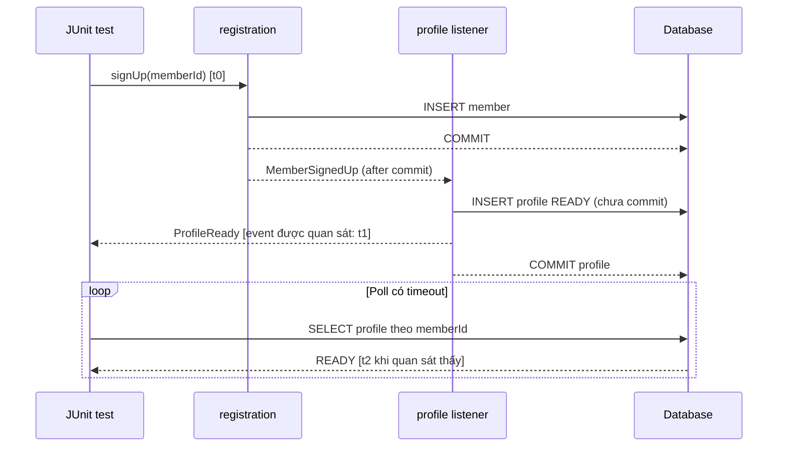

# Đo thời gian chờ event và state change

Trong một ứng dụng Spring Modulith, việc **đã nhận được sự kiện** và việc **trạng thái nghiệp vụ mới đã được commit, có thể đọc từ database** là hai cột mốc khác nhau. Nếu gộp chúng thành một thời gian chờ, bài kiểm thử có thể báo thành công dù transaction của consumer chưa hoàn tất hoặc thậm chí sắp rollback. Bài này xây dựng phép đo riêng cho từng cột mốc bằng Java, JUnit 5, `@ApplicationModuleTest`, `Scenario` và Awaitility; từ đó tìm nguyên nhân chậm hoặc lỗi xử lý bất đồng bộ.

Mục tiêu thuộc chương **Performance tests** của `SPRING_MODULITH_VERIFICATION_TESTING`: đo đúng hành vi liên module trong khi vẫn giữ khả năng kiểm chứng ranh giới module, database và quality gate trong CI. Các số đo từ test tích hợp là **độ trễ quan sát được bởi test**, không tự động là độ trễ nội bộ thuần của listener hay số liệu tải production.

## 1. Phân biệt hai loại thời gian chờ

Giả sử module `registration` phát `MemberSignedUp`; module `profile` xử lý sự kiện, tạo profile với trạng thái `READY` và phát `ProfileReady`. Có ít nhất ba thời điểm quan trọng:

| Mốc | Sự kiện quan sát được | Ý nghĩa |
| --- | --- | --- |
| `t0` | Test chuẩn bị gọi `RegistrationService.signUp()` | Bắt đầu đo end-to-end |
| `t1` | Test quan sát `ProfileReady` | Listener đã đi tới lệnh phát sự kiện kết quả |
| `t2` | Một truy vấn độc lập nhìn thấy profile `READY` | Thay đổi trạng thái đã commit và đọc được |

Từ đó xác định:

- **Event wait** = `t1 − t0`: thời gian tới lúc test thấy sự kiện kết quả.
- **State wait** = `t2 − t0`: thời gian tới lúc test thấy dữ liệu bền vững.
- **Post-event visibility wait** = `t2 − t1`: khoảng quan sát thêm sau event đến lúc đọc được state.

Ở đây `t1` là thời điểm **probe trong test nhận kết quả chờ event**, không phải thời điểm chính xác publisher gọi `publishEvent()`; `t2` là **lần poll đầu tiên nhìn thấy dữ liệu**, không phải timestamp commit của database. Sự khác biệt đó rất quan trọng khi đọc các con số ở mức mili giây.

## 2. Hiểu quan hệ thứ tự giữa event và commit

Luồng bên dưới minh họa trường hợp listener phát `ProfileReady` trong giao dịch riêng:



`@ApplicationModuleListener` của Spring Modulith hỗ trợ kiểu xử lý sự kiện sau commit với transaction riêng và cơ chế thực thi bất đồng bộ. Cần cấu hình thực thi bất đồng bộ phù hợp, ví dụ `@EnableAsync` cùng executor theo yêu cầu ứng dụng. Không suy luận rằng một `ProfileReady` được phát trong thân listener đã bảo đảm transaction ghi profile commit. **Thời điểm phát event, thời điểm event tới observer và thời điểm dữ liệu hiển thị là những điều khác nhau.**

Với luồng sự kiện đồng bộ hoặc listener không có transaction, thứ tự có thể thay đổi. Vì vậy, hãy chọn `t1`, `t2` dựa trên *hợp đồng nghiệp vụ thực tế*, không mặc định mọi listener đều chạy theo sơ đồ này.

## 3. Chọn điều kiện chờ có thể kiểm chứng

Thiết kế test bắt đầu từ hai điều kiện:

1. Event `ProfileReady` phải mang đúng `memberId` vừa khởi tạo; việc chờ event chỉ chấp nhận ID đó.
2. Một truy vấn database trong **giao dịch đọc độc lập** phải thấy đúng một hàng `profiles(member_id, status = 'READY')`.

`memberId` là correlation ID xuyên suốt event và state. Tạo một `UUID` mới cho mỗi lượt đo để tránh nhận nhầm event hoặc profile của lượt khác. Không dùng “listener đã chạy” hoặc “đợi thêm 1 giây” làm điều kiện hoàn tất vì chúng không chứng minh được kết quả.

Lưu ý ba nguồn gây sai phép đo: thread JUnit giữ transaction chưa commit; query chạy trong cùng persistence context nên đọc dữ liệu cache; và dữ liệu cũ thỏa điều kiện chờ. Với phép đo này, **không đặt `@Transactional` ở cấp test**, dùng `JdbcTemplate` cho truy vấn mới theo ID duy nhất và dọn fixture ngoài khoảng đo nếu lặp nhiều lượt.

## 4. Tạo luồng mẫu có hai mốc quan sát

Ví dụ sau dùng hai application module dưới package gốc `demo.members`. Mỗi lớp/record `public` được đặt trong file `.java` riêng theo đúng tên lớp; cần các dependency Spring Boot JDBC, transaction, Spring Modulith events và Spring Modulith test.

Module `registration` ghi member, rồi phát sự kiện trong transaction:

```java
// demo/members/registration/MemberSignedUp.java
package demo.members.registration;

import java.util.UUID;

public record MemberSignedUp(UUID memberId) {}
```

```java
// demo/members/registration/RegistrationService.java
package demo.members.registration;

import java.util.UUID;
import org.springframework.context.ApplicationEventPublisher;
import org.springframework.jdbc.core.JdbcTemplate;
import org.springframework.stereotype.Service;
import org.springframework.transaction.annotation.Transactional;

@Service
public class RegistrationService {
    private final JdbcTemplate jdbc;
    private final ApplicationEventPublisher publisher;

    public RegistrationService(JdbcTemplate jdbc,
                               ApplicationEventPublisher publisher) {
        this.jdbc = jdbc;
        this.publisher = publisher;
    }

    @Transactional
    public void signUp(UUID memberId) {
        jdbc.update("insert into members (member_id) values (?)", memberId);
        publisher.publishEvent(new MemberSignedUp(memberId));
    }
}
```

Module `profile` lắng nghe sự kiện và phát sự kiện kết quả **sau câu lệnh INSERT nhưng trước khi phương thức listener kết thúc**:

```java
// demo/members/profile/ProfileReady.java
package demo.members.profile;

import java.util.UUID;

public record ProfileReady(UUID memberId) {}
```

```java
// demo/members/profile/ProfileProjector.java
package demo.members.profile;

import demo.members.registration.MemberSignedUp;
import org.springframework.context.ApplicationEventPublisher;
import org.springframework.jdbc.core.JdbcTemplate;
import org.springframework.modulith.events.ApplicationModuleListener;
import org.springframework.stereotype.Component;

@Component
public class ProfileProjector {
    private final JdbcTemplate jdbc;
    private final ApplicationEventPublisher publisher;

    public ProfileProjector(JdbcTemplate jdbc,
                            ApplicationEventPublisher publisher) {
        this.jdbc = jdbc;
        this.publisher = publisher;
    }

    @ApplicationModuleListener
    public void on(MemberSignedUp event) {
        jdbc.update(
            "insert into profiles (member_id, status) values (?, ?)",
            event.memberId(), "READY"
        );
        publisher.publishEvent(new ProfileReady(event.memberId()));
    }
}
```

Do `profile` sử dụng kiểu sự kiện công khai của `registration`, hướng phụ thuộc là `profile → registration`. Không làm `registration` phụ thuộc ngược vào service hoặc repository nội bộ `profile`. Khi triển khai thật, bổ sung xử lý idempotency cho trường hợp consumer bị gọi lại.

## 5. Khởi tạo database và module test đúng phạm vi

Hai bảng tối thiểu có thể tạo bằng migration trong test (cú pháp dưới đây dùng được với PostgreSQL hoặc H2 hỗ trợ `uuid`):

```sql
create table members (
    member_id uuid primary key
);

create table profiles (
    member_id uuid primary key,
    status varchar(20) not null
);
```

Đặt class test tại package `demo.members.profile` và chọn:

```java
@ApplicationModuleTest(
    mode = ApplicationModuleTest.BootstrapMode.DIRECT_DEPENDENCIES
)
class ProfileWaitTimeTest {
    // ...
}
```

Bootstrap này khởi động module `profile` cùng dependency trực tiếp cần cho phép thử, cụ thể là `registration`. Cần cấu hình component scan tại package gốc `demo.members`, datasource/test migration, transaction manager và Spring Modulith test support. Với môi trường yêu cầu xử lý bất đồng bộ, ứng dụng nên bật `@EnableAsync`, đồng thời kiểm tra executor và giới hạn pool trong cấu hình test.

Để phép đo phản ánh hành vi thực của database, ưu tiên database cùng engine với production (có thể chạy bằng Testcontainers). In-memory DB giúp kiểm tra thứ tự và timeout nhưng không cho con số có thể so trực tiếp với database qua mạng.

## 6. Đo event wait bằng `Scenario`

`Scenario` của Spring Modulith Test cho phép kích hoạt một hành động rồi đợi event phù hợp, tránh tự dựng `CountDownLatch` hoặc gọi `Thread.sleep()`. Trong ví dụ này, `ProfileReady` là mốc quan sát của quá trình xử lý ở module `profile`:

```java
AtomicLong eventObservedNs = new AtomicLong(-1L);
UUID memberId = UUID.randomUUID();
long startNs = System.nanoTime();

scenario.stimulate(() -> registration.signUp(memberId))
    .andWaitForEventOfType(ProfileReady.class)
    .matching(ProfileReady::memberId, memberId)
    .toArriveAndVerify(event -> {
        assertThat(event.memberId()).isEqualTo(memberId);
        eventObservedNs.set(System.nanoTime());
    });
```

`scenario` là tham số phương thức test kiểu `org.springframework.modulith.test.Scenario`, `registration` là `RegistrationService` được inject, và các import cần thiết là `java.util.UUID`, `java.util.concurrent.atomic.AtomicLong` và AssertJ. `matching` bảo vệ test khỏi event không cùng correlation ID.

Kết quả chỉ xác nhận event đến observer. Nếu handler phát `ProfileReady` rồi transaction rollback, probe vẫn có thể thấy event. Kiểm tra trạng thái trong mục tiếp theo mới phân biệt được trường hợp đó.

## 7. Đo state wait bằng Awaitility và JDBC

Thêm vào cùng class `ProfileWaitTimeTest` một test chạy từ đầu đến cuối. Đo cả hai mốc trong **cùng một lượt**, dùng `System.nanoTime()` để lấy khoảng thời gian đơn điệu và truy vấn `COUNT(*)` để tránh exception khi row chưa tồn tại:

```java
package demo.members.profile;

import static org.assertj.core.api.Assertions.assertThat;
import static org.awaitility.Awaitility.await;

import demo.members.registration.RegistrationService;
import java.time.Duration;
import java.util.UUID;
import java.util.concurrent.atomic.AtomicLong;
import org.junit.jupiter.api.Test;
import org.springframework.beans.factory.annotation.Autowired;
import org.springframework.jdbc.core.JdbcTemplate;
import org.springframework.modulith.test.ApplicationModuleTest;
import org.springframework.modulith.test.Scenario;

@ApplicationModuleTest(
    mode = ApplicationModuleTest.BootstrapMode.DIRECT_DEPENDENCIES
)
class ProfileWaitTimeTest {

    @Autowired RegistrationService registration;
    @Autowired JdbcTemplate jdbc;

    @Test
    void measures_event_arrival_and_committed_state(Scenario scenario) {
        UUID id = UUID.randomUUID();
        AtomicLong eventObservedNs = new AtomicLong(-1L);
        long startedNs = System.nanoTime();

        scenario.stimulate(() -> registration.signUp(id))
            .andWaitForEventOfType(ProfileReady.class)
            .matching(ProfileReady::memberId, id)
            .toArriveAndVerify(event -> {
                assertThat(event.memberId()).isEqualTo(id);
                eventObservedNs.set(System.nanoTime());
            });

        await().pollDelay(Duration.ZERO)
            .pollInterval(Duration.ofMillis(10))
            .atMost(Duration.ofSeconds(5))
            .untilAsserted(() ->
                assertThat(readyProfileCount(id)).isEqualTo(1));

        long stateObservedNs = System.nanoTime();
        long eventNs = eventObservedNs.get();
        assertThat(eventNs).isGreaterThanOrEqualTo(startedNs);
        assertThat(stateObservedNs).isGreaterThanOrEqualTo(eventNs);

        System.out.printf(
            "event_wait=%.2f ms; state_wait=%.2f ms; after_event=%.2f ms%n",
            toMs(eventNs - startedNs),
            toMs(stateObservedNs - startedNs),
            toMs(stateObservedNs - eventNs)
        );
    }

    private int readyProfileCount(UUID id) {
        Integer count = jdbc.queryForObject(
            "select count(*) from profiles "
                + "where member_id = ? and status = ?",
            Integer.class, id, "READY"
        );
        return count == null ? 0 : count;
    }

    private static double toMs(long nanos) {
        return nanos / 1_000_000.0;
    }
}
```

Nếu listener commit thành công, log có đủ ba số đo và test pass. Nếu thấy `ProfileReady` nhưng INSERT rollback, `untilAsserted` sẽ hết timeout và test fail. Nếu không có event, phép chờ trong `Scenario` không thành công; đây là lỗi ở nhánh dispatch/listener hoặc publisher chứ không phải lỗi query trạng thái.

Khoảng `after_event` đo từ lúc test nhận tín hiệu đến lần đọc thấy state, bao gồm thời gian test thức dậy và JDBC polling. Nếu commit đã hoàn tất *trước khi* callback test chạy, chỉ số này vẫn dương do overhead kiểm tra; nó **không** đo chính xác “thời gian từ publish đến commit”.

## 8. Độ chính xác của đồng hồ, polling và timeout

Ba nguồn sai số chủ yếu cần nhận diện:

| Nguồn | Hệ quả và cách kiểm soát |
| --- | --- |
| `System.nanoTime()` | Dùng lấy chênh lệch trong cùng JVM, không so trực tiếp giá trị tuyệt đối với process khác hoặc timestamp database |
| `pollInterval(10 ms)` | State có thể đã commit ngay sau lượt poll trước; `t2` bị trễ thêm gần một chu kỳ polling và chi phí query |
| Lịch thực thi thread/executor | `t1` và `t2` gồm cả scheduling, connection acquisition và thời gian phản hồi của hạ tầng test |
| Timeout event hoặc state | Là giới hạn phát hiện treo, **không** phải dữ liệu latency hợp lệ; phải ghi nhận mẫu timeout riêng |
| Đồng hồ tường (`Instant.now()`) | Phù hợp gắn timestamp vào log/tracing, nhưng có thể chịu clock skew và thay đổi giờ hệ thống |

Không đặt `Thread.sleep(...)` thay cho điều kiện quan sát được. Poll interval quá nhỏ gây thêm tải vào DB; quá lớn gây sai số quan sát. Chọn khoảng poll nhỏ hơn nhiều so với mục tiêu latency, điều chỉnh theo tải test, rồi ghi rõ cấu hình trong báo cáo.

Khi cần đo chính xác **thời điểm giao dịch commit**, nên bổ sung instrumentation tại tầng transaction hoặc telemetry do database/trace cung cấp; phép poll từ JUnit không thể tự suy ra mốc commit chính xác.

## 9. Phân tích kết quả và truy tìm nguyên nhân chậm

Một dòng log *minh họa*, không phải số đo thực tế của dự án:

```text
event_wait=42.80 ms; state_wait=57.30 ms; after_event=14.50 ms
```

Nó có nghĩa test nhận `ProfileReady` sau khoảng 42,8 ms tính từ trước lời gọi `signUp` và thấy state `READY` sau khoảng 57,3 ms. Khoảng 14,5 ms còn lại có thể bao gồm thời gian commit, scheduling và polling; không quy hoàn toàn cho database.

| Dấu hiệu | Giả thuyết cần kiểm tra |
| --- | --- |
| `event_wait` tăng, `after_event` tương đối ổn định | Dispatch chậm, executor bận, consumer chậm trước khi phát event |
| `event_wait` thấp, `after_event` cao | Transaction commit, khóa database, polling hoặc connection pool |
| Event tới nhưng state timeout | Rollback, lỗi insert, transaction bị kẹt hoặc query sai ID/trạng thái |
| Cả hai tăng theo số lượt test | Dữ liệu tồn dư, event publication backlog, connection leak hoặc tài nguyên CI bị tranh chấp |
| Chỉ lượt đầu chậm | Warmup JVM, migration, tạo connection hoặc khởi tạo context |

Để phân biệt nguyên nhân, gắn `memberId` vào log có cấu trúc/trace và quan sát thêm thời điểm bắt đầu listener, kết thúc câu lệnh SQL, commit, số task chờ trong executor và thời gian chờ connection pool. Đặt các mốc đó thành span hoặc metric riêng trong ứng dụng khi cần điều tra sâu; không dùng một phép đo tổng của JUnit để thay thế toàn bộ telemetry.

## 10. Gắn kết quả vào quality gate CI

Chia quality gate thành hai lớp:

1. **Đúng chức năng và kiến trúc** (bắt buộc với mỗi pull request): `ApplicationModules.of(MembersApplication.class).verify()` để kiểm tra phụ thuộc module; test `Scenario` phải thấy `ProfileReady` đúng ID; Awaitility phải thấy `READY` trong thời gian chờ. `MembersApplication` là lớp `@SpringBootApplication` ở package gốc `demo.members`.
2. **Hiệu năng ở môi trường ổn định** (job riêng): chạy nhiều mẫu độc lập, bỏ các mẫu warmup, lưu phân phối `event_wait` và `state_wait` thành hai chuỗi riêng (chẳng hạn p50/p95); kiểm soát JVM, số worker, database, executor và tài nguyên runner trước khi đặt ngưỡng hồi quy.

Không cộng các mẫu timeout thành giá trị `5.000 ms` rồi tính percentile như thành công: báo **số timeout riêng** và coi đó là lỗi hoàn tất flow. Tránh lấy một con số latency đo ở máy phát triển làm ngưỡng cứng cho CI dùng chung. Muốn so sánh kết quả giữa các build, giữ nguyên phương pháp poll, warmup, số mẫu và mức tải nền.

Một phép thử đạt yêu cầu khi chứng minh được **event phù hợp đã đến**, **state đúng ID đã hiển thị sau commit**, và **hai khoảng chờ được đo, báo cáo tách biệt**. Sự tách biệt này giúp phát hiện nhanh lỗi sự kiện bị bỏ lỡ, xử lý chậm, rollback và hồi quy cơ sở dữ liệu trong kiến trúc Spring Modulith.
