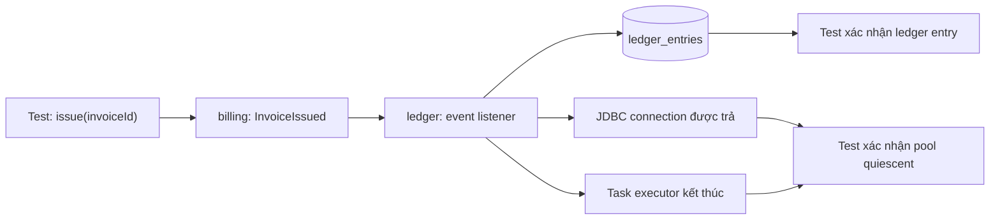

# Phát hiện test rò tài nguyên

Một bài test Spring Modulith có thể chạy xanh nhưng vẫn giữ connection, thread, file handle hoặc dữ liệu tạm sau khi kết thúc. Khi chạy cả suite, các tài nguyên tích lũy khiến test sau chậm dần, hết connection pool, treo ở bước đợi sự kiện hoặc làm CI thất bại ngẫu nhiên. Ngược lại, một số tài nguyên như connection **nhàn rỗi trong pool** và Spring application context **được cache có chủ đích** không phải là rò rỉ.

Bài này thuộc chương **Performance tests** của dịch vụ học `SPRING_MODULITH_VERIFICATION_TESTING`. Mục tiêu là phát hiện tài nguyên không được giải phóng khi chạy `@ApplicationModuleTest`, đặc biệt ở luồng sự kiện có transaction và tác vụ bất đồng bộ; đồng thời duy trì kiểm chứng ranh giới module bằng `ApplicationModules` và đưa phép thử ổn định vào CI.

## 1. Phân biệt rò tài nguyên của test và của ứng dụng

Cần phân loại đúng chủ sở hữu tài nguyên trước khi viết assertion:

| Loại | Ví dụ | Ai chịu trách nhiệm giải phóng? | Dấu hiệu cần kiểm chứng |
| --- | --- | --- | --- |
| Tài nguyên do test tạo | `ExecutorService`, socket, stream, thư mục tạm | Test, JUnit extension hoặc fixture | Đóng trong `@AfterEach`, `@AfterAll` hoặc `try-with-resources` |
| Tài nguyên của ứng dụng | JDBC connection mượn từ HikariCP, task xử lý event | Code ứng dụng/framework quản lý vòng đời | Sau khi flow hoàn tất, connection được trả, hàng đợi không tồn đọng |
| Hạ tầng dùng chung | Spring test `ApplicationContext`, pool chứa connection idle | Spring Test và container khi đóng context | Số lượng ổn định theo chính sách cache/pool, không tăng vô hạn |
| Dữ liệu tích lũy | Hàng test, sự kiện chưa xử lý, outbox record | Fixture cleanup hoặc cơ chế hoàn tất/retry | Không có bản ghi của lượt test cũ làm nhiễu test mới |

**Rò rỉ** là tài nguyên đã hết nhu cầu sử dụng nhưng vẫn bị giữ hoặc không có cơ chế giải phóng đúng vòng đời. Không suy luận có leak chỉ vì số thread đang tồn tại khác 0, HikariCP giữ nhiều connection idle, hay heap chưa giảm ngay sau một vòng GC.

Trong kiểm thử event flow, đích cuối phải vừa thỏa **điều kiện nghiệp vụ** vừa đạt **trạng thái yên (quiescence)**: listener hoàn tất, tài nguyên tạm được trả về và tác vụ chờ không còn tồn đọng ngoài chính sách dự kiến.

## 2. Chọn tín hiệu đo trước khi chạy nhiều lượt

Các tín hiệu định lượng sau giúp tìm nguồn tích lũy:

| Nguồn đo | Chỉ số | Cách đọc chính xác |
| --- | --- | --- |
| `HikariPoolMXBean` | `getActiveConnections()` | Connection đang được mượn; còn dương lâu sau khi mọi task hoàn tất có thể là leak |
| `HikariPoolMXBean` | `getIdleConnections()` | Connection đã trả về pool và đang chờ tái sử dụng; **không phải leak** |
| `HikariPoolMXBean` | `getThreadsAwaitingConnection()` | Thread đang chờ mượn connection; tăng kéo dài là dấu hiệu nghẽn |
| `ThreadPoolTaskExecutor` | `getActiveCount()` và queue size | Task còn chạy hoặc đang chờ; cần biết đúng executor xử lý sự kiện |
| Event publication registry | Publication chưa được đánh dấu hoàn tất | Có thể do listener lỗi/retry; phải đối chiếu tuổi bản ghi và chính sách retry |
| JVM / OS | Thread count, open file descriptor, heap sau GC | Tín hiệu chẩn đoán xu hướng, dễ nhiễu nếu biến thành ngưỡng cứng |

Nguyên tắc đo: **warmup → lấy baseline lúc rảnh → chạy nhiều lượt giống nhau → đợi hệ thống yên → đo lại**. Chạy một thao tác đơn lẻ thường không phát hiện được leak tăng theo số lần xử lý. Với resource dùng chung, chỉ so sánh ở cùng trạng thái tải và cùng vòng đời test.

## 3. Thiết lập kịch bản Spring Modulith có thể tái hiện

Ví dụ ứng dụng dưới package gốc `demo.shop` có hai module:

- `billing`: ghi hóa đơn và phát `InvoiceIssued(UUID invoiceId)`.
- `ledger`: nhận `InvoiceIssued` qua `@ApplicationModuleListener` rồi tạo một dòng bút toán.

`ledger` phụ thuộc vào API sự kiện của `billing`. `billing` không cần gọi repository hay service nội bộ của `ledger`, nhờ đó kiểm tra được ranh giới kiến trúc theo hướng `ledger → billing`.



Schema test tối thiểu, phù hợp PostgreSQL hoặc H2 hỗ trợ kiểu `uuid`:

```sql
create table invoices (
    id uuid primary key
);

create table ledger_entries (
    invoice_id uuid primary key,
    description varchar(80) not null
);
```

Sử dụng datasource thật trong test tích hợp; nếu cần con số sát môi trường chạy, dùng đúng loại database và cấu hình pool như CI/production. Khi đo nhiều lần, tạo `UUID` riêng cho từng hóa đơn. Test không được mang `@Transactional` ở cấp class hoặc method: giao dịch của test chưa commit có thể chặn listener kiểu after-commit và làm phép đo sai.

## 4. Xây dựng producer và listener giải phóng connection đúng cách

Mỗi kiểu `public` sau đây nằm trong file Java riêng tương ứng với tên kiểu. API sự kiện của `billing`:

```java
// demo/shop/billing/InvoiceIssued.java
package demo.shop.billing;

import java.util.UUID;

public record InvoiceIssued(UUID invoiceId) {}
```

Producer phát event bên trong transaction, rồi commit trước khi listener kiểu `@ApplicationModuleListener` xử lý:

```java
// demo/shop/billing/InvoiceService.java
package demo.shop.billing;

import java.util.UUID;
import org.springframework.context.ApplicationEventPublisher;
import org.springframework.jdbc.core.JdbcTemplate;
import org.springframework.stereotype.Service;
import org.springframework.transaction.annotation.Transactional;

@Service
public class InvoiceService {
    private final JdbcTemplate jdbc;
    private final ApplicationEventPublisher publisher;

    public InvoiceService(JdbcTemplate jdbc, ApplicationEventPublisher publisher) {
        this.jdbc = jdbc;
        this.publisher = publisher;
    }

    @Transactional
    public void issue(UUID id) {
        jdbc.update("insert into invoices (id) values (?)", id);
        publisher.publishEvent(new InvoiceIssued(id));
    }
}
```

Consumer dùng `JdbcTemplate` để lấy và trả connection theo transaction do Spring quản lý:

```java
// demo/shop/ledger/LedgerProjector.java
package demo.shop.ledger;

import demo.shop.billing.InvoiceIssued;
import org.springframework.jdbc.core.JdbcTemplate;
import org.springframework.modulith.events.ApplicationModuleListener;
import org.springframework.stereotype.Component;

@Component
public class LedgerProjector {
    private final JdbcTemplate jdbc;

    public LedgerProjector(JdbcTemplate jdbc) {
        this.jdbc = jdbc;
    }

    @ApplicationModuleListener
    public void on(InvoiceIssued event) {
        jdbc.update(
            "insert into ledger_entries (invoice_id, description) values (?, ?)",
            event.invoiceId(), "Issued invoice"
        );
    }
}
```

`@ApplicationModuleListener` kết hợp xử lý sau commit, bất đồng bộ và transaction riêng trong Spring Modulith; ứng dụng phải có cấu hình asynchronous execution phù hợp, chẳng hạn `@EnableAsync` với executor được quản lý. Việc test chờ được dòng bút toán đã commit chỉ xác nhận **chức năng**. Cần thêm assertion tài nguyên để phát hiện connection mà một nhánh xử lý khác có thể quên đóng.

## 5. Test phát hiện connection không được trả về HikariCP

Giả sử Spring Boot sử dụng **HikariCP** làm datasource thực tế và thư viện test có JUnit 5, AssertJ, Awaitility cùng Spring Modulith Test. Đặt test trong `demo.shop.ledger` để `@ApplicationModuleTest` khởi động module `ledger` cùng dependency trực tiếp `billing`.

```java
// demo/shop/ledger/LedgerResourceLeakTest.java
package demo.shop.ledger;

import static org.assertj.core.api.Assertions.assertThat;
import static org.awaitility.Awaitility.await;

import com.zaxxer.hikari.HikariDataSource;
import com.zaxxer.hikari.HikariPoolMXBean;
import demo.shop.billing.InvoiceService;
import java.time.Duration;
import java.util.Objects;
import java.util.UUID;
import org.junit.jupiter.api.Test;
import org.springframework.beans.factory.annotation.Autowired;
import org.springframework.jdbc.core.JdbcTemplate;
import org.springframework.modulith.test.ApplicationModuleTest;

@ApplicationModuleTest(
    mode = ApplicationModuleTest.BootstrapMode.DIRECT_DEPENDENCIES
)
class LedgerResourceLeakTest {

    @Autowired InvoiceService invoices;
    @Autowired JdbcTemplate jdbc;
    @Autowired HikariDataSource hikari;

    @Test
    void returnsConnectionsAfterRepeatedEventFlows() {
        // Khởi động datasource trước khi đọc MXBean.
        assertThat(jdbc.queryForObject("select 1", Integer.class)).isEqualTo(1);
        HikariPoolMXBean pool =
            Objects.requireNonNull(hikari.getHikariPoolMXBean());

        // Chỉ bắt đầu từ trạng thái rảnh trong môi trường test cô lập.
        await().atMost(Duration.ofSeconds(5))
            .untilAsserted(() ->
                assertThat(pool.getActiveConnections()).isZero());

        for (int i = 0; i < 30; i++) {
            UUID id = UUID.randomUUID();
            invoices.issue(id);

            // Truy vấn độc lập sẽ thấy dữ liệu sau khi listener commit.
            await().pollInterval(Duration.ofMillis(20))
                .atMost(Duration.ofSeconds(5))
                .untilAsserted(() ->
                    assertThat(ledgerCount(id)).isEqualTo(1));
        }

        // Đã hết việc mà connection vẫn đang mượn => test thất bại.
        await().pollInterval(Duration.ofMillis(20))
            .atMost(Duration.ofSeconds(5))
            .untilAsserted(() -> {
                assertThat(pool.getActiveConnections()).isZero();
                assertThat(pool.getThreadsAwaitingConnection()).isZero();
            });

        // Kiểm tra cấu hình/giới hạn pool, không đòi total về 0.
        assertThat(pool.getTotalConnections())
            .isLessThanOrEqualTo(hikari.getMaximumPoolSize());
    }

    private int ledgerCount(UUID id) {
        return jdbc.queryForObject(
            "select count(*) from ledger_entries where invoice_id = ?",
            Integer.class, id
        );
    }
}
```

Test khởi tạo và quan sát **30 event flow liên tiếp**, không cần tải cao; mục tiêu là tìm connection bị giữ lại qua nhiều lượt. `JdbcTemplate` của phép kiểm tra cũng mượn connection, nhưng trả connection trước khi `ledgerCount()` kết thúc. Vì vậy, assertion cuối thực hiện *sau* khi query trở về.

**Giới hạn:** assertion `active = 0` phù hợp với database test cô lập, không có health check hoặc công việc nền đồng thời đang sử dụng cùng pool. Nếu ứng dụng có hoạt động DB hợp lệ liên tục, phải chọn thời điểm quiescence khác hoặc đo theo tài nguyên được gắn owner/correlation ID. Dữ liệu từ 30 lượt cần được dọn sau phép đo bằng cơ chế fixture cleanup hoặc dùng một database test dùng riêng và hủy sau khi class chạy xong.

## 6. Tìm lỗi do chính code test mở JDBC connection

Một nguyên nhân phổ biến là test viết truy vấn “để kiểm tra nhanh” nhưng quên đóng:

```java
// Sai: mỗi lần gọi có thể giữ lại một connection đang được mượn.
Connection connection = hikari.getConnection();
PreparedStatement statement =
    connection.prepareStatement("select count(*) from ledger_entries");
ResultSet rows = statement.executeQuery();
// Thiếu close() cho ResultSet, PreparedStatement và Connection.
```

Nếu dùng JDBC trực tiếp, đóng mọi resource kể cả khi assertion ném exception:

```java
try (Connection connection = hikari.getConnection();
     PreparedStatement statement =
         connection.prepareStatement("select count(*) from ledger_entries");
     ResultSet rows = statement.executeQuery()) {

    assertThat(rows.next()).isTrue();
    assertThat(rows.getInt(1)).isGreaterThanOrEqualTo(0);
}
```

Các import chuẩn là `java.sql.Connection`, `PreparedStatement`, `ResultSet`. Cách này phù hợp với phép đọc JDBC độc lập của test; trong service hoặc listener có `@Transactional`, nên ưu tiên `JdbcTemplate` hoặc API dữ liệu được Spring quản lý để connection gắn với transaction đúng cách.

Khi nghi ngờ rò connection, thử chạy test **không phát sự kiện** nhưng lặp lại chính hàm probe. Nếu active connection vẫn tăng, lỗi nhiều khả năng nằm ở code test. Nếu chỉ tăng khi listener xử lý, tập trung vào nhánh exception, câu lệnh JDBC thủ công và các API ngoài transaction trong consumer.

## 7. Kiểm tra executor và thread của luồng sự kiện

`@ApplicationModuleListener` có thể sử dụng executor cho xử lý bất đồng bộ. Sau khi các event được xử lý, queue và số task đang chạy của **đúng executor** phải trở về trạng thái chờ hợp lệ:

```java
// Trong class test, khi ứng dụng thực sự dùng bean "taskExecutor".
@Autowired
@Qualifier("taskExecutor")
ThreadPoolTaskExecutor taskExecutor;

@Test
void eventExecutorEventuallyBecomesIdle() {
    UUID id = UUID.randomUUID();
    invoices.issue(id);

    await().atMost(Duration.ofSeconds(5))
        .untilAsserted(() -> assertThat(ledgerCount(id)).isEqualTo(1));

    await().atMost(Duration.ofSeconds(5))
        .untilAsserted(() -> {
            assertThat(taskExecutor.getActiveCount()).isZero();
            assertThat(taskExecutor.getThreadPoolExecutor().getQueue())
                .isEmpty();
        });
}
```

Ví dụ bổ sung này đặt trong cùng test class ở mục 5; import `org.springframework.beans.factory.annotation.Qualifier` và `org.springframework.scheduling.concurrent.ThreadPoolTaskExecutor`. Chỉ áp dụng khi đã xác nhận `@Async` của listener thực sự dùng bean `taskExecutor`: một ứng dụng có thể cấu hình tên hoặc routing executor khác. Queue rỗng và active bằng 0 **không chứng minh** không có thread leak ở tác vụ tự tạo ngoài executor đó.

**Thread nhàn rỗi trong pool không phải leak.** Không yêu cầu `getPoolSize() == 0` sau mỗi test khi executor là bean của Spring dùng chung. Thay vào đó, theo dõi kích thước pool/queue qua các lượt xử lý, bảo đảm pool không tự tăng ngoài cấu hình, và kiểm tra shutdown khi context sở hữu executor thực sự đóng.

## 8. Đóng tài nguyên do JUnit test sở hữu

JUnit gọi `@AfterEach` cả khi assertion ở test thất bại, nên đây là nơi phù hợp để đóng một executor mà **chính test** đã tạo. Ví dụ độc lập:

```java
import static org.assertj.core.api.Assertions.assertThat;

import java.util.concurrent.ExecutorService;
import java.util.concurrent.Executors;
import java.util.concurrent.TimeUnit;
import org.junit.jupiter.api.AfterEach;
import org.junit.jupiter.api.BeforeEach;
import org.junit.jupiter.api.Test;

class TestOwnedExecutorLifecycleTest {
    private ExecutorService worker;

    @BeforeEach
    void createWorker() {
        worker = Executors.newFixedThreadPool(2);
    }

    @Test
    void executesWork() throws Exception {
        assertThat(worker.submit(() -> 42).get()).isEqualTo(42);
    }

    @AfterEach
    void closeWorker() throws InterruptedException {
        worker.shutdown();
        if (!worker.awaitTermination(3, TimeUnit.SECONDS)) {
            worker.shutdownNow();
            assertThat(worker.awaitTermination(3, TimeUnit.SECONDS)).isTrue();
        }
    }
}
```

Không gọi `shutdown()` lên `ThreadPoolTaskExecutor` được Spring quản lý trong `@AfterEach`: nhiều test có thể tái sử dụng cùng application context và cần executor đó còn sống. Quy tắc sở hữu cũng áp dụng với tài nguyên khác:

- File/stream tự mở: dùng `try-with-resources`; thư mục tạm do JUnit tạo: dùng `@TempDir`.
- Testcontainers: dùng vòng đời `@Testcontainers` / `@Container` hoặc container dùng chung có chính sách rõ ràng; tránh `new` rồi `start()` ở mỗi test mà không `stop()`.
- Server/socket hoặc subscription do test tạo: đóng ở teardown, và kiểm tra callback/task nền thực sự dừng trước khi kết thúc test.

Đừng dùng `@DirtiesContext` như một cách “chữa” rò tài nguyên mặc định: nó làm context đóng và tải lại, có thể che mất lỗi giữ tài nguyên và khiến suite chậm hơn. Chỉ dùng khi test chủ động thay đổi trạng thái Spring context đến mức không thể tái sử dụng.

## 9. Phân biệt rò rỉ với backlog, cache và nhiễu phép đo

Trong Spring Modulith, event publication registry có thể giữ bản ghi **chưa hoàn tất** khi listener lỗi hoặc đang chờ retry. Bản ghi này không đồng nghĩa với connection leak, nhưng số bản ghi chưa hoàn tất cứ tăng sau khi tải đã dừng là tín hiệu cần điều tra. Kiểm tra theo tuổi publication, listener đích, correlation ID, lỗi gần nhất và chính sách retry; API hoặc bảng lưu trữ cụ thể phụ thuộc cấu hình event publication repository và phiên bản đang dùng.

Đọc dấu hiệu kết hợp thay vì kết luận từ một metric:

| Kết quả quan sát sau khi flow hoàn tất | Hướng chẩn đoán |
| --- | --- |
| Active connections tăng từ 0 → 1 → 2 qua nhiều lượt rồi không giảm | Tìm connection mượn trực tiếp không `close()`, code exception bỏ qua cleanup |
| Active = 0, idle/total giữ ở mức vài connection | Pool giữ connection để tái sử dụng; đây là trạng thái bình thường |
| Active cao, threads awaiting connection tăng, listener timeout | Pool cạn, truy vấn chậm/khóa DB hoặc connection bị giữ; kiểm tra stack trace và slow query |
| Executor queue tăng dù DB không bận | Producer nhanh hơn consumer, task bị kẹt hoặc concurrency cấu hình thấp |
| Event publication chưa hoàn tất nhưng executor đang idle | Listener lỗi, retry chưa chạy hoặc registry chưa được đánh dấu hoàn tất |
| Thread count tăng trong quá trình chạy test rồi ổn định | Có thể là JVM/framework warmup; chỉ coi là leak khi tăng mãi hoặc không dừng lúc owner đóng |

Để giảm báo động giả, chạy một số lượt warmup; đo khi không có test khác tranh chấp database/executor; dùng cùng cấu hình HikariCP, JVM, container và số lượt giữa các build. Nếu đo heap, xem xu hướng **sau GC và qua nhiều chu kỳ**, vì việc cấp phát nhiều object trong test không nhất thiết là memory leak.

## 10. Quality gate trong CI và tiêu chí hoàn thành

Ghép kiểm tra tài nguyên vào chuỗi kiểm chứng của module:

1. **Kiến trúc:** `ApplicationModules.of(ShopApplication.class).verify()` (với `ShopApplication` là lớp `@SpringBootApplication` trong `demo.shop`) để phát hiện phụ thuộc trái chiều hoặc vi phạm ranh giới module.
2. **Chức năng:** `@ApplicationModuleTest` phải tạo đúng ledger entry sau `InvoiceIssued`; timeout cho bước chờ event/state là lỗi chức năng.
3. **Tài nguyên:** sau nhiều lượt và khi không còn công việc nền, active connections và thread chờ connection phải về 0 trong môi trường test cô lập; queue executor phải trống nếu kiểm tra đúng executor.
4. **Vòng đời test:** fixture đóng đúng resource do nó sở hữu, dữ liệu và Testcontainers được dọn theo chính sách; test độc lập với thứ tự chạy.
5. **Theo dõi hiệu năng:** lưu duration, peak active/awaiting, queue depth, timeout count và số lượt; so sánh xu hướng thay vì dùng một ngưỡng mili giây tùy ý trên runner CI không ổn định.

Ví dụ gate kiến trúc độc lập:

```java
import demo.shop.ShopApplication;
import org.junit.jupiter.api.Test;
import org.springframework.modulith.core.ApplicationModules;

class ModuleBoundaryTest {
    @Test
    void hasValidDependencies() {
        ApplicationModules.of(ShopApplication.class).verify();
    }
}
```

Trên pull request, ưu tiên test ngắn kiểm chứng tài nguyên trả về đúng vòng đời; đưa các lượt chạy lặp nhiều hơn và phân tích xu hướng vào job CI ổn định. Khi một assertion tài nguyên thất bại, báo cả **correlation ID, trạng thái flow, metric tại lúc lỗi và thread dump/stack trace thích hợp** để truy ra owner, thay vì chỉ tăng timeout.

Bài thực hành hoàn tất khi test tạo được event flow đúng, phát hiện được tình huống giữ connection/task bất thường, phân biệt được connection idle với leak, và chứng minh tài nguyên do JUnit tạo được đóng kể cả khi test thất bại. Đây là lớp bảo vệ thiết thực chống hồi quy hiệu năng và lỗi vòng đời trong ứng dụng Spring Modulith.
