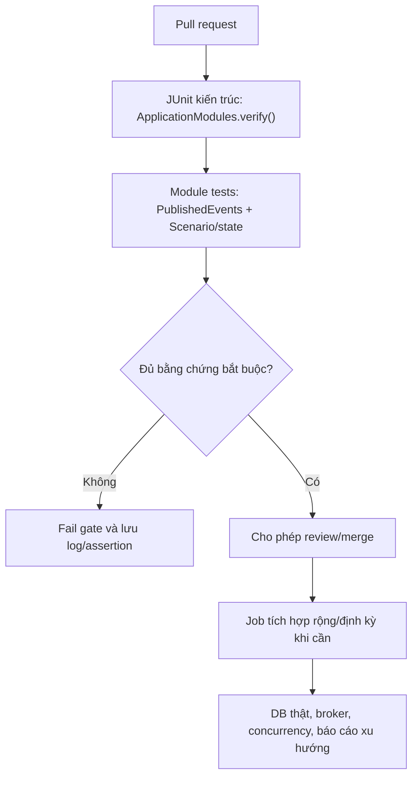

# Tối ưu test mà vẫn giữ bằng chứng cần thiết

Một bộ kiểm thử Spring Modulith tốt cần chạy đủ nhanh để xuất hiện trên mỗi pull request, nhưng phải giữ được **bằng chứng về ranh giới module, sự kiện được phát, phản ứng của module nhận và trạng thái dữ liệu đã commit**. Nếu tối ưu chỉ bằng cách bỏ test chậm, nhóm phát triển dễ mất tín hiệu về hồi quy. Nếu kiểm tra mọi chi tiết ở mọi tầng, suite trở nên tốn tài nguyên và khó xác định lỗi.

Bài thuộc chương **Performance tests** của `SPRING_MODULITH_VERIFICATION_TESTING`. Trọng tâm là giảm chi phí chạy, dữ liệu setup và số context phải khởi tạo **theo phạm vi bằng chứng**, kết hợp `ApplicationModules.verify()`, `@ApplicationModuleTest`, JUnit 5 và cơ sở dữ liệu thực khi cần. Không đặt mục tiêu làm phép benchmark tải cao; ở đây “hiệu năng” là thời gian và độ ổn định của **chính bộ kiểm thử**.

## 1. Định nghĩa “tối ưu” bằng thời gian chạy và rủi ro bỏ sót

Giả sử bộ test kiểm tra luồng `checkout → inventory`: `checkout` phát `CheckoutPlaced`; `inventory` nhận sự kiện và ghi một reservation. Có thể chạy cả ứng dụng với `@SpringBootTest` cho mọi assertion, nhưng việc đó thường tạo context rộng, nhiều bean và phụ thuộc ngoài không cần thiết.

Ba câu hỏi phải được trả lời **trước khi xóa hoặc gộp test**:

1. **Nếu phụ thuộc module bị đảo chiều**, test nào thất bại?
2. **Nếu producer không phát sự kiện hoặc phát sai ID**, test nào thất bại?
3. **Nếu consumer nhận sự kiện nhưng ghi sai dữ liệu hoặc rollback**, test nào thất bại?

Một tối ưu có giá trị khi giảm thời gian/độ dao động mà cả ba câu hỏi vẫn có câu trả lời có thể chạy lại. Đo `wall-clock duration`, số lần bootstrap application context, số truy vấn setup, số container được tạo và tần suất timeout trước/sau thay đổi; không tự nhận “nhanh hơn” nếu chưa có số đo từ runner tương đương.

## 2. Lập ma trận bằng chứng tối thiểu

Mỗi rủi ro chỉ cần một **điểm chứng minh chính** ở tầng thấp nhất đủ tin cậy; chỉ tăng cấp test khi ranh giới kỹ thuật đòi hỏi.

| Rủi ro hồi quy | Bằng chứng cần giữ | Test/đối tượng rẻ nhất phù hợp | Khi nào cần tầng rộng hơn |
| --- | --- | --- | --- |
| Phụ thuộc sai giữa module | `ApplicationModules.verify()` không ném lỗi | JUnit thuần, không khởi động Spring | Khi cần kiểm tra wiring hoặc runtime riêng |
| Producer đổi payload/số lần phát | `PublishedEvents` có đúng một `CheckoutPlaced` với correlation ID | `@ApplicationModuleTest` cho `checkout` | Khi serialization hoặc message broker là hợp đồng |
| Consumer bỏ qua sự kiện | Có event kết quả của đúng ID | `@ApplicationModuleTest` cho `inventory` với dependency trực tiếp | Khi event đi qua broker ngoài tiến trình |
| Listener ghi sai hoặc rollback | DB chứa đúng một reservation đã commit | Module integration test + DB query độc lập | Khi SQL/transaction phụ thuộc engine production |
| Adapter HTTP/API bị sai | Request/response, auth, mapping đúng | Web slice hoặc một integration test API | Khi chuỗi đầy đủ qua gateway, broker, DB là yêu cầu |

Ma trận này không có nghĩa “mỗi dòng bắt buộc một class riêng”. Một test consumer có thể xác nhận cả event kết quả và state đã commit. Tuy nhiên, **hai assertion phải có lý do riêng**: event chỉ cho thấy listener đi đến điểm phát; DB query mới chứng minh dữ liệu sau commit. Tránh nhiều test chỉ gọi cùng một phương thức rồi lặp lại cùng một `assertThat(...)`.

## 3. Chọn phạm vi bootstrap của `@ApplicationModuleTest`

Spring Modulith cho phép giới hạn Spring context theo module đang kiểm tra. Ví dụ tổ chức package:

```text
demo.store
├── StoreApplication.java
├── checkout
│   ├── CheckoutService.java
│   └── CheckoutPlaced.java
└── inventory
    ├── InventoryListener.java
    └── StockReserved.java
```

`checkout` là module phát sự kiện. `inventory` phụ thuộc API công khai `checkout.CheckoutPlaced`, vì vậy **hướng phụ thuộc** là `inventory → checkout`, không phải ngược lại. Mỗi class `public` trong ví dụ đặt trong file `.java` riêng.

| Chế độ | Phạm vi | Áp dụng |
| --- | --- | --- |
| `STANDALONE` (mặc định) | Module đang test | Producer và luật nghiệp vụ nội bộ |
| `DIRECT_DEPENDENCIES` | Module và dependency trực tiếp | Test listener `inventory` cần `CheckoutService` của `checkout` |
| `ALL_DEPENDENCIES` | Module và toàn bộ dependency bắc cầu | Khi fixture thật sự cần một nhánh phụ thuộc nhiều cấp |

Khai báo hai test theo đúng nơi chúng được đặt:

```java
// package demo.store.checkout;
@ApplicationModuleTest
class CheckoutPublicationTest {
    // Chỉ cần checkout và hạ tầng được module này sử dụng.
}

// package demo.store.inventory;
@ApplicationModuleTest(
    mode = ApplicationModuleTest.BootstrapMode.DIRECT_DEPENDENCIES
)
class ReservationFlowTest {
    // Cần inventory và dependency trực tiếp checkout.
}
```

Import `ApplicationModuleTest` từ `org.springframework.modulith.test`. Đặt class trong đúng package module và xác nhận configuration của datasource/transaction manager khả dụng. Nếu một test chỉ có thể pass với `@SpringBootTest` vì đã lỡ dùng bean nội bộ module khác, hãy kiểm tra lại phụ thuộc và boundary; không tự động mở rộng toàn bộ context để che vấn đề thiết kế.

## 4. Giữ một kiểm chứng kiến trúc chạy nhanh

`ApplicationModules` kiểm tra cấu trúc package, quan hệ phụ thuộc và những quy tắc module khai báo mà không cần khởi động Spring application context. Đây là gate nên chạy trên mọi thay đổi có ảnh hưởng tới code module:

```java
package demo.store;

import org.junit.jupiter.api.Test;
import org.springframework.modulith.core.ApplicationModules;

class ModuleBoundaryTest {

    @Test
    void dependenciesFollowModuleBoundaries() {
        ApplicationModules.of(StoreApplication.class).verify();
    }
}
```

`StoreApplication` là class `@SpringBootApplication` đặt tại `demo.store`. Test sẽ phát hiện các vi phạm mà Spring Modulith hỗ trợ như truy cập kiểu nội bộ không được expose hoặc chu trình phụ thuộc module. Trường hợp dự án dùng `@ApplicationModule(allowedDependencies = ...)`, giữ khai báo này cập nhật với hợp đồng kiến trúc.

Đừng thay test kiến trúc bằng “ứng dụng khởi động được”: một ứng dụng có thể chạy dù module A truy cập sai tầng nội bộ của module B. Ngược lại, không yêu cầu cùng một phép `verify()` chạy thêm ở hàng chục class có Spring context; một test JUnit độc lập là đủ để cung cấp bằng chứng này trên CI.

## 5. Dựng fixture nghiệp vụ nhỏ, có correlation ID

Ví dụ dùng bảng đơn giản để test có thể truy cập dữ liệu sau commit (SQL phù hợp PostgreSQL hoặc H2 hỗ trợ kiểu `uuid`):

```sql
create table checkouts (
    id uuid primary key,
    sku varchar(40) not null,
    quantity integer not null
);

create table reservations (
    checkout_id uuid primary key,
    sku varchar(40) not null,
    quantity integer not null
);
```

Sự kiện là API công khai của module `checkout`:

```java
// package demo.store.checkout;
public record CheckoutPlaced(UUID checkoutId, String sku, int quantity) {}
```

Producer cần một transaction thực để listener sau commit hoạt động:

```java
// package demo.store.checkout;
@Service
public class CheckoutService {
    private final JdbcTemplate jdbc;
    private final ApplicationEventPublisher publisher;

    public CheckoutService(JdbcTemplate jdbc, ApplicationEventPublisher publisher) {
        this.jdbc = jdbc;
        this.publisher = publisher;
    }

    @Transactional
    public void place(UUID id, String sku, int quantity) {
        if (quantity <= 0) {
            throw new IllegalArgumentException("quantity must be positive");
        }
        jdbc.update(
            "insert into checkouts (id, sku, quantity) values (?, ?, ?)",
            id, sku, quantity
        );
        publisher.publishEvent(new CheckoutPlaced(id, sku, quantity));
    }
}
```

Trong module `inventory`, một listener ghi reservation và phát kết quả:

```java
// package demo.store.inventory;
public record StockReserved(UUID checkoutId) {}

@Component
public class InventoryListener {
    private final JdbcTemplate jdbc;
    private final ApplicationEventPublisher publisher;

    public InventoryListener(JdbcTemplate jdbc,
                             ApplicationEventPublisher publisher) {
        this.jdbc = jdbc;
        this.publisher = publisher;
    }

    @ApplicationModuleListener
    public void on(CheckoutPlaced event) {
        jdbc.update(
            "insert into reservations (checkout_id, sku, quantity)"
                + " values (?, ?, ?)",
            event.checkoutId(), event.sku(), event.quantity()
        );
        publisher.publishEvent(new StockReserved(event.checkoutId()));
    }
}
```

Trong mã thực, thêm các import tương ứng: `UUID`, `JdbcTemplate`, `ApplicationEventPublisher`, `@Service`, `@Component`, `@Transactional`, `@ApplicationModuleListener` và `CheckoutPlaced` từ module `checkout`. `@ApplicationModuleListener` vận hành sau commit trong transaction riêng và hỗ trợ xử lý bất đồng bộ; ứng dụng cần cấu hình asynchronous execution phù hợp. Sự kiện `StockReserved` được phát **trong thân listener**, có thể tới observer trước khi transaction ghi reservation commit.

Fixture mỗi test chỉ cần một `UUID` mới, một SKU và `quantity = 1`, thay vì nạp toàn bộ catalog. Chỉ thêm dữ liệu nếu luật nghiệp vụ/khóa ngoại bắt buộc. Tối ưu fixture là **giảm chi phí không liên quan**, không vô hiệu hóa constraint, trigger hoặc transaction cần kiểm chứng.

## 6. Dùng `PublishedEvents` giữ bằng chứng phát sự kiện

Test đầu tiên đặt tại `demo.store.checkout`. Nó không cần khởi động module `inventory` để chứng minh producer tạo đúng **một sự kiện** cho checkout mới:

```java
package demo.store.checkout;

import static org.assertj.core.api.Assertions.assertThat;

import java.util.UUID;
import org.junit.jupiter.api.Test;
import org.springframework.beans.factory.annotation.Autowired;
import org.springframework.modulith.test.ApplicationModuleTest;
import org.springframework.modulith.test.PublishedEvents;

@ApplicationModuleTest
class CheckoutPublicationTest {

    @Autowired CheckoutService checkout;

    @Test
    void emitsOneEventForCreatedCheckout(PublishedEvents events) {
        UUID id = UUID.randomUUID();

        checkout.place(id, "SKU-A", 1);

        assertThat(events.ofType(CheckoutPlaced.class)
            .matching(CheckoutPlaced::checkoutId, id))
            .hasSize(1);
    }
}
```

`PublishedEvents` xác minh hợp đồng **phát event**, không chứng minh consumer đã hoàn tất. Correlation ID ngăn test khớp nhầm event từ lượt trước hoặc tác vụ nền. Nếu `CheckoutService` phát trùng sự kiện, số lượng khác 1 và test thất bại; nếu bị bỏ lời gọi `publishEvent`, kết quả là 0.

Không thêm nhiều assertion về từng field của cùng event trừ khi những field đó là hợp đồng công khai có nguy cơ bị thay đổi. Nếu payload phải giữ chính xác `sku`/`quantity`, assert các field này trong cùng test; không cần thêm một test Spring context mới chỉ để kiểm tra một getter.

## 7. Một integration test chứng minh kết quả đã commit

Test thứ hai đặt tại `demo.store.inventory`, cần `checkout` là dependency trực tiếp. `Scenario` chờ đúng sự kiện kết quả; JDBC/Awaitility kiểm chứng **dữ liệu mà giao dịch khác có thể đọc được**:

```java
package demo.store.inventory;

import static org.assertj.core.api.Assertions.assertThat;
import static org.awaitility.Awaitility.await;

import demo.store.checkout.CheckoutService;
import java.time.Duration;
import java.util.UUID;
import org.junit.jupiter.api.Test;
import org.springframework.beans.factory.annotation.Autowired;
import org.springframework.jdbc.core.JdbcTemplate;
import org.springframework.modulith.test.ApplicationModuleTest;
import org.springframework.modulith.test.Scenario;

@ApplicationModuleTest(
    mode = ApplicationModuleTest.BootstrapMode.DIRECT_DEPENDENCIES
)
class ReservationFlowTest {

    @Autowired CheckoutService checkout;
    @Autowired JdbcTemplate jdbc;

    @Test
    void writesOneReservationAfterEvent(Scenario scenario) {
        UUID id = UUID.randomUUID();

        scenario.stimulate(() -> checkout.place(id, "SKU-A", 1))
            .andWaitForEventOfType(StockReserved.class)
            .matching(StockReserved::checkoutId, id)
            .toArriveAndVerify(event ->
                assertThat(event.checkoutId()).isEqualTo(id));

        await().pollInterval(Duration.ofMillis(20))
            .atMost(Duration.ofSeconds(5))
            .untilAsserted(() -> {
                Integer count = jdbc.queryForObject(
                    "select count(*) from reservations "
                        + "where checkout_id = ? and sku = ? and quantity = ?",
                    Integer.class, id, "SKU-A", 1
                );
                assertThat(count).isEqualTo(1);
            });
    }
}
```

Hai điều kiện **không trùng nhau**: `Scenario` chứng minh listener đã đi đến mốc phát `StockReserved`, còn query sau commit chứng minh đúng một hàng với dữ liệu mong đợi. Không đặt `@Transactional` trên test event flow: transaction bao quanh test có thể chưa commit khi listener `AFTER_COMMIT` cần chạy. Không dùng `Thread.sleep(1000)`; chờ trạng thái với timeout xác định giúp fail đúng nếu consumer bị kẹt hoặc rollback.

Nếu ứng dụng thực tế không có event kết quả, có thể dùng `Scenario` để chờ **state change** thay thế, miễn là assertion cuối vẫn kiểm tra dữ liệu đã commit. Chỉ bổ sung test tích hợp toàn ứng dụng nếu flow còn đi qua HTTP, security filter, Kafka hoặc thành phần mà module slice hiện tại không khởi động.

## 8. Tối ưu database, context và việc dọn dữ liệu

Những thay đổi dưới đây thường giảm thời gian suite mà không làm mất bằng chứng:

| Chi phí đang cao | Cải tiến phù hợp | Giữ lại điều gì? |
| --- | --- | --- |
| Bootstrap Spring context nhiều lần | Giữ cấu hình test nhất quán để Spring Test Context Cache tái dùng; tránh `@DirtiesContext` tràn lan | Cùng bean thật và cùng module boundary |
| Fixture nặng | Chỉ seed hàng bắt buộc, `UUID` riêng từng lượt, cleanup sau test | Constraint và dữ liệu cần cho nhánh nghiệp vụ |
| Mở container cho từng method | Với Testcontainers, dùng container có scope class hoặc chung job khi isolation cho phép | Cùng engine/SQL semantics nếu đó là rủi ro cần kiểm tra |
| Chạy H2 cho SQL đặc thù PostgreSQL | Chọn PostgreSQL Testcontainers cho các test SQL/transaction quan trọng | Hợp đồng database production |
| Chờ bằng thời gian cố định | Dùng `Scenario`/Awaitility chờ điều kiện cụ thể | Bằng chứng sự kiện hoặc state đã xảy ra |
| Context rộng cho từng service | Dùng `@ApplicationModuleTest` hoặc JUnit thuần cho luật không cần Spring | Phụ thuộc runtime thật ở ranh giới cần kiểm tra |

Không dùng H2 để tuyên bố đã kiểm chứng hành vi PostgreSQL-specific (isolation, lock, type, SQL dialect). Một cấu hình PostgreSQL Testcontainers minh họa cho **test tích hợp cần engine thật** với Spring Boot hỗ trợ `@ServiceConnection`:

```java
@Testcontainers
@ApplicationModuleTest(
    mode = ApplicationModuleTest.BootstrapMode.DIRECT_DEPENDENCIES
)
class ReservationPostgresIT {

    @Container
    @ServiceConnection
    static PostgreSQLContainer<?> postgres =
        new PostgreSQLContainer<>("postgres:16-alpine");

    // Các test dựa trên datasource được Boot nối tới container này.
}
```

Cấu hình này cần dependency `spring-boot-testcontainers`, Testcontainers PostgreSQL và JUnit Jupiter. Trong một project, chọn **một chính sách vòng đời container** phù hợp pipeline và tránh thay đổi property/profile tùy tiện giữa class vì có thể làm context cache không tái sử dụng.

Giữ trạng thái dữ liệu sạch giữa test; với event xử lý bất đồng bộ, không dựa vào rollback của transaction ở thread JUnit để dọn những thay đổi đã commit ở thread listener. Dùng ID riêng và cleanup sau khi listener kết thúc hoặc tạo database/schema riêng cho test.

## 9. Chia quality gate theo chi phí và đo hiệu quả tối ưu

Một pipeline hợp lý có hai tầng bằng chứng:



Lệnh minh họa nếu project dùng Gradle và ba test đều thuộc task `test`:

```bash
./gradlew test --tests '*ModuleBoundaryTest' \
  --tests '*CheckoutPublicationTest' \
  --tests '*ReservationFlowTest'
```

Trên Windows PowerShell, viết lệnh một dòng nếu không dùng Bash. Nếu project tách các test tích hợp sang task `integrationTest`, cấu hình CI chạy đúng task thực tế; ví dụ trên **không tự tạo** một task. PR phải giữ gate kiến trúc và outcome quan trọng; job mở rộng chạy khi đổi transaction, SQL, hạ tầng sự kiện, hoặc theo lịch nếu quá tốn chi phí.

Lưu duration theo class, số lần tạo context, số container khởi động, timeout và số lần fail ngẫu nhiên của cùng revision. So sánh ở cùng runner/JVM/database, ưu tiên cải thiện tốc độ và độ ổn định của percentile thời gian **toàn suite**. Không giảm timeout xuống rất thấp chỉ để “làm test nhanh”: cách đó biến nhiễu lịch chạy CI thành lỗi giả.

## 10. Checklist kiểm chứng sau tối ưu

Sau khi rút gọn suite, dùng bảng sau để duyệt thay đổi:

| Kiểm tra thực hành | Điều kiện đạt | Tình huống cố ý làm hỏng để xác minh assertion |
| --- | --- | --- |
| Ranh giới module | `ApplicationModules.verify()` pass | Thêm một import trái quy tắc từ module nội bộ; gate phải fail |
| Event producer | Có đúng một `CheckoutPlaced` với ID mới | Bỏ `publishEvent`; test producer phải fail |
| Event consumer | `StockReserved` đúng correlation ID | Vô hiệu listener; test consumer phải timeout/fail |
| State đã commit | Một reservation đúng SKU, quantity, ID | Bỏ `jdbc.update` hoặc gây rollback; query phải fail |
| Fixture | Mỗi test có ID riêng, không phụ thuộc thứ tự | Chạy test lặp/thay thứ tự vẫn cho cùng kết quả |
| Module bootstrap | Chỉ mở rộng module khi có dependency thật | Thử mode gọn hơn; test phải fail rõ nếu thiếu bean hợp lệ |
| Database | Đúng engine khi kiểm chứng SQL/transaction đặc thù | Không coi kết quả H2 là bằng chứng cho PostgreSQL |
| Vận hành CI | Log, test report và bằng chứng lỗi dễ truy tìm | Cố ý làm một assertion fail, kiểm tra report chỉ ra ID và điều kiện |

Khi thử “cố ý làm hỏng”, thực hiện trong một thay đổi tạm rồi **hoàn nguyên** trước khi commit; đây là kiểm tra chất lượng assertion, không phải yêu cầu đưa lỗi vào code chính. Nếu hai test thất bại vì cùng một nguyên nhân nhưng kiểm tra cùng một bất biến, cân nhắc hợp nhất. Nếu chúng thất bại vì **hai hợp đồng khác nhau**, giữ cả hai dù có thêm một ít chi phí.

Kết quả mong đợi của bài: bộ kiểm thử gọn hơn ở số context, fixture và thao tác chờ; vẫn có bằng chứng độc lập về **kiến trúc hợp lệ, sự kiện phát đúng và trạng thái nghiệp vụ đã commit**. Chỉ đánh dấu tối ưu hoàn thành khi cả ba bằng chứng còn chạy được trong quality gate CI và số liệu thời gian suite được đo lại.
