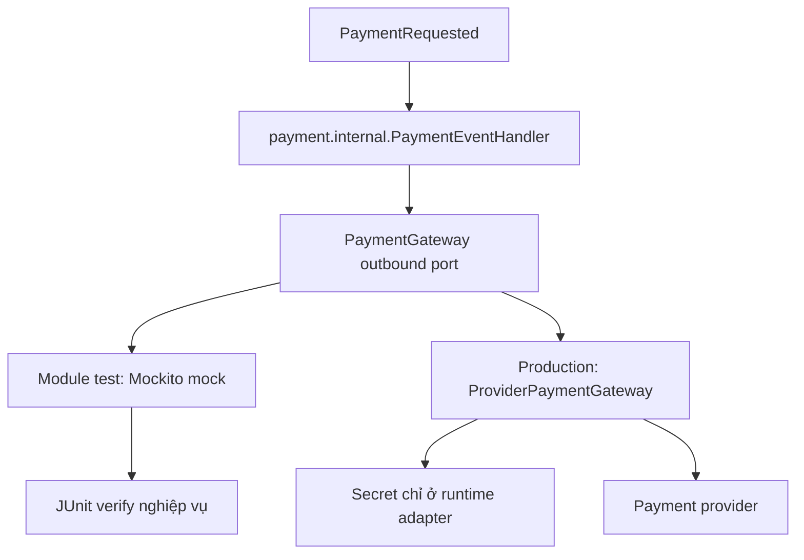
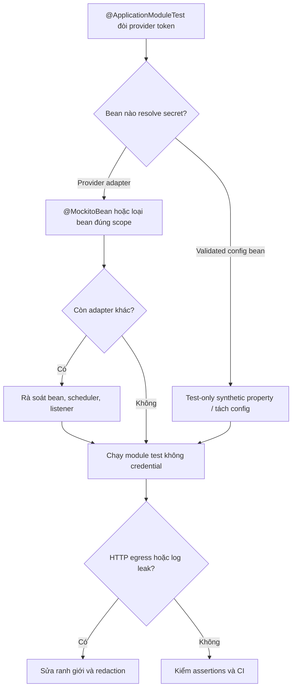

# Không đưa secret thật vào module test

## 1. Nguyên tắc: test ranh giới, không cấp quyền ngoài hệ thống

Trong học phần `SPRING_MODULITH_VERIFICATION_TESTING`, bài `@ApplicationModuleTest` cần kiểm chứng một hành vi của module mà **không cần API key thanh toán, mật khẩu database production, OAuth client secret hay JWT signing key thật**. Một secret có hiệu lực không phải “dữ liệu test” chỉ vì nó được dùng ở môi trường staging hoặc sandbox.

Đưa credential thật vào module test tạo ra hai vấn đề đồng thời:

- **Rò rỉ bảo mật:** secret có thể nằm trong `src/test/resources`, log, exception, HTTP cassette, báo cáo JUnit, screenshot hoặc CI artifact.
- **Lỗi kiểm thử:** test phụ thuộc mạng, quota, account, quyền truy cập và thay đổi của dịch vụ ngoài; test có thể thất bại hoặc xanh giả vì lý do không liên quan đến logic module.

Mục tiêu bài thuộc chương **Security testing**: viết ví dụ Java/JUnit chính xác để cô lập credential tại outbound adapter, kiểm chứng `@ApplicationModuleTest` không cần provider key, và đặt guard vào CI. Kiểm tra ranh giới bằng `ApplicationModules.verify()`, luật phụ thuộc giữa module, sự kiện, database và integration test vẫn quan trọng, nhưng **không được thay thế việc cô lập secret**.

**Quy tắc:** nếu một bài module test chỉ cần chứng minh listener đã gọi gateway đúng tham số, cấp cho nó quyền gọi gateway thật là thừa và nguy hiểm. Hãy thay boundary bằng mock, fake hoặc local stub theo đúng phạm vi kiểm thử.

## 2. Secret thật, dữ liệu giả và credential sandbox

| Loại dữ liệu | Có dùng trong module test không? | Giải pháp |
| --- | --- | --- |
| API key có hiệu lực ở production | **Không** | Mock outbound port |
| Sandbox API key có hiệu lực | **Không cho module test thông thường** | Test live provider riêng, nếu thật sự bắt buộc |
| Mật khẩu production/staging database | **Không** | Testcontainers, schema và account kiểm thử cô lập |
| OAuth client secret đang hoạt động | **Không** | Local identity provider/mock OAuth endpoint |
| JWT private signing key thực | **Không** | `@WithMockUser`, `jwt()` hoặc khóa ephemeral tạo trong test |
| Cloud credential cho tài nguyên thật | **Không** | Local emulator hoặc fake client |
| `synthetic-test-only-token` | Có, vì không cấp quyền | Fixture cho local stub |
| UUID, BigDecimal, trạng thái nghiệp vụ giả | Có | Test data ngẫu nhiên/có kiểm soát |

**Sandbox credential vẫn là secret** nếu nó thực sự xác thực được ở nhà cung cấp. Không sao chép nó vào `application-test.yml` để “bài test giống production”.

Nguồn secret lọt vào test có thể là source, file `.env`, environment variable trên máy developer/CI, Kubernetes secret được mount, cấu hình Spring, dependency build script, HTTP recording hoặc log debug. Giải pháp không chỉ là xóa chuỗi hardcode, mà còn **giới hạn khả năng test nhận hoặc sử dụng secret thật**.

## 3. Thiết kế boundary cho module `payment`

Giả sử `payment` nhận `PaymentRequested` rồi gọi nhà cung cấp thanh toán. Domain/listener chỉ biết một outbound port, adapter mới biết cấu hình Authorization header.

```text
com.example.shop
├── ShopApplication.java
└── payment
    ├── PaymentRequested.java
    └── internal
        ├── PaymentGateway.java
        ├── PaymentEventHandler.java
        └── ProviderPaymentGateway.java
```



Ranh giới này giúp **một module test kiểm chứng event handling mà không khởi tạo HTTP request ngoài**. Các lớp `internal` không cần public chỉ vì test cần truy cập chúng; test có thể đặt trong cùng package.

## 4. Domain event và outbound port tuyệt đối không chứa credential

Event công khai, chỉ chứa dữ liệu nghiệp vụ:

```java
// com/example/shop/payment/PaymentRequested.java
package com.example.shop.payment;

import java.math.BigDecimal;
import java.util.UUID;

public record PaymentRequested(UUID orderId, BigDecimal amount) {
}
```

Outbound port nội bộ:

```java
// com/example/shop/payment/internal/PaymentGateway.java
package com.example.shop.payment.internal;

import java.math.BigDecimal;
import java.util.UUID;

interface PaymentGateway {
    void authorize(UUID orderId, BigDecimal amount);
}
```

Listener:

```java
// com/example/shop/payment/internal/PaymentEventHandler.java
package com.example.shop.payment.internal;

import com.example.shop.payment.PaymentRequested;
import org.springframework.context.event.EventListener;
import org.springframework.stereotype.Component;

@Component
final class PaymentEventHandler {

    private final PaymentGateway gateway;

    PaymentEventHandler(PaymentGateway gateway) {
        this.gateway = gateway;
    }

    @EventListener
    public void on(PaymentRequested event) {
        if (event.orderId() == null
                || event.amount() == null
                || event.amount().signum() <= 0) {
            throw new IllegalArgumentException(
                    "Invalid payment request"
            );
        }

        gateway.authorize(event.orderId(), event.amount());
    }
}
```

Không có `providerApiToken` trong `PaymentRequested`; token không đi qua `ApplicationEventPublisher`, không bị nhân bản sang event registry, broker, log hoặc module subscriber.

**Nếu event được externalize sang Kafka/RabbitMQ**, nguyên tắc này càng quan trọng: transport payload phải là dữ liệu giao tiếp được cho phép, không phải nơi truyền secret cho adapter nhận.

## 5. Adapter production chỉ nạp secret tại thời điểm runtime

Ví dụ adapter dùng Spring Framework 6.1+ `RestClient`:

```java
// com/example/shop/payment/internal/ProviderPaymentGateway.java
package com.example.shop.payment.internal;

import java.math.BigDecimal;
import java.util.Map;
import java.util.UUID;
import org.springframework.beans.factory.annotation.Value;
import org.springframework.http.HttpHeaders;
import org.springframework.http.MediaType;
import org.springframework.stereotype.Component;
import org.springframework.web.client.RestClient;

@Component("providerPaymentGateway")
final class ProviderPaymentGateway implements PaymentGateway {

    private final RestClient client;
    private final String token;

    ProviderPaymentGateway(
            RestClient.Builder builder,
            @Value("${payments.provider.base-url}") String baseUrl,
            @Value("${payments.provider.token}") String token) {

        if (token == null || token.isBlank()) {
            throw new IllegalArgumentException(
                    "Payment provider token is required"
            );
        }
        this.client = builder.baseUrl(baseUrl).build();
        this.token = token;
    }

    @Override
    public void authorize(UUID orderId, BigDecimal amount) {
        client.post()
                .uri("/authorizations")
                .header(HttpHeaders.AUTHORIZATION, "Bearer " + token)
                .contentType(MediaType.APPLICATION_JSON)
                .body(Map.of(
                        "orderId", orderId.toString(),
                        "amount", amount
                ))
                .retrieve()
                .toBodilessEntity();
    }
}
```

Đây là **khung kỹ thuật**, không phải client thanh toán production đầy đủ; còn thiếu timeout, retry policy, idempotency key và error mapping. Điều quan trọng ở đây là **token chỉ xuất hiện trong adapter**, không trong event/domain/test.

- Không hardcode credential trong Java, YAML, test fixtures hoặc fallback.
- Không log token hay tạo `toString()` của cấu hình chứa token.
- Exception khi thiếu secret chỉ mô tả **thiếu cấu hình**, không in giá trị.
- Production lấy token qua secret manager/configuration injection được kiểm soát.
- Module test sẽ **thay bean này**, không nạp secret runtime.

## 6. Unit test Java/JUnit với mock outbound port

Unit test không cần Spring context hoặc quyền truy cập provider:

```java
// src/test/java/com/example/shop/payment/internal/
// PaymentEventHandlerUnitTests.java
package com.example.shop.payment.internal;

import static org.junit.jupiter.api.Assertions.assertThrows;
import static org.mockito.Mockito.mock;
import static org.mockito.Mockito.verify;
import static org.mockito.Mockito.verifyNoInteractions;

import com.example.shop.payment.PaymentRequested;
import java.math.BigDecimal;
import java.util.UUID;
import org.junit.jupiter.api.Test;

class PaymentEventHandlerUnitTests {

    @Test
    void validEventCallsPortWithCorrectData() {
        PaymentGateway gateway = mock(PaymentGateway.class);
        var handler = new PaymentEventHandler(gateway);
        UUID orderId = UUID.randomUUID();

        handler.on(new PaymentRequested(
                orderId, new BigDecimal("125000")
        ));

        verify(gateway).authorize(
                orderId, new BigDecimal("125000")
        );
    }

    @Test
    void invalidAmountNeverReachesProvider() {
        PaymentGateway gateway = mock(PaymentGateway.class);
        var handler = new PaymentEventHandler(gateway);

        assertThrows(IllegalArgumentException.class, () ->
                handler.on(new PaymentRequested(
                        UUID.randomUUID(), BigDecimal.ZERO
                ))
        );

        verifyNoInteractions(gateway);
    }
}
```

Hai test xác nhận **hành vi nghiệp vụ** và nhánh từ chối input. Test không biết token có tồn tại hay không; không cần gọi `System.getenv` hoặc Spring property resolution.

**Giới hạn:** đây là unit test class, không kiểm tra Spring đã đăng ký `@EventListener`. Để kiểm tra wiring mà vẫn không cần secret, dùng `@ApplicationModuleTest`.

## 7. `@ApplicationModuleTest` thay đúng outbound bean bằng `@MockitoBean`

Ví dụ test nằm trong `payment.internal` để nhìn thấy interface package-private:

```java
// src/test/java/com/example/shop/payment/internal/
// PaymentSecretIsolationModuleTests.java
package com.example.shop.payment.internal;

import static org.junit.jupiter.api.Assertions.assertThrows;
import static org.mockito.Mockito.verify;
import static org.mockito.Mockito.verifyNoInteractions;

import com.example.shop.payment.PaymentRequested;
import java.math.BigDecimal;
import java.util.UUID;
import org.junit.jupiter.api.Test;
import org.springframework.beans.factory.annotation.Autowired;
import org.springframework.context.ApplicationEventPublisher;
import org.springframework.modulith.test.ApplicationModuleTest;
import org.springframework.test.context.bean.override.mockito.MockitoBean;

@ApplicationModuleTest
class PaymentSecretIsolationModuleTests {

    @Autowired
    ApplicationEventPublisher events;

    @MockitoBean(name = "providerPaymentGateway")
    PaymentGateway gateway;

    @Test
    void eventIsHandledWithoutRealProviderCredential() {
        UUID orderId = UUID.randomUUID();
        var amount = new BigDecimal("125000");

        events.publishEvent(new PaymentRequested(orderId, amount));

        verify(gateway).authorize(orderId, amount);
    }

    @Test
    void invalidEventNeverContactsGateway() {
        assertThrows(IllegalArgumentException.class, () ->
                events.publishEvent(new PaymentRequested(
                        UUID.randomUUID(), BigDecimal.ZERO
                ))
        );

        verifyNoInteractions(gateway);
    }
}
```

**Điều được kiểm chứng:** module `payment` khởi động được trong phạm vi test, `PaymentEventHandler` là Spring bean nhận application event, và sự kiện được chuyển thành đúng lời gọi port. `ProviderPaymentGateway` được thay bằng mock theo tên bean nên **không có HTTP egress, không cần key thật**.

**Phiên bản:** `@MockitoBean` thuộc Spring Framework 6.2+, cần Spring Boot/Spring Modulith tương thích. Trên bản cũ, dùng cơ chế thay bean tương ứng như `@MockBean` với cấu hình phiên bản phù hợp.

**Lưu ý runtime:** `@EventListener` mặc định đồng bộ. Nếu dùng `@Async` hoặc `@TransactionalEventListener(AFTER_COMMIT)`, assertion tức thời không còn đủ; hãy chờ tác động nghiệp vụ với `Scenario`/Awaitility hoặc kích hoạt commit đúng, **không dùng `Thread.sleep`**.

Test này không nên được “chữa” bằng cách inject một API token có hiệu lực nếu context chưa khởi động. Phải tìm đúng bean/configuration đang cần secret.

## 8. Vì sao chỉ thêm `@Primary` fake bean là chưa đủ?

Một phương án có vẻ dễ:

```java
@TestConfiguration
class FakeGatewayConfiguration {

    @Bean
    @Primary
    PaymentGateway fakeGateway() {
        return (orderId, amount) -> {};
    }
}
```

`@Primary` chỉ ưu tiên bean khi autowire; **không bảo đảm production adapter bean không được khởi tạo**. Adapter có thể vẫn resolve `@Value("${payments.provider.token}")` hoặc một background bean khác vẫn gọi provider.

Để loại bỏ production dependency khỏi module test:

1. Override chính xác bean outbound bằng `@MockitoBean` hoặc cơ chế test bean replacement thích hợp.
2. Hoặc loại production adapter khỏi context bằng cấu hình điều kiện/profile **được thiết kế rõ và kiểm thử**.
3. Kiểm tra có nhiều `PaymentGateway` implementation hay không; nếu có, dùng tên/qualifier xác định đúng target.
4. Rà soát các bean độc lập khác có `RestClient`, `WebClient` hoặc scheduler tự khởi động.

**Không phải cứ inject được fake là production dependency đã biến mất.**

## 9. Nếu cấu hình bị validate khi khởi động: dùng property giả, không dùng key thật

Có hệ thống đăng ký `@ConfigurationProperties` với `@Validated`/`@NotBlank`. Dù outbound adapter đã bị thay thế, một configuration bean vẫn có thể bắt buộc có giá trị property để Spring context bootstrap.

Với **module test**, có thể cung cấp dữ liệu giả chỉ để qua binding validation:

```java
@ApplicationModuleTest
@TestPropertySource(properties = {
    "payments.provider.base-url=http://127.0.0.1:9",
    "payments.provider.token=synthetic-test-only-token"
})
class PaymentConfigurationIsolationTests {
    // Nếu chỉ test hành vi module, vẫn phải mock/exclude adapter
    // để không có HTTP request thực.
}
```

`127.0.0.1` là loopback; `synthetic-test-only-token` không cấp quyền. Đây là **giá trị giả**, không phải credential sandbox.

**Không dùng** property fallback chứa token thật, ví dụ cú pháp `${PAYMENT_TOKEN:real-value}`. Không trỏ test về URL production/sandbox khi câu hỏi test không liên quan nhà cung cấp. Một mock bean có thể làm adapter không được tạo, nhưng config bean khác vẫn validate; cần xử lý **scope configuration**, không tắt validation production vô điều kiện.

Production phải **fail fast khi thiếu secret bắt buộc**, còn module test nên độc lập với secret vì nó không thực hiện đường egress.

## 10. HTTP adapter test dùng WireMock và synthetic token

Nếu cần xác nhận adapter gửi HTTP đúng, dùng **local stub** thay provider thật. WireMock chạy trên loopback với port động; token giả chỉ giúp kiểm tra Authorization header.

```java
// src/test/java/com/example/shop/payment/internal/
// ProviderPaymentGatewayHttpTests.java
package com.example.shop.payment.internal;

import static com.github.tomakehurst.wiremock.client.WireMock.*;

import com.github.tomakehurst.wiremock.WireMockServer;
import java.math.BigDecimal;
import java.util.UUID;
import org.junit.jupiter.api.AfterAll;
import org.junit.jupiter.api.BeforeAll;
import org.junit.jupiter.api.BeforeEach;
import org.junit.jupiter.api.Test;
import org.springframework.web.client.RestClient;

class ProviderPaymentGatewayHttpTests {

    static final String DUMMY = "synthetic-test-only-token";

    static final WireMockServer server = new WireMockServer(
            com.github.tomakehurst.wiremock.core
                    .WireMockConfiguration.wireMockConfig()
                    .dynamicPort()
    );

    @BeforeAll
    static void start() {
        server.start();
    }

    @AfterAll
    static void stop() {
        server.stop();
    }

    @BeforeEach
    void reset() {
        server.resetAll();
    }

    @Test
    void sendsDummyAuthorizationOnlyToLocalStub() {
        server.stubFor(post(urlEqualTo("/authorizations"))
                .willReturn(aResponse().withStatus(204)));

        UUID orderId = UUID.randomUUID();
        var adapter = new ProviderPaymentGateway(
                RestClient.builder(),
                server.baseUrl(),
                DUMMY
        );

        adapter.authorize(orderId, new BigDecimal("125000"));

        server.verify(
                postRequestedFor(urlEqualTo("/authorizations"))
                        .withHeader(
                                "Authorization",
                                equalTo("Bearer " + DUMMY)
                        )
                        .withRequestBody(
                                matchingJsonPath(
                                        "$.orderId",
                                        equalTo(orderId.toString())
                                )
                        )
        );
    }
}
```

Yêu cầu: WireMock 3.x hoặc API tương thích, Spring `RestClient` và JUnit Jupiter. Không cần key thật hay mạng ra ngoài. Test ở cùng package để khởi tạo adapter package-private.

**Giới hạn:** local stub kiểm tra HTTP request format, không khẳng định provider thật chấp nhận credential hoặc xử lý giao dịch. Một live sandbox smoke test (nếu bắt buộc) là **job riêng** có secret sandbox được giới hạn scope và bảo mật, không phải `@ApplicationModuleTest`.

## 11. Đúng mục tiêu thì đúng loại test

| Mục tiêu | Test thực hiện | Thành phần giả | Có cần secret thật? |
| --- | --- | --- | --- |
| Validate event và gọi port | JUnit/Mockito | `PaymentGateway` | Không |
| Kiểm tra Spring event wiring | `@ApplicationModuleTest` | `@MockitoBean` outbound adapter | Không |
| Kiểm tra HTTP headers/JSON | WireMock adapter test | Local HTTP provider | Không |
| Kiểm tra event payload | JSON allow-list/contract | DTO/fixture | Không |
| Kiểm tra transaction | Testcontainers database | Test DB/account | Không dùng credential production |
| Kiểm tra access policy | Spring Security Test | Principal/token context giả | Không |
| Kiểm tra JWT signature | Decoder/verifier + ephemeral key | Khóa được sinh trong test | Không |
| Live provider sandbox | Integration job tách biệt | Không stub provider | **Có thể cần sandbox credential**, không cấp cho module tests |

Module test nên bảo vệ domain + wiring **không có quyền thực hiện tác động ngoài**. Adapter test kiểm chứng request qua stub, còn integration thật có policy riêng về credentials, dữ liệu, quota và log.

## 12. Spring Security test identity không dùng mật khẩu/JWT thật

Khi mục tiêu là kiểm tra **authorization**, Spring Security Test có thể tạo security context thử nghiệm.

```java
import org.springframework.security.test.context.support.WithMockUser;

@Test
@WithMockUser(
    username = "synthetic-user",
    authorities = {"SCOPE_payments.write"}
)
void allowsAuthorizedBusinessAction() {
    // Gọi service/controller thật trong test context và assert
    // quyết định authorization hoặc business response.
}
```

`@WithMockUser` không đòi mật khẩu hay OAuth client secret thật. **Nhưng nó cũng không kiểm tra chữ ký JWT** hoặc OAuth token exchange.

Với Spring Security MockMvc resource server có thể dùng request post-processor:

```java
import static org.springframework.security.test.web.servlet.request
        .SecurityMockMvcRequestPostProcessors.jwt;

// Đoạn minh họa bên trong test MockMvc với endpoint thực:
mockMvc.perform(
        post("/api/payments")
                .with(jwt().jwt(builder ->
                        builder.subject("synthetic-user"))
                        .authorities(
                                new SimpleGrantedAuthority(
                                        "SCOPE_payments.write"
                                )
                        ))
                .with(csrf())
                .contentType(MediaType.APPLICATION_JSON)
                .content(requestJson)
);
```

`mockMvc`, `post`, `csrf`, `requestJson` và endpoint phải được thiết lập theo ứng dụng. `jwt()` tạo authentication test; **không chứng minh signature verification**. Để kiểm tra cryptography, dùng khóa test riêng:

```java
import java.security.KeyPair;
import java.security.KeyPairGenerator;

KeyPairGenerator generator = KeyPairGenerator.getInstance("RSA");
generator.initialize(2048);

KeyPair ephemeralTestKeys = generator.generateKeyPair();
```

Dùng key pair test trong memory cho JWT signing/verification hoặc JWKS server local; không sao chép production private key vào repository hoặc fixture.

**Chuyển tiếp:** Những test trên đã cô lập outbound port và identity; tiếp theo cần bảo vệ event/log/CI để secret không lọt qua các đường quan sát khác.

## 13. Event payload phải có allow-list dữ liệu

Một event là dữ liệu có thể đi qua nhiều người nghe, event publication registry, logging và có thể được externalize tới message broker. Không biến nó thành phương tiện chuyển secret đến adapter.

Ví dụ **không nên thiết kế**:

```java
// Anti-pattern minh họa, KHÔNG dùng làm public event:
record PaymentRequestedUnsafe(
        UUID orderId,
        BigDecimal amount,
        String paymentProviderApiKey
) {
}
```

Thay vào đó, giữ `PaymentRequested(orderId, amount)` và bổ sung Authorization tại outbound adapter. Cơ chế này không chỉ tránh rò rỉ: nó còn tránh làm module khác phụ thuộc vào cấu hình bảo mật của module `payment`.

Một test dùng allow-list các trường xuất bản:

```java
import static org.assertj.core.api.Assertions.assertThat;

import com.fasterxml.jackson.databind.ObjectMapper;
import com.example.shop.payment.PaymentRequested;
import java.math.BigDecimal;
import java.util.HashSet;
import java.util.UUID;
import org.junit.jupiter.api.Test;

class PaymentEventContractTests {

    @Test
    void paymentEventContainsOnlyApprovedFields() {
        var event = new PaymentRequested(
                UUID.randomUUID(), new BigDecimal("125000")
        );

        var tree = new ObjectMapper().valueToTree(event);
        var fields = new HashSet<String>();
        tree.fieldNames().forEachRemaining(fields::add);

        assertThat(fields).containsExactlyInAnyOrder(
                "orderId", "amount"
        );
    }
}
```

Nếu ai đó thêm `providerApiKey`, `accessToken` hoặc field mới khác vào event, allow-list test buộc thay đổi phải được review thay vì vô tình đi vào contract.

**Giới hạn:** field name allow-list chưa chứng minh giá trị của một field đã được cho phép không chứa credential hoặc PII. Cần xét data classification và test mapping/serialization khi event được gửi ra ngoài.

## 14. Bảo vệ không lộ Authorization qua log và exception

Secret có thể không nằm trong event nhưng lại xuất hiện ở:

- Request/response logging của `RestClient`/`WebClient` hoặc HTTP interceptors.
- `Throwable.getMessage()`, stack trace chứa URL/query parameter nhạy cảm.
- Lombok `@Data`, record `toString()` hoặc log nguyên config bean.
- `MockMvc` print, JUnit assertion có actual/expected là token.
- HTTP cassette, snapshot, test report, container logs và CI artifact.
- Actuator `env`/`configprops` nếu masking và quyền truy cập sai.

Các biện pháp cần kiểm chứng:

1. **Không log Authorization/Cookie/key headers**, kể cả ở DEBUG.
2. Không đưa token vào exception message; chỉ báo thiếu/sai cấu hình hoặc status code đã sanitize.
3. Không serialize config có secret vào event/DTO.
4. Khi dùng recorded HTTP fixture, loại bỏ credential **trước khi lưu file**.
5. Dùng một **synthetic marker**, không dùng token thật, để test đường log lỗi.

Ví dụ phần assertion của một bài test có `OutputCaptureExtension` hoặc test appender:

```java
String dummy = "synthetic-test-only-token";

// 1. Cấu hình adapter chỉ nhận dummy và local provider stub.
// 2. Stub trả HTTP 503 để kích hoạt đường exception/log thật.
// 3. Capture log của đúng code path được kiểm thử.

assertThat(capturedLogs).doesNotContain(dummy);
```

`capturedLogs` là **biến minh họa được cung cấp bởi test fixture log capture**, không phải API có sẵn của Spring Modulith. Một test chỉ assert chuỗi rỗng không chứa token là vô nghĩa: phải **kích hoạt đường lỗi mà bạn muốn bảo vệ** và kiểm tra dữ liệu capture thực tế.

**Cẩn thận:** log redaction được kiểm tra trên một đường chạy không tự bảo đảm mọi request interceptor, background thread và mức log khác đều an toàn. Kết hợp review cấu hình logging, secret scanning và tests cho các nhánh rủi ro.

## 15. Production fail-fast không mâu thuẫn với module test không secret

Trong production, thiếu credential bắt buộc nên khiến hệ thống **không khởi động adapter ngoài** hoặc báo lỗi có kiểm soát, thay vì giả tạo Authorization header rỗng.

Ví dụ cấu hình triển khai theo biến runtime:

```yaml
payments:
  provider:
    base-url: ${PAYMENTS_PROVIDER_BASE_URL}
    token: ${PAYMENTS_PROVIDER_TOKEN}
```

Đây là cú pháp placeholder, không phải khuyến khích lưu giá trị trong repository. Cơ chế thực tế có thể là secret manager, orchestrator injection hoặc vault do vận hành cung cấp.

Nếu dùng `@ConfigurationProperties` cùng Bean Validation để kiểm tra `@NotBlank`, test riêng có thể cố ý không cấp token và xác minh fail-fast. **Không cần một token thật để test nhánh thiếu token.**

Phân biệt ba ngữ cảnh:

| Ngữ cảnh | Yêu cầu về secret | Hành vi đúng |
| --- | --- | --- |
| Production cấu hình outbound adapter | Bắt buộc có credential hợp lệ | Fail-fast nếu thiếu hoặc invalid |
| Module test dùng mock outbound port | Không cần credential | Context khởi động, test business behavior |
| Local adapter test dùng WireMock | Token giả đủ cú pháp | Request tới loopback, assert header và JSON |

**Không làm yếu production validation** chỉ để bài module test qua. Hãy sửa bean registration hoặc test context scope. Nếu một config bean vẫn được bind dù adapter đã mock, cung cấp synthetic property test-only hoặc điều chỉnh điều kiện nạp cấu hình, không tìm key thật của developer.

## 16. Chặn egress ngoài ý muốn trong môi trường test

Ngay cả khi test không trực tiếp gọi provider, một số bean có thể tự tạo network request:

- Scheduler, health checker, startup listener hoặc recovery job.
- Auto-configured HTTP client dùng endpoint mặc định.
- Một adapter thứ hai không bị mock.
- Event externalization đến Kafka/broker ngoài.
- Test `@SpringBootTest` bootstrap toàn ứng dụng thay vì module liên quan.

**Mục tiêu:** module test phải có **zero unnecessary egress**. Một số cách:

1. Rà soát bean được `@ApplicationModuleTest` bootstrap thực tế.
2. Thay mọi outbound port mà kịch bản có thể chạm.
3. Với network integration test, trỏ về WireMock/local emulator hoặc Testcontainers, không URL thật.
4. Ở CI, giới hạn network egress của job nếu hạ tầng cho phép.
5. Chạy test với credential provider **không được cấp** để phát hiện dependency ngầm.
6. Khi test bắt buộc truy cập dependency repository, tách quyền đó với quyền gọi provider nghiệp vụ.

Một fake token có thể tránh lỗi xác thực, nhưng **không tự làm việc gọi HTTP ra ngoài trở nên an toàn**. Cần bảo đảm endpoint chỉ nằm trên loopback/test container, hoặc ngăn yêu cầu trước khi gửi.

## 17. Testcontainers database không dùng mật khẩu production

Nếu module `payment` cần kiểm tra transaction/idempotency, có thể dùng PostgreSQL Testcontainers. Dữ liệu và credential chỉ thuộc database tạm thời:

```java
import org.junit.jupiter.api.Test;
import org.springframework.test.context.DynamicPropertyRegistry;
import org.springframework.test.context.DynamicPropertySource;
import org.testcontainers.containers.PostgreSQLContainer;
import org.testcontainers.junit.jupiter.Container;
import org.testcontainers.junit.jupiter.Testcontainers;

@Testcontainers
class PaymentDatabaseTests {

    @Container
    static final PostgreSQLContainer<?> POSTGRES =
            new PostgreSQLContainer<>("postgres:16-alpine");

    @DynamicPropertySource
    static void databaseProperties(DynamicPropertyRegistry registry) {
        registry.add(
                "spring.datasource.url", POSTGRES::getJdbcUrl
        );
        registry.add(
                "spring.datasource.username", POSTGRES::getUsername
        );
        registry.add(
                "spring.datasource.password", POSTGRES::getPassword
        );
    }

    // Khi chạy dưới Spring test context, bổ sung @SpringBootTest
    // hoặc cấu hình application/test slice tương ứng.
}
```

Đoạn code minh họa lifecycle/properties; cần Spring Test context (`@SpringBootTest` hoặc cấu hình tương đương), JDBC/JPA driver và schema fixture phù hợp để thực hiện một DB integration test hoàn chỉnh.

Credential của **test container** không phải credential production; vẫn không nên ghi nó vào log. Đảm bảo không có fallback kết nối nhầm database staging/production khi Docker khởi động lỗi. Một test DB riêng **không** tự bảo đảm outbound payment adapter đã bị cô lập.

### Transaction và event không cần secret thật

Khi test `@TransactionalEventListener(AFTER_COMMIT)` hay outbox, hãy kiểm tra commit/rollback bằng database test và test event publication tương ứng. Secret của HTTP provider không liên quan đến việc xác minh **ràng buộc transaction**; đừng cho phép test “đi xuyên” sang provider thật chỉ vì event đã được commit.

## 18. CI: job module tests không được inject provider secret

Ví dụ GitHub Actions cho unit/module/architecture tests:

```yaml
name: spring-modulith-security-tests

on:
  pull_request:

permissions:
  contents: read

jobs:
  module-tests:
    runs-on: ubuntu-latest
    steps:
      - uses: actions/checkout@v4

      - uses: actions/setup-java@v4
        with:
          distribution: temurin
          java-version: '21'

      - name: Run unit, module and architecture tests
        run: ./mvnw -B test
```

**Điểm quan trọng:** job này **không truyền** `PAYMENTS_PROVIDER_TOKEN`, OAuth client secret hoặc JWT signing key production vào `env`. Nó chỉ cần những quyền tối thiểu để checkout/build/test.

Trong một tổ chức, CI có thể cần quyền tải private dependencies hoặc Docker images; vẫn phải cấp scope tối thiểu cho đúng job và không chuyển thông tin đăng nhập đó vào code nghiệp vụ. Kiểm tra reusable workflows/`secrets: inherit` và injection tự động để tránh nhận ngầm secret ngoài ý muốn.

Một **live sandbox smoke job**, nếu cần, phải tách riêng khỏi `@ApplicationModuleTest`:

- Có owner, policy truy cập và lịch chạy rõ.
- Dùng sandbox credential cấp riêng, scope nhỏ và rotate được.
- Không cấp secret cho pull request không tin cậy.
- Có quota, test data cleanup và cơ chế giới hạn tác dụng ngoài.
- Không đưa response chứa credential vào logs/artifacts.

**Không bao giờ dùng CI secret production để chữa lỗi “Could not resolve placeholder” của module test.**

## 19. Secret scanning và regression test phải bổ sung cho nhau

Secret scanning có thể phát hiện pattern giống API keys trong source, history hoặc artifacts tùy công cụ; nó **không chứng minh test không gọi service thật**. Ngược lại, unit/module test không cần key vẫn có thể bỏ sót một token bị commit trong fixture.

Cần ít nhất ba gate:

1. **Static/secret scanning:** tìm và chặn secret có hiệu lực hoặc dữ liệu nghi vấn; review false positives.
2. **Runtime module isolation:** chạy `@ApplicationModuleTest` không cấp provider secret; outbound bean mock và không có egress.
3. **Output contract/log tests:** event payload, wire DTO, log/error không chứa credential.

Một cách kiểm chứng hiệu lực gate ở nhánh thử nghiệm:

- Thêm một field ngoài allow-list vào `PaymentRequested` → event contract test phải đỏ.
- Xóa mock bean của module test khi production adapter vẫn đòi secret → test phải thất bại rõ, không tự lấy token từ môi trường.
- Sửa log adapter để cố in synthetic token trong đường lỗi test → redaction test phải đỏ.
- Thử đổi module để import một `payment.internal` implementation từ module khác → architecture test phải đỏ.

Không cần tạo hay ghi **credential thật** vào repository để chứng minh scanner hoạt động. Dùng synthetic test markers theo hướng dẫn công cụ và chính sách của tổ chức.

## 20. `ApplicationModules.verify()` kiểm cấu trúc, không kiểm giá trị secret

Bài kiểm chứng cấu trúc:

```java
// src/test/java/com/example/shop/ModuleArchitectureTests.java
package com.example.shop;

import org.junit.jupiter.api.Test;
import org.springframework.modulith.core.ApplicationModules;

class ModuleArchitectureTests {

    @Test
    void modulesStayWithinPublicBoundaries() {
        ApplicationModules.of(ShopApplication.class).verify();
    }
}
```

Trong ví dụ:

- `payment.PaymentRequested` là API event công khai của module.
- `payment.internal.PaymentGateway` và `ProviderPaymentGateway` là implementation.
- Module khác không nên import adapter hoặc kiểu cấu hình secret nội bộ.
- Package boundaries/`allowedDependencies` có thể được kiểm bằng `verify()` theo cấu hình ứng dụng.

**Giới hạn:** `ApplicationModules.verify()` không quét token trong fixture, không kiểm URL environment và không đọc log để tìm Authorization header. Nếu cần, bổ sung ArchUnit/static analysis rule như “domain không phụ thuộc `RestClient`/`HttpHeaders`” hoặc “event API không khai báo `apiKey`”; đây là **quy tắc bổ sung do dự án thiết kế**, không phải phép kiểm mặc định của `verify()`.

### Ma trận kết hợp kiểm chứng

| Bảo đảm | Công cụ | Bằng chứng |
| --- | --- | --- |
| Không vi phạm module dependency | `ApplicationModules.verify()` | Test architecture đạt |
| Business event được xử lý | `@ApplicationModuleTest` | Mock port nhận đúng lời gọi |
| Không gọi external provider | Mock/adaptor isolation + CI egress policy | Không có outbound HTTP ngoài |
| Không đưa token vào message | JSON event allow-list | Field/schema đúng |
| HTTP adapter định dạng đúng | WireMock + synthetic token | Header/path/body đúng ở local stub |
| Không lộ token khi lỗi | Log capture/redaction test | Không thấy synthetic marker |
| Không lưu real credential trong repo | Secret scanning/review | Quét/review các tệp thay đổi |
| Database idempotency/transaction | Testcontainers DB | Commit/rollback/invariant đúng |
| Job CI không có provider credentials | CI permission/secret policy | Workflow cấu hình quyền tối thiểu |

## 21. Những anti-pattern cần phát hiện khi review

| Anti-pattern | Rủi ro | Cách thay thế |
| --- | --- | --- |
| Copy API key từ production vào `application-test.yml` | Credential nằm trong Git/history/CI | Mock outbound port |
| Dùng sandbox key trong mọi module test | Lộ sandbox key, tốn quota và flaky | Local stub + dummy token |
| Test gọi `System.getenv("PAYMENTS_PROVIDER_TOKEN")` | Vô tình dùng key developer hoặc CI | Inject test double, không đọc secret thật |
| `@Primary` fake bean nhưng production bean vẫn được tạo | Adapter vẫn resolve secret/egress | Override/exclude đúng bean |
| Hardcode provider base URL trong test | Request ra ngoài ý muốn | WireMock/Testcontainers |
| Log cả Authorization header | Credential vào logs/artifacts | Redaction/sanitized log |
| Truyền token trong event/DTO | Secret lan qua module/broker | Chỉ outbound adapter dùng token |
| Dùng private signing key thật để test JWT | Token test có thể được hệ thật tin tưởng | Fake JWT context/ephemeral keys |
| Tắt validation production để test qua | Production thiếu key vẫn chạy sai | Tách test scope, giữ fail-fast |
| Chỉ chạy `verify()` rồi coi đã an toàn secret | Không kiểm dữ liệu runtime | Secret scan + payload/log/egress tests |
| Bật `continue-on-error: true` cho security job | CI xanh dù test sai | Required checks bắt buộc |
| Chụp cassette HTTP request thật | Header credential trong fixture | Stub local, scrub mọi recording |

Một test tốt phải **không phụ thuộc credential thật** ngay cả khi developer có quyền truy cập môi trường production. Như vậy việc thay môi trường, máy hoặc CI runner không vô tình thay quyền của bài test.

## 22. Chẩn đoán lỗi “module test cần secret”

Ví dụ exception:

```text
Could not resolve placeholder 'payments.provider.token'
```

Đừng thêm secret thật vào môi trường. Kiểm tra tuần tự:



Checklist cụ thể:

1. Xem **bean creation stack trace**, xác định class đang resolve property.
2. Nếu là outbound adapter, mock hoặc exclude **bean thực tế**; đừng chỉ inject fake ở chỗ khác.
3. Nếu là properties validation, tách cấu hình hoặc cấp **synthetic value** chỉ trong test.
4. Nếu có nhiều implementation, dùng bean name/qualifier rõ ràng.
5. Kiểm tra các `@Configuration`, scheduler, listener và auto-configuration liên quan.
6. Xác nhận `@ApplicationModuleTest` đang bootstrap đúng module, không vô tình toàn ứng dụng.
7. Xác nhận token giả dùng ở adapter test chỉ đi đến loopback.
8. Xác nhận event/contract không chứa field credential.
9. Xác nhận CI không tự inject provider secret.
10. Chạy test và xem báo cáo để chắc nó thực sự được khám phá, không bị skip.

**Một lỗi missing secret trong module test thường là tín hiệu test boundary chưa được cô lập**, không phải lời mời nạp credential thật.

## 23. Bài tập tự kiểm tra

**Câu 1.** Vì sao API key sandbox vẫn không phù hợp cho `@ApplicationModuleTest` kiểm tra `PaymentEventHandler`?

**Đáp án:** Nó vẫn là secret có hiệu lực. Test chỉ cần biết handler gọi port nào với dữ liệu gì; có thể thay port bằng mock.

**Câu 2.** Test có `@Primary` fake gateway, nhưng Spring vẫn báo thiếu `payments.provider.token`. Vì sao?

**Đáp án:** Production gateway bean vẫn có thể được khởi tạo; `@Primary` chỉ chọn injection ưu tiên. Cần override/exclude đúng adapter hoặc cấu hình bean registration.

**Câu 3.** Adapter test cần kiểm tra Authorization header. Có cần key thật không?

**Đáp án:** Không. WireMock loopback và synthetic token đủ để kiểm format header.

**Câu 4.** `@WithMockUser` có chứng minh JWT signature verification không?

**Đáp án:** Không. Nó cung cấp principal/authority giả; cần test JWT decoder riêng với ephemeral test key nếu muốn kiểm chứng chữ ký.

**Câu 5.** Event được externalize có thêm `providerApiKey` nhưng test module vẫn đạt. Thiếu phép kiểm nào?

**Đáp án:** Contract/allow-list event payload và data classification; không truyền secret trong event.

**Câu 6.** Một module test chỉ chạy được khi CI inject `PAYMENTS_PROVIDER_TOKEN`. Giải pháp nên làm gì?

**Đáp án:** Xác định bean nào yêu cầu secret, tách outbound adapter khỏi module test, dùng fake config nếu bắt buộc và không cấp real token.

**Câu 7.** Test WireMock dùng token giả nhưng HTTP logging in toàn bộ Authorization. Vẫn cần sửa không?

**Đáp án:** Có. Khi production chạy, chính đường log ấy có thể làm lộ token thật. Test dùng marker giả để phát hiện, sau đó sửa redaction.

**Câu 8.** `ApplicationModules.verify()` đạt thì có chắc mọi secret fixture đều an toàn không?

**Đáp án:** Không. `verify()` kiểm dependency tĩnh; secret scanning, event/log tests và CI policy bảo vệ mặt khác.

**Câu 9.** Dùng Testcontainers database có tự cách ly adapter gọi payment provider không?

**Đáp án:** Không. Nó chỉ cô lập database; port HTTP vẫn phải mock hoặc trỏ stub cục bộ.

**Câu 10.** Một API key thật từng bị commit rồi bị xóa ở commit tiếp theo. Có phải đã an toàn?

**Đáp án:** Không. Cần coi key có thể đã lộ, rotate/revoke, audit usage và xử lý history/artifacts theo quy trình của tổ chức.

## 24. Checklist trước khi merge

- **Domain boundary:** event, module API và domain service không chứa `apiKey`, OAuth client secret hoặc private key.
- **Port/adapter:** outbound secret chỉ thuộc adapter production, không truyền xuyên các module.
- **Module tests:** `@ApplicationModuleTest` thay outbound bean thật bằng mock hoặc test double; không cần provider key.
- **Bean replacement:** xác minh đúng tên/qualifier và không còn adapter khác có egress.
- **Test properties:** không có real credential hay fallback real value trong `application-test.yml`.
- **Local integration:** WireMock/local emulator với dummy token, URL loopback, không gọi provider ngoài.
- **Security:** `@WithMockUser`/`jwt()` kiểm tra authorization; ephemeral key khi kiểm tra signature.
- **Event contract:** chỉ chứa field đã chấp thuận, có test allow-list theo yêu cầu.
- **Logs:** Authorization/token/password không nằm trong exception, captured logs, snapshot hoặc artifact.
- **Database:** dùng database/container kiểm thử, không có production DB credential.
- **Production config:** giữ fail-fast khi thiếu secret bắt buộc.
- **Kiến trúc:** `ApplicationModules.verify()` bảo vệ hướng phụ thuộc và `allowedDependencies`.
- **CI:** secret scanning, module tests, local HTTP tests và required checks chạy thật; job module tests không nhận provider secrets.
- **Sự cố:** khi đã lộ secret thật, thực hiện rotate/revoke và audit chứ không chỉ xóa dòng code.

**Kết luận:** Module test phải chứng minh **hành vi Spring Modulith mà không có quyền tác động lên hệ thống thật**. Cách làm là đặt secret sau outbound port, thay adapter bằng `@MockitoBean` trong `@ApplicationModuleTest`, dùng WireMock cùng synthetic token khi kiểm tra HTTP, dùng security context/ephemeral key cho authentication và bảo vệ event/log/CI bằng allow-list, redaction và least privilege. `ApplicationModules.verify()` giúp giữ ranh giới cấu trúc; secret scanning và runtime tests giữ ranh giới dữ liệu và quyền truy cập. **Không sử dụng secret thật làm điều kiện để một module test đạt.**
