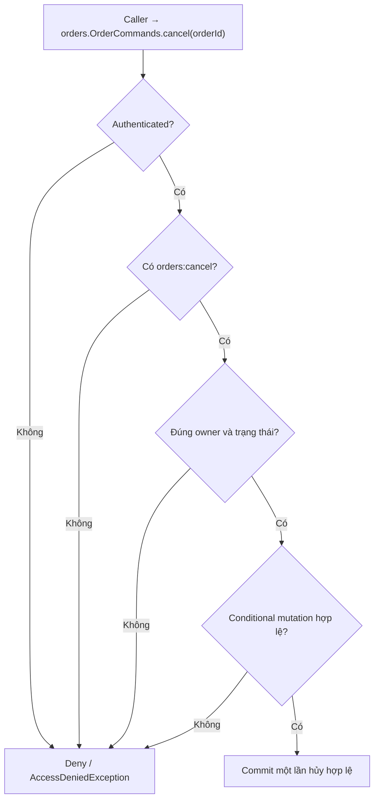
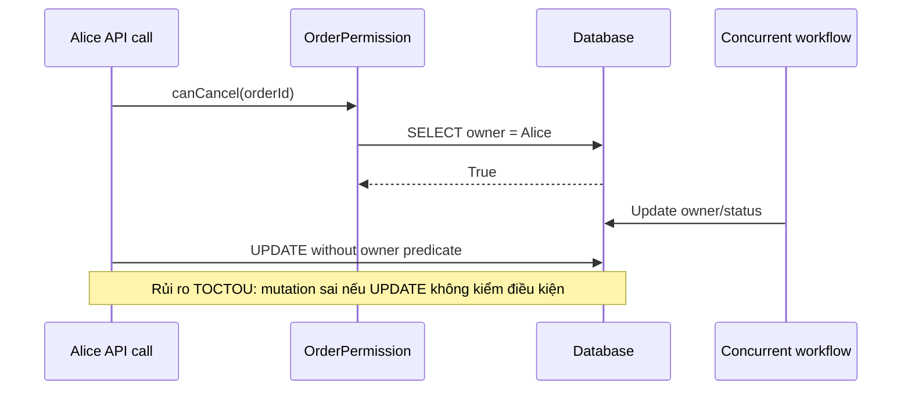
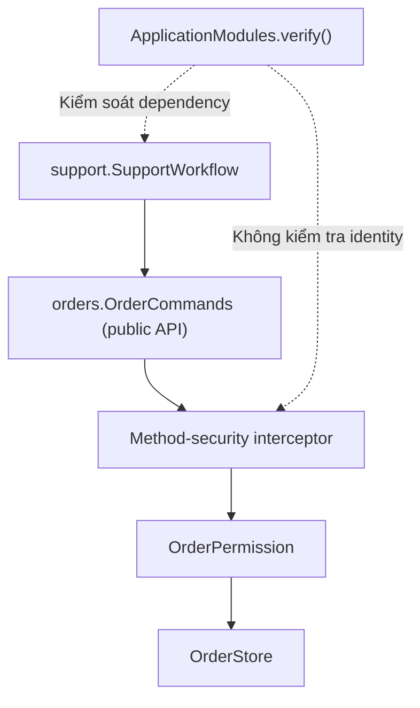
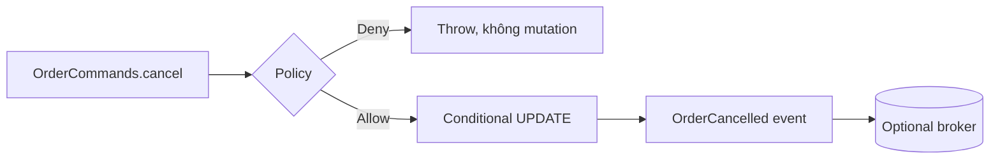
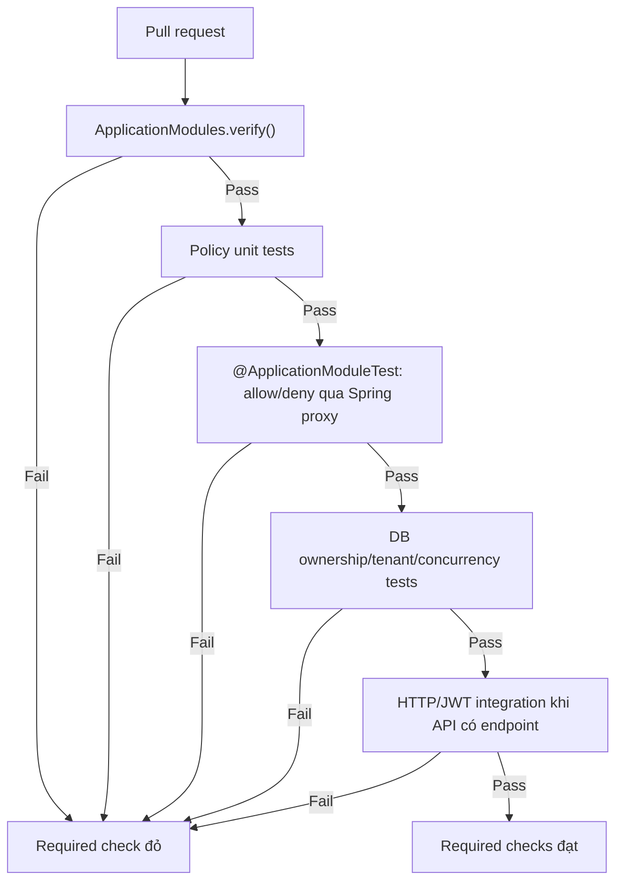

# Kiểm tra authorization khi gọi public module API

## 1. Public module API là điểm kiểm soát quyền, không phải quyền truy cập mặc định

Trong Spring Modulith, một kiểu Java nằm tại package gốc của application module thường được coi là **API mà module khác có thể phụ thuộc**. Nhưng **public trong kiến trúc không đồng nghĩa caller được phép thực hiện mọi nghiệp vụ**.

Ví dụ module `orders` công bố `OrderCommands.cancel(orderId)`. Module `support` có thể tham chiếu interface này mà vẫn tuân thủ ranh giới dependency. Điều đó **không** cho phép một nhân viên bất kỳ hủy đơn hàng của người khác.

Bài **“Kiểm tra authorization khi gọi public module API”** thuộc chương **Security testing** của học phần `SPRING_MODULITH_VERIFICATION_TESTING`. Mục tiêu là kiểm chứng ranh giới kiến trúc với `ApplicationModules.verify()` và các luật phụ thuộc, kết hợp `@ApplicationModuleTest`, kiểm thử sự kiện, database, tích hợp và quality gate CI. Riêng bài này tập trung vào cách **chứng minh** các quy tắc cấp quyền ở **ranh giới Java API giữa module**, không chỉ chứng minh endpoint HTTP đã được khóa.

Sau bài, người học cần có khả năng:

- Phân biệt **public API theo Spring Modulith**, **public HTTP endpoint** và **authorization policy**.
- Test `@PreAuthorize`/method security **qua Spring proxy thật** bằng `@ApplicationModuleTest`.
- Viết ma trận **allow/deny** cho authority, owner, tài nguyên không tồn tại và anonymous.
- Chống **IDOR/BOLA**: user hợp lệ nhưng truy cập `orderId` không thuộc quyền.
- Nhận diện bypass do **self-invocation**, gọi trực tiếp class, event listener hoặc async worker.
- Đảm bảo business mutation được bảo vệ **trong transaction** khi có concurrency.
- Phân biệt `@WithMockUser` với kiểm tra JWT validation/claim mapping qua HTTP.
- Kết hợp test quyền với architecture gate và CI required checks.

**Bất biến xuyên suốt:** một lời gọi API công khai chỉ tạo tác động hủy đơn khi **danh tính, quyền và quan hệ với đúng đối tượng** đều cho phép. Kiểm thử phải chứng minh cả trường hợp bị từ chối **không tạo side effect**.

## 2. Ba ranh giới không được đồng nhất

| Ranh giới | Câu hỏi | Cơ chế | Nếu đạt thì **chưa chứng minh** |
| --- | --- | --- | --- |
| **Kiến trúc** | Module khác có được import kiểu này không? | Public package/named interface, `ApplicationModules.verify()` | Người gọi đủ quyền |
| **HTTP** | Request có token/route/role được phép? | Spring Security filter chain, route rules | Lời gọi Java nội bộ không bypass |
| **Java method/API** | Principal hiện tại có được thực hiện thao tác này trên **đúng đối tượng**? | `@EnableMethodSecurity`, `@PreAuthorize`, domain policy | Token signature, network security hoặc DB mutation atomic |

Đừng dùng mỗi `ApplicationModules.verify()` để kết luận “API đã được bảo vệ”. Nó phát hiện vi phạm cấu trúc, chứ không thực thi `SecurityContext` hay SpEL authorization.

Đừng chỉ bảo vệ `POST /orders/{id}/cancel` tại controller rồi coi mọi đường đều an toàn. Module khác có thể gọi `OrderCommands.cancel(id)` trực tiếp bằng dependency injection, không đi qua HTTP filter chain. Nếu policy quan trọng chỉ nằm trên controller, **internal caller có thể vượt qua**.

### Cách đọc đúng từ “public”

Trong ví dụ:

```text
com.example.shop
├── ShopApplication.java
├── orders
│   ├── OrderCommands.java             ← public module API
│   └── internal
│       ├── OrderCommandService.java   ← implementation
│       ├── OrderPermission.java       ← policy
│       └── OrderStore.java            ← persistence port
└── support
    └── internal
        └── SupportWorkflow.java
```

`support` phụ thuộc `orders.OrderCommands` là hợp lệ nếu luật dependency cho phép. Không được import `orders.internal.OrderCommandService` hoặc repository nội bộ chỉ để né một method authorization check.

## 3. Chọn chính xác yêu cầu cấp quyền cần test

Giả sử hành vi `cancel(orderId)` chỉ hợp lệ khi:

1. Caller có danh tính đã xác thực.
2. Caller có authority **`orders:cancel`**.
3. Caller là **owner** của đơn cần hủy.
4. Đơn đang ở trạng thái có thể hủy.
5. Khi mutation diễn ra, dữ liệu tại database vẫn thỏa quyền và trạng thái đã kiểm tra.

Đây là **policy cụ thể của ví dụ**, không phải chính sách mặc định Spring Modulith.



Điểm cần bảo vệ không chỉ là “đúng role” mà còn là **object-level authorization**. Một user có `orders:cancel` nhưng sở hữu đơn A **không được** hủy đơn B.

Đối với ứng dụng nhiều tenant, `ownerId` có thể chưa đủ; phải ràng buộc cả `tenantId` và scope của principal. Policy cần được cụ thể hóa bằng dữ liệu thử nghiệm cho từng tenant.

## 4. Định nghĩa public module API tối giản

Interface ở package gốc `orders`:

```java
// src/main/java/com/example/shop/orders/OrderCommands.java
package com.example.shop.orders;

import java.util.UUID;

public interface OrderCommands {

    void cancel(UUID orderId);
}
```

Một module khác chỉ nên tham chiếu contract này:

```java
// src/main/java/com/example/shop/support/internal/
// SupportWorkflow.java
package com.example.shop.support.internal;

import com.example.shop.orders.OrderCommands;
import java.util.UUID;
import org.springframework.stereotype.Component;

@Component
class SupportWorkflow {

    private final OrderCommands orders;

    SupportWorkflow(OrderCommands orders) {
        this.orders = orders;
    }

    void requestCancellation(UUID orderId) {
        orders.cancel(orderId);
    }
}
```

**Lưu ý:** `SupportWorkflow` nhận `OrderCommands` từ Spring container; nó **không tự được cấp quyền** chỉ vì là Java bean đáng tin cậy. Phải có `Authentication` phù hợp trong context hiện tại, hoặc một cơ chế machine/service identity được thiết kế rõ.

Nếu method được gọi từ request HTTP của Alice, ví dụ có thể đọc danh tính Alice từ Spring Security context. Nếu một background worker gọi khi **không có user request**, cần chính sách quyền riêng cho automation; không nên tự bật “ADMIN” hoặc bỏ authorization để tránh exception.

## 5. Tách permission và mutation ra khỏi public interface

Repository/persistence port thuộc implementation module:

```java
// src/main/java/com/example/shop/orders/internal/OrderStore.java
package com.example.shop.orders.internal;

import java.util.Optional;
import java.util.UUID;

interface OrderStore {

    Optional<String> ownerOf(UUID orderId);

    int cancelOwnedBy(UUID orderId, String ownerId);
}
```

Giả định về contract:

- `ownerOf(orderId)` trả về user ID sở hữu đơn, hoặc `Optional.empty()` khi không thấy.
- `cancelOwnedBy(orderId, ownerId)` thực hiện **mutation có điều kiện** và trả số dòng được cập nhật.
- Một implementation JDBC/JPA thật phải kiểm tra **owner, trạng thái có thể hủy** (và tenant nếu có) trong cùng thao tác có kiểm soát transaction/concurrency.

**Không dùng `SELECT owner` trong policy rồi `UPDATE orders WHERE id=?` mà bỏ owner/status khỏi điều kiện update**. Giữa kiểm tra và ghi dữ liệu có thể có thay đổi concurrent, gây lỗi **time-of-check/time-of-use (TOCTOU)**.

Một adapter JDBC tương ứng có thể dùng:

```sql
UPDATE orders
SET status = 'CANCELLED'
WHERE id = :order_id
  AND owner_id = :authenticated_owner
  AND status = 'CONFIRMED';
```

SQL này là minh họa, cần bind parameters qua JDBC/JPA và quản lý transaction. Nếu multi-tenant, bổ sung `tenant_id=:authenticated_tenant`. **Không** nối trực tiếp input người dùng vào SQL string.

Tại sao cần hai tầng? `@PreAuthorize` giúp từ chối sớm và thể hiện policy tại API; conditional update bảo vệ invariant **tại điểm ghi**, kể cả khi có race.

## 6. Policy component xử lý object-level permission

Một policy bean nội bộ:

```java
// src/main/java/com/example/shop/orders/internal/OrderPermission.java
package com.example.shop.orders.internal;

import java.util.UUID;
import org.springframework.security.authentication
        .AnonymousAuthenticationToken;
import org.springframework.security.core.Authentication;
import org.springframework.stereotype.Component;

@Component("orderPermission")
public final class OrderPermission {

    private final OrderStore store;

    OrderPermission(OrderStore store) {
        this.store = store;
    }

    public boolean canCancel(
            Authentication authentication,
            UUID orderId) {

        if (authentication == null
                || !authentication.isAuthenticated()
                || authentication instanceof AnonymousAuthenticationToken
                || orderId == null) {
            return false;
        }

        String actor = authentication.getName();

        return store.ownerOf(orderId)
                .filter(actor::equals)
                .isPresent();
    }
}
```

`@Component("orderPermission")` cung cấp bean name rõ ràng cho SpEL. Class `public` nằm trong package `orders.internal` vẫn **không trở thành public module API** theo quy ước mặc định của Spring Modulith; điều này cho phép truy cập phương thức policy qua SpEL mà không đưa implementation ra package gốc. Đây là policy cơ bản về owner, không phải toàn bộ quyết định nghiệp vụ. Khi triển khai thật, nên thêm:

- Điều kiện trạng thái `CONFIRMED`/chưa giao hàng.
- Tenant boundary lấy từ **trusted authentication claims/context**, không lấy một `tenantId` do caller tùy ý truyền vào.
- Kiểm tra quyền đặc biệt của nhân viên hỗ trợ theo policy riêng (nếu business cho phép).
- Quy tắc không tiết lộ sự tồn tại của object không thuộc quyền.
- Cơ chế cache policy (nếu có) với invalidation đúng, không dùng cache cũ cho mutation quan trọng.

**Test quyền sở hữu phải dùng ít nhất hai object khác nhau**: một object thuộc Alice, một object thuộc Bob. Một test chỉ dùng `orderId` của Alice không thể phát hiện lỗi IDOR.

## 7. Kích hoạt method security và bảo vệ public method thật

Method security **không tự được kích hoạt chỉ vì có dependency Spring Security**. Ứng dụng cần `@EnableMethodSecurity` hoặc cấu hình tương đương cho phiên bản đang dùng:

```java
// src/main/java/com/example/shop/orders/internal/
// OrderMethodSecurityConfiguration.java
package com.example.shop.orders.internal;

import org.springframework.context.annotation.Configuration;
import org.springframework.security.config.annotation.method
        .configuration.EnableMethodSecurity;

@Configuration(proxyBeanMethods = false)
@EnableMethodSecurity
class OrderMethodSecurityConfiguration {
}
```

Service triển khai public API:

```java
// src/main/java/com/example/shop/orders/internal/
// OrderCommandService.java
package com.example.shop.orders.internal;

import com.example.shop.orders.OrderCommands;
import java.util.UUID;
import org.springframework.security.access.AccessDeniedException;
import org.springframework.security.access.method.P;
import org.springframework.security.access.prepost.PreAuthorize;
import org.springframework.security.core.context.SecurityContextHolder;
import org.springframework.stereotype.Service;
import org.springframework.transaction.annotation.Transactional;

@Service
class OrderCommandService implements OrderCommands {

    private final OrderStore store;

    OrderCommandService(OrderStore store) {
        this.store = store;
    }

    @Override
    @Transactional
    @PreAuthorize(
        "hasAuthority('orders:cancel') and "
        + "@orderPermission.canCancel(authentication, #orderId)"
    )
    public void cancel(@P("orderId") UUID orderId) {
        String actor = SecurityContextHolder.getContext()
                .getAuthentication().getName();

        int updated = store.cancelOwnedBy(orderId, actor);

        if (updated != 1) {
            throw new AccessDeniedException(
                    "Cancellation not permitted"
            );
        }
    }
}
```

**Tại sao code có ý nghĩa kiểm thử?**

- `@PreAuthorize` kiểm tra quyền **trước khi body được gọi** trên Spring proxy.
- `hasAuthority('orders:cancel')` yêu cầu authority chính xác.
- `@orderPermission.canCancel(authentication, #orderId)` kiểm tra quyền trên **đúng orderId**.
- `@P("orderId")` đặt tên tham số rõ ràng cho SpEL, tránh phụ thuộc vào cách Java compiler giữ parameter names.
- `@Transactional` quản lý transaction cho mutation.
- `cancelOwnedBy(...)` bảo vệ race ở database. Nếu không cập nhật được hàng hợp lệ, service từ chối thay vì trả success giả.

**Giới hạn:** phần source chưa cung cấp implementation `OrderStore` và schema SQL đầy đủ. Trong một ứng dụng thật, adapter JPA/JDBC cần implement contract, được Spring đăng ký bean và được DB integration test kiểm tra. Test module bên dưới thay port bằng mock để cô lập authorization.

### Vì sao policy cần fail-closed?

Nếu không có `Authentication` phù hợp, thiếu quyền, không thấy object hoặc không khớp owner, API không được tiếp tục mutation. Đừng viết policy kiểu:

```java
return owner == null || owner.equals(authentication.getName());
```

Vì cách đó vô tình **cho phép** khi không xác định được owner. Với thao tác nhạy cảm, thất bại tra cứu hoặc thiếu context thường phải từ chối, không suy đoán user có quyền.

## 8. Test đúng đối tượng: Spring bean proxy, không `new OrderCommandService`

Có hai lời gọi trông tương tự nhưng không cùng ý nghĩa:

```java
// ĐÚNG cho method security integration:
@Autowired OrderCommands api;  // Spring bean/proxy
api.cancel(orderId);
```

```java
// KHÔNG phải phép kiểm @PreAuthorize:
var service = new OrderCommandService(store);
service.cancel(orderId);
```

Lời gọi `new` là Java object thuần, không có method-security interceptor hoặc transaction proxy. Nếu test tự tạo service rồi gọi trực tiếp, `@PreAuthorize` **không được Spring thi hành**. Nó có thể chạy body dù không đủ quyền, hoặc fail vì một nguyên nhân khác; **không kết luận authorization hoạt động** từ test ấy.

`@ApplicationModuleTest` cho phép dùng Spring bean thật trong phạm vi module, cô lập port dữ liệu bằng mock. Đó là tầng kiểm thử phù hợp nhất để chứng minh method-level policy của public module API đã được wiring.

## 9. Khung `@ApplicationModuleTest` dùng `@MockitoBean`

Đặt test ở cùng package nội bộ để có thể mock `OrderStore` package-private, nhưng **API được gọi vẫn là public interface `OrderCommands`**:

```java
// src/test/java/com/example/shop/orders/internal/
// OrderCommandsAuthorizationTests.java
package com.example.shop.orders.internal;

import com.example.shop.orders.OrderCommands;
import org.junit.jupiter.api.Test;
import org.springframework.beans.factory.annotation.Autowired;
import org.springframework.context.annotation.Import;
import org.springframework.modulith.test.ApplicationModuleTest;
import org.springframework.test.context.bean.override.mockito.MockitoBean;

@ApplicationModuleTest
@Import(OrderMethodSecurityConfiguration.class)
class OrderCommandsAuthorizationTests {

    @Autowired
    OrderCommands api;

    @MockitoBean
    OrderStore store;

    // Các @Test cho allow/deny matrix nằm ở phần tiếp theo.
}
```

**Các giả định thực thi:**

- Ứng dụng có `@SpringBootApplication` trong `com.example.shop` và module `orders` được Spring Modulith nhận diện.
- Module có bean `OrderCommandService` và `OrderPermission`; `@Import` giúp đảm bảo method security config hiện diện trong test context, đặc biệt nếu global config nằm ngoài phạm vi module.
- `@MockitoBean` của Spring Framework 6.2+ thay hoặc tạo mock repository port trong test. Với Spring Boot đời cũ, dùng cơ chế mock bean tương ứng.
- Ở production, `OrderStore` phải có một adapter được Spring cung cấp; việc thiếu implementation ở đoạn học liệu là chủ ý chỉ tập trung authorization.
- Test được thực thi bằng JUnit Jupiter/Spring Test và `spring-security-test`.
- Không sử dụng real user/password/JWT token để tạo `SecurityContext`.

**Đừng chỉ assert context khởi động.** Một context không có `@EnableMethodSecurity` vẫn có thể khởi động thành công trong khi `@PreAuthorize` bị bỏ qua. Các phép thử *deny* mới là bằng chứng quan trọng.

## 10. Positive test: đúng authority và đúng owner

Test kích hoạt policy qua Spring bean proxy:

```java
import static org.mockito.Mockito.verify;
import static org.mockito.Mockito.when;
import java.util.Optional;
import java.util.UUID;
import org.springframework.security.test.context.support.WithMockUser;

@Test
@WithMockUser(
    username = "alice",
    authorities = "orders:cancel"
)
void ownerWithPermissionCanCancelOwnOrder() {
    UUID orderId = UUID.randomUUID();

    when(store.ownerOf(orderId))
            .thenReturn(Optional.of("alice"));
    when(store.cancelOwnedBy(orderId, "alice"))
            .thenReturn(1);

    api.cancel(orderId);

    verify(store).ownerOf(orderId);
    verify(store).cancelOwnedBy(orderId, "alice");
}
```

Bài test kiểm tra cùng lúc:

1. `@WithMockUser` tạo `Authentication` với name `alice` và authority `orders:cancel`.
2. `OrderCommands` được inject qua Spring, nên security interceptor có cơ hội xử lý `@PreAuthorize`.
3. Policy kiểm tra **chính xác orderId** của test.
4. Service thực hiện mutation qua port với **actor identity**, không lấy owner tùy tiện từ request body.
5. Port trả đúng một row được cập nhật, service hoàn thành.

**Giới hạn:** `OrderStore` bị mock nên test **chưa chứng minh SQL transaction hoặc database row thực sự cập nhật đúng**. Phép kiểm DB integration sẽ tiếp tục kiểm tra conditional update khi chạy đồng thời.

## 11. Deny test: có quyền thao tác nhưng **không sở hữu đối tượng**

Đây là ca kiểm tra IDOR/BOLA cốt lõi:

```java
import static org.junit.jupiter.api.Assertions.assertThrows;
import static org.mockito.ArgumentMatchers.any;
import static org.mockito.Mockito.never;
import static org.mockito.Mockito.verify;
import static org.mockito.Mockito.when;
import org.springframework.security.access.AccessDeniedException;

@Test
@WithMockUser(
    username = "bob",
    authorities = "orders:cancel"
)
void userCannotCancelAnotherUsersOrder() {
    UUID aliceOrderId = UUID.randomUUID();

    when(store.ownerOf(aliceOrderId))
            .thenReturn(Optional.of("alice"));

    assertThrows(
            AccessDeniedException.class,
            () -> api.cancel(aliceOrderId)
    );

    verify(store).ownerOf(aliceOrderId);
    verify(store, never()).cancelOwnedBy(
            any(UUID.class), any(String.class)
    );
}
```

**Bất biến cần thấy:** Bob được xác thực và có `orders:cancel`, nhưng không phải owner; Spring method-security proxy từ chối trước mutation.

Một implementation sai chỉ kiểm tra `hasAuthority('orders:cancel')` sẽ **làm test đỏ** (hoặc có thể đi vào body dẫn tới mutation); đó là một phép kiểm có khả năng phát hiện lỗi thực.

**Không dựa vào mã HTTP 403 ở tầng này.** Đây là **Java module API test**: kết quả trực tiếp là `AccessDeniedException`. Mapping ngoại lệ thành HTTP status thuộc test controller/security filter chain riêng.

## 12. Deny test: đúng owner nhưng **thiếu authority**

Một người sở hữu đơn chưa chắc có quyền thực hiện thao tác cancel:

```java
import static org.mockito.Mockito.verifyNoInteractions;
import org.springframework.security.test.context.support.WithMockUser;

@Test
@WithMockUser(
    username = "alice",
    authorities = "orders:read"
)
void ownerWithoutCancelAuthorityIsRejected() {
    UUID orderId = UUID.randomUUID();

    assertThrows(
            AccessDeniedException.class,
            () -> api.cancel(orderId)
    );

    verifyNoInteractions(store);
}
```

Ở đây expression `hasAuthority('orders:cancel') and ...` có điều kiện trái sai, nên phần policy đọc owner không cần chạy. Nếu framework expression được thay đổi trong production, assertion `verifyNoInteractions` có thể cần xem lại, nhưng **mutation không được xảy ra** là invariant cốt lõi.

### `hasRole` khác `hasAuthority` như thế nào?

- `hasAuthority('orders:cancel')` so sánh **đúng chuỗi authority**.
- `hasRole('ADMIN')` theo cấu hình prefix mặc định kiểm tra `ROLE_ADMIN`.
- `@WithMockUser(roles = "ADMIN")` tạo authority `ROLE_ADMIN`, **không tự tạo** `orders:cancel`.

Một test role-lệch có giá trị:

```java
@Test
@WithMockUser(username = "alice", roles = "ADMIN")
void adminRoleAloneDoesNotImplicitlyGrantCancelAuthority() {
    UUID orderId = UUID.randomUUID();

    assertThrows(
            AccessDeniedException.class,
            () -> api.cancel(orderId)
    );

    verifyNoInteractions(store);
}
```

Nếu nghiệp vụ **muốn** ADMIN có quyền hủy mọi đơn, hãy nêu chính sách đó rõ, tạo policy branch có kiểm soát và test riêng. Không vô tình cho phép chỉ vì role có tên “ADMIN”.

## 13. Deny test: anonymous hoặc không có principal phù hợp

Một test dùng danh tính anonymous rõ ràng:

```java
import org.springframework.security.test.context.support.WithAnonymousUser;

@Test
@WithAnonymousUser
void anonymousCallerCannotCancelOrder() {
    UUID orderId = UUID.randomUUID();

    assertThrows(
            AccessDeniedException.class,
            () -> api.cancel(orderId)
    );

    verifyNoInteractions(store);
}
```

Trong Spring Security Test, `@WithAnonymousUser` thiết lập anonymous authentication với authority anonymous, không có `orders:cancel`. Bài test tránh phụ thuộc vào việc context trống hẳn, vốn có thể dẫn tới loại exception khác ở các cấu hình method-security khác nhau.

Với các trường hợp thiếu `SecurityContext` hoàn toàn, test cần xác định contract mong muốn và không gắn cứng mọi cấu hình vào một exception class duy nhất. **Bất biến vẫn là không thực hiện mutation** khi không có identity đủ tin cậy.

**Không viết đường bypass** như:

```java
if (SecurityContextHolder.getContext().getAuthentication() == null) {
    store.cancel(orderId);  // Anti-pattern: không có auth lại được phép.
}
```

Một tác vụ background được phép hủy đơn cần **service identity/use case riêng với scope cụ thể**, không dựa vào `null` như một quyền đặc biệt.

## 14. Deny test: tài nguyên không tồn tại và tránh rò rỉ thông tin

Khi `orderId` không tồn tại, policy nên từ chối mà không để caller suy ra quá nhiều chi tiết về đối tượng khác.

```java
@Test
@WithMockUser(
    username = "alice",
    authorities = "orders:cancel"
)
void nonexistentOrderIsNotCancellable() {
    UUID absent = UUID.randomUUID();

    when(store.ownerOf(absent))
            .thenReturn(Optional.empty());

    assertThrows(
            AccessDeniedException.class,
            () -> api.cancel(absent)
    );

    verify(store, never()).cancelOwnedBy(
            any(UUID.class), any(String.class)
    );
}
```

Trong API HTTP, chính sách có thể chọn 403 hoặc 404 cho tài nguyên không được phép xem, tùy yêu cầu chống enumeration. **Đừng tùy tiện công bố** “đơn có tồn tại nhưng thuộc Bob” trong exception, response body hoặc log client-visible.

Tại Java API boundary, ý nghĩa test là:

- Caller không được mutate object không được phép.
- Exception không chứa owner ID/PII không cần thiết.
- Với `orderId` vô hiệu hoặc không tồn tại, không có tác động ghi dữ liệu.

**Một check chỉ xác nhận exception mà bỏ qua `verify(..., never())` có thể bỏ sót mutation xảy ra trước khi ném lỗi.**

## 15. Tại sao cần kiểm tra proxy/wiring, không chỉ annotation?

Method security của Spring thường được thực thi bởi AOP interceptor. Những lỗi thường gặp:

1. Thiếu `@EnableMethodSecurity` trong Spring context.
2. Test gọi `new OrderCommandService(...)`, bỏ qua proxy.
3. Method security annotation đặt trên một code path **không được gọi qua proxy**.
4. Test context load thiếu cấu hình security do module scope.
5. Gọi self-invocation `this.cancel(...)`, bỏ qua interceptor với proxy-based AOP.
6. Dùng private/final method hoặc class/proxy strategy không tương thích.
7. Method được gọi từ async/event processing khi security context đã biến mất.

Có thể quan sát đối tượng có phải Spring AOP proxy:

```java
import static org.assertj.core.api.Assertions.assertThat;
import org.springframework.aop.support.AopUtils;

@Test
void publicApiIsInjectedAsSpringProxy() {
    assertThat(AopUtils.isAopProxy(api)).isTrue();
}
```

**Nhưng:** một bean có thể được proxy vì `@Transactional` hoặc advice khác, **không phải vì `@PreAuthorize`**. Vì vậy, chỉ test `AopUtils.isAopProxy` là **không đủ**. Cặp test *deny* thiếu authority và khác owner mới giúp chứng minh policy thực sự có hiệu lực.

### Regression test nên cố tình làm policy lỗi

Trong nhánh thử nghiệm, bỏ `@PreAuthorize` khỏi method hoặc không nạp `@EnableMethodSecurity`. Các test deny phải thất bại, thay vì xanh vì mock repository đã tự ném exception. Sau khi xác nhận, hoàn nguyên thay đổi.

Điều này phát hiện trường hợp “annotation có trong source nhưng test thực tế không kiểm tra enforcement”.

## 16. Self-invocation: điểm bypass cần có thiết kế riêng

Ví dụ một class có:

```java
@Service
class WrongOrderService {

    void runBatch(UUID orderId) {
        this.cancel(orderId); // Gọi nội bộ, không qua Spring proxy.
    }

    @PreAuthorize("hasAuthority('orders:cancel')")
    public void cancel(UUID orderId) {
        // Một mutation cần được bảo vệ.
    }
}
```

Với Spring AOP proxy thông dụng, `this.cancel(...)` là self-invocation, nên **không đi qua interceptor của Spring proxy**. Đặt annotation trên `cancel` không bảo vệ tự động mọi lời gọi nội bộ.

Các phương án đúng hơn:

- Đảm bảo thao tác nhạy cảm được gọi **qua Spring bean/proxy riêng**.
- Tách `BatchOrderWorkflow` và `OrderCommands` thành hai bean; workflow gọi `OrderCommands` qua injection, không `this`.
- Nếu background automation có quyền riêng, thiết kế **đường use case riêng** với một identity/policy được kiểm chứng, không “bỏ qua” annotation.
- Đưa bất biến nhạy cảm vào DB mutation/persistence policy để giảm thiểu tác động nếu AOP bị bypass.
- Với trường hợp thật sự cần bảo vệ ở tầng sâu, xem xét phương án AOP weaving/authorization domain phù hợp, nhưng phải kiểm thử cơ chế đó rõ ràng.

**Kiểm thử:** viết một case gọi entrypoint công khai của workflow (không gọi trực tiếp private helper) bằng principal thiếu quyền và assert **không có mutation**. Nếu workflow gọi self-invocation và bypass, test sẽ cho thấy thiết kế không đáp ứng bất biến.

## 17. Quyền trên đối tượng phải được kiểm lại tại điểm ghi

`@PreAuthorize` có thể xác nhận Alice là owner ở thời điểm \(t_1\), nhưng ownership/status có thể đổi trước khi `cancel` ghi dữ liệu ở thời điểm \(t_2\).



Do đó `OrderStore.cancelOwnedBy(...)` phải thực hiện conditional update hoặc dùng locking/version tương ứng. Đối với nghiệp vụ multi-tenant:

```sql
UPDATE orders
SET status = 'CANCELLED'
WHERE id = :order_id
  AND owner_id = :authenticated_user
  AND tenant_id = :trusted_tenant
  AND status = 'CONFIRMED';
```

Kiểm thử database integration nên xác nhận:

- Alice cập nhật được đúng một row hợp lệ.
- Bob cập nhật **0 row** đối với đơn của Alice.
- Cập nhật lại một đơn đã hủy trả **0 row** hoặc business result theo contract.
- Hai transaction cạnh tranh không thể hủy sai trạng thái.
- Thay ownership/tenant đồng thời không làm query thiếu predicate cập nhật sai.
- `@Transactional` ở service được Spring áp dụng thông qua bean/proxy và không tạo partial commit.

**Module test với `@MockitoBean OrderStore` không thể chứng minh SQL ở trên đúng.** Cần DB integration test với adapter thật và cơ chế transaction giống production ở mức cần thiết.

## 18. Không tin input actor/tenant do caller tự gửi

Anti-pattern:

```java
public void cancel(UUID orderId, String claimedOwnerId) {
    if (store.ownerOf(orderId).equals(claimedOwnerId)) {
        store.cancelOwnedBy(orderId, claimedOwnerId);
    }
}
```

Ở đây caller có thể **tự khai** `claimedOwnerId=alice` để hủy đơn của Alice. Tương tự, một `tenantId` lấy từ request body không phải bằng chứng user được phép truy cập tenant đó.

Trong code có `SecurityContextHolder` ở mục 7, actor được lấy từ **authentication đã được hệ thống xác minh**. Với kiến trúc nhiều tenant, tenant ID phải gắn với một nguồn tin cậy (JWT claims đã được verify, session context đáng tin hoặc policy lookup) và được kiểm tra membership/entitlements.

Cần test tối thiểu:

| Tình huống | Principal | Input cố tình gửi | Kết quả |
| --- | --- | --- | --- |
| Đúng owner | Alice | Order của Alice | Allow nếu đủ authority |
| IDOR | Bob | UUID đơn Alice | Deny |
| Spoof owner | Bob | Header/body `ownerId=alice` | Deny |
| Cross-tenant | Alice thuộc tenant X | UUID đơn tenant Y | Deny |
| Thiếu tenant claim | User không có trusted tenant | UUID tenant Y | Deny hoặc policy đã định |
| Nhân viên hỗ trợ có quyền riêng | Support principal | Order cần can thiệp | Chỉ allow theo policy support explicit |

**Kết luận test:** server-side authorization không thể dựa vào object ID “khó đoán” hoặc trust request fields. UUID không phải permission.

## 19. Cross-module caller: đúng dependency chưa chắc đúng authorization

Một integration test có thể kiểm tra `support.internal.SupportWorkflow` gọi API công khai `orders.OrderCommands`.



Các kiểm tra bổ sung:

1. `ApplicationModules.verify()` xác nhận `support` chỉ phụ thuộc API của `orders`, không gọi `orders.internal`.
2. API authorization test xác nhận principal thiếu quyền bị chặn.
3. Cross-module integration test (nếu cần) xác nhận workflow gọi **Spring bean `OrderCommands`**, không new implementation.
4. Test business effect xác nhận không có mutation trên object bị cấm.
5. Nếu support có cơ chế đặc quyền, test authority/scope riêng thay vì dựa vào package name hoặc “module nội bộ”.

**Không có “trusted by default” chỉ vì caller cùng process.** Trust boundary và authorization policy phải thể hiện ở API hoặc tầng domain và được kiểm chứng. Một module có thể có quyền kiến trúc để gọi interface nhưng không có quyền nghiệp vụ để tác động lên một đơn hàng nhất định.

## 20. `@WithMockUser` kiểm tra method policy, không kiểm tra JWT mapping

`@WithMockUser(username="alice", authorities="orders:cancel")` tạo `SecurityContext` thử nghiệm. Đây là cách hữu ích để kiểm chứng **method authorization**, nhưng nó bỏ qua:

- JWT signature verification.
- Expiration, issuer, audience validation.
- JWT claim → Spring `GrantedAuthority` mapping.
- HTTP filter chain, CSRF/CORS/session policy.
- Xử lý missing/invalid bearer token ở endpoint.

Ví dụ token thật có `scope="orders.cancel"` nhưng `JwtAuthenticationConverter` của ứng dụng map thành `SCOPE_orders.cancel`, không phải `orders:cancel`. Test `@WithMockUser` vẫn qua, còn request HTTP thật có thể bị từ chối.

Cần tách ít nhất hai lớp:

| Lớp | Input | Điều chứng minh |
| --- | --- | --- |
| Method API test | `@WithMockUser`, Java method call | `@PreAuthorize` và resource policy hoạt động |
| HTTP security integration | Request MockMvc/WebTestClient với security filter chain | Endpoint security, authority mapping, status 401/403 |
| JWT cryptography test | Token ký bằng khóa test, decoder/JWKS local | Validation chữ ký/issuer/audience/expiry |
| Production identity integration | IdP phù hợp, môi trường được phép | End-to-end authn riêng, không thuộc module test thường |

Không nạp **JWT signing key production** vào module test. Dùng `@WithMockUser` cho policy hoặc khóa ephemeral/test JWKS khi thật sự kiểm tra decoder.

## 21. Ví dụ HTTP-level verification không thay method test

Giả sử hệ thống có controller `POST /api/orders/{id}/cancel` gọi `OrderCommands.cancel`. Một test MockMvc có thể mô phỏng JWT authentication:

```java
import static org.springframework.security.test.web.servlet.request
        .SecurityMockMvcRequestPostProcessors.csrf;
import static org.springframework.security.test.web.servlet.request
        .SecurityMockMvcRequestPostProcessors.jwt;
import static org.springframework.test.web.servlet.request.MockMvcRequestBuilders.post;
import static org.springframework.test.web.servlet.result.MockMvcResultMatchers.status;
import org.springframework.security.core.authority.SimpleGrantedAuthority;

// Bên trong class @SpringBootTest + @AutoConfigureMockMvc
// với controller/filter chain và repository fixture phù hợp:
mockMvc.perform(
        post("/api/orders/{id}/cancel", orderId)
                .with(jwt().jwt(token ->
                        token.subject("bob"))
                        .authorities(
                                new SimpleGrantedAuthority(
                                        "orders:cancel"
                                )
                        ))
                .with(csrf())
).andExpect(status().isForbidden());
```

**Đây là phần thân test**, giả định controller tồn tại và policy đã cấu hình để Bob không sở hữu đơn. Dùng `csrf()` khi endpoint/filter chain yêu cầu CSRF; với stateless bearer API có thể chính sách khác.

Quan trọng:

- `jwt()` của Spring Security Test **bỏ qua việc ký và xác minh token thật**; nó dùng test authentication để kiểm HTTP/authorization wiring.
- Đoạn test dùng `authorities(...)` chỉ định thẳng quyền, **không kiểm tra mapping claims thật** của `JwtAuthenticationConverter`. Muốn test mapping, cần test converter hoặc tích hợp một decoder/test token phù hợp.
- 403 là kết quả hợp lý khi caller đã xác thực nhưng không đủ quyền, theo exception translation được cấu hình. Nếu thiếu auth, HTTP thường trả 401; chính xác phụ thuộc filter chain/auth entry point.
- HTTP test **không chứng minh module API tự được bảo vệ khi gọi từ Java** nếu chỉ đặt authorization ở controller.

## 22. Async, event listener và consumer: đừng mặc định có SecurityContext

Một `@EventListener` chạy đồng bộ trong cùng thread có thể nhìn thấy security context hiện tại. Nhưng với `@Async`, scheduler, Kafka listener, RabbitMQ consumer hoặc transaction callback, **caller HTTP context không tự được bảo đảm**.

`SecurityContextHolder` mặc định thường dùng ThreadLocal strategy. Vì vậy:

- Không viết business event handler mà âm thầm dựa vào danh tính của HTTP request trước đó khi consumer chạy ở thread khác.
- Không biến trường `actorId` trong message chưa được xác minh thành “principal đã authenticated”.
- Nếu cần propagate security context trong một tác vụ async nội process, cân nhắc cơ chế Spring Security `DelegatingSecurityContext...` phù hợp và **test propagation**.
- Với broker boundary, message được xử lý trong **trust model khác**: service identity, signature/trusted envelope hoặc policy domain rõ; không copy bearer token người dùng vào event tùy tiện.
- Một public API bắt buộc user permission có thể **không phù hợp để background worker gọi trực tiếp**. Thiết kế một command/use case cho automation với quyền giới hạn và audit thay vì disable security toàn module.

Ví dụ test tránh hiểu sai:

```text
HTTP request của Alice:
  Authentication = Alice trên request thread
  OrderCommands.cancel(orderId) → method security kiểm Alice

Kafka listener:
  Một worker thread riêng, không có Alice SecurityContext mặc định
  Lời gọi OrderCommands.cancel(orderId) có thể bị từ chối
  Cần policy dành cho message-processing identity / use case riêng
```

**Đừng sửa lỗi bằng `SecurityContextHolder.setContext(adminContext)` toàn cục** rồi quên clear, đặc biệt trên thread pool; điều đó có thể làm rò rỉ principal giữa các tác vụ.

## 23. Kiểm thử side effect phủ định: “deny” phải thật sự deny

Một test quyền thiếu role mà chỉ assert exception **có thể xanh vì collaborator ném lỗi khác** hoặc body đã thực hiện mutation trước khi ném. Cần kiểm tra cả:

- Loại exception đúng ở Java API: thường `AccessDeniedException`.
- Không gọi mutation method khi bị chặn ở `@PreAuthorize`.
- Không có bản ghi thay đổi tại DB khi test integration.
- Không phát integration event hay gửi broker message sau khi bị deny.
- Không làm lộ dữ liệu nhạy cảm trong error response/log.

Ví dụ:

```java
assertThrows(
        AccessDeniedException.class,
        () -> api.cancel(forbiddenOrderId)
);

verify(store, never())
        .cancelOwnedBy(
                any(UUID.class), any(String.class)
        );
```

Đây là assert bên trong test đã cấu hình Spring context/Mockito imports. Ở DB integration, nên kiểm tra state trước/sau của chính `orderId`, không chỉ `repository.count()`.

**Một invariant bảo mật phải có bằng chứng âm tính**: “truy cập bị từ chối” và “side effect không tồn tại”.

## 24. Test matrix chính xác cho public module API

| Case | Authentication | Authority | Object | Expected | Side effect |
| --- | --- | --- | --- | --- | --- |
| C1 – allow | Alice | `orders:cancel` | Order của Alice | Call success | Một conditional update |
| C2 – thiếu scope | Alice | `orders:read` | Order của Alice | Deny | Không ghi |
| C3 – sai owner/IDOR | Bob | `orders:cancel` | Order Alice | Deny | Không ghi |
| C4 – anonymous | Anonymous | Không có cancel | Order Alice | Deny | Không ghi |
| C5 – không thấy resource | Alice | `orders:cancel` | UUID lạ | Deny | Không ghi |
| C6 – admin role không được policy cấp quyền | Alice | `ROLE_ADMIN` | Order Alice | Deny | Không ghi |
| C7 – cross-tenant | Alice tenant X | `orders:cancel` | Order tenant Y | Deny | Không ghi |
| C8 – trạng thái không cho phép | Alice | `orders:cancel` | Order đã giao/hủy | Deny | Không ghi |
| C9 – race | Alice | `orders:cancel` | Ownership thay sau precheck | Fail conditional update | Không ghi sai |
| C10 – caller từ module khác | Support workflow | Theo identity thực | Public API | Đúng policy như mọi caller | Có/không theo quyền |
| C11 – self-invocation | Internal workflow | Thiếu quyền | Order bất kỳ | Không được bypass | Không ghi |
| C12 – HTTP JWT | Request authenticated | Mapping claims | Order theo quyền | 401/403/2xx theo policy | Đồng nhất với method API |

**Không phải mọi case cần Kafka/DB thật**. Unit policy test và module-level proxy test bảo vệ nhiều case nhanh; DB integration test cho race/tenant, HTTP test cho filter/claims, còn architecture test bảo vệ package references.

## 25. Database integration: proof mạnh hơn mock

Để xác nhận conditional update `cancelOwnedBy` hoạt động, dùng DB test với implementation thật. Ví dụ thiết kế kịch bản:

```text
Fixture:
  Order A: owner=alice, tenant=X, status=CONFIRMED
  Order B: owner=bob,   tenant=X, status=CONFIRMED
  Order C: owner=alice, tenant=Y, status=CONFIRMED

Test với Alice tenant X:
  A → allowed, status becomes CANCELLED
  B → denied, status remains CONFIRMED
  C → denied, status remains CONFIRMED

Race test:
  Thread 1 policy check A at time t1
  Thread 2 changes owner/status at time t2
  Thread 1 conditional UPDATE at time t3 affects 0 row
  API must not return false success or update forbidden order
```

Bài test thực tế cần:

1. PostgreSQL Testcontainers hoặc DB hỗ trợ transaction/concurrency gần production.
2. Schema/constraints/fixture cô lập theo test.
3. Service thật với `@Transactional` và repository adapter thật.
4. Xác lập principal bằng Spring Security Test.
5. Concurrency được điều khiển bằng latch/barrier/failpoint, không `Thread.sleep(...)` đoán thời điểm.
6. Đọc state đã commit bằng transaction phù hợp; assert owner/tenant/status.
7. Dọn dữ liệu và đóng executor.

**Không coi mock `OrderStore.cancelOwnedBy(...)` trả 0 là bằng chứng SQL predicate đúng.** Mock chỉ kiểm service phản ứng khi store báo cập nhật thất bại.

## 26. Authorization trước event publishing và integration side effects

Một use case hủy đơn có thể sau khi cập nhật database phát `OrderCancelled` hoặc externalize sang Kafka. Với caller bị từ chối:



Nếu event được phát **trước** authorization hoặc **trước** transaction hợp lệ, hệ thống có thể gửi thông tin trái phép tới module khác dù method cuối cùng ném exception.

Một bộ test cần xác nhận:

- Denied call **không** phát `OrderCancelled`.
- Cho phép thành công chỉ phát event theo contract khi mutation thực sự thành công.
- Transaction rollback không để lại publication sai; với externalization/outbox, kiểm tra policy publication/recovery.
- Event không chứa token hoặc dữ liệu người dùng không được phép công bố.

`@ApplicationModuleTest` và `Scenario` có thể kiểm tra event trong module. Broker integration test chỉ cần khi contract thực sự đi qua Kafka/RabbitMQ. **Security policy vẫn phải được kiểm tra trên Java API path**; event test thuần không bảo vệ controller hoặc method security.

## 27. Kiểm chứng kiến trúc bằng `ApplicationModules.verify()` là gate riêng

Architecture test:

```java
// src/test/java/com/example/shop/ModuleArchitectureTests.java
package com.example.shop;

import org.junit.jupiter.api.Test;
import org.springframework.modulith.core.ApplicationModules;

class ModuleArchitectureTests {

    @Test
    void moduleBoundariesAreValid() {
        ApplicationModules.of(ShopApplication.class).verify();
    }
}
```

Nó giúp phát hiện:

- Module `support` import `orders.internal.OrderStore` hoặc `OrderCommandService`.
- Vòng phụ thuộc giữa các module.
- Vi phạm named interface/`allowedDependencies` đã khai báo.

**Nó không tự kiểm tra:**

- `@EnableMethodSecurity` có được bật hay không.
- `@PreAuthorize` đúng quyền hay không.
- Caller Alice/Bob/anonymous được cho phép hoặc từ chối.
- Owner/tenant race trong database.
- Request JWT được xác minh hoặc claims được map thành authorities đúng.

Một public module API có thể **hợp lệ về cấu trúc nhưng không có authorization**. Ngược lại, một method được bảo vệ đúng vẫn có thể thuộc module đang import implementation detail sai ranh giới. Do đó, cả architecture và security tests đều phải nằm trong CI.

## 28. Anti-pattern thường khiến test bảo mật xanh giả

| Anti-pattern | Vì sao sai | Phép kiểm/cách sửa |
| --- | --- | --- |
| Gọi `new OrderCommandService` để test `@PreAuthorize` | Bỏ qua AOP proxy | Inject `OrderCommands` từ Spring context |
| Chỉ assert `AopUtils.isAopProxy` | Proxy có thể do transaction, không phải security | Deny cases phải ném `AccessDeniedException` |
| Chỉ test user được allow | Không phát hiện policy bị bỏ/disable | Test thiếu authority, cross-owner, anonymous |
| Chỉ check role | Không bảo vệ IDOR/BOLA | Resource ownership/tenant policy |
| Dùng `@WithMockUser(roles="ADMIN")` để test `hasAuthority('orders:cancel')` | Authority strings khác nhau | Dùng authorities đúng, test prefix mismatch |
| Bảo vệ chỉ controller | Internal module caller bypass HTTP chain | Method security trên public module API |
| `this.cancel(...)` trong cùng bean | Proxy-based advice không được intercept | Tách bean entrypoint hoặc policy sâu hơn |
| Lấy owner/tenant từ request body | Caller có thể mạo danh | Trusted authentication + server-side lookup |
| DB `UPDATE ... WHERE id=?` sau check owner | TOCTOU race | Conditional update owner/tenant/status |
| Test deny chỉ assert exception | Có thể đã xảy ra side effect | Verify no mutation/event, DB unchanged |
| Dùng mock store để kết luận SQL atomic | Mock không thực thi DB | Testcontainers DB integration |
| Dùng `@WithMockUser` để khẳng định JWT thật an toàn | Không verify signature/converter | Security filter/JwtDecoder test riêng |
| Listener async trông chờ HTTP user context | Không có context đảm bảo | Thiết kế service identity/context propagation |
| Cho background task bypass nếu không có auth | Fail-open | Separate audited automation policy |
| Vô hiệu hóa method security để module test chạy | Test không còn bảo vệ chính sách | Nạp `@EnableMethodSecurity` trong test |

Một test tốt phải thất bại khi reviewer **cố tình bỏ annotation**, đổi quyền hoặc bỏ điều kiện owner. Nếu mọi test vẫn xanh, chúng chưa bảo vệ public API authorization đúng nghĩa.

## 29. Quality gate CI tập trung đúng tầng authorization



Ví dụ lệnh build thường gặp:

```bash
./mvnw test
./mvnw verify

./gradlew test
./gradlew check
```

Nhưng test chỉ có tác dụng khi build runner **thực sự khám phá và chạy** chúng. Nếu đặt DB/HTTP test dưới hậu tố `*IT`, Maven có thể cần Failsafe hoặc một Gradle integrationTest task được cấu hình. Kiểm tra JUnit report và required checks trong CI.

Những quy tắc không nên bỏ:

- Không gắn `@Disabled` cho deny test “vì flaky”.
- Không tắt `@EnableMethodSecurity` trong module test để context dễ khởi động hơn.
- Không dùng `continue-on-error: true` cho security checks bắt buộc.
- Không chỉ đo coverage line; đo **policy branches và negative cases**.
- Không đưa credential hoặc dữ liệu user production vào fixture.
- Tách test DB/concurrency để có observable rõ và timeout có kiểm soát.
- Cấu hình required checks ngăn merge khi test quyền thất bại.

Một cách xác nhận gate hữu hiệu: trên nhánh thử nghiệm, bỏ điều kiện `@orderPermission.canCancel(...)`; **cross-owner test phải đỏ**. Bỏ `hasAuthority(...)`; **missing-authority test phải đỏ**. Hoàn nguyên sau kiểm chứng.

## 30. Chẩn đoán khi test authorization không phản ánh production

Giả sử production cho Bob hủy đơn của Alice nhưng `@ApplicationModuleTest` vẫn xanh. Kiểm tra theo thứ tự:

1. Test có thật sự gọi **Spring-injected `OrderCommands`** hay tạo service bằng `new`?
2. `@EnableMethodSecurity` có trong **test context và production context** không?
3. Bean được inject có phải đúng implementation/proxy đang được sử dụng không?
4. `@PreAuthorize` có đặt trên method thực tế bị gọi không?
5. Có self-invocation hoặc call path bỏ qua Spring proxy không?
6. Principal từ `SecurityContext` có cùng semantics trong test và runtime không?
7. `hasAuthority` có so sánh đúng chuỗi (và `ROLE_` prefix) không?
8. SpEL `#orderId` có bind đúng tham số? Có cần `@P` không?
9. Policy có tra **owner và tenant của đúng orderId** không?
10. Request có thể spoof ownerId/tenantId bằng body/header không?
11. SQL update có điều kiện owner/tenant/status để tránh TOCTOU không?
12. Có async listener/scheduler gọi API mà mất hoặc dùng nhầm identity không?
13. Test có assert không có mutation/event khi bị deny không?
14. HTTP JWT converter có tạo authorities như test `@WithMockUser` giả định không?
15. CI có thực sự chạy deny tests và fail khi annotation bị xóa không?

Nếu user thiếu quyền nhưng test không ném `AccessDeniedException`, **đừng thêm logic chặn trực tiếp trong controller chỉ để làm test pass**. Hãy tìm ranh giới mà Java caller có thể vượt qua và bảo vệ ở đó.

## 31. Bài tập tự kiểm tra

**Câu 1.** `ApplicationModules.verify()` đạt khi `support` import `orders.OrderCommands`. Bob có tự động được phép cancel đơn Alice không?

**Đáp án:** Không. Kiến trúc cho phép phụ thuộc kiểu nhưng không quyết định authorization theo principal/object.

**Câu 2.** `@PreAuthorize` có trên method, nhưng test dùng `new OrderCommandService(store)`. Có kiểm chứng method security không?

**Đáp án:** Không. Phải gọi Spring bean/proxy qua injection để advice chạy.

**Câu 3.** `@WithMockUser(roles="ADMIN")` có luôn thỏa `hasAuthority('orders:cancel')` không?

**Đáp án:** Không. Vai trò mặc định tạo authority có prefix `ROLE_`, không tự sinh `orders:cancel`.

**Câu 4.** Alice có authority `orders:cancel`, nhưng cố hủy đơn Bob. Policy chỉ kiểm authority sẽ bị lỗi gì?

**Đáp án:** IDOR/BOLA: có quyền thao tác loại chức năng nhưng không có quyền với đối tượng cụ thể. Cần owner/tenant check.

**Câu 5.** API lấy `ownerId` từ request body để quyết định cho hủy. Có an toàn không?

**Đáp án:** Không. Caller có thể mạo danh; lấy identity đáng tin từ authentication và đối chiếu với dữ liệu server-side.

**Câu 6.** Test khẳng định deny ném `AccessDeniedException`, nhưng service update row trước rồi ném. Còn thiếu gì?

**Đáp án:** Assert không có side effect: `verify(..., never())` hoặc DB state bất biến, kèm kiểm event không được phát.

**Câu 7.** Sau khi `OrderPermission` đọc owner=Alice, transaction khác đổi owner thành Bob; API vẫn cập nhật theo orderId. Giải pháp?

**Đáp án:** Conditional mutation ở DB với owner/tenant/status và transaction/locking phù hợp, không chỉ precheck.

**Câu 8.** `@WithMockUser` test xanh nhưng JWT thực thiếu mapped authority. Test nào cần bổ sung?

**Đáp án:** HTTP filter/`JwtAuthenticationConverter` hoặc decoder integration test, vì `@WithMockUser` không xác minh token/claim mapping thật.

**Câu 9.** Một `@Async` listener gọi `OrderCommands.cancel(...)` không có `SecurityContext`. Có nên gán ADMIN toàn cục?

**Đáp án:** Không. Thiết kế automation identity/use case có policy hạn chế, hoặc propagate context phù hợp với trust boundary và test riêng.

**Câu 10.** Trong Spring AOP, `this.cancel(...)` có chắc chạy `@PreAuthorize` không?

**Đáp án:** Không với proxy-based self-invocation thông thường. Phải gọi qua proxy hoặc bảo vệ ở boundary sâu phù hợp.

**Câu 11.** Vì sao `AopUtils.isAopProxy(api) == true` chưa đủ?

**Đáp án:** Bean có thể được proxy vì transaction hoặc advice khác. Cần test deny chứng minh authorization thực sự hoạt động.

**Câu 12.** Một suite chỉ test principal được phép. Thay đổi nào có thể làm toàn bộ security biến mất mà suite vẫn xanh?

**Đáp án:** Bỏ `@EnableMethodSecurity` hoặc `@PreAuthorize`. Negative tests và mutation kiểm tra khả năng phát hiện regression.

## 32. Checklist trước khi merge

- **Public API:** module khác chỉ inject public interface `OrderCommands`, không import `orders.internal`.
- **Policy:** danh tính, authority, owner, tenant, resource state được định nghĩa rõ.
- **Method security:** `@EnableMethodSecurity` có trong test và production; `@PreAuthorize` nằm trên method được gọi.
- **Spring proxy:** test gọi bean được inject, không dùng `new` cho annotation enforcement.
- **Positive case:** đúng owner/authority cập nhật được đối tượng đúng.
- **Negative cases:** missing scope, IDOR, anonymous, missing resource, tenant mismatch đều từ chối.
- **No side effects:** denied call không ghi DB, không phát event/broker message.
- **Trusted identity:** owner/tenant dùng authentication đã verify, không tin request payload.
- **DB guard:** mutation có điều kiện owner/tenant/status, concurrency được test riêng.
- **No bypass:** self-invocation, helper, scheduled và async paths không vượt qua policy.
- **HTTP/JWT:** authn/claim mapping được test riêng; `@WithMockUser` không bị hiểu là signature verification.
- **Architecture:** `ApplicationModules.verify()` bảo vệ package/API và `allowedDependencies`.
- **CI:** deny tests, module tests, DB/HTTP integration và required checks chạy thật.
- **Regression:** xóa annotation/điều kiện owner trong nhánh thử phải khiến đúng test đỏ.

**Ghi nhớ:** Public API trong Spring Modulith xác định **module nào được phép phụ thuộc vào kiểu Java**, không cấp quyền nghiệp vụ cho người gọi. Kiểm chứng authorization bằng cách gọi **public module API qua Spring-managed proxy**, dùng principal test rõ ràng và ma trận allow/deny, kiểm tra **không có side effect** khi từ chối. Kết hợp method security với **conditional database mutation**, rồi kiểm riêng JWT/HTTP và async boundaries. `ApplicationModules.verify()`, `@ApplicationModuleTest` và quality gate CI phải cùng tồn tại vì mỗi tầng bảo vệ một loại ranh giới khác nhau.
