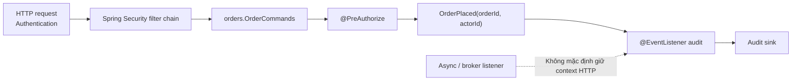
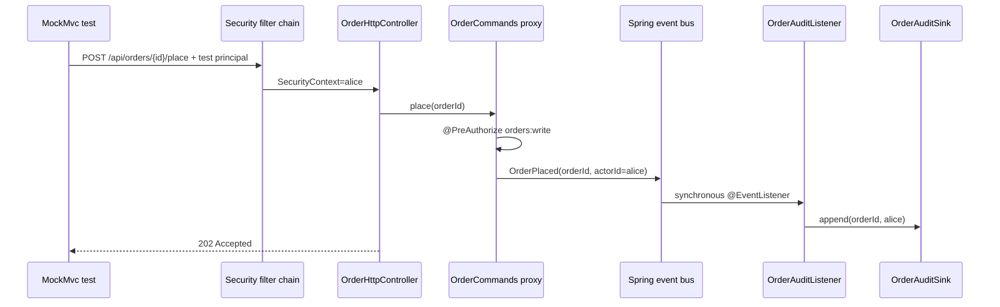
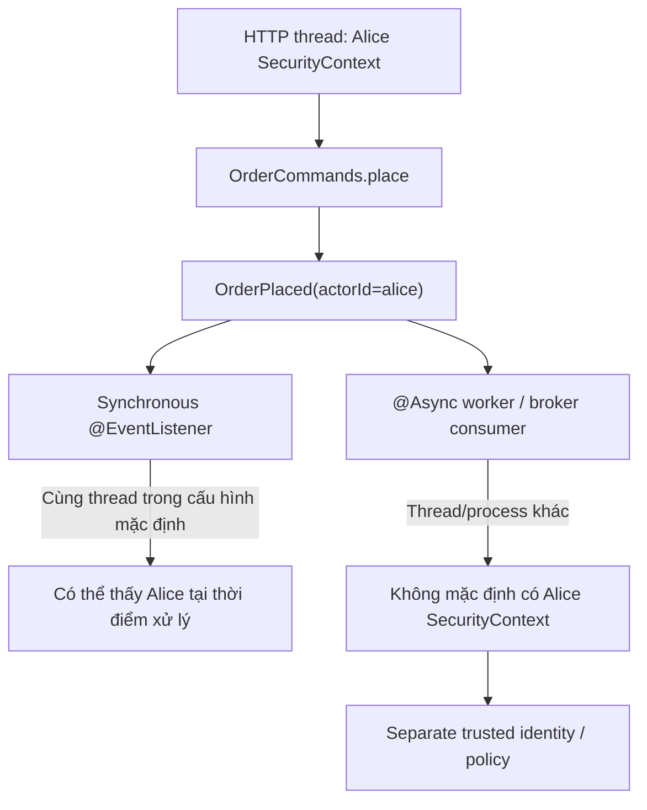
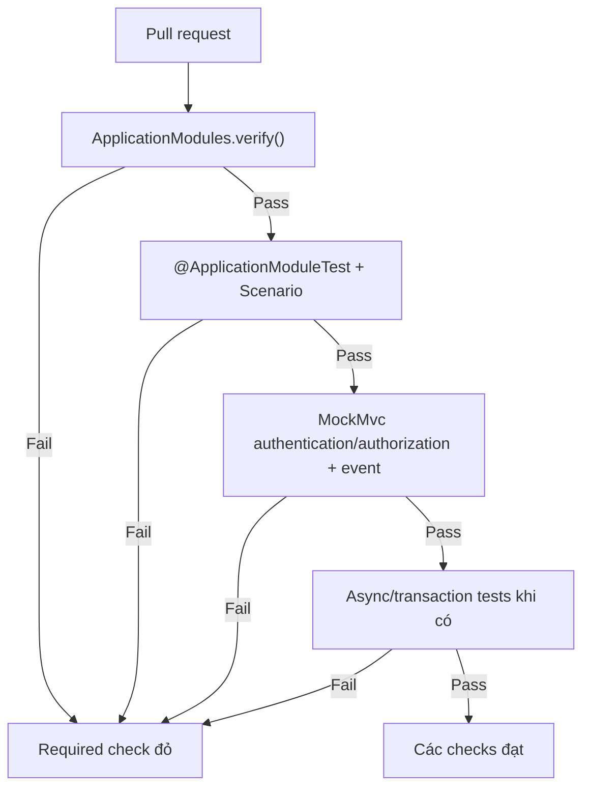

# Security context trong web hoặc event test

## 1. Xác định ranh giới cần kiểm chứng

Trong Spring Modulith, một lời gọi HTTP được xác thực có thể đi qua controller, gọi public module API rồi phát `ApplicationEvent` cho một listener khác. **Security context trong HTTP request** và **ngữ cảnh thực thi của event listener** không mặc nhiên là một thứ, đặc biệt khi event được xử lý bất đồng bộ, sau transaction commit hoặc qua broker.

Bài thuộc chương **Security testing** của học phần `SPRING_MODULITH_VERIFICATION_TESTING`. Mục tiêu học phần là kiểm chứng ranh giới bằng `ApplicationModules.verify()` và luật phụ thuộc module; thực hành `@ApplicationModuleTest`, event/database/integration test và quality gate CI. Ở đây chỉ tập trung sâu vào câu hỏi: **ai đang là principal tại thời điểm gọi module API và tại thời điểm xử lý event, và test nào chứng minh điều đó?**

Ba bất biến cần bảo vệ:

1. **HTTP → public module API:** principal đủ quyền mới được kích hoạt command; không đủ quyền thì không có business event.
2. **Module API → synchronous event:** event ghi nhận `actorId` lấy từ danh tính **đã được xác thực ở command boundary**, không tin dữ liệu caller tự khai.
3. **Async/event/broker:** listener không được coi `SecurityContextHolder` là bằng chứng user gốc vẫn còn; khi chuyển trust boundary, phải có chính sách identity và authorization rõ ràng.



**Phân biệt chứng cứ:** `@WithMockUser` hoặc MockMvc `user()` kiểm tra policy với test authentication, **không** kiểm tra chữ ký JWT hay credential thật. `@ApplicationModuleTest` kiểm Spring event và các bean trong module, **không tự chạy HTTP filter chain**. `ApplicationModules.verify()` kiểm phụ thuộc package, **không đọc principal**.

## 2. SecurityContext được thiết lập và tồn tại trong phạm vi nào?

`SecurityContextHolder.getContext().getAuthentication()` là cách một đoạn code Spring Security đọc authentication của luồng hiện tại. Với chiến lược mặc định, holder thường dùng **ThreadLocal**: ngữ cảnh gắn với thread, không tự động được sao chép một cách an toàn qua mọi executor, broker hoặc JVM.

| Đường thực thi | Context có được cấp từ đâu? | Điều test phải làm rõ |
| --- | --- | --- |
| HTTP request qua Spring Security | Filter chain xác thực/cấp authentication và quản lý vòng đời | Status, authority, principal ở controller và service |
| Unit test service bằng `new` | Không có Spring Test context tự tạo authentication | Phải thiết lập mock context thủ công nếu code phụ thuộc nó; không kiểm AOP |
| `@ApplicationModuleTest` với `@WithMockUser` | Spring Security Test tạo test authentication | Method security và event behavior qua Spring beans |
| `@EventListener` đồng bộ | Thường chạy trên thread publisher với multicaster đồng bộ mặc định | Context có thể đọc được **ở thời điểm đó**; không lấy làm hợp đồng vận chuyển |
| `@Async` / executor thread | Không mặc định kế thừa context theo cách có thể tin cậy | Cần propagation **có chủ đích** hoặc đưa trusted actor metadata vào event |
| `@TransactionalEventListener(AFTER_COMMIT)` | Phụ thuộc thời điểm callback, transaction và executor | Không giả định context luôn còn, cũng không mặc định listener chạy nếu test rollback |
| Kafka/RabbitMQ consumer | Thread/process xử lý message, không phải HTTP request gốc | Xác thực message/service identity và kiểm authorization riêng |

Nhầm lẫn hay gặp là gọi `SecurityContextHolder.getContext()` trong một listener background rồi **coi null là user nội bộ toàn quyền**. Điều đó là fail-open. Mặt khác, việc một synchronous listener nhìn thấy Alice trong test không chứng minh cùng listener sẽ nhìn thấy Alice khi chuyển sang `@Async`.

**Mục tiêu thiết kế:** thực hiện kiểm tra quyền trước khi phát event; đưa vào event những metadata audit tối thiểu đã được lấy từ **nguồn tin cậy**, nhưng không biến `actorId` trong payload thành quyền thực thi mới.

## 3. Kiến trúc cho ví dụ end-to-end: web → module API → event

Ta sử dụng một ứng dụng minh họa có module `orders`:

```text
com.example.shop
├── ShopApplication.java
└── orders
    ├── OrderCommands.java             # Public module API
    ├── OrderPlaced.java               # Published event
    └── internal
        ├── OrderCommandService.java
        ├── OrderHttpController.java
        ├── OrdersSecurityConfiguration.java
        ├── OrderAuditListener.java
        ├── OrderAuditSink.java
        └── LoggingOrderAuditSink.java
```

**Quy tắc nghiệp vụ của bài:** chỉ principal có authority `orders:write` mới được gọi `place(orderId)`. Service **không nhận actorId từ HTTP body**; nó đọc principal đã được Spring Security thiết lập, rồi publish `OrderPlaced(orderId, actorId)`. Listener xử lý event và gửi tới một audit sink.



Ví dụ dùng **listener đồng bộ** để test có điểm hoàn tất xác định. Audit sink được thay bằng Mockito trong bài integration: test chứng minh đường **HTTP filter → module API → event listener → audit port**, chứ chưa chứng minh database audit đã commit. Nếu cần persistence, dùng một bài database integration riêng.

### Public API và event

```java
// src/main/java/com/example/shop/orders/OrderCommands.java
package com.example.shop.orders;

import java.util.UUID;

public interface OrderCommands {
    void place(UUID orderId);
}
```

```java
// src/main/java/com/example/shop/orders/OrderPlaced.java
package com.example.shop.orders;

import java.util.UUID;

public record OrderPlaced(
        UUID orderId,
        String actorId
) {
}
```

`actorId` ở đây chỉ phục vụ **audit attribution**, không phải bearer token, mật khẩu hoặc bằng chứng cho phép một consumer bên ngoài tự cấp quyền. Trong ứng dụng thật, event còn có thể chứa `eventId`, thời gian và correlation ID phù hợp.

## 4. Implementation: lấy trusted principal tại command boundary

Service triển khai public module API:

```java
// src/main/java/com/example/shop/orders/internal/
// OrderCommandService.java
package com.example.shop.orders.internal;

import com.example.shop.orders.OrderCommands;
import com.example.shop.orders.OrderPlaced;
import java.util.UUID;
import org.springframework.context.ApplicationEventPublisher;
import org.springframework.security.access.prepost.PreAuthorize;
import org.springframework.security.core.Authentication;
import org.springframework.security.core.context.SecurityContextHolder;
import org.springframework.stereotype.Service;

@Service
class OrderCommandService implements OrderCommands {

    private final ApplicationEventPublisher events;

    OrderCommandService(ApplicationEventPublisher events) {
        this.events = events;
    }

    @Override
    @PreAuthorize(
        "isAuthenticated() and hasAuthority('orders:write')"
    )
    public void place(UUID orderId) {
        if (orderId == null) {
            throw new IllegalArgumentException("orderId required");
        }

        Authentication authentication =
                SecurityContextHolder.getContext()
                        .getAuthentication();

        String actorId = authentication.getName();

        events.publishEvent(new OrderPlaced(orderId, actorId));
    }
}
```

**Vì sao đặt `@PreAuthorize` trên service API?** Request HTTP đi qua filter chain trước, nhưng module khác cũng có thể gọi `OrderCommands` bằng dependency injection. Method security bảo vệ ranh giới Java chung thay vì chỉ một controller.

**Điểm kiểm tra quan trọng:**

- Phải gọi **Spring-managed `OrderCommands` bean/proxy**, không tự tạo service bằng `new`; nếu không, method-security AOP không chạy.
- `@EnableMethodSecurity` phải thực sự có mặt trong test và production context.
- `authentication.getName()` chỉ được dùng sau một policy yêu cầu authentication phù hợp; không dùng actor ID do client tự gửi.
- Nếu ứng dụng cần chống duplicate/ownership/tenant restrictions, đặt thêm policy nghiệp vụ/DB tại command boundary. Bài này tập trung vào **context identity và quyền write**.

### HTTP controller và method-security configuration

```java
// src/main/java/com/example/shop/orders/internal/
// OrderHttpController.java
package com.example.shop.orders.internal;

import com.example.shop.orders.OrderCommands;
import java.util.UUID;
import org.springframework.http.ResponseEntity;
import org.springframework.web.bind.annotation.PathVariable;
import org.springframework.web.bind.annotation.PostMapping;
import org.springframework.web.bind.annotation.RequestMapping;
import org.springframework.web.bind.annotation.RestController;

@RestController
@RequestMapping("/api/orders")
class OrderHttpController {

    private final OrderCommands commands;

    OrderHttpController(OrderCommands commands) {
        this.commands = commands;
    }

    @PostMapping("/{orderId}/place")
    public ResponseEntity<Void> place(@PathVariable UUID orderId) {
        commands.place(orderId);
        return ResponseEntity.accepted().build();
    }
}
```

```java
// src/main/java/com/example/shop/orders/internal/
// OrdersSecurityConfiguration.java
package com.example.shop.orders.internal;

import org.springframework.context.annotation.Bean;
import org.springframework.context.annotation.Configuration;
import org.springframework.security.config.Customizer;
import org.springframework.security.config.annotation.method
        .configuration.EnableMethodSecurity;
import org.springframework.security.config.annotation.web.builders.HttpSecurity;
import org.springframework.security.web.SecurityFilterChain;

@Configuration(proxyBeanMethods = false)
@EnableMethodSecurity
class OrdersSecurityConfiguration {

    @Bean
    SecurityFilterChain securityFilterChain(
            HttpSecurity http) throws Exception {
        return http
                .authorizeHttpRequests(auth ->
                        auth.anyRequest().authenticated())
                .httpBasic(Customizer.withDefaults())
                .build();
    }
}
```

Đây là **cấu hình minh họa** cho ứng dụng thử nghiệm: HTTP Basic tạo entry point để test phân biệt anonymous (401) và authenticated nhưng thiếu authority (403); test không gửi password thật. Với production OAuth2 resource server/JWT, cần cấu hình filter chain/`JwtAuthenticationConverter` theo thiết kế thật và **test riêng** claim mapping, signature/issuer/audience/expiry.

Vì HTTP `POST` thường chịu CSRF protection trong cấu hình dạng trên, bài MockMvc test bên dưới luôn dùng `csrf()`. Nếu production là stateless bearer API và đã có policy CSRF khác, phải test theo policy thực tế, không sao chép cấu hình này nguyên xi.

## 5. Event listener và audit port: không tái xác thực từ event

Audit port nội bộ:

```java
// src/main/java/com/example/shop/orders/internal/OrderAuditSink.java
package com.example.shop.orders.internal;

import java.util.UUID;

interface OrderAuditSink {
    void append(UUID orderId, String actorId);
}
```

Listener đồng bộ:

```java
// src/main/java/com/example/shop/orders/internal/
// OrderAuditListener.java
package com.example.shop.orders.internal;

import com.example.shop.orders.OrderPlaced;
import org.springframework.context.event.EventListener;
import org.springframework.stereotype.Component;

@Component
class OrderAuditListener {

    private final OrderAuditSink audit;

    OrderAuditListener(OrderAuditSink audit) {
        this.audit = audit;
    }

    @EventListener
    public void on(OrderPlaced event) {
        audit.append(event.orderId(), event.actorId());
    }
}
```

Một adapter tối giản cho môi trường minh họa:

```java
// src/main/java/com/example/shop/orders/internal/
// LoggingOrderAuditSink.java
package com.example.shop.orders.internal;

import java.util.UUID;
import org.slf4j.Logger;
import org.slf4j.LoggerFactory;
import org.springframework.stereotype.Component;

@Component
class LoggingOrderAuditSink implements OrderAuditSink {

    private static final Logger LOG =
            LoggerFactory.getLogger(LoggingOrderAuditSink.class);

    @Override
    public void append(UUID orderId, String actorId) {
        LOG.info("Order audit: orderId={} actorId={}",
                orderId, actorId);
    }
}
```

Trong production, một audit sink có thể ghi DB và đòi hỏi transaction/retention/access control; log trong ví dụ **không phải bằng chứng audit bền vững**. Bài test sẽ thay sink bằng `@MockitoBean` để quan sát input mà không tạo kết nối ngoài.

**Ranh giới tin cậy:** `OrderAuditListener` dùng `actorId` làm metadata để ghi nhận hành động **đã qua kiểm tra quyền ở command boundary**. Nếu ai đó có thể tự gọi `ApplicationEventPublisher.publishEvent(new OrderPlaced(..., "admin"))`, listener vẫn nhận event; vì vậy **không được coi `actorId` trong event là authentication hoặc quyền thanh toán**. Các subscriber thay đổi trạng thái quan trọng phải có chính sách tin cậy/authorization độc lập.

## 6. Ví dụ end-to-end: MockMvc → public API → event listener

Đây là bài integration test xuyên suốt đường in-process ở mục 3–5. Chạy Spring Boot context, Spring Security filters, method-security interceptor, event bus và listener thật; chỉ **audit sink** được mock.

```java
// src/test/java/com/example/shop/orders/internal/
// OrderWebEventSecurityIT.java
package com.example.shop.orders.internal;

import static org.mockito.Mockito.verify;
import static org.mockito.Mockito.verifyNoInteractions;
import static org.springframework.security.test.web.servlet.request
        .SecurityMockMvcRequestPostProcessors.anonymous;
import static org.springframework.security.test.web.servlet.request
        .SecurityMockMvcRequestPostProcessors.csrf;
import static org.springframework.security.test.web.servlet.request
        .SecurityMockMvcRequestPostProcessors.user;
import static org.springframework.test.web.servlet.request
        .MockMvcRequestBuilders.post;
import static org.springframework.test.web.servlet.result
        .MockMvcResultMatchers.status;

import java.util.UUID;
import org.junit.jupiter.api.Test;
import org.springframework.beans.factory.annotation.Autowired;
import org.springframework.boot.test.autoconfigure.web.servlet.AutoConfigureMockMvc;
import org.springframework.boot.test.context.SpringBootTest;
import org.springframework.security.core.authority.SimpleGrantedAuthority;
import org.springframework.test.context.bean.override.mockito.MockitoBean;
import org.springframework.test.web.servlet.MockMvc;

@SpringBootTest
@AutoConfigureMockMvc
class OrderWebEventSecurityIT {

    @Autowired
    MockMvc mvc;

    @MockitoBean
    OrderAuditSink audit;

    @Test
    void authenticatedWriterPublishesEventWithTrustedActor()
            throws Exception {
        UUID orderId = UUID.randomUUID();

        mvc.perform(
                post("/api/orders/{orderId}/place", orderId)
                        .with(user("alice").authorities(
                                new SimpleGrantedAuthority(
                                        "orders:write"
                                )))
                        .with(csrf())
        ).andExpect(status().isAccepted());

        verify(audit).append(orderId, "alice");
    }

    @Test
    void authenticatedReaderDoesNotPublishEvent()
            throws Exception {
        UUID orderId = UUID.randomUUID();

        mvc.perform(
                post("/api/orders/{orderId}/place", orderId)
                        .with(user("bob").authorities(
                                new SimpleGrantedAuthority(
                                        "orders:read"
                                )))
                        .with(csrf())
        ).andExpect(status().isForbidden());

        verifyNoInteractions(audit);
    }

    @Test
    void anonymousRequestCannotReachBusinessCommand()
            throws Exception {
        UUID orderId = UUID.randomUUID();

        mvc.perform(
                post("/api/orders/{orderId}/place", orderId)
                        .with(anonymous())
                        .with(csrf())
        ).andExpect(status().isUnauthorized());

        verifyNoInteractions(audit);
    }
}
```

**Điều kiện để ví dụ chạy:**

- Java/Spring Boot với Spring Security, `spring-security-test`, Spring Modulith dependencies và Mockito Test Bean Override của Spring Framework 6.2+.
- `ShopApplication` dùng `@SpringBootApplication` tại `com.example.shop` và package scan bao trùm `orders.internal`; `OrdersSecurityConfiguration` được đăng ký.
- `OrderCommandService` được inject qua Spring proxy. Handler `OrderAuditListener` chạy đồng bộ theo default multicaster; không dùng `@Async`.
- `OrderAuditSink` có implementation production `LoggingOrderAuditSink` và được thay bằng mock cho test. `@MockitoBean` mặc định reset mock giữa các test method; nếu tùy chỉnh reset policy thì phải quản lý state.
- Bài không yêu cầu DB hoặc Kafka broker; **end-to-end ở đây là toàn bộ đường HTTP → application event → audit port trong một process**, không phải end-to-end tới database/nhà cung cấp ngoài.

**Ba bằng chứng độc lập:**

| Trường hợp | HTTP | Event side effect | Kết luận |
| --- | --- | --- | --- |
| Alice có `orders:write` | 202 | Audit nhận đúng `actorId=alice` | Context được gắn vào command, event chứa trusted actor |
| Bob chỉ có `orders:read` | 403 | Audit **không bị gọi** | Method security từ chối và không phát event |
| Anonymous | 401 | Audit **không bị gọi** | Filter chain chặn trước business command |

Đừng chỉ assert HTTP status: một implementation có thể trả 403 **sau khi** đã phát event nếu policy đặt sai chỗ. `verifyNoInteractions(audit)` giúp bắt tác động không mong muốn trên listener đồng bộ.

**Giới hạn:** `user(...)` của Spring Security Test **không xác thực HTTP Basic password hoặc JWT signature thật**. Nó gắn một test principal vào MockMvc request để kiểm security rules và wiring.

## 7. Module event test: `@WithMockUser` + `@ApplicationModuleTest` + `Scenario`

Khi chỉ cần kiểm public module API và event behavior, không cần HTTP controller/filter chain, module test có thể gọn hơn.

```java
// src/test/java/com/example/shop/orders/internal/
// OrderModuleSecurityTests.java
package com.example.shop.orders.internal;

import static org.junit.jupiter.api.Assertions.assertThrows;
import static org.mockito.Mockito.verify;
import static org.mockito.Mockito.verifyNoInteractions;

import com.example.shop.orders.OrderCommands;
import com.example.shop.orders.OrderPlaced;
import java.util.UUID;
import org.junit.jupiter.api.Test;
import org.springframework.beans.factory.annotation.Autowired;
import org.springframework.context.annotation.Import;
import org.springframework.modulith.test.ApplicationModuleTest;
import org.springframework.modulith.test.Scenario;
import org.springframework.security.access.AccessDeniedException;
import org.springframework.security.test.context.support.WithMockUser;
import org.springframework.test.context.bean.override.mockito.MockitoBean;

@ApplicationModuleTest
@Import(OrdersSecurityConfiguration.class)
class OrderModuleSecurityTests {

    @Autowired
    OrderCommands commands;

    @MockitoBean
    OrderAuditSink audit;

    @Test
    @WithMockUser(
        username = "alice",
        authorities = "orders:write"
    )
    void commandEmitsEventAttributedToCurrentPrincipal(
            Scenario scenario) {
        UUID orderId = UUID.randomUUID();

        scenario.stimulate(() -> commands.place(orderId))
                .andWaitForEventOfType(OrderPlaced.class)
                .matching(event ->
                        event.orderId().equals(orderId)
                                && event.actorId().equals("alice"))
                .toArrive();

        verify(audit).append(orderId, "alice");
    }

    @Test
    @WithMockUser(
        username = "bob",
        authorities = "orders:read"
    )
    void unauthorizedCommandDoesNotReachListener() {
        UUID orderId = UUID.randomUUID();

        assertThrows(AccessDeniedException.class,
                () -> commands.place(orderId));

        verifyNoInteractions(audit);
    }
}
```

**Ý nghĩa:**

- `@ApplicationModuleTest` chỉ bootstrap phạm vi module phù hợp; `@Import` bảo đảm config method security của ví dụ được đưa vào test context khi cần.
- `@WithMockUser` thiết lập authentication test cho luồng test, không cần password/token có hiệu lực.
- `Scenario.stimulate(...)` **gọi public API thật**, rồi chờ một `OrderPlaced` **do use case phát**; không tự publish `OrderPlaced` rồi “quan sát lại input của chính test”.
- `verify(audit)` chứng minh listener được đăng ký và nhận đúng actor ID trong cấu hình đồng bộ.
- Test Bob bảo vệ method-security enforcement. Nếu bỏ `@EnableMethodSecurity` hoặc `@PreAuthorize`, test deny phải đỏ.

**Khác với web test:** bài này không kiểm HTTP authentication filter, status 401/403 hay CSRF. Ngược lại, HTTP test ở mục 6 kiểm đường controller và filter chain thực tế mà không cần kéo các module ngoài vào test.

## 8. Event bất đồng bộ và broker: không mượn SecurityContext HTTP

Một thay đổi tưởng nhỏ có thể làm sai giả định:

```java
@Async
@EventListener
public void on(OrderPlaced event) {
    Authentication current = SecurityContextHolder
            .getContext().getAuthentication();

    // current KHÔNG mặc định là Alice trên worker thread.
}
```

Với `@Async` (khi ứng dụng đã bật `@EnableAsync` và listener thực sự chạy qua executor), listener thường chạy trên thread pool khác. `SecurityContextHolder` mặc định là ThreadLocal nên authentication HTTP **không tự động được bảo đảm** ở worker thread. Nếu thiếu `@EnableAsync` hoặc cấu hình proxy tương ứng, gắn annotation thôi có thể chưa khiến lời gọi trở thành bất đồng bộ; test phải xác nhận đường thực thi thật.

Nếu listener **chỉ cần attribution cho audit**, hãy dùng `event.actorId()` đã được command tạo từ trusted authentication như mục 4; không cần propagate context.

Nếu một tác vụ async **thật sự phải thực hiện thay mặt user**, phải thiết kế việc chuyển context có chủ đích, ví dụ sử dụng `DelegatingSecurityContextAsyncTaskExecutor` cho executor cụ thể, và kiểm tra cleanup. Tuy nhiên:

- Không giả định executor wrapper tự áp dụng cho mọi `@Async` nếu chưa cấu hình đúng executor được dùng.
- Không sử dụng propagation để vượt qua logic kiểm quyền của task; quyền có thể đã thay đổi từ lúc gửi sự kiện.
- Không lưu `SecurityContext`/bearer token vào event bền vững hoặc gửi qua Kafka chỉ để listener có quyền.
- Với Kafka/RabbitMQ hoặc process khác, một message **không phải authentication**. Xác định trust boundary riêng (service identity, signed/trusted message metadata, permissions/ownership lookup).



### Test đúng khi refactor từ sync sang async

Nếu chuyển `OrderAuditListener` sang `@Async`, **đừng giữ nguyên assertion tức thời** `verify(audit).append(...)` rồi chữa bằng `Thread.sleep(...)`. Hãy dùng `verify(audit, timeout(...))`, Awaitility hoặc `Scenario` với deadline hữu hạn, và nếu nghiệp vụ cần đảm bảo thread context, test riêng bằng executor thật.

**Bẫy đặc biệt:** `actorId` trong event là **metadata**, không chứng minh người gửi event có quyền. Một test gọi `events.publishEvent(new OrderPlaced(..., "admin"))` mà thấy audit nhận “admin” **không phải test authorization**. Test authorization phải gọi **`OrderCommands.place(...)` dưới principal cụ thể**, như ở mục 6–7.

## 9. Security context lifecycle, transaction và dữ liệu thử nghiệm

### Context không được rò rỉ giữa các test

`@WithMockUser` được Spring Security Test quản lý trong lifecycle test, và `SecurityContext` được làm sạch theo listener của framework. Khi test tự set context bằng tay, bắt buộc cleanup:

```java
import org.springframework.security.core.context.SecurityContextHolder;

try {
    // Nếu test thật sự cần set Authentication thủ công:
    // SecurityContextHolder.getContext().setAuthentication(testAuth);
    // Kích hoạt code cần kiểm tra.
} finally {
    SecurityContextHolder.clearContext();
}
```

`testAuth` là authentication do test tạo, không phải credential production. Ưu tiên `@WithMockUser`, `user()` hoặc `jwt()` của Spring Security Test để tránh manual context lifecycle khi không cần thiết.

Với request MockMvc, **không kiểm principal bằng cách đọc `SecurityContextHolder` trên test thread sau khi request kết thúc**: filter chain có thể đã cleanup request context đúng thiết kế. Hãy assert dữ liệu đã được ghi tại boundary trong request/event hoặc dùng test-specific probe có kiểm soát.

### `@TransactionalEventListener` thay đổi thời điểm quan sát

Nếu listener chuyển từ `@EventListener` sang `@TransactionalEventListener(phase = AFTER_COMMIT)`, một test `@Transactional` rồi rollback có thể **không bao giờ kích hoạt listener AFTER_COMMIT**. Khi đó:

1. Dùng service thực chạy transaction và commit theo policy.
2. Đợi một tín hiệu hoàn tất với timeout hữu hạn.
3. Không suy ra callback giữ nguyên user context nếu chuyển qua executor/callback khác.
4. Kiểm tra không phát event side effect khi DB transaction rollback, nếu đó là invariant nghiệp vụ.
5. Không dùng publish event trong test đơn thuần để thay bài xác nhận transaction.

Cần phân biệt **event test**, **transaction test** và **broker integration test**. Một listener đồng bộ có thể chạy đúng nhưng publication sau commit hoặc Kafka consumer xử lý khác context.

### Dữ liệu và identity phải cô lập

Tạo `orderId` mới cho mỗi test và mock reset giữa tests. Khi cần DB, dùng test database/schema/transaction phù hợp; query đúng `orderId`. Không nhận nhầm audit của test khác và không dùng một principal global được gán cho cả test suite.

## 10. Ma trận kiểm chứng và những lỗi hay gặp

| Kịch bản | Cách kích hoạt | Kỳ vọng cần assert | Bẫy thường gặp |
| --- | --- | --- | --- |
| Writer hợp lệ | MockMvc `user("alice")` + `orders:write` | 202; event audit actor Alice | Chỉ assert status, không assert event |
| Thiếu quyền | MockMvc `user("bob")` + `orders:read` | 403; không audit | Method security không bật nên event vẫn được phát |
| Anonymous | MockMvc `anonymous()` | 401; không audit | Test không qua filter chain |
| Module command hợp lệ | `@WithMockUser` + `Scenario.stimulate(...)` | Event đúng orderId/actorId | Test tự publish event đầu vào |
| Module command bị chặn | `@WithMockUser` thiếu authority | `AccessDeniedException`; không event | Gọi bean bằng `new`, bỏ qua AOP |
| Listener đồng bộ | Event bus mặc định | Audit nhận actor từ event | Đọc SecurityContext như hợp đồng bền vững |
| Listener `@Async` | Executor thật | Đúng actor metadata hoặc context propagation có chủ đích | Giả định ThreadLocal được giữ |
| Kafka/RabbitMQ consumer | Message broker fixture | Identity/trust policy riêng | Tin actorId trong payload như principal |
| Transaction AFTER_COMMIT | Commit thật | Side effect xuất hiện sau commit | Test rollback và đợi vô hạn |
| HTTP JWT | Filter/decoder test tương ứng | Claim mapping, signature/issuer/expiry đúng | `jwt()` test principal bị nhầm là crypto verification |
| Cô lập test | Principal và ID mới | Không dùng state từ test trước | Rò rỉ SecurityContext hoặc mock interactions |
| Architecture | `ApplicationModules.verify()` | Không có dependency sai | Tưởng verify() kiểm authentication |

### Một số anti-pattern cần chặn

**1. Chỉ test listener bằng `publishEvent` rồi tuyên bố đã kiểm auth.**

```java
events.publishEvent(
        new OrderPlaced(orderId, "admin")
);
```

Đây là dữ liệu do test tự tạo, không đi qua `OrderCommands.place` và `@PreAuthorize`. Nó chỉ có thể giúp test listener contract, **không chứng minh nguồn event được cấp quyền**.

**2. Dùng `@WithMockUser(roles = "ADMIN")` cho `hasAuthority('orders:write')` rồi chờ allow.**

`roles` mặc định tạo authority có prefix `ROLE_`; muốn policy `orders:write` thì dùng `authorities = "orders:write"` hoặc thiết kế mapping rõ ràng.

**3. Dùng `new OrderCommandService(...)` để kiểm `@PreAuthorize`.**

Test không đi qua Spring proxy, annotation có thể không được thực thi. Sử dụng `@Autowired OrderCommands` trong test context.

**4. Async listener tin tưởng vào request context cũ.**

Không thể giả định ThreadLocal truyền đúng qua thread pool; đưa attribution vào event và kiểm tra chính sách của tác vụ riêng khi cần.

**5. Khẳng định `@WithMockUser` hoặc `jwt()` đã test JWT signature.**

Hai phương thức dựng authentication cho test; muốn kiểm JWT crypto cần `JwtDecoder`/JWKS fixture với khóa test, không dùng signing key thật.

## 11. Checklist và quality gate trước khi merge

Một quality gate cho phạm vi bài này nên gồm:

- **Security filter chain:** web test qua `MockMvc` với security filters bật; phân biệt 202/403/401 theo policy.
- **Method security:** `@EnableMethodSecurity` có mặt; gọi bean `OrderCommands` qua Spring proxy, không `new` để kiểm annotation.
- **Test principal:** dùng `user()`/`@WithMockUser`/`jwt()` của `spring-security-test`; không dùng credential thật.
- **Identity capture:** `actorId` được lấy tại command boundary từ authentication đã được xác thực, không lấy từ request body.
- **Event behavior:** `@ApplicationModuleTest` + `Scenario.stimulate(...)` chứng minh command thực phát event đúng; không quan sát lại event tự publish rồi gọi là security test.
- **Negative effects:** thiếu quyền và anonymous không gửi event, không ghi audit hoặc tạo business state.
- **Async boundary:** khi thay thành `@Async`/broker, không dựa vào ThreadLocal; có policy context propagation/service identity rõ.
- **Transaction:** nếu listener AFTER_COMMIT, test kích hoạt commit thật và kiểm callback đúng thời điểm.
- **Lifecycle:** không để `SecurityContext` hoặc mock calls rò rỉ giữa các test; dữ liệu/correlation ID riêng.
- **Architecture:** `ApplicationModules.verify()` chạy độc lập để phát hiện dependency sai; không coi nó là auth test.
- **CI:** cả module test và web security test **thực sự được runner chạy**; báo cáo test có case allowed/denied/anonymous.
- **Required checks:** lỗi authorization, event hoặc transaction phải làm job đỏ; không `@Disabled`/`continue-on-error: true` cho gate bắt buộc.



Ví dụ lệnh chạy phụ thuộc build setup:

```bash
# Maven unit/module tests do Surefire phát hiện
./mvnw test

# Maven integration tests nếu Failsafe đã được cấu hình
./mvnw verify

# Gradle verification tasks do dự án liên kết
./gradlew test
./gradlew check
```

**Không mặc định** class tên `*IT` được Maven Surefire chạy ở pha `test`. Nếu ví dụ `OrderWebEventSecurityIT` thuộc nhóm integration tests, cần cấu hình Failsafe/Gradle task và CI báo cáo đúng test được thực thi. Tương tự, `./gradlew check` chỉ chạy những verification task đã được liên kết.

**Kết luận:** Hãy xem `SecurityContext` là **ngữ cảnh bảo mật gắn với điểm thực thi**, không phải một phần mặc định của message. Trong web test, kiểm principal, filter chain và method API; trong module event test, gọi use case qua Spring proxy dưới `@WithMockUser`; khi event đi async/broker, chuyển sang policy identity rõ ràng và không tự trao quyền từ `actorId`. Kết hợp các bài test này với `ApplicationModules.verify()`, test transaction khi cần và CI required checks để giữ cả **ranh giới kiến trúc** lẫn **ranh giới bảo mật**.
