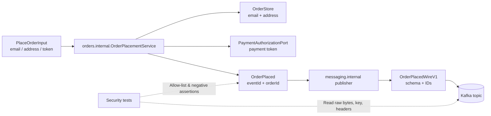
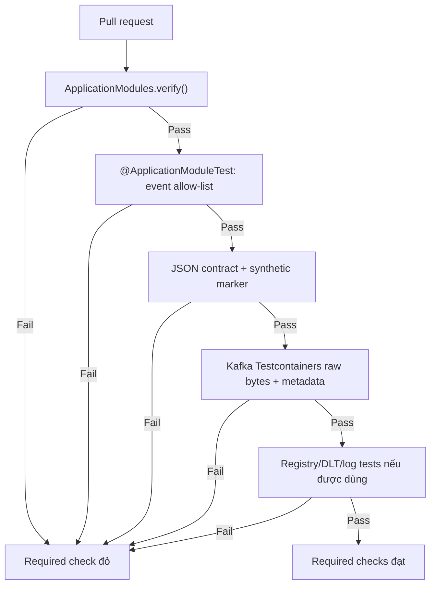

# Kiểm tra event không làm lộ dữ liệu nhạy cảm

## 1. Ranh giới rò rỉ: một event có thể đi xa hơn nơi được publish

Trong Spring Modulith, `ApplicationEventPublisher.publishEvent(...)` thường bắt đầu bằng một object Java trong cùng ứng dụng. Tuy nhiên, event có thể được nhiều listener quan sát, được ghi nhận bởi cơ chế quản lý publication, đưa qua broker, chuyển đến dead-letter topic hoặc xuất hiện trong log và tracing. Vì vậy, một trường dữ liệu nhạy cảm được đưa vào event có nguy cơ **lan sang nhiều nơi ngoài phạm vi ban đầu của use case**.

Bài **“Kiểm tra event không làm lộ dữ liệu nhạy cảm”** thuộc chương **Security testing** của học phần `SPRING_MODULITH_VERIFICATION_TESTING`. Trong học phần, `ApplicationModules.verify()` bảo vệ luật phụ thuộc giữa các module, `@ApplicationModuleTest` kiểm tra hành vi module, còn test sự kiện, database, tích hợp và quality gate CI bảo vệ các ranh giới runtime. Riêng bài này, chúng ta sẽ chứng minh **dữ liệu đầu vào nhạy cảm không bị đưa vào event hoặc message được xuất bản**.

Những điểm cần phân biệt:

| Bề mặt rò rỉ | Ví dụ | Vì sao test phải kiểm? |
| --- | --- | --- |
| **Application event** | `OrderPlaced` chứa email hoặc access token | Listener/module không có nhu cầu vẫn có thể nhận dữ liệu |
| **Serialized payload** | JSON gửi Kafka có `deliveryAddress` | Payload có thể được lưu và sao chép nhiều lần |
| **Key và headers** | Kafka key là email, header chứa `Authorization` | Kiểm tra riêng body sẽ bỏ sót |
| **Publication registry / outbox** | Record publication chứa serialized event | Có thể lưu lại dữ liệu theo retention của database |
| **Retry, DLT/DLQ** | Message lỗi bị gửi nguyên bản sang topic khác | Dữ liệu đi qua thêm destination và quyền truy cập |
| **Log, exception, tracing** | Log cả `event.toString()` hoặc baggage có PII | Dữ liệu có thể vào hệ thống quan sát |
| **Fixture và CI artifact** | Test report in ra raw JSON với token thật | Secret có thể nằm trong logs/artifacts dù request đã thất bại |

**Bất biến của bài:** command đầu vào *có thể* chứa email, địa chỉ và một payment token; **public event `OrderPlaced` và wire message `OrderPlacedWireV1` chỉ chứa `eventId` và `orderId`** (wire message thêm `schemaVersion`). Đây là hợp đồng allow-list: bất cứ field mới nào cũng phải được review và cập nhật test có chủ đích.

**Không đồng nhất “ID” với “vô hại”:** `orderId` hoặc `eventId` vẫn có thể là dữ liệu liên kết được với một người nếu bên nhận có quyền tra cứu. Chỉ gửi các ID cần thiết, hạn chế quyền đọc topic, quy định retention và bảo vệ quyền truy cập ở consumer. Bài test tập trung ngăn phát tán **PII/credential trực tiếp** và các field ngoài contract; nó không tự chứng minh tuân thủ mọi yêu cầu về quyền riêng tư.

## 2. Xác định dữ liệu được phép xuất bản trước khi viết code

Ví dụ hệ thống nhận một thao tác đặt hàng có các giá trị sau:

| Dữ liệu đầu vào | Nhạy cảm? | Có xuất hiện trong `OrderPlaced`? | Ghi chú |
| --- | --- | --- | --- |
| `orderId` | Có thể liên kết đến người dùng | **Có, cần thiết** | Khóa tham chiếu nghiệp vụ; consumer phải có quyền đọc |
| `eventId` | Metadata định danh sự kiện | **Có, cần thiết** | Correlation/dedup; không mã hóa từ PII |
| `customerEmail` | PII | **Không** | Chỉ lưu/tra cứu ở nơi có quyền và nhu cầu |
| `deliveryAddress` | PII | **Không** | Không chuyển cho mọi subscriber |
| `paymentToken` | Credential/reference nhạy cảm, dù ngắn hạn | **Không** | Chỉ đi đến payment port được phép, không log |
| `schemaVersion` | Contract metadata | Chỉ trong **wire DTO** | Không mang dữ liệu khách hàng |

**Quy tắc thiết kế:**

1. Dùng **allow-list** field cho event thay vì serialize cả request/entity rồi cố xóa một vài trường.
2. Tách **command chứa dữ liệu đầu vào** khỏi **domain event tối giản** và **transport DTO**.
3. Không chuyển `paymentToken`, bearer JWT, password, private key hoặc dữ liệu thẻ vào event, header, key hay audit log.
4. Đừng ghi `customerEmail` vào Kafka key chỉ vì cần phân vùng theo người mua; key có thể hiển thị trong công cụ vận hành.
5. Nếu một consumer thật sự cần địa chỉ giao hàng, thiết kế **hợp đồng/luồng riêng có kiểm soát truy cập, retention và mục đích sử dụng**; không biến event chung thành bản sao tất cả PII.
6. Không dùng PII để tạo `eventId`, ví dụ hash email không salt hay ghép mã khách hàng vào ID. Một giá trị được hash vẫn có thể bị liên kết hoặc đoán.

### Không đưa secret thật vào test

Bài sử dụng các marker tổng hợp có thể nhận biết khi rò rỉ:

```text
customerEmail   = synthetic.person@example.invalid
deliveryAddress = SENTINEL-PRIVATE-ADDRESS-712
paymentToken    = synthetic-not-a-live-payment-token-712
```

Tên miền `example.invalid` và token phía trên **không có giá trị xác thực**. Đây không phải thông tin của người thật hay sandbox credential đang hoạt động. Trong CI, không inject khóa production/sandbox chỉ để kiểm thử privacy của event.

## 3. Thiết kế một luồng end-to-end với event tối giản

Ví dụ hai application module:

```text
com.example.shop
├── ShopApplication.java
├── orders
│   ├── PlaceOrderInput.java
│   ├── OrderPlacement.java
│   ├── OrderPlaced.java
│   └── internal
│       ├── OrderPlacementService.java
│       ├── OrderStore.java
│       └── PaymentAuthorizationPort.java
└── messaging
    ├── OrderPlacedWireV1.java
    └── internal
        └── OrderPlacedKafkaPublisher.java
```

`orders` nhận dữ liệu nhạy cảm trong command và gọi các port nội bộ có phạm vi cụ thể. Event `OrderPlaced` nằm trong API module để consumer được phép có thể tham chiếu, nhưng nó **không** mang theo email, địa chỉ hoặc payment token. `messaging` chuyển event thành một payload dành cho broker.



### Command đầu vào: không tự tạo `toString()` lộ token

Một `record` Java tự sinh `toString()` với toàn bộ thành phần. Với input chứa token, **không log record nguyên vẹn**. Ví dụ này dùng class thông thường và chủ động che các field nhạy cảm:

```java
// src/main/java/com/example/shop/orders/PlaceOrderInput.java
package com.example.shop.orders;

import java.util.Objects;
import java.util.UUID;

public final class PlaceOrderInput {

    private final UUID orderId;
    private final String customerEmail;
    private final String deliveryAddress;
    private final String paymentToken;

    public PlaceOrderInput(
            UUID orderId,
            String customerEmail,
            String deliveryAddress,
            String paymentToken) {
        this.orderId = Objects.requireNonNull(orderId);
        this.customerEmail = Objects.requireNonNull(customerEmail);
        this.deliveryAddress = Objects.requireNonNull(deliveryAddress);
        this.paymentToken = Objects.requireNonNull(paymentToken);
    }

    public UUID orderId() { return orderId; }
    public String customerEmail() { return customerEmail; }
    public String deliveryAddress() { return deliveryAddress; }
    public String paymentToken() { return paymentToken; }

    @Override
    public String toString() {
        return "PlaceOrderInput[orderId=" + orderId
                + ", sensitiveFields=REDACTED]";
    }
}
```

`toString()` redaction là một lớp phòng vệ, **không phải phép bảo đảm token sẽ không bị lộ theo đường khác**. Đừng log nguyên request body, serialize input vào event, hoặc đưa `paymentToken` vào exception.

### Public API và domain event

```java
// src/main/java/com/example/shop/orders/OrderPlacement.java
package com.example.shop.orders;

public interface OrderPlacement {
    void place(PlaceOrderInput input);
}
```

```java
// src/main/java/com/example/shop/orders/OrderPlaced.java
package com.example.shop.orders;

import java.util.UUID;

public record OrderPlaced(
        UUID eventId,
        UUID orderId
) {
}
```

Đây là **event allow-list**: chỉ hai ID. Không có field `customerEmail`/`deliveryAddress`/`paymentToken`, không chứa cả `PlaceOrderInput` hay entity nội bộ.

### Service phát event sau khi hoàn thành các bước của ví dụ

```java
// src/main/java/com/example/shop/orders/internal/
// OrderPlacementService.java
package com.example.shop.orders.internal;

import com.example.shop.orders.OrderPlaced;
import com.example.shop.orders.OrderPlacement;
import com.example.shop.orders.PlaceOrderInput;
import java.util.UUID;
import org.springframework.context.ApplicationEventPublisher;
import org.springframework.stereotype.Service;

@Service
class OrderPlacementService implements OrderPlacement {

    private final OrderStore store;
    private final PaymentAuthorizationPort payments;
    private final ApplicationEventPublisher events;

    OrderPlacementService(
            OrderStore store,
            PaymentAuthorizationPort payments,
            ApplicationEventPublisher events) {
        this.store = store;
        this.payments = payments;
        this.events = events;
    }

    @Override
    public void place(PlaceOrderInput input) {
        store.save(
                input.orderId(),
                input.customerEmail(),
                input.deliveryAddress()
        );
        payments.authorize(input.orderId(), input.paymentToken());

        events.publishEvent(new OrderPlaced(
                UUID.randomUUID(), input.orderId()
        ));
    }
}
```

Hai port nội bộ:

```java
// src/main/java/com/example/shop/orders/internal/OrderStore.java
package com.example.shop.orders.internal;

import java.util.UUID;

interface OrderStore {
    void save(UUID orderId, String email, String deliveryAddress);
}
```

```java
// src/main/java/com/example/shop/orders/internal/
// PaymentAuthorizationPort.java
package com.example.shop.orders.internal;

import java.util.UUID;

interface PaymentAuthorizationPort {
    void authorize(UUID orderId, String paymentToken);
}
```

**Giới hạn chủ ý của ví dụ:** code tập trung vào **data minimization của event**, chưa xây dựng workflow payment production. Trong hệ thống thật, gọi payment provider và ghi database cần transaction, idempotency, error recovery và chính sách lưu PII riêng; không xem các lời gọi tuần tự trên là bảo đảm atomic. Phần test sẽ thay hai port bằng Mockito để tránh đưa PII ra database hoặc provider thật.

## 4. Transport DTO và publisher: giữ allow-list đến tận bytes

Wire contract của module `messaging`:

```java
// src/main/java/com/example/shop/messaging/
// OrderPlacedWireV1.java
package com.example.shop.messaging;

import java.util.Objects;
import java.util.UUID;

public record OrderPlacedWireV1(
        int schemaVersion,
        UUID eventId,
        UUID orderId
) {
    public OrderPlacedWireV1 {
        if (schemaVersion != 1) {
            throw new IllegalArgumentException(
                    "Only wire schema V1 is supported"
            );
        }
        Objects.requireNonNull(eventId, "eventId");
        Objects.requireNonNull(orderId, "orderId");
    }
}
```

Adapter nhận Spring event rồi gửi Kafka:

```java
// src/main/java/com/example/shop/messaging/internal/
// OrderPlacedKafkaPublisher.java
package com.example.shop.messaging.internal;

import com.example.shop.messaging.OrderPlacedWireV1;
import com.example.shop.orders.OrderPlaced;
import org.springframework.beans.factory.annotation.Value;
import org.springframework.context.event.EventListener;
import org.springframework.kafka.core.KafkaTemplate;
import org.springframework.stereotype.Component;

@Component
class OrderPlacedKafkaPublisher {

    private final KafkaTemplate<String, OrderPlacedWireV1> kafka;
    private final String topic;

    OrderPlacedKafkaPublisher(
            KafkaTemplate<String, OrderPlacedWireV1> kafka,
            @Value("${app.messaging.order-topic}") String topic) {
        this.kafka = kafka;
        this.topic = topic;
    }

    @EventListener
    void on(OrderPlaced event) {
        var message = new OrderPlacedWireV1(
                1, event.eventId(), event.orderId()
        );

        kafka.send(topic, event.orderId().toString(), message);
    }
}
```

Những gì được/không được gửi:

- Kafka **value**: JSON của `OrderPlacedWireV1`, chỉ `schemaVersion`, `eventId`, `orderId`.
- Kafka **key**: `orderId`, không phải email hay token.
- Kafka **headers**: không chủ động thêm `Authorization` hoặc PII.
- Java package/class type header: trong cấu hình bên dưới được tắt để tránh phụ thuộc vào tên class Java trong wire contract.

Cấu hình producer minh họa:

```yaml
app:
  messaging:
    order-topic: orders.placed.v1

spring:
  kafka:
    producer:
      key-serializer: org.apache.kafka.common.serialization.StringSerializer
      value-serializer: org.springframework.kafka.support.serializer.JsonSerializer
      properties:
        spring.json.add.type.headers: false
```

`KafkaTemplate.send(...)` chạy bất đồng bộ; gọi xong **chưa chứng minh** broker đã nhận hoặc consumer đã xử lý. Bài end-to-end ở mục tiếp theo sẽ **poll raw bytes từ broker thật**, thay vì chỉ dùng Mockito `verify(kafka).send(...)`.

**Điểm tinh tế:** tắt Java type headers không loại trừ mọi header do framework/custom interceptor khác thêm. Security test phải **đọc thực tế Kafka record headers**, không chỉ dựa vào YAML.

## 5. Một ví dụ end-to-end: command chứa marker → Kafka record không chứa marker

Bài này chạy đường:

**`OrderPlacement.place(...)` → Spring `OrderPlaced` → `@EventListener` publisher → Kafka `JsonSerializer` → Kafka broker → test consumer đọc bytes**.

Các port lưu PII/authorize payment được mock. Nhờ đó, test dùng **marker giả** để chứng minh dữ liệu đầu vào tới đúng collaborator nhưng **không đi vào payload, key hoặc headers**.

### Kafka Testcontainers và Spring context

```java
// src/test/java/com/example/shop/orders/internal/
// OrderEventNoLeakIT.java
package com.example.shop.orders.internal;

import com.example.shop.orders.OrderPlacement;
import com.example.shop.orders.PlaceOrderInput;
import com.fasterxml.jackson.databind.ObjectMapper;
import java.util.UUID;
import org.apache.kafka.clients.admin.NewTopic;
import org.springframework.beans.factory.annotation.Autowired;
import org.springframework.boot.test.context.SpringBootTest;
import org.springframework.context.annotation.Bean;
import org.springframework.boot.test.context.TestConfiguration;
import org.springframework.context.annotation.Import;
import org.springframework.kafka.config.TopicBuilder;
import org.springframework.test.context.DynamicPropertyRegistry;
import org.springframework.test.context.DynamicPropertySource;
import org.springframework.test.context.bean.override.mockito.MockitoBean;
import org.testcontainers.junit.jupiter.Container;
import org.testcontainers.junit.jupiter.Testcontainers;
import org.testcontainers.kafka.KafkaContainer;
import org.testcontainers.utility.DockerImageName;

@SpringBootTest
@Testcontainers
@Import(OrderEventNoLeakIT.TestTopics.class)
class OrderEventNoLeakIT {

    static final String TOPIC =
            "orders.placed.it." + UUID.randomUUID()
                    .toString().replace("-", "");

    @Container
    static final KafkaContainer KAFKA =
            new KafkaContainer(
                    DockerImageName.parse("apache/kafka:3.8.0")
            );

    @DynamicPropertySource
    static void properties(DynamicPropertyRegistry registry) {
        registry.add(
                "spring.kafka.bootstrap-servers",
                KAFKA::getBootstrapServers
        );
        registry.add("app.messaging.order-topic", () -> TOPIC);
    }

    @TestConfiguration
    static class TestTopics {
        @Bean
        NewTopic ordersTopic() {
            return TopicBuilder.name(TOPIC)
                    .partitions(1).replicas(1).build();
        }
    }

    @Autowired
    OrderPlacement orders;

    @MockitoBean
    OrderStore store;

    @MockitoBean
    PaymentAuthorizationPort payments;

    private final ObjectMapper json = new ObjectMapper();

    // Phương thức @Test cùng class ở đoạn bên dưới.
}
```

**Điều kiện để chạy:** Spring Boot/Spring Kafka, Jackson 2, JUnit Jupiter, Testcontainers Kafka/JUnit và Docker; `@MockitoBean` thuộc Spring Framework 6.2+; đường KafkaContainer minh họa cho thế hệ Testcontainers tương thích. Nếu project dùng các phiên bản khác, đồng bộ dependency/BOM và API tương ứng. `NewTopic` cần Spring Kafka admin được cấu hình để tạo topic. Ứng dụng thật cần implementation cho các port khi chạy production; ở test chúng được thay bằng Mockito.

Không sử dụng bất kỳ **payment token hoặc email thật** nào trong toàn bộ ví dụ.

### Test body: đọc raw value, key và headers

Đặt method này **trong class `OrderEventNoLeakIT`**, cùng test setup phía trên:

```java
@Test
void sensitiveInputDoesNotAppearInPublishedRecord()
        throws Exception {

    String email = "synthetic.person@example.invalid";
    String address = "SENTINEL-PRIVATE-ADDRESS-712";
    String paymentToken =
            "synthetic-not-a-live-payment-token-712";
    UUID orderId = UUID.randomUUID();

    Properties settings = new Properties();
    settings.put(ConsumerConfig.BOOTSTRAP_SERVERS_CONFIG,
            KAFKA.getBootstrapServers());
    settings.put(ConsumerConfig.GROUP_ID_CONFIG,
            "privacy-probe-" + UUID.randomUUID());
    settings.put(ConsumerConfig.AUTO_OFFSET_RESET_CONFIG, "earliest");
    settings.put(ConsumerConfig.KEY_DESERIALIZER_CLASS_CONFIG,
            StringDeserializer.class);
    settings.put(ConsumerConfig.VALUE_DESERIALIZER_CLASS_CONFIG,
            ByteArrayDeserializer.class);

    try (var probe = new KafkaConsumer<String, byte[]>(settings)) {
        probe.subscribe(List.of(TOPIC));

        long assignmentDeadline = System.nanoTime()
                + TimeUnit.SECONDS.toNanos(10);
        while (probe.assignment().isEmpty()
                && System.nanoTime() < assignmentDeadline) {
            probe.poll(Duration.ofMillis(100));
        }
        assertThat(probe.assignment()).isNotEmpty();

        orders.place(new PlaceOrderInput(
                orderId, email, address, paymentToken
        ));

        ConsumerRecord<String, byte[]> found = null;
        long messageDeadline = System.nanoTime()
                + TimeUnit.SECONDS.toNanos(20);

        while (found == null
                && System.nanoTime() < messageDeadline) {
            for (var candidate :
                    probe.poll(Duration.ofMillis(200))) {
                if (orderId.toString().equals(candidate.key())) {
                    found = candidate;
                    break;
                }
            }
        }

        assertThat(found)
                .as("A message for this test's orderId")
                .isNotNull();

        String raw = new String(
                found.value(), StandardCharsets.UTF_8
        );
        var payload = json.readTree(raw);

        Set<String> fields = new HashSet<>();
        payload.fieldNames().forEachRemaining(fields::add);

        // Positive allow-list: unknown fields must fail this test.
        assertThat(fields).containsExactlyInAnyOrder(
                "schemaVersion", "eventId", "orderId"
        );
        assertThat(payload.path("schemaVersion").asInt())
                .isEqualTo(1);
        assertThat(payload.path("orderId").asText())
                .isEqualTo(orderId.toString());
        assertThat(UUID.fromString(
                payload.path("eventId").asText()))
                .isNotNull();

        assertThat(found.topic()).isEqualTo(TOPIC);
        assertThat(found.key()).isEqualTo(orderId.toString());

        // Negative assertions on the real serialized JSON.
        assertThat(raw).doesNotContain(
                email, address, paymentToken
        );
        assertThat(found.key()).doesNotContain(
                email, address, paymentToken
        );

        for (var header : found.headers()) {
            assertThat(header.key()).doesNotContain(
                    email, address, paymentToken
            );
            if (header.value() != null) {
                String value = new String(
                        header.value(),
                        StandardCharsets.UTF_8
                );
                assertThat(value).doesNotContain(
                        email, address, paymentToken
                );
            }
        }
    }

    // Chứng minh dữ liệu đã đến đúng port nội bộ,
    // không phải test bỏ qua xử lý toàn bộ command.
    verify(store).save(orderId, email, address);
    verify(payments).authorize(orderId, paymentToken);
}
```

Imports bổ sung cần có trong class trên:

```java
import static org.assertj.core.api.Assertions.assertThat;
import static org.mockito.Mockito.verify;

import java.nio.charset.StandardCharsets;
import java.time.Duration;
import java.util.HashSet;
import java.util.List;
import java.util.Properties;
import java.util.Set;
import java.util.concurrent.TimeUnit;
import org.apache.kafka.clients.consumer.ConsumerConfig;
import org.apache.kafka.clients.consumer.ConsumerRecord;
import org.apache.kafka.clients.consumer.KafkaConsumer;
import org.apache.kafka.common.serialization.ByteArrayDeserializer;
import org.apache.kafka.common.serialization.StringDeserializer;
import org.junit.jupiter.api.Test;
```

### Điều bài test thực sự chứng minh

- Use case nhận đủ input giả và gọi port nội bộ đúng tham số.
- Use case tạo event, adapter thực đưa record tới Kafka topic thử nghiệm.
- **Bytes thực trên broker** mang đúng ba field allow-list.
- Message key là `orderId` và không phải email hay token.
- Headers được quan sát không chứa **các marker giả của kịch bản này**.
- Test chỉ nhận record có `orderId` riêng, không nhầm message của test khác.

Bài test **không** chứng minh mọi plugin/handler về sau không thể rò rỉ, không tự kiểm chứng database publication registry, DLT/DLQ hoặc mức log khác. Các đường đó cần kiểm chứng riêng khi được bật.

**Tại sao dùng `ByteArrayDeserializer` thay vì chỉ round-trip DTO?** Một typed consumer có thể cùng serializer hiện tại bỏ qua/đổi schema mà vẫn đọc được; đọc raw bytes cho phép kiểm cả **field lạ ngoài contract** và marker nhạy cảm.

**Tại sao vừa allow-list vừa deny-list?** Allow-list phát hiện field mới kể cả tên vô hại nhưng chứa dữ liệu nhạy cảm; deny-list marker giúp chẩn đoán giá trị nào bị phát tán. Chỉ kiểm `!json.contains("password")` thì không thể phát hiện rò rỉ trong field `details`.

## 6. Module test riêng: chứng minh domain event không chứa PII

Không phải mọi bài kiểm tra cần Kafka/Docker. Một `@ApplicationModuleTest` nhanh có thể kiểm **event object được phát từ command** cùng hợp đồng trường.

```java
// src/test/java/com/example/shop/orders/internal/
// OrderEventPrivacyModuleTests.java
package com.example.shop.orders.internal;

import static org.assertj.core.api.Assertions.assertThat;

import com.example.shop.orders.OrderPlaced;
import com.example.shop.orders.OrderPlacement;
import com.example.shop.orders.PlaceOrderInput;
import java.lang.reflect.RecordComponent;
import java.util.Arrays;
import java.util.UUID;
import org.junit.jupiter.api.Test;
import org.springframework.beans.factory.annotation.Autowired;
import org.springframework.modulith.test.ApplicationModuleTest;
import org.springframework.modulith.test.Scenario;
import org.springframework.test.context.bean.override.mockito.MockitoBean;

@ApplicationModuleTest
class OrderEventPrivacyModuleTests {

    @Autowired
    OrderPlacement orders;

    @MockitoBean
    OrderStore store;

    @MockitoBean
    PaymentAuthorizationPort payments;

    @Test
    void applicationEventHasOnlyApprovedFields(Scenario scenario) {
        UUID orderId = UUID.randomUUID();

        var input = new PlaceOrderInput(
                orderId,
                "synthetic.person@example.invalid",
                "SENTINEL-PRIVATE-ADDRESS-712",
                "synthetic-not-a-live-payment-token-712"
        );

        scenario.stimulate(() -> orders.place(input))
                .andWaitForEventOfType(OrderPlaced.class)
                .matching(event ->
                        event.orderId().equals(orderId))
                .toArrive();

        var fields = Arrays.stream(
                    OrderPlaced.class.getRecordComponents()
                )
                .map(RecordComponent::getName)
                .toList();

        assertThat(fields).containsExactlyInAnyOrder(
                "eventId", "orderId"
        );
    }
}
```

Phép test này có **hai bằng chứng khác nhau**:

1. `Scenario.stimulate(...)` gọi use case thật và chờ event **do use case phát**, không tự publish event đầu vào rồi tự quan sát lại.
2. Reflection trên `OrderPlaced` kiểm tra allow-list **tên thành phần của record**. Khi ai đó thêm `customerEmail`, `deliveryAddress` hoặc `paymentToken` vào event, test phải fail.

**Giới hạn:** đây chưa phải kiểm chứng wire JSON bytes, Kafka headers hoặc việc một listener khác tự thêm dữ liệu nhạy cảm khi gửi broker. Vì vậy, module test nhanh **bổ sung** chứ không thay bài broker end-to-end ở mục 5.

Nếu Spring Modulith version/test context khác khiến `Scenario` hoặc bean mock hoạt động khác, hãy đồng bộ API và cách bootstrap với phiên bản dùng trong project. Không mở implementation của `orders.internal` thành public module API chỉ để test.

## 7. Những nơi dễ bị bỏ sót: registry, retry/DLT, logs và observability

### Publication registry, outbox và database

Khi dùng event publication registry của Spring Modulith hoặc transactional outbox, thông tin publication/payload có thể được lưu trong **cơ sở dữ liệu** theo adapter/cấu hình/version cụ thể. Nếu public event chứa email hoặc token, **cả broker lẫn nơi lưu publication có thể giữ bản sao**.

Bộ test cần xác định:

- Những cột hoặc document nào lưu event/payload được serialize?
- Record có chứa **chỉ hai ID của event được công bố**, hay còn serialized request/entity?
- Ai có quyền đọc publication table/outbox?
- Publication failed/retry có giữ payload trong bao lâu?
- Khi cleanup hoặc retention chạy, dữ liệu có được xóa đúng policy?

**Không có một tên bảng hay định dạng lưu cố định cho mọi phiên bản** Spring Modulith và mọi implementation publication registry. Với hệ thống đang dùng, hãy kiểm tra storage adapter thực tế và test query trên DB test instance; không đưa một tên bảng giả vào assertion rồi kết luận an toàn.

### Dead-letter, retry topic và error handler

Ví dụ Kafka record đầu vào hợp đồng đúng, nhưng error handler hoặc recoverer có thể gửi record lỗi sang `orders.placed.v1.DLT`. Khi đó phải kiểm tra:

- DLT nhận **payload gốc tối giản** thay vì toàn bộ exception/request.
- Error headers không chứa token, raw Authorization hoặc dữ liệu cá nhân.
- DLT topic/queue có phân quyền, retention và cleanup.
- Recovery log không in toàn bộ Kafka record trong trường hợp message hỏng.
- Test observer của DLT có **group riêng** và lọc theo `eventId`/`orderId`.

Với RabbitMQ, tương tự cần xem DLX/DLQ, routing key, message properties và exception/retry mechanisms. **Không suy ra DLT/DLQ đã tồn tại chỉ vì có error handler**; phải cấu hình và kiểm thử đúng đường runtime.

### Logs, exception, tracing và metrics tags

Một lỗi thường gặp:

```java
// Không dùng trên object có field nhạy cảm:
logger.info("Processing place order: {}", input);
```

Trong ví dụ, `PlaceOrderInput.toString()` đã che các field nhạy cảm, nhưng đây **chỉ là phòng vệ cục bộ**; filter/interceptor có thể log JSON body nguyên gốc trước khi tạo object.

Các nơi cần rà soát:

- HTTP request/response logging (bao gồm Authorization headers).
- Kafka producer/consumer interceptors, exception stack trace.
- `MDC`, tracing baggage, span attributes và metrics labels.
- Event debug log hoặc `toString()` tự sinh từ record chứa PII.
- Test failure output/CI console và artifact.

**Quy tắc:** không đặt email, address, token vào metric labels/span tags có phạm vi truy cập rộng. Nếu trace cần correlation, dùng event/order ID tối thiểu, hiểu rằng ID vẫn có thể liên kết đến người dùng.

### Test log bằng synthetic marker

Nếu dự án có logging/capture test infrastructure, dùng fake marker để kích hoạt đúng đường lỗi:

```java
String fakeToken = "synthetic-not-a-live-payment-token-712";

// Kích hoạt code path thực, bao gồm exception/retry đang cần test.
// capturedOutput là console/log do test harness thu được:
assertThat(capturedOutput).doesNotContain(fakeToken);
```

`capturedOutput` là biến do test fixture (ví dụ `OutputCaptureExtension` hoặc test appender) cung cấp, **không phải API có sẵn của Spring Modulith**. Một bài test chỉ xác nhận output rỗng không chứa token **không có giá trị**: cần chứng minh đường code liên quan đã chạy và log capture đã thu được output mong đợi.

## 8. Negative test, giới hạn chứng minh và các anti-pattern

### Kiểm tra sự hồi quy có chủ đích

Trên nhánh thử nghiệm, thay đổi event:

```java
// Regression cố ý, phải làm allow-list test đỏ.
public record OrderPlaced(
        UUID eventId,
        UUID orderId,
        String customerEmail
) {
}
```

Lúc này:

- `OrderEventPrivacyModuleTests` phải fail vì event có thêm field.
- Nếu adapter “copy cả event” thành JSON, raw-byte test cũng phải fail vì schema có field lạ.
- Nhưng với adapter hiện tại chỉ map `eventId` và `orderId`, raw-byte test **có thể vẫn xanh** dù application event đã chứa PII. Đây là lý do phải giữ **cả hai phép test** ở hai ranh giới.

Một phép thử khác: thay publisher để đưa `customerEmail` vào Kafka header hoặc thay key bằng email. Khi đó **header/key check** phải đỏ dù payload JSON không đổi.

**Không sửa golden fixture/allow-list ngay để làm test xanh** khi field mới xuất hiện. Trước hết phải review mục đích, quyền truy cập consumer, retention và tác động riêng tư. Nếu business thật sự cần trường mới, cần thay đổi contract có chủ đích cùng kiểm tra data classification.

### Các anti-pattern phổ biến

| Anti-pattern | Rủi ro | Test hoặc giải pháp |
| --- | --- | --- |
| Event chứa nguyên `PlaceOrderInput` | Email/address/token tới mọi subscriber | Event record allow-list |
| Serialize JPA entity hoặc DTO nội bộ | Lộ object graph, PII, lazy proxy và schema DB | DTO wire tối giản |
| Dùng Kafka key là email | PII hiện trong broker tooling | Key theo orderId/UUID khi phù hợp |
| Chỉ assert JSON không có tên `password` | PII có thể ẩn trong `details` | Exact field allow-list + sentinel |
| Chỉ inspect JSON body | Header/key vẫn có thể rò rỉ | Raw-byte broker test cả metadata |
| DLT/retry copy full exception | Lộ request/header trong lỗi | Recovery contract test + log sanitization |
| Log `event.toString()` của record chứa PII | Dữ liệu vào SIEM/CI logs | Data minimization, log capture |
| Lưu payload nguyên vào outbox/publication registry | Lộ qua DB và backup | Kiểm tra serialization/storage/retention |
| Dùng real API token làm marker | Rò rỉ ngay từ test | Chỉ synthetic nonfunctional marker |
| Test chỉ thấy publisher được gọi | Không chứng minh bytes thực gửi | Testcontainers raw observer |
| Dùng `Thread.sleep(100)` rồi kết luận không có leak | Consumer có thể chưa xử lý | Chờ record/side effect có deadline và correlation |
| Xem ID là ẩn danh tuyệt đối | Có thể liên kết trở lại người dùng | Least privilege, retention, access control |

### Phạm vi âm tính phải nói chính xác

Một test chứng minh **không có PII trong record mà nó đọc được**; nó không thể chứng minh **không một message nào trong tương lai** hoặc **không hệ thống nào khác** có dữ liệu. Để có kết luận đáng tin, kết hợp:

1. Allow-list schema của event và wire DTO.
2. Broker test kiểm dữ liệu sau serializer và toàn bộ key/headers được quan sát.
3. Test các nhánh lỗi, retry, DLT, storage khi chúng thực sự tồn tại.
4. Review logging/tracing/metrics và permission/retention.
5. Ràng buộc CI chống thêm field hoặc skip tests.

Đừng chỉ tăng thời gian chờ của một test âm tính. Hãy xác nhận đường producer/consumer đã **hoàn thành một hành động dương tính**, rồi mới kiểm absence của marker trên dữ liệu quan sát.

## 9. Kiểm chứng module boundary và chất lượng CI

### Architecture gate khác privacy gate

Đường phụ thuộc Java trong ví dụ:

- `messaging.internal.OrderPlacedKafkaPublisher` phụ thuộc `orders.OrderPlaced` → cạnh `messaging → orders` hợp lệ nếu luật module cho phép.
- `orders.internal.OrderPlacementService` chỉ gọi `OrderStore` và `PaymentAuthorizationPort` thuộc implementation của module.
- Consumer module khác nếu có chỉ nên phụ thuộc public API hoặc wire contract được xuất bản; không import `orders.internal` để lấy email/token.

Architecture test:

```java
// src/test/java/com/example/shop/ModuleArchitectureTests.java
package com.example.shop;

import org.junit.jupiter.api.Test;
import org.springframework.modulith.core.ApplicationModules;

class ModuleArchitectureTests {

    @Test
    void moduleBoundariesStayValid() {
        ApplicationModules.of(ShopApplication.class).verify();
    }
}
```

`ApplicationModules.verify()` giúp phát hiện phụ thuộc package, vòng module và `allowedDependencies` khi được khai báo. Nó **không** chứng minh event payload không có email hoặc secret. Một module hoàn toàn tuân thủ dependency vẫn có thể công bố event chứa PII.

Ngược lại, test JSON payload xanh cũng không bảo đảm các module không import implementation detail của nhau. **Hai gate là bổ sung, không thay thế.**

### Test matrix theo bề mặt dữ liệu

| Rủi ro | Loại test | Assertion chính |
| --- | --- | --- |
| Field nhạy cảm được thêm vào Java event | `@ApplicationModuleTest` + schema reflection | `OrderPlaced` chỉ có `eventId`, `orderId` |
| Mapping sang wire DTO thêm field lạ | Jackson contract test | JSON exact field allow-list |
| Key/header/value chứa PII | Kafka Testcontainers raw observer | Không có marker, đúng schema/key/header |
| Dữ liệu bị lưu trong publication registry/outbox | DB integration nếu dùng | Stored payload theo allow-list; retention đúng |
| DLT/retry message chứa dữ liệu không mong muốn | Broker failure test nếu dùng | DLT raw bytes/headers không chứa marker |
| Exception/log lộ token | Output capture trên nhánh lỗi | Không có synthetic marker |
| Caller trái quyền được đọc dữ liệu qua event | Security/business integration | ACL/authorization và consumer access policy |
| Cross-module dependency trái quy ước | `ApplicationModules.verify()` | Không vi phạm ranh giới tĩnh |
| Test bị skip hoặc CI không có Docker | Pipeline validation | Báo cáo test thực sự chạy, failure làm check đỏ |

### Quality gate theo chi phí



Lệnh chạy phụ thuộc build configuration:

```bash
# Maven unit/module/architecture tests do Surefire phát hiện
./mvnw test

# Maven verify nếu Failsafe/integration đã được cấu hình
./mvnw verify

# Gradle test/check theo các verification tasks đã được liên kết
./gradlew test
./gradlew check
```

**Lưu ý:** class ví dụ tên `OrderEventNoLeakIT` có thể **không được Maven Surefire chạy ở pha `test`**; cần Maven Failsafe hoặc Gradle integrationTest task tương ứng và kiểm tra JUnit report. Không xem job xanh là bằng chứng test đã được thực thi nếu báo cáo không có tên bài.

**CI không được inject real provider token** vào bài security-testing này. Khi thay đổi event schema hoặc externalization adapter, chạy cả event allow-list và raw broker test. Cấu hình các job làm required checks, không đánh dấu `@Disabled` hoặc `continue-on-error: true` cho các phép kiểm bắt buộc.

## 10. Checklist và tình huống tự kiểm tra

Trước khi merge một thay đổi liên quan đến application event, hãy đối chiếu:

- **Data inventory:** biết rõ field nào là PII, secret, liên kết được với user và có mục đích xử lý.
- **Event allow-list:** `OrderPlaced` chỉ chứa `eventId`, `orderId`; không nhận nguyên `PlaceOrderInput`/JPA entity.
- **Wire contract:** `OrderPlacedWireV1` có schema version và các field được công bố; không serialize toàn bộ object graph.
- **Metadata:** Kafka key, headers, tracing và metric labels không chứa email, address hoặc payment token.
- **Test identity:** dùng synthetic sentinel, không dùng PII/credential thật, kể cả sandbox token có hiệu lực.
- **Module test:** `@ApplicationModuleTest`/`Scenario.stimulate` gọi use case thật và kiểm event object/schema; không quan sát lại event tự publish.
- **Broker test:** Testcontainers đọc raw bytes/headers/key bằng observer group riêng; chọn record theo `orderId` mới và có timeout hữu hạn.
- **Side channels:** nếu bật publication registry/outbox, retry/DLT, log/tracing, có test storage/recovery/redaction tương ứng.
- **Access control:** consumer/topic/registry có quyền tối thiểu; ID liên kết tới người dùng vẫn cần bảo vệ.
- **No secret in outputs:** token không nằm trong exception, log, JUnit assertion details, fixture hoặc CI artifacts.
- **Architecture:** `ApplicationModules.verify()` và `allowedDependencies` kiểm ranh giới tĩnh, không thay privacy tests.
- **CI:** kiểm tra test discovery, Docker/Testcontainers, branch required checks và policy không bỏ qua test.

### Ba câu hỏi kiểm tra hiểu bài

**1.** Event Java không có `paymentToken` nhưng test Kafka thấy token trong header. Có đạt yêu cầu không?

**Không.** Privacy contract bao gồm **cả metadata**, không chỉ JSON body. Cần sửa producer/interceptor và test header.

**2.** Broker JSON không có PII, nhưng publication registry lưu nguyên input command. Có thể kết luận đã an toàn chưa?

**Chưa.** PII vẫn bị nhân bản trong database/backup/publication storage. Cần kiểm tra registry/outbox implementation, quyền truy cập, payload và retention.

**3.** Test phản chứng thêm `customerEmail` vào `OrderPlaced` nhưng Kafka bytes vẫn chỉ có ID. Vì sao vẫn phải sửa?

**Vì application event là một ranh giới riêng.** Một listener hoặc event publication store có thể quan sát serialized/full Java event trước khi mapper Kafka lọc. Event allow-list test phải chặn thay đổi không được duyệt ngay tại source.

**Kết luận:** Kiểm tra event không làm lộ dữ liệu nhạy cảm là kiểm tra **toàn bộ đường phát tán**, từ public Spring event đến broker bytes, key/headers, publication registry, DLT và observability. Hãy dùng **event/schema allow-list + synthetic sentinel + raw broker test**, xác minh nguồn dữ liệu nội bộ vẫn xử lý đúng nhưng thông tin nhạy cảm không vượt ranh giới. Kết hợp `@ApplicationModuleTest`, `ApplicationModules.verify()`, kiểm thử database/integration thích hợp và CI required checks để bảo vệ kiến trúc lẫn quyền riêng tư khi hệ thống tiến hóa.
