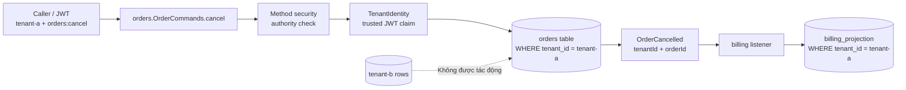
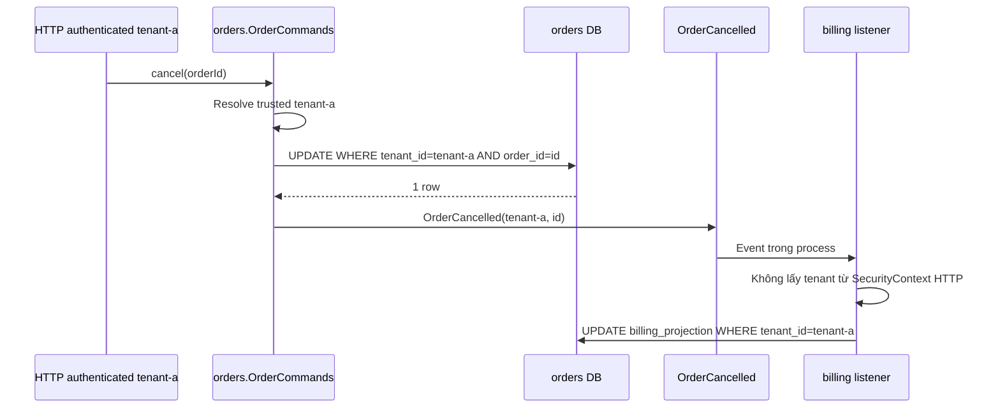
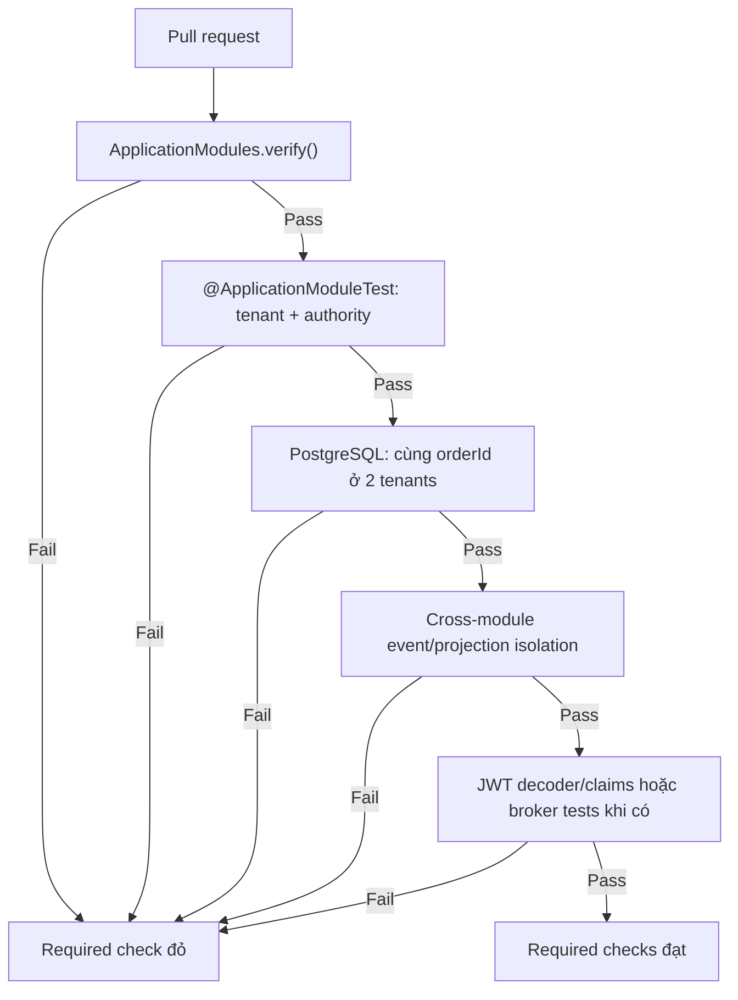

# Kiểm tra tenant boundary giữa module

## 1. Tenant boundary là một bất biến nghiệp vụ, không phải quy tắc package

Trong ứng dụng Spring Modulith đa tenant, module `orders` công bố `OrderCommands.cancel(orderId)` để module khác gọi mà không truy cập `orders.internal`. Module `billing` có thể lắng nghe `OrderCancelled` để cập nhật trạng thái thanh toán. Quan hệ phụ thuộc giữa module có thể **hoàn toàn hợp lệ**, nhưng vẫn có lỗi nghiêm trọng: một lời gọi dưới danh tính tenant B làm thay đổi dữ liệu của tenant A.

Đây là ranh giới cần kiểm chứng trong chương **Security testing** của học phần `SPRING_MODULITH_VERIFICATION_TESTING`. Học phần dùng `ApplicationModules.verify()` để kiểm tra phụ thuộc module, `@ApplicationModuleTest` để kiểm tra hành vi, test database/event/integration và quality gate CI để chống hồi quy. Trong bài này, trọng tâm là **tenant isolation xuyên public module API, repository và application event**; các kiểm thử kiến trúc là lớp bổ sung, không thay thế authorization.

**Bất biến xuyên suốt:** với một lời gọi `cancel(orderId)` dưới principal của tenant `tenant-a`:

- Chỉ hàng `orders` của `tenant-a` được phép thay đổi.
- Nếu cùng `orderId` xuất hiện ở `tenant-b`, hàng `tenant-b` không được thay đổi.
- `OrderCancelled` chỉ được phát khi mutation hợp lệ, chứa `tenantId` đã suy ra từ danh tính **đáng tin**.
- Listener của `billing` chỉ thay đổi projection có **cùng cặp (`tenantId`, `orderId`)**.
- Thiếu quyền, thiếu tenant đã xác thực hoặc không tìm thấy hàng phù hợp phải **fail closed**, không có event và không có side effect.



### Vì sao test chỉ có một tenant quá yếu?

Nếu chỉ tạo một đơn `tenant-a` với `orderId=42`, câu SQL sai `UPDATE orders SET status='CANCELLED' WHERE order_id=?` vẫn qua. Để test có khả năng phát hiện rò rỉ, ta cố ý tạo **hai hàng có cùng `orderId` nhưng thuộc hai tenant khác nhau**. Một câu UPDATE thiếu `tenant_id` sẽ thay đổi cả hai hàng và test phải đỏ.

| Lớp kiểm chứng | Câu hỏi | Công cụ |
| --- | --- | --- |
| Authentication/tenant selection | Tenant lấy từ đâu, có đáng tin không? | Spring Security test principal, JWT integration |
| Public module API | Caller thiếu scope có bị chặn trước mutation không? | `@ApplicationModuleTest` + method security |
| Data access | SQL có lọc tenant ở **điểm ghi** không? | PostgreSQL Testcontainers |
| Cross-module event | Event và listener có giữ tenant scope không? | Spring event integration + database assertions |
| Kiến trúc | Module khác có phụ thuộc implementation trái luật không? | `ApplicationModules.verify()` |
| CI | Negative test có thực sự chạy và chặn merge không? | Required checks, báo cáo JUnit |

## 2. Nguồn tenant đáng tin: JWT claim đã xác minh, không phải header tự khai

Đối với ví dụ, identity provider phát JWT có claim `tenant_id` biểu thị **tenant đang được ủy quyền** của request. Trong production, phải cấu hình `JwtDecoder` xác minh **signature, issuer, audience, expiration** và bảo đảm cơ chế cấp claim/tenant membership đúng chính sách. Chỉ sau đó module mới đọc tenant.

Không nên lấy tenant từ:

- Header `X-Tenant-Id` hoặc query param bất kỳ **mà không kiểm membership**.
- `tenantId` trong request body do caller có thể tự sửa.
- `orderId` và suy đoán tenant từ một cache không có ranh giới truy cập.
- `SecurityContextHolder` của một HTTP request trước đó trong worker thread tái sử dụng.
- Một event/message do nguồn chưa được xác thực tự công bố.

Trong mô hình một active tenant được issuer cấp, resolver có thể như sau:

```java
// src/main/java/com/example/shop/orders/internal/TenantIdentity.java
package com.example.shop.orders.internal;

import org.springframework.security.access.AccessDeniedException;
import org.springframework.security.core.Authentication;
import org.springframework.security.core.context.SecurityContextHolder;
import org.springframework.security.oauth2.server.resource.authentication
        .JwtAuthenticationToken;
import org.springframework.stereotype.Component;

@Component
class TenantIdentity {

    String requireTenant() {
        Authentication authentication =
                SecurityContextHolder.getContext()
                        .getAuthentication();

        if (!(authentication instanceof JwtAuthenticationToken jwt)
                || !authentication.isAuthenticated()) {
            throw new AccessDeniedException(
                    "Trusted tenant identity is required"
            );
        }

        String tenantId =
                jwt.getToken().getClaimAsString("tenant_id");

        if (tenantId == null || tenantId.isBlank()) {
            throw new AccessDeniedException(
                    "Tenant claim is missing"
            );
        }

        return tenantId;
    }
}
```

**Cần hiểu đúng:**

- `JwtAuthenticationToken` là kết quả authentication trong Spring Security; đoạn resolver **không tự xác minh chữ ký**. Đây là trách nhiệm của security filter và decoder ở request ingress.
- `@WithMockUser` tạo authentication kiểu khác, nên **không phù hợp để test resolver này**. Các ví dụ dùng `JwtAuthenticationToken` test được tạo chủ động hoặc `jwt()` của Spring Security Test.
- `jwt()` trong MockMvc cũng **không kiểm cryptographic signature**; nó chỉ thiết lập test authentication. JWT decoder và claim mapping cần test riêng.
- Nếu một user thuộc **nhiều tenant** và được phép chọn tenant qua request, đừng đơn giản thay đoạn trên bằng `request.getHeader("X-Tenant-Id")`. Phải kiểm tenant được chọn thuộc **danh sách membership đáng tin**, sau đó truyền active tenant đã xác nhận vào scope của command.

### Method security bật ở ranh giới API

```java
// src/main/java/com/example/shop/orders/internal/
// OrdersMethodSecurityConfiguration.java
package com.example.shop.orders.internal;

import org.springframework.context.annotation.Configuration;
import org.springframework.security.config.annotation.method
        .configuration.EnableMethodSecurity;

@Configuration(proxyBeanMethods = false)
@EnableMethodSecurity
class OrdersMethodSecurityConfiguration {
}
```

Một `@PreAuthorize` chỉ hoạt động khi lời gọi đi qua **Spring-managed proxy** và method security đã được bật. Module khác phải inject public API, không dùng `new` hoặc tự tham chiếu implementation để bỏ qua interceptor.

## 3. Public `orders` API: tenant scope trước khi phát event

Cấu trúc tối thiểu của hai module:

```text
com.example.shop
├── ShopApplication.java
├── orders
│   ├── OrderCommands.java
│   ├── OrderCancelled.java
│   └── internal
│       ├── TenantIdentity.java
│       ├── OrderCommandService.java
│       ├── OrderWriteRepository.java
│       ├── JdbcOrderWriteRepository.java
│       ├── OrderHttpController.java
│       └── OrdersMethodSecurityConfiguration.java
└── billing
    └── internal
        └── BillingCancellationListener.java
```

API công khai không nhận `tenantId` tự khai:

```java
// src/main/java/com/example/shop/orders/OrderCommands.java
package com.example.shop.orders;

import java.util.UUID;

public interface OrderCommands {
    void cancel(UUID orderId);
}
```

Event công khai mang **tenant đã được service xác nhận**, không chứa bearer token hoặc cả `SecurityContext`:

```java
// src/main/java/com/example/shop/orders/OrderCancelled.java
package com.example.shop.orders;

import java.util.UUID;

public record OrderCancelled(
        UUID eventId,
        String tenantId,
        UUID orderId
) {
}
```

Service hiện thực:

```java
// src/main/java/com/example/shop/orders/internal/
// OrderCommandService.java
package com.example.shop.orders.internal;

import com.example.shop.orders.OrderCancelled;
import com.example.shop.orders.OrderCommands;
import java.util.UUID;
import org.springframework.context.ApplicationEventPublisher;
import org.springframework.security.access.AccessDeniedException;
import org.springframework.security.access.prepost.PreAuthorize;
import org.springframework.stereotype.Service;
import org.springframework.transaction.annotation.Transactional;

@Service
class OrderCommandService implements OrderCommands {

    private final TenantIdentity tenantIdentity;
    private final OrderWriteRepository orders;
    private final ApplicationEventPublisher events;

    OrderCommandService(
            TenantIdentity tenantIdentity,
            OrderWriteRepository orders,
            ApplicationEventPublisher events) {
        this.tenantIdentity = tenantIdentity;
        this.orders = orders;
        this.events = events;
    }

    @Override
    @Transactional
    @PreAuthorize("hasAuthority('orders:cancel')")
    public void cancel(UUID orderId) {
        if (orderId == null) {
            throw new IllegalArgumentException("orderId required");
        }

        String tenantId = tenantIdentity.requireTenant();
        int changed = orders.cancelInTenant(tenantId, orderId);

        if (changed != 1) {
            throw new AccessDeniedException(
                    "Order not found or cancellation not permitted"
            );
        }

        events.publishEvent(new OrderCancelled(
                UUID.randomUUID(), tenantId, orderId
        ));
    }
}
```

**Tại sao giữ cả `@PreAuthorize` và tenant predicate?**

- `@PreAuthorize` kiểm **authority chức năng** trên public API.
- `TenantIdentity` buộc có tenant từ nguồn đã authenticated.
- `cancelInTenant(...)` bảo vệ **object-level scope tại database**, kể cả khi caller biết UUID của tenant khác.
- Chỉ khi đúng một hàng đổi trạng thái service mới phát event. Không tiết lộ tenant nào sở hữu UUID khác trong exception.

Trong ví dụ này, `@Transactional` bao quanh mutation và publish Spring event. Với `@EventListener` đồng bộ và JDBC cùng datasource, listener phía `billing` có thể tham gia transaction hiện tại. Nếu chuyển sang `@Async`, `@TransactionalEventListener(AFTER_COMMIT)` hoặc broker, **transaction/identity behavior thay đổi** và cần test riêng; không coi hai hệ thống đã commit atomically.

Controller HTTP:

```java
// src/main/java/com/example/shop/orders/internal/
// OrderHttpController.java
package com.example.shop.orders.internal;

import com.example.shop.orders.OrderCommands;
import java.util.UUID;
import org.springframework.http.ResponseEntity;
import org.springframework.web.bind.annotation.PathVariable;
import org.springframework.web.bind.annotation.PostMapping;
import org.springframework.web.bind.annotation.RequestMapping;
import org.springframework.web.bind.annotation.RestController;

@RestController
@RequestMapping("/api/orders")
class OrderHttpController {

    private final OrderCommands commands;

    OrderHttpController(OrderCommands commands) {
        this.commands = commands;
    }

    @PostMapping("/{orderId}/cancel")
    public ResponseEntity<Void> cancel(
            @PathVariable("orderId") UUID orderId) {
        commands.cancel(orderId);
        return ResponseEntity.noContent().build();
    }
}
```

Một module khác có thể gọi `OrderCommands` bằng injection và chịu **cùng policy**. Authorization không được đặt **chỉ ở controller**, vì inter-module Java caller không đi qua HTTP filter chain.

## 4. Cô lập ở database và listener module khác

### Schema thiết kế theo composite tenant key

```sql
CREATE TABLE orders (
    tenant_id VARCHAR(80) NOT NULL,
    order_id UUID NOT NULL,
    status VARCHAR(20) NOT NULL,
    PRIMARY KEY (tenant_id, order_id)
);

CREATE TABLE billing_projection (
    tenant_id VARCHAR(80) NOT NULL,
    order_id UUID NOT NULL,
    status VARCHAR(20) NOT NULL,
    PRIMARY KEY (tenant_id, order_id)
);
```

Ngay cả nếu các `orderId` được tạo bằng UUID ngẫu nhiên toàn cục, mọi truy vấn nhạy cảm vẫn phải **ràng buộc tenant**. Composite key trong bài giúp kiểm tra lỗi cực rõ: hai tenant có thể có **cùng `orderId`** để phát hiện SQL thiếu predicate.

Port ghi dữ liệu của `orders`:

```java
// src/main/java/com/example/shop/orders/internal/
// OrderWriteRepository.java
package com.example.shop.orders.internal;

import java.util.UUID;

interface OrderWriteRepository {
    int cancelInTenant(String tenantId, UUID orderId);
}
```

Adapter JDBC:

```java
// src/main/java/com/example/shop/orders/internal/
// JdbcOrderWriteRepository.java
package com.example.shop.orders.internal;

import java.util.UUID;
import org.springframework.jdbc.core.JdbcTemplate;
import org.springframework.stereotype.Repository;

@Repository
class JdbcOrderWriteRepository implements OrderWriteRepository {

    private final JdbcTemplate jdbc;

    JdbcOrderWriteRepository(JdbcTemplate jdbc) {
        this.jdbc = jdbc;
    }

    @Override
    public int cancelInTenant(String tenantId, UUID orderId) {
        return jdbc.update(
                """
                UPDATE orders
                   SET status = 'CANCELLED'
                 WHERE tenant_id = ?
                   AND order_id = ?
                   AND status = 'CONFIRMED'
                """,
                tenantId, orderId
        );
    }
}
```

Điều kiện `tenant_id = ?`, `order_id = ?` và `status = 'CONFIRMED'` nằm **trong cùng câu UPDATE**. Không chỉ làm:

```java
// Anti-pattern: kiểm tenant ở SELECT rồi UPDATE chỉ theo orderId.
// boolean allowed = repository.belongsToTenant(orderId, tenantId);
// if (allowed) repository.cancelById(orderId);
```

Giữa SELECT và UPDATE có thể xảy ra thay đổi concurrent; khi thiếu điều kiện tenant trên câu ghi còn có thể đổi cả hàng tenant khác. Đây là rủi ro **TOCTOU**. Điều kiện tại DB là phép bảo vệ cần kiểm với integration test, không thể chứng minh bằng Mockito.

### `billing` phải giữ tenant trong mọi cập nhật projection

```java
// src/main/java/com/example/shop/billing/internal/
// BillingCancellationListener.java
package com.example.shop.billing.internal;

import com.example.shop.orders.OrderCancelled;
import org.springframework.context.event.EventListener;
import org.springframework.jdbc.core.JdbcTemplate;
import org.springframework.stereotype.Component;

@Component
class BillingCancellationListener {

    private final JdbcTemplate jdbc;

    BillingCancellationListener(JdbcTemplate jdbc) {
        this.jdbc = jdbc;
    }

    @EventListener
    public void on(OrderCancelled event) {
        jdbc.update(
                """
                UPDATE billing_projection
                   SET status = 'CANCELLED'
                 WHERE tenant_id = ?
                   AND order_id = ?
                   AND status = 'OPEN'
                """,
                event.tenantId(), event.orderId()
        );
    }
}
```

Đường dependency Java là **`billing → orders`** qua public event `orders.OrderCancelled`. Listener không import `orders.internal`; Spring Modulith có thể kiểm dependency tĩnh này. SQL của billing chỉ cập nhật bảng do billing quản lý trong ví dụ, không trực tiếp đọc internal repository của orders.

**Giới hạn bảo mật cần nói rõ:** `tenantId` bên trong event là **routing metadata, không phải authentication**. Ví dụ tin tưởng event được tạo **bên trong cùng process từ command đã được authorize**. Nếu event nhận từ Kafka/RabbitMQ hay endpoint có thể bị publisher ngoài kiểm soát, consumer phải xác thực nguồn, quyền publish, schema/provenance và/hoặc đối chiếu dữ liệu nghiệp vụ. Chỉ copy `tenantId` từ một message không đáng tin vào `WHERE` **không đủ** để bảo vệ tenant.

## 5. Module test: authority, tenant scope và không phát event khi bị từ chối

Mục tiêu của `@ApplicationModuleTest` là test **Spring bean/proxy thật** của module `orders`, nhưng có thể mock port `OrderWriteRepository` để tập trung vào decision logic. Vì service ở mục 3 có `@Transactional`, test cần một Spring transaction manager; có thể dùng H2 **chỉ cho module test** hoặc Testcontainers database test, không nối production.

Ví dụ test dùng H2 test datasource và `@RecordApplicationEvents` của Spring Test:

```java
// src/test/java/com/example/shop/orders/internal/
// OrdersTenantModuleTests.java
package com.example.shop.orders.internal;

import static org.assertj.core.api.Assertions.assertThat;
import static org.junit.jupiter.api.Assertions.assertThrows;
import static org.mockito.Mockito.verify;
import static org.mockito.Mockito.verifyNoInteractions;
import static org.mockito.Mockito.when;

import com.example.shop.orders.OrderCancelled;
import com.example.shop.orders.OrderCommands;
import java.util.List;
import java.util.UUID;
import org.junit.jupiter.api.AfterEach;
import org.junit.jupiter.api.Test;
import org.springframework.beans.factory.annotation.Autowired;
import org.springframework.modulith.test.ApplicationModuleTest;
import org.springframework.modulith.test.Scenario;
import org.springframework.security.access.AccessDeniedException;
import org.springframework.security.core.authority.SimpleGrantedAuthority;
import org.springframework.security.core.context.SecurityContextHolder;
import org.springframework.security.oauth2.jwt.Jwt;
import org.springframework.security.oauth2.jwt.JwtDecoder;
import org.springframework.security.oauth2.server.resource.authentication
        .JwtAuthenticationToken;
import org.springframework.test.context.TestPropertySource;
import org.springframework.test.context.bean.override.mockito.MockitoBean;
import org.springframework.test.context.event.ApplicationEvents;
import org.springframework.test.context.event.RecordApplicationEvents;

@ApplicationModuleTest
@RecordApplicationEvents
@TestPropertySource(properties = {
    "spring.datasource.url=jdbc:h2:mem:tenant_module;DB_CLOSE_DELAY=-1",
    "spring.datasource.driver-class-name=org.h2.Driver"
})
class OrdersTenantModuleTests {

    @Autowired
    OrderCommands api;

    @Autowired
    ApplicationEvents publications;

    @MockitoBean
    OrderWriteRepository orders;

    // Đảm bảo cấu hình resource server không cần IdP thật.
    @MockitoBean
    JwtDecoder decoder;

    private void authenticate(String tenant, String authority) {
        var jwtBuilder = Jwt.withTokenValue("synthetic-test-token")
                .header("alg", "none")
                .subject("tester");
        if (tenant != null) {
            jwtBuilder.claim("tenant_id", tenant);
        }
        var jwt = jwtBuilder.build();

        var auth = new JwtAuthenticationToken(
                jwt,
                List.of(new SimpleGrantedAuthority(authority))
        );
        var context = SecurityContextHolder.createEmptyContext();
        context.setAuthentication(auth);
        SecurityContextHolder.setContext(context);
    }

    @AfterEach
    void clearSecurity() {
        SecurityContextHolder.clearContext();
    }

    @Test
    void tenantACommandEmitsTenantAEvent(Scenario scenario) {
        UUID id = UUID.randomUUID();
        authenticate("tenant-a", "orders:cancel");
        when(orders.cancelInTenant("tenant-a", id))
                .thenReturn(1);

        scenario.stimulate(() -> api.cancel(id))
                .andWaitForEventOfType(OrderCancelled.class)
                .matching(event ->
                        event.tenantId().equals("tenant-a")
                        && event.orderId().equals(id))
                .toArrive();

        verify(orders).cancelInTenant("tenant-a", id);
    }

    @Test
    void wrongTenantDoesNotEmitEvent() {
        UUID tenantAOrderId = UUID.randomUUID();
        authenticate("tenant-b", "orders:cancel");

        // Tenant B không có hàng tương ứng.
        when(orders.cancelInTenant("tenant-b", tenantAOrderId))
                .thenReturn(0);

        assertThrows(AccessDeniedException.class,
                () -> api.cancel(tenantAOrderId));

        verify(orders).cancelInTenant(
                "tenant-b", tenantAOrderId
        );
        assertThat(publications.stream(OrderCancelled.class))
                .isEmpty();
    }

    @Test
    void missingAuthorityNeverCallsRepository() {
        authenticate("tenant-a", "orders:read");

        assertThrows(AccessDeniedException.class,
                () -> api.cancel(UUID.randomUUID()));

        verifyNoInteractions(orders);
        assertThat(publications.stream(OrderCancelled.class))
                .isEmpty();
    }

    @Test
    void missingTenantClaimFailsClosed() {
        authenticate(null, "orders:cancel");

        assertThrows(AccessDeniedException.class,
                () -> api.cancel(UUID.randomUUID()));

        verifyNoInteractions(orders);
        assertThat(publications.stream(OrderCancelled.class))
                .isEmpty();
    }
}
```

**Điều kiện và mức chứng minh:**

- `@ApplicationModuleTest` bootstrap module `orders`; một `OrderCommands` bean được inject qua Spring proxy để `@PreAuthorize` và `@Transactional` hoạt động. Kiểm tra `OrdersMethodSecurityConfiguration` có thực sự được nạp trong module/test context.
- `@MockitoBean JwtDecoder` giúp bootstrap cấu hình resource server mà **không kết nối IdP thật**. Module test không gọi decoder; việc xác minh JWT chữ ký/issuer/audience thuộc một lớp test riêng.
- Dự án cần `spring-security-test` nếu dùng các tiện ích bảo mật test khác, `spring-security-oauth2-resource-server`/`spring-security-oauth2-jose` cho JWT types và H2 test dependency. Cấu hình H2 trên chỉ dùng cho Spring transaction manager trong module test; port JDBC đã được mock.
- `JwtAuthenticationToken` được test tạo trực tiếp. Nó **không kiểm chứng chữ ký JWT**; bài này chỉ kiểm logic module và tenant được chọn trong authentication đã có.
- `@RecordApplicationEvents` ghi nhận Spring application event để test **không có event** sau deny, trong khi `Scenario.stimulate(...)` quan sát event thực được command tạo.
- Không dùng `@WithMockUser` với resolver chỉ chấp nhận `JwtAuthenticationToken`; đó là loại principal không phù hợp và test có thể đỏ do lý do sai.
- `verifyNoInteractions(orders)` trong test thiếu authority xác nhận method body không chạy. Test thiếu `tenant_id` xác nhận resolver **fail closed trước repository**. Test sai tenant cho phép gọi repository với **tenant-b**, nhưng repository báo 0 và event không được phát.

**Giới hạn:** vì `orders` là mock, bài này **không chứng minh SQL có `WHERE tenant_id`**. Database test ở mục 6 sẽ kiểm điều đó với PostgreSQL và cả module `billing`.

## 6. End-to-end integration: cùng `orderId` ở hai tenant, không rò rỉ qua module

Integration test sử dụng **HTTP MockMvc → Spring Security → public `OrderCommands` → JDBC update `orders` → `OrderCancelled` → listener `billing` → PostgreSQL**. Đây là một luồng thực tế trong process, không cần Kafka hay secret thật.

### Security filter cho API stateless trong ví dụ

```java
// src/main/java/com/example/shop/orders/internal/
// OrdersHttpSecurityConfiguration.java
package com.example.shop.orders.internal;

import org.springframework.context.annotation.Bean;
import org.springframework.context.annotation.Configuration;
import org.springframework.security.config.Customizer;
import org.springframework.security.config.annotation.web.builders.HttpSecurity;
import org.springframework.security.config.http.SessionCreationPolicy;
import org.springframework.security.web.SecurityFilterChain;

@Configuration(proxyBeanMethods = false)
class OrdersHttpSecurityConfiguration {

    @Bean
    SecurityFilterChain apiSecurity(HttpSecurity http)
            throws Exception {
        return http
                .csrf(csrf -> csrf.disable())
                .sessionManagement(session ->
                        session.sessionCreationPolicy(
                                SessionCreationPolicy.STATELESS
                        ))
                .authorizeHttpRequests(auth ->
                        auth.anyRequest().authenticated())
                .oauth2ResourceServer(oauth ->
                        oauth.jwt(Customizer.withDefaults()))
                .build();
    }
}
```

**Chỉ áp dụng CSRF-disable cho API bearer stateless với chính sách CSRF phù hợp**. Với ứng dụng có cookie/session browser, phải thiết kế/test CSRF tương ứng. Production resource server cần `JwtDecoder` cấu hình xác thực issuer/audience/signature/expiry; test dùng mock decoder **chỉ để bootstrap context**, còn `jwt()` là request post-processor tạo authentication giả.

### Spring Boot + PostgreSQL Testcontainers + MockMvc

```java
// src/test/java/com/example/shop/orders/internal/
// TenantBoundaryHttpIT.java
package com.example.shop.orders.internal;

import static org.assertj.core.api.Assertions.assertThat;
import static org.springframework.security.test.web.servlet.request
        .SecurityMockMvcRequestPostProcessors.jwt;
import static org.springframework.test.web.servlet.request
        .MockMvcRequestBuilders.post;
import static org.springframework.test.web.servlet.result
        .MockMvcResultMatchers.status;

import java.util.UUID;
import org.junit.jupiter.api.BeforeEach;
import org.junit.jupiter.api.Test;
import org.springframework.beans.factory.annotation.Autowired;
import org.springframework.boot.test.autoconfigure.web.servlet.AutoConfigureMockMvc;
import org.springframework.boot.test.context.SpringBootTest;
import org.springframework.jdbc.core.JdbcTemplate;
import org.springframework.security.core.authority.SimpleGrantedAuthority;
import org.springframework.security.oauth2.jwt.JwtDecoder;
import org.springframework.test.context.DynamicPropertyRegistry;
import org.springframework.test.context.DynamicPropertySource;
import org.springframework.test.context.bean.override.mockito.MockitoBean;
import org.springframework.test.web.servlet.MockMvc;
import org.testcontainers.containers.PostgreSQLContainer;
import org.testcontainers.junit.jupiter.Container;
import org.testcontainers.junit.jupiter.Testcontainers;

@SpringBootTest
@AutoConfigureMockMvc
@Testcontainers
class TenantBoundaryHttpIT {

    @Container
    static final PostgreSQLContainer<?> DB =
            new PostgreSQLContainer<>("postgres:16-alpine");

    @DynamicPropertySource
    static void database(DynamicPropertyRegistry props) {
        props.add("spring.datasource.url", DB::getJdbcUrl);
        props.add("spring.datasource.username", DB::getUsername);
        props.add("spring.datasource.password", DB::getPassword);
    }

    @Autowired
    MockMvc mvc;

    @Autowired
    JdbcTemplate jdbc;

    @MockitoBean
    JwtDecoder decoder;

    @BeforeEach
    void schemaAndCleanFixtures() {
        jdbc.execute("""
            CREATE TABLE IF NOT EXISTS orders (
                tenant_id VARCHAR(80) NOT NULL,
                order_id UUID NOT NULL,
                status VARCHAR(20) NOT NULL,
                PRIMARY KEY (tenant_id, order_id)
            )
            """);
        jdbc.execute("""
            CREATE TABLE IF NOT EXISTS billing_projection (
                tenant_id VARCHAR(80) NOT NULL,
                order_id UUID NOT NULL,
                status VARCHAR(20) NOT NULL,
                PRIMARY KEY (tenant_id, order_id)
            )
            """);

        jdbc.update("DELETE FROM billing_projection");
        jdbc.update("DELETE FROM orders");
    }

    private void seed(String tenant, UUID id) {
        jdbc.update(
                """
                INSERT INTO orders(tenant_id, order_id, status)
                VALUES (?, ?, 'CONFIRMED')
                """, tenant, id);
        jdbc.update(
                """
                INSERT INTO billing_projection(
                    tenant_id, order_id, status
                )
                VALUES (?, ?, 'OPEN')
                """, tenant, id);
    }

    private String statusOf(String table, String tenant, UUID id) {
        // Tên bảng là hằng số nội bộ của test, không nhận input client.
        String sql = switch (table) {
            case "orders" ->
                    "SELECT status FROM orders "
                    + "WHERE tenant_id=? AND order_id=?";
            case "billing" ->
                    "SELECT status FROM billing_projection "
                    + "WHERE tenant_id=? AND order_id=?";
            default -> throw new IllegalArgumentException("table");
        };
        return jdbc.queryForObject(
                sql, String.class, tenant, id
        );
    }

    @Test
    void tenantBCannotCancelTenantAOrder() throws Exception {
        UUID sharedId = UUID.randomUUID();
        seed("tenant-a", sharedId);

        mvc.perform(post("/api/orders/{id}/cancel", sharedId)
                .with(jwt().jwt(token -> token
                        .subject("bob")
                        .claim("tenant_id", "tenant-b"))
                        .authorities(new SimpleGrantedAuthority(
                                "orders:cancel"))))
                .andExpect(status().isForbidden());

        assertThat(statusOf("orders", "tenant-a", sharedId))
                .isEqualTo("CONFIRMED");
        assertThat(statusOf("billing", "tenant-a", sharedId))
                .isEqualTo("OPEN");
    }

    @Test
    void sameOrderIdInTwoTenantsUpdatesOnlyActiveTenant()
            throws Exception {
        UUID sharedId = UUID.randomUUID();
        seed("tenant-a", sharedId);
        seed("tenant-b", sharedId);

        mvc.perform(post("/api/orders/{id}/cancel", sharedId)
                .with(jwt().jwt(token -> token
                        .subject("alice")
                        .claim("tenant_id", "tenant-a"))
                        .authorities(new SimpleGrantedAuthority(
                                "orders:cancel"))))
                .andExpect(status().isNoContent());

        assertThat(statusOf("orders", "tenant-a", sharedId))
                .isEqualTo("CANCELLED");
        assertThat(statusOf("billing", "tenant-a", sharedId))
                .isEqualTo("CANCELLED");

        assertThat(statusOf("orders", "tenant-b", sharedId))
                .isEqualTo("CONFIRMED");
        assertThat(statusOf("billing", "tenant-b", sharedId))
                .isEqualTo("OPEN");
    }

    @Test
    void validTenantButMissingPermissionCannotMutate()
            throws Exception {
        UUID id = UUID.randomUUID();
        seed("tenant-a", id);

        mvc.perform(post("/api/orders/{id}/cancel", id)
                .with(jwt().jwt(token -> token
                        .subject("alice")
                        .claim("tenant_id", "tenant-a"))
                        .authorities(new SimpleGrantedAuthority(
                                "orders:read"))))
                .andExpect(status().isForbidden());

        assertThat(statusOf("orders", "tenant-a", id))
                .isEqualTo("CONFIRMED");
        assertThat(statusOf("billing", "tenant-a", id))
                .isEqualTo("OPEN");
    }
}
```

**Điều kiện để ví dụ chạy:** Spring Boot/JUnit Jupiter, Spring Web/Security/resource server, Spring JDBC, PostgreSQL driver, Testcontainers PostgreSQL/JUnit và `spring-security-test`; Spring Framework 6.2+ cho `@MockitoBean`; `ShopApplication` nằm ở root `com.example.shop` và quét cả hai module. Spring Data/JDBC cần transaction manager được Boot tạo từ datasource. Trong project thật, nên quản lý schema bằng Flyway/Liquibase; `@BeforeEach` ở đây giúp bài **tự chứa**.

**Các giới hạn đã chủ ý:**

- Các test dùng chung một database/container trong class và xóa bảng ở `@BeforeEach`; **không chạy song song trên cùng schema**. Muốn song song, dùng schema/container riêng hoặc fixture cleanup theo namespace.
- `@MockitoBean JwtDecoder` và MockMvc `jwt()` **không chứng minh JWT signature/issuer/audience validation**. Đây là bài test **tenant boundary sau khi authentication đã được cung cấp**. Cần resource-server/JWT verification test độc lập.
- `BillingCancellationListener` là synchronous `@EventListener`. Test này chứng minh cross-module effect trong cùng process, **không** chứng minh broker consumer, DLT hoặc eventual consistency sau async delivery.
- Trường hợp `tenant-b` cố hủy hàng chỉ có ở `tenant-a` kỳ vọng 403 do service cố tình dùng một lỗi chung “not found or not permitted” để tránh tiết lộ tồn tại đối tượng. HTTP error mapping thực tế phải được cấu hình phù hợp.
- Nếu service không có `@Transactional`/transaction manager, event listener có thể cập nhật trong thời điểm không nhất quán; giữ test transaction/retry riêng khi production chuyển sang async/broker.

### Vì sao hai phép thử có giá trị mạnh?

Test `tenantBCannotCancelTenantAOrder` phát hiện API xử lý sai tenant. Test `sameOrderIdInTwoTenantsUpdatesOnlyActiveTenant` đặc biệt phát hiện **câu UPDATE thiếu tenant predicate ở một trong hai module**: nếu `orders` hoặc `billing` cập nhật chỉ theo `order_id`, hàng tenant còn lại cũng bị đổi và assertion phải fail.

Chỉ `verify(repository).cancel...` với Mockito **không thể phát hiện lỗi SQL**; đó là lý do tích hợp PostgreSQL là một phần của quality gate.

## 7. Event và async/broker boundary: không biến `tenantId` thành quyền

Sơ đồ trust boundary:



Trong ví dụ, Spring event được publish **sau khi update tenant-scoped thành công**. Listener dùng `event.tenantId()` cho **phạm vi cập nhật**, không cố lấy tenant từ `SecurityContextHolder` của request trước đó.

Khi chuyển sang `@Async`, `@TransactionalEventListener(AFTER_COMMIT)` hoặc Kafka/RabbitMQ:

- Worker thread thường **không có `SecurityContext` HTTP**; `ThreadLocal` không được tự động nhân sang thread/process khác.
- Event có thể được phát lại/nhận trùng; cần `eventId` để idempotency và transaction/outbox/recovery policy nếu cần.
- Source identity khác tenant metadata. `tenantId` trong JSON không xác thực được **ai** được phép gửi message.
- Ingress từ broker cần **quyền publish/service identity, topic ACL, schema validation và provenance** phù hợp. Nếu consumer có thể nhận event giả, chỉ lọc `WHERE tenant_id=:tenant` chưa đảm bảo chống một publisher độc hại biết tenant ID và order ID.
- Cross-tenant ordering/retry phải giữ tenant key trong partition/cache/idempotency keys; không dùng `orderId` đơn lẻ nếu không toàn cục.
- Nếu listener ghi vào DB transaction khác, cần test eventual consistency và no-leak sau retry/rollback, không suy luận atomicity từ Spring event test đồng bộ.

### Test negative cho event không đáng tin

Không dùng test sau để **tuyên bố authorization đã được kiểm chứng**:

```java
// Chỉ test listener có thể nhận event này;
// KHÔNG đi qua OrderCommands và tenant authorization.
events.publishEvent(new OrderCancelled(
        UUID.randomUUID(), "tenant-a", orderId
));
```

Đây chỉ là **listener contract test**. Nếu caller không đáng tin có thể publish event, cần xác thực nguồn tại ingress hoặc thay event bằng command được authorize. Một test broker an toàn phải mô phỏng message **không được tin cậy**, bảo đảm validation/rejection hoặc quarantine trước khi có effect, thay vì cho phép nó tự quyết định tenant bằng payload.

**Không dùng tenant ID làm secret**: tenant ID có thể đoán được hoặc lộ trong metadata; bảo vệ dựa trên identity, authorization, data predicates và nguồn event, không phải tính bí mật của một chuỗi.

## 8. Ma trận negative cases và lỗi thường gặp

| Kịch bản | Kết quả kỳ vọng | Nếu chỉ test happy path sẽ bỏ sót |
| --- | --- | --- |
| Tenant B gọi hủy đơn chỉ thuộc tenant A | 403 hoặc policy deny; không đổi dữ liệu A | Thiếu `tenant_id` trong UPDATE |
| A và B cùng có `orderId` | Chỉ đúng cặp (`tenant-a`, `orderId`) đổi | Câu UPDATE có `WHERE order_id` nhưng không tenant |
| Principal thiếu `tenant_id` | Deny, không gọi repository | Fallback vào tenant mặc định/toàn hệ thống |
| User có tenant A nhưng thiếu `orders:cancel` | Deny trước mutation | Quên `@EnableMethodSecurity`/`@PreAuthorize` |
| Caller tự gửi `X-Tenant-Id: tenant-b` | Không đổi tenant nếu chưa xác thực membership | Tin header thay cho validated claim |
| Tenant A truy vấn order của tenant B | Không lộ tồn tại/dữ liệu ngoài chính sách | Query đọc/cache không tenant-aware |
| Event mang `tenant-a` nhưng được gửi từ nguồn không xác thực | Reject/validate provenance trước side effect | Tin mọi incoming event payload |
| `billing` listener dùng `orderId` mà không tenant | Không đổi projection tenant khác | Cross-module leak sau event |
| Hai job/test chạy cùng schema | Không ảnh hưởng nhau | Cleanup/xóa dữ liệu toàn cục |
| Tenant identity đặt trong ThreadLocal không cleanup | Không rò rỉ tenant qua request/job kế tiếp | Reused worker context |
| Cache key chỉ là `orderId` | Không trả data khác tenant | Cache contamination |
| RLS session variable giữ nguyên trong connection pool | Không “mượn” tenant context từ lần dùng trước | Session leakage qua pooling |

### Những anti-pattern cần chặn bằng test hồi quy

**1. Repository cập nhật không có tenant predicate.**

```sql
-- Sai:
UPDATE orders SET status='CANCELLED'
WHERE order_id = ?;

-- Đúng cho ví dụ:
UPDATE orders SET status='CANCELLED'
WHERE tenant_id = ? AND order_id = ?
  AND status = 'CONFIRMED';
```

**2. Tenant từ header chưa xác minh.**

```java
// Sai: caller có thể tự đổi header.
String tenantId = request.getHeader("X-Tenant-Id");
repository.cancelInTenant(tenantId, orderId);
```

Nếu business cho phép chọn active tenant bằng header, **header chỉ là yêu cầu lựa chọn**; backend phải kiểm membership/entitlements bằng identity đáng tin rồi mới tạo một tenant scope được xác nhận.

**3. Projection/cache chỉ dùng business ID.**

```java
// Sai khi orderId có thể trùng giữa tenants:
// cache.get(orderId);
// repository.findById(orderId);

// Đúng về nguyên tắc:
// cache.get(new TenantOrderKey(tenantId, orderId));
// repository.findByTenantIdAndOrderId(tenantId, orderId);
```

Cả query đọc và ghi đều cần tenant, kể cả khi API chỉ phơi bày UUID khó đoán.

**4. Chỉ có `@PreAuthorize` mà không có DB guard.**

Ngay cả khi method security đúng, một câu SQL thiếu tenant predicate có thể sửa nhiều hàng. Đồng thời, nếu có thay đổi ownership/tenant giữa precheck và update, cần conditional mutation/locking phù hợp để chống **TOCTOU**.

**5. Dùng `@WithMockUser` rồi cho rằng tenant claim được kiểm.**

`@WithMockUser` không tạo `JwtAuthenticationToken` với `tenant_id`. Test phải cung cấp test JWT authentication phù hợp hoặc một tenant-selection policy seam được kiểm riêng.

**6. Dùng test listener event để chứng minh ingress authorization.**

Gọi `publishEvent` trực tiếp bỏ qua command và các policy của caller. Listener test chứng minh event handling, không chứng minh nguồn được phép phát event.

## 9. Architecture verification, database hardening và CI quality gate

### `ApplicationModules.verify()` kiểm tra kiểu phụ thuộc, không kiểm tenant scope

Ví dụ:

```java
// src/test/java/com/example/shop/ModuleArchitectureTests.java
package com.example.shop;

import org.junit.jupiter.api.Test;
import org.springframework.modulith.core.ApplicationModules;

class ModuleArchitectureTests {

    @Test
    void verifiesModuleBoundaries() {
        ApplicationModules.of(ShopApplication.class).verify();
    }
}
```

`ApplicationModules.verify()` có thể phát hiện module `billing` import `orders.internal.OrderWriteRepository`, vi phạm named interface hoặc tạo vòng dependency. Nhưng nó **không** phân tích nội dung SQL để biết `UPDATE` có `tenant_id`, không xác minh JWT claim hoặc event provenance.

Để bảo vệ sâu hơn, có thể bổ sung architecture rule dự án (ví dụ ArchUnit) ngăn module khác import implementation, và database tests quan sát dữ liệu thật. **Không tuyên bố `verify()` đủ để bảo vệ multi-tenancy.**

### Defense in depth tại database

Với PostgreSQL, có thể cân nhắc **Row-Level Security (RLS)** khi threat model yêu cầu. RLS phải được cấu hình policy, quyền DB role và tenant session variable một cách chính xác; khi dùng connection pool cần set/reset theo transaction để không rò rỉ tenant giữa requests. Một ứng dụng dùng cùng DB role có quyền bypass RLS hoặc table owner có thể vượt policy theo cấu hình PostgreSQL.

**Trong bài này**, SQL predicate tường minh là cơ chế chính và được test end-to-end. RLS nếu áp dụng là **lớp bảo vệ bổ sung**, phải có integration tests riêng cho session context, pooled connection và admin/bypass roles. Không tắt tenant filter vì “đã có RLS”.

### Quality gate



Ví dụ lệnh chạy theo build đã cấu hình:

```bash
./mvnw test
./mvnw verify

./gradlew test
./gradlew check
```

- Với Maven, class `*IT` thường cần Failsafe/config tương ứng; `mvn test` không mặc định bảo đảm nó đã chạy. Gradle cần integrationTest task được link vào `check` nếu dùng source set riêng.
- CI chạy Testcontainers phải có Docker và PostgreSQL schema fixture cô lập; không dùng DB production/staging với credential thật.
- Không gắn `@Disabled` cho negative tenant tests hoặc cho phép required checks `continue-on-error: true`.
- Báo cáo JUnit phải liệt kê trường hợp cross-tenant, shared-orderId và missing authority; kiểm tra **test discovery**, không chỉ build exit 0.
- Trên nhánh thử nghiệm, bỏ `tenant_id = ?` trong `orders` hoặc `billing` UPDATE: test `sameOrderIdInTwoTenantsUpdatesOnlyActiveTenant` **phải đỏ**. Bỏ `@PreAuthorize`: missing-authority test phải đỏ. Hoàn nguyên thay đổi sau kiểm chứng.

## 10. Checklist trước khi merge và bài tập phản chứng

### Checklist tenant boundary

- **Tenant selection:** tenant được lấy từ authentication/authorization đáng tin; header/body chỉ là input chưa được xác thực.
- **Quyền:** public `OrderCommands` có method-security policy đúng; test gọi Spring proxy, không `new` service.
- **Missing tenant:** thiếu/blank/invalid claim phải fail closed; không fallback tenant chung.
- **Repository:** read/write/query/count/delete đều mang tenant predicate; mutation bảo vệ tenant và status tại **câu SQL thực**.
- **Database schema:** uniqueness/key có tenant scope nếu business IDs có thể trùng; indexes/constraints đúng.
- **Side effect:** denied command không đổi dữ liệu, không phát event và không làm thay đổi projection của module khác.
- **Event:** `OrderCancelled` có tenant đã xác nhận; listener dùng cặp (`tenantId`, `orderId`) cho cập nhật.
- **Trust:** event tenant metadata không cấp quyền; consumer broker xác thực nguồn và áp dụng tenant policy riêng.
- **Threading:** async worker không dựa vào HTTP `SecurityContext`; mọi tenant scope tạm phải được cleanup đúng lifecycle.
- **Caches/RLS:** cache key tenant-aware, pooled connection/RLS session state không rò rỉ.
- **Architecture:** `ApplicationModules.verify()` kiểm module boundaries, không thay SQL/auth tests.
- **CI:** module test, PostgreSQL Testcontainers test, negative scenarios và required checks thực sự chạy.

### Ba bài tập kiểm tra hiểu đúng ranh giới

**1.** `ApplicationModules.verify()` đạt, cả `orders` và `billing` đều chỉ import API công khai. Nhưng `billing` cập nhật `WHERE order_id=?`. Hệ thống đã an toàn tenant chưa?

**Chưa.** Quan hệ Java hợp lệ không chứng minh SQL tenant isolation. Test hai tenant có cùng `orderId` sẽ phát hiện row của tenant khác bị thay đổi.

**2.** Request chứa `X-Tenant-Id: tenant-b`, JWT được xác minh chỉ xác nhận user thuộc `tenant-a`. Module có thể nhận header làm tenant active không?

**Không trực tiếp.** Nếu muốn hỗ trợ chọn tenant, phải kiểm membership/entitlements và chính sách cho `tenant-b` từ nguồn đáng tin. Trong ví dụ, active tenant lấy từ claim issuer đã cấp, nên header không thay đổi tenant scope.

**3.** Kafka consumer nhận `OrderCancelled(tenant-b, orderId)` từ một nguồn không xác thực; nó dùng `WHERE tenant_id='tenant-b'` nên không đụng tenant-a. Đã đủ bảo vệ chưa?

**Chưa.** Người gửi có thể làm thay đổi dữ liệu của chính `tenant-b` nếu biết ID. Tenant predicate chỉ giới hạn phạm vi hàng; consumer vẫn phải xác minh **nguồn và quyền phát message** trước khi coi event là một command có hiệu lực.

**Kết luận:** Kiểm tra tenant boundary giữa module đòi hỏi kiểm cả **nguồn identity**, **public API authorization**, **tenant predicate ở database**, **event scope** và **side effect trong module nhận**. Bài test mạnh phải dùng hai tenant có **cùng business ID**, kiểm cả hàng được phép lẫn hàng không được phép, rồi thêm negative cases cho quyền và tenant claim. `ApplicationModules.verify()` bảo vệ cấu trúc; `@ApplicationModuleTest`, PostgreSQL Testcontainers, event integration và CI required checks bảo vệ tenant isolation thực tế.
