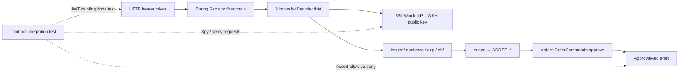
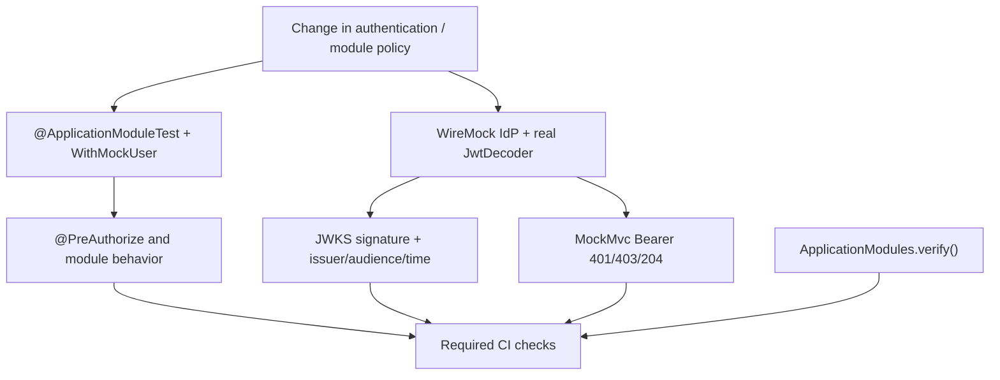

# Mock external identity provider theo contract

## 1. Mock đúng ranh giới: identity provider trả gì và ứng dụng phải tin điều gì?

Trong một hệ thống Spring Modulith, public API của module `orders` có thể chỉ được gọi khi bearer JWT hợp lệ và có scope `orders.approve`. JWT do một **external identity provider (IdP)** cấp, nhưng module test không nên phụ thuộc IdP thật, network ngoài hoặc client secret có hiệu lực.

Điểm khác biệt quan trọng giữa hai cách test:

- **Mock `JwtDecoder` trả sẵn một `Jwt`:** phù hợp khi chỉ cần kiểm tra authorization nội bộ. Nó **bỏ qua** việc tải public key, xác minh chữ ký, issuer, audience và thời hạn.
- **Mock IdP ở giao thức HTTP:** dùng WireMock phát **OIDC metadata**, **JWKS public keys** và khi cần **OAuth2 token endpoint**. Ứng dụng vẫn sử dụng **JwtDecoder thật** để xác minh một JWT được ký bằng **private key thử nghiệm**. Cách này bảo vệ contract ở ranh giới ứng dụng ↔ IdP.

Bài thuộc chương **Security testing** trong học phần `SPRING_MODULITH_VERIFICATION_TESTING`. Mục tiêu học phần là kiểm chứng ranh giới kiến trúc bằng `ApplicationModules.verify()`, các luật phụ thuộc, `@ApplicationModuleTest`, test sự kiện/database/tích hợp và quality gate CI. Bài này tập trung **duy nhất** vào **mock external identity provider theo contract**, tức kiểm chứng những kỳ vọng mà ứng dụng dựa vào khi làm việc với IdP.

Một test được coi là có ích phải trả lời được:

1. **Issuer:** token có `iss` đúng với IdP được cấu hình không?
2. **Key:** decoder có tìm đúng public key dựa vào `kid` và xác minh chữ ký `RS256` không?
3. **Audience:** token có được cấp cho đúng resource/API của ứng dụng không?
4. **Lifetime:** token hết hạn hoặc chưa có hiệu lực có bị từ chối không?
5. **Authority mapping:** claim `scope` được đổi thành `SCOPE_orders.approve` đúng cách không?
6. **Business effect:** token bị từ chối **không thể gọi** thao tác của public module API và không tạo side effect?



**Giới hạn:** đây không phải phép chứng minh IdP ngoài đời đang hoạt động hay contract không bao giờ thay đổi. Test xác minh ứng dụng tuân thủ **một contract giả lập có version rõ**; cần có cách đối chiếu contract đó với cấu hình/tài liệu được IdP công bố và giám sát drift riêng.

## 2. Chốt contract trước khi tạo WireMock fixture

Để tránh test chỉ “mô phỏng chính code của mình”, hãy ghi rõ contract của resource server trong một bảng có thể review:

| Thành phần IdP / JWT | Contract của ví dụ | Failure expectation |
| --- | --- | --- |
| `issuer` | URL issuer khớp cấu hình đáng tin | Khác `iss` → HTTP 401 |
| Discovery | `/.well-known/openid-configuration` công bố đúng `issuer`, `jwks_uri`, `token_endpoint` | Metadata thiếu/sai → không dùng cấu hình sai |
| JWKS | `GET /jwks` trả public RSA key trong JWK Set, có `kid` | Không tìm được key / sai chữ ký → 401 |
| Signature algorithm | Chỉ chấp nhận `RS256` theo decoder policy | `none` hoặc thuật toán không hỗ trợ → 401 |
| Audience | `aud` chứa `orders-api` | Token của service khác → 401 |
| Expiry / not-before | `exp` còn hiệu lực, `nbf` chưa chặn | Token hết hạn hoặc quá sớm → 401 |
| Scope | `scope` là chuỗi phân cách bằng dấu cách | Không có `orders.approve` → 403 khi authenticated |
| Subject | `sub` định danh principal, không rỗng theo chính sách ứng dụng | Claim bắt buộc thiếu → reject theo validator |
| Public API | `orders.OrderCommands.approve(UUID)` | Bị từ chối thì `ApprovalAuditPort` không được gọi |
| Token endpoint (nếu ứng dụng là OAuth2 client) | `POST /oauth/token`, form `grant_type=client_credentials`, Basic client authentication, JSON token response | 400/401/5xx được xử lý theo policy; không để lộ secret |

**401 khác 403:** HTTP 401 thường thể hiện authentication không hợp lệ/thiếu; HTTP 403 thể hiện caller đã authenticated nhưng không được authorize. Giá trị cụ thể có thể chịu ảnh hưởng của custom `AuthenticationEntryPoint`/`AccessDeniedHandler`, nên test phải dùng đúng filter chain thực.

**Không nên dùng contract mơ hồ** kiểu “JWT có role ADMIN”. Nếu hệ thống chấp nhận claim `scope = "orders.approve"`, Spring Security có thể chuyển thành `SCOPE_orders.approve`. Đừng mặc định `roles`, `groups` hoặc `realm_access` sẽ tự map như vậy khi chưa có converter tương ứng.

Trong production, nếu IdP cấp nhiều tenant, contract cần bổ sung `tenant_id`, membership, audience per tenant và lựa chọn active tenant; riêng bài này chỉ bảo vệ IdP contract cho **scope phê duyệt đơn**, không lặp toàn bộ kiểm thử tenant isolation.

## 3. Public module API và HTTP entrypoint của ví dụ

Cấu trúc ứng dụng được dùng trong toàn bài:

```text
com.example.shop
├── ShopApplication.java
└── orders
    ├── OrderCommands.java                 # Public module API
    └── internal
        ├── OrderApprovalService.java      # @PreAuthorize
        ├── OrderHttpController.java       # HTTP adapter
        ├── OrderSecurityConfiguration.java
        ├── ApprovalAuditPort.java
        └── LoggingApprovalAudit.java
```

API ở package gốc module:

```java
// src/main/java/com/example/shop/orders/OrderCommands.java
package com.example.shop.orders;

import java.util.UUID;

public interface OrderCommands {
    void approve(UUID orderId);
}
```

Port ghi nhận tác động được giữ trong implementation package:

```java
// src/main/java/com/example/shop/orders/internal/
// ApprovalAuditPort.java
package com.example.shop.orders.internal;

import java.util.UUID;

interface ApprovalAuditPort {
    void approved(UUID orderId, String actorId);
}
```

Service:

```java
// src/main/java/com/example/shop/orders/internal/
// OrderApprovalService.java
package com.example.shop.orders.internal;

import com.example.shop.orders.OrderCommands;
import java.util.UUID;
import org.springframework.security.access.prepost.PreAuthorize;
import org.springframework.security.core.context.SecurityContextHolder;
import org.springframework.stereotype.Service;

@Service
class OrderApprovalService implements OrderCommands {

    private final ApprovalAuditPort audit;

    OrderApprovalService(ApprovalAuditPort audit) {
        this.audit = audit;
    }

    @Override
    @PreAuthorize("hasAuthority('SCOPE_orders.approve')")
    public void approve(UUID orderId) {
        if (orderId == null) {
            throw new IllegalArgumentException("orderId required");
        }

        String actor = SecurityContextHolder.getContext()
                .getAuthentication().getName();

        audit.approved(orderId, actor);
    }
}
```

Controller:

```java
// src/main/java/com/example/shop/orders/internal/
// OrderHttpController.java
package com.example.shop.orders.internal;

import com.example.shop.orders.OrderCommands;
import java.util.UUID;
import org.springframework.http.ResponseEntity;
import org.springframework.web.bind.annotation.PathVariable;
import org.springframework.web.bind.annotation.PostMapping;
import org.springframework.web.bind.annotation.RequestMapping;
import org.springframework.web.bind.annotation.RestController;

@RestController
@RequestMapping("/api/orders")
class OrderHttpController {

    private final OrderCommands orders;

    OrderHttpController(OrderCommands orders) {
        this.orders = orders;
    }

    @PostMapping("/{orderId}/approve")
    public ResponseEntity<Void> approve(
            @PathVariable("orderId") UUID orderId) {
        orders.approve(orderId);
        return ResponseEntity.noContent().build();
    }
}
```

Một adapter tối giản để ứng dụng có implementation thật của port:

```java
// src/main/java/com/example/shop/orders/internal/
// LoggingApprovalAudit.java
package com.example.shop.orders.internal;

import java.util.UUID;
import org.slf4j.Logger;
import org.slf4j.LoggerFactory;
import org.springframework.stereotype.Component;

@Component
class LoggingApprovalAudit implements ApprovalAuditPort {

    private static final Logger LOG =
            LoggerFactory.getLogger(LoggingApprovalAudit.class);

    @Override
    public void approved(UUID orderId, String actorId) {
        // Minh họa; production cần durable audit và quyền truy cập phù hợp.
        LOG.info("Order approval action: orderId={}", orderId);
    }
}
```

Trong integration test, `ApprovalAuditPort` sẽ được thay bằng Mockito để quan sát việc **business method có thật sự chạy**. Một kết quả HTTP 204 đơn thuần không chứng minh principal được chuyển đúng hoặc side effect không xảy ra ở nhánh lỗi.

### Spring Security configuration dùng trong ứng dụng

```java
// src/main/java/com/example/shop/orders/internal/
// OrderSecurityConfiguration.java
package com.example.shop.orders.internal;

import org.springframework.context.annotation.Bean;
import org.springframework.context.annotation.Configuration;
import org.springframework.security.config.Customizer;
import org.springframework.security.config.annotation.method.configuration.EnableMethodSecurity;
import org.springframework.security.config.annotation.web.builders.HttpSecurity;
import org.springframework.security.config.annotation.web.configurers.AbstractHttpConfigurer;
import org.springframework.security.config.http.SessionCreationPolicy;
import org.springframework.security.web.SecurityFilterChain;

@Configuration(proxyBeanMethods = false)
@EnableMethodSecurity
class OrderSecurityConfiguration {

    @Bean
    SecurityFilterChain apiFilterChain(HttpSecurity http)
            throws Exception {
        return http
                .csrf(AbstractHttpConfigurer::disable)
                .sessionManagement(session ->
                        session.sessionCreationPolicy(
                                SessionCreationPolicy.STATELESS))
                .authorizeHttpRequests(auth ->
                        auth.anyRequest().authenticated())
                .oauth2ResourceServer(resourceServer ->
                        resourceServer.jwt(Customizer.withDefaults()))
                .build();
    }
}
```

Ví dụ dùng **stateless bearer-token API**; việc disable CSRF không nên sao chép sang ứng dụng browser dùng session/cookie mà chưa phân tích CSRF. Để token được kiểm tra thật, filter chain phải có `JwtDecoder` tương thích với IdP; test ở phần sau cung cấp decoder được cấu hình tới WireMock.

Đối với scope chuẩn, `JwtAuthenticationConverter` mặc định của Spring Security thường đọc `scope` hoặc `scp` và tạo authorities có prefix `SCOPE_`. Nếu IdP thật trả nested roles/groups, phải định nghĩa converter riêng và test chính xác mapping đó — không sửa fixture thành thứ code thích để che contract drift.

## 4. Test IdP cục bộ: JWKS RSA public key, metadata OIDC và không có secret thật

Sử dụng `WireMockServer` trên loopback với port động. Chỉ công bố **RSA public key** qua JWKS; private key tồn tại trong bộ nhớ test để ký token.

JWKS contract:

```json
{
  "keys": [
    {
      "kty": "RSA",
      "kid": "it-rsa-1",
      "alg": "RS256",
      "use": "sig",
      "n": "<base64url public modulus>",
      "e": "AQAB"
    }
  ]
}
```

`n`/`e` là thành phần **public key**, không phải secret. Đừng đưa private exponent `d` hay full private JWK vào endpoint, file fixture, test logs hoặc report.

Bộ test dưới đây dùng Spring Boot Test, WireMock và Nimbus JOSE + JWT (thường có sẵn khi dùng Spring Security OAuth2 JOSE). Toàn bộ ví dụ từ mục 4–6 nằm trong **cùng class `IdpContractIT`** ở package `orders.internal`.

### Phần đầu của class và local WireMock setup

```java
// src/test/java/com/example/shop/orders/internal/IdpContractIT.java
package com.example.shop.orders.internal;

import static com.github.tomakehurst.wiremock.client.WireMock.*;
import static org.assertj.core.api.Assertions.assertThat;
import static org.mockito.Mockito.verify;
import static org.mockito.Mockito.verifyNoInteractions;
import static org.springframework.test.web.servlet.request.MockMvcRequestBuilders.post;
import static org.springframework.test.web.servlet.result.MockMvcResultMatchers.status;

import com.fasterxml.jackson.databind.JsonNode;
import com.fasterxml.jackson.databind.ObjectMapper;
import com.github.tomakehurst.wiremock.WireMockServer;
import com.github.tomakehurst.wiremock.core.WireMockConfiguration;
import com.nimbusds.jose.JOSEException;
import com.nimbusds.jose.JWSAlgorithm;
import com.nimbusds.jose.JWSHeader;
import com.nimbusds.jose.crypto.RSASSASigner;
import com.nimbusds.jose.jwk.JWKSet;
import com.nimbusds.jose.jwk.RSAKey;
import com.nimbusds.jwt.JWTClaimsSet;
import com.nimbusds.jwt.SignedJWT;
import java.security.KeyPair;
import java.security.KeyPairGenerator;
import java.security.NoSuchAlgorithmException;
import java.security.interfaces.RSAPrivateKey;
import java.security.interfaces.RSAPublicKey;
import java.time.Instant;
import java.util.Date;
import java.util.UUID;
import org.junit.jupiter.api.AfterAll;
import org.junit.jupiter.api.Test;
import org.springframework.beans.factory.annotation.Autowired;
import org.springframework.boot.test.autoconfigure.web.servlet.AutoConfigureMockMvc;
import org.springframework.boot.test.context.SpringBootTest;
import org.springframework.context.annotation.Bean;
import org.springframework.context.annotation.Import;
import org.springframework.boot.test.context.TestConfiguration;
import org.springframework.http.HttpHeaders;
import org.springframework.test.annotation.DirtiesContext;
import org.springframework.test.context.DynamicPropertyRegistry;
import org.springframework.test.context.DynamicPropertySource;
import org.springframework.test.context.bean.override.mockito.MockitoBean;
import org.springframework.test.web.servlet.MockMvc;

@SpringBootTest
@AutoConfigureMockMvc
@DirtiesContext(classMode = DirtiesContext.ClassMode.AFTER_CLASS)
@Import(IdpContractIT.LocalDecoderConfiguration.class)
class IdpContractIT {

    static final String KID = "it-rsa-1";
    static final KeyPair TEST_KEYS = createRsaKeys();

    static final WireMockServer IDP =
            new WireMockServer(
                    WireMockConfiguration.wireMockConfig()
                            .dynamicPort()
            );

    static KeyPair createRsaKeys() {
        try {
            var generator = KeyPairGenerator.getInstance("RSA");
            generator.initialize(2048);
            return generator.generateKeyPair();
        } catch (NoSuchAlgorithmException ex) {
            throw new IllegalStateException(ex);
        }
    }

    static {
        IDP.start();

        // Chỉ đưa PUBLIC KEY vào JWKS; tuyệt đối không lộ private key.
        var publicJwk = new RSAKey.Builder(
                (RSAPublicKey) TEST_KEYS.getPublic()
        )
                .keyID(KID)
                .algorithm(JWSAlgorithm.RS256)
                .keyUse(com.nimbusds.jose.jwk.KeyUse.SIGNATURE)
                .build();

        IDP.stubFor(
                get(urlEqualTo("/jwks"))
                        .willReturn(okJson(
                                new JWKSet(publicJwk).toString()
                        ))
        );

        // Fixture cho metadata contract và discovery-path test.
        String base = IDP.baseUrl();
        String discovery = """
            {
              "issuer": "%s",
              "authorization_endpoint": "%s/authorize",
              "jwks_uri": "%s/jwks",
              "token_endpoint": "%s/oauth/token",
              "response_types_supported": ["code"],
              "subject_types_supported": ["public"],
              "id_token_signing_alg_values_supported": ["RS256"]
            }
            """.formatted(base, base, base, base);

        IDP.stubFor(
                get(urlEqualTo(
                        "/.well-known/openid-configuration"))
                        .willReturn(okJson(discovery))
        );
    }

    @DynamicPropertySource
    static void idpProperties(DynamicPropertyRegistry registry) {
        registry.add("test.idp.issuer", IDP::baseUrl);
        registry.add("test.idp.jwks-uri",
                () -> IDP.baseUrl() + "/jwks");
    }

    @AfterAll
    static void shutdownIdp() {
        IDP.stop();
    }

    @Autowired
    MockMvc mvc;

    @MockitoBean
    ApprovalAuditPort audit;

    // Decoder bean, JWT builder và các @Test nằm trong class này.
}
```

**Điều kiện chạy:** Java 17+, Spring Boot 3.x/Spring Framework 6.2+ tương thích, Spring Security Resource Server + OAuth2 JOSE, Spring Web/MockMvc, WireMock 3.x, Nimbus JOSE JWT, JUnit Jupiter và Spring Boot Test. `@MockitoBean` thuộc Spring Framework 6.2+; trên framework cũ dùng cơ chế thay bean phù hợp.

Bộ test không truy cập IdP production. `WireMock` cấp URL loopback mới theo class, `@DirtiesContext` giúp không tái sử dụng nhầm context gắn với local server đã dừng. Không dùng `@Testcontainers` vì WireMock là HTTP server chạy trực tiếp trong JVM test.

**Lưu ý về metadata:** fixture trên cung cấp các trường discovery chính cho ví dụ resource server, nhưng không cố mô phỏng toàn bộ chức năng của một OpenID Provider (authorization flow, login, consent, userinfo). Test decoder `NimbusJwtDecoder.withJwkSetUri(...)` ở mục sau **không tự thực hiện OIDC discovery**. Muốn xác minh đường discovery thực, hãy thêm test dùng `JwtDecoders.fromIssuerLocation(localIssuer)` hoặc cho ứng dụng dựng decoder từ issuer như production; đừng chỉ stub metadata rồi tuyên bố rằng app đã dùng discovery. Phần token verification bên dưới tập trung vào JWKS/claims contract; mục 7 nói cách bổ sung discovery test.

## 5. Dùng JwtDecoder thật thay vì mock decoder

Bổ sung **nested test configuration** này vào `IdpContractIT` (không tạo file khác). Nó dùng JWKS URI trên WireMock và kiểm issuer, audience, expiry:

```java
@TestConfiguration(proxyBeanMethods = false)
static class LocalDecoderConfiguration {

    @Bean
    JwtDecoder jwtDecoder(
            @Value("${test.idp.jwks-uri}") String jwksUri,
            @Value("${test.idp.issuer}") String issuer) {

        var decoder = NimbusJwtDecoder
                .withJwkSetUri(jwksUri)
                .build();

        OAuth2TokenValidator<Jwt> issuerAndTime =
                JwtValidators.createDefaultWithIssuer(issuer);

        OAuth2TokenValidator<Jwt> audience = token -> {
            if (token.getAudience().contains("orders-api")) {
                return OAuth2TokenValidatorResult.success();
            }
            return OAuth2TokenValidatorResult.failure(
                    new OAuth2Error(
                            "invalid_token",
                            "Wrong audience",
                            null
                    )
            );
        };

        decoder.setJwtValidator(
                new DelegatingOAuth2TokenValidator<>(
                        issuerAndTime, audience
                )
        );

        return decoder;
    }
}
```

Imports bổ sung của test class:

```java
import org.springframework.beans.factory.annotation.Value;
import org.springframework.security.oauth2.core.DelegatingOAuth2TokenValidator;
import org.springframework.security.oauth2.core.OAuth2Error;
import org.springframework.security.oauth2.core.OAuth2TokenValidator;
import org.springframework.security.oauth2.core.OAuth2TokenValidatorResult;
import org.springframework.security.oauth2.jwt.Jwt;
import org.springframework.security.oauth2.jwt.JwtDecoder;
import org.springframework.security.oauth2.jwt.JwtValidators;
import org.springframework.security.oauth2.jwt.NimbusJwtDecoder;
```

**Mốc kiểm chứng:**

- `NimbusJwtDecoder` nhận JWKS HTTP response để xác minh **chữ ký thật** của JWT thử nghiệm.
- `JwtValidators.createDefaultWithIssuer(issuer)` kiểm `iss` và các validator mặc định liên quan đến thời gian.
- Audience validator riêng kiểm `aud` có `orders-api`; đừng tưởng issuer validator tự kiểm audience.
- `@PreAuthorize("hasAuthority('SCOPE_orders.approve')")` ở service tiếp tục kiểm **quyền nghiệp vụ** sau khi token được authenticated.
- Khi thiếu `JwtDecoder`, resource-server configuration có thể không bootstrap được; **không thay decoder bằng mock trả token hợp lệ** trong bài contract này.

**Production khác test thế nào?** Production có thể dùng:

```yaml
spring:
  security:
    oauth2:
      resourceserver:
        jwt:
          issuer-uri: https://idp.example.invalid/issuer
          jwk-set-uri: https://idp.example.invalid/issuer/jwks
```

Các URI trên chỉ là **tên miền minh họa không có dịch vụ thật**. Cần dùng issuer/JWKS thực tế do vận hành quản lý và cấu hình **audience validator** theo IdP contract. Nếu dự án đã có `JwtDecoder` tự định nghĩa, phải test **cấu hình thực tế đó**, không tạo một decoder test khác mà không liên hệ đến production semantics.

## 6. Ký JWT bằng private key chỉ tồn tại trong test và chạy HTTP end-to-end

Bổ sung helper trong `IdpContractIT`:

```java
private static String signedJwt(
        KeyPair keys,
        String kid,
        String issuer,
        String audience,
        String scope,
        Instant expiresAt) throws JOSEException {

    var claims = new JWTClaimsSet.Builder()
            .issuer(issuer)
            .subject("synthetic-user")
            .audience(audience)
            .issueTime(Date.from(
                    Instant.now().minusSeconds(3600)))
            .expirationTime(Date.from(expiresAt))
            .claim("scope", scope)
            .build();

    var header = new JWSHeader.Builder(JWSAlgorithm.RS256)
            .keyID(kid)
            .build();

    var token = new SignedJWT(header, claims);
    token.sign(new RSASSASigner(
            (RSAPrivateKey) keys.getPrivate()
    ));

    return token.serialize();
}

private static String tokenFor(
        String issuer, String audience, String scope)
        throws JOSEException {

    return signedJwt(
            TEST_KEYS,
            KID,
            issuer,
            audience,
            scope,
            Instant.now().plusSeconds(600)
    );
}
```

**Đây không phải production credential.** Test tạo RSA key pair mới trong memory, công bố đúng public key qua WireMock và dùng private key tương ứng để ký JWT. Không đưa private key vào source/fixture, không log raw JWT, không gọi token endpoint thật.

### Happy path: JWT hợp lệ tới public module API

```java
@Test
void acceptsValidIssuerAudienceSignatureAndScope()
        throws Exception {

    UUID orderId = UUID.randomUUID();
    String bearer = tokenFor(
            IDP.baseUrl(),
            "orders-api",
            "orders.approve"
    );

    mvc.perform(post("/api/orders/{orderId}/approve", orderId)
            .header(HttpHeaders.AUTHORIZATION,
                    "Bearer " + bearer))
            .andExpect(status().isNoContent());

    verify(audit).approved(orderId, "synthetic-user");
}
```

**Test đã kiểm:**

1. MockMvc đi qua **Spring Security filter chain thật**, không dùng `jwt()` post-processor để bypass decode.
2. Decoder lấy public key từ local JWKS và xác minh `RS256` signature của bearer token.
3. `iss` và `aud` hợp lệ, token chưa hết hạn.
4. Claim `scope="orders.approve"` được ánh xạ thành `SCOPE_orders.approve` theo converter đang dùng.
5. Method-security interceptor cho phép gọi public module API.
6. Audit port nhận đúng `orderId` và principal `synthetic-user`.

**Giới hạn:** đây là end-to-end **in-process** từ bearer HTTP tới module API + mock audit port; không có database, broker hay IdP mạng thật. Một live IdP smoke test, nếu tổ chức cần, là lớp kiểm thử vận hành khác với quyền truy cập được kiểm soát riêng.

### Negative tests: chữ ký hoặc audience sai phải 401, scope sai phải 403

```java
@Test
void wrongAudienceIsRejectedBeforeBusinessEffect()
        throws Exception {

    UUID orderId = UUID.randomUUID();
    String bearer = tokenFor(
            IDP.baseUrl(),
            "another-api",       // Không phải orders-api.
            "orders.approve"
    );

    mvc.perform(post("/api/orders/{orderId}/approve", orderId)
            .header(HttpHeaders.AUTHORIZATION,
                    "Bearer " + bearer))
            .andExpect(status().isUnauthorized());

    verifyNoInteractions(audit);
}

@Test
void insufficientScopeIsForbidden()
        throws Exception {

    UUID orderId = UUID.randomUUID();
    String bearer = tokenFor(
            IDP.baseUrl(),
            "orders-api",
            "orders.read"        // Thiếu orders.approve.
    );

    mvc.perform(post("/api/orders/{orderId}/approve", orderId)
            .header(HttpHeaders.AUTHORIZATION,
                    "Bearer " + bearer))
            .andExpect(status().isForbidden());

    verifyNoInteractions(audit);
}

@Test
void wrongSignatureIsRejected()
        throws Exception {

    UUID orderId = UUID.randomUUID();
    KeyPair attackerKeys = createRsaKeys();

    // Cùng kid như JWKS nhưng ký bằng private key KHÁC.
    String forged = signedJwt(
            attackerKeys, KID,
            IDP.baseUrl(), "orders-api",
            "orders.approve",
            Instant.now().plusSeconds(600)
    );

    mvc.perform(post("/api/orders/{orderId}/approve", orderId)
            .header(HttpHeaders.AUTHORIZATION,
                    "Bearer " + forged))
            .andExpect(status().isUnauthorized());

    verifyNoInteractions(audit);
}
```

Thêm một trường hợp khác: token được ký bằng **đúng private key** của fixture nhưng chỉ ra `kid` chưa được công bố trong JWKS. Decoder cũng phải từ chối, thay vì tùy tiện chọn một key khác.

```java
@Test
void unknownKeyIdIsRejected() throws Exception {
    UUID id = UUID.randomUUID();
    String token = signedJwt(
            TEST_KEYS, "unknown-key-id",
            IDP.baseUrl(), "orders-api", "orders.approve",
            Instant.now().plusSeconds(600)
    );

    mvc.perform(post("/api/orders/{orderId}/approve", id)
            .header(HttpHeaders.AUTHORIZATION,
                    "Bearer " + token))
            .andExpect(status().isUnauthorized());

    verifyNoInteractions(audit);
}
```

Một token sai chữ ký vẫn có thể chứa `iss`/`aud`/`scope` trông hợp lệ khi giải mã base64. Test bắt buộc phải dùng **decoder thật** để chứng minh chữ ký không khớp public key. Nếu thay `JwtDecoder` bằng Mockito trả `Jwt` thành công bất kể input, negative test sẽ **xanh giả**.

### Các ca từ chối còn lại

Bổ sung cùng helper `signedJwt(...)`:

```java
@Test
void wrongIssuerIsRejected() throws Exception {
    UUID id = UUID.randomUUID();
    String token = tokenFor(
            "https://different-issuer.example.invalid",
            "orders-api",
            "orders.approve"
    );

    mvc.perform(post("/api/orders/{orderId}/approve", id)
            .header(HttpHeaders.AUTHORIZATION,
                    "Bearer " + token))
            .andExpect(status().isUnauthorized());

    verifyNoInteractions(audit);
}

@Test
void expiredTokenIsRejected() throws Exception {
    UUID id = UUID.randomUUID();
    String expired = signedJwt(
            TEST_KEYS, KID,
            IDP.baseUrl(), "orders-api", "orders.approve",
            Instant.now().minusSeconds(900)
    );

    mvc.perform(post("/api/orders/{orderId}/approve", id)
            .header(HttpHeaders.AUTHORIZATION,
                    "Bearer " + expired))
            .andExpect(status().isUnauthorized());

    verifyNoInteractions(audit);
}

@Test
void missingBearerTokenCannotReachModule() throws Exception {
    UUID id = UUID.randomUUID();

    mvc.perform(post("/api/orders/{orderId}/approve", id))
            .andExpect(status().isUnauthorized());

    verifyNoInteractions(audit);
}
```

**Về đồng hồ:** validator JWT có thể có clock skew (leeway) mặc định. Test hết hạn ở quá khứ **15 phút**, tránh một ca chỉ vừa quá `exp` vài mili giây bị phụ thuộc leeway và scheduling. Nếu cần kiểm `nbf`, tạo token với `notBeforeTime` ở tương lai xa hơn skew cho phép, rồi assert 401. Không cần `Thread.sleep` để chờ token hết hạn.

## 7. OIDC discovery, JWKS rotation và fail-closed khi IdP lỗi

### Kiểm tra OIDC metadata độc lập

Ở mục 4 ta đã dựng endpoint discovery. Một bài **contract sanity test** có thể parse response của mock IdP và so các trường đã cam kết:

```java
@Test
void discoveryMetadataMatchesPublishedContract()
        throws Exception {

    var raw = org.springframework.web.client.RestClient.create()
            .get()
            .uri(IDP.baseUrl()
                    + "/.well-known/openid-configuration")
            .retrieve()
            .body(String.class);

    JsonNode body = new ObjectMapper().readTree(raw);

    assertThat(body.path("issuer").asText())
            .isEqualTo(IDP.baseUrl());
    assertThat(body.path("authorization_endpoint").asText())
            .isEqualTo(IDP.baseUrl() + "/authorize");
    assertThat(body.path("jwks_uri").asText())
            .isEqualTo(IDP.baseUrl() + "/jwks");
    assertThat(body.path("token_endpoint").asText())
            .isEqualTo(IDP.baseUrl() + "/oauth/token");
}
```

**Cẩn thận phạm vi:** bài trên mới kiểm **fixture đúng contract đã định**, chưa chứng minh ứng dụng thực sự khám phá metadata. Nếu production dùng OIDC issuer discovery, cần test đường ứng dụng khởi tạo decoder từ issuer, chẳng hạn tạo một decoder mới:

```java
JwtDecoder discoveryDecoder =
        org.springframework.security.oauth2.jwt.JwtDecoders
                .fromIssuerLocation(IDP.baseUrl());

Jwt decoded = discoveryDecoder.decode(
        tokenFor(IDP.baseUrl(), "orders-api", "orders.approve")
);

assertThat(decoded.getIssuer().toString())
        .isEqualTo(IDP.baseUrl());
```

Đây là **đoạn thêm vào method JUnit có thể ném exception**, sử dụng JWKS/discovery stub ở mục 4. `JwtDecoders.fromIssuerLocation` xác minh issuer theo cơ chế của decoder; để bảo vệ **audience**, vẫn cần đặt audience validator như mục 5. **Không coi test discovery riêng là bằng chứng toàn bộ resource server kiểm audience.**

### Key rotation

IdP thường xoay khóa và đổi `kid`. Một kế hoạch test có kiểm soát:

1. Ban đầu JWKS chỉ công bố `kid=key-1`; JWT ký bởi private key 1 phải được chấp nhận.
2. JWKS công bố **cả** key 1 và key 2; JWT ký bởi key 2 và `kid=key-2` phải được chấp nhận.
3. Sau giai đoạn chuyển tiếp, JWKS bỏ key 1; xác nhận token key 1 bị từ chối **theo chính sách cache và thời gian hiệu lực** của decoder.
4. Token tuyên bố `kid=key-2` nhưng ký bằng private key 1 phải bị từ chối.
5. Không bao giờ đưa private key 1/2 vào JWKS response hoặc log.

**Điểm tinh tế:** Nimbus/Spring Security có **JWKS caching**. Cập nhật WireMock stub rồi ngay lập tức assert decoder không nhận key cũ có thể flaky hoặc sai về mặt semantics. Nếu test yêu cầu ranh giới cache chính xác, hãy dùng **fresh decoder/context** hoặc cơ chế cache/clock được kiểm soát; test có deadline theo điều kiện, không đoán bằng `Thread.sleep`. Không khẳng định một `kid` mới luôn buộc fetch HTTP ở thời điểm cố định trong mọi version.

### Khi IdP/JWKS không sẵn sàng

Đừng thiết kế fallback “nếu không tải JWKS được thì trust token header”. Cần bảo vệ **fail closed**:

- Decoder mới chưa có public key và JWKS trả 503 → không cho request thực hiện business effect.
- `kid` không tìm thấy → từ chối; không tự lấy public key từ token header như nguồn tin cậy.
- Metadata issuer mismatch → reject configuration/token, không bỏ issuer validator.
- Timeout JWKS phải hữu hạn; không để HTTP request treo vô hạn hoặc retry quá mức.
- Khi JWKS đã được cache hợp lệ, việc IdP tạm ngừng có thể **không đồng nghĩa mọi token đều bị từ chối ngay**. Test phải nêu rõ trạng thái cache trước khi mô phỏng outage.

Một bài fault test tốt tạo **decoder mới** để test cold-start failure, hoặc chủ động dùng `kid` không có trong cache, rồi xác nhận **không có side effect**. Không thử outage trên decoder đang có cache ấm rồi kết luận fail-open nếu token hợp lệ vẫn được xác nhận bằng cached key.

## 8. Nếu ứng dụng là OAuth2 client: mock token endpoint theo contract

Không phải ứng dụng nào cũng chỉ **nhận** JWT. Một adapter có thể đóng vai **OAuth2 client** lấy access token bằng `client_credentials` để gọi dịch vụ khác. Trong trường hợp đó, contract cần bảo vệ **outbound request đến token endpoint** và **cách parse response**.

Ví dụ IdP nhận:

```http
POST /oauth/token
Content-Type: application/x-www-form-urlencoded
Authorization: Basic <base64(client-id:client-secret)>

grant_type=client_credentials&scope=orders.read
```

Đây là **hợp đồng HTTP**, không phải giá trị thực của Authorization. Không lưu secret thật vào fixture. Local test có thể dùng client ID/secret giả và xác nhận cách adapter tạo request.

Bổ sung một test độc lập trong `IdpContractIT`:

```java
@Test
void clientCredentialsTokenEndpointContractIsStable()
        throws Exception {

    // Stub với client credentials hoàn toàn tổng hợp.
    IDP.stubFor(post(urlEqualTo("/oauth/token"))
            .withBasicAuth(
                    "synthetic-client", "synthetic-client-secret")
            .withHeader("Content-Type",
                    containing("application/x-www-form-urlencoded"))
            .withRequestBody(
                    containing("grant_type=client_credentials"))
            .withRequestBody(
                    containing("scope=orders.read"))
            .willReturn(
                    okJson("""
                        {
                          "access_token": "synthetic-opaque-token",
                          "token_type": "Bearer",
                          "expires_in": 300,
                          "scope": "orders.read"
                        }
                        """)
            ));

    String body =
            org.springframework.web.client.RestClient.create()
                    .post()
                    .uri(IDP.baseUrl() + "/oauth/token")
                    .headers(headers ->
                            headers.setBasicAuth(
                                    "synthetic-client",
                                    "synthetic-client-secret"))
                    .contentType(
                            org.springframework.http.MediaType
                                    .APPLICATION_FORM_URLENCODED)
                    .body("grant_type=client_credentials"
                            + "&scope=orders.read")
                    .retrieve()
                    .body(String.class);

    JsonNode tokenResponse =
            new ObjectMapper().readTree(body);

    assertThat(tokenResponse.path("token_type").asText())
            .isEqualTo("Bearer");
    assertThat(tokenResponse.path("expires_in").asInt())
            .isEqualTo(300);
    assertThat(tokenResponse.path("scope").asText())
            .isEqualTo("orders.read");

    IDP.verify(
            postRequestedFor(urlEqualTo("/oauth/token"))
                    .withRequestBody(
                            containing("grant_type=client_credentials"))
    );
}
```

**Giới hạn đặc biệt:** method trên kiểm **hợp đồng HTTP theo fixture** bằng một `RestClient` test tối giản. Nó chưa kiểm application `OAuth2AuthorizedClientManager` hoặc adapter thật, vì ví dụ `orders` ở mục 3 chỉ là **resource server**. Nếu ứng dụng thực là OAuth2 client, hãy cấu hình **OAuth2 client registration/authorized client manager thật** trỏ tới local `token-uri` rồi test chính nó. Không dùng đoạn kiểm fixture để khẳng định adapter chưa được gọi cũng tuân thủ contract.

Các nhánh lỗi cần có với outbound OAuth client:

| Token endpoint response | Điều cần chứng minh |
| --- | --- |
| 200 + JSON đầy đủ | Client parse `access_token`, `token_type`, `expires_in`, `scope` đúng |
| 400 + `{"error":"invalid_scope"}` | Không đổi thành “token hợp lệ”; lỗi được phân loại |
| 401 + `invalid_client` | Không log client secret hoặc Basic header |
| 429 + retry hint | Có giới hạn retry/backoff theo policy |
| 503/timeout | Fail closed, không dùng token rỗng hoặc cache đã hết hạn |
| Malformed JSON/thiếu `access_token` | Không tiếp tục gọi downstream bằng credential vô hiệu |

Không bao giờ mock một token endpoint bằng “mọi request đều trả 200”. Contract mock phải có **request matching** cho grant type, content type, client authentication và scope, kèm negative cases. **Bearer token giả ở endpoint này chỉ dùng kiểm parse**, không phải JWT sẽ qua decoder ở mục 6.

## 9. Đặt đúng tầng test: `@ApplicationModuleTest` không thay được IdP contract integration

Tách bạch hai mục tiêu:

**A. Kiểm tra logic module sau authentication:**

```java
// Ví dụ tách biệt, không thuộc IdpContractIT.
@ApplicationModuleTest
class OrdersAuthorizationModuleTests {

    @Autowired
    OrderCommands orders;

    @MockitoBean
    ApprovalAuditPort audit;

    @Test
    @WithMockUser(
        username = "synthetic-user",
        authorities = "SCOPE_orders.approve"
    )
    void permittedCallerCanApprove() {
        UUID id = UUID.randomUUID();
        orders.approve(id);
        verify(audit).approved(id, "synthetic-user");
    }
}
```

Đây là **snippet định hướng**: cần imports `OrderCommands`, `UUID`, `@Test`, `@WithMockUser` và Mockito, đồng thời `@EnableMethodSecurity` phải được bootstrap trong module context. `@WithMockUser` **không gọi WireMock**, không kiểm chữ ký/JWKS/issuer. Nó hữu ích để test quyền nghiệp vụ qua Spring proxy mà không cần HTTP network.

**B. Kiểm tra IdP contract / bearer authentication:**

- Dùng `@SpringBootTest + @AutoConfigureMockMvc`, **không dùng** `jwt()` post-processor để bypass decode.
- Gửi **raw Authorization: Bearer** chứa token ký bằng private key test.
- Giữ `JwtDecoder` thật, trỏ tới WireMock JWKS.
- Kiểm **issuer, audience, signature, lifetime, scope** và side effect bị chặn.
- Khi production dùng dynamic discovery, test đường discovery; khi dùng OAuth2 client, test token endpoint adapter riêng.



**Spring Modulith lưu ý:** một module khác gọi `orders.OrderCommands` qua Java không đi qua HTTP filter; nếu method security nằm ở controller thay vì public API service, internal caller có thể bypass. Đặt policy ở đúng public API boundary rồi test bằng `@ApplicationModuleTest`. IdP integration test chỉ bảo vệ **entrypoint authentication** và chuyển identity vào API, không tự chứng minh mọi internal call path an toàn.

## 10. Lỗi thường gặp, negative-test matrix và checklist CI

### Những lỗi tạo xanh giả

| Anti-pattern | Vì sao sai | Test cần bắt |
| --- | --- | --- |
| `@MockitoBean JwtDecoder` luôn trả token hợp lệ | Không kiểm JWK, signature, issuer, audience | Raw Bearer + real decoder |
| Dùng `jwt()` của Spring Security Test và nói đã test IdP | Nó thiết lập authentication trực tiếp | Test raw HTTP Authorization |
| Chỉ assert JWT payload decode được bằng Base64 | Bất kỳ attacker nào cũng tự viết claims | Test JWT ký sai key → 401 |
| Chỉ test `scope`, không test `aud` | Token cho API khác có thể được nhận | Wrong-audience → 401 |
| Chỉ test valid token | Có thể toàn bộ validator bị bỏ | Sai issuer/exp/signature phải 401 |
| JWKS fixture chứa **private JWK** | Secret có thể bị lộ qua HTTP/log | Chỉ xuất public `n/e`, không có `d` |
| Dùng sandbox client secret thật | Credential có hiệu lực vào source/CI | Synthetic credential + local endpoint |
| Stub token endpoint mọi request đều 200 | Client sai grant/scope vẫn xanh | WireMock request matching + error responses |
| Thay đổi `scope` thành `roles` nhưng không đổi converter | Runtime 403 dù module test xanh | JWT claim mapping integration |
| Cập nhật JWKS rồi assert rotation ngay tức thì | Cache decoder làm test flaky/sai | Fresh decoder/controlled cache |
| Lấy `kid`/`jku` trong JWT làm URL tin cậy để tải key | Token tự chọn key nguồn | Decoder chỉ tin JWKS URI cố định từ config |
| IdP 503 mà code tự trust token | Fail-open authentication | Cold decoder/outage → deny, no side effect |
| Chạy WireMock trên URL production | Có thể gọi dịch vụ thật, tốn quota | Bind loopback/port động, chặn egress |
| Chỉ kiểm status HTTP | Có thể đã xảy ra side effect rồi mới lỗi | `verifyNoInteractions(audit)` |
| `ApplicationModules.verify()` xanh nên bỏ JWT tests | Kiến trúc không kiểm cryptography | Chạy cả architecture và security gates |

### Ma trận kiểm chứng tối thiểu

| Case | JWT / IdP | HTTP kỳ vọng | Audit effect |
| --- | --- | --- | --- |
| V1 | Ký đúng, issuer/audience/scope hợp lệ | **204** | Một lần với `synthetic-user` |
| V2 | Ký đúng, sai audience | **401** | Không |
| V3 | Ký đúng, sai issuer | **401** | Không |
| V4 | Ký sai private key, cùng `kid` | **401** | Không |
| V5 | Token hết hạn | **401** | Không |
| V6 | Ký đúng, thiếu `orders.approve` | **403** | Không |
| V7 | Không có bearer | **401** | Không |
| V8 | Token `kid` không tìm thấy | **401** | Không |
| V9 | JWKS 503 lúc decoder cold-start | Từ chối/fail đóng theo cấu hình | Không |
| V10 | Token endpoint 400/401/503 | Client phân loại lỗi, không dùng token vô hiệu | Không có downstream call |
| V11 | JWT `nbf` tương lai | **401** khi vượt skew được phép | Không |
| V12 | JWKS rotate `kid` | Chấp nhận/từ chối đúng policy và cache | Chỉ token hợp lệ được gọi |

### Checklist trước khi merge

- **Contract cố định:** issuer, discovery URL, JWKS URL, signing algorithm, audience và scope mapping được document/review.
- **Local IdP:** WireMock trên loopback, port động, endpoints phản hồi đúng status/content-type/schema.
- **Test keys:** RSA private key chỉ trong memory test; JWKS chỉ public key; không sử dụng real signing key/client secret.
- **Raw bearer:** ít nhất một integration test qua Spring Security filter chain với **real JwtDecoder**, không mock hay `jwt()` bypass.
- **Negative tests:** wrong issuer/audience/signature, expired/missing token, insufficient scope và **no business side effect**.
- **OIDC discovery:** nếu ứng dụng dùng discovery, phải test **đường decoder khởi tạo từ issuer**, không chỉ test JSON fixture.
- **Token endpoint:** nếu app là OAuth2 client, verify grant, client auth, scope, response fields và lỗi qua **adapter thật**.
- **Cache & rotation:** xác định JWKS TTL/refresh, xử lý `kid` mới và outage theo policy, test có kiểm soát.
- **Module API:** `@EnableMethodSecurity` và `@PreAuthorize` bảo vệ public service, module tests gọi Spring proxy.
- **Architecture:** `ApplicationModules.verify()` và luật dependency chạy độc lập, không bị nhầm với JWT test.
- **CI:** unit/module tests và IdP integration tests được runner khám phá; class `*IT` có Maven Failsafe/Gradle integrationTest task nếu cần.
- **Fail gates:** failure/timeout làm required checks đỏ; không `@Disabled` hoặc `continue-on-error: true` cho test bắt buộc; không log bearer token.

Lệnh build tham khảo, **chỉ hiệu lực khi test task đã được cấu hình**:

```bash
./mvnw test
./mvnw verify

./gradlew test
./gradlew check
```

**Kết luận:** Mock external identity provider **theo contract** không có nghĩa trả sẵn một principal “đủ quyền”. Hãy mock **giao thức và public key** của IdP, tạo JWT bằng **khóa test**, để `JwtDecoder` thực xác minh signature/issuer/audience/lifetime và để Spring Security map scope đến public module API. Kiểm cả đường **204 được phép** và **401/403 không có side effect**, tách riêng OAuth2 client token endpoint khi ứng dụng cần. Kết hợp với `@ApplicationModuleTest`, `ApplicationModules.verify()` và CI required checks để phát hiện cả hợp đồng IdP lệch lẫn lỗi quyền bên trong Spring Modulith.
