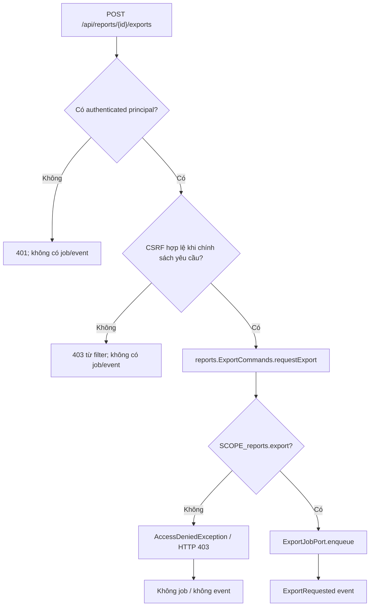
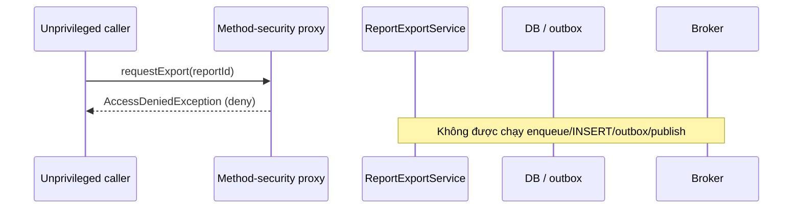
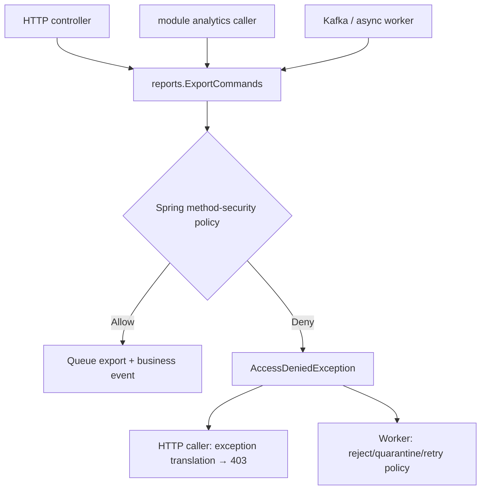
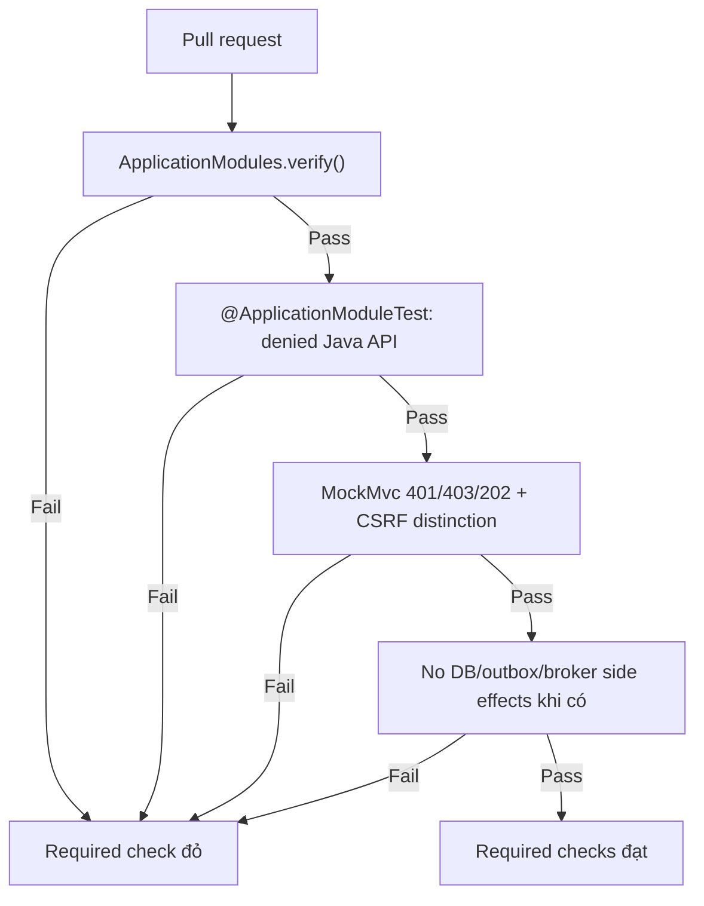

# Test lỗi khi thiếu quyền

## 1. Hợp đồng lỗi: từ chối đúng **và** không có tác động nghiệp vụ

Trong một hệ thống Spring Modulith, module `reports` công bố API `ExportCommands.requestExport(reportId)`. Một caller chỉ có quyền `reports.read` không được tạo export job, dù nó biết UUID báo cáo hoặc được phép import interface công khai của module. **Kiểm thử “thiếu quyền” không thể kết thúc ở việc thấy HTTP 403**: cần chứng minh request bị từ chối **đúng lý do** và không tạo job, không phát event, không gửi tác vụ qua broker.

Chủ đề **“Test lỗi khi thiếu quyền”** nằm trong chương **Security testing** của học phần `SPRING_MODULITH_VERIFICATION_TESTING`. Học phần rèn kỹ năng kiểm chứng ranh giới module bằng `ApplicationModules.verify()`, luật phụ thuộc, `@ApplicationModuleTest`, kiểm thử event/database/integration và quality gate CI. Bài này đi sâu vào **negative authorization test** ở ranh giới **public Java API** và **HTTP security filter chain**, không lặp phần nhập môn authentication.

**Hợp đồng cụ thể của ví dụ:**

- Caller được xác thực có authority `SCOPE_reports.export` → được phép gọi `ExportCommands`; tạo một export job và công bố `ExportRequested`.
- Caller được xác thực nhưng **không có** `SCOPE_reports.export` → `AccessDeniedException` tại Java method boundary; qua HTTP là **403 Forbidden** theo filter chain ví dụ.
- Request HTTP **không có authentication** → **401 Unauthorized** do HTTP Basic entry point của ví dụ.
- Request authenticated **thiếu CSRF token** trên POST → **403** từ CSRF filter trước khi vào controller; **không được kết luận** rằng `@PreAuthorize` đã chạy.
- Mọi đường bị từ chối → **không gọi `ExportJobPort.enqueue(...)`, không phát `ExportRequested`** và không làm lộ dữ liệu nội bộ trong error body.



**Phân biệt hai bề mặt lỗi:**

| Tầng | Thiếu quyền biểu hiện ra sao? | Bằng chứng mạnh hơn status |
| --- | --- | --- |
| **Java public module API** | `AccessDeniedException` hoặc subtype trong Spring Security hiện hành | Gọi **bean/proxy thật**; assert không gọi port và không phát event |
| **HTTP qua Spring Security** | 401/403 tùy authentication, CSRF và chính sách | Assert status, đường kích hoạt, không side effect và error body an toàn |
| **Async event/broker consumer** | Không có HTTP status; cần reject/quarantine/DLT theo policy | Assert không có business effect, retry/ack/offset đúng thiết kế |

**Bất biến quan trọng:** 403 đơn lẻ là **triệu chứng**, không phải bằng chứng method security đã bảo vệ nghiệp vụ. Một test mạnh phải làm đỏ khi reviewer cố tình xóa `@PreAuthorize` nhưng vẫn giữ cấu hình HTTP/CSRF.

## 2. Ví dụ tự chứa: public API, export job và business event

Cấu trúc Java minh họa:

```text
com.example.shop
├── ShopApplication.java
└── reports
    ├── ExportCommands.java
    ├── ExportRequested.java
    └── internal
        ├── ReportExportService.java
        ├── ReportExportHttpController.java
        ├── ExportJobPort.java
        ├── InMemoryExportJobPort.java
        └── ReportSecurityConfiguration.java
```

**Public module API** nằm ở package gốc `reports`, trong khi job store và implementation nằm trong `reports.internal`:

```java
// src/main/java/com/example/shop/reports/ExportCommands.java
package com.example.shop.reports;

import java.util.UUID;

public interface ExportCommands {
    void requestExport(UUID reportId);
}
```

```java
// src/main/java/com/example/shop/reports/ExportRequested.java
package com.example.shop.reports;

import java.util.UUID;

public record ExportRequested(
        UUID reportId,
        String requestedBy
) {
}
```

Port nội bộ (điểm quan sát side effect của test):

```java
// src/main/java/com/example/shop/reports/internal/ExportJobPort.java
package com.example.shop.reports.internal;

import java.util.UUID;

interface ExportJobPort {
    void enqueue(UUID reportId, String requestedBy);
}
```

Một adapter in-memory chỉ để ví dụ bootstrap độc lập hạ tầng:

```java
// src/main/java/com/example/shop/reports/internal/
// InMemoryExportJobPort.java
package com.example.shop.reports.internal;

import java.util.UUID;
import java.util.concurrent.ConcurrentHashMap;
import java.util.concurrent.ConcurrentMap;
import org.springframework.stereotype.Component;

@Component
class InMemoryExportJobPort implements ExportJobPort {

    private final ConcurrentMap<UUID, String> jobs =
            new ConcurrentHashMap<>();

    @Override
    public void enqueue(UUID reportId, String requestedBy) {
        jobs.putIfAbsent(reportId, requestedBy);
    }
}
```

**Lưu ý:** adapter này **không phải** job queue production. Nó không có database durability, outbox, transaction, retry hoặc trạng thái processing. Khi kiểm tra “không có DB/broker side effect” trong production, cần một integration test với adapter/hạ tầng thật, không suy luận từ mock ở các mục sau.

### Service được bảo vệ tại Java method boundary

```java
// src/main/java/com/example/shop/reports/internal/
// ReportExportService.java
package com.example.shop.reports.internal;

import com.example.shop.reports.ExportCommands;
import com.example.shop.reports.ExportRequested;
import java.util.Objects;
import java.util.UUID;
import org.springframework.context.ApplicationEventPublisher;
import org.springframework.security.access.prepost.PreAuthorize;
import org.springframework.security.core.context.SecurityContextHolder;
import org.springframework.stereotype.Service;

@Service
class ReportExportService implements ExportCommands {

    private final ExportJobPort jobs;
    private final ApplicationEventPublisher events;

    ReportExportService(
            ExportJobPort jobs,
            ApplicationEventPublisher events) {
        this.jobs = jobs;
        this.events = events;
    }

    @Override
    @PreAuthorize("hasAuthority('SCOPE_reports.export')")
    public void requestExport(UUID reportId) {
        Objects.requireNonNull(reportId, "reportId");

        String requestedBy = SecurityContextHolder
                .getContext()
                .getAuthentication()
                .getName();

        jobs.enqueue(reportId, requestedBy);

        events.publishEvent(new ExportRequested(
                reportId, requestedBy
        ));
    }
}
```

**Thứ tự thực thi là ý đồ test:** authorization advice từ chối trước khi vào method body; vì vậy cả `jobs.enqueue` lẫn `events.publishEvent` đều không xảy ra khi thiếu authority.

Điểm cần tránh: nếu chỉ đặt policy trên REST controller, một module khác có thể inject `ExportCommands` và gọi trực tiếp qua Java mà không qua HTTP filter chain. Vì vậy, permission phải được kiểm tại **public module API method** (hoặc domain policy tương ứng) và test cả đường Java.

Để xây hệ thống thực, cần kiểm thêm quyền với **đúng reportId / owner / tenant**, quota, trạng thái và việc enqueue+event nhất quán. Những bất biến đó không thay đổi mục tiêu chính của bài: **thiếu authority không được có bất kỳ business effect nào**.

## 3. Method security và HTTP exception translation phải cùng được bật

Cấu hình security của ví dụ:

```java
// src/main/java/com/example/shop/reports/internal/
// ReportSecurityConfiguration.java
package com.example.shop.reports.internal;

import org.springframework.context.annotation.Bean;
import org.springframework.context.annotation.Configuration;
import org.springframework.security.config.Customizer;
import org.springframework.security.config.annotation.method
        .configuration.EnableMethodSecurity;
import org.springframework.security.config.annotation.web.builders.HttpSecurity;
import org.springframework.security.web.SecurityFilterChain;

@Configuration(proxyBeanMethods = false)
@EnableMethodSecurity
class ReportSecurityConfiguration {

    @Bean
    SecurityFilterChain reportFilterChain(HttpSecurity http)
            throws Exception {
        return http
                .authorizeHttpRequests(auth ->
                        auth.anyRequest().authenticated())
                .httpBasic(Customizer.withDefaults())
                .build();
    }
}
```

Điểm quan trọng của cấu hình này:

1. `@EnableMethodSecurity` bật `@PreAuthorize` trên Spring-managed beans.
2. `httpBasic(...)` cung cấp authentication entry point để request không có principal nhận **401**.
3. `authorizeHttpRequests(...authenticated())` yêu cầu một principal được xác thực khi vào HTTP endpoint, **nhưng không tự kiểm scope export**. Scope đó được kiểm ở service.
4. CSRF **được giữ bật** theo cấu hình mặc định cho request POST; HTTP test hợp lệ cần gửi `csrf()`. Ví dụ này không đại diện cho mọi API stateless bearer/OAuth2 deployment.
5. Spring Security có thể trả 403 cho cả **CSRF failure** và **method authorization failure**. Vì vậy phải thiết kế test để phân biệt hai nguyên nhân.

Controller:

```java
// src/main/java/com/example/shop/reports/internal/
// ReportExportHttpController.java
package com.example.shop.reports.internal;

import com.example.shop.reports.ExportCommands;
import java.util.UUID;
import org.springframework.http.ResponseEntity;
import org.springframework.web.bind.annotation.PathVariable;
import org.springframework.web.bind.annotation.PostMapping;
import org.springframework.web.bind.annotation.RequestMapping;
import org.springframework.web.bind.annotation.RestController;

@RestController
@RequestMapping("/api/reports")
class ReportExportHttpController {

    private final ExportCommands exports;

    ReportExportHttpController(ExportCommands exports) {
        this.exports = exports;
    }

    @PostMapping("/{reportId}/exports")
    public ResponseEntity<Void> request(
            @PathVariable("reportId") UUID reportId) {
        exports.requestExport(reportId);
        return ResponseEntity.accepted().build();
    }
}
```

Bài HTTP test ở mục 5 sẽ dùng `MockMvc` với **Spring Security filters thật**, nhưng principal từ `spring-security-test`. Không cần mật khẩu thật, identity provider thật hoặc token bearer có hiệu lực để test **missing permission**.

### 401, 403 và lỗi nghiệp vụ không được nhập làm một

| Trường hợp | Tình trạng authentication | Kỳ vọng theo cấu hình ví dụ |
| --- | --- | --- |
| Không có principal trên POST + CSRF hợp lệ | Unauthenticated | **401** từ Basic entry point |
| Principal đã authenticated nhưng thiếu export authority + CSRF hợp lệ | Authenticated | **403** do `@PreAuthorize` |
| Principal đã authenticated và có export authority + CSRF hợp lệ | Authenticated | **202** |
| Principal authenticated có quyền, nhưng thiếu CSRF token | Authenticated | **403** tại filter; method chưa chạy |
| UUID path không đúng format | Có thể authenticated | Thường **400**, không phải lỗi permission |
| Report không tồn tại nhưng có quyền export | Authenticated/authorized | 404/409 theo business API contract; ví dụ demo chưa lookup report |

Trong ứng dụng production có custom entry point/exception handler, JSON error body và status có thể khác. **Điểm bắt buộc:** contract được đặc tả và test đúng cấu hình thực, không hardcode “mọi lỗi = 403”.

## 4. `@ApplicationModuleTest`: test thiếu quyền tại public Java API

Một Java module caller không đi qua HTTP filter chain. Để test trực tiếp `@PreAuthorize`, dùng Spring Modulith `@ApplicationModuleTest` với **Spring bean được inject**, không tự `new ReportExportService(...)`.

Ví dụ trong `reports.internal` để tiếp cận `ExportJobPort` package-private:

```java
// src/test/java/com/example/shop/reports/internal/
// ExportPermissionModuleTests.java
package com.example.shop.reports.internal;

import static org.assertj.core.api.Assertions.assertThat;
import static org.junit.jupiter.api.Assertions.assertThrows;
import static org.mockito.Mockito.verify;
import static org.mockito.Mockito.verifyNoInteractions;

import com.example.shop.reports.ExportCommands;
import com.example.shop.reports.ExportRequested;
import java.util.UUID;
import org.junit.jupiter.api.Test;
import org.springframework.beans.factory.annotation.Autowired;
import org.springframework.modulith.test.ApplicationModuleTest;
import org.springframework.modulith.test.Scenario;
import org.springframework.security.access.AccessDeniedException;
import org.springframework.security.test.context.support.WithAnonymousUser;
import org.springframework.security.test.context.support.WithMockUser;
import org.springframework.test.context.bean.override.mockito.MockitoBean;
import org.springframework.test.context.event.ApplicationEvents;
import org.springframework.test.context.event.RecordApplicationEvents;

@ApplicationModuleTest
@RecordApplicationEvents
class ExportPermissionModuleTests {

    @Autowired
    ExportCommands api;

    @Autowired
    ApplicationEvents publications;

    @MockitoBean
    ExportJobPort jobs;

    @Test
    @WithMockUser(
        username = "bob",
        authorities = "SCOPE_reports.read"
    )
    void missingExportPermissionThrowsAndProducesNoEffects() {
        UUID reportId = UUID.randomUUID();

        assertThrows(
                AccessDeniedException.class,
                () -> api.requestExport(reportId)
        );

        verifyNoInteractions(jobs);
        assertThat(publications.stream(ExportRequested.class)
                .toList()).isEmpty();
    }

    @Test
    @WithAnonymousUser
    void anonymousModuleCallerCannotRequestExport() {
        UUID reportId = UUID.randomUUID();

        assertThrows(
                AccessDeniedException.class,
                () -> api.requestExport(reportId)
        );

        verifyNoInteractions(jobs);
        assertThat(publications.stream(ExportRequested.class)
                .toList()).isEmpty();
    }

    @Test
    @WithMockUser(
        username = "alice",
        authorities = "SCOPE_reports.export"
    )
    void allowedCallerDoesCreateJobAndPublishEvent(
            Scenario scenario) {
        UUID reportId = UUID.randomUUID();

        scenario.stimulate(
                    () -> api.requestExport(reportId)
                )
                .andWaitForEventOfType(ExportRequested.class)
                .matching(event ->
                        event.reportId().equals(reportId)
                                && event.requestedBy().equals("alice"))
                .toArrive();

        verify(jobs).enqueue(reportId, "alice");
    }
}
```

### Phép kiểm này mạnh hơn unit test thuần ở đâu?

- `@ApplicationModuleTest` khởi động module `reports` theo nhận diện Spring Modulith.
- `@WithMockUser` cung cấp authentication giả trong `SecurityContext`; không cần password/JWT production.
- `ExportCommands` là **Spring-managed bean**, nên `@PreAuthorize` có cơ hội chạy qua proxy.
- `@MockitoBean` thay port enqueue thật (Spring Framework 6.2+; đời cũ dùng cơ chế mock bean tương thích).
- `@RecordApplicationEvents` thu Spring application events; bài negative assert event **không được công bố**.
- Positive test `Scenario.stimulate(...)` chứng minh use case thực sự phát event đúng; nếu chỉ có negative tests, một service “luôn từ chối” cũng có thể được chấp nhận sai.

**Giới hạn:** mock port không chứng minh database/outbox hoặc broker production không có effect do cấu hình runtime khác. Nó chứng minh **method-security enforcement tại module boundary** và thứ tự thực hiện side effect trong code path đang chạy.

**Lưu ý exception:** với `@WithAnonymousUser`, Spring Security Test thiết lập anonymous authentication có authority tương ứng nhưng không có `SCOPE_reports.export`; method advice bị deny. Khi hoàn toàn không có SecurityContext hoặc dùng custom exception handler, loại exception ở tầng Java có thể khác. Không dùng assertion kiểu `assertThrows(Exception.class)` vì quá rộng; phân biệt nguyên nhân theo contract của test context.

## 5. MockMvc integration: phân biệt **401/403/202** và kiểm side effect

HTTP test phải đi qua filter chain, controller, Spring-managed service và event bus. Ở đây chúng ta chỉ mock `ExportJobPort` để biết method body **có bị chạy nhầm** hay không.

```java
// src/test/java/com/example/shop/reports/internal/
// ReportExportDeniedHttpIT.java
package com.example.shop.reports.internal;

import static org.assertj.core.api.Assertions.assertThat;
import static org.mockito.Mockito.verify;
import static org.mockito.Mockito.verifyNoInteractions;
import static org.springframework.security.test.web.servlet.request
        .SecurityMockMvcRequestPostProcessors.anonymous;
import static org.springframework.security.test.web.servlet.request
        .SecurityMockMvcRequestPostProcessors.csrf;
import static org.springframework.security.test.web.servlet.request
        .SecurityMockMvcRequestPostProcessors.user;
import static org.springframework.test.web.servlet.request
        .MockMvcRequestBuilders.post;
import static org.springframework.test.web.servlet.result
        .MockMvcResultMatchers.status;

import com.example.shop.reports.ExportRequested;
import java.util.UUID;
import org.junit.jupiter.api.Test;
import org.springframework.beans.factory.annotation.Autowired;
import org.springframework.boot.test.autoconfigure.web.servlet.AutoConfigureMockMvc;
import org.springframework.boot.test.context.SpringBootTest;
import org.springframework.security.core.authority.SimpleGrantedAuthority;
import org.springframework.test.context.bean.override.mockito.MockitoBean;
import org.springframework.test.context.event.ApplicationEvents;
import org.springframework.test.context.event.RecordApplicationEvents;
import org.springframework.test.web.servlet.MockMvc;

@SpringBootTest
@AutoConfigureMockMvc
@RecordApplicationEvents
class ReportExportDeniedHttpIT {

    @Autowired
    MockMvc mvc;

    @Autowired
    ApplicationEvents publications;

    @MockitoBean
    ExportJobPort jobs;

    @Test
    void authenticatedReaderWithoutExportScopeGets403()
            throws Exception {
        UUID reportId = UUID.randomUUID();

        mvc.perform(post("/api/reports/{reportId}/exports", reportId)
                .with(user("bob").authorities(
                        new SimpleGrantedAuthority(
                                "SCOPE_reports.read")))
                .with(csrf()))
                .andExpect(status().isForbidden());

        verifyNoInteractions(jobs);
        assertThat(publications.stream(ExportRequested.class)
                .toList()).isEmpty();
    }

    @Test
    void anonymousRequestGets401AndNoEffects()
            throws Exception {
        UUID reportId = UUID.randomUUID();

        mvc.perform(post("/api/reports/{reportId}/exports", reportId)
                .with(anonymous())
                .with(csrf()))
                .andExpect(status().isUnauthorized());

        verifyNoInteractions(jobs);
        assertThat(publications.stream(ExportRequested.class)
                .toList()).isEmpty();
    }

    @Test
    void writerWithScopeGets202AndCreatesEffect()
            throws Exception {
        UUID reportId = UUID.randomUUID();

        mvc.perform(post("/api/reports/{reportId}/exports", reportId)
                .with(user("alice").authorities(
                        new SimpleGrantedAuthority(
                                "SCOPE_reports.export")))
                .with(csrf()))
                .andExpect(status().isAccepted());

        verify(jobs).enqueue(reportId, "alice");
        assertThat(publications.stream(ExportRequested.class)
                .toList()).anySatisfy(event -> {
                    assertThat(event.reportId()).isEqualTo(reportId);
                    assertThat(event.requestedBy()).isEqualTo("alice");
                });
    }

    @Test
    void validPermissionButMissingCsrfAlsoGets403()
            throws Exception {
        UUID reportId = UUID.randomUUID();

        mvc.perform(post("/api/reports/{reportId}/exports", reportId)
                .with(user("alice").authorities(
                        new SimpleGrantedAuthority(
                                "SCOPE_reports.export"))))
                .andExpect(status().isForbidden());

        verifyNoInteractions(jobs);
        assertThat(publications.stream(ExportRequested.class)
                .toList()).isEmpty();
    }
}
```

**Điều kiện để chạy đoạn ví dụ:**

- Java 17+, Spring Boot + Spring Web/Security + `spring-security-test`, Spring Modulith test, JUnit Jupiter, Mockito và `@SpringBootApplication` ở `com.example.shop`. Ví dụ sử dụng `Stream.toList()` nên cần Java hỗ trợ API này.
- `@MockitoBean` có từ Spring Framework 6.2+; dự án cũ dùng replacement tương ứng.
- `ReportSecurityConfiguration`, controller và `ReportExportService` thực sự được Spring quét.
- Security filter chain của mục 3 **giữ CSRF bật và dùng HTTP Basic**. Nếu production dùng stateless bearer tokens với CSRF policy khác, điều chỉnh test cho đúng filter chain đó.
- `@RecordApplicationEvents` và `ApplicationEvents` thuộc Spring Test; event publisher đồng bộ mặc định để assertions sau HTTP request quan sát được publication.
- Spring test framework quản lý reset mock và event recorder theo test method; không được để các test phụ thuộc thứ tự chạy.

### Đọc kết quả mà không suy luận sai

| Test | HTTP status | `ExportJobPort` | `ExportRequested` | Điều thực sự chứng minh |
| --- | --- | --- | --- | --- |
| Bob thiếu export scope, **có CSRF** | **403** | Không gọi | Không phát | Scope restriction ở method API có hiệu lực |
| Anonymous, **có CSRF** | **401** | Không gọi | Không phát | Authentication entry point từ chối |
| Alice có scope, **có CSRF** | **202** | Gọi đúng | Có event | Positive path thật hoạt động |
| Alice có scope, **thiếu CSRF** | **403** | Không gọi | Không phát | CSRF filter chặn, **không phải** phép kiểm scope |

Cách viết trên cố ý dùng cả **positive và negative controls**. Nếu xóa `@PreAuthorize`, test Bob thiếu quyền sẽ đi vào method body và **đỏ** (thường nhận 202 và gọi port); trong khi test thiếu CSRF vẫn nhận 403. Đây là cách tránh nhầm lẫn 403 giữa hai tầng.

**Đây không phải test JWT signature.** `user(...)` của Spring Security Test đưa principal giả vào MockMvc, không kiểm HTTP Basic password thật hoặc OAuth2 resource server. Với ứng dụng JWT, cần test decoder/issuer/audience/claim mapping riêng, còn bài này tập trung *thiếu quyền đã được xác thực*.

## 6. Vì sao 403 có thể là “xanh giả”: nguồn lỗi và cách chẩn đoán

Một test chỉ có:

```java
mvc.perform(post("/api/reports/{reportId}/exports", id))
        .andExpect(status().isForbidden());
```

**Không kiểm chứng method permission**, vì request không có `csrf()` có thể bị CSRF filter chặn từ đầu. Trong ứng dụng khác, status 403 còn có thể đến từ URL-level rule, một gateway hoặc custom filter, khi service `@PreAuthorize` chưa từng chạy.

Các nguồn phổ biến cần phân biệt:

| Quan sát | Nguồn có thể | Cách test cô lập |
| --- | --- | --- |
| HTTP 403 khi thiếu CSRF | `CsrfFilter` | Thêm `csrf()` để test method authorization; test CSRF riêng |
| HTTP 403 dù có `SCOPE_reports.export` | Thiếu role ở URL matcher hoặc converter map sai scope | Kiểm filter chain và GrantedAuthorities, thêm positive control |
| HTTP 403 khi gọi Java API | Spring method-security `AccessDeniedException` | `@ApplicationModuleTest` + gọi injected API |
| HTTP 401 dù test tưởng authenticated | Chưa có principal hoặc token bị reject | Kiểm authn mechanism, token parsing/entry point |
| HTTP 404 trước khi vào service | Sai URL/controller mapping hoặc policy che tồn tại tài nguyên | Kiểm handler mapping và test positive |
| HTTP 400 | Invalid UUID/request validation | Dùng UUID hợp lệ, assert validation riêng |
| HTTP 500 | Broad exception handler hoặc lỗi dependency | Test policy/error mapping, không đổi mọi lỗi thành 403 |

**Quy trình chẩn đoán khi test thiếu quyền không đỏ:**

1. Xác nhận test đang dùng **đúng endpoint** và Spring Security filters được bật; `@AutoConfigureMockMvc(addFilters = false)` sẽ vô hiệu hóa phép kiểm filter behavior.
2. Gửi `csrf()` trong test muốn kiểm authorization để tránh false 403 từ CSRF.
3. Đặt principal đã authenticated nhưng chỉ có `SCOPE_reports.read`; không dùng anonymous khi muốn kiểm **thiếu scope**.
4. Cấp **đúng `SCOPE_reports.export`** cho positive control và xác nhận request thành công.
5. Gọi `ExportCommands` qua bean Spring ở module test; không dùng `new ReportExportService(...)`.
6. Xác nhận `@EnableMethodSecurity` được nạp trong **test và production**.
7. Assert **không enqueue job và không phát event**; nếu chỉ so status, dễ bỏ sót sai thứ tự thực hiện.
8. Xem JUnit report để chắc case negative thực sự được runner chạy.

### Authority khác role

`hasAuthority('SCOPE_reports.export')` so sánh **đúng chuỗi**. `@WithMockUser(roles="ADMIN")` thường tạo `ROLE_ADMIN`, **không tự cấp** `SCOPE_reports.export`. Một user được gọi là “admin” trong UI không có nghĩa backend tự cho nó quyền export.

Nếu business cho phép role ADMIN vượt scope, hãy **định nghĩa rõ nhánh policy** và viết cả allow/deny tests. Đừng sửa test bằng cách thêm mọi quyền cho user giả vì muốn nó qua.

## 7. Error response an toàn: không tiết lộ permission graph hoặc dữ liệu báo cáo

Với caller thiếu quyền, error body không nên làm lộ:

- Tên Java class/package nội bộ, stack trace, SQL hoặc repository implementation.
- Chi tiết “báo cáo này thuộc user X / tenant Y” nếu caller không được xem metadata ấy.
- Token, secret, Authorization header hoặc toàn bộ request context.
- Trạng thái tồn tại của resource nếu chính sách chống enumeration yêu cầu ẩn.

Trong cấu hình HTTP Basic đơn giản, response 403 có thể không có body. Nếu dự án dùng `ProblemDetail` hoặc JSON error contract, nên trả **mã lỗi chung** (`ACCESS_DENIED`) hoặc nội dung tối thiểu đã được review, không phản chiếu `exception.getMessage()` thẳng ra client.

Bổ sung một phép kiểm không lộ thông tin trong **cùng `ReportExportDeniedHttpIT`**:

```java
@Test
void forbiddenResponseDoesNotExposeInternalDetails()
        throws Exception {
    UUID reportId = UUID.randomUUID();

    var result = mvc.perform(
            post("/api/reports/{reportId}/exports", reportId)
                    .with(user("bob").authorities(
                            new SimpleGrantedAuthority(
                                    "SCOPE_reports.read")))
                    .with(csrf()))
            .andExpect(status().isForbidden())
            .andReturn();

    String body = result.getResponse().getContentAsString();

    assertThat(body)
            .doesNotContain(
                    "ReportExportService",
                    "InMemoryExportJobPort",
                    "at com.example.shop",
                    "java.lang.",
                    "SqlException"
            );

    verifyNoInteractions(jobs);
}
```

**Giới hạn:** “không chứa vài chuỗi” chỉ là một phép kiểm có giá trị hạn chế. Với ứng dụng có JSON error contract, nên assert **allow-list field** và error code/HTTP status đã quy định; đồng thời test không lộ sensitive details trong logs/headers. Không dùng message của exception làm API contract nếu nó có thể thay đổi theo Spring Security version.

### Có được ghi security audit khi bị từ chối không?

Có — **security denial audit** và **business event** là hai việc khác nhau. Một lần bị từ chối có thể tạo bản ghi bảo mật tối thiểu, ví dụ request ID, actor đã xác thực, action code và reason category. Nhưng nó **không** được tạo `ExportRequested` hoặc đưa job vào queue.

Trong bài này, `ExportRequested` là **business event của hành động thành công**, không phải event ghi nhận một lần từ chối quyền. Không đổi tên event rồi dùng chung cho cả allow/deny vì sẽ khó test và dễ kích hoạt consumer sai.

Khi kiểm log/audit, dùng principal và marker **tổng hợp**, không đưa credential production vào test. Đừng log bearer token, claim nhạy cảm hoặc toàn bộ báo cáo chỉ để giải thích lỗi 403.

## 8. Side effect tại database, outbox và event: chặn ở đâu, test đến đâu?

`verifyNoInteractions(jobs)` chứng minh body chưa gọi port theo code path đang test. Tuy nhiên, với production adapter, side effect có thể nằm tại nhiều điểm:



Nếu một command phức tạp vừa ghi dữ liệu vừa publish event, thứ tự quan trọng: kiểm quyền phải xảy ra **trước mutation**. Chỉ dựa vào `@PostAuthorize` cho command có side effect là nguy hiểm: method body có thể đã ghi dữ liệu trước khi post-authorization từ chối.

Trong hệ thống thật có database/outbox:

- Assert **không có hàng `export_jobs` mới** với `reportId` của caller bị từ chối.
- Assert **không có outbox/event publication** tương ứng.
- Assert các hàng báo cáo chưa bị thay đổi nếu job preparation đụng metadata.
- Nếu bất kỳ nhánh nào bắt đầu transaction trước kiểm quyền, test rollback/commit thực tế để xác nhận **không có partial write**.
- Nếu listener async hoặc Kafka được dùng, negative test chỉ đọc “không có message ngay lập tức” chưa đủ; phải xác nhận stimulus đã được xử lý, correlation ID và quan sát với deadline/thiết kế phù hợp.
- Xác nhận error handler không vô tình publish `ExportRequested` từ đường exception.

Ví dụ **schema/check cần viết trong DB integration test** với adapter bền vững, không phải test dùng `InMemoryExportJobPort` ở mục 2:

```sql
-- Sau denied request có reportId riêng:
SELECT COUNT(*) AS leaked_jobs
FROM export_jobs
WHERE report_id = :forbidden_report_id;

-- Sau denied request có correlation ID:
SELECT COUNT(*) AS leaked_outbox
FROM outbox_events
WHERE correlation_id = :denied_request_id;
```

Tên bảng ở trên chỉ là **minh họa**, không phải schema mặc định của Spring Modulith. Cần dùng bảng và schema do ứng dụng thật quản lý. Nếu dùng Spring Modulith Event Publication Registry, hãy kiểm storage adapter/version đang dùng; không suy đoán một tên bảng chung cho mọi implementation.

**Độ mạnh của negative test:** verify mock → bằng chứng không gọi port; DB integration → bằng chứng không commit dữ liệu; broker integration → bằng chứng không phát message trái quyền. Không suy luận tầng sau chỉ từ một tầng trước.

### Phân biệt 403 và nghiệp vụ không tồn tại

Một caller có quyền export nhưng report không tồn tại có thể nhận 404; một caller **không có quyền xem sự tồn tại** có thể được trả 403 hoặc 404 theo privacy policy. Điều quan trọng là **không để kết quả tiết lộ dữ liệu trái quyền**, và test quyền trên chính object/resource khi policy yêu cầu.

Một test chỉ dùng `reportId` không tồn tại có thể xanh vì code fail trong repository, **không phải vì permission được kiểm**. Vì vậy, test thiếu scope nên sử dụng một `reportId` hợp lệ trong fixture tích hợp, hoặc mock port được thiết lập sao cho nếu method body chạy thì sẽ tạo side effect quan sát được.

## 9. Event, async và cross-module caller: không có HTTP 403 ở mọi đường

Một listener từ module khác có thể gọi `reports.ExportCommands` theo Java; Kafka consumer hoặc scheduled worker cũng có thể gọi nó. Những caller này **không đi qua HTTP filter chain**, nên không có status code 401/403 cho bản thân lời gọi. Nếu method security từ chối, chúng nhận Java exception.



**Rủi ro thường gặp:**

- `@EventListener`/`@Async`, Kafka/RabbitMQ consumer hoặc scheduler chạy trên thread không có HTTP `SecurityContext` tương ứng. Không tự cho `ADMIN` khi authentication null để tránh exception.
- Nếu một worker hợp pháp cần tạo export, hãy định nghĩa service identity, authority và policy riêng **được kiểm tra**; không bỏ `@PreAuthorize` khỏi public API.
- Message chứa `actorId` **không phải authentication**. Consumer phải xác minh nguồn message/quyền và áp dụng policy phù hợp trước mutation.
- Một `AccessDeniedException` ở Kafka listener không tự chuyển thành HTTP 403; cần error handler, retry/quarantine/DLT/ack hoặc offset policy. Không retry vô hạn một lỗi quyền vĩnh viễn.
- Nếu một event listener phát business event trước khi authorization được thực thi ở downstream, có thể đã rò rỉ dữ liệu hoặc khởi động tác vụ trái phép.
- Với `@TransactionalEventListener(AFTER_COMMIT)`, test rollback có thể không kích hoạt event; không dùng kết quả đó để suy ra permission được bảo vệ.

**Cách test đúng theo ranh giới:**

| Caller | Test cần có | Kỳ vọng thiếu quyền |
| --- | --- | --- |
| Java public module API | `@ApplicationModuleTest` + `@WithMockUser` | `AccessDeniedException`; không job/event |
| HTTP request | `@SpringBootTest` + MockMvc filters | 403 khi authenticated thiếu scope; không job/event |
| Anonymous HTTP | MockMvc không auth nhưng CSRF hợp lệ | 401 với Basic entry point ví dụ |
| Background worker | Test worker/service identity và policy | Exception được xử lý theo workflow; không business effect |
| Kafka/RabbitMQ | Broker integration + authn/trust policy | Reject/quarantine/ack phù hợp, không phát export |
| Database/outbox | Integration test adapter thật | Không hàng mới, không publication trái quyền |

**Không sửa lỗi thiếu quyền bằng cách bypass interceptor cho internal module caller.** “Cùng process” chỉ nói về vị trí code, không chứng minh caller có quyền với dữ liệu.

## 10. Bộ ca kiểm thử âm tính có khả năng phát hiện hồi quy

| ID | Tình huống | Expected | Bằng chứng không side effect |
| --- | --- | --- | --- |
| N1 | Authenticated Bob chỉ có `SCOPE_reports.read` | **403** trên HTTP, `AccessDeniedException` ở Java | Không enqueue/export event |
| N2 | Anonymous HTTP + CSRF hợp lệ | **401** với HTTP Basic ví dụ | Không enqueue/export event |
| N3 | Authenticated Alice có `SCOPE_reports.export` | **202** | Đúng một enqueue và event đúng actor |
| N4 | Alice có scope nhưng thiếu CSRF | **403** từ CSRF filter | Không enqueue/export event |
| N5 | `@WithMockUser(roles="ADMIN")` nhưng policy đòi `SCOPE_reports.export` | **Deny**, trừ khi có policy riêng | Không enqueue/export event |
| N6 | Permission annotation bị xóa | **N1 phải đỏ** | Test phát hiện body chạy trái quyền |
| N7 | `@EnableMethodSecurity` không được load | **N1/module test phải đỏ** | Không được chỉ assert context boot |
| N8 | Controller Advice xử lý `AccessDeniedException` sai | **HTTP contract test phải đỏ** | Không trả 200/500 sai contract |
| N9 | Endpoint sai hoặc test thiếu CSRF | Positive control phải đỏ; chẩn đoán đúng nguồn 403 | Không được kết luận thiếu scope |
| N10 | API kiểm quyền sau khi enqueue | Negative test phải đỏ | Enqueue/event xuất hiện trước deny |
| N11 | Worker không có identity | Fail closed theo worker policy | Không tự cho quyền ADMIN |
| N12 | DB/outbox adapter thật chạy theo denied request | DB integration phải đỏ | Không có row/publication mới |

### Mutation test tối thiểu nên thực hiện trong nhánh thử nghiệm

**Phép thử A:** tạm xóa `@PreAuthorize` khỏi `ReportExportService.requestExport`. Kết quả cần thấy:

- Module test thiếu authority **đỏ**, vì method chạy và không ném `AccessDeniedException`.
- HTTP test Bob thiếu scope **đỏ**, vì `authorizeHttpRequests(...authenticated())` vẫn cho Bob vào và service tạo job.
- Positive test Alice vẫn có thể xanh; đây là lý do không chỉ test happy path.

**Phép thử B:** giữ `@PreAuthorize`, nhưng trong HTTP negative test **bỏ `csrf()`**. Test có thể vẫn xanh 403 dù method security bị vô hiệu hóa. Điều này phơi bày một **false positive** do CSRF filter; khôi phục `csrf()` khi test scope.

**Phép thử C:** đổi annotation thành `@PostAuthorize` và cho body enqueue trước khi từ chối. Negative test phải đỏ nhờ `verifyNoInteractions(jobs)` hoặc DB state assertions. Đừng chấp nhận “đã ném exception” là đủ nếu transaction/side effect không được hoàn nguyên.

### Tránh một phép assert quá rộng

```java
// Yếu: có thể xanh vì NPE, validation, repository fail...
assertThrows(Exception.class, () -> api.requestExport(reportId));
```

Nên dùng type phù hợp với context:

```java
// Test Java module API qua Spring proxy:
assertThrows(
        AccessDeniedException.class,
        () -> api.requestExport(reportId)
);

// Kết hợp:
verifyNoInteractions(jobs);
```

Ở HTTP boundary, dùng `status().isForbidden()` **sau khi** đã tạo authenticated principal thiếu scope và cấp CSRF hợp lệ. Gắn dấu hiệu completion/observable của business path để tránh lỗi “chưa có event vì chưa xử lý xong”.

## 11. Checklist quality gate CI cho lỗi thiếu quyền

Bài test chỉ có giá trị khi build runner **thực sự chạy nó** và branch protection chặn regression.



Checklist review:

- **Permission contract:** authority cụ thể được liệt kê; phân biệt user thiếu authority với unauthenticated.
- **Module method:** `@EnableMethodSecurity` thực sự được load, `@PreAuthorize` ở public API service; test gọi **Spring bean/proxy**, không dùng `new`.
- **Java negative test:** assert `AccessDeniedException` (hoặc subtype đã quy định), không catch mọi Exception.
- **HTTP negative test:** authenticated thiếu scope và **có CSRF** → 403; anonymous có CSRF → 401 theo entry point ví dụ.
- **Positive control:** authenticated đủ scope và có CSRF → 202; job và business event đúng principal.
- **Không side effect:** thiếu quyền không enqueue, không phát `ExportRequested`, không ghi DB/outbox hay gửi broker record.
- **Error body:** không có stack trace, package/internal class, token, owner/tenant details vượt quyền; error contract được kiểm khi ứng dụng công bố.
- **CSRF phân biệt:** thiếu CSRF là test **CSRF**, không phải test `@PreAuthorize`.
- **Authority mapping:** `roles`/`ROLE_` không bị nhầm với `authorities`/`SCOPE_`; JWT claim converter test riêng nếu dùng resource server.
- **Async/broker:** khi caller không có HTTP context, có identity/policy rõ, xử lý deny theo worker error policy, không fallback ADMIN.
- **Architectural gate:** `ApplicationModules.verify()` kiểm dependency giữa module, **không** tự kiểm quyền.
- **CI discovery:** JUnit reports xác nhận suite chạy; `ReportExportDeniedHttpIT` cần Maven Failsafe hoặc Gradle integrationTest task nếu project tách integration.
- **Required checks:** lỗi test không được bỏ qua bằng `@Disabled` hay `continue-on-error: true`; không cấp credential thật chỉ để test quyền.

Các lệnh tham khảo, tùy cấu hình build:

```bash
./mvnw test
./mvnw verify

./gradlew test
./gradlew check
```

**Đừng mặc định** `mvn test` đã chạy class `*IT`. Kiểm tra Surefire/Failsafe hoặc Gradle verification task, số test thực thi và log CI. Nếu suite không chạy, “build xanh” không bảo vệ authorization.

### Tự kiểm tra hiểu bài

**Câu 1.** Test POST không gửi CSRF, nhận 403. Đã chứng minh `@PreAuthorize` từ chối quyền chưa?

**Chưa.** `CsrfFilter` có thể chặn trước controller. Dùng authenticated user thiếu scope **và có `csrf()`**, thêm positive control đủ scope.

**Câu 2.** Module test gọi `new ReportExportService(...)` dưới `@WithMockUser` và thấy service chạy. Có thể kết luận method security lỗi không?

**Không.** Gọi `new` không qua Spring proxy. Test annotation enforcement phải inject `ExportCommands` từ context.

**Câu 3.** Một HTTP 403 xảy ra nhưng `export_jobs` đã có record mới. Test nên đạt không?

**Không.** Lỗi thiếu quyền phải ngăn side effect. Cần sửa thứ tự authorization/transaction và test DB/outbox thực.

**Câu 4.** Alice đủ `SCOPE_reports.export` nhưng chỉ có `ROLE_USER` trong một test khác. Vì sao hành vi có thể khác nhau?

**Vì authority string khác nhau.** `hasAuthority('SCOPE_reports.export')` không được thỏa chỉ bởi `ROLE_USER`. Test phải khai báo đúng authorities và kiểm claim mapping riêng.

**Kết luận:** Với lỗi thiếu quyền, hãy kiểm đồng thời **đúng lớp lỗi** (`AccessDeniedException` tại public Java API, 401/403 ở HTTP theo nguyên nhân) và **không có tác động nghiệp vụ** (không job, event, DB write hoặc broker message). `@ApplicationModuleTest` bảo vệ Spring method-security ở ranh giới module; MockMvc phân biệt authentication, authorization và CSRF; integration tests bổ sung kiểm chứng transaction và event thực. Kết hợp với `ApplicationModules.verify()` và quality gate CI để lỗi quyền không âm thầm quay lại khi ứng dụng Spring Modulith thay đổi.
