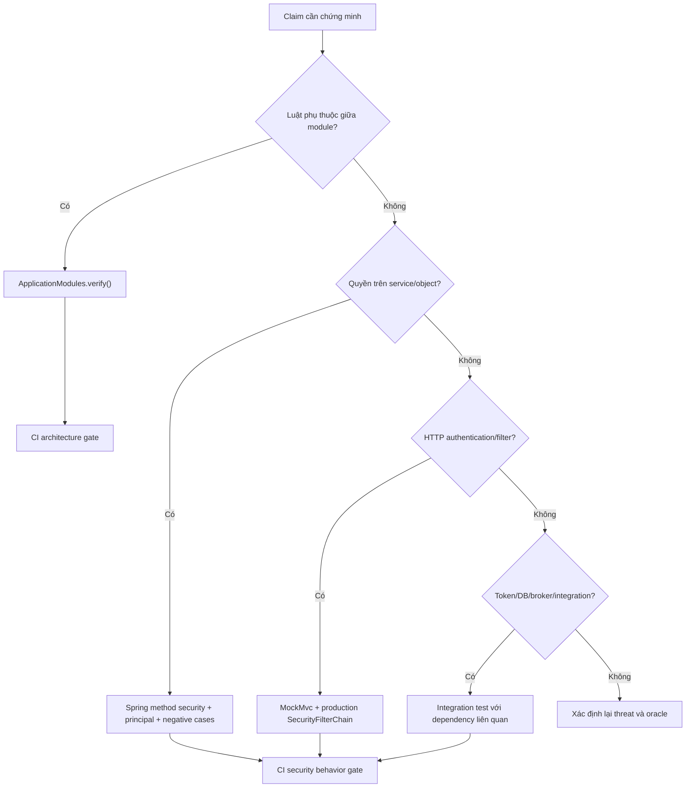
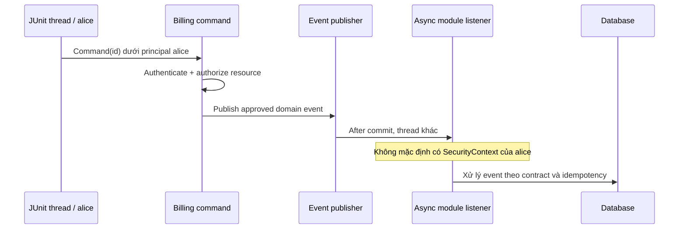
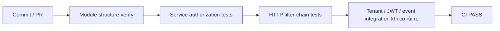

# Phân biệt security test với architectural verification

## 1. Cùng một ứng dụng, hai loại câu hỏi hoàn toàn khác nhau

Trong học phần **SPRING_MODULITH_VERIFICATION_TESTING**, chúng ta kiểm chứng **ranh giới kiến trúc** ứng dụng bằng `ApplicationModules` và quy tắc phụ thuộc giữa các module; đồng thời dùng `@ApplicationModuleTest`, kiểm thử sự kiện, database, tích hợp và quality gate CI để ngăn lỗi hồi quy. Ở chương **Security testing**, việc phân biệt **security test** với **architectural verification** quyết định test nào thật sự có giá trị bảo vệ quyền truy cập.

Hai câu hỏi mẫu:

- **Kiến trúc:** “Module `billing` có phụ thuộc trái phép vào `identity.internal` hoặc gây vòng phụ thuộc với `order` không?”
- **Bảo mật:** “Người dùng `alice` thiếu quyền `billing:read` hoặc không sở hữu hóa đơn B có thể đọc B không?”

Dù đều có thể dùng JUnit 5 và trả về kết quả xanh/đỏ, hai phép kiểm này **quan sát những thuộc tính khác nhau**.

| Góc nhìn | Architectural verification | Security test |
| --- | --- | --- |
| **Đối tượng** | Đồ thị phụ thuộc code, ranh giới API/internal package, luật module | Hành vi **xác thực**, **phân quyền**, cách ly dữ liệu, chính sách HTTP/method/event |
| **Đầu vào** | Bytecode/classes, khai báo module, allowed dependencies | Principal/authority, resource ID, request, token, SecurityContext, dữ liệu |
| **Phép kiểm tiêu biểu** | `ApplicationModules.of(Application.class).verify()` | `@WithMockUser`, `MockMvc`, method security, negative authorization assertions |
| **Tín hiệu pass** | Không có vi phạm luật module được cấu hình | Đúng principal được phép; principal sai bị từ chối; không có dữ liệu/side effect bị lộ |
| **Phát hiện tốt** | Import package nội bộ, module cycle, dependency ngoài danh sách cho phép | Broken access control, IDOR/BOLA, thiếu authority, filter chain/CSRF sai |
| **Không chứng minh** | Runtime authorization thực thi; 401/403; tenant data isolation | Module dependency DAG hoặc cấm import `identity.internal` |
| **Cần Docker?** | Không | Không bắt buộc; chỉ cần khi claim phụ thuộc DB/broker/token infrastructure thật |

**Thông điệp trung tâm:** **hợp lệ về kiến trúc không có nghĩa an toàn về phân quyền**, và một security test pass cũng **không chứng minh** hệ thống giữ đúng ranh giới module.

Một module có thể chỉ dùng public API của module `identity` mà vẫn trả nhầm hóa đơn của người khác. Ngược lại, một endpoint có thể kiểm tra role đúng nhưng module `billing` lại import lớp `identity.internal.JwtSecretLoader` trái luật kiến trúc.

### Đừng đồng nhất “security” với “chạy có Spring Security”

Test có `@WithMockUser` chưa chắc đã kiểm chứng gì nếu method thực tế **không có** authorization interceptor hoặc test gọi một mock thay vì bean cần bảo vệ. Một test `MockMvc` trả HTTP 200 cũng chưa chứng minh được 401/403 nếu không có **negative cases**.

Bài này dùng **một use case duy nhất — đọc hóa đơn của người sở hữu** — để phân tách ba bằng chứng:

1. Cấu trúc module không bị phá.
2. Service từ chối principal thiếu quyền hoặc không sở hữu hóa đơn.
3. HTTP filter chain trả 401/403 đúng khi request không hợp lệ.

## 2. Lập ma trận rủi ro: lỗi cần bắt quyết định loại test

Trước khi viết test, tạo một **security evidence sheet**: claim, lỗi giả định và oracle đủ sức bác bỏ claim sai.

| Claim | Failure mode phải phát hiện | Test thích hợp | Oracle |
| --- | --- | --- | --- |
| `billing` không import `identity.internal.*` | Developer dùng implementation nội bộ của module khác | Architectural verification | `verify()` ném violation |
| `billing` chỉ phụ thuộc module được phép | Thêm dependency ngoài `allowedDependencies` | Architectural verification | `verify()` ném violation |
| Chỉ user có authority `billing:read` được gọi service | `@PreAuthorize` bị bỏ hoặc method security chưa bật | **Method security test trên Spring proxy** | Thiếu authority → `AccessDeniedException` |
| User A không đọc được hóa đơn thuộc B | Chỉ kiểm tra role, quên owner/tenant | **Object-level authorization test** | A có role vẫn bị từ chối khi invoice của B |
| Request chưa xác thực không lấy được hóa đơn | HTTP filter chain để lộ endpoint | **MockMvc + SecurityFilterChain thật** | Anonymous GET → HTTP 401 khi dùng HTTP Basic |
| User đã xác thực nhưng thiếu quyền bị chặn | Request matcher sai hoặc `permitAll` quá rộng | MockMvc + security filters | HTTP 403 |
| POST thiếu CSRF token bị chặn (khi bật CSRF) | Filter CSRF bị vô hiệu hóa ngoài ý muốn | MockMvc với/không `csrf()` | 403 hoặc kết quả đúng chính sách |
| JWT sai chữ ký/issuer/audience bị từ chối | Decoder/validator sai | Resource-server integration với token đã ký/không hợp lệ | HTTP 401 và không gọi nghiệp vụ |
| Event từ message broker không được giả mạo user | Listener tin vào `userId` trong payload | Security test tại consumer/command boundary | Forged principal không vượt chính sách |
| Truy vấn DB không lộ tenant khác | Repository bỏ điều kiện `tenant_id` | DB integration/authorization test | Kết quả chỉ thuộc tenant được phép |

**Điểm quyết định:** `ApplicationModules.verify()` không đọc HTTP request, JWT claims hoặc user đang đăng nhập. Nó kiểm tra luật **cấu trúc module** chứ không chạy một luồng xác thực/phân quyền.

Ngược lại, `@WithMockUser` chỉ tạo danh tính test giả trong Spring SecurityContext. Nó **không** tự phân tích module cycles, và cũng **không** xác minh chữ ký JWT, token expiration hay issuer.

### Sơ đồ chọn loại bằng chứng



Một bài test chất lượng phải **ghi rõ điều nó không chứng minh**. Ví dụ phép kiểm HTTP 403 khi thiếu role chưa chứng minh IDOR: người có role `billing:read` vẫn có thể đọc hóa đơn thuộc người khác nếu quên kiểm tra ownership.

## 3. Architectural verification: kiểm chứng ranh giới, không chạy authorization

Spring Modulith nhận diện các application modules từ package cấu trúc và thực hiện các luật kiểm chứng mặc định thông qua `ApplicationModules.verify()`. Theo tài liệu chính thức, nhóm luật chính gồm:

- Phụ thuộc giữa module không tạo **cycle**.
- Module bên ngoài chỉ được truy cập **public API package** hoặc named interface đã công bố của module khác, không tùy ý import internal packages.
- Khi khai báo `@ApplicationModule(allowedDependencies = ...)`, dependency ngoài danh sách cho phép bị từ chối.

### 3.1. JUnit architecture test độc lập Docker và Spring Context

Giả sử lớp khởi động ứng dụng là `com.acme.Application`:

`src/test/java/com/acme/ModuleBoundariesTests.java`:

```java
package com.acme;

import org.junit.jupiter.api.Test;
import org.springframework.modulith.core.ApplicationModules;

class ModuleBoundariesTests {

    @Test
    void modulesRespectDeclaredBoundaries() {
        ApplicationModules.of(Application.class).verify();
    }
}
```

**Những gì được chứng minh:**

- Đồ thị module không vi phạm luật cấu trúc được `verify()` áp dụng.
- Không cần `@SpringBootTest`, không cần user giả, datasource hay Docker.
- Nếu `billing` import class nằm trong package nội bộ không được công bố của `identity`, phép kiểm phải thất bại (trừ trường hợp module được khai báo “open” hoặc có ngoại lệ kiến trúc được cấu hình có chủ đích).

**Những gì KHÔNG được chứng minh:** controller đã đăng ký `SecurityFilterChain`, `@EnableMethodSecurity` đang có hiệu lực, anonymous bị chặn hoặc người A không xem được hóa đơn B.

### 3.2. Anti-example: code đúng luật import nhưng vẫn không an toàn

```java
package com.acme.billing;

// Giả định đây là API public của identity:
import com.acme.identity.CurrentUser;

class InvoiceLookup {

    private final CurrentUser currentUser;

    InvoiceLookup(CurrentUser currentUser) {
        this.currentUser = currentUser;
    }

    // Lỗi logic: chỉ cần đăng nhập, không kiểm tra
    // invoice.ownerId có bằng currentUser.id hay không.
    Invoice loadAnyInvoice(java.util.UUID id) {
        return findInvoiceById(id);
    }
}
```

`findInvoiceById(...)` trong đoạn này là phương thức nghiệp vụ **minh họa**. Import `CurrentUser` qua API public có thể hoàn toàn hợp lệ về kiến trúc; phương thức vẫn có lỗi **Broken Object Level Authorization (BOLA/IDOR)**.

### 3.3. Kiểm chứng âm tính cho luật kiến trúc

Trong một nhánh thử nghiệm cô lập:

1. Thêm tạm một import của `com.acme.identity.internal.*` vào module `billing`.
2. Chạy `ModuleBoundariesTests` và xác nhận kết quả fail vì vi phạm kiến trúc.
3. Khôi phục thay đổi.
4. Chạy lại và xác nhận pass.

Không làm việc này trực tiếp trên branch đang dùng chung hoặc giữ lỗi cố ý trong code production.

**Giới hạn:** các custom rules ArchUnit có thể kiểm tra sự hiện diện của annotation như `@PreAuthorize` ở một số vị trí, nhưng **sự hiện diện của annotation vẫn chưa chứng minh runtime interceptor hoạt động hoặc policy đúng**. Security behavior phải được test bằng execution.

## 4. Use case thống nhất: đọc hóa đơn theo authority và owner

Giả sử module `billing` có endpoint `GET /api/invoices/{id}`. Security policy:

- User chưa đăng nhập không được đọc (HTTP 401 với HTTP Basic ở cấu hình minh họa).
- User đăng nhập nhưng **không có authority `billing:read`** bị chặn (HTTP 403).
- User có `billing:read` chỉ được đọc **hóa đơn do chính mình sở hữu**.
- Một service call từ code nội bộ cũng phải tuân thủ policy, không chỉ request đến controller.

### 4.1. Domain và repository contract

`src/main/java/com/acme/billing/Invoice.java`:

```java
package com.acme.billing;

import java.util.UUID;

public record Invoice(UUID id, String owner, long amountCents) {}
```

`src/main/java/com/acme/billing/InvoiceRepository.java`:

```java
package com.acme.billing;

import java.util.Optional;
import java.util.UUID;

public interface InvoiceRepository {
    Optional<Invoice> findById(UUID id);
}
```

Repository là một **port**. Trong security method test, ta mock repository để tạo hóa đơn của `alice` hoặc `bob` một cách xác định. Bài kiểm tra đó **không cần DB thật** vì claim là authorization. Test DB/tenant query thực cần được viết riêng khi rủi ro nằm ở SQL.

### 4.2. Service là điểm bảo vệ quan trọng

`src/main/java/com/acme/billing/InvoiceQueries.java`:

```java
package com.acme.billing;

import java.util.NoSuchElementException;
import java.util.UUID;

import org.springframework.security.access.AccessDeniedException;
import org.springframework.security.access.prepost.PreAuthorize;
import org.springframework.security.core.Authentication;
import org.springframework.security.core.context.SecurityContextHolder;
import org.springframework.stereotype.Service;

@Service
public class InvoiceQueries {

    private final InvoiceRepository repository;

    public InvoiceQueries(InvoiceRepository repository) {
        this.repository = repository;
    }

    @PreAuthorize("hasAuthority('billing:read')")
    public Invoice byId(UUID id) {
        Invoice invoice = repository.findById(id)
                .orElseThrow(() ->
                        new NoSuchElementException("Invoice not found"));

        Authentication current =
                SecurityContextHolder.getContext()
                        .getAuthentication();

        // Object-level check: có authority vẫn chưa đủ.
        if (current == null
                || !invoice.owner().equals(current.getName())) {
            throw new AccessDeniedException(
                    "Not permitted to read this invoice");
        }

        return invoice;
    }
}
```

Chúng ta chủ ý dùng **hai lớp kiểm tra**:

1. `@PreAuthorize` chặn sớm user thiếu authority.
2. Ownership check chặn user có authority nhưng **không phải chủ hóa đơn**.

Điều này tránh lỗi test chỉ kiểm tra role rồi bỏ qua `owner`/`tenant`. Với ứng dụng nhiều tenant, policy có thể phức tạp hơn, ví dụ kiểm tra cả tenant membership và quyền truy cập resource theo scope; không được chỉ tin `ownerId` do client gửi.

### 4.3. Bật method security bằng cấu hình production

`src/main/java/com/acme/billing/BillingMethodSecurity.java`:

```java
package com.acme.billing;

import org.springframework.context.annotation.Configuration;
import org.springframework.security.config.annotation.method.configuration.EnableMethodSecurity;

@Configuration(proxyBeanMethods = false)
@EnableMethodSecurity
class BillingMethodSecurity {
}
```

**Lưu ý:** Spring Boot Starter Security **không tự bật method-level authorization**. Cần `@EnableMethodSecurity` hoặc cấu hình tương đương. Annotation `@PreAuthorize` đặt trên method nhưng interceptor không được bật thì service call có thể chạy như một method bình thường.

Test phải gọi `InvoiceQueries` qua **Spring-managed proxy**. Nếu dùng `new InvoiceQueries(mockRepository)`, self-invocation hoặc method call không đi qua proxy, `@PreAuthorize` không bảo vệ lời gọi đó. Unit test trực tiếp có thể kiểm tra logic ownership, nhưng **không chứng minh method security**.

## 5. `@ApplicationModuleTest`: test runtime authorization tại module boundary

Dưới đây là bộ test trọng tâm của bài. Nó không tạo HTTP server, không cần Docker, nhưng **khởi động Spring module và method-security interceptor thật**.

### 5.1. Phụ thuộc kiểm thử

Cần có starter tương thích với phiên bản dự án: `spring-modulith-starter-test`, `spring-boot-starter-test`, `spring-boot-starter-security` và `spring-security-test`. Với code `@MockitoBean`, cần Spring Framework **6.2+**. Spring Boot 3.4/3.5 + Spring Modulith tương thích là một hướng; dự án dùng Spring Boot 4 có thể đổi package của một số test annotations HTTP ở phần sau.

### 5.2. Ví dụ JUnit đủ bốn nhánh được phép/bị chặn

`src/test/java/com/acme/billing/InvoiceAuthorizationModuleTests.java`:

```java
package com.acme.billing;

import static org.assertj.core.api.Assertions.assertThat;
import static org.assertj.core.api.Assertions.assertThatThrownBy;
import static org.mockito.BDDMockito.given;
import static org.mockito.Mockito.verify;
import static org.mockito.Mockito.verifyNoInteractions;

import java.util.Optional;
import java.util.UUID;

import org.junit.jupiter.api.Test;
import org.springframework.aop.support.AopUtils;
import org.springframework.beans.factory.annotation.Autowired;
import org.springframework.context.annotation.Import;
import org.springframework.modulith.test.ApplicationModuleTest;
import org.springframework.security.access.AccessDeniedException;
import org.springframework.security.test.context.support.WithAnonymousUser;
import org.springframework.security.test.context.support.WithMockUser;
import org.springframework.test.context.bean.override.mockito.MockitoBean;

@ApplicationModuleTest
@Import(BillingMethodSecurity.class)
class InvoiceAuthorizationModuleTests {

    @Autowired InvoiceQueries queries;

    @MockitoBean InvoiceRepository repository;

    @Test
    void securityAdviceIsActuallyActive() {
        // Chống pass giả do test gọi bean không có proxy.
        assertThat(AopUtils.isAopProxy(queries)).isTrue();
    }

    @Test
    @WithMockUser(username = "alice",
                  authorities = "billing:read")
    void ownerWithReadAuthorityCanRead() {
        UUID id = UUID.randomUUID();
        Invoice invoice = new Invoice(id, "alice", 42_000);

        given(repository.findById(id))
                .willReturn(Optional.of(invoice));

        assertThat(queries.byId(id)).isEqualTo(invoice);
        verify(repository).findById(id);
    }

    @Test
    @WithMockUser(username = "alice",
                  authorities = "billing:write")
    void missingReadAuthorityIsDeniedBeforeRepositoryCall() {
        UUID id = UUID.randomUUID();

        assertThatThrownBy(() -> queries.byId(id))
                .isInstanceOf(AccessDeniedException.class);

        verifyNoInteractions(repository);
    }

    @Test
    @WithMockUser(username = "alice",
                  authorities = "billing:read")
    void readerCannotReadAnotherOwnersInvoice() {
        UUID id = UUID.randomUUID();

        given(repository.findById(id))
                .willReturn(Optional.of(
                        new Invoice(id, "bob", 42_000)));

        assertThatThrownBy(() -> queries.byId(id))
                .isInstanceOf(AccessDeniedException.class);

        verify(repository).findById(id);
    }

    @Test
    @WithAnonymousUser
    void anonymousIsDenied() {
        assertThatThrownBy(() ->
                queries.byId(UUID.randomUUID()))
                .isInstanceOf(AccessDeniedException.class);

        verifyNoInteractions(repository);
    }
}
```

**Kết quả mong đợi:**

| Test | Đầu vào | Oracle |
| --- | --- | --- |
| Proxy active | Spring bean `InvoiceQueries` | `AopUtils.isAopProxy(...) == true` |
| Owner allowed | `alice` có `billing:read`, invoice owner `alice` | Trả về đúng invoice |
| Thiếu authority | `alice` chỉ có `billing:write` | `AccessDeniedException` **trước** khi gọi repo |
| IDOR/BOLA | `alice` có quyền đọc nhưng invoice owner `bob` | `AccessDeniedException` sau khi biết owner |
| Anonymous | Anonymous authentication | Bị từ chối, không truy vấn repo |

**Vì sao test này là security test chứ không phải architectural verification?** Nó thực sự tạo principal trong `SecurityContext`, gọi **Spring proxy** của service và quan sát allow/deny khi principal hoặc resource thay đổi.

**Vì sao vẫn cần architectural verification?** Không dòng nào ở trên phân tích module cycle hoặc import package nội bộ. Các mock cùng package không tự chứng minh module boundary đúng.

### Những điều kiện để test không cho kết quả xanh giả

- `BillingMethodSecurity` ở trên là **cấu hình production** được import vào test; không tự sáng chế một policy yếu hơn chỉ để test pass.
- `@MockitoBean InvoiceRepository` thay repository, **không** thay `InvoiceQueries` đang cần kiểm chứng.
- `@WithMockUser` tạo user giả, không xác thực password, token signature hay database user.
- Dữ liệu owner `alice/bob` trong stub phục vụ **policy test**; test SQL tenant isolation phải dùng repository/database thật nếu cần chứng minh query lọc tenant đúng.
- `AopUtils.isAopProxy` chỉ phát hiện có proxy, **không thay thế** các negative tests. Proxy có thể do transaction hoặc advice khác tạo ra.

Nếu một test chỉ assert `queries.byId(id) != null` với admin, thì việc vô tình xóa `@PreAuthorize` có thể không làm test đỏ. Negative tests ở đây buộc policy bị kiểm chứng thực chất.

## 6. MockMvc: kiểm tra HTTP filter chain, không chỉ method service

Test ở mục 5 đi qua method security nhưng **không** đi qua Servlet `SecurityFilterChain`. Một HTTP request không xác thực có thể được filter chain xử lý khác với lời gọi trực tiếp vào service. Ta cần một phép kiểm riêng ở **transport boundary**.

### 6.1. Controller trả DTO không lộ dữ liệu dư thừa

`src/main/java/com/acme/billing/InvoiceController.java`:

```java
package com.acme.billing;

import java.util.UUID;

import org.springframework.web.bind.annotation.GetMapping;
import org.springframework.web.bind.annotation.PathVariable;
import org.springframework.web.bind.annotation.RequestMapping;
import org.springframework.web.bind.annotation.RestController;

@RestController
@RequestMapping("/api/invoices")
public class InvoiceController {

    private final InvoiceQueries queries;

    public InvoiceController(InvoiceQueries queries) {
        this.queries = queries;
    }

    @GetMapping("/{id}")
    public InvoiceView get(@PathVariable UUID id) {
        Invoice invoice = queries.byId(id);
        return new InvoiceView(
                invoice.id(), invoice.amountCents());
    }

    public record InvoiceView(UUID id, long amountCents) {}
}
```

Controller không tự quyết định ownership — nó giao cho `InvoiceQueries` để cả HTTP entry point lẫn các Spring beans gọi service qua proxy đều chịu cùng policy.

### 6.2. Production filter chain áp dụng đúng path

`src/main/java/com/acme/billing/BillingHttpSecurity.java`:

```java
package com.acme.billing;

import static org.springframework.security.config.Customizer.withDefaults;

import org.springframework.context.annotation.Bean;
import org.springframework.context.annotation.Configuration;
import org.springframework.http.HttpMethod;
import org.springframework.security.config.annotation.web.configuration.EnableWebSecurity;
import org.springframework.security.config.annotation.web.builders.HttpSecurity;
import org.springframework.security.web.SecurityFilterChain;

@Configuration(proxyBeanMethods = false)
@EnableWebSecurity
class BillingHttpSecurity {

    @Bean
    SecurityFilterChain billingChain(HttpSecurity http)
            throws Exception {

        http.authorizeHttpRequests(auth -> auth
                .requestMatchers(
                        HttpMethod.GET, "/api/invoices/**")
                .hasAuthority("billing:read")
                .anyRequest().authenticated())
            .httpBasic(withDefaults());

        return http.build();
    }
}
```

Đây là cấu hình **minh họa cho HTTP Basic** để kết quả anonymous GET rõ ràng là `401`. Dự án production dùng OAuth2/JWT, session hoặc nhiều `SecurityFilterChain` phải sử dụng **cấu hình thật** của nó; không thay production config chỉ để theo ví dụ.

### 6.3. `@WebMvcTest` + MockMvc với cả positive và negative controls

Ví dụ import cho **Spring Boot 3.4/3.5** dùng `org.springframework.boot.test.autoconfigure.web.servlet.WebMvcTest`. Spring Boot 4 có package mới `org.springframework.boot.webmvc.test.autoconfigure.WebMvcTest`; chọn đúng package theo BOM của dự án.

`src/test/java/com/acme/billing/InvoiceHttpSecurityTests.java`:

```java
package com.acme.billing;

import static org.mockito.BDDMockito.given;
import static org.mockito.Mockito.verifyNoInteractions;
import static org.springframework.security.test.web.servlet.request.SecurityMockMvcRequestPostProcessors.user;
import static org.springframework.test.web.servlet.request.MockMvcRequestBuilders.get;
import static org.springframework.test.web.servlet.result.MockMvcResultMatchers.jsonPath;
import static org.springframework.test.web.servlet.result.MockMvcResultMatchers.status;

import java.util.UUID;

import org.junit.jupiter.api.Test;
import org.springframework.beans.factory.annotation.Autowired;
import org.springframework.boot.test.autoconfigure.web.servlet.WebMvcTest;
import org.springframework.context.annotation.Import;
import org.springframework.security.core.authority.SimpleGrantedAuthority;
import org.springframework.test.context.bean.override.mockito.MockitoBean;
import org.springframework.test.web.servlet.MockMvc;

@WebMvcTest(InvoiceController.class)
@Import(BillingHttpSecurity.class)
class InvoiceHttpSecurityTests {

    @Autowired MockMvc mvc;

    @MockitoBean InvoiceQueries queries;

    @Test
    void anonymousGetReturns401() throws Exception {
        UUID id = UUID.randomUUID();

        mvc.perform(get("/api/invoices/{id}", id))
                .andExpect(status().isUnauthorized());

        verifyNoInteractions(queries);
    }

    @Test
    void authenticatedUserWithoutReadAuthorityGets403()
            throws Exception {
        UUID id = UUID.randomUUID();

        mvc.perform(get("/api/invoices/{id}", id)
                .with(user("alice").authorities(
                        new SimpleGrantedAuthority(
                                "billing:write"))))
                .andExpect(status().isForbidden());

        verifyNoInteractions(queries);
    }

    @Test
    void readerIsAllowedThroughFilterChain() throws Exception {
        UUID id = UUID.randomUUID();

        given(queries.byId(id))
                .willReturn(new Invoice(id, "alice", 42_000));

        mvc.perform(get("/api/invoices/{id}", id)
                .with(user("alice").authorities(
                        new SimpleGrantedAuthority(
                                "billing:read"))))
                .andExpect(status().isOk())
                .andExpect(jsonPath("$.id")
                        .value(id.toString()))
                .andExpect(jsonPath("$.amountCents")
                        .value(42_000));
    }
}
```

**Phép kiểm thực sự đo:**

- Anonymous request → **401** nhờ HTTP Basic entry point và policy.
- User đã authenticate nhưng thiếu authority → **403**.
- Có authority → request tới controller và trả DTO được mong đợi.

**Giới hạn cố ý:** test `@WebMvcTest` trên **mock `InvoiceQueries`** kiểm tra **HTTP authorization/filtering**. Nó **không** chứng minh object ownership logic trong service; mục 5 có test riêng làm việc đó. Nếu chỉ có test MockMvc này, một lỗi IDOR ở `InvoiceQueries` có thể bị che bởi mock.

### Chú ý bảo đảm security filter thực sự được lắp

`@WebMvcTest` thường auto-configure `MockMvc` kèm các security filters khi dependency phù hợp hiện diện. Nếu tự dựng MockMvc bằng `MockMvcBuilders.standaloneSetup(...)`, phải tích hợp `springSecurity()`/filter chain có chủ đích; nếu không, test có thể vô tình **bypass security**.

Test nên import **production `BillingHttpSecurity`**, không tạo một `permitAll()` filter chain trong test rồi gọi kết quả là security regression protection.

## 7. Ba khoảng trống bảo mật mà architecture test không lấp được

Ngay cả khi `ApplicationModules.verify()` và các test ở mục 5–6 xanh, ta vẫn cần xác định rủi ro **khác** theo threat model.

### 7.1. CSRF khi ứng dụng dùng session/cookie

Với Spring Security CSRF được bật và endpoint thay đổi trạng thái (POST/PUT/DELETE), MockMvc có thể kiểm tra:

```java
// Đoạn dưới áp dụng khi ứng dụng THỰC SỰ có
// POST /api/invoices/{id}/approve và CSRF được bật.

mvc.perform(post("/api/invoices/{id}/approve", id)
        .with(user("alice").authorities(
                new SimpleGrantedAuthority("billing:approve"))))
        .andExpect(status().isForbidden());

mvc.perform(post("/api/invoices/{id}/approve", id)
        .with(user("alice").authorities(
                new SimpleGrantedAuthority("billing:approve")))
        .with(csrf()))
        .andExpect(status().is2xxSuccessful());
```

Static imports bổ sung: `MockMvcRequestBuilders.post` và `SecurityMockMvcRequestPostProcessors.csrf`. Đoạn này là **mẫu mở rộng theo endpoint có thật**, không chạy trên controller chỉ có GET ở mục 6.

**Không kết luận mọi REST API cần CSRF:** hệ thống bearer-token stateless không dùng cookie credentials có thể chọn chính sách khác theo threat model. Khi test CSRF, phải sử dụng **cấu hình SecurityFilterChain production**, không bật/tắt CSRF tùy hứng để assertion xanh.

### 7.2. JWT simulation không chứng minh signature validation

Với Spring Security resource server, MockMvc hỗ trợ:

```java
mvc.perform(get("/api/invoices/{id}", id)
        .with(jwt().authorities(
                new SimpleGrantedAuthority("SCOPE_billing.read"))))
        .andExpect(status().isOk());
```

Đây là **mẫu khi dự án đã cấu hình resource server và endpoint có policy tương ứng**; không áp dụng nguyên trạng cho HTTP Basic/`billing:read` policy ở mục 6. Import `SecurityMockMvcRequestPostProcessors.jwt`.

`jwt()` tạo một JWT **giả phục vụ kiểm thử authorization**, thường bỏ qua quá trình xác minh chữ ký thật qua `JwtDecoder`. Nó hữu ích để test mapping claims/authorities và quyền, **không** chứng minh chữ ký, issuer, audience, expiration hoặc JWK rotation của token production.

Muốn chứng minh **token validation**, cần một phép kiểm khác thực hiện request với token đúng/sai chữ ký vào security filter chain/resource-server configuration **thật**, dùng decoder/validator và key test tin cậy (hoặc issuer test container có kiểm soát). Expected oracle thường là `401` đối với token sai, không được nhận là authenticated.

### 7.3. Object ownership khác request authorization

Một user có `billing:read` vẫn có thể truy cập `GET /api/invoices/{idOfBob}` nếu service/repository quên kiểm tra chủ sở hữu. `requestMatchers(...).hasAuthority("billing:read")` là **coarse-grained authorization**; nó chưa bao phủ object-level access.

Bài test ở mục 5 bắt được lỗi đó khi `InvoiceQueries.byId(id)` thực thi với `@WithMockUser(username="alice")` và repository trả invoice owner `bob`.

Nếu rủi ro nằm ở **SQL tenant scoping**, test lại phải dùng repository/database thật: mock `InvoiceRepository` trả một invoice giả có thể chứng minh service owner guard, **không chứng minh** query `WHERE tenant_id = ?` hay row-level security trong PostgreSQL.

## 8. Module test, events và asynchronous security boundary

Spring Modulith `@ApplicationModuleTest` chạy current module (mặc định `STANDALONE`), hoặc thêm dependencies khi chọn bootstrap mode. Nó cung cấp môi trường kiểm thử module nhưng **không tự bảo đảm** HTTP security config, method-security config và actor context đều có mặt.

### 8.1. Sai lầm: dùng module test để thay HTTP test

```java
@ApplicationModuleTest
class BillingModuleTests {
    @Autowired InvoiceQueries queries;
}
```

Lớp trên **không mặc định chứng minh** rằng mọi request `/api/invoices/**` đi qua đúng HTTP security filter. Bản thân test gọi service bằng Java có thể bỏ qua HTTP filter. Cần `MockMvc`/Servlet test nếu claim là status 401/403, route matcher, CSRF hoặc authentication entry point.

### 8.2. Sai lầm: test service được mock nên không chạy method security

```java
@ApplicationModuleTest
class BillingAuthorizationTests {

    @MockitoBean InvoiceQueries queries; // Đang mock chính subject!
}
```

Khi `InvoiceQueries` bị mock, `@PreAuthorize`, ownership check và các side effect trong method production có thể không chạy. Muốn kiểm tra method security, **inject real `InvoiceQueries`**, chỉ mock repository hoặc external port **ngoài claim**.

### 8.3. Event listener không mặc nhiên thừa hưởng principal

`@ApplicationModuleListener` thường xử lý **bất đồng bộ và sau commit**. `SecurityContextHolder` theo cơ chế phổ biến là ThreadLocal, nên `@WithMockUser` trong JUnit thread **không bảo đảm** principal được tự động mang sang listener thread.



Vì vậy **không nên** viết listener phụ thuộc ngầm vào `SecurityContextHolder.getContext().getAuthentication().getName()` rồi giả định test `@WithMockUser` đã chứng minh đúng trên executor async.

Phân định trách nhiệm:

1. **Entry point/command**: xác thực và phân quyền actor trước khi publish event.
2. **Event contract**: chứa business data đã được phê duyệt và correlation/tenant ID phù hợp; actor ID nếu cần audit là metadata **có nguồn tin cậy**, không đơn thuần chuỗi client tự nhận.
3. **Consumer/listener**: kiểm tra dữ liệu và quyền hệ thống phù hợp với mức tin cậy của event, idempotency và ownership của resource; không “mượn” đặc quyền từ user thread khác.
4. **Test**: xác minh user không có quyền **không phát sinh** event/DB mutation; event hợp lệ được listener xử lý đúng; event giả mạo từ nguồn không tin cậy không được mặc định chấp nhận.

Nếu ứng dụng thực sự cần truyền security context giữa threads, việc đó phải có cơ chế `DelegatingSecurityContext...`/executor phù hợp và test riêng. Truyền context có thể tạo **rủi ro privilege leakage** nếu thread pool hoặc dữ liệu không được cleanup đúng.

### Claim nào cần loại test nào?

| Claim | Test thích hợp |
| --- | --- |
| Không được gọi billing command khi thiếu authority | Method security/module test |
| Anonymous HTTP request bị chặn | MockMvc filter-chain test |
| Event không được publish nếu lệnh bị từ chối | Security + event publication assertion tại command boundary |
| Listener xử lý đúng event đã được approve | `Scenario`/integration test theo event ID/DB state |
| Async listener có SecurityContext như kỳ vọng | Test propagation/clearing riêng, không suy từ `@WithMockUser` |
| Chỉ module API được phép được truy cập | `ApplicationModules.verify()` |

## 9. Kiểm thử âm tính: chứng minh hai quality gates không che lỗi cho nhau

Một bộ test mạnh cần cố ý đặt câu hỏi: **nếu loại lỗi mục tiêu xảy ra, phép kiểm nào phải đỏ?**

| Thay đổi giả định trong branch thử nghiệm | Architectural verification | Security tests |
| --- | --- | --- |
| `billing` import `identity.internal.SecretProvider` trái luật | **FAIL** | Có thể vẫn pass |
| Tạo cycle `billing → order → billing` | **FAIL** | Có thể vẫn pass |
| Xóa `@PreAuthorize` khỏi `InvoiceQueries.byId` | Có thể pass | **Missing-authority negative test FAIL** |
| Bỏ ownership check `invoice.owner()` | Có thể pass | **Cross-owner test FAIL** |
| Đổi matcher GET invoices sang `permitAll()` | Có thể pass | **MockMvc anonymous 401 test FAIL** |
| Thay `hasAuthority("billing:read")` bằng `authenticated()` | Có thể pass | **MockMvc 403 test FAIL** |
| Bỏ `@EnableMethodSecurity` khỏi production context | Có thể pass | Method-security test phải fail nếu test dùng đúng production config |
| Xóa SQL filter `WHERE tenant_id=?` | Có thể pass | DB/tenant isolation integration test phải fail |
| Giả lập JWT bằng `jwt()` nhưng prod token validator sai | Có thể pass | JWT simulation **có thể pass**; cần token-validation integration |

**Cách thực hành an toàn:** thực hiện mutation trên nhánh cô lập, chạy đúng test, khôi phục code rồi chạy lại. Không cố ý tắt security trong môi trường production hoặc trên branch đang được người khác sử dụng.

### Hai kiểu pass giả cần chú ý

**Pass giả 1 — Test có user nhưng thiếu interceptor:**

```java
@WithMockUser(authorities = "billing:read")
@Test
void happyPathOnly() {
    assertThat(queries.byId(id)).isNotNull();
}
```

Nếu `@PreAuthorize` bị xóa hoặc `@EnableMethodSecurity` chưa bật, test positive này vẫn có thể pass. Vì thế cần case **thiếu authority phải bị deny** và test chạy qua Spring proxy.

**Pass giả 2 — HTTP security test chỉ mock service:**

```java
@MockitoBean InvoiceQueries queries;
```

Nếu test chỉ gửi GET với role đúng rồi nhận 200 từ mock, nó không kiểm tra IDOR trong `InvoiceQueries`. Cần cả **module-level service authorization test** và **HTTP filter test**, hoặc một integration test full path có chủ đích.

### Tránh kiểm thử “bằng annotation inventory”

Một ArchUnit rule bắt mọi controller phải có `@PreAuthorize` có thể là **convention guard** hữu ích trong một hệ thống, nhưng dễ bỏ sót global request authorization, annotation custom, security ở service hoặc method không đi qua AOP proxy. Nó cũng không kiểm chứng quyền chính xác của từng object.

**Phân biệt:** static conventions giúp **phát hiện vị trí khả nghi**; behavioral tests mới chứng minh allow/deny ở runtime.

## 10. Quality gate CI, checklist và bài tập

### 10.1. Phân tầng quality gate



| Gate | Tập test | Docker | Tín hiệu bắt buộc |
| --- | --- | --- | --- |
| **Architecture** | `ApplicationModules.verify()` | Không | Không dependency cycles/internal access |
| **Method security** | `@ApplicationModuleTest` + `@WithMockUser`/`@WithAnonymousUser` | Không bắt buộc | Missing authority và cross-owner đều deny |
| **HTTP security** | `@WebMvcTest` + production `SecurityFilterChain` + `MockMvc` | Không | Anonymous 401, thiếu quyền 403, user đúng 200 |
| **Data/tenant** | Repository/query real DB hoặc policy RLS | Có thể cần Testcontainers | Không lộ row tenant khác |
| **Token validation** | Resource server + real test key/decoder | Tùy môi trường | Token sai/expired/issuer sai bị 401 |
| **Event/integration** | Command security + listener + storage/broker | Khi claim cần | Lệnh bị deny không sinh side effect; listener xử lý đúng |

**Không biến test security bắt buộc thành SKIPPED chỉ vì thiếu Docker nếu threat cần database/broker thật.** Tách các gate chạy không Docker khỏi gate hạ tầng bắt buộc và kiểm tra báo cáo số test **đã thực thi**.

### 10.2. Phụ thuộc cần có cho ví dụ

Tùy Spring Boot BOM, các nhóm test sử dụng:

- `org.springframework.modulith:spring-modulith-starter-test` cho `@ApplicationModuleTest`.
- `org.springframework.boot:spring-boot-starter-test`, JUnit 5, Mockito, AssertJ.
- `org.springframework.boot:spring-boot-starter-security` và `org.springframework.security:spring-security-test`.
- Spring Web MVC starter/test auto-configuration cho `@WebMvcTest` và `MockMvc`.
- Spring Framework 6.2+ khi dùng `@MockitoBean`.

**Phiên bản phải đồng bộ**; với Spring Boot 4, một số starter/module và package của annotation test MVC khác Boot 3.x. Không copy đồng thời imports của hai major versions. Các ví dụ được soạn để làm mẫu logic và API; chưa chạy compilation/test suite tại bước viết nội dung.

### 10.3. Checklist tự kiểm

- [ ] Có **hai gate độc lập**: module architecture và authorization behavior.
- [ ] Architecture test gọi `ApplicationModules.of(Application.class).verify()` trên application class thực.
- [ ] Test kiến trúc không nhận “security pass” chỉ vì module dependencies hợp lệ.
- [ ] Method security được bật trong **production configuration**, không chỉ trong test.
- [ ] Service dưới test là **Spring bean thật qua proxy**, không `new` hoặc `@MockitoBean` chính subject.
- [ ] Có case quyền đúng, thiếu quyền, anonymous và **có quyền nhưng sai owner/tenant**.
- [ ] Không chỉ assert HTTP 200; có 401/403 hoặc kết quả tương đương theo entry point thật.
- [ ] `MockMvc` có security filters và import production `SecurityFilterChain`.
- [ ] Test MockMvc mock service được mô tả đúng phạm vi: chỉ HTTP boundary, không IDOR ở service.
- [ ] JWT simulation không được dùng làm bằng chứng chữ ký/token validator.
- [ ] CSRF được kiểm chứng khi thuộc threat model; không tự tắt trong test.
- [ ] SecurityContext trong async listener có test riêng nếu ứng dụng cần propagation.
- [ ] Test data/tenant isolation dùng DB thật khi claim nằm ở SQL/RLS.
- [ ] CI kiểm tra test reports để tránh quality gate xanh vì mọi test bị skip.
- [ ] Có ít nhất một **negative mutation** được thử cho từng loại gate.

### 10.4. Bài tập thực hành

1. **Phân loại claim:** “`billing` không import `identity.internal`” và “`alice` không đọc invoice của `bob`” cần loại test nào? Nêu oracle.
2. **Cấu trúc:** Viết `ModuleBoundariesTests` dùng `ApplicationModules.verify()`. Tạo import sai trên nhánh thử nghiệm và quan sát fail.
3. **Phân quyền method:** Bỏ `@PreAuthorize` khỏi `InvoiceQueries.byId`. Test nào ở mục 5 phải fail?
4. **Bật method security:** Bỏ `@EnableMethodSecurity` khỏi production config. Vì sao test positive có thể vẫn xanh? Negative case nào phát hiện?
5. **IDOR:** Cho `@WithMockUser(username="alice", authorities="billing:read")`, repository trả invoice của `bob`. Expected exception là gì?
6. **Proxy:** Thay Spring-injected service bằng `new InvoiceQueries(mockRepo)`. Những bằng chứng security nào đã mất?
7. **HTTP:** Cấu hình `GET /api/invoices/**` thành `permitAll()`. Những test MockMvc nào phải fail?
8. **401/403:** Giải thích khác nhau giữa anonymous 401 (HTTP Basic) và authenticated thiếu authority 403.
9. **Mock subject:** Vì sao `@MockitoBean InvoiceQueries` trong `@WebMvcTest` không phát hiện lỗi ownership ở service?
10. **CSRF:** Với một POST thay đổi hóa đơn và CSRF bật, hai request khác nhau bằng `csrf()` được kỳ vọng gì?
11. **JWT:** Vì sao `jwt()` của Spring Security Test không chứng minh token chữ ký hợp lệ?
12. **Async event:** Vì sao `@ApplicationModuleListener` không tự có principal của `@WithMockUser` trên JUnit thread?
13. **Tenant DB:** Nếu SQL bỏ điều kiện `tenant_id`, test method mock repository ở mục 5 có đủ phát hiện không? Cần test nào?
14. **CI:** Thiết kế hai stages chạy architecture và security tests; tiêu chí nào ngăn pipeline xanh giả?
15. **Review:** Một module vẫn tuân `allowedDependencies` nhưng mở API cho mọi authenticated user. Vì sao `verify()` có thể pass mà sản phẩm vẫn thiếu an toàn?

**Gợi ý:** (1) cấu trúc so với runtime; (2) import internal; (3) missing-authority; (4) interceptor không kích hoạt; (5) `AccessDeniedException`; (6) AOP proxy; (7) anonymous/missing authority; (8) chưa authenticate vs đã authenticate nhưng không đủ quyền; (9) subject bị thay bằng mock; (10) 403 khi thiếu token và hành vi theo policy khi hợp lệ; (11) JWT simulation bypass crypto validation; (12) thread-local context; (13) real repository/database; (14) required executed-count và fail-on-missing; (15) luật phụ thuộc không phải luật quyền truy cập.

### 10.5. Tài liệu tham khảo chính thức

- [Spring Modulith — Verifying Application Module Structure](https://docs.spring.io/spring-modulith/reference/verification.html): các luật dependency cycle, internal package access và allowed dependencies.
- [Spring Modulith — Integration Testing Application Modules](https://docs.spring.io/spring-modulith/reference/testing.html): `@ApplicationModuleTest`, bootstrap scope và `@MockitoBean` cho collaborator ngoài module.
- [Spring Security — Method Security](https://docs.spring.io/spring-security/reference/servlet/authorization/method-security.html): `@EnableMethodSecurity`, `@PreAuthorize`, AOP proxy, method-level authorization.
- [Spring Security — Testing Method Security](https://docs.spring.io/spring-security/reference/servlet/test/method.html): `@WithMockUser`, `@WithAnonymousUser`, SecurityContext trong test.
- [Spring Security — Testing Spring MVC Security](https://docs.spring.io/spring-security/reference/servlet/test/mockmvc/setup.html): cách gắn Spring Security filter chain vào MockMvc.
- [Spring Security — Authorizing HTTP Servlet Requests](https://docs.spring.io/spring-security/reference/servlet/authorization/authorize-http-requests.html): request matchers và `SecurityFilterChain`.
- [Spring Security — CSRF in MockMvc](https://docs.spring.io/spring-security/reference/servlet/test/mockmvc/csrf.html): `csrf()` và negative test.
- [Spring Security — OAuth2/JWT MockMvc Testing](https://docs.spring.io/spring-security/reference/servlet/test/mockmvc/oauth2.html): `jwt()`, claims, authorities và giới hạn so với signature validation.
- [Spring Boot — Testing Spring Boot Applications](https://docs.spring.io/spring-boot/reference/testing/spring-boot-applications.html): `@WebMvcTest`, `MockMvc`, Spring test slices.
- [Spring Framework — MockitoBean](https://docs.spring.io/spring-framework/reference/testing/annotations/integration-spring/annotation-mockitobean.html): bean override strategy và scope test.
- [Spring Modulith — Working with Application Events](https://docs.spring.io/spring-modulith/reference/events.html): `@ApplicationModuleListener`, asynchronous after-commit events và publication registry.
