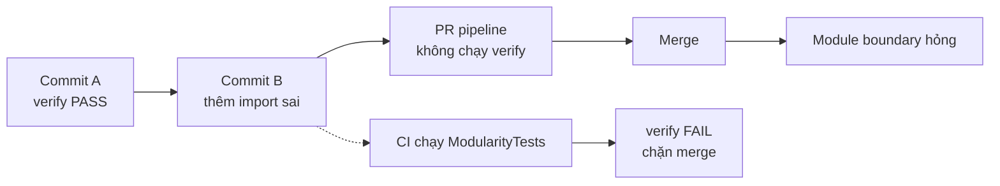
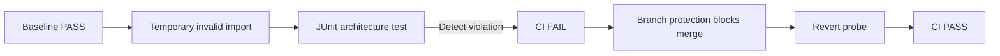

# Chỉ chạy verify một lần rồi bỏ qua trong CI

Một nhóm phát triển vừa tách ứng dụng Spring Boot thành các application module bằng Spring Modulith. Trong ngày hoàn thành refactor, cả nhóm chạy `ApplicationModules.of(ShopApplication.class).verify()` trên máy cá nhân và nhận kết quả xanh. Hai tuần sau, một pull request thêm import từ `orders` sang `payments.internal` để “sửa nhanh” lỗi nghiệp vụ. Vì **không còn bước verify trong CI**, code được merge, module boundary bị phá vỡ, và các thay đổi tiếp theo bắt đầu tạo phụ thuộc vòng.

Lỗi cần tránh là **coi việc verify thành công một lần như một chứng chỉ kiến trúc có hiệu lực mãi mãi**. `verify()` chỉ kiểm **trạng thái code tại lần chạy đó**. Bất kỳ commit, dependency, package move hoặc cấu hình module nào về sau đều có thể làm kết quả thay đổi. Muốn quy tắc kiến trúc phát huy tác dụng, cần biến nó thành **quality gate lặp lại, không thể bỏ qua một cách vô tình, và có bằng chứng rằng test thực sự được CI thực thi**.

Bài nằm trong chương **Lỗi thường gặp** của học phần `SPRING_MODULITH_VERIFICATION_TESTING`. Học phần hướng đến kiểm chứng ranh giới ứng dụng bằng `ApplicationModules` và các quy tắc phụ thuộc, thực hành `@ApplicationModuleTest`, kiểm thử sự kiện/cơ sở dữ liệu/tích hợp, rồi dùng CI để ngăn phụ thuộc sai và hồi quy. Bài này tập trung **duy nhất** vào sai lầm *chạy verify một lần rồi bỏ qua trong CI*: dấu hiệu, cách cấu hình, test chứng minh gate có tác dụng và checklist vận hành, không lặp lại phần nhập môn Spring Modulith.

## 1. Vì sao một lần verify xanh không đủ?

`ApplicationModules.verify()` làm việc với cấu trúc module và các phụ thuộc **ở thời điểm chạy**. Nó không “khóa” repository hoặc tự thiết lập một policy trên nhánh chính.

| Mốc | Hoạt động | Kết quả nếu không có CI gate |
| --- | --- | --- |
| Ngày 1 | Refactor thành `orders`, `payments`, `inventory`; chạy `verify()` | Kiến trúc tại commit A hợp lệ |
| Ngày 5 | Thêm một interface vào `payments.internal`; `orders` import nó | Commit B có thể vi phạm encapsulation |
| Ngày 10 | Thêm callback để `payments` gọi sang `orders` | Có thể phát sinh cycle |
| Ngày 12 | PR chỉ chạy unit test business, bỏ architecture test | PR vẫn xanh nếu test khác không thấy lỗi |
| Ngày 15 | Nhánh chính chứa phụ thuộc sai | Refactor tiếp theo khó hơn, thay đổi lan qua module |



**Vấn đề không phải `verify()` không đủ mạnh** mà là tổ chức **không thực thi nó tại điểm kiểm soát thay đổi**. Developer chạy thủ công khi nhớ thì hữu ích để nhận phản hồi sớm, nhưng không thay thế quality gate bắt buộc ở pull request và nhánh bảo vệ.

Một quy trình tốt có hai tầng: **local test** để phát hiện nhanh khi viết code, và **CI required check** để đảm bảo mọi thay đổi đi qua cùng một quy tắc trước khi merge.

## 2. Hiểu chính xác `verify()` kiểm điều gì và không kiểm điều gì

Trong cấu trúc module Spring Modulith được nhận diện đúng, `ApplicationModules.verify()` kiểm các quy tắc kiến trúc mà framework hỗ trợ, đặc biệt:

1. **Không có vòng phụ thuộc** giữa các application module.
2. **Không truy cập implementation package của module khác** trái với API/named interface được công bố.
3. **Tuân thủ `allowedDependencies`** nếu module khai báo giới hạn phụ thuộc.

Một tình huống điển hình:

```text
com.example.shop
  ShopApplication
  orders
    OrderApi.java
    internal/OrderService.java
  payments
    PaymentApi.java
    internal/PaymentLedger.java
  inventory
    StockFacade.java
    internal/StockRepository.java
```

Theo mặc định, package ở mức module root thường là API, còn package con như `payments.internal` là chi tiết triển khai không nên bị module khác import. Nếu muốn công bố một package cụ thể, thiết kế named interface có chủ đích thay vì mở toàn bộ nội bộ.

### Giới hạn cần nêu để không đặt sai kỳ vọng

| `verify()` giúp phát hiện | Phải có test/cơ chế riêng |
| --- | --- |
| Phụ thuộc Java làm module graph có cycle | Bean wiring/runtime startup lỗi |
| Tham chiếu sai vào internal API của module khác | Event có được consumer xử lý không |
| Vi phạm `allowedDependencies` được khai báo | Giao dịch commit/rollback đúng không |
| Vi phạm module exposure theo mô hình áp dụng | Kafka/AMQP broker nhận message không |
| Một số phụ thuộc tĩnh qua bytecode/type reference | Coupling động qua bean name, reflection/configuration khó nhìn thấy qua static analysis |

Khi ứng dụng dùng reflection, tên bean/string-based lookup, resources hoặc service locator, cần cân nhắc thêm review và test tương ứng; **không nên tuyên bố `verify()` phát hiện mọi phụ thuộc runtime**.

Trong học phần này, `@ApplicationModuleTest`, event/database/broker integration tests và architecture test **bổ trợ nhau**. Lỗi “chỉ verify một lần” không được chữa bằng cách gộp mọi thứ vào một `@SpringBootTest` nặng; ngược lại, cần giữ **một bài test kiến trúc nhanh, có mục tiêu** và chạy nó thường xuyên.

## 3. Đóng gói `verify()` thành một JUnit test chạy được nhiều lần

Một lời gọi thủ công trong `main()` hoặc một script không được gọi bởi CI rất dễ bị quên. Cách chắc chắn hơn là đặt assertion vào **JUnit Jupiter test**, nằm trong test source set của ứng dụng:

```java
// src/test/java/com/example/shop/ModularityTests.java
package com.example.shop;

import org.junit.jupiter.api.Test;
import org.springframework.modulith.core.ApplicationModules;

class ModularityTests {

    @Test
    void verifiesArchitecturalBoundaries() {
        ApplicationModules.of(ShopApplication.class).verify();
    }
}
```

**Vì sao mẫu này quan trọng?**

- `ShopApplication.class` là lớp root thuộc ứng dụng modular monolith được kiểm. Nó không phải một class tùy ý nằm ở module con.
- `ModularityTests` nằm dưới `src/test/java` và có `@Test` của JUnit Jupiter; test engine có thể phát hiện nó khi cấu hình đúng.
- Bất kỳ vi phạm nào mà `verify()` phát hiện sẽ làm method test **ném exception/assertion failure**, để build báo đỏ.
- Không cần `@SpringBootTest` chỉ để khởi chạy `ApplicationModules.of(...).verify()`. Cách kiểm này dựa vào mô hình/module discovery, không yêu cầu tạo toàn bộ Spring application context.
- Không “chữa lỗi” bằng `try { verify(); } catch (Exception e) { log.warn(...); }` rồi vẫn PASS.

Một phản ví dụ nguy hiểm:

```java
@Test
void appearsToVerifyButSilentlyIgnoresFailures() {
    try {
        ApplicationModules.of(ShopApplication.class).verify();
    } catch (RuntimeException ex) {
        System.out.println("Module verification failed: " + ex);
        // SAI: không fail test; CI vẫn có thể xanh.
    }
}
```

**Test kiến trúc phải fail nếu phát hiện vi phạm.** Nếu một rule đã chủ động được nới lỏng, sửa đúng thiết kế/module declaration và code review; không nuốt lỗi hoặc disable test để mở đường merge.

### Kiểm tra phạm vi scan

Phải bảo đảm `ShopApplication` là root thật và các package cần kiểm nằm trong phạm vi Spring Modulith discovery. Nếu chọn sai class gốc hoặc các module nằm ngoài vùng được nhận diện, test có thể PASS mà **không quét những module tưởng rằng nó đang kiểm**.

Một hành động review cụ thể: khi thêm module mới, xác nhận nó được discovery trong mô hình module và chạy một lần **negative probe** (mục 8) để biết một dependency sai tới module ấy bị phát hiện. Không tự suy từ tên file hoặc việc Java code compile rằng mô hình module đã bao phủ toàn bộ repository.

## 4. Minh họa một hồi quy mà CI phải bắt được

Giả sử `orders` được phép gọi API công khai của `payments`, nhưng không được chạm vào logic nội bộ của `payments`:

```java
// payments/PaymentApi.java
package com.example.shop.payments;

public interface PaymentApi {
    boolean isPaid(java.util.UUID orderId);
}
```

Một thay đổi sai:

```java
// orders/internal/OrderService.java
package com.example.shop.orders.internal;

// PHẢN VÍ DỤ: phụ thuộc implementation package module khác.
import com.example.shop.payments.internal.PaymentLedger;

class OrderService {
    private final PaymentLedger ledger;

    OrderService(PaymentLedger ledger) {
        this.ledger = ledger;
    }
}
```

Để lỗi biên dịch không che mục tiêu kiến trúc, giả sử `PaymentLedger` được khai báo `public` trong package `payments.internal`. Java compiler **có thể cho import**, nhưng đây vẫn là tham chiếu trái ranh giới module đã thiết kế. `ApplicationModules.verify()` phải được phép kiểm và làm test thất bại nếu `payments.internal` không phải API được công bố.

Sửa theo thiết kế:

```java
// orders/internal/OrderService.java
package com.example.shop.orders.internal;

import com.example.shop.payments.PaymentApi;

class OrderService {
    private final PaymentApi payments;

    OrderService(PaymentApi payments) {
        this.payments = payments;
    }
}
```

Một kiểu sai khác là **vòng phụ thuộc**:

```text
orders  --dùng payments.PaymentApi--> payments
payments --dùng orders.OrderApi----> orders

Cycle: orders -> payments -> orders
```

Ngay cả khi cả `PaymentApi` lẫn `OrderApi` nằm ở public package, một dependency cycle vẫn là vấn đề cần kiểm. Đừng nghĩ khai báo `allowedDependencies` hai chiều sẽ tự hợp thức hóa cycle; cần thay thiết kế hoặc tách hợp đồng/module theo hướng phụ thuộc đúng.

### `allowedDependencies` chỉ là chính sách, không phải một lối thoát

Nếu module `orders` chỉ được phụ thuộc `payments` và `inventory`:

```java
// orders/package-info.java
@org.springframework.modulith.ApplicationModule(
        allowedDependencies = {"payments", "inventory"}
)
package com.example.shop.orders;
```

Khai báo như trên **giới hạn những module `orders` được dùng**; nó không tự tạo dependency, không xóa dependency cycle và không cho phép import `payments.internal` nếu internal package chưa được công bố hợp lệ.

Nếu cố sửa build bằng cách thay wildcard/cấu hình quá rộng hoặc gỡ `allowedDependencies` mà không có review, CI có thể xanh nhưng **kiến trúc đã bị nới quy tắc**. Mỗi thay đổi module declaration nên được coi là một thay đổi architecture policy.

## 5. Bảo đảm test thật sự được build tool khám phá

Một file JUnit tồn tại trong repository chưa có nghĩa nó **đã chạy trong CI**. Lỗi này rất hay gặp khi nhóm dùng filter, source set riêng hoặc tên class không khớp pattern.

### Maven: Surefire và Failsafe có phạm vi khác nhau

Với Maven, test tên `ModularityTests` nằm ở `src/test/java` và dùng JUnit Jupiter nên phù hợp để chạy qua **Surefire** trong phase `test`, nếu plugin/dependencies được cấu hình tương thích.

```bash
# Chạy toàn bộ test thuộc phase test:
./mvnw -B -ntp test

# Hoặc lifecycle đầy đủ hơn (khi project cấu hình plugin phù hợp):
./mvnw -B -ntp verify

# Chỉ chạy bài verify khi muốn tái hiện nhanh trên module sở hữu:
./mvnw -B -ntp -Dtest=ModularityTests test
```

**Các lệnh này là tài liệu để developer dùng, không phải lệnh đã thực thi khi soạn bài.**

Nếu bạn đặt tên test là `ModularityIT` và chỉ chạy `mvn test`, class ấy có thể thuộc bộ **Failsafe integration tests** và không được thực thi nếu plugin chưa cấu hình. Không thể suy “CI chạy Maven” thành “CI chạy mọi test”.

Lưu ý:

- Kiểm tra JUnit Jupiter engine, Surefire version và dependency Spring Modulith phù hợp.
- Kiểm `-DskipTests`, `-Dmaven.test.skip=true` hoặc cấu hình `<skip>` trong plugin.
- Kiểm `<excludes>`/`<includes>` và profile đang bật.
- Với **multi-module Maven build**, test phải nằm trong module có source set cần quét; chạy lệnh ở module sai có thể không kiểm đúng application root.
- Kiểm test report, không chỉ log “BUILD SUCCESS”.

Trong một cấu hình Surefire thường gặp, báo cáo JUnit XML được ghi dưới `target/surefire-reports`. Xác nhận có `ModularityTests` được thực thi với **test count khác 0**; đừng chỉ kiểm một file XML cũ còn tồn tại từ build trước.

### Gradle: JUnit Platform và task được chạy

Với Gradle/Kotlin DSL:

```kotlin
// build.gradle.kts
tasks.test {
    useJUnitPlatform()
}
```

Lệnh minh họa:

```bash
# Chạy JUnit tests trong main test task:
./gradlew test --no-daemon

# Chạy riêng ModularityTests khi điều tra:
./gradlew test --tests "*ModularityTests" --no-daemon
```

Đừng chạy `./gradlew build -x test` rồi đánh dấu architecture gate đã hoàn tất. Tương tự, nếu dùng source set/test suite riêng, hãy kiểm `test` có bao gồm `ModularityTests` không; nếu không, CI cần gọi **task đúng** theo cấu hình thực tế.

**Chốt kiểm chứng:** run log và JUnit reports phải cho thấy `verifiesArchitecturalBoundaries` đã chạy. Một lệnh build trả exit code 0 không đủ nếu test bị skip, không được discover hoặc được exclude.

## 6. Biến JUnit verification thành job CI bắt buộc

Ví dụ với **GitHub Actions** cho dự án Maven sử dụng JDK 21:

```yaml
# .github/workflows/module-architecture.yml
name: module-architecture

on:
  pull_request:
  push:
    branches:
      - main
  # Chỉ cần khi repository sử dụng GitHub merge queue.
  merge_group:

permissions:
  contents: read

jobs:
  modulith-verification:
    name: Verify module boundaries
    runs-on: ubuntu-latest
    timeout-minutes: 15

    steps:
      - name: Checkout source
        uses: actions/checkout@v4

      - name: Set up JDK
        uses: actions/setup-java@v4
        with:
          distribution: temurin
          java-version: "21"
          cache: maven

      - name: Run unit and module architecture tests
        run: ./mvnw -B -ntp test

      - name: Upload Surefire reports
        if: always()
        uses: actions/upload-artifact@v4
        with:
          name: surefire-reports
          path: "**/target/surefire-reports/*"
          if-no-files-found: warn
```

**Đây là workflow mẫu**, cần điều chỉnh JDK, Maven wrapper, repository layout, caching và phiên bản action theo chính sách dự án. Nếu repository dùng Gradle, thay bước chạy test bằng `./gradlew test --no-daemon` và cấu hình cache/report tương ứng. Không cần cài Kafka chỉ để chạy test `ApplicationModules.verify()` đơn lẻ.

### Tại sao dùng `pull_request` và `push`?

- **`pull_request`:** phát hiện vi phạm **trước khi merge**, nơi kiểm soát thay đổi hiệu quả nhất.
- **`push` vào `main`:** kiểm tra lại trạng thái nhánh chính và phát hiện trường hợp code được cập nhật qua đường khác theo quyền đã cấp.
- **`merge_group`:** nếu dùng **merge queue**, required checks phải có khả năng chạy trên sự kiện merge group, thay vì chỉ chạy trên PR branch rồi bỏ qua kết quả hàng đợi.

Đừng thêm bộ lọc `paths` quá hẹp chỉ để “tiết kiệm CI” khi chưa chứng minh nó bao phủ **mọi đường thay đổi phụ thuộc**, bao gồm source code, `package-info.java`, dependency/build configuration và mã được generate. Một thay đổi source không kích hoạt job đồng nghĩa gate không còn đáng tin.

### Dùng exit code thật của bài test

CI phải có đặc điểm:

```text
ModularityTests passes
    -> Maven test exit code 0
    -> CI job PASS

ModularityTests fails
    -> Maven test exit code non-zero
    -> CI job FAIL
    -> required check blocks merge
```

Không viết:

```bash
# PHẢN VÍ DỤ: che exit code, biến lỗi thành xanh.
./mvnw -B -ntp test || true
```

Tương tự, đừng đặt `continue-on-error: true` vào **bước kiểm kiến trúc bắt buộc**, hoặc chỉ tạo log warning thay vì để test ném lỗi. Upload artifact có thể dùng `if: always()` để giữ thông tin chẩn đoán, nhưng việc upload thành công **không được đổi trạng thái fail của bước test**.

### Không khóa phụ thuộc vào việc chạy full application

`ApplicationModules.of(ShopApplication.class).verify()` là static architecture verification, không cần broker/database test infrastructure. Tách job này khỏi những integration test nặng có thể giúp phản hồi nhanh; tuy nhiên phải đảm bảo quality gate chạy đủ các test cần thiết theo chiến lược CI chung. Trong pipeline trên, `mvn test` vẫn chạy các test khác thuộc Surefire; nếu muốn architecture job riêng, hãy cấu hình lọc một cách **có kiểm chứng** trong Maven reactor cụ thể.

## 7. CI xanh vẫn chưa đủ nếu merge không bị chặn

Một job CI có thể chạy đúng nhưng **chỉ mang tính tham khảo**: PR hiển thị lỗi mà người có quyền vẫn merge trực tiếp, hoặc branch protection chưa yêu cầu trạng thái của job.

Để biến verify thành **chốt kiểm soát**, thiết lập tại repository hosting:

1. **Branch protection/ruleset** cho nhánh đích như `main`.
2. Bật **require status checks before merging** với đúng check/job `Verify module boundaries` (theo tên hiển thị thực tế).
3. Cấu hình chỉ cho phép merge khi check thành công và branch đã cập nhật theo chính sách.
4. Hạn chế bypass quyền quản trị/merge trực tiếp nếu chính sách yêu cầu kiểm bắt buộc.
5. Nếu dùng **merge queue**, bảo đảm workflow xử lý `merge_group` và kết quả trong queue được dùng đúng.
6. Kiểm tra tác dụng với một PR thử nghiệm thất bại có chủ đích.

**Không phải YAML có dòng `pull_request` là tự động chặn merge.** Trigger chỉ xác định khi nào job chạy; việc kết quả có **bắt buộc** hay không do ruleset/branch protection và quyền thực thi của nền tảng quản lý.

### Một số đường bypass khó nhìn thấy

| Tình huống | Rủi ro | Biện pháp |
| --- | --- | --- |
| Người review tự merge khi check đỏ | Kiến trúc sai vào nhánh chính | Required check và hạn chế bypass |
| PR đổi base branch không có protection | Có thể né gate | Ruleset bao phủ các nhánh phát hành |
| CI workflow được tắt hoặc xóa | Không còn kiểm kiến trúc | Quyền bảo vệ workflow và review thay đổi CI |
| Check bị path filter bỏ qua | Kết quả không phản ánh thay đổi | Không filter quá hẹp; kiểm trạng thái skipped/pending |
| Check chỉ là annotation/warning | PR vẫn xem là PASS | Test failure phải làm job fail |
| Merge queue không chạy cùng workflow | Merge dựa trên kết quả cũ | Bật event và required checks phù hợp |
| Local bypass khác với CI | Mỗi developer có tiêu chuẩn khác nhau | Chốt build và JDK trong CI |

Khi dùng GitLab CI, Azure Pipelines, Jenkins hoặc hệ thống khác, nguyên tắc tương đương: **pipeline test kiến trúc phải được trigger theo thay đổi, và trạng thái fail phải chặn merge/release**. Tên màn hình cấu hình có thể khác; hãy xác nhận chính sách thực tế của repository.

### Đừng đánh đồng “required” với “đã chạy trên code sẽ merge”

Một required check quá cũ, chạy trên commit khác hoặc không xét merge queue có thể cho cảm giác an toàn giả. Cần xem policy “up to date branch”, merge commit/merge group và cách CI nhận SHA được kiểm. Nếu business muốn bảo đảm code trên nhánh chính luôn hợp lệ, hãy kiểm tra cả pipeline sau merge và có cơ chế khắc phục ngay khi nó fail.

## 8. Kiểm chứng quality gate bằng một vi phạm có chủ đích

Một gate không nên chỉ được tin vì hôm nay nó báo xanh. Cách kiểm chứng mạnh hơn là **thử làm cho nó báo đỏ** trong một nhánh thử nghiệm riêng, sau đó bỏ thay đổi.

### Quy trình negative probe

1. Tạo một **nhánh thử nghiệm** từ commit sạch. Không thử trực tiếp trên nhánh phát hành.
2. Xác nhận `ModularityTests` đang PASS và xuất hiện trong test report.
3. Thêm một tham chiếu Java **có thể biên dịch nhưng trái quy tắc module** (ví dụ `orders` import class `public` trong `payments.internal` chưa công bố).
4. Chạy test architecture ở máy dev và đẩy PR thử nghiệm.
5. Kỳ vọng **JUnit FAIL → CI job FAIL → PR không thể merge** qua required check.
6. Xóa thay đổi cố ý, chạy lại test và xác nhận CI PASS.
7. Lưu lại evidence/test report của probe theo quy trình review nội bộ.



**Đây là một quy trình kiểm chứng cho developer thực hiện trong nhánh thử**, không phải hướng dẫn chỉnh bài học khác hoặc phá kiến trúc thật. Đừng cố đưa lỗi “chỉ để kiểm CI” vào branch production.

### Nếu probe vẫn PASS, điều tra theo thứ tự

| Dấu hiệu | Nguyên nhân khả dĩ |
| --- | --- |
| Test không xuất hiện trong report | JUnit không được discover, filter/exclude hoặc task không chạy |
| Test chạy nhưng không thấy import sai | Scope `ApplicationModules.of(...)` không bao phủ module hoặc package được expose ngoài ý định |
| Method ném lỗi nhưng CI PASS | Shell/bước CI nuốt exit code, `continue-on-error` |
| CI FAIL nhưng PR vẫn merge được | Check chưa được yêu cầu bởi branch protection/ruleset |
| Job bị skip khi thay đổi package module | Path/branch filter hoặc workflow trigger thiếu |
| Local FAIL, CI PASS | Khác JDK/dependency/classpath, test source set hoặc profile/build task |

Điểm quan trọng: **negative probe phải dùng một vi phạm mà kiến trúc thực sự cấm**, không phải một lời gọi hợp lệ giữa hai public API. Nếu test không fail, trước hết xác nhận mẫu vi phạm có nằm trong phạm vi rule hay chưa, rồi mới kết luận CI bị lỗi.

### Cảnh báo về các “sửa chữa” làm yếu gate

Nếu một violation phát sinh, tránh các cách:

```text
@Disabled("architecture tests are noisy")
return;                        // thay vì verify()
try { verify(); } catch (...)  // nuốt lỗi
-DskipTests                    // bỏ qua toàn bộ tests
continue-on-error: true
remove allowedDependencies     // nới policy không review
expose internal package        // chỉ để tắt cảnh báo
```

Những cách này có thể làm CI trở lại xanh nhưng **không sửa dependency sai**. Quy trình đúng là xem violation, đánh giá ownership/rationale và thay code/module design hoặc phê duyệt thay đổi policy có chủ đích.

## 9. Chẩn đoán khi verify fail: sửa kiến trúc thay vì tắt kiểm tra

Một failure của `ApplicationModules.verify()` thường chỉ ra chuỗi package/class/module liên quan. Khi nhận được, xử lý theo trình tự:

1. **Tái hiện lỗi** bằng cùng source/JDK/dependency classpath như CI.
2. **Xác định module nguồn, module đích và loại phụ thuộc**: import kiểu, constructor parameter, return type, inheritance, annotation hoặc access khác mà công cụ thấy.
3. **Kiểm tra API công bố**: module đích có package API/named interface cho nhu cầu đó không?
4. **Xem xét vòng phụ thuộc**: edge mới có tạo cycle trực tiếp hoặc qua nhiều module?
5. **Đánh giá vị trí đặt interface/contract**: facade/API thuộc module nào? Có thể đảo chiều phụ thuộc bằng domain event hoặc interface có ownership rõ không?
6. **Sửa code thiết kế**, không tự nâng cấp mọi internal package thành public.
7. **Rerun architecture test**, rồi chạy `@ApplicationModuleTest` và integration tests chịu ảnh hưởng bởi refactor.
8. **Review diff của `package-info.java`**, vì thay named interfaces hoặc `allowedDependencies` cũng là thay đổi kiến trúc.

### Một câu chuyện debugging cụ thể

PR thêm:

```java
// orders/internal/OrderService.java
import com.example.shop.payments.internal.PaymentLedger;
```

Failure xuất hiện trong `ModularityTests` vì `orders` tham chiếu implementation package của `payments`. Các phương án:

- Nếu nghiệp vụ chỉ cần biết thanh toán đã hoàn tất, dùng một **public API** của `payments` (nếu phù hợp với dependency direction).
- Nếu đây là một thông báo sự thật đã xảy ra và các module không cần gọi đồng bộ, cân nhắc **domain event** để tách coupling theo hướng hợp lệ.
- Nếu cả `orders` và `payments` phải dùng một contract riêng, xem lại module ownership/named interface, tránh di chuyển interface sang nơi làm phát sinh dependency cycle.

Không nên “sửa nhanh” bằng cách cho phép `orders` import toàn bộ `payments.internal`. Điều đó có thể khiến verify PASS khi policy bị nới, nhưng tiếp tục mở cửa cho phụ thuộc không chủ đích.

### Phân biệt failure kiến trúc và failure môi trường

| Loại failure | Cách xử lý |
| --- | --- |
| Module cycle | Phân tích cạnh phụ thuộc và refactor |
| Vi phạm API encapsulation | Dùng API/named interface hợp lệ hoặc event |
| `allowedDependencies` violation | Đối chiếu quy tắc ownership, sửa tham chiếu |
| Missing test dependency/JUnit engine | Sửa build để test được chạy, không bỏ test |
| Build dùng sai root/application class | Sửa phạm vi kiểm chứng |
| CI thiếu quyền tải artifact/dependency | Sửa môi trường CI, giữ failure visible |

Một build đỏ do mạng/dependency không nhất thiết là **kiến trúc sai**, nhưng cũng **không được coi là test kiến trúc đã PASS**. Phân biệt nguyên nhân khi báo cáo và khôi phục gate nhanh chóng.

## 10. Checklist chốt quy trình: từ file test tới policy repository

Để quyết định “đã sửa lỗi chỉ verify một lần” hay chưa, cần bằng chứng ở **ba lớp**: JUnit có chạy, CI có chạy, và kết quả CI có chặn merge.

| Kiểm chứng | Cách chứng minh | Đạt khi |
| --- | --- | --- |
| `ModularityTests` tồn tại | Kiểm code review ở `src/test/java` | Có `@Test` gọi `ApplicationModules.of(root).verify()` |
| Root đúng phạm vi | Review package root/module discovery | Các module quan trọng nằm trong mô hình kiểm |
| Test discovery hoạt động | JUnit/Surefire/Gradle report | Test có số lần chạy thực tế, không bị skip |
| Không nuốt exception | Review test method | Violation làm method fail |
| CI chạy theo PR | Đẩy PR thử | Job kích hoạt trên code thay đổi |
| CI chạy trên nhánh chính | Xem workflow trigger và execution | Có `push`/pipeline phù hợp |
| Không bị filter sai | Review paths/tasks/profiles | Thay đổi dependency/module luôn kích hoạt gate |
| Fail làm job đỏ | Negative probe | Exit code/test failure được giữ |
| Fail chặn merge | Required check/ruleset | PR vi phạm không thể merge theo quyền thông thường |
| Merge queue tương thích | Test queue nếu dùng | Check chạy đúng sự kiện merge group |
| Policy changes được review | Xem diff `package-info.java` và CI YAML | Không nới rule chỉ để xanh |
| Regression coverage đủ lớp | CI có các test riêng khác | Runtime/event/DB/broker không bị gán nhầm cho `verify()` |
| Bằng chứng sau merge | Pipeline trên `main`/release | Kiến trúc vẫn được kiểm sau thay đổi |

### Mẫu tiêu chí hoàn thành cho một pull request

```text
[ ] Architecture JUnit test discovered and executed
[ ] ApplicationModules.verify() PASS for the checked commit
[ ] No unreviewed @ApplicationModule / @NamedInterface policy relaxation
[ ] Required CI check PASS
[ ] Affected @ApplicationModuleTest / integration tests PASS where applicable
[ ] No skip flag or workflow bypass applied
```

Checklist này phải nằm trong **quy trình review và branch protection thực tế**, không chỉ trong một comment của test class. Việc đồng đội nhớ chạy verify thủ công vẫn đáng khuyến khích, nhưng **không phải bằng chứng thay thế CI**.

### Quy tắc bảo trì gate

- Khi đổi **Spring Modulith**, JUnit, Surefire/Gradle hay Java version, chạy lại negative probe để xác nhận detection không mất.
- Khi **thêm/di chuyển application module**, xác nhận nó nằm trong scan scope và giữ đúng dependency rules.
- Khi đổi **workflow name/job name**, kiểm tra required checks vẫn trỏ đúng check hiện hành; tránh yêu cầu một check cũ không còn phát hoặc vô tình ngừng yêu cầu check mới.
- Khi tối ưu CI để tiết kiệm thời gian, đo **thời gian thực thi kiến trúc** trước khi quyết định skip; `verify()` thường rẻ hơn so với thiệt hại của phụ thuộc sai bị merge.

## 11. Bài tập tình huống và đáp án

### Tình huống 1 — Local PASS, PR không chạy

Nhóm đã chạy `ModularityTests` một lần trên máy developer. Sau đó workflow CI chỉ chạy lệnh `./mvnw package -DskipTests`.

**Hỏi:** Quality gate kiến trúc có tồn tại trong CI chưa?

**Đáp án:** **Chưa.** Cần gọi lifecycle/task thực sự chạy test, bỏ skip flag, kiểm test report và cấu hình required check trên PR.

### Tình huống 2 — Test có nhưng không được discover

File được đặt tên `ArchitectureIT.java`, Maven Surefire chạy phase `test` còn Failsafe chưa được cấu hình. Build PASS.

**Hỏi:** Có thể kết luận kiến trúc hợp lệ không?

**Đáp án:** **Không.** Không có bằng chứng test đã chạy. Đổi thành test thuộc pattern Surefire phù hợp hoặc cấu hình/chạy Failsafe; xác nhận test report có đúng class/method và số lần chạy.

### Tình huống 3 — Vi phạm cycle sau khi refactor

`orders` dùng `payments.PaymentApi`; `payments` thêm tham chiếu `orders.OrderApi`, dẫn tới vòng dependency.

**Hỏi:** Thêm `allowedDependencies` hai chiều có sửa được không?

**Đáp án:** **Không.** Rule về cycle vẫn cần được đáp ứng. Xem lại contract ownership, direction dependency hoặc cơ chế event phù hợp; chạy `verify()` trước khi merge.

### Tình huống 4 — CI đỏ nhưng merge vẫn thành công

PR có job `Verify module boundaries` báo đỏ, nhưng maintainer vẫn merge được vì check chưa đặt ở Required status checks.

**Hỏi:** Lỗ hổng ở đâu?

**Đáp án:** **Ở merge policy**, không phải ở Java test. Bật branch protection/ruleset yêu cầu check, hạn chế bypass và thử lại bằng PR negative probe.

### Tình huống 5 — Maven CI xanh giả

CI chạy `./mvnw -B -ntp verify`, log cuối ghi `BUILD SUCCESS`, nhưng report không có `ModularityTests`.

**Hỏi:** Bước điều tra đầu tiên?

**Đáp án:** Kiểm **test discovery/skip/plugin/profile/source set**: test class có nằm ở module cần chạy không, JUnit engine có hoạt động không, Surefire có exclude pattern hay Maven flags skip. Không lấy tên phase `verify` làm bằng chứng architecture test đã chạy.

### Tình huống 6 — Thêm module mới ngoài scan scope

Team thêm `com.example.billing` ở ngoài root `com.example.shop`, nhưng `ApplicationModules.of(ShopApplication.class).verify()` vẫn PASS.

**Hỏi:** Đã kiểm tra module mới chưa?

**Đáp án:** **Chưa có bằng chứng.** Phải xác định module đó thuộc cùng ứng dụng/modularity model hay là ứng dụng riêng. Nếu cùng ứng dụng, điều chỉnh package/scope/model và test discovery tương ứng; không mặc định nó được scan chỉ vì cùng repository.

### Tình huống 7 — Cố tình làm hỏng kiến trúc để thử gate

Một nhánh thử thêm import công khai vào `payments.internal` trái boundary. CI `ModularityTests` báo FAIL và PR bị chặn merge; xóa import thì PASS.

**Hỏi:** Thử nghiệm chứng minh điều gì?

**Đáp án:** Test được phát hiện, có khả năng bắt **vi phạm đang kiểm**, failure truyền tới CI và branch protection chặn merge. Đây là một **bằng chứng mạnh về hiệu lực của gate**, nhưng không chứng minh mọi loại coupling động hoặc lỗi runtime đều được `verify()` phát hiện.

### Tổng kết

**Một lần `ApplicationModules.verify()` xanh chỉ chứng minh kiến trúc tại thời điểm đó**, không bảo vệ các commit tiếp theo. Cách sửa lỗi “chỉ chạy verify một lần rồi bỏ qua trong CI” là đặt nó trong **JUnit test có thể lặp**, bảo đảm **Surefire/Gradle thực sự chạy**, đưa vào **workflow PR/branch chính**, gắn **required status check** và **thử một dependency violation có chủ đích** để xác nhận PR bị chặn.

Trong `SPRING_MODULITH_VERIFICATION_TESTING`, hãy xem `verify()` là **một quality gate kiến trúc** song song với `@ApplicationModuleTest`, event/database/broker integration tests. Không quy trách nhiệm runtime delivery cho architecture check, nhưng cũng không để một merge phá ranh giới module chỉ vì test không được gọi.

## Tài liệu tham khảo

- [Spring Modulith — Verifying Application Module Structure](https://docs.spring.io/spring-modulith/reference/verification.html)
- [Spring Modulith — Application Modules](https://docs.spring.io/spring-modulith/reference/fundamentals.html)
- [Spring Modulith — Testing Application Modules](https://docs.spring.io/spring-modulith/reference/testing.html)
- [JUnit 5 — User Guide](https://docs.junit.org/current/user-guide/)
- [Maven Surefire — Running a Single Test](https://maven.apache.org/surefire/maven-surefire-plugin/examples/single-test.html)
- [Maven Failsafe Plugin](https://maven.apache.org/surefire/maven-failsafe-plugin/)
- [Gradle — Testing in Java & JVM Projects](https://docs.gradle.org/current/userguide/java_testing.html)
- [GitHub Actions — Workflow Syntax](https://docs.github.com/en/actions/reference/workflows-and-actions/workflow-syntax)
- [GitHub — Protected Branches and Required Status Checks](https://docs.github.com/en/repositories/configuring-branches-and-merges-in-your-repository/managing-protected-branches/about-protected-branches)
