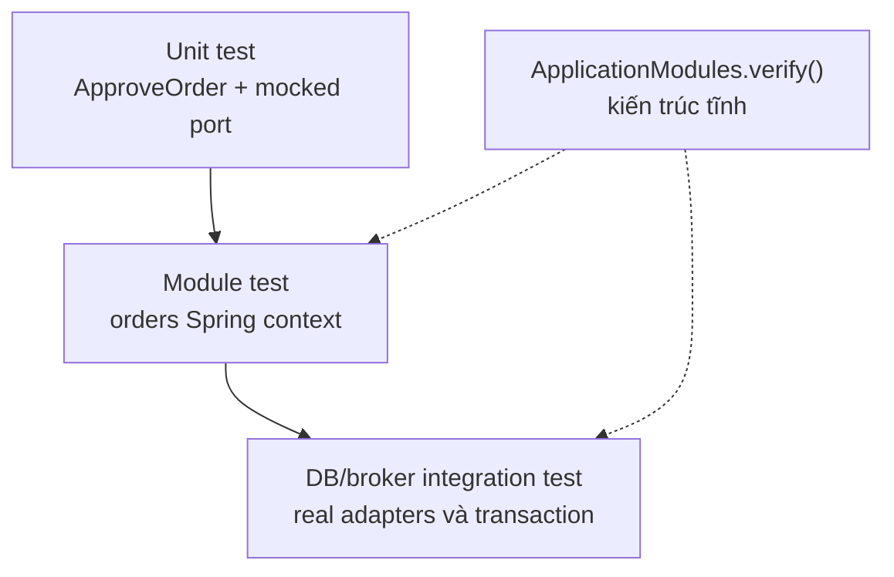
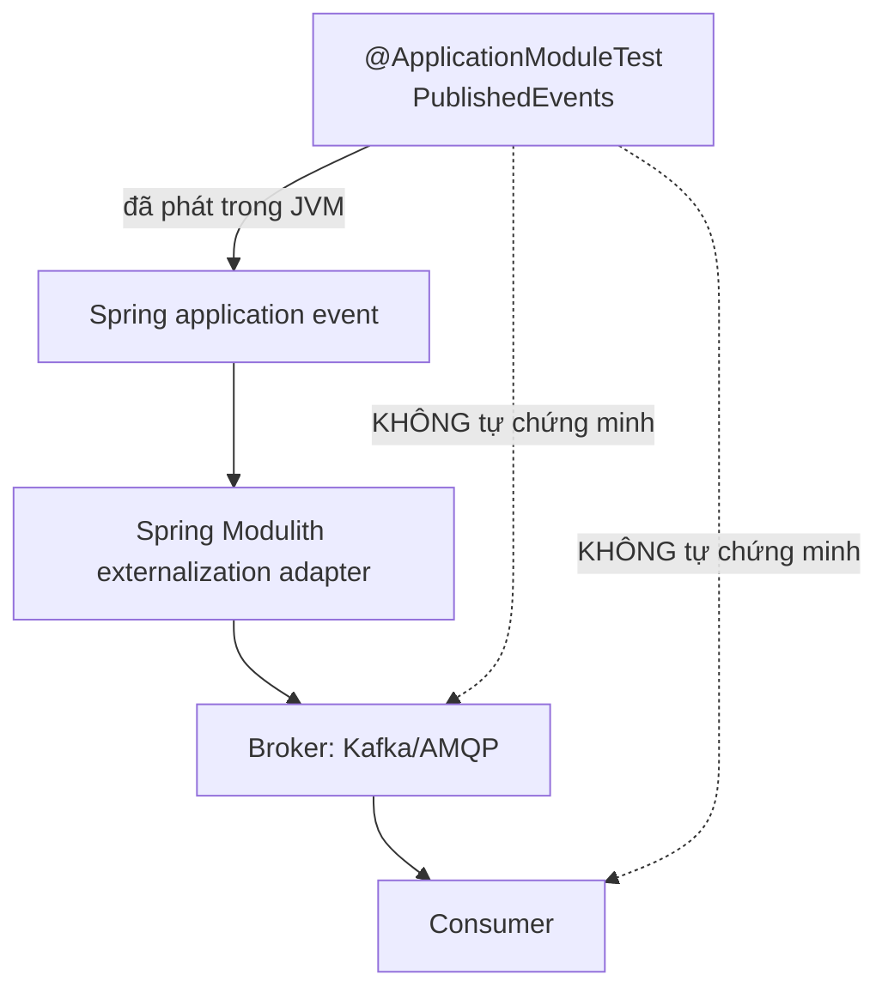

# Coi module test là unit test có Spring

Một developer gắn `@ApplicationModuleTest` lên `OrderServiceTests`, mock repository và event publisher, rồi tuyên bố: “Đây vẫn là unit test, chỉ thêm Spring cho tiện inject bean”. Sau đó developer sử dụng kết quả test xanh để kết luận rằng **module `orders` được bootstrap độc lập, dependency boundary đúng, transaction hoạt động và sự kiện đã externalize**. Những kết luận đó không được chứng minh chỉ bằng một vài assertion gọi mock.

Sai lầm **“Coi module test là unit test có Spring”** xuất phát từ việc nhầm lẫn **đơn vị kiểm chứng**, **ranh giới khởi tạo context** và **mức độ thực của các cộng tác viên**. Trong Spring Modulith, `@ApplicationModuleTest` kiểm một **application module trong một Spring application context có phạm vi được giới hạn theo module**; nó không tự trở thành unit test thuần, cũng không tự kiểm broker, database hay kiến trúc toàn hệ thống.

Bài thuộc chương **Lỗi thường gặp** của học phần `SPRING_MODULITH_VERIFICATION_TESTING`: rèn kiểm chứng ranh giới kiến trúc bằng `ApplicationModules`/dependency rules, thực hành `@ApplicationModuleTest`, kiểm thử event, database, tích hợp và quality gate CI để chặn phụ thuộc sai hoặc hồi quy. Trọng tâm bài là **chọn đúng cấp test, cấu hình module bootstrap, đặt assertion có giá trị và đọc kết quả test đúng giới hạn**. Các ví dụ dùng một luồng duyệt đơn hàng nhỏ; không nhắc lại kiến thức nhập môn Spring Modulith ngoài những gì cần để nhận diện sai lầm này.

## 1. Ba cấp kiểm thử thường bị đánh đồng

Giả sử module `orders` sở hữu use case “duyệt đơn” và phát `OrderApproved`:

| Tiêu chí | **Unit test thuần** | **`@ApplicationModuleTest`** | **Full application integration test** |
| --- | --- | --- | --- |
| Đối tượng trực tiếp | Một class/hàm và hợp đồng đầu vào–đầu ra | Bean và collaboration **bên trong application module** | Nhiều module/hạ tầng tích hợp trong ứng dụng |
| Spring context | **Không cần** | **Có**, bootstrap có giới hạn theo module | Thường **có** context toàn ứng dụng |
| Test annotation điển hình | JUnit `@Test`, Mockito | Spring Modulith `@ApplicationModuleTest` | `@SpringBootTest` + cấu hình tích hợp |
| Dependency collaborators | Mock, stub, fake hoặc value object tự tạo | Bean thật trong module và test double ở boundary được chọn | Nhiều bean/hạ tầng thật, có thể Testcontainers |
| Có thể kiểm | Branch logic, validation, interaction, mapper | Wiring, cấu hình Spring, module-local collaboration, Spring event, các hạ tầng được bật thực sự | DB transaction, broker, nhiều module, luồng end-to-end phù hợp setup |
| Không tự chứng minh | Spring wiring / transaction | Broker đã nhận, DB thật commit, mọi module cùng hoạt động | Module boundary hợp lệ nếu không chạy architecture verification |
| Chi phí | Thường thấp, chạy nhanh | Tốn bootstrap Spring, có thể tải auto-configuration | Thường lớn hơn và phức tạp hơn |

**Tên annotation không quyết định mức độ kiểm thử của mọi side effect.** Một module test dùng fake repository vẫn có giá trị kiểm Spring wiring, nhưng không chứng minh JDBC transaction; một module test dùng database thật có thể trở thành kiểm thử tích hợp ở phạm vi module. Cần nhìn **đường chạy thực sự** chứ không chỉ tên file.



Sơ đồ không phải một thứ bậc “càng to càng tốt”. Mỗi bài test cần một **câu hỏi chứng minh**. Kiểm kiến trúc bằng `ApplicationModules.verify()` là trục khác với kiểm hành vi runtime và cần quality gate riêng.

## 2. Use case minh họa với một ranh giới module rõ ràng

Cấu trúc:

```text
com.example.shop
├── ShopApplication.java           # @SpringBootApplication, root của app
├── orders
│   ├── OrderApproved.java          # event API của orders
│   └── internal
│       ├── ApproveOrder.java       # business service
│       └── OrderStore.java         # port nội bộ
└── payments
    ├── PaymentApi.java             # API module khác (nếu cần)
    └── internal
        └── PaymentLedger.java      # không được orders import trực tiếp
```

Event thuộc API module `orders`:

```java
// orders/OrderApproved.java
package com.example.shop.orders;

import java.time.Instant;
import java.util.UUID;

public record OrderApproved(
        UUID orderId,
        Instant occurredAt
) {}
```

Port lưu trữ và service:

```java
// orders/internal/OrderStore.java
package com.example.shop.orders.internal;

import java.util.UUID;

interface OrderStore {
    /** Chỉ true nếu đơn chuyển thành công từ DRAFT sang APPROVED. */
    boolean approveIfDraft(UUID orderId);
}
```

```java
// orders/internal/ApproveOrder.java
package com.example.shop.orders.internal;

import com.example.shop.orders.OrderApproved;
import java.time.Clock;
import java.util.UUID;
import org.springframework.context.ApplicationEventPublisher;
import org.springframework.stereotype.Service;

@Service
class ApproveOrder {

    private final OrderStore orders;
    private final ApplicationEventPublisher events;
    private final Clock clock;

    ApproveOrder(
            OrderStore orders,
            ApplicationEventPublisher events,
            Clock clock) {
        this.orders = orders;
        this.events = events;
        this.clock = clock;
    }

    void approve(UUID orderId) {
        if (!orders.approveIfDraft(orderId)) {
            throw new IllegalStateException(
                    "Order cannot be approved");
        }

        events.publishEvent(
                new OrderApproved(orderId, clock.instant()));
    }
}
```

**Phạm vi cố ý của ví dụ:** `ApproveOrder` không gắn `@Transactional` để có thể minh họa rõ test unit và test module với một fake store không sử dụng database. Trong ứng dụng production, thao tác lưu đơn và publish event thường cần **transaction boundary**; việc thêm `@Transactional` phải đi cùng kiểm thử database/commit/rollback ở mục 7. Không dùng đoạn trên như một workflow production hoàn chỉnh về tính bền vững.

`ApplicationEventPublisher` ở đây là **Spring application event** trong JVM. Nó không tự là Kafka producer và không chứng minh externalization. `OrderStore` chưa có implementation production trong đoạn code vì bài học tập trung vào **cách kiểm thử module**, không xây persistence adapter.

## 3. Unit test thật sự: constructor + Mockito, không mở Spring context

Nếu câu hỏi là “đơn không còn `DRAFT` thì có phát event không?” hoặc “event có đúng thời điểm không?”, chỉ cần JUnit 5 và Mockito:

```java
// orders/internal/ApproveOrderUnitTests.java
package com.example.shop.orders.internal;

import static org.assertj.core.api.Assertions.assertThat;
import static org.assertj.core.api.Assertions.assertThatThrownBy;
import static org.mockito.Mockito.*;

import com.example.shop.orders.OrderApproved;
import java.time.Clock;
import java.time.Instant;
import java.time.ZoneOffset;
import java.util.UUID;
import org.junit.jupiter.api.Test;
import org.springframework.context.ApplicationEventPublisher;
import org.mockito.ArgumentCaptor;

class ApproveOrderUnitTests {

    private static final Instant NOW =
            Instant.parse("2026-11-26T02:00:00Z");

    private final OrderStore store = mock(OrderStore.class);
    private final ApplicationEventPublisher events =
            mock(ApplicationEventPublisher.class);

    private final ApproveOrder service = new ApproveOrder(
            store,
            events,
            Clock.fixed(NOW, ZoneOffset.UTC));

    @Test
    void approvedOrderPublishesCorrectEvent() {
        UUID id = UUID.randomUUID();
        when(store.approveIfDraft(id)).thenReturn(true);

        service.approve(id);

        ArgumentCaptor<OrderApproved> captured =
                ArgumentCaptor.forClass(OrderApproved.class);
        verify(events).publishEvent(captured.capture());

        assertThat(captured.getValue().orderId()).isEqualTo(id);
        assertThat(captured.getValue().occurredAt()).isEqualTo(NOW);
        verify(store).approveIfDraft(id);
    }

    @Test
    void rejectedOrderDoesNotPublish() {
        UUID id = UUID.randomUUID();
        when(store.approveIfDraft(id)).thenReturn(false);

        assertThatThrownBy(() -> service.approve(id))
                .isInstanceOf(IllegalStateException.class);

        verifyNoInteractions(events);
    }
}
```

Đây là **unit test thuần** dù service có `@Service`. Annotation `@Service` không buộc constructor được gọi qua Spring. Test tự tạo `ApproveOrder`, mock collaborators và sử dụng `Clock.fixed` nên kết quả quyết định được mà không cần khởi động container Spring.

**Kết luận đúng:** logic điều kiện duyệt đơn và lời gọi phát event ở class này đúng theo hai tình huống đã test.

**Không được kết luận:** bean `ApproveOrder` được component scan, `Clock` có bean trong Spring, transaction hoạt động, `OrderStore` được inject đúng trong production, Spring event listener nhận được event hoặc module boundary được bảo vệ.

### Tại sao không nên dùng `@SpringBootTest` để chạy hai assertion này?

Nó có thể kéo datasource, security, scheduling hoặc integration adapter lên chỉ để kiểm một nhánh `if`. Khi test fail do broker không chạy, developer có thể tốn thời gian điều tra một dependency **không liên quan mục tiêu unit test**. Tách unit test giúp vòng phản hồi nhanh và xác định lỗi chính xác.

## 4. Module test đúng nghĩa: có Spring context và kiểm collaboration trong module

Nếu câu hỏi là “`ApproveOrder` có được Spring bootstrap trong phạm vi `orders` và event xuất hiện trong Spring event infrastructure không?”, dùng `@ApplicationModuleTest`:

```java
// orders/internal/ApproveOrderModuleTests.java
package com.example.shop.orders.internal;

import static org.assertj.core.api.Assertions.assertThat;
import static org.assertj.core.api.Assertions.assertThatThrownBy;

import com.example.shop.orders.OrderApproved;
import java.time.Clock;
import java.time.Instant;
import java.time.ZoneOffset;
import java.util.Set;
import java.util.UUID;
import java.util.concurrent.ConcurrentHashMap;
import org.junit.jupiter.api.Test;
import org.springframework.beans.factory.annotation.Autowired;
import org.springframework.boot.test.context.TestConfiguration;
import org.springframework.context.annotation.Bean;
import org.springframework.context.annotation.Import;
import org.springframework.context.annotation.Primary;
import org.springframework.modulith.test.ApplicationModuleTest;
import org.springframework.modulith.test.PublishedEvents;

@ApplicationModuleTest
@Import(ApproveOrderModuleTests.Fixture.class)
class ApproveOrderModuleTests {

    @Autowired ApproveOrder service;
    @Autowired FakeStore store;

    @Test
    void modulePublishesSpringEvent(PublishedEvents published) {
        UUID id = UUID.randomUUID();
        store.addDraft(id);

        service.approve(id);

        assertThat(
                published.ofType(OrderApproved.class)
                        .matching(e -> e.orderId().equals(id))
        ).hasSize(1);
    }

    @Test
    void invalidTransitionDoesNotEmitSpringEvent(
            PublishedEvents published) {
        UUID absentId = UUID.randomUUID();

        assertThatThrownBy(() -> service.approve(absentId))
                .isInstanceOf(IllegalStateException.class);

        assertThat(
                published.ofType(OrderApproved.class)
                        .matching(e -> e.orderId().equals(absentId))
        ).isEmpty();
    }

    @TestConfiguration(proxyBeanMethods = false)
    static class Fixture {
        @Bean
        @Primary
        FakeStore orderStore() {
            return new FakeStore();
        }

        @Bean
        Clock clock() {
            return Clock.fixed(
                    Instant.parse("2026-11-26T02:00:00Z"),
                    ZoneOffset.UTC);
        }
    }

    static final class FakeStore implements OrderStore {
        private final Set<UUID> draftIds =
                ConcurrentHashMap.newKeySet();

        void addDraft(UUID id) {
            draftIds.add(id);
        }

        @Override
        public boolean approveIfDraft(UUID id) {
            return draftIds.remove(id);
        }
    }
}
```

Điều kiện để ví dụ hoạt động trong project:

- `ShopApplication` ở root của ứng dụng Spring Boot/Modulith, module `orders` được phát hiện từ package của test.
- Có dependency tương thích của Spring Modulith Test, Spring Boot Test, JUnit Jupiter và AssertJ.
- Không có auto-configuration ngoài phạm vi ví dụ ép datasource/broker lên mà chưa cung cấp test configuration cần thiết.
- `FakeStore` là bean `@Primary` dùng **trong test context**, không phải implementation được đưa vào production.

**Bằng chứng mới so với unit test:** Spring tạo `ApproveOrder` qua dependency injection, `ApplicationEventPublisher` thực trong context nhận event, còn `PublishedEvents` quan sát event phát trong phạm vi module test.

**Bằng chứng vẫn còn thiếu:** không có database production, không có transaction commit thật và không có broker. Fake store chỉ chứng minh collaboration qua **port**, không chứng minh JDBC/JPA mappings, locking hay rollback. Vì thế tên `ModuleTests` là phù hợp hơn `UnitTests`.

### Đặt fake vào boundary có chủ đích

Fake `OrderStore` ở đây chỉ minh họa cho **lớp hạ tầng không liên quan mục tiêu test Spring wiring/event**. Không nên thay **mọi service trong chính module `orders`** bằng mock rồi kết luận module integration hoạt động, vì lúc đó các bean quan trọng có thể chưa được chạy thật.

Nếu module đã có `@Repository`/JPA adapter production được component scan, dù fake được đặt `@Primary`, bean hạ tầng production **vẫn có thể được khởi tạo** và đòi datasource. Khi đó cần test profile/slice/configuration loại bỏ adapter không liên quan hoặc chuyển sang module test với database thật — không đoán rằng `@Primary` sẽ ngăn mọi auto-configuration khác.

## 5. Bootstrap mode: điều cốt lõi mà “unit test có Spring” bỏ qua

`@ApplicationModuleTest` xác định application module từ vị trí package của test và bootstrap **một phạm vi module**, không mặc định khởi chạy toàn bộ các module khác như full application test.

Các mode được Spring Modulith hỗ trợ trong các phiên bản phù hợp:

| Mode | Phạm vi ý định | Khi nào nên dùng? |
| --- | --- | --- |
| `STANDALONE` | Module đang kiểm, không kéo nguyên các module nghiệp vụ phụ thuộc vào context | Kiểm collaboration nội bộ; thay boundary bên ngoài bằng fake/mock cần thiết |
| `DIRECT_DEPENDENCIES` | Module đang kiểm **và các application module phụ thuộc trực tiếp** | Kiểm một hợp đồng module-to-module liền kề với bean thật |
| `ALL_DEPENDENCIES` | Module đang kiểm và các module phụ thuộc bắc cầu | Kiểm luồng qua chuỗi dependency thật khi có lý do rõ |

Mặc định thường là `STANDALONE`. Ví dụ chuyển sang kiểm phụ thuộc trực tiếp:

```java
// Trong version Spring Modulith có BootstrapMode tương ứng:
import org.springframework.modulith.test.ApplicationModuleTest;
import org.springframework.modulith.test.ApplicationModuleTest.BootstrapMode;

@ApplicationModuleTest(
        mode = BootstrapMode.DIRECT_DEPENDENCIES
)
class OrdersWithDirectDependenciesTests {
    // Inject bean có thật thuộc orders và các direct dependencies.
}
```

**Không mặc định `ALL_DEPENDENCIES` = `@SpringBootTest` toàn ứng dụng**. Nó mở phạm vi theo **đồ thị phụ thuộc của module đang test**, không nhất thiết bootstrap mọi module độc lập khác; framework version, detection và test auto-configuration vẫn tác động context.

### Hai sai lầm đối nghịch

**Sai lầm A: luôn dùng `STANDALONE` nhưng không nhìn các bean bị thiếu.** Developer mock `PaymentApi` và `InventoryApi`, test `orders` PASS, rồi tuyên bố liên kết với `payments`/`inventory` đã được kiểm bằng bean thật. Thực tế test chỉ kiểm `orders` làm việc với **test doubles**.

**Sai lầm B: chuyển mọi module test thành `ALL_DEPENDENCIES` vì “khỏi cần mock”.** Nó có thể mở context lớn, làm test chậm và biến lỗi infrastructure của module khác thành failure khó chẩn đoán. Mode rộng chỉ nên dùng khi câu hỏi kiểm thử thực sự đòi collaboration ấy.

### Không dùng bootstrap mode để “sửa” dependency sai

`DIRECT_DEPENDENCIES` hoặc `ALL_DEPENDENCIES` không hợp thức hóa một module cycle hay import trái API. Đó là nhiệm vụ của **`ApplicationModules.verify()`** với module boundary được công bố. Nếu thiếu bean do module `orders` đang import `payments.internal`, hãy sửa thiết kế phụ thuộc trước khi nới phạm vi test theo kiểu mò mẫm.

### Cách chứng minh phạm vi module trong thực tế

Khi debug, xem bootstrap log của Spring Modulith Test và danh sách module được phát hiện, đối chiếu với `@ApplicationModuleTest(mode=...)` và vị trí package của test. Nếu một bean ngoài scope xuất hiện qua auto-configuration hoặc `@Import` tùy ý, phải giải thích nguồn gốc; **không coi mọi bean trong context là bằng chứng module graph đúng**.

## 6. Mock quá nhiều khiến module test chỉ còn “unit test đắt tiền”

Xét một module `orders` có chuỗi bean:

```text
OrderApprovalFacade
  -> OrderPolicy
  -> OrderStore
  -> ApplicationEventPublisher
```

Nếu test thay cả `OrderPolicy`, `OrderStore` và event publisher bằng mock, rồi gọi `OrderApprovalFacade`, gần như mọi collaboration đáng kiểm đã bị loại bỏ. Test có thể vẫn bootstrap Spring nhưng assertion chỉ là “facade gọi mock X một lần”. Đây là một **unit-interaction test được bọc trong Spring context**, không phải bằng chứng module wiring/hành vi tổng thể mạnh hơn.

### Chọn test double theo trách nhiệm

| Thành phần | Mục tiêu module test | Lựa chọn phù hợp |
| --- | --- | --- |
| `OrderPolicy` trong module `orders` | Kiểm policy và wiring thực | Ưu tiên **bean thật** |
| `OrderStore` truy cập DB | Chỉ kiểm event/wiring, không kiểm persistence | Fake in-memory với giới hạn được ghi rõ |
| `OrderStore` truy cập DB | Kiểm transaction/repository query | **Adapter + database thật** |
| `PaymentApi` thuộc module khác | Kiểm `orders` độc lập | Mock/fake tại **module boundary** |
| `PaymentApi` thuộc module phụ thuộc trực tiếp | Kiểm contract và wiring thực giữa hai module | `DIRECT_DEPENDENCIES` + bean thật |
| `ApplicationEventPublisher` | Kiểm Spring event publication | **Giữ bean thật**, dùng `PublishedEvents` |
| Kafka producer/AMQP adapter | Kiểm wire payload và broker ACK | Broker integration test, không chỉ mock |

Quy tắc thực dụng: **giữ collaborator thật ở trong phạm vi đang kiểm, thay thế những boundary không thuộc mục tiêu bài test**. Một test dùng mock/fake không sai; sai là **tuyên bố mức bảo đảm vượt quá phần đã chạy thực**.

### `@MockitoBean`/`@MockBean` không phải “nút làm module test PASS”

Trong các phiên bản Spring Framework/Spring Boot hỗ trợ, test có thể dùng `@MockitoBean` để thay bean trong context; những bản Spring Boot cũ có `@MockBean`. Cần chọn annotation phù hợp **version đang chạy**, không copy máy móc rồi dựa vào nó để che toàn bộ dependency. Spring Boot đã chuyển hướng sang cơ chế Mockito bean của Spring Framework ở các phiên bản mới.

Ví dụ ý định hợp lệ:

```java
// Minh họa ý định; test thật phải có API PaymentApi
// và dùng annotation mock phù hợp phiên bản.
@ApplicationModuleTest
class OrdersWithPaymentBoundaryTests {
    // Một mock PaymentApi thuộc module ngoài orders
    // cho phép kiểm logic bên trong orders độc lập.
}
```

Nhưng nếu `OrderPolicy` — class cần được kiểm — cũng bị thay bằng mock, kết quả test không còn chứng minh policy thật hoạt động. Khi review PR, hãy yêu cầu một bảng nhỏ: **bean nào thật, bean nào fake/mock, và vì sao**.

### Vì sao module test có thể thất bại dù unit test PASS?

Unit test tự new object nên không cần mọi bean Spring. Module test có thể phát hiện:

- `@Service` thiếu component scan hoặc sai package.
- Constructor dependency không có bean trong bootstrap scope.
- Hai bean cùng type nhưng thiếu qualifier hoặc lựa chọn rõ.
- `@Configuration` của module thiếu property hoặc fail bean creation.
- Transaction/AOP proxy và configuration khác với suy đoán từ constructor call.

Những lỗi này có thể **đúng là giá trị gia tăng của module test**. Tuy nhiên, nếu test fail vì không có bean của module khác thì phải phân tích **module boundary** và mục tiêu test, không nhất thiết lập tức chuyển thành full `@SpringBootTest`.

## 7. Transaction: Spring context không tự bảo đảm commit/rollback đã được test

Một điểm nhầm lẫn phổ biến: “Đã có `@ApplicationModuleTest` và `@Transactional` nên chắc chắn transaction đúng”. Không đúng — cần biết transaction nào được mở, đã commit chưa và event listener chạy ở phase nào.

### Phân biệt ba điều kiện

| Điều kiện | Bằng chứng | Test phù hợp |
| --- | --- | --- |
| Spring event đã publish trong JVM | `PublishedEvents` thấy event | Module test |
| Database cập nhật và **commit thành công** | Đọc state từ transaction/connection mới | DB integration test |
| `@TransactionalEventListener(AFTER_COMMIT)` hoặc externalization hoạt động sau commit | Quan sát listener/target **sau commit thực** | Transaction boundary + integration test |

Ví dụ service production thay `OrderStore` fake bằng JDBC/JPA adapter và đặt `@Transactional` trên application service. **Một module test có `PublishedEvents` thấy `OrderApproved` không chứng minh JDBC commit** — Spring event có thể được publish giữa transaction rồi transaction rollback.

### Bẫy test-managed transaction

```java
// Phản ví dụ: dễ kết luận sai nếu mong after-commit xảy ra
// trước khi test kết thúc.
@ApplicationModuleTest
@Transactional
class MisleadingTransactionTests {
    @Test
    void eventObservedButNoCommitYet(PublishedEvents events) {
        // service.approve(...) trong transaction do test mở.
        // PublishedEvents có thể thấy application event.
        // Transaction vẫn đang mở; Spring Test thường rollback
        // vào cuối test, nên AFTER_COMMIT chưa được chứng minh.
    }
}
```

Ở đây imports `@Transactional` là `org.springframework.transaction.annotation.Transactional`. Snippet **chỉ minh họa tình huống**, không phải test class runnable: còn thiếu bean service, store, database và assertion.

Với real database/transaction manager trong integration test, có thể chủ động kết thúc test transaction bằng Spring `TestTransaction`:

```java
// Mẫu thân @Test trong class có @Transactional
// và transaction manager + database thật:
UUID orderId = testOrders.insertDraft();

service.approve(orderId);
TestTransaction.flagForCommit();
TestTransaction.end(); // test-managed transaction COMMIT thật

// Dùng connection/transaction mới để đọc trạng thái đã commit.
assertThat(testOrders.findState(orderId)).isEqualTo("APPROVED");
// Nếu có listener AFTER_COMMIT, kiểm hành vi riêng tại đây.
```

`testOrders` là **test fixture/repository helper tự định nghĩa**. Đoạn này không dùng `FakeStore` ở mục 4 và không tự kiểm Kafka; nó mô tả cách đặt **commit boundary có thật**. Muốn kiểm rollback, tạo một case khác, dùng `TestTransaction.flagForRollback()` và `end()`, rồi đọc state từ transaction khác.

**Chú ý:** nếu test có `@Transactional` bên ngoài, service với propagation mặc định có thể tham gia transaction của test. Service method return bình thường **không đồng nghĩa outer transaction đã commit**. Nếu listener bị đánh dấu `AFTER_COMMIT`, cần test thực sự commit để mong thấy nó chạy.

### Đừng trộn fake và real persistence trong cùng một kết luận

Module test mục 4 với `FakeStore` chỉ chứng minh fake đổi tập ID trong memory. Dù có Spring container và `PublishedEvents`, nó vẫn **không chứng minh consistency giữa database và event**. Cần test bổ sung dùng persistence adapter/transaction manager thật khi mục tiêu nghiệp vụ đòi tính nguyên tử.

## 8. `PublishedEvents` không phải chứng cứ broker đã nhận message

Spring Modulith có `PublishedEvents` để assert application events phát trong JVM:

```java
assertThat(
        published.ofType(OrderApproved.class)
                .matching(e -> e.orderId().equals(orderId))
).hasSize(1);
```

Assertion hợp lệ: `OrderApproved` đã được **Spring application event publisher** phát và được test infrastructure quan sát.

Assertion không hợp lệ: “Kafka đã lưu event, consumer đã nhận và xử lý”. Để chứng minh các điều đó, cần các tầng tương ứng:



Nếu event được chọn externalize bằng `@Externalized` hoặc selection configuration khác, một test `PublishedEvents` PASS vẫn chưa chứng minh:

- Externalization adapter được cài và bật trong context.
- Event đã được selector chọn đúng destination.
- Serializer tạo wire format/headers/key hợp đồng.
- Business transaction commit, publication được ghi bền vững.
- Broker ack thành công, hoặc publication được phục hồi sau sự cố.
- Consumer đã xử lý side effect.

Đó không phải “điểm yếu” của `@ApplicationModuleTest`; đơn giản là **mục tiêu test khác**. Một broker integration test với adapter thật có thể kiểm event đến đích và payload, còn consumer integration test mới kiểm nghiệp vụ bên nhận.

### Đừng dùng full integration để kiểm mọi thứ cùng lúc

Từ ngược lại, không cần chạy Kafka Testcontainers chỉ để chứng minh class `ApproveOrder` có ném exception khi `approveIfDraft` trả false. Khi test lớn fail, khó biết logic, Spring wiring, transaction hay broker là nguyên nhân. Bộ test tốt **chọn từng ranh giới quan sát được** và chia thành các test ít phụ thuộc nhau.

## 9. Phân loại failure của module test thay vì “thêm mock đến khi xanh”

Khi `@ApplicationModuleTest` fail khởi động context, đừng mặc định unit test thất bại. Đây thường là tín hiệu rằng phạm vi test hoặc wiring có vấn đề.

| Triệu chứng | Câu hỏi cần kiểm | Hành động phù hợp |
| --- | --- | --- |
| `NoSuchBeanDefinitionException` cho `PaymentApi` | Đây là bean ở module khác hay configuration bị thiếu? | Test boundary bằng mock hoặc chuyển `DIRECT_DEPENDENCIES` có lý do |
| `NoUniqueBeanDefinitionException` | Có nhiều implementation bean trong module? | Dùng qualifier/chọn bean theo thiết kế |
| Datasource không kết nối được | Test đang kéo DB auto-configuration dù mục tiêu chỉ là event? | Fake đúng port hoặc cấp database test thực |
| Context kéo quá nhiều module | Mode hoặc `@Import` có mở rộng phạm vi? | Giữ `STANDALONE` nếu không cần tích hợp các module khác |
| `PublishedEvents` không thấy event | Service có thực publish không? Test có gọi đúng branch? | Kiểm flow và loại event/fixture, không suy ngay là Kafka lỗi |
| Event thấy trong test nhưng after-commit listener không chạy | Test-managed transaction chưa commit/rollback? | Kiểm phase và transaction boundary |
| Unit PASS, module test fail vì @Configuration | Context/wiring có vấn đề, không nhất thiết business branch sai | Điều tra bean scan/conditions/properties |
| Module test PASS, architecture test FAIL | Có phụ thuộc trái ranh giới mà test runtime không bắt | Sửa module graph/API bằng `verify()` |

### Negative probe có giá trị

Một bài test chỉ đáng tin khi nó fail trước những thay đổi mà nó tuyên bố bảo vệ:

1. Trong **nhánh thử nghiệm**, bỏ `@Service` khỏi class `ApproveOrder` rồi chạy module test. Nếu injection không còn bean, test phải fail ở context/wiring (trừ khi test chủ động import/khởi tạo bean khác).
2. Đổi logic `approveIfDraft` thành luôn trả false trong fake ở test có event success. Assertion `PublishedEvents` phải fail.
3. Đưa một import `orders → payments.internal` sai kiến trúc vào code (vẫn biên dịch), chạy `ApplicationModules.verify()`. Architecture test phải fail, nhưng module test đơn lẻ không nhất thiết bắt được.
4. Với DB integration test riêng, ép rollback sau khi publish Spring event và kiểm **không có external event thành công** cho một business fact chưa commit.

Thực hiện probe có chủ đích rồi revert trước merge. Nó giúp xác minh **test có nhạy với loại lỗi đang tuyên bố kiểm không**, thay vì chỉ tin một badge xanh.

### Không lấy `@ApplicationModuleTest` thay cho `ApplicationModules.verify()`

Thêm một JUnit architecture test độc lập:

```java
// src/test/java/com/example/shop/ModularityTests.java
package com.example.shop;

import org.junit.jupiter.api.Test;
import org.springframework.modulith.core.ApplicationModules;

class ModularityTests {
    @Test
    void moduleBoundariesAreValid() {
        ApplicationModules.of(ShopApplication.class).verify();
    }
}
```

`verify()` kiểm các quy tắc kiến trúc/module graph áp dụng, như cycle, internal API access và `allowedDependencies` nếu có khai báo; nó **không đòi khởi động một Spring context nghiệp vụ đầy đủ**. `@ApplicationModuleTest` kiểm runtime context/module collaboration; **hai bài bổ trợ chứ không thay thế nhau**.

## 10. Quality gate CI: gọi đúng tên test và kỳ vọng bằng chứng đúng

Một CI pipeline cho học phần nên giữ các lớp riêng:

```text
Pull request
    |
    v
Pure unit tests (JUnit + Mockito, không Spring)
    |-- ApproveOrderUnitTests
    |
    v
Architecture verification
    |-- ModularityTests -> ApplicationModules.verify()
    |
    v
Spring Modulith module tests
    |-- ApproveOrderModuleTests -> @ApplicationModuleTest
    |-- context wiring, PublishedEvents, module collaboration
    |
    v
Database transaction tests (nếu scope cần)
    |-- commit/rollback + real persistence adapter
    |
    v
Broker integration tests (nếu externalization cần)
    |-- route/payload/headers/ack với broker thật
    |
    v
Required CI checks PASS -> cho phép merge
```

Nếu dùng Maven, lệnh test phase có thể là:

```bash
./mvnw -B -ntp test
```

Nếu dùng Gradle:

```bash
./gradlew test --no-daemon
```

**Các lệnh là ví dụ sử dụng, không phải lệnh đã chạy khi soạn bài.** Với test tên `*IT`, Maven Failsafe hoặc Gradle integrationTest suite riêng có thể cần cấu hình và gọi task/lifecycle khác. CI phải **xác nhận report cho từng lớp test** thay vì suy từ `BUILD SUCCESS` rằng mọi loại test đã chạy.

### Checklist review trước khi gọi một class là “module test”

| Câu hỏi | Kết quả cần thấy |
| --- | --- |
| Test có thực sự mở Spring context? | `@ApplicationModuleTest` và log bootstrap được xác nhận |
| Package test nằm trong module muốn kiểm? | Đúng `orders`, không chọn nhầm module root |
| Mode bootstrap đã có lý do? | `STANDALONE`/direct/all theo scope cần kiểm |
| Bean nội bộ quan trọng có được dùng thật? | Không mock hết policy/service cần test |
| Test doubles ở boundary nào? | Có bảng bean thật/fake/mock rõ |
| `PublishedEvents` assert cả loại và dữ liệu? | Không chỉ đếm tổng các event |
| Có kết luận vượt bằng chứng không? | Không tự gán broker/DB commit cho test dùng fake |
| Hành vi transaction cần kiểm có commit thật? | Real DB + transaction boundary tests |
| Architecture rule được kiểm riêng? | `ModularityTests` chạy trong CI |
| Các test integration có chạy thật không? | Test reports/required jobs được kiểm |
| Test fail có chặn merge? | CI required checks, không nuốt exception/skip |

Một cách viết tên test hữu ích: **`ApproveOrderUnitTests`**, **`ApproveOrderModuleTests`**, **`OrderPersistenceIT`** và **`OrderExternalizationKafkaIT`**. Tên không tạo thêm bảo đảm, nhưng giúp reviewer đặt đúng kỳ vọng và kiểm test discovery trong build tool.

## 11. Bài tập áp dụng và đáp án

### Bài 1 — Có Spring annotation thì là module test?

`ApproveOrder` có `@Service`. Test dùng `new ApproveOrder(mockStore, mockPublisher, fixedClock)`, không mở context.

**Hỏi:** Đây có phải `@ApplicationModuleTest` không?

**Đáp án:** **Không.** Đây là **unit test thuần**. Spring annotation trên class production không khiến một constructor call biến thành module test.

### Bài 2 — Mock event publisher rồi kết luận broker đã nhận

Developer `verify(mockPublisher).publishEvent(any())` và tuyên bố externalization hoạt động.

**Hỏi:** Thiếu bằng chứng gì?

**Đáp án:** Chưa kiểm Spring event infrastructure thực, adapter, transaction, routing, serializer hoặc broker. Unit test chỉ chứng minh interaction với mock.

### Bài 3 — Module test dùng FakeStore

`@ApplicationModuleTest` inject `ApproveOrder`, dùng `FakeStore` và `PublishedEvents`; mọi assertion PASS.

**Hỏi:** Đã chứng minh JDBC transaction đúng chưa?

**Đáp án:** **Chưa.** Test kiểm Spring wiring và event trong JVM nhưng không có database/transaction manager thực. Cần persistence/transaction integration test riêng.

### Bài 4 — Thiếu bean của module khác

`@ApplicationModuleTest` ở mode `STANDALONE` fail vì không có bean `payments.PaymentApi`.

**Hỏi:** Có phải giải pháp duy nhất là dùng `@SpringBootTest`?

**Đáp án:** **Không.** Nếu muốn kiểm `orders` độc lập, cung cấp mock/fake ở boundary `PaymentApi`. Nếu muốn kiểm collaboration thực, cân nhắc `DIRECT_DEPENDENCIES` và cấu hình đúng. Đừng mở full context theo phản xạ.

### Bài 5 — Bật `ALL_DEPENDENCIES` và nghĩ là full app

Developer chuyển mode sang `ALL_DEPENDENCIES` rồi khẳng định mọi module và hạ tầng đã được kiểm.

**Hỏi:** Vì sao kết luận sai?

**Đáp án:** Mode này mở scope theo **transitive dependencies của module đang test**, không tương đương mặc định với mọi module độc lập và broker/DB integration. Cần xem bootstrap log và kiểm hạ tầng thực tế.

### Bài 6 — Test transaction tự rollback

Test gắn `@Transactional`, `PublishedEvents` thấy `OrderApproved` nhưng `@TransactionalEventListener(AFTER_COMMIT)` chưa chạy.

**Hỏi:** Có thể kết luận after-commit listener lỗi không?

**Đáp án:** **Chưa.** Test-managed transaction có thể đang mở và rollback mặc định. Chủ động commit bằng `TestTransaction` trong một integration test có transaction manager thật rồi quan sát listener.

### Bài 7 — Unit test PASS, module verify FAIL

Một developer import `payments.internal.PaymentLedger` vào `orders`. Unit test và module test vẫn PASS, nhưng `ApplicationModules.verify()` FAIL.

**Hỏi:** Cần sửa test hay sửa code?

**Đáp án:** Xem dependency sai và **sửa module API/direction**, không tắt architecture rule. Runtime tests không thay thế phân tích module graph.

### Bài 8 — CI chỉ chạy unit tests

Pipeline chỉ chạy `ApproveOrderUnitTests`, không chạy `ApproveOrderModuleTests` hay `ModularityTests`.

**Hỏi:** Có thể tuyên bố đã kiểm ranh giới Spring Modulith không?

**Đáp án:** **Không.** CI thiếu cả test Spring module context và architecture verification. Cần bắt buộc chạy đúng task/test suite và xem report xác nhận chúng thực thi.

### Tổng kết thực hành

**`@ApplicationModuleTest` không phải “unit test có thêm Spring”**. Nó khởi tạo một **Spring context có scope ứng dụng theo module** nhằm kiểm bean wiring và collaboration ở phạm vi đã chọn. Unit test thuần vẫn là công cụ tốt nhất cho logic đơn lẻ; module test có giá trị ở sự tích hợp Spring/module nội bộ; database, broker và transaction delivery cần test hạ tầng tương ứng.

Muốn tránh nhầm lẫn, hãy xác định **scope, bootstrap mode, bean thật/mock/fake và điều cần chứng minh trước khi viết assertion**. Dùng `PublishedEvents` để kiểm Spring events, dùng `ApplicationModules.verify()` để bảo vệ dependency rules, dùng integration test để kiểm commit và broker, rồi yêu cầu **các lớp cần thiết thực sự chạy trong CI**. Đó là cách học phần `SPRING_MODULITH_VERIFICATION_TESTING` biến tên bài test thành bằng chứng đáng tin thay vì một nhãn gây hiểu nhầm.

## Tài liệu tham khảo

- [Spring Modulith — Testing Application Modules](https://docs.spring.io/spring-modulith/reference/testing.html)
- [Spring Modulith — Verifying Application Module Structure](https://docs.spring.io/spring-modulith/reference/verification.html)
- [Spring Modulith — Working with Application Events](https://docs.spring.io/spring-modulith/reference/events.html)
- [Spring Framework — TestContext Framework](https://docs.spring.io/spring-framework/reference/testing/testcontext-framework.html)
- [Spring Framework — Transaction Management for Tests](https://docs.spring.io/spring-framework/reference/testing/testcontext-framework/tx.html)
- [Spring Framework — MockitoBean and MockitoSpyBean](https://docs.spring.io/spring-framework/reference/testing/annotations/integration-spring/annotation-mockitobean.html)
- [JUnit 5 — User Guide](https://docs.junit.org/current/user-guide/)
- [Mockito — Documentation](https://site.mockito.org/)
