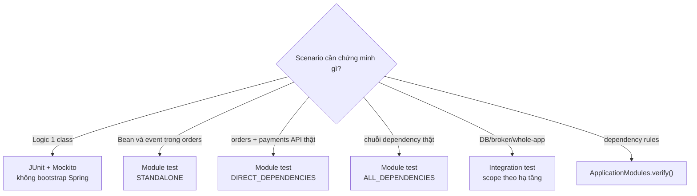

# Bootstrap toàn ứng dụng cho mọi scenario

Một nhóm phát triển có ba module `orders`, `payments` và `inventory`. Để kiểm một nhánh nhỏ “đơn chưa thanh toán thì không được xác nhận”, developer viết `@SpringBootTest`, khởi tạo toàn bộ ứng dụng, cấu hình database, Kafka và hàng loạt mock cho các tích hợp không liên quan. Test cuối cùng chỉ assert một `IllegalStateException`. Khi broker hoặc bean trong `inventory` lỗi, bài test `orders` cũng đỏ dù logic của scenario không thay đổi.

Sai lầm **“Bootstrap toàn ứng dụng cho mọi scenario”** không nằm ở việc `@SpringBootTest` sai: full application integration test là công cụ đúng **khi câu hỏi cần toàn ứng dụng**. Sai ở việc **không chọn phạm vi bootstrap theo điều cần chứng minh**, làm chi phí, nguyên nhân failure và tốc độ phản hồi mất cân đối. Spring Modulith cung cấp `@ApplicationModuleTest` với nhiều bootstrap mode để kiểm bean ở **một phạm vi module**, thay vì luôn kéo mọi thứ vào Spring context.

Bài thuộc chương **Lỗi thường gặp** của học phần `SPRING_MODULITH_VERIFICATION_TESTING`. Học phần rèn kiểm chứng ranh giới kiến trúc bằng `ApplicationModules` và dependency rules, thực hành `@ApplicationModuleTest`, kiểm thử event, database và tích hợp, kết hợp quality gate trong CI để ngăn phụ thuộc sai và hồi quy. Bài tập trung vào **chọn đúng context cho từng scenario**, trình bày ví dụ lỗi → sửa → test chứng minh, không lặp các khái niệm nhập môn.

## 1. Nhận diện “full bootstrap” bị lạm dụng

Một lớp test có `@SpringBootTest` sẽ sử dụng cơ chế Spring Boot để dựng application context theo cấu hình test; thông thường có thể đưa nhiều bean của toàn ứng dụng vào phạm vi kiểm. Nó **không mặc định khởi chạy Kafka/PostgreSQL thật**: việc kết nối hay bootstrap hạ tầng còn phụ thuộc auto-configuration, profiles, Testcontainers, bean và test setup.

Các dấu hiệu **dùng phạm vi quá rộng**:

| Triệu chứng | Câu hỏi phải đặt |
| --- | --- |
| Test `orders` fail vì bean `inventory` không khởi tạo được | Scenario có thật sự sử dụng `inventory` không? |
| Để test một nhánh `if` phải cấu hình broker và credentials | Có thể kiểm bằng constructor + mock đơn giản không? |
| Hàng chục `@MockitoBean`/`@MockBean` để làm context khởi động | Có nên bootstrap riêng module, fake tại boundary không? |
| Test kéo nhiều module transitively dù chỉ kiểm một module | Bootstrap mode có đang rộng hơn nhu cầu? |
| Thay profile/env làm test đỏ vì hạ tầng ngoài | Scenario đang kiểm logic hay cấu hình full runtime? |
| Khởi chạy lớp test rất chậm, nhiều cache miss | Có tạo quá nhiều context configuration riêng không? |
| Toàn bộ suite dùng `@DirtiesContext` để hết lỗi chia sẻ state | Có thể reset fixture thay vì dựng context mới không? |

### Đừng đoán chi phí từ tên annotation

Spring Test **cache application context** giữa các test có cấu hình tương thích. Do đó không đúng nếu nói “mỗi method `@SpringBootTest` luôn khởi động toàn app từ đầu”. Chi phí thực phụ thuộc **số context khác nhau**, cách dùng `@DirtiesContext`, profiles, imports, bean overrides và auto-configuration.

Tuy nhiên, ngay cả khi cache reuse tốt, **phạm vi đầy đủ vẫn đưa những điều không liên quan vào đường khởi tạo và failure surface của test**. Một bean thiếu property ở module khác có thể làm cả context không khởi động, khiến một assertion nghiệp vụ đơn giản chưa kịp chạy.

## 2. Chọn test theo scenario, không theo thói quen

Trước khi viết test, phát biểu **một câu hỏi kiểm chứng** rồi chọn context nhỏ nhất đủ để trả lời:

| Scenario cụ thể | Test ưu tiên | Cần Spring context? | Điều kết luận được |
| --- | --- | --- | --- |
| Nếu payment chưa settled thì `confirm` phải từ chối | JUnit + Mockito | Không | Nhánh business logic đúng |
| Spring có wiring đúng service, fake boundary và phát application event? | `@ApplicationModuleTest` `STANDALONE` | Có, module-scoped | Nội bộ module và Spring event infrastructure |
| `orders` thật sự gọi API `payments` được bootstrap cùng context? | `@ApplicationModuleTest` `DIRECT_DEPENDENCIES` | Có, rộng theo dependency trực tiếp | Collaboration giữa module liên quan, với bean thật |
| Một use case đi qua chuỗi module phụ thuộc bắc cầu | `@ApplicationModuleTest` `ALL_DEPENDENCIES`, khi có lý do | Có, thêm phụ thuộc bắc cầu | Một đoạn dependency graph, không nhất thiết toàn app |
| Order state được commit/rollback bởi JDBC/JPA adapter | Module/integration test với DB thật | Có | Tính nhất quán theo transaction được kiểm |
| Producer external event thật tới Kafka với đúng payload | Broker integration test | Có, adapter/broker phù hợp | Routing/serialization/delivery quan sát được |
| Toàn ứng dụng có thể khởi động và phối hợp nhiều module? | `@SpringBootTest` phù hợp | Có, rộng | Full-context startup/integration theo setup |
| Có dependency cycle, import trái module API? | `ApplicationModules.verify()` | Không cần full Spring context | Ranh giới kiến trúc tĩnh theo quy tắc được hỗ trợ |

**Không phải càng nhiều bean thật càng tốt trong mọi bài test.** Một full-context test có thể mạnh ở kiểm tích hợp nhưng yếu về **độ chính xác chẩn đoán** cho một nhánh nghiệp vụ nhỏ; một unit test rất nhanh nhưng không phát hiện wiring Spring. Sử dụng cả hai khi mỗi bên có trách nhiệm khác nhau.



## 3. Ví dụ xuyên suốt: xác nhận đơn qua API thanh toán

Giả sử module `orders` chỉ cần biết đơn đã thanh toán hay chưa từ API công khai của `payments`. Không được truy cập `payments.internal.PaymentLedger` chỉ để dễ viết test.

```text
com.example.shop
├── ShopApplication.java
├── orders
│   ├── OrderConfirmed.java
│   └── internal
│       ├── OrderConfirmationService.java
│       └── OrderStore.java
└── payments
    ├── PaymentApi.java
    └── internal
        └── PaymentApplicationService.java
```

Contract giữa hai module:

```java
// payments/PaymentApi.java
package com.example.shop.payments;

import java.util.UUID;

public interface PaymentApi {
    boolean isSettled(UUID orderId);
}
```

Event thuộc API của `orders`:

```java
// orders/OrderConfirmed.java
package com.example.shop.orders;

import java.time.Instant;
import java.util.UUID;

public record OrderConfirmed(UUID orderId, Instant occurredAt) {}
```

Port nội bộ của `orders`:

```java
// orders/internal/OrderStore.java
package com.example.shop.orders.internal;

import java.util.UUID;

interface OrderStore {
    /** Chỉ true khi DRAFT -> CONFIRMED thành công. */
    boolean confirmIfDraft(UUID orderId);
}
```

Service nghiệp vụ:

```java
// orders/internal/OrderConfirmationService.java
package com.example.shop.orders.internal;

import com.example.shop.orders.OrderConfirmed;
import com.example.shop.payments.PaymentApi;
import java.time.Clock;
import java.util.UUID;
import org.springframework.context.ApplicationEventPublisher;
import org.springframework.stereotype.Service;

@Service
class OrderConfirmationService {

    private final OrderStore orders;
    private final PaymentApi payments;
    private final Clock clock;
    private final ApplicationEventPublisher events;

    OrderConfirmationService(
            OrderStore orders,
            PaymentApi payments,
            Clock clock,
            ApplicationEventPublisher events) {
        this.orders = orders;
        this.payments = payments;
        this.clock = clock;
        this.events = events;
    }

    void confirm(UUID orderId) {
        if (!payments.isSettled(orderId)) {
            throw new IllegalStateException("Payment not settled");
        }
        if (!orders.confirmIfDraft(orderId)) {
            throw new IllegalStateException(
                    "Order is not confirmable");
        }
        events.publishEvent(
                new OrderConfirmed(orderId, clock.instant()));
    }
}
```

**Thiết kế có chủ đích:**

- `orders` chỉ import `payments.PaymentApi`, không chạm implementation của module `payments`.
- Service phụ thuộc các port đơn giản, cho phép unit test không cần Spring context.
- `OrderConfirmed` là **Spring application event**, không tự là integration event đã gửi ra broker.
- Ví dụ chưa thêm transaction manager; phần kiểm database/commit được đặt ở mục 7. Không dùng fake `OrderStore` để tuyên bố dữ liệu production đã commit.

Một implementation `PaymentApi` thật cần tồn tại trong module `payments` khi chạy ứng dụng. Trong `STANDALONE` module test, implementation ngoài `orders` không được yêu cầu vì test có thể cung cấp một **stub tại module boundary**.

## 4. Anti-pattern: dùng `@SpringBootTest` cho một nhánh thuần logic

Phản ví dụ:

```java
// PHẢN VÍ DỤ: quá rộng cho mục tiêu "payment chưa settled".
@SpringBootTest
class OrderConfirmationTooBroadTests {

    @Autowired OrderConfirmationService service;

    // Trong dự án thực có thể phải override cả Kafka,
    // datasource, inventory adapters, scheduler, ...
    // Chỉ để cuối cùng kiểm một exception.

    @Test
    void unpaidOrderIsRejected() {
        assertThrows(
                IllegalStateException.class,
                () -> service.confirm(UUID.randomUUID()));
    }
}
```

Test trên còn thiếu **fixture kiểm payment state**. Nếu `PaymentApi` production trả giá trị không xác định trong test, assertion có thể xanh do một lỗi khác xảy ra trước khi kiểm payment, hoặc fail do hạ tầng không liên quan. Việc bootstrap toàn ứng dụng không tự sửa được **độ chính xác của assertion**.

### Cách sửa nhỏ nhất: unit test không Spring

```java
// orders/internal/OrderConfirmationUnitTests.java
package com.example.shop.orders.internal;

import static org.junit.jupiter.api.Assertions.assertThrows;
import static org.mockito.Mockito.*;

import com.example.shop.payments.PaymentApi;
import java.time.Clock;
import java.time.Instant;
import java.time.ZoneOffset;
import java.util.UUID;
import org.junit.jupiter.api.Test;
import org.springframework.context.ApplicationEventPublisher;

class OrderConfirmationUnitTests {

    @Test
    void unpaidOrderIsRejectedBeforeTouchingStore() {
        UUID orderId = UUID.randomUUID();
        OrderStore store = mock(OrderStore.class);
        PaymentApi payments = mock(PaymentApi.class);
        ApplicationEventPublisher events =
                mock(ApplicationEventPublisher.class);
        when(payments.isSettled(orderId)).thenReturn(false);

        var service = new OrderConfirmationService(
                store,
                payments,
                Clock.fixed(
                        Instant.parse("2026-11-26T02:00:00Z"),
                        ZoneOffset.UTC),
                events);

        assertThrows(IllegalStateException.class,
                () -> service.confirm(orderId));

        verify(payments).isSettled(orderId);
        verifyNoInteractions(store, events);
    }
}
```

Test này **không bootstrap Spring**, không cần DB/Kafka, và chốt chính xác branch: payment chưa settled nên **không đụng store hoặc publish event**.

**Phạm vi kết luận:** business logic trong class này đúng cho nhánh đã kiểm. Nó không kiểm Spring component scan, module collaboration, transaction và broker. Thêm các test ấy ở đúng lớp cần thiết, thay vì biến unit test thành full integration test.

## 5. Cách sửa cho scenario module: `STANDALONE` với fake đúng boundary

Nếu mục tiêu là “module `orders` bootstrap được, service được Spring inject đúng, khi đã thanh toán thì phát application event”, `@ApplicationModuleTest` phạm vi `STANDALONE` là lựa chọn có chủ đích.

Ví dụ JUnit dùng **bean thật `OrderConfirmationService`**, fake `OrderStore` và stub `PaymentApi` tại boundary bên ngoài:

```java
// orders/internal/OrderConfirmationModuleTests.java
package com.example.shop.orders.internal;

import static org.assertj.core.api.Assertions.assertThat;
import static org.assertj.core.api.Assertions.assertThatThrownBy;

import com.example.shop.orders.OrderConfirmed;
import com.example.shop.payments.PaymentApi;
import java.time.Clock;
import java.time.Instant;
import java.time.ZoneOffset;
import java.util.Set;
import java.util.UUID;
import java.util.concurrent.ConcurrentHashMap;
import org.junit.jupiter.api.Test;
import org.springframework.beans.factory.annotation.Autowired;
import org.springframework.boot.test.context.TestConfiguration;
import org.springframework.context.annotation.Bean;
import org.springframework.context.annotation.Import;
import org.springframework.modulith.test.ApplicationModuleTest;
import org.springframework.modulith.test.PublishedEvents;

@ApplicationModuleTest
@Import(OrderConfirmationModuleTests.Fixture.class)
class OrderConfirmationModuleTests {

    @Autowired OrderConfirmationService service;
    @Autowired FakeOrders orders;
    @Autowired StubPayments payments;

    @Test
    void paidOrderPublishesOneSpringEvent(PublishedEvents events) {
        UUID orderId = UUID.randomUUID();
        orders.addDraft(orderId);
        payments.markSettled(orderId);

        service.confirm(orderId);

        assertThat(
                events.ofType(OrderConfirmed.class)
                        .matching(e -> e.orderId().equals(orderId))
        ).hasSize(1);
    }

    @Test
    void unpaidOrderDoesNotPublish(PublishedEvents events) {
        UUID orderId = UUID.randomUUID();
        orders.addDraft(orderId);

        assertThatThrownBy(() -> service.confirm(orderId))
                .isInstanceOf(IllegalStateException.class);

        assertThat(
                events.ofType(OrderConfirmed.class)
                        .matching(e -> e.orderId().equals(orderId))
        ).isEmpty();
    }

    @TestConfiguration(proxyBeanMethods = false)
    static class Fixture {
        @Bean FakeOrders fakeOrders() {
            return new FakeOrders();
        }

        @Bean StubPayments stubPayments() {
            return new StubPayments();
        }

        @Bean Clock clock() {
            return Clock.fixed(
                    Instant.parse("2026-11-26T02:00:00Z"),
                    ZoneOffset.UTC);
        }
    }

    static final class FakeOrders implements OrderStore {
        private final Set<UUID> draftIds =
                ConcurrentHashMap.newKeySet();

        void addDraft(UUID id) {
            draftIds.add(id);
        }

        @Override
        public boolean confirmIfDraft(UUID id) {
            return draftIds.remove(id);
        }
    }

    static final class StubPayments implements PaymentApi {
        private final Set<UUID> paidIds =
                ConcurrentHashMap.newKeySet();

        void markSettled(UUID id) {
            paidIds.add(id);
        }

        @Override
        public boolean isSettled(UUID id) {
            return paidIds.contains(id);
        }
    }
}
```

**Những gì test này thực sự kiểm:**

1. `@ApplicationModuleTest` bootstrap Spring context của module `orders` theo phạm vi mặc định `STANDALONE` trong các phiên bản hỗ trợ.
2. Spring tạo/inject `OrderConfirmationService` thật và `ApplicationEventPublisher` thật.
3. Hai test doubles có chủ đích thay `OrderStore` infrastructure và `PaymentApi` thuộc module khác.
4. `PublishedEvents` xác nhận **Spring application event trong JVM**, không chứng minh broker đã nhận.

**Điều kiện chạy thực tế:** cần application root `ShopApplication`, dependency Spring Modulith Test, JUnit Jupiter, AssertJ và Spring Boot Test. Nếu project có implementation `OrderStore`/bean configuration khác làm context cố khởi tạo datasource, thêm profile/test configuration đúng phạm vi hoặc chuyển sang DB integration test; fake `@Bean` không tự ngăn mọi bean production khác được tạo.

Vì `FakeOrders` và `StubPayments` là mutable beans trong **test context được cache**, ví dụ sử dụng **UUID riêng cho mỗi test**, tránh giao thoa ở trường hợp chạy tuần tự. Khi test chạy song song, cần thêm isolation/reset theo test ID hoặc cấu hình tránh chia sẻ mutable fixture giữa các test chạy đồng thời. Không dùng `@DirtiesContext` hàng loạt chỉ để thay việc quản lý state của fake.

### Khi nào đây chưa phải module test đủ mạnh?

Nếu mục tiêu là kiểm tương tác giữa `OrderPolicy` và `OrderStoreJDBC`, một fake store không còn phù hợp. Phải dùng adapter/persistence thật trong phạm vi phù hợp và một database test. **Không đánh đồng “có Spring context” với “đã dùng collaborator production”.**

## 6. Mở rộng có kiểm soát: `DIRECT_DEPENDENCIES` và `ALL_DEPENDENCIES`

Khi scenario đổi từ “`orders` làm gì nếu `PaymentApi` trả true?” sang “`orders` và implementation thật trong `payments` phối hợp ra sao?”, bạn có lý do **mở rộng đúng dependency cần kiểm**, thay vì dùng full application context theo phản xạ.

Spring Modulith có các bootstrap mode trong `@ApplicationModuleTest`:

| Mode | Scope mong muốn | Câu hỏi phù hợp |
| --- | --- | --- |
| `STANDALONE` | Module đang kiểm, các application module khác không được tự thêm vào chỉ vì chúng là dependencies | Bean nội bộ + fake/mock boundary có hoạt động? |
| `DIRECT_DEPENDENCIES` | Module đang kiểm và application modules mà nó **phụ thuộc trực tiếp** | API `orders → payments` có kết nối với implementation thật? |
| `ALL_DEPENDENCIES` | Module đang kiểm và **các phụ thuộc bắc cầu** theo module graph | Use case đi qua chuỗi module có hoạt động trong context có scope phù hợp? |

**`ALL_DEPENDENCIES` không có nghĩa mặc định là tất cả module của toàn ứng dụng.** Những module độc lập hoặc không thuộc dependency graph của module đang kiểm có thể vẫn nằm ngoài context. Ngược lại, các auto-configuration bean và `@Import` có thể ảnh hưởng phạm vi context; cần đọc bootstrap logs khi xác minh.

### Ví dụ mở rộng đúng một bước

Nếu module `payments` có bean `PaymentApplicationService implements PaymentApi` và hạ tầng của nó được chuẩn bị cho test:

```java
// orders/internal/OrdersWithPaymentDependencyTests.java
package com.example.shop.orders.internal;

import static org.assertj.core.api.Assertions.assertThat;

import com.example.shop.payments.PaymentApi;
import org.junit.jupiter.api.Test;
import org.springframework.beans.factory.annotation.Autowired;
import org.springframework.modulith.test.ApplicationModuleTest;
import org.springframework.modulith.test.ApplicationModuleTest.BootstrapMode;

@ApplicationModuleTest(
        mode = BootstrapMode.DIRECT_DEPENDENCIES
)
class OrdersWithPaymentDependencyTests {

    @Autowired OrderConfirmationService orders;
    @Autowired PaymentApi payments;

    @Test
    void bootsOrdersWithRealDirectDependency() {
        assertThat(orders).isNotNull();
        assertThat(payments).isNotNull();
    }
}
```

**Snippet này là ví dụ cấu trúc test**, không tự đủ dependencies để chạy: cần implementation `PaymentApi` thật trong `payments`, `OrderStore` adapter hoặc test bean và `Clock`; nếu implementation payment truy cập DB thì cần test datasource/schema hoặc port thay thế có chủ đích. Đặc biệt, assertion `isNotNull()` chỉ chứng minh bean wiring, **chưa chứng minh một business path đã chạy**. Để kiểm collaboration thực, phải đưa một payment test fixture ở trạng thái settled, gọi `orders.confirm(orderId)` rồi assert state/event tương ứng.

**Không dùng lại `StubPayments` của mục 5 trong bài test tuyên bố kiểm “real direct dependency”**: làm vậy vẫn chỉ kiểm stub, dù mode đã chuyển sang `DIRECT_DEPENDENCIES`. Đọc danh sách bean thực và nguồn bean để bảo đảm test đang gọi implementation mong muốn.

### Khi nào dùng `ALL_DEPENDENCIES`?

Ví dụ `orders → payments → ledger`, và câu hỏi test yêu cầu cả cách `payments` dùng ledger để xác nhận trạng thái thanh toán. Khi ấy `ALL_DEPENDENCIES` có thể là lựa chọn hợp lý nếu mọi dependency được nhận diện và test infrastructure sẵn sàng:

```java
@ApplicationModuleTest(
        mode = BootstrapMode.ALL_DEPENDENCIES
)
class OrdersWithTransitiveDependenciesTests {
    // Test thực tế phải thiết lập fixture cho orders,
    // payments và các transitive modules có tham gia.
}
```

**Không mở mode rộng chỉ để giải quyết `NoSuchBeanDefinitionException` mà chưa hiểu nguyên nhân.** Nếu cần test độc lập, thay API module ngoài bằng stub; nếu cần kiểm phối hợp thật, mở đúng dependency và cấp fixture phù hợp. Mở rộng mà không xác định câu hỏi kiểm chứng chỉ thay một lỗi wiring rõ ràng bằng một test chậm khó debug hơn.

### Mode không hợp thức hóa vi phạm kiến trúc

Nếu `orders` import `payments.internal.PaymentLedger`, thay `STANDALONE` bằng `ALL_DEPENDENCIES` không tự biến import đó thành API hợp lệ. Kiểm **dependency cycle, API exposure và `allowedDependencies`** bằng `ApplicationModules.verify()`; module test chỉ kiểm hành vi bootstrap/collaboration trong phạm vi được chọn.

## 7. Những scenario thật sự cần database, broker hoặc full context

Thu hẹp bootstrap không có nghĩa **không bao giờ dùng integration test**. Có những câu hỏi mà test với fake **không thể trả lời**:

| Scenario | Vì sao module test với fake chưa đủ? | Bằng chứng cần bổ sung |
| --- | --- | --- |
| Repository JDBC update trạng thái đúng và commit | `FakeOrders` chỉ sửa `Set` trong memory | DB integration với SQL/schema/transaction thật |
| Transaction rollback sau lỗi ở bước thứ hai | Mock không tái hiện DB commit/rollback | Kiểm DB state từ transaction/connection mới |
| `@TransactionalEventListener(AFTER_COMMIT)` chạy đúng lúc | `PublishedEvents` có thể thấy event trước commit | Commit/rollback integration test |
| Spring Modulith externalize `OrderConfirmed` ra Kafka | Event JVM không đồng nghĩa broker record | Kafka adapter + broker test |
| Một API Gateway route qua nhiều module và security config | `STANDALONE` không chứa toàn tuyến runtime | `@SpringBootTest` hoặc integration scope rộng phù hợp |
| Application start-up smoke test toàn bộ bean topology | Module-scoped test không yêu cầu mọi bean toàn app lên | Full-context smoke test |

### Một chi tiết giao dịch dễ làm test xanh giả

Khi production service `OrderConfirmationService.confirm(...)` được đặt `@Transactional` với persistence adapter thực, một bài test có `@Transactional` ở lớp test **thường rollback mặc định**. `service.confirm(...)` trả về **chưa chắc nghĩa là database đã commit**, vì nó có thể đang tham gia transaction do Spring Test mở.

```java
// Mẫu phần thân test tích hợp, không phải class độc lập.
// Giả định đã có DB thật, schema, transaction manager,
// testOrders helper và service @Transactional.
UUID id = testOrders.insertDraftWithSettledPayment();
service.confirm(id);

// Chỉ kết thúc khi test-managed transaction tồn tại:
TestTransaction.flagForCommit();
TestTransaction.end();

// Lúc này đọc state qua transaction/connection mới:
assertThat(testOrders.findStatus(id)).isEqualTo("CONFIRMED");
```

Test cần import `org.springframework.test.context.transaction.TestTransaction` và được đặt trong test có `@Transactional` do Spring Test quản lý. `testOrders` là **helper minh họa**, không phải API Spring Modulith. Nhánh rollback phải chạy riêng với `TestTransaction.flagForRollback()` và `end()`, rồi assert không có thay đổi đã commit.

**Với kiểm Kafka/external event**, phải xem transaction-aware externalization adapter và broker thực tế. `PublishedEvents.ofType(OrderConfirmed.class)` chứng minh event được publish vào Spring context, **không chứng minh** Kafka gửi thành công, destination đúng hoặc consumer đã xử lý. Mục đích của integration test chính là kiểm thêm lớp này, không phải lý do để mọi unit test bootstrap full app.

### Không dùng một bài full integration thay cho toàn bộ unit/module test

Một end-to-end test có thể mất nhiều thời gian và fail ở nhiều điểm. Khi nó đỏ, bạn chưa biết ngay lỗi từ branch logic, Spring wiring, transaction hay broker. Giữ unit test và scoped module test nhỏ như **bộ định vị lỗi**; thêm một số integration tests có trọng tâm cho những biên hạ tầng quan trọng.

## 8. Context caching, `@DirtiesContext` và state leakage

Một lý do khiến team tin rằng “mọi scenario phải bootstrap cả app” là họ nhìn thấy những test full context chạy khá nhanh nhờ cache. Điều đó có thể đúng cho **các test dùng cùng cấu hình Spring Test**, nhưng không làm cho mỗi test tự động có scope phù hợp.

### Hiểu chi phí thực tế

Spring TestContext **cache những application context tương thích**. Những yếu tố có thể làm cache key khác nhau hoặc gây rebuild:

- Các tổ hợp `@SpringBootTest`, `@ApplicationModuleTest` và các context configurations khác.
- `@ActiveProfiles` và properties khác nhau.
- `@Import`/`@TestConfiguration` và bean override/mock definitions khác nhau.
- Một số customizers và cấu hình test infrastructure.
- `@DirtiesContext` đánh dấu context bẩn, khiến nó bị đóng và phải dựng lại.

**Không thể nói “100 method @SpringBootTest = 100 lần startup”** nếu context được cache; cũng không thể nói “@ApplicationModuleTest luôn nhanh hơn 10 lần” mà không đo profile/dự án. Mục tiêu là **giảm context không cần thiết và giữ failure scope hẹp**, không chạy theo một con số thời gian bịa ra.

### Vì sao trạng thái giả lập có thể lây giữa test?

Trong test ở mục 5, `FakeOrders` và `StubPayments` là bean của cached context, có `Set` chứa dữ liệu của các test trước. Dùng ID mới cho mỗi test giúp hạn chế va chạm, nhưng test sửa dữ liệu toàn cục, sequence hoặc global flags có thể gây flaky.

Chiến lược tốt:

1. **Dùng immutable test data và fixed clock** khi phù hợp.
2. **Reset fake/repository trước mỗi test** bằng `@BeforeEach` hoặc transaction rollback/cleanup có kiểm soát.
3. **Dùng ID riêng theo test** để tránh collision; không phụ thuộc thứ tự chạy.
4. Khi parallel test chạy chung cached context, chọn state isolation thích hợp hoặc hạn chế parallel cho suite có shared mutable fixture.
5. Chỉ dùng `@DirtiesContext` khi context thực sự bị thay đổi về configuration/global state và không thể reset an toàn.

Một `@DirtiesContext` trên mọi test có thể làm mất lợi ích cache và tăng thời gian toàn suite đáng kể; nhưng **không được bỏ isolation chỉ để giữ cache**. Ưu tiên test deterministic và chủ động kiểm sự rò rỉ state.

### Test “không ổn định” vì profile, không phải vì thiếu full bootstrap

Nếu một module test thất bại do `DataSource` không có trong `STANDALONE`, đây là tín hiệu **mismatch giữa scope và wiring**, không mặc định một lý do dùng full app. Hỏi:

- Scenario có cần kiểm persistence không?
- Có thể inject fake tại `OrderStore` để kiểm event/wiring?
- Nếu cần persistence, đã cấp đúng test datasource/migration chưa?
- Có auto-configuration nào khởi tạo adapter ngoài mục tiêu?

**Sửa wiring/fixture theo mục đích**, không thêm mock hoặc mở scope cho đến khi context xanh mà không biết đã kiểm gì.

## 9. Kiểm chứng phạm vi: positive/negative probes và quality gate

Khi thay `@SpringBootTest` bằng module test, cần bằng chứng rằng bộ test **vẫn bắt lỗi nó được thiết kế để bắt**.

### Positive probes — test đúng những gì thuộc scope

| Thay đổi giả lập trong nhánh thử | Test kỳ vọng fail |
| --- | --- |
| Bỏ `@Service` trên `OrderConfirmationService` | Module test phải báo thiếu bean (nếu test không tự import replacement) |
| Thay điều kiện `payments.isSettled` bằng luôn true | Unit test unpaid order phải fail |
| Không publish `OrderConfirmed` khi xác nhận thành công | Module `PublishedEvents` assertion phải fail |
| Đổi `orderId` trong emitted event | Module test lọc theo `orderId` phải fail |
| Làm JDBC adapter không commit | DB integration test phải fail |
| Làm sai broker topic/route | Broker integration test phải fail |

**Đừng thử trực tiếp trên nhánh production.** Tạo nhánh/thay đổi giả lập, chạy đúng suite, ghi nhận failure, rồi revert. Một test xanh không chứng minh mọi lỗi đều bị bắt, nhưng một negative probe đúng giúp xác minh thiết kế test có thực sự quan sát hành vi cần bảo vệ.

### Negative probes — lỗi ở module khác có cần ảnh hưởng test này?

Nếu thay một bean chỉ thuộc `inventory`, test `orders` `STANDALONE` không nên fail **chỉ vì bean inventory không khởi tạo được**, trừ khi có auto-configuration/import ngoài ý muốn. Đây là một phép kiểm về **cô lập phạm vi**, không phải khẳng định rằng module test phát hiện mọi lỗi toàn ứng dụng.

Ngược lại, full-context smoke test có thể **nên fail** khi `inventory` bean không khởi động; đó là nhiệm vụ của nó. Hai kết quả khác nhau đều đúng vì câu hỏi test khác nhau.

### Architecture verification vẫn phải chạy riêng

```java
// src/test/java/com/example/shop/ModularityTests.java
package com.example.shop;

import org.junit.jupiter.api.Test;
import org.springframework.modulith.core.ApplicationModules;

class ModularityTests {

    @Test
    void moduleDependenciesAreValid() {
        ApplicationModules.of(ShopApplication.class).verify();
    }
}
```

`ApplicationModules.verify()` phát hiện các vi phạm module graph/API mà nó hỗ trợ, như dependency cycles, references vào nội bộ module khác trái quy tắc và `allowedDependencies` nếu được khai báo. **Một scoped module test có thể PASS dù code vẫn import trái API**; vì vậy không dùng runtime bootstrap test để thay verification.

### CI: để từng loại test bảo vệ đúng việc

```text
Pull request
  |
  v
JUnit + Mockito: nhánh nghiệp vụ
  |
  v
ApplicationModules.verify(): dependency rules
  |
  v
@ApplicationModuleTest STANDALONE: wiring/event trong module
  |
  v
DIRECT/ALL tests: khi cần collaboration thật
  |
  v
DB/Broker integration: commit/rollback/wire contract
  |
  v
@SpringBootTest: smoke/full context cho luồng có lý do
  |
  v
Required quality gates PASS -> merge
```

Với Maven, những test JUnit thuộc Surefire có thể chạy qua `./mvnw -B -ntp test`; các test integration `*IT` thường cần cấu hình/chạy Failsafe ở phase `verify`. Với Gradle, kiểm `test` và các integration test suite/tasks thực tế. **Không suy từ một build xanh rằng mọi suite đã được discover**: xem test report, số bài chạy và CI jobs bắt buộc.

Nếu một full-context test nặng chỉ cần chạy trước release, phải có chiến lược rõ: **không được im lặng bỏ hết validation end-to-end**, nhưng cũng không cần buộc mọi unit scenario trả chi phí khởi tạo toàn ứng dụng.

## 10. Checklist lựa chọn context và bài tập tự kiểm

### Checklist trước khi chọn annotation

| Câu hỏi review | Quyết định/kiểm chứng |
| --- | --- |
| Scenario chỉ kiểm logic một class? | Bắt đầu bằng JUnit/Mockito, không bootstrap Spring |
| Cần Spring injection/AOP/event infrastructure? | Cân nhắc `@ApplicationModuleTest` |
| Test đặt đúng package application module? | Đối chiếu module discovery và bootstrap log |
| `STANDALONE` đủ cho collaboration trong module? | Fake/mock dependency ngoài boundary, không mock hết nội bộ |
| Cần API module phụ thuộc trực tiếp thật? | Dùng `DIRECT_DEPENDENCIES` với fixture thật |
| Cần dependency bắc cầu thật? | `ALL_DEPENDENCIES`, không đồng nhất với toàn app |
| Test cần DB commit/rollback? | Real DB/transaction manager và kiểm sau commit |
| Test cần Kafka/externalization? | Broker/adapter integration test |
| Dùng `@SpringBootTest` vì lý do gì? | Ghi rõ smoke/full-context scenario trong tên/test doc |
| Có context state leakage giữa tests? | Reset fixture, IDs riêng, xem caching/parallel |
| `@DirtiesContext` có thật sự cần? | Kiểm khả năng cleanup, tránh rebuild vô ích |
| Module boundary đúng? | Chạy `ApplicationModules.verify()` riêng |
| CI có chạy đúng suite không? | Required checks và test report có bài thực thi |
| Mỗi test nêu đúng kết luận? | Không lấy `PublishedEvents` làm bằng chứng broker ACK |

### Bài tập 1 — Chỉ kiểm điều kiện từ chối

`OrderConfirmationService.confirm(id)` phải throw nếu payment chưa settled. Developer dùng `@SpringBootTest` và khởi chạy toàn bộ Kafka/DB.

**Hỏi:** Cách sửa nhỏ nhất?

**Đáp án:** Dùng **JUnit + Mockito** cho `PaymentApi`, `OrderStore`, publisher và fixed clock. Assert exception, kiểm store/publisher không được gọi. Không cần Spring context.

### Bài tập 2 — Cần kiểm `PublishedEvents`

Unit test mock `ApplicationEventPublisher` đã PASS, nhưng nhóm muốn biết event có thực sự đi qua Spring application event infrastructure trong module `orders` hay không.

**Hỏi:** Nên dùng gì?

**Đáp án:** `@ApplicationModuleTest` `STANDALONE` với bean service thật và `PublishedEvents`; fake boundary cần thiết. Không phải mở full app chỉ để kiểm Spring event.

### Bài tập 3 — Payment module cần bean thật

Scenario cần kiểm `orders` gọi đúng implementation `PaymentApi` của module `payments`. `STANDALONE` hiện dùng `StubPayments`.

**Hỏi:** Cách thay đổi?

**Đáp án:** Có thể chuyển sang `DIRECT_DEPENDENCIES`, **loại stub `PaymentApi`**, dùng bean thật của `payments` và cấp test fixtures/hạ tầng tương ứng. Chỉ đổi mode mà giữ stub không chứng minh integration thật.

### Bài tập 4 — `ALL_DEPENDENCIES` có phải full context?

`orders` có phụ thuộc bắc cầu tới `ledger`, nhưng module `recommendations` độc lập.

**Hỏi:** `ALL_DEPENDENCIES` có mặc định bootstrap `recommendations` không?

**Đáp án:** **Không.** Nó theo dependency graph của module đang test. Không suy rằng mọi module độc lập đều nằm trong scope.

### Bài tập 5 — Context được cache

Team có 20 class `@SpringBootTest` dùng cùng cấu hình. Một developer nói sẽ có ít nhất 20 lần startup context.

**Hỏi:** Kết luận này có chắc đúng?

**Đáp án:** **Không.** Spring TestContext cache có thể reuse context tương thích. Đo bằng test reports/bootstrap logs và xem `@DirtiesContext`, profiles/bean overrides; dù cache tốt vẫn phải kiểm scope có phù hợp mục tiêu không.

### Bài tập 6 — Fake persistence + transaction

`@ApplicationModuleTest` với `FakeOrders` thấy event và cập nhật tập `Set` thành công. Nhóm khẳng định PostgreSQL commit và event after-commit hoạt động.

**Hỏi:** Bằng chứng thiếu?

**Đáp án:** Test dùng fake nên chưa kiểm **real DB transaction** hay `AFTER_COMMIT`. Cần persistence integration test, commit/rollback thật, và broker integration nếu có externalization.

### Bài tập 7 — Unit/module test PASS nhưng `verify()` FAIL

Developer import `payments.internal.PaymentLedger` vào `orders`. Unit và module tests vẫn xanh.

**Hỏi:** Có nên thay mọi module test bằng `@SpringBootTest` để bắt lỗi?

**Đáp án:** **Không.** Chạy **`ApplicationModules.verify()`** và sửa module API/dependency. Full runtime context không thay công cụ static architecture verification.

### Bài tập 8 — Vì sao một test `@SpringBootTest` vẫn cần thiết?

Nhóm vừa nâng cấp dependency quan trọng; muốn kiểm application context toàn hệ thống có thể bootstrap cùng security, persistence và message adapter theo cấu hình release.

**Hỏi:** Dùng full bootstrap là sai?

**Đáp án:** **Không.** Đây là **full-context smoke/integration scenario có lý do hợp lệ**. Sai chỉ khi áp dụng cùng lựa chọn cho **mọi** nhánh logic nhỏ và dùng nó thay các test có scope hẹp.

### Tổng kết

Sửa lỗi **“Bootstrap toàn ứng dụng cho mọi scenario”** không phải là cấm `@SpringBootTest`, mà là **chọn mức bootstrap theo câu hỏi kiểm chứng**: constructor/JUnit cho logic, `@ApplicationModuleTest` `STANDALONE` cho wiring/event trong module, `DIRECT_DEPENDENCIES` hoặc `ALL_DEPENDENCIES` khi cần collaboration thật, và integration/full-context test khi cần database, broker hay toàn app.

Trong `SPRING_MODULITH_VERIFICATION_TESTING`, giữ `ApplicationModules.verify()` làm quality gate **kiến trúc**, `@ApplicationModuleTest` làm quality gate **module runtime**, và DB/broker tests bảo vệ **transaction/externalization**. Kiểm scope, test doubles, context caching và test discovery trong CI trước khi tin một badge xanh. **Một test có phạm vi đúng và assertion chính xác thường hữu ích hơn một full-context test không biết đang chứng minh điều gì.**

## Tài liệu tham khảo

- [Spring Modulith — Testing Application Modules](https://docs.spring.io/spring-modulith/reference/testing.html)
- [Spring Modulith — Verifying Application Module Structure](https://docs.spring.io/spring-modulith/reference/verification.html)
- [Spring Modulith — Fundamentals of Application Modules](https://docs.spring.io/spring-modulith/reference/fundamentals.html)
- [Spring Framework — TestContext Framework](https://docs.spring.io/spring-framework/reference/testing/testcontext-framework.html)
- [Spring Framework — Context Caching](https://docs.spring.io/spring-framework/reference/testing/testcontext-framework/ctx-management/caching.html)
- [Spring Framework — Test-managed Transactions](https://docs.spring.io/spring-framework/reference/testing/testcontext-framework/tx.html)
- [Spring Boot — Testing](https://docs.spring.io/spring-boot/reference/testing/index.html)
- [JUnit — User Guide](https://docs.junit.org/current/user-guide/)
