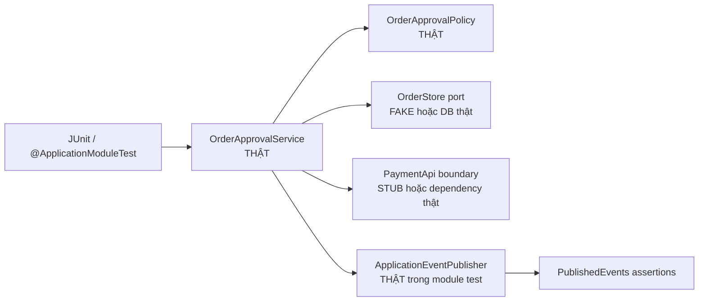

# Mock toàn bộ dependency làm mất giá trị tích hợp

Một nhóm viết test cho module `orders` trong Spring Modulith. Họ đánh dấu class bằng `@ApplicationModuleTest`, nhưng lại thay `OrderApprovalService`, `OrderApprovalPolicy`, repository và cả `ApplicationEventPublisher` bằng mock. Cuối cùng test gọi `approve(orderId)` rồi `verify(...)` trên các mock và kết luận “module `orders` đã được kiểm thử tích hợp”. Trên thực tế, **phần lớn logic và collaboration thật chưa hề chạy**. Một lỗi làm service bỏ qua policy hoặc phát event sai vẫn có thể lọt qua nếu test đã mock chính service/publisher cần kiểm.

Đó là sai lầm **“Mock toàn bộ dependency làm mất giá trị tích hợp”**: không phải dùng mock luôn sai, mà là **thay thế đúng những thành phần mà bài test được cho là phải chứng minh**. Mock thích hợp ở ranh giới ngoài scope; việc mock mọi bean khiến `@ApplicationModuleTest` chỉ còn một Spring context tốn chi phí để kiểm tương tác nhân tạo.

Bài thuộc chương **Lỗi thường gặp** của học phần `SPRING_MODULITH_VERIFICATION_TESTING`. Học phần tập trung kiểm chứng ranh giới kiến trúc bằng `ApplicationModules` và dependency rules, thực hành `@ApplicationModuleTest`, kiểm thử sự kiện, database và tích hợp, kết hợp quality gate trong CI nhằm ngăn hồi quy. Bài đi thẳng vào **xác định bean nào nên thật, bean nào có thể fake/mock, viết test chứng minh được collaboration, và kiểm tra các giới hạn của test**. Yêu cầu không phải loại bỏ Mockito mà là dùng đúng chỗ.

## 1. Nhận diện test “xanh” nhưng không kiểm được đường đi thật

Ví dụ anti-pattern:

```java
// PHẢN VÍ DỤ: test có @ApplicationModuleTest
// nhưng mock chính class được tuyên bố là đang kiểm.
@ApplicationModuleTest
class OrdersMisleadingTests {

    @MockitoBean
    OrderApprovalService service;

    @Test
    void appearsToApproveOrder() {
        UUID orderId = UUID.randomUUID();
        var fabricated = new OrderApproved(
                orderId,
                Instant.parse("2026-11-26T02:00:00Z"));

        when(service.approve(orderId)).thenReturn(fabricated);

        assertThat(service.approve(orderId))
                .isEqualTo(fabricated);
        verify(service).approve(orderId);
    }
}
```

Đây là **mẫu minh họa anti-pattern**: các import JUnit, Mockito, AssertJ, Java Time/UUID và Spring Modulith Test được lược đi. `@MockitoBean` là annotation của Spring Framework ở các phiên bản phù hợp; một số stack Spring Boot cũ dùng `@MockBean`. Muốn đưa vào project thật phải chọn annotation tương thích, và còn cần context có bean/bean definition phù hợp để override.

**Điều test này thực sự chứng minh:** Mockito trả về đối tượng đã được người viết test gán sẵn. `OrderApprovalService` thật không chạy; không có policy, database, transaction hay Spring event được kiểm. Dù application context có bootstrap, trọng tâm assertion chỉ là **stubbing của mock**.

### “Mock nhiều” không phải tiêu chí duy nhất

Một test dùng ba mock vẫn có giá trị nếu chỉ muốn kiểm một class với ba cổng cộng tác. Ngược lại, một `@ApplicationModuleTest` chỉ mock **một** bean nhưng bean ấy chính là business service cần kiểm vẫn có thể rỗng giá trị. Câu hỏi quyết định:

> **Nếu xóa hoặc làm sai một quy tắc nghiệp vụ bên trong module đang kiểm, bài test có thất bại không?**

Nếu câu trả lời là “không, vì class chứa quy tắc đã bị mock”, đó là dấu hiệu cần sửa cách cô lập.

## 2. Định nghĩa ranh giới trước khi lựa chọn test double

Sử dụng ví dụ ứng dụng:

```text
com.example.shop
├── ShopApplication.java
├── orders
│   ├── OrderApproved.java
│   └── internal
│       ├── OrderApprovalService.java
│       ├── OrderApprovalPolicy.java
│       ├── OrderSnapshot.java
│       ├── OrderStore.java
│       └── JdbcOrderStore.java
└── payments
    ├── PaymentApi.java
    └── internal
        └── PaymentApplicationService.java
```

`orders` sở hữu logic duyệt đơn: đơn đang ở trạng thái `DRAFT`, có ít nhất một sản phẩm và địa chỉ giao hàng đã xác minh. `payments` sở hữu sự thật “đơn đã thanh toán đủ”. `orders` chỉ được gọi **API công khai** của `payments`, không import `payments.internal.PaymentApplicationService`.



Lựa chọn theo **mục tiêu**:

| Thành phần | Mục tiêu là test collaboration trong `orders` | Mục tiêu là test DB/broker end-to-end |
| --- | --- | --- |
| `OrderApprovalService` | **Bean thật** | Bean thật |
| `OrderApprovalPolicy` | **Bean thật** | Bean thật |
| `OrderStore` | Fake có kiểm soát khi chưa kiểm persistence | Adapter thật + test database |
| `PaymentApi` ở module khác | Stub/mock tại module boundary | Bean thật với `DIRECT_DEPENDENCIES` nếu cần |
| `ApplicationEventPublisher` | **Bean Spring thật** để `PublishedEvents` quan sát | Bean thật + adapter phù hợp |
| Kafka/AMQP adapter | Không cần nếu chỉ kiểm Spring event | Adapter và broker thật |

**Mock đúng boundary để giữ logic trong scope hoạt động thật.** `@ApplicationModuleTest` mặc định sử dụng phạm vi module đang kiểm trong bootstrap mode `STANDALONE` ở các phiên bản hỗ trợ; test chỉ cần thay những collaborator không thuộc phạm vi mục tiêu.

## 3. Mô hình Java tối thiểu: logic cần kiểm phải tồn tại thật

Định nghĩa hợp đồng event:

```java
// com/example/shop/orders/OrderApproved.java
package com.example.shop.orders;

import java.time.Instant;
import java.util.UUID;

public record OrderApproved(UUID orderId, Instant occurredAt) {}
```

API công khai của module `payments`:

```java
// com/example/shop/payments/PaymentApi.java
package com.example.shop.payments;

import java.util.UUID;

public interface PaymentApi {
    boolean isSettled(UUID orderId);
}
```

Model và port riêng của `orders`:

```java
// com/example/shop/orders/internal/OrderSnapshot.java
package com.example.shop.orders.internal;

import java.util.UUID;

enum OrderStatus { DRAFT, APPROVED }

record OrderSnapshot(
        UUID id,
        OrderStatus status,
        int itemCount,
        boolean shippingVerified
) {}
```

```java
// com/example/shop/orders/internal/OrderStore.java
package com.example.shop.orders.internal;

import java.util.Optional;
import java.util.UUID;

interface OrderStore {
    Optional<OrderSnapshot> find(UUID id);

    /** True nếu chuyển DRAFT -> APPROVED được lưu thành công. */
    boolean approveIfDraft(UUID id);
}
```

Policy là **bean nghiệp vụ thực**:

```java
// com/example/shop/orders/internal/OrderApprovalPolicy.java
package com.example.shop.orders.internal;

import org.springframework.stereotype.Component;

@Component
class OrderApprovalPolicy {

    void requireApprovable(OrderSnapshot order) {
        if (order.status() != OrderStatus.DRAFT) {
            throw new IllegalStateException(
                    "Only draft orders can be approved");
        }
        if (order.itemCount() <= 0) {
            throw new IllegalStateException(
                    "Order must contain items");
        }
        if (!order.shippingVerified()) {
            throw new IllegalStateException(
                    "Shipping details not verified");
        }
    }
}
```

Service phối hợp policy, store, payment boundary và Spring events:

```java
// com/example/shop/orders/internal/OrderApprovalService.java
package com.example.shop.orders.internal;

import com.example.shop.orders.OrderApproved;
import com.example.shop.payments.PaymentApi;
import java.time.Clock;
import java.util.UUID;
import org.springframework.context.ApplicationEventPublisher;
import org.springframework.stereotype.Service;

@Service
class OrderApprovalService {

    private final OrderStore orders;
    private final OrderApprovalPolicy policy;
    private final PaymentApi payments;
    private final ApplicationEventPublisher publisher;
    private final Clock clock;

    OrderApprovalService(
            OrderStore orders,
            OrderApprovalPolicy policy,
            PaymentApi payments,
            ApplicationEventPublisher publisher,
            Clock clock) {
        this.orders = orders;
        this.policy = policy;
        this.payments = payments;
        this.publisher = publisher;
        this.clock = clock;
    }

    OrderApproved approve(UUID orderId) {
        OrderSnapshot order = orders.find(orderId)
                .orElseThrow(() -> new IllegalStateException(
                        "Order not found"));

        // Nếu ai đó mock policy, test sẽ không chạy ba rule này.
        policy.requireApprovable(order);

        if (!payments.isSettled(orderId)) {
            throw new IllegalStateException(
                    "Payment not settled");
        }

        // Conditional update bảo vệ nhánh order bị đổi trạng thái.
        if (!orders.approveIfDraft(orderId)) {
            throw new IllegalStateException(
                    "Order state changed concurrently");
        }

        var event = new OrderApproved(orderId, clock.instant());
        publisher.publishEvent(event);
        return event;
    }
}
```

**Giới hạn mẫu:** service chưa gắn `@Transactional` để module test với fake store không phải kéo transaction manager thật. Production cần đặt transaction boundary thích hợp cho state change + event publication, bảo vệ race condition ở database và kiểm commit/rollback bằng integration test riêng. Mục 8 trình bày cách chọn bằng chứng đó.

Sơ đồ dependency thiết kế:

```text
orders.internal.OrderApprovalService
  -> orders.internal.OrderApprovalPolicy  (logic thực)
  -> orders.internal.OrderStore            (port lưu trữ)
  -> payments.PaymentApi                   (public boundary)
  -> Spring ApplicationEventPublisher      (event trong JVM)
```

Không nên “sửa test cho dễ” bằng cách cho `orders` gọi trực tiếp `payments.internal` hoặc mock class payment implementation nội bộ. Phụ thuộc sai về module graph phải được phát hiện bằng `ApplicationModules.verify()`.

## 4. Đổi anti-pattern thành unit test đúng mục tiêu

Nếu câu hỏi rất hẹp là “policy từ chối đơn không có item”, **không cần Spring context**; test đúng nhất là tạo instance `OrderApprovalPolicy`:

```java
// com/example/shop/orders/internal/OrderApprovalPolicyTests.java
package com.example.shop.orders.internal;

import static org.junit.jupiter.api.Assertions.assertDoesNotThrow;
import static org.junit.jupiter.api.Assertions.assertThrows;

import java.util.UUID;
import org.junit.jupiter.api.Test;

class OrderApprovalPolicyTests {

    private final OrderApprovalPolicy policy =
            new OrderApprovalPolicy();

    @Test
    void rejectsEmptyOrder() {
        var order = new OrderSnapshot(
                UUID.randomUUID(), OrderStatus.DRAFT, 0, true);

        assertThrows(IllegalStateException.class,
                () -> policy.requireApprovable(order));
    }

    @Test
    void rejectsUnverifiedShipping() {
        var order = new OrderSnapshot(
                UUID.randomUUID(), OrderStatus.DRAFT, 2, false);

        assertThrows(IllegalStateException.class,
                () -> policy.requireApprovable(order));
    }

    @Test
    void acceptsValidDraft() {
        var order = new OrderSnapshot(
                UUID.randomUUID(), OrderStatus.DRAFT, 2, true);

        assertDoesNotThrow(
                () -> policy.requireApprovable(order));
    }
}
```

Nếu service cần kiểm các nhánh gọi collaborator, Mockito vẫn hữu ích ở **pure unit test**:

```java
// Thân một unit test không dùng @ApplicationModuleTest:
OrderStore store = mock(OrderStore.class);
PaymentApi payments = mock(PaymentApi.class);
ApplicationEventPublisher events =
        mock(ApplicationEventPublisher.class);

var service = new OrderApprovalService(
        store,
        new OrderApprovalPolicy(), // policy THẬT
        payments,
        events,
        Clock.fixed(
                Instant.parse("2026-11-26T02:00:00Z"),
                ZoneOffset.UTC));

UUID id = UUID.randomUUID();
when(store.find(id)).thenReturn(Optional.of(
        new OrderSnapshot(id, OrderStatus.DRAFT, 2, false)));

assertThrows(IllegalStateException.class,
        () -> service.approve(id));

verifyNoInteractions(payments, events);
verify(store, never()).approveIfDraft(any());
```

Các imports bổ sung cho thân test: Mockito static methods, `java.util.Optional`, `Clock`/`Instant`/`ZoneOffset`, `ApplicationEventPublisher`, JUnit assertions. Đoạn này minh họa bố trí test chứ không phải một class JUnit đầy đủ.

**Bằng chứng unit test:** policy thật từ chối input sai; service không gọi payment/store update/publisher khi policy fail. **Không có bằng chứng** về Spring bean wiring hoặc event infrastructure vì publisher ở đây là mock. Đây vẫn là test tốt **khi gọi đúng tên và không suy rộng kết quả**.

## 5. Module test đúng: chạy service/policy thật, fake chỉ port ngoài phạm vi

Muốn kiểm collaboration nội bộ với Spring, để `OrderApprovalService` và `OrderApprovalPolicy` được tạo qua component scan của `orders`. Thay duy nhất `OrderStore` bằng fake và `PaymentApi` bằng stub test (một module khác); giữ `ApplicationEventPublisher` thật để `PublishedEvents` quan sát.

```java
// com/example/shop/orders/internal/OrderApprovalModuleTests.java
package com.example.shop.orders.internal;

import static org.assertj.core.api.Assertions.assertThat;
import static org.assertj.core.api.Assertions.assertThatThrownBy;

import com.example.shop.orders.OrderApproved;
import com.example.shop.payments.PaymentApi;
import java.time.Clock;
import java.time.Instant;
import java.time.ZoneOffset;
import java.util.Map;
import java.util.Optional;
import java.util.UUID;
import java.util.concurrent.ConcurrentHashMap;
import org.junit.jupiter.api.BeforeEach;
import org.junit.jupiter.api.Test;
import org.springframework.beans.factory.annotation.Autowired;
import org.springframework.boot.test.context.TestConfiguration;
import org.springframework.context.annotation.Bean;
import org.springframework.context.annotation.Import;
import org.springframework.modulith.test.ApplicationModuleTest;
import org.springframework.modulith.test.PublishedEvents;

@ApplicationModuleTest
@Import(OrderApprovalModuleTests.Fixtures.class)
class OrderApprovalModuleTests {

    @Autowired OrderApprovalService service;
    @Autowired FakeOrders orders;
    @Autowired StubPayments payments;

    @BeforeEach
    void resetFakes() {
        orders.clear();
        payments.clear();
    }

    @Test
    void validOrderFlowsThroughRealPolicyAndPublishesEvent(
            PublishedEvents published) {
        UUID id = UUID.randomUUID();
        orders.put(new OrderSnapshot(id, OrderStatus.DRAFT, 2, true));
        payments.settled(id);

        OrderApproved result = service.approve(id);

        assertThat(result.orderId()).isEqualTo(id);
        assertThat(result.occurredAt())
                .isEqualTo(Instant.parse("2026-11-26T02:00:00Z"));
        assertThat(orders.find(id).orElseThrow().status())
                .isEqualTo(OrderStatus.APPROVED);
        assertThat(published.ofType(OrderApproved.class)
                .matching(e -> e.orderId().equals(id)))
                .hasSize(1);
    }

    @Test
    void realPolicyRejectsUnverifiedShipping(
            PublishedEvents published) {
        UUID id = UUID.randomUUID();
        orders.put(new OrderSnapshot(id, OrderStatus.DRAFT, 2, false));
        payments.settled(id);

        assertThatThrownBy(() -> service.approve(id))
                .isInstanceOf(IllegalStateException.class)
                .hasMessageContaining("Shipping details");

        assertThat(orders.find(id).orElseThrow().status())
                .isEqualTo(OrderStatus.DRAFT);
        assertThat(published.ofType(OrderApproved.class)
                .matching(e -> e.orderId().equals(id)))
                .isEmpty();
    }

    @Test
    void unpaidOrderDoesNotPublish(PublishedEvents published) {
        UUID id = UUID.randomUUID();
        orders.put(new OrderSnapshot(id, OrderStatus.DRAFT, 2, true));

        assertThatThrownBy(() -> service.approve(id))
                .isInstanceOf(IllegalStateException.class)
                .hasMessageContaining("Payment not settled");

        assertThat(orders.find(id).orElseThrow().status())
                .isEqualTo(OrderStatus.DRAFT);
        assertThat(published.ofType(OrderApproved.class)
                .matching(e -> e.orderId().equals(id)))
                .isEmpty();
    }

    @TestConfiguration(proxyBeanMethods = false)
    static class Fixtures {

        @Bean
        FakeOrders fakeOrders() {
            return new FakeOrders();
        }

        @Bean
        StubPayments stubPayments() {
            return new StubPayments();
        }

        @Bean
        Clock clock() {
            return Clock.fixed(
                    Instant.parse("2026-11-26T02:00:00Z"),
                    ZoneOffset.UTC);
        }
    }

    static final class FakeOrders implements OrderStore {
        private final Map<UUID, OrderSnapshot> data =
                new ConcurrentHashMap<>();

        void put(OrderSnapshot order) {
            data.put(order.id(), order);
        }

        void clear() {
            data.clear();
        }

        @Override
        public Optional<OrderSnapshot> find(UUID id) {
            return Optional.ofNullable(data.get(id));
        }

        @Override
        public boolean approveIfDraft(UUID id) {
            OrderSnapshot current = data.get(id);
            if (current == null
                    || current.status() != OrderStatus.DRAFT) {
                return false;
            }
            var next = new OrderSnapshot(
                    id, OrderStatus.APPROVED,
                    current.itemCount(), current.shippingVerified());
            return data.replace(id, current, next);
        }
    }

    static final class StubPayments implements PaymentApi {
        private final java.util.Set<UUID> settled =
                ConcurrentHashMap.newKeySet();

        void settled(UUID id) {
            settled.add(id);
        }

        void clear() {
            settled.clear();
        }

        @Override
        public boolean isSettled(UUID id) {
            return settled.contains(id);
        }
    }
}
```

**Những điểm cụ thể cần kiểm khi đưa vào dự án:**

- Test phải ở package thuộc module `orders`; `ShopApplication` phải là application root mà Spring Modulith nhận diện.
- `OrderApprovalService` và `OrderApprovalPolicy` phải là bean thật được component scan tạo; **không gắn `@MockitoBean` lên hai class này**.
- `FakeOrders` và `StubPayments` là bean từ `@TestConfiguration`; một adapter repository production nằm trong cùng scope vẫn có thể được khởi tạo và cần datasource. Nếu có nhiều bean `OrderStore`, cần lựa chọn `@Primary`/profile hoặc loại adapter không liên quan một cách minh bạch. **`@Primary` không chặn bean production khởi tạo**.
- Bộ fake có mutable state và `@BeforeEach` reset. Với parallel test dùng chung cached context, cần isolation/không chạy song song để tránh race giữa các lần reset. Đây **không** phải concurrency test của repository.
- `PublishedEvents` chỉ chứng minh event phát **trong Spring application context**, không chứng minh Kafka/AMQP nhận message.

**Bằng chứng có giá trị hơn anti-pattern:** Spring thực sự inject service/policy, policy từ chối shipping sai, service chuyển trạng thái trong fake store và Spring event được phát khi đúng điều kiện. **Chưa thể kết luận JDBC transaction/rollback hay broker delivery đúng**; đó là phạm vi test khác.

## 6. Mở rộng scope đúng mục tiêu, không mock để che dependency sai

`@ApplicationModuleTest` cho phép kiểm một module với phạm vi có thể điều chỉnh. Trong các phiên bản Spring Modulith hỗ trợ:

| Bootstrap mode | Phạm vi kiểm chủ yếu | Vai trò của mock/stub |
| --- | --- | --- |
| `STANDALONE` | Module `orders` độc lập | Stub `payments.PaymentApi`, fake persistence nếu không kiểm DB |
| `DIRECT_DEPENDENCIES` | `orders` và các module phụ thuộc trực tiếp, như `payments` | Dùng bean `PaymentApi` thật nếu muốn kiểm hợp đồng liên module |
| `ALL_DEPENDENCIES` | `orders` cùng các dependency bắc cầu | Chỉ fake những external adapters không thuộc test objective |

Ví dụ chuyển sang test collaboration thật với `payments`:

```java
// Đây là cấu trúc của một module integration test;
// cần thêm bean thật và fixtures tương ứng.
import org.springframework.modulith.test.ApplicationModuleTest;
import org.springframework.modulith.test.ApplicationModuleTest.BootstrapMode;

@ApplicationModuleTest(
        mode = BootstrapMode.DIRECT_DEPENDENCIES
)
class OrdersPaymentsIntegrationTests {

    @Autowired OrderApprovalService service;
    @Autowired PaymentApi paymentApi;

    @Test
    void moduleDependenciesCanBeInjected() {
        assertThat(service).isNotNull();
        assertThat(paymentApi).isNotNull();
    }
}
```

**Không copy đoạn này rồi gọi nó là business integration test hoàn chỉnh**: chỉ kiểm `isNotNull` chứng minh bean wiring, chưa kiểm nghiệp vụ. Để chứng minh collaboration thật cần tạo order ở `DRAFT`, tạo payment ở trạng thái settled trong **repository/payment bean thật**, gọi `service.approve(...)` và assert trạng thái/event tương ứng. Đồng thời không dùng `StubPayments` trong test đang tuyên bố kiểm implementation `payments` thật.

Một rủi ro ngược lại là chọn `ALL_DEPENDENCIES` chỉ để **tránh phân tích bean thiếu**. Context có thể mở rộng dần, test chậm, phải mock thêm bean và cuối cùng lặp lại chính anti-pattern ban đầu. **Tăng bootstrap mode chỉ khi scope nghiệp vụ yêu cầu**.

### Module graph phải được kiểm riêng

Nếu `orders` import `payments.internal.PaymentApplicationService` trái API hoặc phát sinh vòng phụ thuộc, có thể có runtime test vẫn PASS vì mock hoặc context vô tình khởi động được. Hãy chạy thêm:

```java
// src/test/java/com/example/shop/ModularityTests.java
package com.example.shop;

import org.junit.jupiter.api.Test;
import org.springframework.modulith.core.ApplicationModules;

class ModularityTests {

    @Test
    void applicationModulesObeyDependencyRules() {
        ApplicationModules.of(ShopApplication.class).verify();
    }
}
```

`ApplicationModules.verify()` kiểm các ranh giới kiến trúc mà framework hỗ trợ, như dependency cycle, import implementation package trái API và `allowedDependencies` khi khai báo. Nó **không kiểm database hoặc event delivery**. Ngược lại, `@ApplicationModuleTest` không phải một chứng chỉ static architecture cho toàn app.

### Fake đúng cổng nhưng có cần kiểm contract không?

Fake `OrderStore` dễ viết nhưng có thể không tuân thủ một số đặc tính của adapter production: atomic update, isolation, xử lý optimistic locking hoặc SQL constraint. Vì vậy với port quan trọng:

1. Viết **port contract tests** áp dụng cho fake và adapter thật, nếu thiết kế yêu cầu chúng có cùng semantics.
2. Dùng **Testcontainers/database thật** cho những tính chất về concurrency/transaction/locking.
3. Nếu mục tiêu chỉ là policy/event wiring, ghi rõ giả định về fake và **không nâng kết luận thành database integration**.

Không cần xóa fake khỏi module test chỉ vì nó không bắt được mọi vấn đề database. Cần **thêm đúng lớp test**, không biến mọi scenario thành một full-context suite.

## 7. Chứng minh test bắt được lỗi bằng negative probes

Một suite chỉ đáng tin khi **lỗi thuộc trách nhiệm của nó làm test đỏ**. Có thể dùng phép thử có chủ đích trong nhánh tạm, rồi hoàn tác thay đổi trước khi merge.

### Probe A — Loại bỏ một rule nghiệp vụ thật

Trong `OrderApprovalPolicy.requireApprovable(...)`, tạm bỏ:

```java
if (!order.shippingVerified()) {
    throw new IllegalStateException("Shipping details not verified");
}
```

Kỳ vọng:

| Loại test | Kết quả phải quan sát |
| --- | --- |
| `OrderApprovalPolicyTests.rejectsUnverifiedShipping` | **FAIL** |
| `OrderApprovalModuleTests.realPolicyRejectsUnverifiedShipping` | **FAIL** |
| Test anti-pattern mock toàn bộ `OrderApprovalService` | Có thể **vẫn PASS** vì service thật không chạy |

Probe này trực tiếp đo **độ nhạy của test đối với logic cần kiểm**. Nó không yêu cầu benchmark thời gian chạy hoặc một full `@SpringBootTest`. Bài test module đúng sẽ fail bởi vì nó thực sự chạy bean policy.

### Probe B — Bỏ Spring component registration

Tạm bỏ `@Service` trên `OrderApprovalService`. Khi module test **không tự import hoặc mock thay** bean đó, context injection `@Autowired OrderApprovalService` phải fail. Unit test tự gọi constructor thì vẫn có thể PASS.

Đây là ví dụ về **giá trị riêng của module test**: phát hiện wiring/configuration errors mà unit test đơn lẻ không kiểm. Nếu module test vẫn PASS sau khi xóa `@Service`, hãy điều tra xem test có `@Bean` hoặc `@MockitoBean` nào đang vô tình tạo **bean thay thế** hay không.

### Probe C — Không publish application event

Tạm bỏ `publisher.publishEvent(event)` trong service. Test `PublishedEvents` ở module phải FAIL; unit test thuần chỉ assert state có thể không thấy thay đổi này nếu không verify publisher.

Điểm quan trọng là **mỗi test có hợp đồng riêng**. Có thể để unit test kiểm state/policy và module test kiểm Spring event; không cần mọi test kiểm trùng tất cả thứ.

### Probe D — Sai module API

Trong nhánh thử, thêm import Java hợp lệ nhưng trái boundary `orders → payments.internal` (giả sử class mục tiêu `public`). Kỳ vọng `ModularityTests` FAIL, dù module tests có thể còn xanh.

**Không xem việc module test vẫn PASS trong probe này là thất bại của module test.** Nó không được thiết kế làm static architecture analyzer. Chỉ cần **architecture quality gate** phát hiện vi phạm và chặn merge.

### Kết luận từ negative probes

Một bảng evidence rõ hơn chỉ số “mock count”:

| Bất biến | Test bảo vệ | Probe được nhận diện? |
| --- | --- | --- |
| Shipping phải được xác minh | Unit policy + module test | Có |
| Bean service phải được Spring scan | Module test | Có |
| Order approve phải publish Spring event | `PublishedEvents` module test | Có |
| Không import `payments.internal` | `ApplicationModules.verify()` | Có |
| SQL update atomic và commit | DB integration | Chưa chứng minh bằng fake |
| Event tới Kafka đúng route | Broker integration | Chưa chứng minh bằng `PublishedEvents` |

Test dùng mock không sai nếu nó bảo vệ **một bất biến có tên**, nhưng phải có suite khác bảo vệ những bất biến của collaborator thật.

## 8. Những gì fake/mock không thể chứng minh: DB, transaction và broker

Sau khi sửa overmocking ở module test, vẫn còn các thuộc tính cần kiểm qua **hạ tầng thật**:

| Điều muốn chứng minh | Tại sao mock/fake không đủ? | Kiểm thử bổ sung |
| --- | --- | --- |
| `approveIfDraft` chỉ đổi một lần khi hai request cạnh tranh | Fake Map không tái hiện isolation/row locks của RDBMS | Integration test trên cùng loại DB production |
| State change và event publication có transaction boundary đúng | Fake store không commit/rollback | DB test + `TestTransaction` hoặc orchestration transaction |
| `@Transactional` được Spring proxy áp dụng đúng | Constructor unit test bỏ qua AOP/proxy | Spring context + transaction manager thật |
| External event chỉ ra broker sau commit | Mock `ApplicationEventPublisher` không có adapter | Spring Modulith externalization + broker test |
| Publication incomplete phục hồi sau broker outage | `PublishedEvents` không đo durable registry | Registry persistence + recovery integration test |

### Ví dụ repository thật có semantics khác fake

Trong PostgreSQL, một phép chuyển trạng thái atomic thường dựa trên conditional update:

```sql
UPDATE orders
SET status = 'APPROVED'
WHERE id = :order_id AND status = 'DRAFT';
```

Với JDBC, số hàng được update chính là kết quả `approveIfDraft`. Fake Map trong mục 5 mô phỏng hành vi một lần cập nhật, nhưng **không mô phỏng SQL transaction, lock, rollback, constraint hay isolation**.

Ví dụ test DB có mục tiêu riêng:

```text
Given:
  Order O ở trạng thái DRAFT trong PostgreSQL test

When:
  Hai transaction cùng cố chuyển O sang APPROVED

Then:
  Chỉ một transaction có UPDATE count = 1
  Transaction còn lại có UPDATE count = 0
  Database cuối cùng có status APPROVED
```

Để kiểm concurrency, dùng **Testcontainers PostgreSQL** và hai transaction/connection thật, không thay bằng Mockito stubbing `when(store.approveIfDraft(id)).thenReturn(true,false)` rồi tuyên bố database đã được kiểm.

### Commit/rollback với Spring Test

Khi một production variant đặt `@Transactional` trên service và sử dụng database thật:

```java
// Mẫu thân integration test với @Transactional do Spring Test quản lý,
// testOrders helper và transaction manager phù hợp.
UUID id = testOrders.insertDraftWithPaymentSettled();

service.approve(id);

TestTransaction.flagForCommit();
TestTransaction.end(); // Kết thúc transaction do test quản lý.

assertThat(testOrders.readStatusInNewTransaction(id))
        .isEqualTo("APPROVED");
```

`TestTransaction` thuộc `org.springframework.test.context.transaction`. `testOrders` là helper minh họa, không phải API Spring Modulith. Cần cấu hình real repository, schema, transaction manager và test fixture. **Không dùng đoạn này với `FakeOrders` rồi kết luận transaction đã commit**.

Với nhánh rollback, dùng test tương ứng và `TestTransaction.flagForRollback(); TestTransaction.end();`, đọc state từ transaction khác và xác minh không phát external business fact của thay đổi đã rollback.

**Giới hạn `PublishedEvents`:** khi nó thấy `OrderApproved`, chỉ có bằng chứng sự kiện đã được phát trong JVM; adapter Kafka, serializer, broker ack, publication registry và consumer xử lý là các điểm cần test riêng. Một test được đặt tên `OrderApprovalModuleTests` không tự cung cấp các bảo đảm đó.

## 9. Ma trận quyết định để tránh mock sai trong thực tế

Trước khi viết `@MockitoBean`, `@MockBean` hoặc `@Bean` fake, xác định “subject under test” và trách nhiệm thật của nó:

| Mục tiêu test | Bean giữ thật | Có thể thay | Test/Assertion đề xuất |
| --- | --- | --- | --- |
| Policy từ chối địa chỉ chưa xác minh | `OrderApprovalPolicy` | Không cần Spring/DB | JUnit `assertThrows` |
| Service điều phối policy → payment → store | `OrderApprovalService` và `OrderApprovalPolicy` | `OrderStore`, `PaymentApi`, event publisher nếu là **pure unit test** | Verify không update/publish khi reject |
| Spring wiring + Spring event trong `orders` | Service, policy, `ApplicationEventPublisher` thật | Store fake và payment stub | `@ApplicationModuleTest`/`PublishedEvents` |
| `orders` tích hợp bean thật từ `payments` | Service, policy, `PaymentApi` implementation thật | DB/external adapters tùy scope | `DIRECT_DEPENDENCIES` + business fixture |
| Repository rollback/concurrency | JDBC/JPA repository, transaction manager | Không mock chính repository | PostgreSQL/Testcontainers |
| Event ra Kafka sau commit | Application service, registry/adapter, serializer | Consumer business service nếu không phải mục tiêu | Broker integration |
| Dependency graph đúng | Các class/module thực | Không có dependency mocks | `ApplicationModules.verify()` |

### Phân biệt lời khẳng định của từng cấp test

- **Unit test có mock collaborators**: chứng minh cách class logic phối hợp với hợp đồng giả lập; không kiểm runtime wiring.
- **Module test với collaborator nội bộ thật**: chứng minh Spring wiring và collaboration theo phạm vi module; có thể dùng fake ở boundary mà không làm mất mục tiêu.
- **Integration test có hạ tầng thật**: chứng minh behavior của database/broker/transaction adapter theo setup cụ thể.
- **Architecture verification**: chứng minh các quy tắc module mà `ApplicationModules.verify()` hỗ trợ; không dựa trên mock.

Không cần thay một bộ test bằng bộ khác; cần có **các bằng chứng bổ trợ nhau**, với test doubles được chọn đúng nơi.

### Quy tắc review trước khi mock một bean

Hỏi lần lượt:

1. Bean này có chứa **business invariant** hoặc logic nội bộ mà scenario cần kiểm không?
2. Nó thuộc **module đang kiểm**, module phụ thuộc khác hay hạ tầng ngoài?
3. Nếu mock nó, assertion nào còn quan sát được hành vi thật?
4. Có cách đơn giản hơn như **fake tại port boundary** hoặc kiểm class bằng unit test thuần không?
5. Có test khác kiểm adapter/implementation thật và contract của port này chưa?
6. Test có đặt tên/kết luận phù hợp với phần đã mock không?

Nếu ba phần quan trọng nhất của module đều được mock, hãy cân nhắc chuyển test thành **pure unit test không Spring** hoặc sửa phạm vi của `@ApplicationModuleTest` để chạy collaborator thật.

## 10. Quality gate CI, checklist và bài tập tự kiểm

Một pipeline giúp phát hiện overmocking không thể chỉ kiểm **test PASS**; cần chạy đúng **nhóm test có ý nghĩa**:

```text
Pull request
  |
  v
JUnit pure unit tests
  -> OrderApprovalPolicyTests
  |
  v
ApplicationModules.verify()
  -> không cycle/import sai module API
  |
  v
@ApplicationModuleTest
  -> OrderApprovalService và OrderApprovalPolicy thật
  -> PublishedEvents và các negative paths
  |
  v
Database integration (nếu module có persistence)
  -> real repository, commit/rollback/concurrency
  |
  v
Externalization/broker integration (nếu phát external event)
  -> route/serialization/ack
  |
  v
Required CI check PASS -> merge
```

Với Maven, những test phù hợp Surefire có thể chạy bằng `./mvnw -B -ntp test`; integration tests đặt tên `*IT` thường cần cấu hình/chạy Failsafe, ví dụ `./mvnw -B -ntp verify` **khi project thực sự đã cấu hình plugin đó**. Với Gradle, kiểm task `test` và integration-test suite thật. **Không suy một build xanh là mọi test đã chạy**; kiểm báo cáo JUnit/test discovery, skip flags và required CI checks.

### Checklist kiểm chứng chất lượng module test

| Câu hỏi | Bằng chứng |
| --- | --- |
| Subject under test có phải bean thật? | `OrderApprovalService` không bị mock |
| Các policy nội bộ quan trọng có chạy thật? | Negative policy test fail khi xóa rule |
| Những mock/fake thuộc boundary có chủ đích? | `OrderStore`, `PaymentApi` có lý do rõ |
| Có mock `ApplicationEventPublisher` trong bài đòi Spring event? | **Không**; dùng `PublishedEvents` |
| Module test có dùng mode phù hợp? | `STANDALONE`/`DIRECT_DEPENDENCIES`/`ALL_DEPENDENCIES` theo câu hỏi |
| Test fixture có tránh state leakage? | Reset fake, test IDs riêng, parallel isolation |
| Fake repository có bị xem nhầm là DB thật? | Có test database riêng khi cần |
| Có kiểm ranh giới kiến trúc riêng? | `ApplicationModules.verify()` |
| Test được phép thất bại khi logic sai? | Negative probes trong nhánh thử |
| CI thực sự chạy các lớp test? | JUnit reports + required checks |
| Kết luận có đúng phạm vi test? | Không lấy mock verification làm broker/DB evidence |

### Bài tập 1 — Mock service đang được kiểm

Test dùng `@ApplicationModuleTest` nhưng đặt `@MockitoBean OrderApprovalService` rồi assert service trả về event do `when(...).thenReturn(...)` quy định. Bài này chứng minh điều gì?

**Đáp án:** Chỉ chứng minh **cấu hình/stubbing của mock**, không chạy service/policy thật. Thay bằng bean thật; mock/fake đúng boundary hoặc dùng unit test nếu chỉ cần kiểm interaction.

### Bài tập 2 — Mock policy, giữ service

`OrderApprovalService` chạy thật nhưng `OrderApprovalPolicy` bị mock. Developer xóa rule bắt buộc địa chỉ đã xác minh mà test vẫn xanh. Nên sửa gì?

**Đáp án:** Dùng **policy thật** trong module test và thêm negative scenario `shippingVerified=false`; vẫn có thể stub API payment ngoài scope.

### Bài tập 3 — Fake store cập nhật đúng

`FakeOrders` chuyển trạng thái thành công và `PublishedEvents` có `OrderApproved`. Có thể tuyên bố PostgreSQL transaction đúng không?

**Đáp án:** **Không.** Fake trong memory không thực hiện SQL transaction/rollback. Cần repository và transaction manager thật trong integration test.

### Bài tập 4 — Dependency ngoài module

`orders` cần `payments.PaymentApi`. Test `STANDALONE` không có implementation thật và báo missing bean. Có nên mock toàn bộ `orders` để context lên không?

**Đáp án:** **Không.** Nếu muốn kiểm `orders` độc lập, tạo stub/mock **`PaymentApi` tại module boundary**. Nếu muốn integration thật với `payments`, chọn `DIRECT_DEPENDENCIES` và cấp fixture của implementation thật.

### Bài tập 5 — Event trong JVM

Unit test mock `ApplicationEventPublisher` và `verify(publisher).publishEvent(...)`. Có được gọi là kiểm Spring `PublishedEvents` không?

**Đáp án:** **Không.** Nó chỉ kiểm lời gọi vào mock. `@ApplicationModuleTest` với Spring publisher thật và `PublishedEvents` mới kiểm được event infrastructure trong phạm vi module.

### Bài tập 6 — Gate bắt được lỗi gì?

Unit/module tests PASS nhưng một import từ `orders` vào `payments.internal` làm `ApplicationModules.verify()` FAIL. Nên bỏ architecture gate vì runtime vẫn xanh?

**Đáp án:** **Không.** Runtime tests không thay static dependency checks. Sửa code/module API hoặc chính sách kiến trúc có review; giữ gate CI bắt buộc.

### Bài tập 7 — Test âm có giá trị

Một developer tạm xóa rule `shippingVerified` trong `OrderApprovalPolicy`. Unit policy và module test đều FAIL, còn mock-all test vẫn PASS. Điều đó chứng minh gì?

**Đáp án:** Unit/module tests thật sự **nhạy với business invariant cần bảo vệ**; mock-all test không chạy logic ấy. Đây là bằng chứng thực tế về giá trị của một test có collaborator nội bộ thật.

### Bài tập 8 — Module test cần broker?

Để kiểm một policy không cho phép duyệt đơn rỗng, developer khởi chạy Kafka Testcontainers vì module có external event. Có cần thiết?

**Đáp án:** **Không.** Policy dùng JUnit thuần; module wiring dùng `@ApplicationModuleTest` nếu có mục tiêu tương ứng; Kafka chỉ cần khi kiểm externalization route/payload/ack thật.

### Tổng kết

**Mock toàn bộ dependency** có thể làm test dễ xanh nhưng khiến nó **không còn kiểm được collaboration cần thiết của module**. Cách sửa là xác định subject under test, để **service và policy nội bộ chạy thật**, chỉ fake/mock ở **module boundary hoặc infrastructure không thuộc mục tiêu**, và dùng `PublishedEvents` thay cho mock publisher khi cần kiểm Spring event.

Trong `SPRING_MODULITH_VERIFICATION_TESTING`, kết hợp unit test cho từng rule, `@ApplicationModuleTest` cho Spring/module collaboration, `ApplicationModules.verify()` cho dependency boundaries, và integration tests thật cho database/transaction/broker. Khi review CI, đừng chỉ nhìn badge xanh hay số lượng mock: hãy yêu cầu **bằng chứng một lỗi nghiệp vụ có chủ đích làm đúng test thất bại**.

## Tài liệu tham khảo

- [Spring Modulith — Testing Application Modules](https://docs.spring.io/spring-modulith/reference/testing.html)
- [Spring Modulith — Verifying Application Module Structure](https://docs.spring.io/spring-modulith/reference/verification.html)
- [Spring Modulith — Working with Application Events](https://docs.spring.io/spring-modulith/reference/events.html)
- [Spring Framework — TestContext Framework](https://docs.spring.io/spring-framework/reference/testing/testcontext-framework.html)
- [Spring Framework — Bean Overrides in Tests](https://docs.spring.io/spring-framework/reference/testing/testcontext-framework/bean-overriding.html)
- [Spring Framework — Transaction-managed Tests](https://docs.spring.io/spring-framework/reference/testing/testcontext-framework/tx.html)
- [JUnit 5 — User Guide](https://docs.junit.org/current/user-guide/)
- [Mockito — Documentation](https://site.mockito.org/)
- [Testcontainers — PostgreSQL Module](https://java.testcontainers.org/modules/databases/postgres/)
