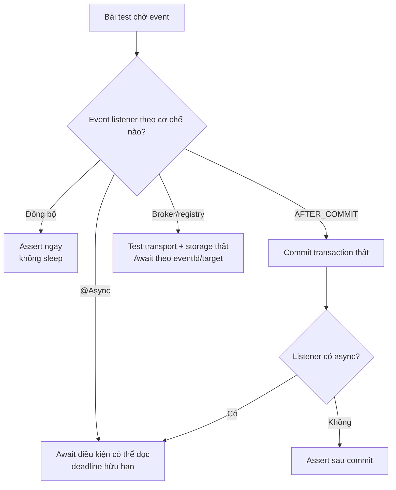

# Dùng sleep để chờ event

Trong một bài `@ApplicationModuleTest` của Spring Modulith, developer gọi `orderService.confirm(orderId)`, sau đó dùng `Thread.sleep(1000)` và kiểm xem một listener đã cập nhật projection chưa. Bài test chạy xanh trên máy cá nhân nhưng thỉnh thoảng đỏ trong CI. Developer tăng lên 3 giây; test chậm hơn mà vẫn có lúc fail. Ngược lại, nếu test đọc nhầm dữ liệu tồn tại từ case trước, chờ lâu hơn cũng không giúp phát hiện false positive.

Sai lầm **“Dùng sleep để chờ event”** là coi **thời gian đã trôi qua** như bằng chứng một điều kiện nghiệp vụ đã hoàn tất. `Thread.sleep(...)` chỉ dừng thread test trong một khoảng thời gian; nó **không xác nhận** listener đã được dispatch, transaction đã commit, broker đã acknowledge, publication đã completed hoặc consumer đã áp dụng business effect.

Bài thuộc chương **Lỗi thường gặp** của học phần `SPRING_MODULITH_VERIFICATION_TESTING`, nơi người học kiểm chứng ranh giới kiến trúc bằng `ApplicationModules`/dependency rules, `@ApplicationModuleTest`, event, database, integration và quality gate trong CI. Nội dung tập trung vào **thay sleep bằng đồng bộ hóa theo điều kiện quan sát được**, viết Java/JUnit test có giới hạn thời gian rõ, kiểm đúng phase transaction và xác định chứng cứ theo phạm vi test.

## 1. Vì sao `Thread.sleep` gây flaky và không chứng minh điều gì?

Phản ví dụ rất phổ biến:

```java
// PHẢN VÍ DỤ: không dùng để đồng bộ hóa event test.
@Test
void confirmsOrderEventually() throws InterruptedException {
    UUID id = UUID.randomUUID();

    orderService.confirm(id);
    Thread.sleep(1_000);

    assertThat(orderProjection.contains(id)).isTrue();
}
```

Giả sử event listener chạy trên một executor khác hoặc được kích hoạt sau transaction commit. Có ít nhất bốn lịch thực thi khác nhau:

```text
Scenario A: listener mất 15 ms
  confirm ---- listener completes ---- 1s sleep ends ---- assert PASS
                         ^^^^^^^^^^^^^^^^^^^^^^^^^^^^^^^^^^
                         lãng phí gần 1 giây

Scenario B: CI đang quá tải, listener mất 1.4 s
  confirm ---- sleep ends ---- assert FAIL ---- listener completes
                  ^^^^^^^^^
                  false negative do thời gian chờ đoán mò

Scenario C: transaction test chưa commit
  confirm ---- sleep 1s ---- assert FAIL
  (AFTER_COMMIT listener chưa thể chạy, dù ngủ 10s)

Scenario D: projection vẫn còn trạng thái từ test khác
  confirm ---- sleep ---- assert PASS
  (assert đọc dữ liệu cũ, không chứng minh event lần này)
```

**Tăng `sleep` không sửa được nguyên nhân.** Nó chỉ làm giảm xác suất gặp một số race tình cờ; không giải quyết sai transaction boundary, event bị drop, wrong topic, hay dữ liệu test không cô lập.

| Vấn đề | `sleep(1000)` tạo ra gì? | Điều thực sự cần |
| --- | --- | --- |
| Listener hoàn tất nhanh | Lãng phí thời gian cố định | Dừng chờ ngay khi điều kiện đúng |
| Listener chậm ngẫu nhiên | Timeout giả, flaky CI | Polling/condition synchronization có deadline |
| Listener không bao giờ chạy | Đợi xong rồi failure mơ hồ | Assertion rõ và timeout có nguyên nhân |
| Event phụ thuộc commit | Ngủ khi transaction còn mở | Commit/rollback có chủ đích |
| Broker ack không chắc chắn | Không thay đổi broker semantics | Quan sát broker record/adapter completion |
| Shared test state | Có thể PASS vì dữ liệu cũ | Correlation ID và fixture isolation |

**Mục tiêu không phải bỏ mọi thời gian chờ.** Test bất đồng bộ vẫn cần **deadline hữu hạn** để không chạy vô hạn. Khác biệt cốt lõi: đợi **một sự thật được quan sát**, không đợi một con số mili-giây cố định rồi hy vọng.

## 2. Chọn cách đợi theo đúng kiểu event và điều kiện hoàn tất

Trước khi dùng bất kỳ API chờ nào, xác định **event đang chạy theo mô hình nào**.

| Cơ chế | Khi nào work được thực hiện? | Kiểm thử phù hợp |
| --- | --- | --- |
| `@EventListener` đồng bộ, multicaster mặc định đồng bộ | Listener thường chạy ngay trong lời gọi publish trên cùng thread | Assert trực tiếp sau `publishEvent`/service call |
| `@Async @EventListener` | Listener được đưa tới executor, chạy ở thread khác | `Awaitility.untilAsserted(...)` hoặc `CountDownLatch` có timeout |
| `@TransactionalEventListener(AFTER_COMMIT)` | Callback chỉ có cơ hội chạy sau commit transaction | Kết thúc transaction thật rồi assert/poll kết quả |
| `@TransactionalEventListener(AFTER_COMMIT)` kết hợp `@Async` | Sau commit mới scheduling asynchronous work | Commit thật, sau đó await kết quả ở downstream observable |
| Spring Modulith publication externalization | Phụ thuộc transaction-aware registry/adapter, transport và cấu hình | Broker/registry integration test, đối chiếu event/target |
| Consumer Kafka/RabbitMQ | Broker đưa record tới listener, handler/DB xử lý tùy cấu hình | Await business state/record có correlation ID, test ACK/retry riêng |

**Đây là bảng theo semantics thông thường, không phải lời hứa tất cả cấu hình Spring đều đồng bộ:** Spring event multicaster có thể được cấu hình với executor. Nếu có custom multicaster, test phải hiểu cấu hình thực tế. Mặt khác, dù listener chạy đồng bộ, **external broker send** bên trong listener vẫn có thể bất đồng bộ.



### Đừng nhầm “đã phát event” với “đã xử lý event”

Với `PublishedEvents` trong Spring Modulith, bạn có thể xác minh **một Spring application event đã được publish trong JVM**. Kết luận đó khác với:

- Listener asynchronous đã cập nhật projection.
- Listener `AFTER_COMMIT` đã chạy.
- Kafka topic đã nhận record.
- Event Publication Registry đã ghi completion.
- Consumer ở ứng dụng khác đã xử lý business effect.

Mỗi assertion nên ghi rõ **điều gì là điều kiện thành công**. Dùng công cụ chờ đúng phase và đúng observable, thay vì dùng một `sleep` cho tất cả.

## 3. Ví dụ Java: producer, synchronous assertion và async projection

Để thấy rõ các mức đảm bảo, xét một application module `orders`:

```text
com.example.shop
├── ShopApplication.java
└── orders
    ├── OrderConfirmed.java
    └── internal
        ├── ConfirmOrder.java
        └── OrderSummaryProjection.java
```

Một event đơn giản:

```java
// orders/OrderConfirmed.java
package com.example.shop.orders;

import java.util.UUID;

public record OrderConfirmed(UUID orderId) {}
```

Service phát Spring event:

```java
// orders/internal/ConfirmOrder.java
package com.example.shop.orders.internal;

import com.example.shop.orders.OrderConfirmed;
import java.util.UUID;
import org.springframework.context.ApplicationEventPublisher;
import org.springframework.stereotype.Service;

@Service
class ConfirmOrder {

    private final ApplicationEventPublisher publisher;

    ConfirmOrder(ApplicationEventPublisher publisher) {
        this.publisher = publisher;
    }

    void confirm(UUID orderId) {
        publisher.publishEvent(new OrderConfirmed(orderId));
    }
}
```

**Lưu ý phạm vi:** `ConfirmOrder` ở ví dụ chỉ làm nguồn event để học **cách chờ đúng**. Một use case xác nhận đơn thực tế còn phải kiểm business state và transaction, không nên phát `OrderConfirmed` như business fact đã commit nếu chưa lưu trạng thái. Mục 6 minh họa test after-commit với DB.

Projection nhận event bằng executor:

```java
// orders/internal/OrderSummaryProjection.java
package com.example.shop.orders.internal;

import com.example.shop.orders.OrderConfirmed;
import java.util.Set;
import java.util.UUID;
import java.util.concurrent.ConcurrentHashMap;
import org.springframework.context.event.EventListener;
import org.springframework.scheduling.annotation.Async;
import org.springframework.stereotype.Component;

@Component
class OrderSummaryProjection {

    private final Set<UUID> confirmed =
            ConcurrentHashMap.newKeySet();

    @Async("orderEventsExecutor")
    @EventListener
    public void on(OrderConfirmed event) {
        confirmed.add(event.orderId());
    }

    boolean contains(UUID orderId) {
        return confirmed.contains(orderId);
    }
}
```

`ConcurrentHashMap.newKeySet()` bảo đảm **memory visibility và thread safety** cho tập được async listener cập nhật. Dùng `HashSet` thuần cùng hai thread mà không synchronization có thể gây race và test đọc giá trị không xác định, dù listener đã chạy.

### Phân biệt test phát event với test projection

Kiểm producer phát event trong module **không cần sleep**:

```java
// orders/internal/OrderPublicationTests.java
package com.example.shop.orders.internal;

import static org.assertj.core.api.Assertions.assertThat;

import com.example.shop.orders.OrderConfirmed;
import java.util.UUID;
import org.junit.jupiter.api.Test;
import org.springframework.beans.factory.annotation.Autowired;
import org.springframework.modulith.test.ApplicationModuleTest;
import org.springframework.modulith.test.PublishedEvents;

@ApplicationModuleTest
class OrderPublicationTests {

    @Autowired ConfirmOrder service;

    @Test
    void publishesAnOrderConfirmedEvent(PublishedEvents events) {
        UUID id = UUID.randomUUID();

        service.confirm(id);

        assertThat(events.ofType(OrderConfirmed.class)
                .matching(event -> event.orderId().equals(id)))
                .hasSize(1);
    }
}
```

`PublishedEvents` kiểm **event được phát**, không phải projection asynchronous đã xử lý. Nếu câu hỏi chỉ là service có publish đúng `OrderConfirmed`, assert trực tiếp này đã đủ; **chờ thêm không làm bằng chứng tốt hơn**.

Với event synchronous `@EventListener` thông thường, sau khi `service.confirm(id)` trả về và listener đã hoàn tất trên cùng thread, có thể assert state trực tiếp nếu đó là semantics của configuration. **Đừng ép event async chỉ để cần Awaitility**.

## 4. Awaitility: chờ *assertion* đúng thay vì `sleep`

Với projection bất đồng bộ ở mục 3, cách sửa là **poll điều kiện nhận được event**, dừng ngay khi thành công và báo rõ thất bại khi quá deadline.

Phụ thuộc test minh họa (Maven):

```xml
<!-- Trong pom.xml của ứng dụng, không phải file cần tạo ở đây. -->
<dependency>
    <groupId>org.awaitility</groupId>
    <artifactId>awaitility</artifactId>
    <scope>test</scope>
</dependency>
```

Version cụ thể cần do dependency management hoặc project chọn tương thích; không giả định mọi Spring Boot BOM đều quản lý version này.

JUnit Spring Modulith module test:

```java
// orders/internal/OrderAsyncProjectionTests.java
package com.example.shop.orders.internal;

import static org.assertj.core.api.Assertions.assertThat;
import static org.awaitility.Awaitility.await;

import java.time.Duration;
import java.util.UUID;
import org.junit.jupiter.api.Test;
import org.springframework.beans.factory.annotation.Autowired;
import org.springframework.boot.test.context.TestConfiguration;
import org.springframework.context.annotation.Bean;
import org.springframework.context.annotation.Import;
import org.springframework.modulith.test.ApplicationModuleTest;
import org.springframework.scheduling.annotation.EnableAsync;
import org.springframework.scheduling.concurrent.ThreadPoolTaskExecutor;

@ApplicationModuleTest
@Import(OrderAsyncProjectionTests.AsyncTestConfiguration.class)
class OrderAsyncProjectionTests {

    @Autowired ConfirmOrder service;
    @Autowired OrderSummaryProjection projection;

    @Test
    void projectionEventuallySeesTheSpecificEvent() {
        UUID id = UUID.randomUUID();

        service.confirm(id);

        await()
                .atMost(Duration.ofSeconds(5))
                .pollInterval(Duration.ofMillis(50))
                .untilAsserted(() ->
                        assertThat(projection.contains(id)).isTrue());
    }

    @TestConfiguration(proxyBeanMethods = false)
    @EnableAsync
    static class AsyncTestConfiguration {

        @Bean("orderEventsExecutor")
        ThreadPoolTaskExecutor orderEventsExecutor() {
            var executor = new ThreadPoolTaskExecutor();
            executor.setCorePoolSize(1);
            executor.setMaxPoolSize(2);
            executor.setQueueCapacity(16);
            executor.setThreadNamePrefix("orders-test-async-");
            // Spring quản lý khởi tạo/hủy executor của @Bean.
            return executor;
        }
    }
}
```

Điều kiện để dùng ví dụ này trong project:

1. `ShopApplication` là root của ứng dụng Spring Boot/Modulith, module `orders` được nhận diện từ package của test.
2. Spring Modulith Test, JUnit Jupiter, AssertJ và Awaitility đã có trong test dependencies.
3. `@EnableAsync` được bật thông qua test configuration; executor `orderEventsExecutor` đúng tên của `@Async("orderEventsExecutor")`, được quản lý vòng đời như một Spring bean.
4. `ConfirmOrder` và `OrderSummaryProjection` là bean thật được bootstrap trong phạm vi module.
5. Test dùng **UUID mới**, không khẳng định một phần tử có sẵn từ case khác là dấu hiệu xử lý của case hiện tại.

**Vì sao tốt hơn sleep?** Nếu listener hoàn tất sau 8 ms, điều kiện đúng ở lần poll sớm và test không phải ngủ hết vài giây. Nếu listener không chạy, Awaitility kết thúc bằng **timeout có assertion cần đạt**, thay vì thất bại sau một khoảng ngủ không có ý nghĩa nghiệp vụ.

**Giới hạn:** test này đo **projection trong memory**, không đo database transaction hay broker. Một thread-safe Set phù hợp để minh họa synchronization, nhưng khi production ghi PostgreSQL hoặc gọi HTTP, hãy await **kết quả thực của adapter ấy**, không thay bằng một cờ memory dễ làm test xanh giả.

## 5. Chọn observable đáng tin và thiết kế timeout có chủ đích

`Awaitility` không phải phép màu. Nếu điều kiện đọc sai nguồn sự thật, test có thể xanh sai như với `sleep`.

### Chờ business state thay vì “callback đã bắt đầu”

Giả sử listener nhận `OrderConfirmed` rồi cập nhật bảng `order_summary`. Assertion có giá trị cao hơn:

```java
// Mẫu thân integration test, giả sử có JdbcTemplate và DB thật:
UUID orderId = UUID.randomUUID();
service.confirm(orderId);

await()
        .atMost(Duration.ofSeconds(10))
        .pollInterval(Duration.ofMillis(100))
        .untilAsserted(() -> {
            Integer count = jdbc.queryForObject(
                    """
                    SELECT COUNT(*) FROM order_summary
                    WHERE order_id = ? AND confirmed = TRUE
                    """,
                    Integer.class,
                    orderId);
            assertThat(count).isEqualTo(1);
        });
```

Đây là **mẫu thân test**: phải có real persistence adapter, migration/schema, transaction manager và datasource. Không tạo bảng `order_summary` qua câu lệnh ví dụ ở một bài học khác mà giả định đã tồn tại trong project. Với dữ liệu test lặp, dùng event/order ID riêng và cleanup có kiểm soát.

**Tại sao không poll một flag `listenerInvoked`?** Listener có thể được gọi rồi fail giữa chừng trước khi transaction commit. Một cờ đặt ngay đầu method chỉ chứng minh callback bắt đầu, không chứng minh business side effect hoàn tất.

### Chọn deadline từ SLO, không từ may rủi

| Cấu hình | Vai trò | Cách chọn |
| --- | --- | --- |
| `atMost(5s)` | Trần thời gian cho test | Theo CI latency thực tế và yêu cầu nghiệp vụ |
| `pollInterval(50ms)` | Nhịp kiểm điều kiện | Không gây truy vấn DB quá dày |
| Event ID riêng | Khóa correlation | Không nhầm dữ liệu từ test trước |
| DB read mới | Xem trạng thái committed | Tránh snapshot stale/cùng transaction |
| Lỗi timeout | Chỉ rõ state đang đợi | Dễ chẩn đoán hơn “sleep rồi assert false” |

**Không tự áp một con số chuẩn cho mọi team.** Test in-memory có thể dùng deadline ngắn, còn Testcontainers broker trong CI có khởi tạo/rebalance có thể cần trần dài hơn. Đừng dùng timeout cực dài để che lỗi “không có commit” hoặc “adapter chưa được bật”.

### Mỗi lần poll phải có khả năng thấy trạng thái mới

Một bug tinh vi:

```java
// PHẢN VÍ DỤ: lấy snapshot một lần rồi poll mãi snapshot đó.
boolean alreadyConfirmed = repository.isConfirmed(orderId);

await().atMost(Duration.ofSeconds(5))
       .untilAsserted(() ->
           assertThat(alreadyConfirmed).isTrue());
```

Cách sửa là **đọc lại trong mỗi lần poll**:

```java
await().atMost(Duration.ofSeconds(5))
       .untilAsserted(() ->
           assertThat(repository.isConfirmed(orderId)).isTrue());
```

Nếu `repository` đọc qua persistence context/JPA EntityManager với first-level cache hoặc transaction test giữ một snapshot lâu, việc gọi lại method chưa chắc đem đến dữ liệu committed mới. Cần **read boundary phù hợp**: transaction/EntityManager mới, `JdbcTemplate` query trên connection thích hợp hoặc cơ chế refresh mà dự án sử dụng. Không “chữa” cache stale bằng cách tăng sleep.

## 6. `AFTER_COMMIT`: phải commit thật, không thể “ngủ đến lúc commit”

Đây là nguyên nhân lỗi phổ biến hơn cả độ trễ executor. Một listener:

```java
// orders/internal/AfterCommitProbe.java
package com.example.shop.orders.internal;

import com.example.shop.orders.OrderConfirmed;
import java.util.Set;
import java.util.UUID;
import java.util.concurrent.ConcurrentHashMap;
import org.springframework.stereotype.Component;
import org.springframework.transaction.event.TransactionPhase;
import org.springframework.transaction.event.TransactionalEventListener;

@Component
class AfterCommitProbe {

    private final Set<UUID> observed =
            ConcurrentHashMap.newKeySet();

    @TransactionalEventListener(phase = TransactionPhase.AFTER_COMMIT)
    public void on(OrderConfirmed event) {
        observed.add(event.orderId());
    }

    boolean has(UUID orderId) {
        return observed.contains(orderId);
    }
}
```

Listener này **chỉ có cơ hội xử lý event khi transaction liên quan đã commit** theo quy tắc Spring. Nếu không có transaction đang hoạt động, transactional listener thường **không chạy** trừ khi đã cấu hình `fallbackExecution` phù hợp. Không nhầm với `@EventListener` chạy thông thường.

### Phản ví dụ: test đang mở transaction và rollback mặc định

```java
// PHẢN VÍ DỤ:
@ApplicationModuleTest
@Transactional
class IncorrectAfterCommitTests {

    @Autowired ConfirmOrder commands;
    @Autowired AfterCommitProbe probe;

    @Test
    void incorrectlyTriesToWaitForCommit() throws Exception {
        UUID id = UUID.randomUUID();

        commands.confirm(id);
        Thread.sleep(5_000); // Vẫn đang trong transaction test.

        assertThat(probe.has(id)).isTrue(); // Sai kỳ vọng.
    }
}
```

Test-managed transaction của Spring Test thường **kết thúc bằng rollback sau method**. `Thread.sleep(5_000)` không commit transaction và không làm `AFTER_COMMIT` chạy. Tăng `sleep` lên 30 giây không sửa được bài test.

### Cách sửa: `TestTransaction` quyết định thời điểm commit/rollback

Ví dụ test với transaction manager thật đã được cấu hình cho module:

```java
// orders/internal/AfterCommitBehaviorTests.java
package com.example.shop.orders.internal;

import static org.assertj.core.api.Assertions.assertThat;

import com.example.shop.orders.OrderConfirmed;
import java.util.UUID;
import org.junit.jupiter.api.Test;
import org.springframework.beans.factory.annotation.Autowired;
import org.springframework.context.ApplicationEventPublisher;
import org.springframework.modulith.test.ApplicationModuleTest;
import org.springframework.test.context.transaction.TestTransaction;
import org.springframework.transaction.annotation.Transactional;

@ApplicationModuleTest
@Transactional
class AfterCommitBehaviorTests {

    @Autowired ApplicationEventPublisher publisher;
    @Autowired AfterCommitProbe probe;

    @Test
    void afterCommitRunsOnlyWhenTransactionCommits() {
        UUID id = UUID.randomUUID();

        publisher.publishEvent(new OrderConfirmed(id));

        assertThat(probe.has(id)).isFalse();

        TestTransaction.flagForCommit();
        TestTransaction.end();

        // Probe đồng bộ: callback AFTER_COMMIT được gọi
        // trong quá trình commit. Không cần Thread.sleep.
        assertThat(probe.has(id)).isTrue();
    }

    @Test
    void rollbackDoesNotTriggerAfterCommitListener() {
        UUID id = UUID.randomUUID();

        publisher.publishEvent(new OrderConfirmed(id));

        TestTransaction.flagForRollback();
        TestTransaction.end();

        assertThat(probe.has(id)).isFalse();
    }
}
```

**Điều kiện chạy:** phải có `PlatformTransactionManager` thật và Spring Test hỗ trợ transaction cho test này. Ví dụ `ConfirmOrder` ở mục 3 không tự mở transaction; ở đây transaction được mở **bởi `@Transactional` trên test**, rồi kết thúc bằng `TestTransaction`. Test thực tế có thể dùng JDBC/JPA test datasource tương ứng.

`AfterCommitProbe` ở đây chỉ ghi vào thread-safe Set để minh họa **thứ tự callback**. Nó không phải một ví dụ cập nhật business database sau commit. Nếu listener sau commit cần **ghi database**, cần xem semantics transaction resources của Spring; thường cần một transaction mới (ví dụ `REQUIRES_NEW`) hoặc một xử lý bất đồng bộ có transaction boundary riêng, và phải kiểm commit thật của side effect đó.

### Nếu listener sau commit cũng bất đồng bộ

Khi `AFTER_COMMIT` tiếp tục đưa work tới executor, `TestTransaction.end()` bảo đảm transaction của test đã hoàn tất, **không bảo đảm async work cũng đã hoàn tất**. Khi ấy đúng thứ tự là:

```text
1. Tạo event trong transaction đang hoạt động.
2. Assert trạng thái trước commit nếu cần.
3. TestTransaction.flagForCommit(); TestTransaction.end().
4. Await condition trên projection/DB/broker đã hoàn tất.
5. Kết thúc khi condition đúng hoặc deadline hết.
```

**Tránh đặt `@Transactional` trên mọi test như một thói quen.** Với integration test cần service tự tạo và commit transaction, đôi khi nên **không đặt transaction ở test**, để method service kết thúc transaction riêng trước khi Awaitility bắt đầu quan sát.

## 7. `CountDownLatch`: đợi tín hiệu chính xác, nhưng phải đặt latch đúng chỗ

Nếu test chỉ cần xác nhận một event listener được gọi, `CountDownLatch` có thể thay `sleep` mà không cần poll liên tục. Điều kiện: **đăng ký chờ trước khi kích hoạt event**, dùng **timeout hữu hạn** và dọn trạng thái sau test.

Một probe độc lập:

```java
// orders/internal/OrderEventProbe.java
package com.example.shop.orders.internal;

import com.example.shop.orders.OrderConfirmed;
import java.time.Duration;
import java.util.UUID;
import java.util.concurrent.ConcurrentHashMap;
import java.util.concurrent.ConcurrentMap;
import java.util.concurrent.CountDownLatch;
import java.util.concurrent.TimeUnit;
import org.springframework.context.event.EventListener;
import org.springframework.scheduling.annotation.Async;
import org.springframework.stereotype.Component;

@Component
class OrderEventProbe {

    private final ConcurrentMap<UUID, CountDownLatch> expected =
            new ConcurrentHashMap<>();

    void expect(UUID id) {
        if (expected.putIfAbsent(id, new CountDownLatch(1))
                != null) {
            throw new IllegalStateException(
                    "Expectation already exists");
        }
    }

    @Async("orderEventsExecutor")
    @EventListener
    public void on(OrderConfirmed event) {
        CountDownLatch latch = expected.get(event.orderId());
        if (latch != null) {
            latch.countDown();
        }
    }

    boolean await(UUID id, Duration timeout)
            throws InterruptedException {
        CountDownLatch latch = expected.get(id);
        if (latch == null) {
            throw new IllegalStateException(
                    "Register expectation before publishing");
        }
        try {
            return latch.await(
                    timeout.toMillis(), TimeUnit.MILLISECONDS);
        } finally {
            expected.remove(id, latch);
        }
    }
}
```

JUnit test (đặt trong một module test đã import `AsyncTestConfiguration` có `@EnableAsync` và bean `orderEventsExecutor` như mục 4):

```java
// Test class phải bootstrap probe và service trong Spring context.
@Test
void listenerReceivesSpecificEvent() throws Exception {
    UUID id = UUID.randomUUID();
    probe.expect(id); // ĐĂNG KÝ trước khi publish.

    service.confirm(id);

    assertThat(probe.await(id, Duration.ofSeconds(5))).isTrue();
}
```

**Ý nghĩa assertion:** listener `OrderEventProbe.on(...)` đã thấy một `OrderConfirmed` đúng ID. Nó **không chứng minh** projection/DB đã commit; bản thân probe là listener song song, có thể nhận event trước khi listener nghiệp vụ hoàn tất.

Để dùng thân test trên, inject `@Autowired OrderEventProbe probe` và `@Autowired ConfirmOrder service` trong class module test đang chạy. `@Async` chỉ thực sự dispatch qua executor khi Spring async support được bật và tên executor khớp; nếu bị bỏ qua, test có thể vẫn PASS do listener chạy đồng bộ. Vì vậy, khi mục tiêu là **xác minh async execution**, cần kiểm cấu hình executor/thread thực tế thay vì chỉ nhìn latch xanh.

Nếu muốn đợi business work hoàn tất, hãy phát/đánh dấu **completion signal sau work thành công** hoặc tốt hơn là kiểm chính **business state durable**. Một latch được count down ngay đầu handler có thể làm test PASS trong khi handler tiếp tục throw exception.

### Chú ý race và interrupt

- Đăng ký `expect(id)` **trước** `service.confirm(id)`. Đăng ký sau có nguy cơ bỏ lỡ event đã được xử lý.
- Dùng `UUID` riêng cho mỗi test; không dùng static global latch cho mọi event.
- Luôn đặt deadline `await(timeout)` thay vì `await()` vô hạn.
- Nếu thread test bị interrupt, để `InterruptedException` propagate hoặc khôi phục interrupt flag theo policy; **không nuốt lỗi rồi xem test PASS**.
- Nếu cần giữ probe để test nhiều sự kiện cùng ID, dùng cơ chế sequence/phases có chủ đích; latch một lần chỉ chứng minh ít nhất một event đến.

**Khi nào chọn latch thay vì Awaitility?** Latch thích hợp cho một **tín hiệu cụ thể** mà test control được chỗ emit/observe; Awaitility thích hợp hơn khi bạn cần **poll một trạng thái đã commit** hoặc một observable ngoài JVM không phát callback trực tiếp cho test.

## 8. Broker và publication registry: chờ đúng sự kiện, đúng target

Khi một Spring Modulith event được externalize, thời gian gửi phụ thuộc transaction, persistence registry, adapter, broker và acknowledgement. Không thể dùng `Thread.sleep(2000)` rồi kết luận event đã tới Kafka, nhất là khi CI có Kafka container khởi động lại, broker retry hoặc producer nhận ack muộn.

### Sai cách: đo số giây thay cho message

```java
// PHẢN VÍ DỤ:
service.acceptOrder(orderId);
Thread.sleep(2_000);
assertThat(testKafkaConsumer.poll(Duration.ofMillis(1))
        .count()).isEqualTo(1);
```

Các vấn đề:

1. Record có thể tới trước/sau mốc 2 giây.
2. Consumer có thể chưa được assigned partition đúng lúc poll.
3. Topic có record cũ từ test khác, khiến `count()==1` sai mục tiêu.
4. Một lần poll không chứng minh đúng payload, key, headers hoặc event ID.
5. Broker record đã nhận không đồng nghĩa registry completion hoặc consumer nghiệp vụ đã xử lý.

### Điều kiện đúng: record có correlation ID của case hiện tại

Với broker integration test, tạo **event ID riêng** và dùng test consumer/helper được đăng ký đúng topic/consumer group. Một helper minh họa:

```java
// Mẫu thân test với broker và consumer test thật.
UUID eventId = UUID.randomUUID();
UUID orderId = UUID.randomUUID();

producer.publishConfirmed(eventId, orderId);

await().atMost(Duration.ofSeconds(15))
       .pollInterval(Duration.ofMillis(100))
       .untilAsserted(() -> {
           var received = brokerProbe.findByEventId(
                   "orders.confirmed.v1", eventId);

           assertThat(received).isPresent();
           assertThat(received.orElseThrow().orderId())
                   .isEqualTo(orderId);
       });
```

`producer.publishConfirmed(...)` và `brokerProbe.findByEventId(...)` là **helpers minh họa**, không phải API có sẵn của Spring Modulith/Kafka. Để test chạy cần adapter và broker thật, topic được provision, serializer/decoder đúng hợp đồng, consumer test có offset/assignment hợp lệ và deadline. Nếu test chạy song song, isolation consumer group/topic và retention cũng phải được cấu hình rõ.

**Probe phải thực sự đọc từ broker** và dùng eventId của lần phát hiện tại; nếu nó chỉ đọc một danh sách local được update trước khi send thì assertion không chứng minh transport. Trường hợp broker nhận message trùng do retry, test nên phân biệt **một business event ID** với **số delivery**, không mặc định gửi exactly once.

### Registry completion là một assertion khác

Với persistent Event Publication Registry trong Spring Modulith:

```text
event E được publish trong JVM
     |
     v
publication tới target T được registry theo dõi
     |
     +----> broker có thể đã nhận E
     |
     '---> registry có thể vẫn incomplete
           (nếu chưa ghi nhận completion/ack)
```

Để chờ publication hoàn tất, cần đọc **trạng thái target publication theo API/storage của phiên bản đang dùng**, rồi Await condition như “publication E/T không còn incomplete”. **Không bịa bảng SQL hoặc method repository** khi chưa kiểm schema và module lưu trữ thực tế.

Điều kiện “không còn incomplete” cũng cần một **positive assertion** rằng publication E/T đã được đăng ký. Nếu registry chưa bật hoặc selector không chọn event, một truy vấn incomplete rỗng có thể khiến test PASS giả ngay từ đầu.

**Cảnh báo về crash window:** broker nhận E nhưng producer crash trước registry completion sẽ dẫn tới resend và duplicate có thể xảy ra. Awaitility không chữa semantics này; nó chỉ giúp test quan sát quá trình cho đến deadline. Consumer idempotency và recovery policy cần test riêng.

## 9. Chẩn đoán timeout và kiểm thử âm mà không dựa vào sleep

Một test `Awaitility` timeout không nhất thiết có nghĩa “máy CI chậm”. Trước khi tăng `atMost`, xác định **điều kiện nào chưa xảy ra** và quan sát cấu hình tương ứng.

| Triệu chứng | Nguyên nhân khả dĩ | Bước kiểm chứng |
| --- | --- | --- |
| `PublishedEvents` thấy event nhưng projection async không đổi | Listener thiếu `@EnableAsync`/executor; listener throw; sai event type | Kiểm registration, executor, exception handler và listener logs |
| `AFTER_COMMIT` không bao giờ chạy | Test-managed transaction đang mở hoặc rollback mặc định | Dùng `TestTransaction.end()`, kiểm phase và transaction manager |
| Poll DB mãi thấy state cũ | Test đọc trong persistence context/transaction snapshot cũ | Đọc lại trong transaction/EntityManager mới |
| Kafka không có record | Adapter/selector tắt, wrong topic, broker chưa sẵn sàng | Positive control, topic/route/serializer/connection |
| Kafka record có nhưng test không đọc được | Consumer chưa assign partition, offset/group sai | Kiểm subscribe/assignment và consumer group isolation |
| Registry incomplete mãi | Broker lỗi, completion update lỗi, chưa có resubmission | Kiểm target publication, adapter errors và recovery trigger |
| Test chỉ flaky trên CI | CPU scheduling, executor starvation, timeout quá gắt, fixture chung | Đo latency, thread pool, state isolation và bounded polling |
| Await pass nhưng dữ liệu nghiệp vụ sai | Assertion kiểm cờ “listener started” thay vì state đã commit | Assert observable business fact/correlation ID |

### Ghi log hữu ích khi chờ thất bại

Một test tốt ghi được:

- `eventId`/`orderId` của **case đang chạy**, không cần log raw payload có PII.
- Điều kiện mục tiêu: `order_summary.confirmed=true`, registry E/T completed, hay record Kafka có `eventId=E`.
- Deadline đã cấu hình và trạng thái quan sát cuối cùng.
- Trạng thái executor/container, lỗi deserialize/handler, transaction phase nếu có.
- Cấu hình test profile/adapter để phân biệt lỗi business logic với lỗi môi trường.

Tránh cách “sửa”:

```java
// PHẢN VÍ DỤ: nuốt mọi exception từ DB/adapter,
// biến lỗi thực thành một chuỗi retry vô nghĩa.
await()
        .ignoreExceptions()
        .atMost(Duration.ofMinutes(2))
        .until(() -> repository.isConfirmed(orderId));
```

`ignoreExceptions()` có thể phù hợp nếu bạn **chủ động** xem một số lỗi truy cập tạm thời là retryable trong lúc container đang khởi động. Nhưng không nên dùng vô điều kiện: schema sai, permission denied, SQL grammar error hoặc converter lỗi cần được báo rõ, không kéo dài test rồi kết thúc bằng timeout mơ hồ. Nếu cần retry exceptions, **giới hạn đúng loại lỗi đã phân loại** theo semantics Awaitility/version đang dùng.

### Đừng dùng sleep để “chứng minh không có event”

Một phản ví dụ test âm:

```java
service.rejectOrder(id);
Thread.sleep(2_000);
assertThat(brokerProbe.findByOrderId(id)).isEmpty();
```

“Không thấy trong hai giây” chỉ chứng minh **không quan sát được trong cửa sổ đó**; message có thể xuất hiện sau đó, hoặc probe không kết nối đúng broker. Với trường hợp không phát Spring event khi nghiệp vụ từ chối, dùng assertion đồng bộ:

```java
// Mẫu @ApplicationModuleTest:
assertThatThrownBy(() -> service.rejectOrder(invalidId))
        .isInstanceOf(IllegalStateException.class);

assertThat(published.ofType(OrderConfirmed.class)
        .matching(event -> event.orderId().equals(invalidId)))
        .isEmpty();
```

`service.rejectOrder(...)` là **phương thức minh họa của một business service test khác**, không có trong class `ConfirmOrder` tối giản ở mục 3. Áp dụng mẫu này với **phương thức nghiệp vụ có nhánh reject thật** trong dự án.

Với `AFTER_COMMIT` rollback, kiểm **đúng transaction phase** như mục 6. Với event được chọn externalize, dùng **positive control** khẳng định adapter đang chạy và kiểm selection/routing, cộng một khoảng quan sát hữu hạn nếu cần; không tuyên bố rằng một negative broker test có thể chứng minh “không bao giờ gửi” trong mọi tương lai.

### Kiểm soát race thay vì tăng độ trễ tùy ý

Nếu cần test thứ tự “listener đã bắt đầu nhưng chưa hoàn tất”, sử dụng hai latch/barrier do test điều khiển:

```text
Thread xử lý event:
  signal(listenerStarted)
  wait(allowCompletion, timeout)
  apply business effect

Thread test:
  trigger event
  await(listenerStarted, bounded timeout)
  assert effect chưa xảy ra
  release(allowCompletion)
  await(effect completed, bounded timeout)
```

Cách này tạo **điểm đồng bộ có chủ đích**, không đoán rằng `Thread.sleep(200)` sẽ làm worker tạm dừng đúng chỗ. Khi có exception trong test, luôn release latch trong `finally` để tránh thread bị treo và test sau bị ảnh hưởng.

## 10. Checklist quality gate CI và bài tập áp dụng

### Quy trình kiểm thử theo lớp

```text
Pull request
    |
    v
JUnit unit tests
    |-- Điều kiện nghiệp vụ, event ID đúng
    '-- Không Thread.sleep làm đồng bộ hóa
    |
    v
ApplicationModules.verify()
    '-- Boundary không cycle/import sai API?
    |
    v
@ApplicationModuleTest
    |-- PublishedEvents: event đã phát?
    |-- Async projection: Awaitility / CountDownLatch?
    '-- Test fixture cô lập?
    |
    v
Transaction integration
    |-- Commit thật -> AFTER_COMMIT chạy
    '-- Rollback thật -> không có external business fact sai
    |
    v
Broker / registry integration
    |-- Đúng eventId, target, payload/headers?
    '-- Completion được quan sát theo API/storage thật?
    |
    v
Required quality gates PASS -> merge
```

`ApplicationModules.verify()` kiểm các quy tắc kiến trúc Spring Modulith áp dụng, như dependency cycle, API boundary và `allowedDependencies` nếu được khai báo. Nó **không chứng minh async event đã hoàn tất**; ngược lại, một `Awaitility` test xanh không thay thế architecture verification.

Các test `*IT` với Kafka/Testcontainers có thể dùng Maven Failsafe hoặc Gradle integration suite riêng. Hãy kiểm **CI thực thi đúng test task**, không bỏ qua bằng `skipTests`/`@Disabled`; và **chặn merge khi test fail**. Không chạy broker đầy đủ chỉ để test event Java đồng bộ, nhưng cũng không lấy mock/poll memory thay cho broker khi yêu cầu delivery integration.

### Checklist review trước khi chấp nhận một event test

| Câu hỏi | Bằng chứng cần có |
| --- | --- |
| Test có `Thread.sleep` chỉ để chờ eventual outcome? | Thay bằng assert ngay, Awaitility hoặc synchronization có điều kiện |
| Đã biết listener đồng bộ hay bất đồng bộ? | Cấu hình `@EventListener`/`@Async`/multicaster rõ |
| Nếu `AFTER_COMMIT`, transaction đã commit thật chưa? | `TestTransaction` hoặc service transaction tự kết thúc |
| Test-managed transaction có rollback mặc định không? | Phân biệt kiểm publish với kiểm after-commit |
| Condition có đọc **dữ liệu mới mỗi lần**? | Không poll một snapshot cũ |
| Condition có kiểm business effect thật? | Trạng thái DB/broker/registry theo mục tiêu |
| Có correlation ID riêng cho test? | `eventId`/`orderId` mới, tránh data stale |
| Deadline hữu hạn và phù hợp hạ tầng? | Không infinite wait; không tùy tiện tăng timeout |
| Async listener lỗi có lộ trong kết quả test? | Exception handler/logs và timeout failure rõ |
| Probe event có đăng ký trước khi publish? | Không bỏ lỡ tín hiệu vì race |
| Có tránh shared mutable fixture giữa tests? | Cleanup, IDs riêng, isolation cho parallel run |
| Negative test không dùng “ngủ rồi không thấy” làm bằng chứng duy nhất? | Kiểm logic selection/transaction và positive control |
| Kafka listener/consumer đã subscribe đúng offset/group? | Broker test thực với assignment và source xác định |
| Registry completion có phân biệt từng target? | Assertion E/T, không gộp mọi publication |
| CI có architecture và event quality gates riêng? | Test reports và required checks |

### Bài tập 1 — Tăng sleep từ 1 lên 5 giây

Test `@Async @EventListener` đôi khi mất 1,2 giây trong CI. Developer tăng `Thread.sleep(1000)` thành `Thread.sleep(5000)`.

**Hỏi:** Đây có phải giải pháp đúng?

**Đáp án:** **Không.** Test sẽ chậm hơn ngay cả khi listener xong sau 10 ms và vẫn có thể flaky nếu worker treo. Dùng `Awaitility.untilAsserted(...)` với deadline rõ và điều kiện business state được đọc mới mỗi poll.

### Bài tập 2 — `PublishedEvents` đã có sự kiện

`PublishedEvents` thấy `OrderConfirmed` ngay sau `service.confirm(id)`, nhưng projection `@Async` chưa có ID đó.

**Hỏi:** Có mâu thuẫn không?

**Đáp án:** **Không.** Một assertion kiểm **event đã được publish**, assertion kia kiểm **handler bất đồng bộ đã hoàn tất**. Giữ test phát event đồng bộ; dùng Awaitility cho projection.

### Bài tập 3 — Transaction còn mở

`@ApplicationModuleTest @Transactional` gọi service publish event, sau đó ngủ 10 giây. `@TransactionalEventListener(AFTER_COMMIT)` không chạy.

**Hỏi:** Thứ đầu tiên cần sửa?

**Đáp án:** **Commit transaction thật** bằng `TestTransaction.flagForCommit(); TestTransaction.end();` khi có transaction manager phù hợp, hoặc test service transaction độc lập; không tăng sleep. Sau commit mới await nếu listener còn asynchronous work.

### Bài tập 4 — Latch signal quá sớm

Async listener gọi `latch.countDown()` ở dòng đầu, sau đó viết database và gặp exception. Test `await()` trên latch trả true.

**Hỏi:** Test chứng minh được gì?

**Đáp án:** Chỉ chứng minh listener **đã bắt đầu/nhận tín hiệu**, không chứng minh database commit. Hãy signal sau khi công việc hoàn tất theo semantics phù hợp hoặc await **DB state đã commit**.

### Bài tập 5 — Poll một biến cũ

`boolean done = repository.isDone(id)` được tính trước Awaitility; lambda chỉ assert `done`.

**Hỏi:** Lỗi ở đâu?

**Đáp án:** Condition không đọc state mới. Gọi `repository.isDone(id)` **bên trong mỗi poll** và chú ý cache/transaction snapshot của persistence.

### Bài tập 6 — Event bị gửi vào topic sai

Test ngủ 2 giây rồi poll topic `orders.confirmed.v1` và không thấy message. Team tăng thời gian chờ.

**Hỏi:** Cần kiểm gì?

**Đáp án:** Kiểm externalization adapter, selector/route, broker topic provisioning, serializer, consumer subscription/offset và correlation ID. Thời gian chờ không thể sửa **wrong destination**.

### Bài tập 7 — Không có record trong DLT hoặc registry

Developer assert “registry incomplete rỗng” và kết luận publication đã completed. Thực tế publisher chưa đăng ký publication vì module adapter bị tắt.

**Hỏi:** Làm sao tránh false PASS?

**Đáp án:** Dùng **positive assertion** rằng publication E/T đã từng được đăng ký/chọn đúng, sau đó kiểm trạng thái hoàn tất và broker outcome. Tập incomplete rỗng một mình không phải bằng chứng completion.

### Bài tập 8 — CI chỉ đôi lúc fail

Local test luôn PASS vì `OrderSummaryProjection` giữ ID từ một test trước; CI chạy thứ tự khác thì FAIL.

**Hỏi:** Sleep dài hơn giúp không?

**Đáp án:** **Không.** Cần ID riêng, cleanup fixture và cô lập state giữa các test; nếu chạy song song, quản lý mutable beans/probes có chủ đích.

### Tổng kết

**Dùng `Thread.sleep` để chờ event là thay một điều kiện có thể kiểm chứng bằng một ước lượng thời gian.** Với Spring Modulith, hãy xác định đúng semantics: event đồng bộ thì assert ngay; `@Async` thì đợi observable bằng **Awaitility hoặc CountDownLatch có deadline**; `AFTER_COMMIT` thì **commit transaction thật** trước khi chờ; externalization thì kiểm broker và publication registry theo eventId/target cụ thể.

Chất lượng test nằm ở **điều kiện kết thúc, nguồn dữ liệu được quan sát, phạm vi kết luận và khả năng tái hiện lỗi** — không nằm ở độ dài sleep. Trong `SPRING_MODULITH_VERIFICATION_TESTING`, kết hợp các event/transaction integration tests với `ApplicationModules.verify()` và quality gate CI để tránh cả flaky tests lẫn hồi quy ranh giới module.

## Tài liệu tham khảo

- [Spring Modulith — Testing Application Modules](https://docs.spring.io/spring-modulith/reference/testing.html)
- [Spring Modulith — Working with Application Events](https://docs.spring.io/spring-modulith/reference/events.html)
- [Spring Modulith — Verifying Application Module Structure](https://docs.spring.io/spring-modulith/reference/verification.html)
- [Spring Framework — Transaction-bound Events](https://docs.spring.io/spring-framework/reference/data-access/transaction/event.html)
- [Spring Framework — Test-managed Transactions](https://docs.spring.io/spring-framework/reference/testing/testcontext-framework/tx.html)
- [Spring Framework — Scheduling and Asynchronous Execution](https://docs.spring.io/spring-framework/reference/integration/scheduling.html)
- [Awaitility — Usage](https://github.com/awaitility/awaitility/wiki/Usage)
- [Spring for Apache Kafka — Reference](https://docs.spring.io/spring-kafka/reference/)
- [JUnit 5 — User Guide](https://docs.junit.org/current/user-guide/)
