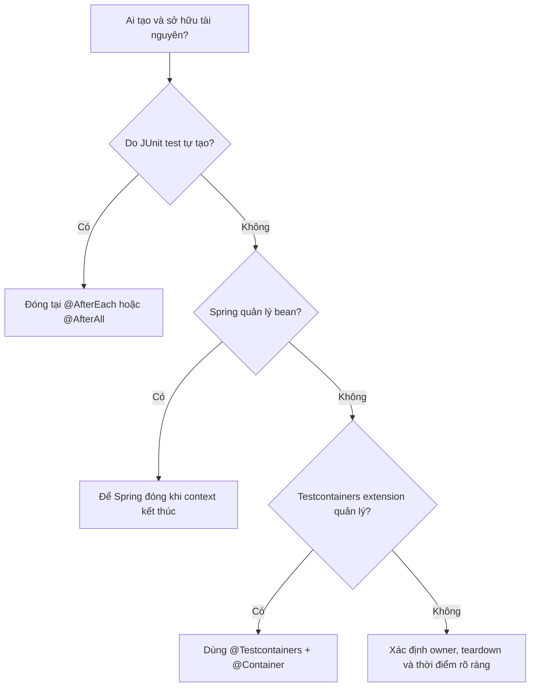

# Không dọn executor và container

Một lỗi khó nhận ra trong kiểm thử Spring Modulith là **test đã pass nhưng những tài nguyên do test hoặc ứng dụng tạo ra vẫn còn sống**. Một `ExecutorService` không được đóng có thể giữ thread sau khi JUnit kết thúc; một PostgreSQL Testcontainer không được quản lý vòng đời có thể tiếp tục chiếm Docker, cổng và bộ nhớ. Ở chiều ngược lại, việc đóng **nhầm** executor hoặc container của Spring quá sớm cũng làm test tiếp theo thất bại dù code nghiệp vụ đúng.

Trong chương **Lỗi thường gặp** của `SPRING_MODULITH_VERIFICATION_TESTING`, bài này tập trung xác định **ai sở hữu tài nguyên, khi nào được dọn và kiểm chứng việc dọn đã xảy ra**. Các ví dụ JUnit 5, `@ApplicationModuleTest`, event listener, `ThreadPoolTaskExecutor` và Testcontainers hỗ trợ mục tiêu rộng hơn của module: giữ ranh giới kiến trúc đúng, kiểm tra event/database đáng tin và ngăn hồi quy trong CI.

## 1. Nhận biết lỗi và tác hại thực tế

Biểu hiện thường xuất hiện khi chạy cả suite hoặc chạy lại test nhiều lần, thay vì ngay ở test đầu:

| Triệu chứng | Nguyên nhân đáng nghi | Bằng chứng cần lấy |
| --- | --- | --- |
| JUnit báo tất cả test pass nhưng JVM vẫn không thoát | Thread không phải daemon từ `Executors.newFixedThreadPool(...)` vẫn hoạt động | Thread dump có tên worker của test; executor chưa `isTerminated()` |
| Lần chạy CI sau thiếu tài nguyên Docker | Container khởi động thủ công nhưng thiếu `stop()`/vòng đời quản lý | `docker ps`, log khởi tạo/dừng container, tài nguyên còn gắn job |
| Test tích hợp đầu pass, class sau lỗi `Connection refused` | Spring context còn cache datasource trỏ vào container đã dừng | Đối chiếu vòng đời container với `ApplicationContext` của hai class |
| Flow sự kiện đôi lúc timeout | Executor bị đóng trước khi listener bất đồng bộ hoàn tất, hoặc task tồn đọng | Executor active/queue, exception và correlation ID của event |
| Chỉ fail khi chạy suite song song | Một test đóng tài nguyên chung đang được test khác sử dụng | Owner tài nguyên, thứ tự teardown và mức độ chia sẻ context/container |

**Không phải cứ còn thread, connection hay container là rò rỉ.** Thread nhàn rỗi trong pool Spring quản lý có thể sống cho tới khi application context đóng; container dùng chung có thể chủ động tồn tại đến cuối suite. Lỗi là **vòng đời thực tế không khớp vòng đời chủ sở hữu đã định**.

## 2. Xác định chủ sở hữu và thời điểm kết thúc

Trước khi thêm `shutdown()` hoặc `stop()`, phân loại resource:

| Resource | Chủ sở hữu | Thời điểm dọn đúng |
| --- | --- | --- |
| `ExecutorService` được tạo trong `@BeforeEach` | Một lần thực thi test | `@AfterEach`, kể cả khi assertion fail |
| `ExecutorService` dùng chung và tạo trong `@BeforeAll` | Cả test class | `@AfterAll` sau khi mọi task test đã hoàn tất |
| `ThreadPoolTaskExecutor` khai báo `@Bean` | Spring `ApplicationContext` | Spring destroy bean lúc context đóng; test chỉ quan sát trạng thái |
| `@Container` trên field instance | Một test method | JUnit/Testcontainers extension quản lý theo method |
| `static @Container` cùng `@Testcontainers` | Một test class | Extension start trước và stop sau class |
| Singleton Testcontainer cho cả JVM | Cơ sở hạ tầng tích hợp dùng chung | Kéo dài suốt JVM/suite và để cơ chế cleanup của môi trường dọn lúc kết thúc |

Sơ đồ quyết định:



Quy tắc quan trọng nhất: **test không được đóng tài nguyên của một scope rộng hơn nó**. `@AfterEach` gọi `taskExecutor.shutdown()` trên bean chung sẽ phá các test tái sử dụng context; `@AfterAll` gọi `postgres.stop()` trên container chung cho cả suite có thể làm mọi datasource tiếp theo mất kết nối.

## 3. Sai lầm: tạo `ExecutorService` nhưng quên shutdown

Đây là test có khả năng “xanh giả”: task hoàn tất nhưng hai worker vẫn tồn tại. Đừng dùng cách này:

```java
@Test
void processesEventButLeaksWorkers() throws Exception {
    ExecutorService workers = Executors.newFixedThreadPool(2);
    Future<String> result = workers.submit(() -> "OK");

    assertThat(result.get(2, TimeUnit.SECONDS)).isEqualTo("OK");
    // Sai: thiếu workers.shutdown() và chờ kết thúc.
}
```

Phiên bản sửa có **teardown kể cả khi test fail**, phù hợp JUnit 5:

```java
import static org.assertj.core.api.Assertions.assertThat;

import java.util.concurrent.ExecutorService;
import java.util.concurrent.Executors;
import java.util.concurrent.TimeUnit;
import org.junit.jupiter.api.AfterEach;
import org.junit.jupiter.api.BeforeEach;
import org.junit.jupiter.api.Test;

class TestOwnedExecutorTest {
    private ExecutorService workers;

    @BeforeEach
    void setUp() {
        workers = Executors.newFixedThreadPool(2);
    }

    @Test
    void calculatesOnWorker() throws Exception {
        var future = workers.submit(() -> 42);
        assertThat(future.get(2, TimeUnit.SECONDS)).isEqualTo(42);
    }

    @AfterEach
    void tearDown() throws InterruptedException {
        workers.shutdown(); // Không nhận thêm task mới.
        if (!workers.awaitTermination(3, TimeUnit.SECONDS)) {
            workers.shutdownNow(); // Yêu cầu ngắt task còn lại.
            assertThat(workers.awaitTermination(3, TimeUnit.SECONDS)).isTrue();
        }
        assertThat(workers.isTerminated()).isTrue();
    }
}
```

`shutdown()` chỉ bắt đầu trình tự đóng, **không** đợi task kết thúc. `awaitTermination()` cung cấp thời hạn; `shutdownNow()` cố ngắt task nhưng không bảo đảm task bỏ qua interrupt sẽ dừng. Nếu gặp `InterruptedException`, giữ chính sách interruption của test/runner thay vì bỏ qua; code vận hành thực tế cần bảo đảm cleanup cả khi thread bị interrupt.

Nếu mỗi test chỉ dùng executor trong một khối ngắn, `try/finally` cũng hợp lý. Với executor tạo một lần cho cả class, chuyển cleanup sang `@AfterAll` và xác nhận không còn test nào đang submit công việc.

## 4. Sai lầm: listener tự sinh thread pool thay vì dùng Spring

Trong Spring Modulith, consumer thường được kích hoạt bởi event sau commit. Nếu tự tạo executor riêng mà không có owner rõ ràng, listener có thể sống lâu hơn context hoặc thực thi task sau khi fixture/database đã bị dọn:

```java
// Không nên: pool static không được quản lý vòng đời.
@Component
class RiskyListener {
    private static final ExecutorService WORKERS =
        Executors.newFixedThreadPool(4);

    @EventListener
    void on(OrderSubmitted event) {
        WORKERS.submit(() -> process(event));
    }

    private void process(OrderSubmitted event) {
        // Xử lý nghiệp vụ...
    }
}
```

`@EventListener` ở ví dụ trên còn làm mất hợp đồng after-commit nếu được dùng sai nơi. Với listener module thông thường, dùng `@ApplicationModuleListener`, `@EnableAsync` và **một executor bean** do Spring quản lý:

```java
// Trong module xử lý event, ví dụ demo.store.inventory.
@Configuration
@EnableAsync
class InventoryAsyncConfiguration {

    @Bean(name = "taskExecutor")
    ThreadPoolTaskExecutor taskExecutor() {
        var executor = new ThreadPoolTaskExecutor();
        executor.setCorePoolSize(2);
        executor.setMaxPoolSize(4);
        executor.setQueueCapacity(50);
        executor.setThreadNamePrefix("inventory-events-");
        executor.setWaitForTasksToCompleteOnShutdown(true);
        executor.setAwaitTerminationSeconds(10);
        return executor;
    }
}
```

Các import chính: `org.springframework.context.annotation.Configuration`, `Bean`, `org.springframework.scheduling.annotation.EnableAsync` và `org.springframework.scheduling.concurrent.ThreadPoolTaskExecutor`. Bean tên `taskExecutor` có thể được cơ chế `@Async` chọn theo mặc định; nếu ứng dụng có nhiều executor hoặc `AsyncConfigurer`, **kiểm tra executor thực sự được listener sử dụng**. Không đo một pool không liên quan rồi kết luận listener không còn task.

Khi context đóng, Spring gọi logic shutdown của executor bean. `setWaitForTasksToCompleteOnShutdown(true)` cho phép task trong queue được xử lý trong shutdown; `setAwaitTerminationSeconds(10)` giới hạn thời gian đợi. Chọn thời hạn phù hợp và bảo đảm listener xử lý được interrupt/exception; timeout chờ **không** có nghĩa task chắc chắn đã dừng.

## 5. Kiểm chứng executor đã yên trước khi kết thúc test

Không đếm tổng thread rồi yêu cầu bằng 0: thread của pool có thể **idle** và vẫn thuộc quyền quản lý của context. Với `ThreadPoolTaskExecutor`, kiểm tra số task đang chạy và độ dài queue tại thời điểm không còn flow nghiệp vụ chờ:

```java
// Phần trong @ApplicationModuleTest ở package inventory.
@Autowired
@Qualifier("taskExecutor")
ThreadPoolTaskExecutor executor;

void assertExecutorEventuallyIdle() {
    await().atMost(Duration.ofSeconds(5))
        .pollInterval(Duration.ofMillis(20))
        .untilAsserted(() -> {
            assertThat(executor.getActiveCount()).isZero();
            assertThat(executor.getThreadPoolExecutor().getQueue())
                .isEmpty();
        });
}
```

Phương thức này cần import `@Autowired`, `@Qualifier`, `Duration`, `ThreadPoolTaskExecutor`, `Awaitility.await` và AssertJ. Gọi nó **sau** khi đã xác nhận event flow hoàn tất; nếu gọi quá sớm, queue bằng 0 có thể chỉ là event chưa được dispatch. Quan sát `active=0`/queue rỗng chứng minh pool đang yên **ở thời điểm đó**, không phải bảo đảm mọi task tương lai đều an toàn.

Nếu test tạo executor riêng, có thể kiểm tra `isTerminated()` **sau teardown**. Với bean Spring, giữ bean sống qua các test dùng chung context rồi để Spring destroy. Nếu nghi thread vẫn kẹt, lấy thread dump và đối chiếu tên `inventory-events-...`, stack trace, event ID thay vì chỉ tăng timeout.

## 6. Sai lầm: khởi động Testcontainer thủ công mà không dọn

Một cách viết thiếu vòng đời:

```java
class LeakyDatabaseIT {
    static PostgreSQLContainer<?> database =
        new PostgreSQLContainer<>("postgres:16-alpine");

    @BeforeAll
    static void start() {
        database.start();
    }

    // Thiếu teardown hoặc cơ chế sở hữu lâu dài rõ ràng.
}
```

Nếu container chỉ phục vụ **một test class**, giao việc khởi động/dừng cho Testcontainers JUnit Jupiter extension. Ví dụ Spring Boot có hỗ trợ `@ServiceConnection`:

```java
package demo.store.inventory;

import static org.assertj.core.api.Assertions.assertThat;

import org.junit.jupiter.api.Test;
import org.springframework.boot.testcontainers.service.connection.ServiceConnection;
import org.springframework.modulith.test.ApplicationModuleTest;
import org.testcontainers.containers.PostgreSQLContainer;
import org.testcontainers.junit.jupiter.Container;
import org.testcontainers.junit.jupiter.Testcontainers;

@Testcontainers
@ApplicationModuleTest(
    mode = ApplicationModuleTest.BootstrapMode.DIRECT_DEPENDENCIES
)
class InventoryDatabaseIT {

    @Container
    @ServiceConnection
    static PostgreSQLContainer<?> database =
        new PostgreSQLContainer<>("postgres:16-alpine");

    @Test
    void databaseIsAvailableToThisClass() {
        assertThat(database.isRunning()).isTrue();
    }
}
```

`@Testcontainers` đăng ký extension, còn `static @Container` cho phép container chạy một lần cho class và được extension dừng sau class. `@ServiceConnection` yêu cầu Spring Boot hỗ trợ service connection và dependency `spring-boot-testcontainers` cùng Testcontainers PostgreSQL/JUnit Jupiter. Cần cấu hình database migration/schema cho test ứng dụng; chỉ có một container chạy **không** chứng minh transaction/event đã đúng.

Không thêm `@AfterEach database.stop()`: phép thử khác trong cùng class sẽ bị mất database. Cũng không dựa vào `@AfterAll` để assert `isRunning() == false`, vì extension quản lý teardown ở một thời điểm riêng của vòng đời JUnit.

## 7. Bẫy quan trọng: context cache và container sống khác thời hạn

Spring Test thường **cache `ApplicationContext` giữa các test class** có cấu hình tương đương. Nếu class A dùng `static @Container` rồi Testcontainers extension dừng container khi A kết thúc, trong khi class B tái sử dụng cùng Spring context/datasource, B có thể kết nối tới một cổng của container đã tắt. Lỗi này dễ bị nhầm thành hồi quy của `@ApplicationModuleTest` hoặc database.

Hai chính sách có thể chọn, theo nhu cầu thực tế:

| Chính sách | Cách làm | Điều kiện cần giữ |
| --- | --- | --- |
| Container theo class | `@Testcontainers` + `static @Container`; context chỉ dùng trong vòng đời class | Không để class sau tái dùng datasource trỏ container đã dừng |
| Container dùng chung cho cả suite/JVM | Một nơi khởi tạo singleton, `start()` duy nhất, dùng chung cấu hình datasource | Không gắn singleton với `@Container` để extension stop sau từng class; dọn ở cuối vòng đời JVM/job |

Ví dụ singleton đơn giản dành cho một **integration-test suite thống nhất**, sử dụng `@DynamicPropertySource` (thay cho `@ServiceConnection` trong cấu hình này):

```java
import org.springframework.test.context.DynamicPropertyRegistry;
import org.springframework.test.context.DynamicPropertySource;
import org.testcontainers.containers.PostgreSQLContainer;

abstract class SharedPostgresTest {
    static final PostgreSQLContainer<?> POSTGRES =
        new PostgreSQLContainer<>("postgres:16-alpine");

    static {
        POSTGRES.start();
    }

    @DynamicPropertySource
    static void databaseProperties(DynamicPropertyRegistry registry) {
        registry.add("spring.datasource.url", POSTGRES::getJdbcUrl);
        registry.add("spring.datasource.username", POSTGRES::getUsername);
        registry.add("spring.datasource.password", POSTGRES::getPassword);
    }
}
```

Những class test kế thừa `SharedPostgresTest` dùng cùng container. **Không** đặt `@Testcontainers`/`@Container` lên `POSTGRES` vì extension có thể dừng nó sau một class; container dạng singleton chủ động sống tới cuối JVM và phụ thuộc cơ chế cleanup của Testcontainers/Docker khi process kết thúc. Thiết kế này có lợi cho context cache nhưng cần cô lập dữ liệu bằng ID riêng và cleanup có kiểm soát, đặc biệt khi test chạy song song.

Chỉ dùng `@DirtiesContext` khi thật sự cần hủy context để tránh tái sử dụng datasource sai vòng đời; dùng tràn lan sẽ khiến suite chậm và che lỗi thiết kế lifecycle. Chốt một chính sách container cho nhóm test thay vì trộn hai cách trong cùng suite.

## 8. Bài thực hành: event flow chạy xong, tài nguyên còn hợp lệ

Giả sử ứng dụng `demo.store` có hai module: `orders` phát `OrderSubmitted`, `inventory` xử lý và ghi vào bảng `reservations`. Mỗi kiểu `public` đặt ở file Java riêng; code rút gọn sau minh họa phần nghiệp vụ:

```java
// demo/store/orders/OrderSubmitted.java
package demo.store.orders;

import java.util.UUID;

public record OrderSubmitted(UUID orderId) {}
```

```java
// demo/store/orders/OrderService.java
package demo.store.orders;

import java.util.UUID;
import org.springframework.context.ApplicationEventPublisher;
import org.springframework.jdbc.core.JdbcTemplate;
import org.springframework.stereotype.Service;
import org.springframework.transaction.annotation.Transactional;

@Service
public class OrderService {
    private final JdbcTemplate jdbc;
    private final ApplicationEventPublisher events;

    public OrderService(JdbcTemplate jdbc, ApplicationEventPublisher events) {
        this.jdbc = jdbc;
        this.events = events;
    }

    @Transactional
    public void submit(UUID id) {
        jdbc.update("insert into orders (id) values (?)", id);
        events.publishEvent(new OrderSubmitted(id));
    }
}
```

```java
// demo/store/inventory/ReservationListener.java
package demo.store.inventory;

import demo.store.orders.OrderSubmitted;
import org.springframework.jdbc.core.JdbcTemplate;
import org.springframework.modulith.events.ApplicationModuleListener;
import org.springframework.stereotype.Component;

@Component
public class ReservationListener {
    private final JdbcTemplate jdbc;

    public ReservationListener(JdbcTemplate jdbc) {
        this.jdbc = jdbc;
    }

    @ApplicationModuleListener
    public void on(OrderSubmitted event) {
        jdbc.update(
            "insert into reservations (order_id) values (?)",
            event.orderId()
        );
    }
}
```

Schema test được migration hoặc `schema.sql` tạo trước khi test chạy:

```sql
create table orders (id uuid primary key);
create table reservations (order_id uuid primary key);
```

Class JUnit tại `demo.store.inventory` có thể kết hợp container class-scoped ở mục 6 với kiểm tra flow và executor. Ví dụ này giả định cấu hình `InventoryAsyncConfiguration` ở mục 4 được Spring nạp và `taskExecutor` chính là executor của listener:

```java
@Test
void commitsReservationAndLeavesExecutorIdle() {
    UUID id = UUID.randomUUID();
    orderService.submit(id); // @Autowired OrderService

    await().atMost(Duration.ofSeconds(5))
        .pollInterval(Duration.ofMillis(20))
        .untilAsserted(() -> {
            Integer count = jdbc.queryForObject(
                "select count(*) from reservations where order_id = ?",
                Integer.class, id
            );
            assertThat(count).isEqualTo(1);
        });

    assertExecutorEventuallyIdle(); // Kiểm tra ở mục 5.
}
```

Inject `OrderService` và `JdbcTemplate` bằng `@Autowired` vào class `InventoryDatabaseIT`, cùng `executor` như mục 5; import `UUID`, `Duration`, AssertJ và Awaitility. Test **không** mang `@Transactional` ở method/class vì giao dịch test chưa commit có thể khiến listener sau commit không chạy. Ở đây không gọi `stop()` trên container hay `shutdown()` trên executor trong method: đó là trách nhiệm của extension và Spring context tương ứng.

Luồng này xác minh **state đã commit** bằng truy vấn độc lập, rồi kiểm tra executor idle. Nếu cần chứng minh sự kiện thực sự được phát, thêm một test producer dùng `PublishedEvents` theo đúng module `orders`; nếu cần ràng buộc kiến trúc, giữ `ApplicationModules.verify()` ở mục 10. Không đánh đồng kiểm tra executor idle với kiểm tra chính xác kết quả nghiệp vụ.

## 9. Chẩn đoán lỗi khó tái hiện trong CI

Khi test chỉ fail trên pipeline, thu đủ bằng chứng phân biệt **leak thực**, **lifecycle bị đóng sớm** và **tải nền hợp lệ**:

| Hiện tượng | Thao tác kiểm chứng |
| --- | --- |
| JVM không thoát sau khi JUnit pass | Lấy thread dump; tìm thread từ `Executors.new...`, kiểm tra `isShutdown()`/`isTerminated()` của executor test sở hữu |
| Task event còn chạy khi test teardown | Gắn correlation ID vào log, đợi state/business completion rồi đợi active/queue về trạng thái yên |
| Container còn chạy khi suite đã kết thúc | Kiểm tra owner của `start()`/`stop()`, có dùng extension hay singleton, trạng thái cleanup của Docker/Testcontainers |
| `Connection refused` chỉ ở test class thứ hai | Kiểm tra Spring context cache và `static @Container` bị extension stop sau class thứ nhất |
| Pool có thread idle sau khi test | Xác minh bean còn thuộc Spring context; không gọi đây là leak khi context đang cache |
| Test song song đôi khi fail | Kiểm tra có test nào shutdown/stop resource mà lớp khác còn sử dụng hay không |

Chạy thử **hai class liên tiếp rồi đảo thứ tự**, đồng thời chạy lặp suite trong cùng JVM nếu harness hỗ trợ. Với executor tự tạo, ghi lại số task còn chờ lúc shutdown; với container, ghi tên/ID, thời điểm start-stop và test class sở hữu. Chỉ tăng timeout sau khi biết điểm nghẽn, bởi việc đợi lâu hơn không sửa được lỗi quên dọn.

Tránh cleanup bằng cách tắt bừa các process Docker hoặc gọi `shutdownNow()` lên mọi pool được tìm thấy: hành động đó có thể phá job khác và che đi owner thực sự của resource.

## 10. Checklist sửa lỗi và quality gate

Trước khi coi lỗi đã được giải quyết, kiểm tra theo thứ tự:

- [ ] Mỗi `ExecutorService` được tạo có owner và teardown rõ ràng; `shutdown()` đi cùng `awaitTermination()` có giới hạn và phương án xử lý task kẹt.
- [ ] Không gọi `shutdown()` trên `ThreadPoolTaskExecutor` do Spring quản lý trong `@AfterEach`; kiểm tra executor có đúng là pool xử lý event.
- [ ] Listener `@ApplicationModuleListener` chạy trong cấu hình async/transaction phù hợp; test chờ **kết quả đã commit**, rồi mới đánh giá task còn tồn.
- [ ] Container theo class dùng `@Testcontainers` + `@Container`, không gọi `stop()` từ từng method; container singleton không bị JUnit extension dừng giữa suite.
- [ ] Vòng đời datasource/Spring context cache khớp với container; test nhiều class không trỏ tới container đã dừng.
- [ ] Các test event dùng ID độc lập, cleanup dữ liệu đúng thời điểm, không phụ thuộc thứ tự hoặc mức độ song song.
- [ ] Trong CI, lưu timeout, thread dump khi treo, event ID và log start/stop container để có thể truy vết lỗi lifecycle.

Giữ một quality gate kiến trúc riêng để cleanup không che các vi phạm module:

```java
package demo.store;

import org.junit.jupiter.api.Test;
import org.springframework.modulith.core.ApplicationModules;

class ModuleBoundaryTest {
    @Test
    void followsModuleRules() {
        ApplicationModules.of(StoreApplication.class).verify();
    }
}
```

`StoreApplication` là lớp `@SpringBootApplication` tại package gốc `demo.store`. Test ranh giới này có thể chạy với JUnit mà không cần khởi động database/container. Trong CI, chạy nó cùng test phát event và test `@ApplicationModuleTest` kiểm tra trạng thái sau commit; thêm một job tích hợp nhiều class để phát hiện lỗi phối hợp **context cache – container lifecycle** nếu suite có chia sẻ tài nguyên.

**Tiêu chí hoàn thành:** mọi executor/container đều có owner và thời điểm dọn hợp lý, test tự tạo worker chứng minh `isTerminated()`, listener hoàn tất trước khi quan sát idle, container chỉ dừng khi scope sở hữu kết thúc, và toàn bộ suite chạy lại không phụ thuộc thứ tự. Khi đó, phép kiểm thử Spring Modulith vừa bảo vệ đúng hành vi nghiệp vụ vừa không để tài nguyên của lượt trước làm hỏng lượt sau.
