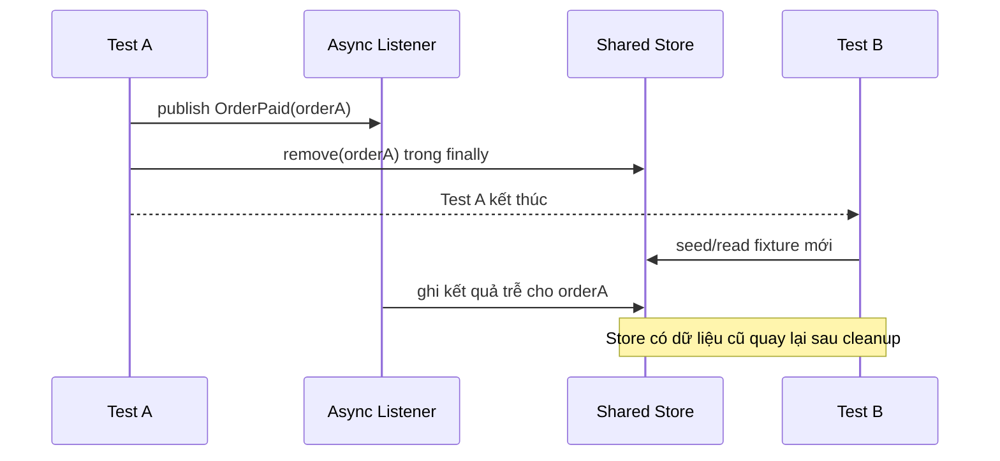

# Dùng fixture dùng chung có thể thay đổi

Trong chương **Lỗi thường gặp** của học phần **SPRING_MODULITH_VERIFICATION_TESTING**, một anti-pattern làm test Spring Modulith khó tin cậy là **nhiều bài test dùng chung cùng một fixture có trạng thái thay đổi được** (*shared mutable fixture*). Test đầu tiên sửa object hoặc database row; test kế tiếp tưởng đang nhận dữ liệu ban đầu nhưng thực ra đọc trạng thái còn sót. Kết quả là cùng một bài `@ApplicationModuleTest` có thể xanh khi chạy riêng, đỏ khi chạy cả suite hoặc thất bại tùy thứ tự và lịch thực thi.

Đây là vấn đề **cô lập dữ liệu kiểm thử**, không đơn thuần là “builder tạo sai field”. Bài này tập trung vào cách phát hiện **aliasing của object**, **state tồn dư trong Spring context được cache**, **dữ liệu database chia sẻ**, **worker bất đồng bộ chạy muộn** và **test song song**; từ đó thiết kế fixture độc lập mà vẫn giữ các kiểm chứng module boundary, event, database và CI.

## 1. Dấu hiệu và bản chất của shared mutable fixture

Một fixture có thể là object Java, entity JPA, bộ dữ liệu SQL, hàng đợi sự kiện hoặc state của fake gateway. **Dùng chung** trở thành lỗi khi một bài test có thể làm biến đổi thứ mà bài khác mặc định là dữ liệu đầu vào chưa đổi.

Ví dụ nghiệp vụ `orders`:

```text
Fixture ban đầu:
  orderId = A
  status  = CONFIRMED
  total   = 120.00

Test thanh toán:
  pay(A) → status của cùng object đổi thành PAID

Test kiểm tra xác nhận đơn:
  tưởng nhận order CONFIRMED
  thực tế nhận chính object A đang PAID
  → assertion fail / transition bị từ chối
```

Các triệu chứng thường gặp:

- Test A pass, test B pass khi chạy riêng; chạy A trước B thì B fail.
- Test B thất bại do `status == PAID` dù fixture builder mang tên `confirmedOrder`.
- `PublishedEvents` không có `OrderPaid`, nhưng lý do là service từ chối đơn **đã PAID từ test trước**, không phải publisher bỏ quên event.
- H2/Testcontainers còn row với ID cố định, gây `DataIntegrityViolationException` hoặc cùng query đọc nhầm dữ liệu cũ.
- Một `@Async` listener cập nhật store **sau khi test đã dọn dữ liệu**, làm test tiếp theo nhiễu.
- Test chạy với JUnit parallel execution fail nhưng chế độ tuần tự thường xanh.

### 1.1. “final” không có nghĩa trạng thái không đổi

```java
static final Order SHARED =
        OrderFixtures.confirmedOrder();
```

`final` chỉ chặn việc gán lại tham chiếu `SHARED`; nếu `Order` là mutable, mọi người giữ tham chiếu đó vẫn có thể gọi `SHARED.markPaid()`. Tương tự, một `record` chứa `List<Order>` không tự tạo deep immutability: list hoặc các phần tử mutable vẫn có thể thay đổi nếu không được sao chép và bảo vệ.

**Phân biệt:** dùng chung `String`, `BigDecimal` hoặc enum bất biến là bình thường. Vấn đề là dùng chung **instance có thể đổi state**, bộ sưu tập chứa instance mutable, hoặc external store có dữ liệu bị ghi lại.

### 1.2. Ba cấp độ rò rỉ state

| Nơi state được giữ | Ví dụ | Vì sao lan sang test khác? |
| --- | --- | --- |
| **JVM / class** | `static final Order`, `static List`, singleton fake | Nhiều test thấy cùng object/bộ sưu tập |
| **Spring Test context** | `@Repository` in-memory, bean cache/singleton, embedded event store | Test class khác có thể dùng lại context và bean nếu cache key phù hợp |
| **Hạ tầng ngoài process** | DB row, Redis key, queue, outbox, email sink | Dữ liệu tiếp tục tồn tại dù Java object và context đã bị hủy |

Đừng chỉ tạo lại test class để kết luận fixture đã được reset: JUnit tạo instance test mới **không đồng nghĩa** Spring singleton bean hay database đã được làm sạch.

## 2. Tái hiện aliasing: hai biến, một Order mutable

Để chỉ ra bản chất mà không phụ thuộc Spring, tạo một aggregate đơn giản. Nó chỉ phục vụ bài học về fixture; repository thực tế có thể là JPA, nhưng ví dụ dưới dùng in-memory.

Tệp `src/main/java/com/example/shop/orders/OrderStatus.java`:

```java
package com.example.shop.orders;

public enum OrderStatus {
    CONFIRMED,
    PAID
}
```

Tệp `src/main/java/com/example/shop/orders/Order.java`:

```java
package com.example.shop.orders;

import java.math.BigDecimal;
import java.util.Objects;
import java.util.UUID;

public final class Order {

    private final UUID id;
    private final UUID customerId;
    private final BigDecimal total;
    private OrderStatus status = OrderStatus.CONFIRMED;

    public Order(UUID id, UUID customerId, BigDecimal total) {
        this.id = Objects.requireNonNull(id, "id");
        this.customerId =
                Objects.requireNonNull(customerId, "customerId");
        this.total = Objects.requireNonNull(total, "total");

        if (total.signum() <= 0) {
            throw new IllegalArgumentException(
                    "Order total must be positive");
        }
    }

    public void markPaid() {
        if (status != OrderStatus.CONFIRMED) {
            throw new IllegalStateException(
                    "Only CONFIRMED orders can be paid");
        }
        status = OrderStatus.PAID;
    }

    public UUID id() {
        return id;
    }

    public UUID customerId() {
        return customerId;
    }

    public BigDecimal total() {
        return total;
    }

    public OrderStatus status() {
        return status;
    }
}
```

`Order` cố ý có method `markPaid()` thay đổi state. `BigDecimal` là immutable, nhưng `Order.status` thì không. Hai reference trỏ đến cùng `Order` sẽ thấy cùng trạng thái mới.

JUnit chứng minh aliasing một cách **xác định**, không cần dựa vào thứ tự chạy các test:

```java
package com.example.shop.orders;

import static org.assertj.core.api.Assertions.assertThat;

import java.math.BigDecimal;
import java.util.UUID;
import org.junit.jupiter.api.Test;

class MutableFixtureAliasingTests {

    @Test
    void twoReferencesToOneFixtureShareMutation() {
        Order shared = new Order(
                UUID.randomUUID(),
                UUID.randomUUID(),
                new BigDecimal("120.00"));

        Order testAView = shared;
        Order testBView = shared;

        assertThat(testAView).isSameAs(testBView);
        assertThat(testBView.status())
                .isEqualTo(OrderStatus.CONFIRMED);

        testAView.markPaid();

        // Không cần test B chạy: đã chứng minh cùng instance.
        assertThat(testBView.status()).isEqualTo(OrderStatus.PAID);
    }
}
```

Đây là bài test **pass để chứng minh cơ chế rò state**, không phải test hồi quy của use case thanh toán. Nếu fixture là `static final Order`, hiện tượng tương tự có thể lan qua nhiều method và class dùng chung tham chiếu.

### 2.1. Mẫu lỗi phụ thuộc thứ tự test

```java
@Disabled("Chỉ dùng trình diễn anti-pattern; không chạy trong CI")
@TestMethodOrder(MethodOrderer.OrderAnnotation.class)
class BrokenSharedOrderFixtureTests {

    private static final Order SHARED = new Order(
            UUID.randomUUID(),
            UUID.randomUUID(),
            new BigDecimal("120.00"));

    @Test
    @org.junit.jupiter.api.Order(1)
    void firstTestPaysSharedOrder() {
        SHARED.markPaid();
        assertThat(SHARED.status()).isEqualTo(OrderStatus.PAID);
    }

    @Test
    @org.junit.jupiter.api.Order(2)
    void secondTestAssumesFreshConfirmedOrder() {
        // Cố ý fail khi test đầu đã đổi SHARED.
        assertThat(SHARED.status())
                .isEqualTo(OrderStatus.CONFIRMED);
    }
}
```

Đoạn trên đặt trong package `com.example.shop.orders`, với import JUnit `Disabled`, `TestMethodOrder`, `MethodOrderer`, `Test`, AssertJ, `UUID` và `BigDecimal`. `@Disabled` trên **class** giữ ví dụ lỗi khỏi CI; bỏ annotation khi chủ động trình diễn. **`@TestMethodOrder` chỉ giúp tái hiện hiện tượng**, không phải biện pháp sửa. Nếu đổi thứ tự để test xanh, shared state vẫn nguy hiểm và có thể hỏng khi chạy suite hoặc song song.

## 3. Các nguồn chia sẻ thường bị bỏ sót trong JUnit và Spring Test

### 3.1. Static field và @BeforeAll

```java
private static Order order;

@BeforeAll
static void createFixtureOnce() {
    order = OrderFixtures.confirmedOrder();
}
```

`@BeforeAll` mặc định chạy một lần cho test class. Nếu nhiều method thao tác `order.markPaid()`, chúng cùng sửa một instance. `@BeforeAll` phù hợp để chuẩn bị **dữ liệu bất biến hoặc hạ tầng đắt tiền có quản lý vòng đời**, không phù hợp để giữ một aggregate mutable mà mỗi method cần trạng thái ban đầu.

### 3.2. @TestInstance(PER_CLASS) và field không reset

```java
@TestInstance(TestInstance.Lifecycle.PER_CLASS)
class PaymentTests {
    private Order order = OrderFixtures.confirmedOrder();
}
```

Khi dùng `PER_CLASS`, JUnit dùng chung một **test class instance** cho nhiều method. Trường `order` không được tự reset trước mỗi test. Với `PER_METHOD` mặc định, instance field của test class được tạo lại theo method, nhưng **static field** và **Spring singleton bean** vẫn có thể chia sẻ.

### 3.3. @BeforeEach chưa chắc reset state

Đoạn nguy hiểm:

```java
private static final Order SHARED =
        OrderFixtures.confirmedOrder();

@BeforeEach
void setup() {
    orders.save(SHARED);
}
```

Mỗi method gọi `save(SHARED)` lại nhưng **vẫn là một object** đã có thể bị chuyển sang PAID. `@BeforeEach` không làm object tự quay về CONFIRMED. Tạo mới **bên trong** `@BeforeEach` hoặc trong test, rồi cleanup theo ID.

### 3.4. Spring context cache / singleton repository

`@ApplicationModuleTest` dùng Spring TestContext Framework; các test có cấu hình context phù hợp có thể **dùng lại `ApplicationContext`** và những bean singleton bên trong. Bean `@Repository` in-memory lưu map sẽ giữ dữ liệu nếu không reset; một test mới có thể thấy row mà test trước tạo.

Đây là khác biệt quan trọng:

| Thứ được tạo lại | Thường tạo lại mỗi method? | Có nghĩa singleton Spring đã reset? |
| --- | --- | --- |
| JUnit `PER_METHOD` test instance | Có | **Không** |
| Local variable `Order order = …` | Có | Không liên quan |
| `static Order` | Không | Không |
| Spring `@Repository` bean trong cached context | Không nhất thiết | **Không** |
| Database bên ngoài | Không nhất thiết | **Không** |

`@DirtiesContext` có thể yêu cầu Spring đóng/evict context sau test theo scope quy định, nhưng thường làm suite chậm và **không tự xóa database/queue ngoài process**. Không dùng nó làm giải pháp đầu tiên khi vấn đề có thể giải quyết bằng fixture mới và cleanup chính xác.

### 3.5. @Nested và thư viện fixture chung

`@Nested` chỉ tổ chức test. Nếu outer class giữ một `Order` mutable hoặc fixture helper trả về singleton, các test bên trong vẫn có thể thấy dữ liệu chung tùy lifecycle. Tương tự, một “Object Mother”:

```java
static Order confirmedOrder() {
    return SHARED_CONFIRMED_ORDER; // Sai khi SHARED mutable.
}
```

nhìn như factory nhưng thực chất trả lại **cùng một tham chiếu**. Cần kiểm chứng `assertThat(a).isNotSameAs(b)` với object mutable.

## 4. Cách sửa căn bản: fixture factory trả object mới mỗi lần

Một fixture factory tốt có thể dùng chung **quy tắc tạo dữ liệu**, nhưng không dùng chung **instance mutable**.

Tệp `src/test/java/com/example/shop/orders/OrderFixtures.java`:

```java
package com.example.shop.orders;

import java.math.BigDecimal;
import java.util.UUID;

public final class OrderFixtures {

    // Dùng chung immutable value là an toàn.
    private static final BigDecimal DEFAULT_TOTAL =
            new BigDecimal("120.00");

    private OrderFixtures() {
    }

    public static Order confirmedOrder() {
        return confirmedOrder(
                UUID.randomUUID(), UUID.randomUUID());
    }

    public static Order confirmedOrder(
            UUID orderId, UUID customerId) {
        return new Order(orderId, customerId, DEFAULT_TOTAL);
    }
}
```

Các bảo đảm:

- Mỗi lời gọi trả **một `new Order`**, không trả cache/shared instance.
- Factory không có `static List<Order>` mutable, không mutate global registry.
- Default total là `BigDecimal` bất biến.
- Test có thể chủ động cung cấp `orderId` và `customerId` khi cần liên kết event/DB.
- Phương thức tên `confirmedOrder` khẳng định trạng thái **đầu vào** cho use case thanh toán.

### 4.1. Unit test bảo vệ chính fixture

```java
package com.example.shop.orders;

import static org.assertj.core.api.Assertions.assertThat;

import org.junit.jupiter.api.Test;

class OrderFixtureIsolationTests {

    @Test
    void eachCallProducesIndependentOrder() {
        Order first = OrderFixtures.confirmedOrder();
        Order second = OrderFixtures.confirmedOrder();

        assertThat(first).isNotSameAs(second);
        assertThat(first.id()).isNotEqualTo(second.id());
        assertThat(first.status())
                .isEqualTo(OrderStatus.CONFIRMED);
        assertThat(second.status())
                .isEqualTo(OrderStatus.CONFIRMED);

        first.markPaid();

        assertThat(first.status()).isEqualTo(OrderStatus.PAID);
        assertThat(second.status())
                .isEqualTo(OrderStatus.CONFIRMED);
    }
}
```

Đây là phép kiểm **độc lập với Spring và DB**, nên nếu ai đó sửa factory để trả singleton, failure xuất hiện gần nguyên nhân hơn một `Scenario` timeout vài giây.

### 4.2. Với List và record, cần xem cấp độ sao chép

Đoạn code:

```java
List<Order> copied = List.copyOf(sourceOrders);
```

tạo một list không sửa được bằng các thao tác `add/remove`, nhưng các `Order` bên trong **vẫn chính là các instance có thể đổi trạng thái**. `List.copyOf` không deep-copy các phần tử. Nếu test cần các aggregate độc lập, phải **tạo Order mới theo dữ liệu mẫu** cho từng test, không chỉ copy container.

Đừng clone JPA entity một cách cơ học cùng ID/version: điều đó có thể khiến persistence layer tưởng đây là một row đã tồn tại, gây merge/unique collision. Với JPA, “fresh fixture” còn bao gồm **identity và transaction scope phù hợp**.

### 4.3. Supplier và builder phải tạo mới tại thời điểm dùng

Nếu muốn trì hoãn tạo fixture:

```java
Supplier<Order> freshOrder = OrderFixtures::confirmedOrder;

Order one = freshOrder.get();
Order two = freshOrder.get();

assertThat(one).isNotSameAs(two);
```

Đây là đoạn trong test cần `java.util.function.Supplier` và AssertJ. Tránh đóng kín một object đã tạo:

```java
Order shared = OrderFixtures.confirmedOrder();
Supplier<Order> notFresh = () -> shared;
```

Lambda thứ hai **mỗi lần trả lại cùng object**; việc dùng `Supplier` không mặc nhiên tạo mới dữ liệu.

## 5. Module test kiểm chứng: fixture độc lập và event chính xác

Để thấy shared fixture làm hỏng **Spring Modulith verification & testing** như thế nào, thêm repository in-memory và use case thanh toán. Bài test không dùng DB hoặc async, nên nguyên nhân khi fail có thể được thu hẹp về trạng thái fixture/repository.

### 5.1. Repository và service trong module orders

Tệp `src/main/java/com/example/shop/orders/OrderRepository.java`:

```java
package com.example.shop.orders;

import java.util.Optional;
import java.util.UUID;

public interface OrderRepository {
    void save(Order order);
    Optional<Order> findById(UUID orderId);
    void deleteById(UUID orderId);
}
```

Tệp `src/main/java/com/example/shop/orders/InMemoryOrderRepository.java`:

```java
package com.example.shop.orders;

import java.util.Optional;
import java.util.UUID;
import java.util.concurrent.ConcurrentHashMap;
import java.util.concurrent.ConcurrentMap;
import org.springframework.stereotype.Repository;

@Repository
class InMemoryOrderRepository implements OrderRepository {

    private final ConcurrentMap<UUID, Order> data =
            new ConcurrentHashMap<>();

    @Override
    public void save(Order order) {
        data.put(order.id(), order);
    }

    @Override
    public Optional<Order> findById(UUID orderId) {
        return Optional.ofNullable(data.get(orderId));
    }

    @Override
    public void deleteById(UUID orderId) {
        data.remove(orderId);
    }
}
```

Repository này cố ý giữ **tham chiếu `Order`**, không sao chép object. Nó đủ để minh họa lỗi mutable fixture nhưng **không** mô phỏng JPA dirty checking, transaction/rollback hoặc nhiều instance ứng dụng.

Tệp `src/main/java/com/example/shop/orders/OrderPaid.java`:

```java
package com.example.shop.orders;

import java.math.BigDecimal;
import java.util.UUID;

public record OrderPaid(
        UUID orderId,
        BigDecimal amount) {
}
```

Tệp `src/main/java/com/example/shop/orders/OrderPaymentService.java`:

```java
package com.example.shop.orders;

import java.util.UUID;
import org.springframework.context.ApplicationEventPublisher;
import org.springframework.stereotype.Service;

@Service
public class OrderPaymentService {

    private final OrderRepository orders;
    private final ApplicationEventPublisher publisher;

    public OrderPaymentService(
            OrderRepository orders,
            ApplicationEventPublisher publisher) {
        this.orders = orders;
        this.publisher = publisher;
    }

    public void pay(UUID orderId) {
        Order order = orders.findById(orderId)
                .orElseThrow(() ->
                        new IllegalArgumentException(
                                "Unknown order: " + orderId));

        order.markPaid();
        orders.save(order);
        publisher.publishEvent(
                new OrderPaid(order.id(), order.total()));
    }
}
```

Hợp đồng của ví dụ: **đơn CONFIRMED được pay một lần** → trạng thái PAID và **một `OrderPaid`**. Lần pay tiếp theo bị từ chối, **không phát event mới**. Đây là service đồng bộ/demo; đối với production dùng JPA cần transaction và cơ chế publication phù hợp.

### 5.2. Test đúng: cấp fixture mới, assert trước/sau, cleanup

Tệp `src/test/java/com/example/shop/orders/OrderPaymentModuleTests.java`:

```java
package com.example.shop.orders;

import static org.assertj.core.api.Assertions.assertThat;
import static org.assertj.core.api.Assertions.assertThatThrownBy;

import java.math.BigDecimal;
import java.util.UUID;
import org.junit.jupiter.api.Test;
import org.springframework.beans.factory.annotation.Autowired;
import org.springframework.modulith.test.ApplicationModuleTest;
import org.springframework.modulith.test.PublishedEvents;

@ApplicationModuleTest
class OrderPaymentModuleTests {

    @Autowired
    OrderRepository orders;

    @Autowired
    OrderPaymentService payments;

    @Test
    void paysIndependentConfirmedOrder(PublishedEvents events) {
        Order fixture = OrderFixtures.confirmedOrder();
        UUID orderId = fixture.id();

        try {
            orders.save(fixture);
            assertThat(orders.findById(orderId).orElseThrow()
                    .status()).isEqualTo(OrderStatus.CONFIRMED);

            payments.pay(orderId);

            assertThat(orders.findById(orderId).orElseThrow()
                    .status()).isEqualTo(OrderStatus.PAID);

            assertThat(events.ofType(OrderPaid.class)
                    .matching(event ->
                            orderId.equals(event.orderId())))
                    .hasSize(1)
                    .allSatisfy(event ->
                            assertThat(event.amount())
                                    .isEqualByComparingTo(
                                            new BigDecimal("120.00")));
        } finally {
            orders.deleteById(orderId);
        }
    }

    @Test
    void secondPaymentIsRejectedWithoutAnotherEvent(
            PublishedEvents events) {
        Order fixture = OrderFixtures.confirmedOrder();
        UUID orderId = fixture.id();

        try {
            orders.save(fixture);
            payments.pay(orderId);

            assertThatThrownBy(() ->
                    payments.pay(orderId))
                    .isInstanceOf(IllegalStateException.class)
                    .hasMessage(
                            "Only CONFIRMED orders can be paid");

            assertThat(events.ofType(OrderPaid.class)
                    .matching(event ->
                            orderId.equals(event.orderId())))
                    .hasSize(1);
        } finally {
            orders.deleteById(orderId);
        }
    }
}
```

Ở mỗi test:

1. `OrderFixtures.confirmedOrder()` trả **instance mới** và `orderId` mới.
2. `save` đặt dữ liệu vào repository, nhưng chưa dựa vào state từ test trước.
3. Assertion ở Arrange bảo đảm **trước Act** là CONFIRMED.
4. `PublishedEvents` lọc đúng `OrderPaid` theo `orderId`, tránh nhầm event của fixture khác.
5. `finally` cleanup theo ID khi happy path hoặc assertion fail.

Test thứ hai **cố tình** trả tiền hai lần trong **cùng bài test** để kiểm tra idempotency/transition; đó không phải shared fixture anti-pattern, vì toàn bộ trạng thái thay đổi thuộc **một test có ownership rõ ràng**.

### 5.3. Những gì test này chưa chứng minh

`InMemoryOrderRepository` dùng `ConcurrentHashMap` có thể tồn tại suốt context cache, nhưng cleanup theo ID giúp cô lập các test đồng bộ. Tuy nhiên, điều này không chứng minh:

- Database thật đã commit hoặc rollback đúng.
- Listener `AFTER_COMMIT` nhận event sau commit.
- Một `@Async` consumer đã hoàn tất.
- Một order có thể được pay đúng một lần khi **nhiều application instances** chạy đồng thời.

Các hợp đồng ấy cần kiểm chứng khác. Không nên dùng kết quả của fixture isolation test để kết luận chắc chắn về concurrency hoặc durability production.

## 6. Dữ liệu database dùng chung: rollback không phải “bàn chải toàn năng”

Chuyển sang JPA hoặc SQL test, shared mutable fixture có thể trở thành **row được nhiều bài test đọc/ghi**. Mỗi test dùng object Java mới vẫn có thể chia sẻ **cùng business ID hoặc unique key** trong database.

### 6.1. Save cùng ID không tạo fixture độc lập

```java
UUID FIXED_ORDER_ID = UUID.fromString(
        "00000000-0000-0000-0000-000000000042");

orderRepository.save(newOrderWithId(FIXED_ORDER_ID));
```

Đây là **snippet minh họa** với JPA entity/repository riêng của dự án, không phải `OrderRepository` in-memory ở mục 5. Nếu test khác đã dùng `FIXED_ORDER_ID`, `save` có thể cập nhật/merge một entity cũ hoặc vướng unique constraint tùy entity mapping. Không giả định hai object mới có cùng ID là hai row độc lập.

Ngoài khóa chính, `email`, `orderNumber`, `paymentReference` hoặc `sku` có unique constraint cũng có thể va chạm giữa tests. Hãy tạo **business key test riêng** hoặc seed bằng một cơ chế cô lập thật sự.

### 6.2. @Transactional test rollback được phần nào?

Trong Spring Test, một `@Transactional` test thường rollback các thay đổi tham gia **test-managed transaction** khi method kết thúc. Nhưng điều đó **không đồng nghĩa**:

- Xóa dữ liệu test đã commit qua một transaction khác.
- Rollback thao tác của listener `@Async` trong thread riêng.
- Dọn dữ liệu Redis/broker hoặc file ngoài DB.
- Undo một `@Transactional(propagation = REQUIRES_NEW)` đã commit độc lập.
- Đặt lại sequence, cache, scheduled work hoặc state singleton trong JVM.

Đặc biệt, khi test dùng `@Sql` hoặc setup scripts, cần xác định script chạy trong transaction nào và cleanup thực sự xảy ra ở đâu; không suy “có annotation là tự sạch”.

### 6.3. @DataJpaTest kiểm tra trạng thái persisted

Mẫu trong một dự án có `OrderEntity` và `OrderJpaRepository` thật:

```java
@DataJpaTest
class OrderJpaFixtureTests {

    @Autowired
    TestEntityManager entityManager;

    @Autowired
    OrderJpaRepository orders;

    @Test
    void readsNewOrderAfterFlushAndClear() {
        OrderEntity order = OrderEntity.confirmed(
                UUID.randomUUID());

        entityManager.persistAndFlush(order);
        entityManager.clear();

        OrderEntity loaded = orders.findById(order.getId())
                .orElseThrow();

        assertThat(loaded.getStatus())
                .isEqualTo(OrderStatus.CONFIRMED);
    }
}
```

Đây là **mẫu tích hợp**: `OrderEntity` và repository là các kiểu ứng dụng phải cung cấp, còn import `DataJpaTest`/`TestEntityManager` phụ thuộc package Spring Boot của phiên bản đang dùng. `flush()` giúp lộ một số lỗi constraint ngay trong Arrange; `clear()` tránh nhận lại entity chỉ vì first-level cache. **`flush()` không phải commit**: thread/connection khác chưa chắc đọc được row, và rollback cuối `@DataJpaTest` vẫn có thể xóa thay đổi.

### 6.4. @Sql và cleanup có trách nhiệm

Với fixture SQL:

```java
@Sql(
    scripts = "/fixtures/confirmed-order.sql",
    executionPhase = Sql.ExecutionPhase.BEFORE_TEST_METHOD)
@Sql(
    scripts = "/fixtures/cleanup-order.sql",
    executionPhase = Sql.ExecutionPhase.AFTER_TEST_METHOD)
@Test
void paysSeededOrder() {
    // Query, precondition check, Act, Assert.
}
```

Các đường dẫn SQL ở đây chỉ là **ví dụ**, không khẳng định file tồn tại trong dự án. Import từ `org.springframework.test.context.jdbc.Sql`. Script cleanup phải tránh xóa dữ liệu test khác: ưu tiên schema/database cách ly, khóa namespace riêng hoặc delete theo ID test. Không chạy câu `DELETE FROM orders` không giới hạn trên database chung.

Nếu test thực sự chạy song song với một DB, hai test cùng seed `order_number='ORDER-001'` vẫn có thể tranh chấp dù cả hai đều có `@Sql` teardown. **Unique test data + transaction/schema isolation** quan trọng hơn chỉ cleanup sau cùng.

## 7. Event, Scenario và listener bất đồng bộ: cleanup quá sớm cũng là mutation

Một kiểu rò state khó nhìn thấy hơn xuất hiện khi test A kết thúc nhưng callback async của nó **vẫn đang chạy**:



Nếu dùng cùng một ID cố định giữa A và B, listener muộn còn có thể ghi đè đúng row B đang đọc. Thậm chí khi dùng UUID riêng, state trễ vẫn làm nhiễu những assertion đếm **tất cả event cùng loại** hoặc truy vấn **không lọc ID**.

### 7.1. Phân biệt source event với completion

`PublishedEvents` xác nhận event được publish trong test context, nhưng không tự chứng minh:

- Listener `@Async` đã kết thúc.
- Transaction của listener đã commit.
- Repository/outbox bên ngoài đã bền vững.
- Không còn callback trễ sẽ mutate fixture sau cleanup.

Tương tự, `Scenario` thấy một outcome phù hợp không mặc nhiên chứng minh **tất cả** callback khác đã hoàn tất. Nếu có nhiều listener hoặc retry, cần xác định mốc completion của từng công việc liên quan.

### 7.2. Scenario với correlation ID riêng

Giả sử module `billing` có listener thực nhận `orders.OrderPaid` và publish `InvoiceCreated(orderId)`, một test **thuộc module billing** có thể chờ:

```java
@ApplicationModuleTest
class BillingListenerModuleTests {

    @Autowired
    ApplicationEventPublisher publisher;

    @Test
    void eachEventUsesItsOwnOrderId(Scenario scenario) {
        UUID orderId = UUID.randomUUID();

        scenario.stimulate(() ->
                        publisher.publishEvent(
                                new OrderPaid(
                                        orderId,
                                        new BigDecimal("120.00"))))
                .andWaitForEventOfType(InvoiceCreated.class)
                .matching(event ->
                        orderId.equals(event.orderId()))
                .toArriveAndVerify(event ->
                        assertThat(event.orderId())
                                .isEqualTo(orderId));
    }
}
```

Đây là **mẫu consumer contract test**; cần các import JUnit, Spring Modulith, `ApplicationEventPublisher`, `UUID`, `BigDecimal` và `InvoiceCreated`/listener thuộc dự án billing thực. Không tự tạo ra `InvoiceCreated` nếu contract của consumer chỉ cập nhật DB; lúc đó dùng `andWaitForStateChange(…)` đọc lại repository theo `orderId`.

Điểm liên quan fixture:

1. Event mang `orderId` mới cho **mỗi test**.
2. `matching` lọc đúng kết quả của stimulus đó.
3. Nếu listener ghi một store singleton, việc cleanup chỉ an toàn sau khi đã biết **công việc cần thiết hoàn tất**.
4. Khi có retry hoặc nhiều listener, thêm cơ chế đồng bộ/quiescence thích hợp; không dựa vào thời gian ngủ.

### 7.3. Đừng dùng Thread.sleep để “bảo đảm sạch”

```java
Thread.sleep(500); // Không bảo đảm mọi callback đã chạy xong.
store.clear();      // Có thể xóa dữ liệu của test khác.
```

Thay vào đó dùng state/event condition có timeout hữu hạn, `Future`/`CountDownLatch` hoặc test-specific executor có thể drain được. Cleanup theo **ID riêng của test**; không gọi `clear()` toàn store nếu test song song hoặc một context được nhiều test dùng chung.

### 7.4. Transaction-bound listener làm khác biệt rõ hơn

Nếu consumer dùng `@TransactionalEventListener(phase = AFTER_COMMIT)`, cần nguồn publish trong transaction **commit thành công**, không giữ `@Transactional` test chưa kết thúc rồi chờ callback ngay trong method. Điều đó có thể tạo timeout dù listener đã đăng ký đúng.

Không giải thích timeout hậu commit bằng “fixture bị test khác sửa” nếu chưa có bằng chứng. **Shared mutation**, **missing listener**, **chưa commit** và **predicate sai** là các nguyên nhân khác nhau có thể tạo cùng triệu chứng.

## 8. Chạy song song: từ test order-dependence sang race condition

Khi JUnit parallel execution được bật, hai bài test có thể cùng sửa một singleton hoặc cùng row DB. Thậm chí dữ liệu bắt đầu ở trạng thái hợp lệ, kết quả vẫn phụ thuộc lịch thread.

### 8.1. Vì sao check-then-act không an toàn?

```java
// Pseudocode trong fake repository dùng chung:
if (!orders.containsKey(orderId)) {
    orders.put(orderId, OrderFixtures.confirmedOrder(
            orderId, customerId));
}
```

Hai thread có thể cùng thấy `containsKey == false`. Nếu fixture có ID/khóa dùng chung, cả hai tưởng mình sở hữu dữ liệu. Một test có thể pay order trong lúc test kia vẫn đang validate trạng thái CONFIRMED.

Hãy phân biệt:

- **Tính cô lập test:** mỗi test có `orderId`/row riêng.
- **Tính đúng concurrent business operation:** nhiều request cùng một `orderId` có cần chặn double payment bằng constraint/transaction/locking không?

Không dùng fixture chia sẻ để vô tình “test concurrency”; tạo một concurrency test riêng có điểm đồng bộ và assertion theo contract.

### 8.2. JUnit chứng minh mutation giữa hai thread bằng latch

Một đoạn JUnit nhỏ, có điểm đồng bộ xác định:

```java
import static org.assertj.core.api.Assertions.assertThat;

import java.util.concurrent.CountDownLatch;
import java.util.concurrent.Executors;
import java.util.concurrent.TimeUnit;
import org.junit.jupiter.api.Test;

class SharedOrderConcurrencyTests {

    @Test
    void concurrentReaderSeesMutationOfSameFixture()
            throws Exception {
        Order shared = OrderFixtures.confirmedOrder();
        CountDownLatch paid = new CountDownLatch(1);
        var pool = Executors.newSingleThreadExecutor();

        try {
            var observed = pool.submit(() -> {
                if (!paid.await(5, TimeUnit.SECONDS)) {
                    throw new IllegalStateException("Timed out");
                }
                return shared.status();
            });

            shared.markPaid();
            paid.countDown();

            assertThat(observed.get(5, TimeUnit.SECONDS))
                    .isEqualTo(OrderStatus.PAID);
        } finally {
            paid.countDown();
            pool.shutdownNow();
        }
    }
}
```

Đặt test trong package `com.example.shop.orders` hoặc import `Order`, `OrderFixtures`, `OrderStatus` tương ứng. `CountDownLatch` tạo quan hệ happens-before để quan sát state **đã bị đổi** mà không phụ thuộc `sleep`. Test này **pass để minh họa shared mutation**, không chứng minh service production thread-safe.

### 8.3. @ResourceLock có giải quyết nguyên nhân không?

JUnit `@ResourceLock("shared-repository")` có thể phối hợp các test cùng tuân thủ khóa resource khi chạy song song. Nó có thể cần thiết với một tài nguyên thật sự không thể cô lập, nhưng:

- Không biến một `static Order` thành fixture mới.
- Không ngăn async worker ngoài lifecycle test mutate sau khi lock của method được nhả.
- Không bảo vệ process khác, CI job khác hoặc database ngoài JUnit engine đó.
- Có thể che sự phụ thuộc thứ tự giữa tests dù đã tuần tự hóa.

Ưu tiên **fixture mới + ID riêng + dọn đúng scope**. Chỉ dùng `@ResourceLock` như biện pháp quản lý resource chia sẻ **có chủ đích**, và ghi rõ lý do/giới hạn.

## 9. Quy trình debug rò state và checklist xử lý

Đừng gắn nhãn “flaky” rồi tăng timeout trước khi so sánh **trạng thái fixture** tại ba thời điểm.

### 9.1. Thu bằng chứng có thể tái hiện

| Bước | Bằng chứng cần thu | Ý nghĩa |
| --- | --- | --- |
| **1. Đơn lẻ** | Test B chạy riêng pass/fail? | Có phụ thuộc suite hoặc external state không? |
| **2. Cặp A→B** | Chạy A trước B có làm B fail? | Gợi ý rò state qua ordering |
| **3. Fixture identity** | `System.identityHashCode(order)` và `order.id()` | Phân biệt cùng Java object với cùng business ID |
| **4. Before/after Act** | `status`, totals, IDs, bean instance | Xác nhận ai đã mutate |
| **5. Spring context** | `ApplicationContext`/repository bean có dùng lại không? | Context cache và singleton scope |
| **6. External store** | Query row/unique key trước seed, sau cleanup | Tìm dữ liệu tồn dư ở DB |
| **7. Worker** | Listener start/finish, timeout, transaction commit | Xác nhận cleanup xảy ra trước async completion? |
| **8. Parallel mode** | Runner, count, lệnh chạy, số lần fail | Phân biệt race và ordering |

`System.identityHashCode` chỉ hữu ích như dấu vết **trong một JVM/run**, không phải định danh bền vững giữa các lần chạy. `order.id()` là business key, không chứng minh hai object có cùng reference. Nếu object A và B có **cùng UUID nhưng khác instance**, nguyên nhân có thể là **DB key collision**, không phải Java aliasing.

### 9.2. Quy trình sửa theo nguyên nhân

1. **Nếu cùng Java instance:** thay `static mutable` hoặc factory trả singleton bằng `new Order` mỗi lần gọi.
2. **Nếu Spring bean giữ state:** reset/cleanup theo test-owned IDs hoặc thiết kế fake có lifecycle phù hợp; không ép scope production thành prototype chỉ để test.
3. **Nếu DB row bị tái sử dụng:** tạo unique key, seed dữ liệu độc lập, xác định transaction và cleanup FK/children đúng cách.
4. **Nếu async callback chạy muộn:** chờ completion/quiescence và quản lý executor trước khi cleanup; dùng correlation ID.
5. **Nếu test phụ thuộc thứ tự:** bỏ `@TestMethodOrder` dùng để né lỗi, rồi chứng minh từng test chạy độc lập.
6. **Nếu concurrency thật sự được yêu cầu:** viết test riêng với barrier và invariant atomicity; không dùng việc suite chạy song song làm concurrency harness.
7. **Nếu test sai tiền điều kiện:** khẳng định fixture CONFIRMED trước Act; nếu đúng rồi vẫn fail thì chuyển sang service/event/transaction.
8. **Sau sửa:** chạy lại test riêng, cặp A/B, full suite và chế độ parallel liên quan; lưu kết quả thật.

### 9.3. Checklist trước khi merge fixture helper

- [ ] Factory trả **instance mới** mỗi lần đối với object mutable.
- [ ] Tên factory diễn tả trạng thái nghiệp vụ mà use case cần.
- [ ] ID/unique keys riêng cho mỗi test, hoặc có scope cách ly được chứng minh.
- [ ] Không có `static` mutable ẩn trong helper/`@BeforeAll`.
- [ ] `@BeforeEach` không lưu lại **cùng object đã bị mutate**.
- [ ] Test không dựa vào thứ tự chạy hoặc dữ liệu test khác tạo ra.
- [ ] Với JPA, đã kiểm tra FK, unique constraint, flush/commit và readback phù hợp.
- [ ] Cleanup chỉ tác động dữ liệu test sở hữu; listener async đã hoàn tất khi cleanup.
- [ ] Assertion `PublishedEvents` lọc đúng event type và correlation ID.
- [ ] Các test chạy song song không cùng sửa một row/queue/fake state ngoài kiểm soát.

**Giá trị của checklist:** không đảm bảo tự động mọi test đều đúng, nhưng giúp review phát hiện một nguồn flakiness **trước** khi nó làm fail CI.

## 10. CI, kiểm chứng kiến trúc và bài thực hành

Fixture isolation không thay thế các quality gate cốt lõi của Spring Modulith:

| Gate | Mục tiêu | Failure liên quan |
| --- | --- | --- |
| **Fixture unit test** | Mỗi lần factory tạo object mới, đúng trạng thái | Static/shared instance, default mutable |
| **Module test** | `@ApplicationModuleTest` với dữ liệu độc lập | State leak làm service từ chối, event thiếu |
| **Event assertion** | `PublishedEvents` đúng type/count/ID | Event sai hoặc test đọc nhầm event khác |
| **Consumer Scenario** | Listener xử lý đúng stimulus và hoàn thành | Shared state, async late writes, predicate sai |
| **JPA/database integration** | Row/relationship/commit đúng giữa test cases | Unique collision, rollback không bao phủ |
| **Parallel test run** | Test không phụ thuộc scheduling/order | Race trên fixture/store dùng chung |
| **Architecture verification** | `ApplicationModules.verify()` | Import sai API, dependency cycle |

### 10.1. Giữ ApplicationModules.verify() độc lập

Test kiến trúc:

```java
package com.example.shop;

import org.junit.jupiter.api.Test;
import org.springframework.modulith.core.ApplicationModules;

class ArchitectureVerificationTests {

    @Test
    void moduleBoundariesAreValid() {
        ApplicationModules.of(ShopApplication.class).verify();
    }
}
```

`ShopApplication` là `@SpringBootApplication` gốc ở package `com.example.shop` của ví dụ. Test này **không kiểm tra fixture**: nó xác minh quan hệ phụ thuộc và các quy tắc module được Spring Modulith hỗ trợ. Khi cần test data của module khác, không vì tiện seed mà cho production code import `inventory.internal.*` rồi bỏ `verify()`; nên sử dụng public API hoặc test-support boundary hợp lệ.

### 10.2. Lệnh chạy minh họa và nguyên tắc quan sát CI

Khi được phép thực thi trong project Maven:

```bash
./mvnw -Dtest=OrderFixtureIsolationTests,OrderPaymentModuleTests test
```

Hoặc Gradle:

```bash
./gradlew test --tests "com.example.shop.orders.OrderFixtureIsolationTests" --tests "com.example.shop.orders.OrderPaymentModuleTests"
```

Đây là **lệnh tham khảo, chưa được chạy trong quá trình soạn bài**. Ghi nhận lệnh chạy thực sự và kết quả khi điều tra. JUnit parallel execution phụ thuộc cấu hình JUnit/build tool; không mặc định một lệnh bình thường đã bật parallel. Khi lỗi chỉ xuất hiện trong full suite, ghi thứ tự/cách lọc test, profile, worker count và dữ liệu tồn dư.

Không dùng `@DirtiesContext` bừa bãi hoặc tắt parallel cho toàn repository chỉ để che fixture mutable. Chỉ dùng chúng khi đã xác định tài nguyên thực sự cần serialize/recreate, sau đó đo lại hiệu quả test isolation.

### 10.3. Bài thực hành

1. **Chứng minh aliasing:** chạy `MutableFixtureAliasingTests` và giải thích vì sao hai biến khác tên vẫn thấy `PAID` sau một lần mutation.
2. **Tái hiện theo thứ tự:** bỏ `@Disabled` của `BrokenSharedOrderFixtureTests` khi chủ động thực hành, quan sát test thứ hai fail; ghi lại dữ liệu nào được chia sẻ.
3. **Sửa fixture:** thay `static final Order` bằng `OrderFixtures.confirmedOrder()` bên trong từng test; bỏ `@TestMethodOrder` và chứng minh test độc lập.
4. **Factory regression:** sửa factory cố tình trả một singleton, chạy `OrderFixtureIsolationTests` và xem assertion `isNotSameAs` phát hiện.
5. **Context cache:** thêm một singleton in-memory repository rồi seed cùng ID cố định trong hai test; ghi state trước/sau và sửa bằng ID riêng/cleanup.
6. **Mutable collection:** tạo `List.copyOf` từ list chứa `Order` mutable, mutate phần tử gốc và giải thích shallow-copy không bảo vệ state.
7. **JPA:** seed cùng một unique key từ hai tests, phân biệt `save`, `flush`, `commit` và rollback của test-managed transaction.
8. **Async:** cho listener ghi result sau khi test kết thúc, dùng latch/`Scenario` có timeout hữu hạn để tái hiện late write, rồi sửa lifecycle/cleanup.
9. **Parallel:** hai task cùng sửa một order, dùng `CountDownLatch` để có điểm đồng bộ thay vì `Thread.sleep`; giải thích khác nhau giữa fixture isolation và business concurrency.
10. **CI gate:** chạy module test, fixture unit tests và `ApplicationModules.verify()` độc lập, viết báo cáo rõ lỗi fixture và lỗi dependency có bằng chứng khác nhau.

### 10.4. Mẫu báo cáo flakiness có ích

```text
Failure: payment module test rejects CONFIRMED order
Test under investigation: <class#method>
Run mode: isolated / full-suite / parallel
Observed orderId: <uuid>
Fixture Java identity: <identityHashCode within this JVM>
Status before Arrange: <status or not-present>
Status after Arrange: <status>
Status before Act: <status>
Repository/context reused: yes / no / unknown
Unfinished async jobs: <count or unknown>
DB row existed before seed: yes / no / unknown
First failure fingerprint: <exception/assertion>
Reproduction counts: <failures>/<runs>
Confirmed root cause: <evidence, not guess>
Fix: <new fixture/unique ID/cleanup/transaction>
Validation: <actual reruns if executed>
```

Không log PII hoặc bí mật trong fixture. Nếu một trường chưa được đo, ghi **unknown** thay vì tự suy thành “no”.

### Kết luận

Sai lầm **dùng fixture dùng chung có thể thay đổi** không nằm ở việc tái sử dụng helper, mà ở việc vô tình tái sử dụng **trạng thái** giữa các bài test. `static final`, `@BeforeAll`, `PER_CLASS`, Spring context cache, JPA database và worker async đều có thể giữ hoặc sửa dữ liệu qua ranh giới test. Cách sửa ưu tiên là **tạo object mới, cấp khóa tương quan riêng, kiểm tra precondition trước Act, chỉ dọn state mà test sở hữu và đồng bộ hóa công việc bất đồng bộ**. Giữ `@ApplicationModuleTest`, `PublishedEvents`, `Scenario`, integration DB tests và `ApplicationModules.verify()` thành các gate độc lập để phát hiện hồi quy đúng nguồn gốc, thay vì biến một suite flaky thành suite “xanh” bằng cách đổi thứ tự hoặc tăng thời gian ngủ.

## Tài liệu tham khảo

- [JUnit 5 User Guide — Test Instance Lifecycle](https://junit.org/junit5/docs/current/user-guide/#writing-tests-test-instance-lifecycle)
- [JUnit 5 User Guide — Parallel Execution](https://junit.org/junit5/docs/current/user-guide/#writing-tests-parallel-execution)
- [Spring Framework Reference — Context Caching](https://docs.spring.io/spring-framework/reference/testing/testcontext-framework/ctx-management/caching.html)
- [Spring Framework Reference — Test-managed Transactions](https://docs.spring.io/spring-framework/reference/testing/testcontext-framework/tx.html)
- [Spring Modulith Reference — Testing Application Modules](https://docs.spring.io/spring-modulith/reference/testing.html)
- [Spring Modulith Reference — Verifying Application Module Structure](https://docs.spring.io/spring-modulith/reference/verification.html)
- [Spring Modulith Reference — Working with Application Events](https://docs.spring.io/spring-modulith/reference/events.html)
- [Spring Modulith Javadoc — PublishedEvents](https://docs.spring.io/spring-modulith/docs/current/api/org/springframework/modulith/test/PublishedEvents.html)
- [Spring Modulith Javadoc — Scenario](https://docs.spring.io/spring-modulith/docs/current/api/org/springframework/modulith/test/Scenario.html)
- [Spring Boot Reference — Testing Spring Boot Applications](https://docs.spring.io/spring-boot/reference/testing/spring-boot-applications.html)
