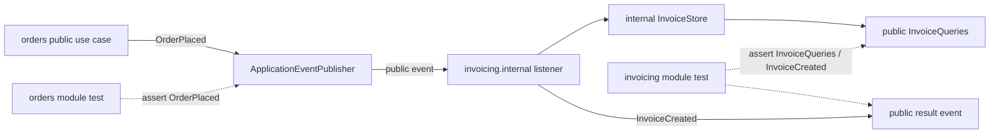

# Assertion trực tiếp vào package nội bộ

Trong chương **Lỗi thường gặp** của học phần **SPRING_MODULITH_VERIFICATION_TESTING**, một anti-pattern dễ xuất hiện khi viết test cho ứng dụng Spring Modulith là: **test của module này import trực tiếp entity, repository, service hoặc listener trong package `internal` của module khác chỉ để thực hiện assertion**. Bài test có thể chạy xanh, nhưng nó đã biến chi tiết triển khai thành một phụ thuộc kiểm thử khó thay đổi. Khi module sở hữu thay repository, cấu trúc bảng hoặc phương pháp xử lý sự kiện mà vẫn giữ nguyên API công khai, test ở module khác vẫn có thể đỏ vô lý.

Vấn đề này không đồng nghĩa “mọi unit test đều bị cấm kiểm tra code nội bộ”. Cần phân biệt **kiểm thử implementation thuộc chính module sở hữu** với **kiểm thử hợp đồng giữa hai module**. Bài học sẽ dùng `orders` phát `OrderPlaced` và `invoicing` tạo `InvoiceCreated` để chỉ ra nơi nên assert, nơi không nên assert, và các phép kiểm có thể xác nhận kiến trúc lẫn hành vi.

Sau bài này, bạn có thể nhận diện assertion vượt ranh giới module; thiết kế test dựa trên public API, event hoặc kết quả nghiệp vụ; dùng `@ApplicationModuleTest`, `PublishedEvents` và `Scenario` đúng chỗ; hiểu giới hạn của `ApplicationModules.verify()` với test source; và xây checklist CI để giảm coupling mà không làm mất khả năng phát hiện hồi quy.

## 1. Anti-pattern: test dùng implementation detail làm tiêu chuẩn thành công

Một test đặt tại `com.example.shop.orders` muốn xác minh rằng “khi đơn được đặt, hệ thống tạo hóa đơn”. Thay vì quan sát hợp đồng của `invoicing`, người viết test lấy thẳng repository nội bộ:

```java
// MẪU SAI — minh họa một repository Java public
// nhưng nằm trong package nội bộ của module khác.
package com.example.shop.orders;

import com.example.shop.invoicing.internal.InvoiceJpaRepository;
import org.junit.jupiter.api.Test;
import org.springframework.beans.factory.annotation.Autowired;
import org.springframework.modulith.test.ApplicationModuleTest;

@ApplicationModuleTest
class OrdersLeaksInvoiceInternalsTests {

    @Autowired
    InvoiceJpaRepository invoices;

    @Test
    void placesOrderAndInspectsForeignRepository() {
        // orderService.place(orderId, amount);
        // assertThat(invoices.findByOrderId(orderId)).isPresent();
    }
}
```

Đây là **đoạn anti-pattern có chủ đích**, giả sử dự án thực sự khai báo một `public InvoiceJpaRepository` trong `invoicing.internal`; repository đó **không thuộc source demo hoàn chỉnh ở các mục sau**. Không copy nó vào project rồi kỳ vọng compile. Nó minh họa vấn đề ngay cả khi Java cho phép import một kiểu `public`.

Test như vậy gây ra ít nhất bốn loại phụ thuộc không cần thiết:

1. **Phụ thuộc package:** `orders` biết tên `invoicing.internal` dù package này không được công bố như API module.
2. **Phụ thuộc dữ liệu:** assertion biết entity/bảng/index cụ thể thay vì kết quả hóa đơn mà domain cam kết.
3. **Phụ thuộc hạ tầng:** module test của `orders` có thể phải bootstrap JPA, datasource, migration và repository của `invoicing`.
4. **Phụ thuộc thời điểm:** nếu listener của `invoicing` xử lý bất đồng bộ hoặc sau commit, đọc repository ngay sau `place()` có thể quá sớm.

### 1.1. Tại sao test vẫn có thể xanh?

Một ứng dụng hoặc integration test quét toàn bộ package có thể tạo được repository nội bộ. Test gọi `findByOrderId` và thấy row thì pass. Nhưng “pass” chỉ chứng minh **điều kiện phụ thuộc implementation hiện tại** đang đúng, chưa chứng minh ranh giới module hợp lệ.

Khi module `invoicing` đổi từ JPA sang event-sourced read model, hoặc thay bảng `invoice` bằng một projection khác nhưng vẫn phát cùng `InvoiceCreated`, test của `orders` đỏ dù hành vi observable vẫn đúng. Đây là **false coupling** giữa test consumer và implementation supplier.

### 1.2. Các biến thể khó phát hiện hơn

| Assertion vượt ranh giới | Điều đang bị khóa cứng | Cách quan sát phù hợp hơn |
| --- | --- | --- |
| `assertThat(invoiceJpaRepository.findById(id))` từ test `orders` | Repository và entity của `invoicing` | Public query API hoặc contract result event |
| `assertThat(invoiceEntity.getInternalStatus())` | State machine/entity internal | Public `InvoiceView`/business status |
| `verify(invoicingInternalService).create(…)` | Call graph nội bộ | Kết quả nghiệp vụ, event, persisted public state |
| `ReflectionTestUtils.getField(listener, "buffer")` | Field private và buffer implementation | Callback outcome/public metric phù hợp |
| Đọc trực tiếp bảng internal bằng JDBC từ test module khác | Physical schema/column nội bộ | Query contract hoặc integration test thuộc module sở hữu |
| `assertThat(publisher.events)` qua private collection | Event publisher mechanism | `PublishedEvents` theo type/correlation key |

Không phải mọi SQL query trong integration test đều sai: test migration và integrity **thuộc module sở hữu** có quyền kiểm tra schema. Anti-pattern ở đây là **một module khác lấy cấu trúc nội bộ làm hợp đồng kiểm thử lâu dài**.

## 2. Java public khác với Spring Modulith public API

Trong Spring Modulith mặc định, các package con trực tiếp dưới package ứng dụng gốc thường là các application module. Package **gốc của mỗi application module** là API mặc định; các subpackage như `internal` là chi tiết nội bộ, trừ khi được công bố có chủ đích thông qua cơ chế như `@NamedInterface`.

Ví dụ:

```text
com.example.shop
├── orders                       # API gốc của orders
│   ├── OrderPlaced.java         # Public contract
│   └── OrderPlacementService.java
└── invoicing                    # API gốc của invoicing
    ├── InvoiceQueries.java      # Public query contract
    ├── InvoiceView.java         # Public response DTO
    ├── InvoiceCreated.java      # Public event contract
    └── internal                 # KHÔNG là API mặc định
        ├── InvoiceStore.java
        ├── InvoiceRow.java
        ├── InvoiceQueryAdapter.java
        └── OrderInvoicingListener.java
```

**Một class là `public` theo Java chỉ nói về khả năng truy cập theo ngôn ngữ Java**, không có nghĩa nó là API hợp lệ của Spring Modulith. Nếu class `public InvoiceJpaRepository` được đặt trong `invoicing.internal`, mã Java từ package khác có thể import nó trong một ứng dụng classpath thông thường, nhưng điều đó vẫn có thể vi phạm ranh giới kiến trúc module.

Ngược lại, nếu `InvoiceStore` là package-private, test của `orders` import class ấy có thể **không biên dịch** ngay từ Java visibility. Đây là hai lớp bảo vệ khác nhau:

- **Java compiler/JPMS**: visibility, exports và access rules của Java.
- **Spring Modulith verifier**: dependency và exposure rules theo mô hình application module.
- **Test design**: lựa chọn observables đúng hợp đồng, kể cả khi compiler chưa cấm truy cập.

### 2.1. Named interface là ngoại lệ có chủ đích, không phải mẹo để test xuyên vào internal

Nếu một nhóm kiểu thật sự cần được module khác sử dụng, có thể chuyển chúng vào package công khai chuyên biệt, chẳng hạn `invoicing.query`, và đánh dấu:

```java
// invoicing/query/package-info.java
@org.springframework.modulith.NamedInterface("query")
package com.example.shop.invoicing.query;
```

Module phụ thuộc có thể công bố ranh giới:

```java
// reporting/package-info.java
@org.springframework.modulith.ApplicationModule(
        allowedDependencies = "invoicing :: query")
package com.example.shop.reporting;
```

Đây là **biến thể kiến trúc thay thế** ví dụ dùng API gốc của `invoicing` ở phần tiếp theo. Nếu chuyển `InvoiceQueries`/`InvoiceView` sang `invoicing.query`, cần sửa package và import tương ứng. `query` trong `allowedDependencies` là **tên logical named interface**, không phải tên Java package.

Không thêm `@NamedInterface("internal")` lên toàn bộ package implementation chỉ vì test muốn inject một repository. Việc đó **mở rộng contract không cần thiết** và khuyến khích coupling lâu dài.

## 3. Chọn đúng mức assertion: input, contract và side effect

Trước khi viết test, hãy trả lời **điều gì được module cam kết với caller hoặc consumer**. Với luồng đặt đơn rồi lập hóa đơn:



Có **ba lớp hợp đồng** nên test riêng:

| Bài kiểm tra | Mục tiêu đúng | Không nên phụ thuộc |
| --- | --- | --- |
| `orders` module test | `OrderPlacementService` phát một `OrderPlaced` đúng payload | `invoicing.internal.InvoiceStore` |
| `invoicing` module test | Xử lý `OrderPlaced` thành `InvoiceView`/`InvoiceCreated` | Controller/internal repository của `orders` |
| Integration xuyên module | Toàn luồng caller → publisher → consumer → kết quả | Trường private hoặc số lần gọi helper nội bộ không nằm trong hợp đồng |

Nếu module `invoicing` **không hề công bố public query** và hợp đồng chỉ là phát `InvoiceCreated`, test nên assert **event công khai** thay vì tạo mới một query interface **chỉ để test**. Ngược lại, nếu một dịch vụ reporting thật sự cần đọc hóa đơn, `InvoiceQueries` và `InvoiceView` có thể là business-facing API hợp lý.

### 3.1. Event và state có ý nghĩa khác nhau

`PublishedEvents` cho biết một event đã được **publish trong context của test**; nó không tự chứng minh listener đã xử lý xong, JPA đã commit hay message broker đã ACK. `Scenario` dùng để chờ mốc outcome có điều kiện, còn một query public có thể kiểm chứng trạng thái được tạo ra.

Chọn phép kiểm theo contract:

- **Chỉ contract publish** → `PublishedEvents.ofType(…).matching(…)`.
- **Contract listener tạo event kết quả** → `Scenario.andWaitForEventOfType(…)`.
- **Contract public read model** → `InvoiceQueries.findByOrderId(…)`.
- **Contract durability/JPA migration** → integration test thuộc module sở hữu, xác nhận dữ liệu sau commit.

Không dùng assertion lên `InvoiceRow.internalFlag` để thay thế một trong những contract trên.

## 4. Ví dụ Java 17: public contract và internal implementation tách rời

Ví dụ dưới đây dùng repository **in-memory** để tập trung vào ranh giới module, không cần database. Các source class được trình bày theo file riêng; khi chuyển sang production JPA, cần integration test về transaction/SQL.

### 4.1. Lớp ứng dụng gốc

Tệp `com/example/shop/ShopApplication.java`:

```java
package com.example.shop;

import org.springframework.boot.SpringApplication;
import org.springframework.boot.autoconfigure.SpringBootApplication;

@SpringBootApplication
public class ShopApplication {

    public static void main(String[] args) {
        SpringApplication.run(ShopApplication.class, args);
    }
}
```

### 4.2. Producer `orders` phát event public

Tệp `orders/OrderPlaced.java`:

```java
package com.example.shop.orders;

import java.math.BigDecimal;
import java.util.UUID;

public record OrderPlaced(
        UUID orderId,
        BigDecimal amount) {
}
```

Tệp `orders/OrderPlacementService.java`:

```java
package com.example.shop.orders;

import java.math.BigDecimal;
import java.util.Objects;
import java.util.UUID;
import org.springframework.context.ApplicationEventPublisher;
import org.springframework.stereotype.Service;

@Service
public class OrderPlacementService {

    private final ApplicationEventPublisher publisher;

    public OrderPlacementService(
            ApplicationEventPublisher publisher) {
        this.publisher = publisher;
    }

    public void place(UUID orderId, BigDecimal amount) {
        Objects.requireNonNull(orderId, "orderId");
        Objects.requireNonNull(amount, "amount");
        if (amount.signum() <= 0) {
            throw new IllegalArgumentException(
                    "amount must be positive");
        }
        publisher.publishEvent(new OrderPlaced(orderId, amount));
    }
}
```

`OrderPlacementService` **không import `invoicing`** và không cần biết consumer có dùng JPA, SQL hay event-sourced projection. Bài module test của `orders` chỉ cần kiểm chứng output event nguồn, không tìm dữ liệu trực tiếp trong module consumer.

### 4.3. Public API của `invoicing`

Tệp `invoicing/InvoiceStatus.java`:

```java
package com.example.shop.invoicing;

public enum InvoiceStatus {
    PREPARED
}
```

Tệp `invoicing/InvoiceView.java`:

```java
package com.example.shop.invoicing;

import java.math.BigDecimal;
import java.util.UUID;

public record InvoiceView(
        UUID orderId,
        BigDecimal amount,
        InvoiceStatus status) {
}
```

Tệp `invoicing/InvoiceQueries.java`:

```java
package com.example.shop.invoicing;

import java.util.Optional;
import java.util.UUID;

public interface InvoiceQueries {
    Optional<InvoiceView> findByOrderId(UUID orderId);
}
```

Tệp `invoicing/InvoiceCreated.java`:

```java
package com.example.shop.invoicing;

import java.math.BigDecimal;
import java.util.UUID;

public record InvoiceCreated(
        UUID orderId,
        BigDecimal amount) {
}
```

Điểm chủ ý: các kiểu này mô tả **hóa đơn theo hợp đồng**, không chứa JPA entity, transaction manager, method repository hoặc tên bảng. Một caller có thể đổi implementation của `InvoiceQueries` mà không thay đổi assertion về `InvoiceView`.

### 4.4. Internal row và store, không công bố ra ngoài module

Tệp `invoicing/internal/InvoiceRow.java`:

```java
package com.example.shop.invoicing.internal;

import java.math.BigDecimal;
import java.util.UUID;

record InvoiceRow(
        UUID orderId,
        BigDecimal amount,
        String internalStorageCode) {
}
```

Tệp `invoicing/internal/InvoiceStore.java`:

```java
package com.example.shop.invoicing.internal;

import java.util.Optional;
import java.util.UUID;
import java.util.concurrent.ConcurrentHashMap;
import java.util.concurrent.ConcurrentMap;
import org.springframework.stereotype.Component;

@Component
class InvoiceStore {

    private final ConcurrentMap<UUID, InvoiceRow> rows =
            new ConcurrentHashMap<>();

    boolean insertIfAbsent(InvoiceRow row) {
        return rows.putIfAbsent(row.orderId(), row) == null;
    }

    Optional<InvoiceRow> find(UUID orderId) {
        return Optional.ofNullable(rows.get(orderId));
    }

    void remove(UUID orderId) {
        rows.remove(orderId);
    }
}
```

`InvoiceStore` và `InvoiceRow` là **package-private**. Ngoài package `invoicing.internal`, compiler không cho truy cập chúng trực tiếp. Nếu cần thay `ConcurrentHashMap` bằng JPA, không test bên ngoài module nào phải thay đổi chỉ vì `InvoiceRow` biến mất.

### 4.5. Internal adapter triển khai public query contract

Tệp `invoicing/internal/InvoiceQueryAdapter.java`:

```java
package com.example.shop.invoicing.internal;

import com.example.shop.invoicing.InvoiceQueries;
import com.example.shop.invoicing.InvoiceStatus;
import com.example.shop.invoicing.InvoiceView;
import java.util.Optional;
import java.util.UUID;
import org.springframework.stereotype.Component;

@Component
class InvoiceQueryAdapter implements InvoiceQueries {

    private final InvoiceStore store;

    InvoiceQueryAdapter(InvoiceStore store) {
        this.store = store;
    }

    @Override
    public Optional<InvoiceView> findByOrderId(UUID orderId) {
        return store.find(orderId)
                .map(row -> new InvoiceView(
                        row.orderId(),
                        row.amount(),
                        InvoiceStatus.PREPARED));
    }
}
```

Spring có thể tạo và inject bean qua **public interface `InvoiceQueries`** dù concrete adapter ở package nội bộ là package-private. Test module khác không cần inject `InvoiceQueryAdapter`.

### 4.6. Internal listener tạo state và public outcome

Tệp `invoicing/internal/OrderInvoicingListener.java`:

```java
package com.example.shop.invoicing.internal;

import com.example.shop.invoicing.InvoiceCreated;
import com.example.shop.orders.OrderPlaced;
import org.springframework.context.ApplicationEventPublisher;
import org.springframework.context.event.EventListener;
import org.springframework.stereotype.Component;

@Component
class OrderInvoicingListener {

    private final InvoiceStore store;
    private final ApplicationEventPublisher publisher;

    OrderInvoicingListener(
            InvoiceStore store,
            ApplicationEventPublisher publisher) {
        this.store = store;
        this.publisher = publisher;
    }

    @EventListener
    void on(OrderPlaced event) {
        var row = new InvoiceRow(
                event.orderId(),
                event.amount(),
                "ORDER_PLACED_V1");

        if (store.insertIfAbsent(row)) {
            publisher.publishEvent(new InvoiceCreated(
                    event.orderId(), event.amount()));
        }
    }
}
```

Listener nhận public `OrderPlaced` từ `orders`, thực hiện internal write, rồi phát public `InvoiceCreated`. `internalStorageCode` **không thuộc contract** nên không được đưa vào test xuyên module chỉ để so giá trị `ORDER_PLACED_V1`.

Đây là listener `@EventListener` **đồng bộ**, sử dụng in-memory store. Không có JPA transaction hoặc broker; `putIfAbsent` là cơ chế chặn duplicate **trong cùng một JVM**, không phải exactly-once guarantee của hệ thống phân tán.

## 5. JUnit @ApplicationModuleTest: kiểm tra đúng public behavior

Nên tách test producer và consumer, vì `@ApplicationModuleTest` bootstrap theo **module chứa test**, chứ không tự kéo mọi consumer khi producer publish event.

### 5.1. Test trong `orders` chỉ khẳng định `OrderPlaced`

Tệp `src/test/java/com/example/shop/orders/OrderPublisherModuleTests.java`:

```java
package com.example.shop.orders;

import static org.assertj.core.api.Assertions.assertThat;

import java.math.BigDecimal;
import java.util.UUID;
import org.junit.jupiter.api.Test;
import org.springframework.beans.factory.annotation.Autowired;
import org.springframework.modulith.test.ApplicationModuleTest;
import org.springframework.modulith.test.PublishedEvents;

@ApplicationModuleTest
class OrderPublisherModuleTests {

    @Autowired
    OrderPlacementService orders;

    @Test
    void publishesPublicEventWithCorrectContract(
            PublishedEvents events) {

        UUID orderId = UUID.randomUUID();
        BigDecimal amount = new BigDecimal("125000.00");

        orders.place(orderId, amount);

        assertThat(events.ofType(OrderPlaced.class)
                .matching(event ->
                        orderId.equals(event.orderId())))
                .hasSize(1)
                .allSatisfy(event ->
                        assertThat(event.amount())
                                .isEqualByComparingTo(amount));
    }
}
```

Test này có ý nghĩa ngay cả khi `invoicing` hoàn toàn không được bootstrap. Nó xác minh module `orders` phát sự kiện đầu vào đúng hợp đồng và **không biết** producer có bao nhiêu consumer.

**Sai ý định:** từ test `orders` ở `STANDALONE` tìm `InvoiceStore` hoặc chờ `InvoiceCreated` rồi kết luận production lỗi khi consumer không được tải. Test publisher và test consumer cần được đặt theo **module ownership**.

### 5.2. Test trong `invoicing` quan sát query và event kết quả

Tệp `src/test/java/com/example/shop/invoicing/InvoicingModuleContractTests.java`:

```java
package com.example.shop.invoicing;

import static org.assertj.core.api.Assertions.assertThat;

import com.example.shop.orders.OrderPlaced;
import java.math.BigDecimal;
import java.util.UUID;
import org.junit.jupiter.api.Test;
import org.springframework.beans.factory.annotation.Autowired;
import org.springframework.context.ApplicationEventPublisher;
import org.springframework.modulith.test.ApplicationModuleTest;
import org.springframework.modulith.test.PublishedEvents;

@ApplicationModuleTest
class InvoicingModuleContractTests {

    @Autowired
    ApplicationEventPublisher publisher;

    @Autowired
    InvoiceQueries queries;

    @Test
    void createsInvoiceVisibleViaPublicContract(
            PublishedEvents events) {

        UUID orderId = UUID.randomUUID();
        BigDecimal amount = new BigDecimal("125000.00");

        publisher.publishEvent(new OrderPlaced(orderId, amount));

        assertThat(queries.findByOrderId(orderId))
                .contains(new InvoiceView(
                        orderId, amount, InvoiceStatus.PREPARED));

        assertThat(events.ofType(InvoiceCreated.class)
                .matching(event ->
                        orderId.equals(event.orderId())))
                .hasSize(1)
                .allSatisfy(event ->
                        assertThat(event.amount())
                                .isEqualByComparingTo(amount));
    }

    @Test
    void repeatedSourceEventDoesNotCreateSecondOutcome(
            PublishedEvents events) {

        UUID orderId = UUID.randomUUID();
        BigDecimal amount = new BigDecimal("50000.00");
        var source = new OrderPlaced(orderId, amount);

        publisher.publishEvent(source);
        publisher.publishEvent(source);

        assertThat(queries.findByOrderId(orderId))
                .contains(new InvoiceView(
                        orderId, amount, InvoiceStatus.PREPARED));

        assertThat(events.ofType(InvoiceCreated.class)
                .matching(event ->
                        orderId.equals(event.orderId())))
                .hasSize(1);
    }
}
```

Những assertion trên quan sát đúng hai thứ module `invoicing` công bố: **`InvoiceView` qua `InvoiceQueries`** và **`InvoiceCreated` qua event**. Test không import `InvoiceStore`, `InvoiceRow` hay `OrderInvoicingListener`.

Lưu ý về cô lập dữ liệu: ví dụ sử dụng `UUID.randomUUID()` cho từng test, vì `InvoiceStore` là Spring singleton có thể sống cùng context cache. Với DB thật, phải thiết kế fixture và cleanup theo khóa riêng/transaction phù hợp; không nên mở một public `deleteForTest()` trên production API chỉ để xóa dữ liệu cho module test.

### 5.3. Assertion nào vẫn có thể quá chặt?

Đoạn:

```java
assertThat(events.ofType(InvoiceCreated.class)
        .matching(e -> orderId.equals(e.orderId())))
        .hasSize(1);
```

có ý nghĩa nếu **hợp đồng nói rõ một event kết quả cho một order**. Nếu hệ thống cho phép nhiều lần tạo phiên bản hóa đơn theo hợp đồng, phải điều chỉnh assertion theo `invoiceVersion` hoặc trạng thái chuyển đổi thực tế. Không mặc định “một event” cho mọi kiến trúc.

Ngược lại, chỉ dùng `isNotEmpty()` khi contract đòi **chính xác một event** có thể che duplicate. Mỗi phép kiểm phải dựa trên contract, không dựa vào implementation nội bộ hay sở thích cú pháp.

## 6. Với listener bất đồng bộ: đừng đổi sang đọc internal repository

Trong ví dụ mục 4, listener xử lý đồng bộ; có thể assert `InvoiceQueries` ngay sau `publishEvent`. Trong ứng dụng thực, consumer có thể dùng `@Async`, `@ApplicationModuleListener` hoặc `@TransactionalEventListener(AFTER_COMMIT)`; lúc đó việc state chưa xuất hiện **ngay lập tức** không có nghĩa listener sai.

### 6.1. Scenario chờ public outcome theo correlation ID

Một phiên bản test consumer trong `com.example.shop.invoicing` có thể dùng `Scenario`:

```java
@Test
void waitsForPublicInvoiceOutcome(Scenario scenario) {
    UUID orderId = UUID.randomUUID();
    BigDecimal amount = new BigDecimal("125000.00");

    scenario.stimulate(() ->
                    publisher.publishEvent(
                            new OrderPlaced(orderId, amount)))
            .andWaitForEventOfType(InvoiceCreated.class)
            .matching(event ->
                    orderId.equals(event.orderId()))
            .toArriveAndVerify(event -> {
                assertThat(event.amount())
                        .isEqualByComparingTo(amount);
            });

    assertThat(queries.findByOrderId(orderId))
            .contains(new InvoiceView(
                    orderId, amount, InvoiceStatus.PREPARED));
}
```

Đây là **method bổ sung** cho `InvoicingModuleContractTests`, cần import `org.springframework.modulith.test.Scenario`. Phép chờ nhận **public event kết quả**, còn query xác minh state ở read model; không chọc vào buffer hoặc repository của listener.

### 6.2. Phân biệt event đã publish với side effect đã commit

| Quan sát | Có thể kết luận | Không thể tự kết luận |
| --- | --- | --- |
| `PublishedEvents` thấy `OrderPlaced` | Producer đã publish nguồn trong test | Listener thực đã xử lý |
| `Scenario` thấy `InvoiceCreated` | Public outcome đã được phát và quan sát theo ID | Hóa đơn DB đã commit nếu outcome publish sớm |
| `InvoiceQueries` trả `InvoiceView` | Public read contract có dữ liệu trong context/transaction quan sát | External broker đã ACK |
| `ApplicationModules.verify()` pass | Static module dependencies hợp lệ trong phạm vi verifier | Mọi listener/DB runtime đều hoạt động |

Nếu contract là “hóa đơn đã commit trước khi publish `InvoiceCreated`”, listener cần tổ chức transaction ghi state cho đúng. Test phải kiểm tra **mốc commit thật**; chỉ vì event đã xuất hiện không có nghĩa mọi side effect bên ngoài đã bền vững.

### 6.3. AFTER_COMMIT cần transaction nguồn commit, không chỉ fixture đã save

Nếu thay listener bằng:

```java
@TransactionalEventListener(
        phase = TransactionPhase.AFTER_COMMIT)
public void on(OrderPlaced event) {
    // Xử lý sau khi transaction nguồn commit.
}
```

thì publish ngoài transaction với `fallbackExecution = false` mặc định có thể không kích hoạt callback. Ngược lại, `@Transactional` trên test method có thể giữ transaction mở đến cuối bài và rollback, khiến `Scenario` chờ outcome timeout.

Một mẫu stimulus **có ranh giới commit** cho integration test:

```java
TransactionTemplate tx =
        new TransactionTemplate(transactionManager);

scenario.stimulate(() ->
                tx.executeWithoutResult(status ->
                        publisher.publishEvent(
                                new OrderPlaced(orderId, amount))))
        .andWaitForEventOfType(InvoiceCreated.class)
        .matching(e -> orderId.equals(e.orderId()))
        .toArriveAndVerify(e ->
                assertThat(e.amount())
                        .isEqualByComparingTo(amount));
```

Đoạn này **không thuộc source demo đồng bộ hoàn chỉnh ở mục 4**. Nó chỉ áp dụng khi test thật có `PlatformTransactionManager`, listener hậu commit tương ứng và `TransactionTemplate` **sở hữu transaction sẽ commit**. Nếu template `REQUIRED` chỉ tham gia test transaction bên ngoài chưa kết thúc, listener vẫn có thể chưa chạy. Không tăng timeout hoặc import repository nội bộ để che thiếu commit.

### 6.4. Khi chỉ có state, không có event kết quả

Nếu `invoicing` không publish `InvoiceCreated` nhưng cung cấp `InvoiceQueries`, dùng `Scenario.andWaitForStateChange(…)` (hoặc điều kiện chờ hữu hạn tương đương):

```java
scenario.stimulate(() ->
                publisher.publishEvent(
                        new OrderPlaced(orderId, amount)))
        .andWaitForStateChange(
                () -> queries.findByOrderId(orderId).orElse(null),
                state -> state != null
                        && state.status() == InvoiceStatus.PREPARED)
        .andVerify(state -> {
            assertThat(state.orderId()).isEqualTo(orderId);
            assertThat(state.amount())
                    .isEqualByComparingTo(amount);
        });
```

Supplier đọc lại public query mỗi lần; không nắm một snapshot trước stimulus. Với JPA, cần tính tới isolation/persistence context cũ và thời điểm commit. Đây là một **biến thể contract**, không nên dùng song song với việc chờ event kết quả không tồn tại theo thiết kế.

## 7. Ngoại lệ hợp lý: unit test code nội bộ của **chính** module sở hữu

Không phải mọi assertion vào `internal` đều là anti-pattern. Một test nhỏ xác minh **thuật toán/invariant của module `invoicing`** có thể đặt **trong chính package nội bộ** của `invoicing` để không buộc module mở thêm public API.

Ví dụ unit test cho `InvoiceStore` ở `src/test/java/com/example/shop/invoicing/internal/InvoiceStoreTests.java`:

```java
package com.example.shop.invoicing.internal;

import static org.assertj.core.api.Assertions.assertThat;

import java.math.BigDecimal;
import java.util.UUID;
import org.junit.jupiter.api.Test;

class InvoiceStoreTests {

    @Test
    void insertIfAbsentPreventsDuplicateInSingleJvm() {
        var store = new InvoiceStore();
        UUID orderId = UUID.randomUUID();
        var row = new InvoiceRow(
                orderId,
                new BigDecimal("125000.00"),
                "ORDER_PLACED_V1");

        assertThat(store.insertIfAbsent(row)).isTrue();
        assertThat(store.insertIfAbsent(row)).isFalse();
        assertThat(store.find(orderId)).contains(row);
    }
}
```

Test này:

- Nằm cùng module và package với implementation được kiểm tra.
- Không làm module `orders` phụ thuộc `invoicing.internal`.
- Không yêu cầu mở `InvoiceStore` thành `public` hoặc tạo `@NamedInterface` giả.
- Dùng JUnit thuần vì không cần Spring context để kiểm tra atomic `putIfAbsent` trong một JVM.

Giới hạn: đây là **unit test implementation**, nên khi thay `InvoiceStore` bằng JPA repository có thể phải viết lại hoặc xóa nó; đó là chi phí chấp nhận được của **test thuộc module sở hữu**, không phải một contract test xuyên module.

### 7.1. Phân biệt test ownership bằng bảng quyết định

| Ai viết test? | Cần assert gì? | Được trực tiếp kiểm tra internal không? |
| --- | --- | --- |
| Unit test trong `invoicing.internal` | Logic `InvoiceStore` hoặc calculator nội bộ | **Có thể**, khi đây là chủ đích và cùng module sở hữu |
| Module contract test trong `invoicing` | `OrderPlaced` → `InvoiceView`/`InvoiceCreated` | **Ưu tiên public behavior** để bền vững khi refactor |
| Module `orders` muốn biết hóa đơn đã tạo | Hợp đồng công khai từ invoicing, integration result | **Không nên** import `invoicing.internal` |
| Integration test kiểm chứng JPA mapping của invoicing | FK, migration, SQL/rollback | **Có thể**, nếu thuộc trách nhiệm module invoicing/hạ tầng |
| E2E test black-box | HTTP/API/event công khai | **Không nên** dùng reflection/fields implementation |

### 7.2. Khi nội bộ phải được kiểm tra, hãy tách test theo mục đích

Thay vì một test khổng lồ vừa mở database vừa kiểm tra private field, nên có:

1. Unit test cùng package cho thuật toán/hàm nội bộ không có Spring.
2. `@ApplicationModuleTest` của module sở hữu cho business contract.
3. Database/integration test ở module sở hữu cho repository/migration.
4. Integration xuyên module chỉ dùng public API và event ở boundary.

Các test này có mục tiêu khác nhau. **Không cấm test nội bộ**, mà tránh đưa internal detail thành **phụ thuộc bắt buộc đối với module khác**.

## 8. ApplicationModules.verify() bắt được gì, và không bắt được gì?

Test kiến trúc cần có trong CI:

```java
package com.example.shop;

import org.junit.jupiter.api.Test;
import org.springframework.modulith.core.ApplicationModules;

class ArchitectureVerificationTests {

    @Test
    void modulesRespectBoundaries() {
        ApplicationModules.of(ShopApplication.class).verify();
    }
}
```

Spring Modulith phân tích cấu trúc module và dependency giữa các loại thuộc application. Trong ví dụ, `invoicing.internal.OrderInvoicingListener` phụ thuộc `orders.OrderPlaced` ở **API gốc của orders**, một hướng phụ thuộc có chủ đích:

```text
Dependency tĩnh: invoicing → orders
Runtime event:     orders → invoicing
```

Nếu một **production class** của `orders` import `invoicing.internal.InvoiceStore`, verifier có thể phát hiện việc đi qua package nội bộ của module khác (theo cấu hình và module model). Mục tiêu là sửa dependency và contract, **không** tắt verifier để test runtime xanh.

### 8.1. Cẩn thận với lời khẳng định “verify() sẽ bắt mọi import trong test”

`ApplicationModules.of(ShopApplication.class).verify()` thường phân tích **application classes/module production model**; test sources trong `src/test/java` không nhất thiết được đưa vào đồ thị dependency mà lời gọi đó kiểm tra. Do đó:

> Một test trong `src/test` import `invoicing.internal.InvoiceJpaRepository` **không được phép coi là chắc chắn bị `verify()` bắt**, dù đó là coupling test cần loại bỏ.

Phải kết hợp **code review**, quy ước package và nếu cần một **static test architecture rule** chủ động import/classify cả test classes. Không tuyên bố verifier đã kiểm tra test-only dependencies nếu chưa có bằng chứng về phạm vi được phân tích.

### 8.2. Có thể bổ sung ArchUnit rule dành cho cross-module tests

Trong dự án đã có dependency `com.tngtech.archunit:archunit-junit5` hoặc ArchUnit phù hợp, một ví dụ JUnit tổng quát:

```java
package com.example.shop;

import static com.tngtech.archunit.lang.syntax.ArchRuleDefinition.noClasses;

import com.tngtech.archunit.core.importer.ClassFileImporter;
import org.junit.jupiter.api.Test;

class CrossModuleTestDependencyRules {

    @Test
    void ordersMustNotDependOnInvoicingInternals() {
        var classes = new ClassFileImporter()
                .importPackages("com.example.shop");

        noClasses()
                .that().resideInAPackage("..orders..")
                .should().dependOnClassesThat()
                .resideInAPackage("..invoicing.internal..")
                .check(classes);
    }
}
```

**Phạm vi phải được kiểm tra khi áp dụng:** `ClassFileImporter` cần import các compiled test classes cần kiểm chứng, không chỉ production classes. Các wildcard/package pattern phải phản ánh tên package và module thật. Đây là **rule bổ sung theo dự án**, không thay thế `ApplicationModules.verify()` và không phải chuẩn bắt buộc cho mọi codebase. Nó cũng không tự phát hiện phụ thuộc qua reflection hoặc raw SQL string.

Nếu project dùng Java Module System (JPMS), `exports` còn có thể ngăn một số kiểu truy cập ngay khi compile. Tuy nhiên nhiều ứng dụng Spring Boot không dùng JPMS; không dựa vào Java `public`/`exports` để đánh giá toàn bộ Modulith boundary.

### 8.3. Đừng công khai repository chỉ để làm architecture test pass

Một sửa chữa sai:

```text
invoicing.internal.InvoiceJpaRepository
  → chuyển thành invoicing.InvoiceJpaRepository
  → chỉ để test orders tiếp tục đọc trực tiếp
```

Nó biến một internal persistence API thành public API vĩnh viễn mà không có yêu cầu nghiệp vụ. Lựa chọn tốt hơn:

- Đổi assertion sang `InvoiceCreated` hoặc public `InvoiceQueries` **nếu đó là contract thật**.
- Nếu cần assert JPA entity mapping, đặt test thuộc **module invoicing**.
- Nếu chỉ muốn kiểm chứng publisher, tách test tại **orders** và dừng ở `OrderPlaced`.

## 9. Kiểm thử tích hợp DB mà không khóa cứng implementation của module khác

Một câu hỏi thực tế: “Đơn hàng đã được ghi nhận thì tôi muốn kiểm tra hóa đơn **đã commit trong DB**, không chỉ event”. Có thể cần integration test, nhưng nơi kiểm tra internal repository vẫn phải rõ **ownership**.

### 9.1. Phân tầng ba loại bằng chứng

| Bằng chứng | Phép kiểm | Giới hạn |
| --- | --- | --- |
| **Publisher contract** | `PublishedEvents.ofType(OrderPlaced.class)` theo `orderId` | Không chứng minh consumer đã chạy |
| **Consumer output contract** | `Scenario` chờ `InvoiceCreated` hoặc `InvoiceQueries.findByOrderId` | Không tự chứng minh DB commit nếu đọc cache/store bộ nhớ |
| **Durable persistence** | Integration test của invoicing đọc bằng transaction mới sau commit, kiểm tra unique/FK/mapping | Phụ thuộc DB/schema thật, thuộc module sở hữu |

Không dùng `entityManager.flush()` rồi kết luận transaction đã commit. `flush` chỉ đồng bộ trạng thái pending tới DB trong transaction hiện tại; reader ở transaction khác có thể không thấy.

### 9.2. Mẫu test ở **module invoicing** cho DB adapter thật

Đoạn sau giả định project có `InvoiceEntity` và `InvoiceJpaRepository` *nội bộ* được module invoicing sở hữu. Đặt test ngay trong `com.example.shop.invoicing.internal` để kiểm chứng mapping mà không tạo dependency từ orders:

```java
package com.example.shop.invoicing.internal;

import static org.assertj.core.api.Assertions.assertThat;

import java.util.UUID;
import org.junit.jupiter.api.Test;
import org.springframework.beans.factory.annotation.Autowired;
import org.springframework.boot.test.autoconfigure.orm.jpa.DataJpaTest;
import org.springframework.boot.test.autoconfigure.orm.jpa.TestEntityManager;

@DataJpaTest
class InvoicePersistenceTests {

    @Autowired
    TestEntityManager entityManager;

    @Autowired
    InvoiceJpaRepository invoices;

    @Test
    void persistsInvoiceForOrder() {
        UUID orderId = UUID.randomUUID();
        InvoiceEntity entity =
                InvoiceEntity.forOrder(orderId);

        entityManager.persistAndFlush(entity);
        entityManager.clear();

        assertThat(invoices.findByOrderId(orderId)).isPresent();
    }
}
```

Đây là **mẫu tích hợp theo hạ tầng ứng dụng**, **không phải source hoàn chỉnh** của demo in-memory mục 4: `InvoiceEntity`, `InvoiceJpaRepository`, mapping, migration và driver cần do dự án cung cấp. Đường import của `@DataJpaTest`/`TestEntityManager` phải phù hợp phiên bản Spring Boot đang dùng. Đoạn test kiểm tra persisted readback trong test-managed transaction, **chưa chứng minh commit bền vững qua transaction khác** vì `@DataJpaTest` thường rollback sau method.

### 9.3. Khi test toàn tuyến cần xác nhận DB sau commit

Trong integration test đã bootstrap `orders` + `invoicing`:

1. Tạo dữ liệu nguồn hợp lệ và xác định transaction manager.
2. Kích hoạt use case trong transaction **thật sự commit**.
3. Chờ consumer hoàn tất hoặc public result state theo correlation ID.
4. Đọc dữ liệu qua một **transaction/read context phù hợp sau commit**.
5. Kiểm tra số lượng kết quả và business key, không phụ thuộc field hạ tầng không thuộc contract.

`@ApplicationModuleTest(mode = BootstrapMode.DIRECT_DEPENDENCIES)` trên **orders** không mặc định kéo consumer **invoicing** vào context, bởi dependency tĩnh trong ví dụ là `invoicing → orders`. Đừng chữa lỗi bằng cách ép `orders` import `invoicing.internal` để tạo dependency ngược. Khi cần E2E đầy đủ, dùng integration scope chủ đích chứa cả producer và consumer.

### 9.4. Phân biệt assertion sai boundary với thiếu bean

Nếu test `orders` ở `STANDALONE` autowire `InvoiceJpaRepository` thuộc `invoicing` rồi fail `NoSuchBeanDefinitionException`, đó là **triệu chứng bootstrap**. Việc thêm `@Import` repository để test chạy chỉ giải quyết bean availability, **không làm assertion xuyên vào implementation trở thành hợp đồng tốt**.

Nếu full integration test có bean và chạy xanh, nhưng code bị phụ thuộc quá sâu vào schema/module internal, vẫn cần **thiết kế lại tiêu chí assertion**. Runtime pass không xác nhận kiến trúc.

## 10. Checklist review, bài thực hành và quality gate CI

### 10.1. Checklist trước khi merge module test

- [ ] Test nằm trong **module sở hữu behavior** đang kiểm chứng; package statement đã được xem xét.
- [ ] Test producer chỉ assert public source event/response, không import repository của consumer.
- [ ] Test consumer dùng public event làm stimulus và quan sát public query/result event theo contract.
- [ ] Không import `*.internal.*` **từ module khác** chỉ để gọi repository/service hoặc đọc entity.
- [ ] Nếu test cùng module kiểm tra implementation nội bộ, có **mục tiêu unit/integration rõ ràng** và không biến internal thành public API.
- [ ] `PublishedEvents` lọc theo event type, correlation ID và count phù hợp.
- [ ] Với `Scenario`, predicate và event/state đang chờ là **outcome thực sự tồn tại**.
- [ ] Với `AFTER_COMMIT`, transaction nguồn đã commit trước khi chờ; không nhầm publish nguồn với listener hoàn thành.
- [ ] Test DB không lấy `flush()` làm bằng chứng đã commit; dữ liệu seed/readback được cô lập.
- [ ] Test source cross-module dependencies có được review hoặc static rule phù hợp; không mặc định `verify()` kiểm tra mọi class trong `src/test`.
- [ ] `ApplicationModules.verify()` vẫn chạy để kiểm tra dependency production.
- [ ] Không thêm named interface/public repository chỉ để một assertion test bớt khó viết.

### 10.2. Bảng “smell → sửa tối thiểu”

| Test smell | Hậu quả | Sửa nhỏ nhất đúng mục tiêu |
| --- | --- | --- |
| `orders` import `invoicing.internal.InvoiceJpaRepository` | Khóa cứng persistence nội bộ | Tách test `invoicing`, assert `InvoiceCreated` hoặc public query |
| Test inject listener nội bộ rồi `verify(on).handle(…)` | Khóa implementation call graph | Stimulate public event; assert outcome |
| Test đọc `InvoiceRow.internalStorageCode` | Refactor DB phá test vô cớ | Assert `InvoiceStatus`/DTO public |
| Mở `@ComponentScan` toàn ứng dụng để tìm internal bean | Module isolation mất ý nghĩa | Đặt test đúng module/viết integration thật |
| Test trong orders chờ outcome invoicing ở `STANDALONE` | Consumer không được bootstrap | Tách publisher/consumer contract tests |
| `PublishedEvents` có source, test tưởng DB đã commit | Nhầm mốc publication và durability | Consumer/DB integration gate sau commit |
| `verify()` xanh nên tin test imports hợp lệ | Test sources có thể ngoài phạm vi verifier | Review + optional ArchUnit rule cho compiled test classes |
| Public hóa toàn `internal` để test compile | Phình API, tăng coupling | Public contract theo nhu cầu thật, unit test nội bộ ở module sở hữu |

### 10.3. Quality gate CI

| Tầng | Đặt test ở đâu? | Điều kiện fail |
| --- | --- | --- |
| **Architecture** | `com.example.shop.ArchitectureVerificationTests` | Dependency violation/cycle/module boundary |
| **Publisher module** | `orders` | Sai `OrderPlaced` type/count/payload |
| **Consumer module** | `invoicing` | Không quan sát được `InvoiceCreated`/`InvoiceView` |
| **Internal unit** | `invoicing.internal` | InvoiceStore idempotency/calculation sai |
| **DB adapter integration** | Module `invoicing` | Mapping/constraint/transaction sai |
| **Cross-module static rule** | Test architecture rule được cấu hình chủ đích | Test imports implementation của module khác |
| **E2E/integration** | Cấu hình chứa cả producer/consumer | Luồng thực không đạt hợp đồng công khai |

Việc tách gate khiến một lỗi `InvoiceStore` chỉ cần điều tra trong `invoicing`, còn lỗi `orders` phát sai payload được tìm ngay ở publisher test. Tránh một test quá rộng phụ thuộc nhiều internals rồi đỏ vì bất kỳ refactor nào.

### 10.4. Bài thực hành ngắn

1. **Nhận diện vi phạm:** xem một test `orders` import `invoicing.internal.InvoiceJpaRepository`. Chỉ ra API công khai nào cần assert thay thế.
2. **Đúng phạm vi:** tạo `OrderPublisherModuleTests` chỉ kiểm tra `OrderPlaced` theo `orderId`, không phụ thuộc `InvoiceStore`.
3. **Consumer contract:** viết `InvoicingModuleContractTests` publish `OrderPlaced`, assert `InvoiceView` và đúng một `InvoiceCreated`.
4. **Chứng minh nội bộ có thể test được:** đặt `InvoiceStoreTests` trong `invoicing.internal` và kiểm chứng `insertIfAbsent` mà không mở API.
5. **Refactor implementation:** đổi `internalStorageCode` hoặc thay `InvoiceStore` bằng JPA adapter. Dự đoán test nào **nên** cần sửa, test nào **không nên** cần sửa.
6. **Bootstrap mode:** chuyển test `orders` sang `DIRECT_DEPENDENCIES` và giải thích vì sao không mặc định tải `invoicing` consumer.
7. **Async:** đổi listener sang xử lý bất đồng bộ, dùng `Scenario` chờ public outcome theo `orderId`. Không dùng `Thread.sleep`.
8. **AFTER_COMMIT:** thêm listener hậu commit và test stimulus commit thật; giải thích vì sao `PublishedEvents` có event nguồn chưa đủ.
9. **Static rules:** chạy `ApplicationModules.verify()` rồi thử một cross-module test import internal type; kiểm tra verifier có thấy test code không, bổ sung rule riêng nếu cần.
10. **DB adapter:** viết test JPA trong module `invoicing`, xác minh flush/readback và tách bài integration kiểm chứng commit bền vững.

**Tiêu chí hoàn thành:** người học giải thích được **ai sở hữu implementation**, **module nào đang kiểm chứng hợp đồng gì**, viết assertion không xâm phạm internals của module khác và biết cách giữ unit tests nội bộ khi thật sự cần.

### Kết luận

Sai lầm **assertion trực tiếp vào package nội bộ** xuất hiện khi test dùng thứ **module khác triển khai như thế nào** làm thay thế cho thứ **module đó cam kết ra bên ngoài**. Spring Modulith giúp phân biệt package API và implementation, nhưng kiểm thử tốt còn cần chọn đúng ownership: `orders` kiểm tra `OrderPlaced`, `invoicing` kiểm tra `InvoiceCreated` hoặc `InvoiceQueries`, còn repository/entity internal được kiểm tra trong module sở hữu nếu cần. Kết hợp `@ApplicationModuleTest`, `PublishedEvents`, `Scenario`, test persistence và `ApplicationModules.verify()` trong CI; khi kiểm tra test-only imports, phải chủ động xác nhận phạm vi static rule. Mục tiêu không phải cấm mọi phép kiểm implementation, mà là **giữ hợp đồng xuyên module ổn định trước refactor và không biến nội bộ thành API ngoài ý muốn**.

## Tài liệu tham khảo

- [Spring Modulith Reference — Application Module Fundamentals](https://docs.spring.io/spring-modulith/reference/fundamentals.html)
- [Spring Modulith Reference — Verifying Application Module Structure](https://docs.spring.io/spring-modulith/reference/verification.html)
- [Spring Modulith Reference — Testing Application Modules](https://docs.spring.io/spring-modulith/reference/testing.html)
- [Spring Modulith Reference — Working with Application Events](https://docs.spring.io/spring-modulith/reference/events.html)
- [Spring Modulith Javadoc — ApplicationModuleTest](https://docs.spring.io/spring-modulith/docs/current/api/org/springframework/modulith/test/ApplicationModuleTest.html)
- [Spring Modulith Javadoc — PublishedEvents](https://docs.spring.io/spring-modulith/docs/current/api/org/springframework/modulith/test/PublishedEvents.html)
- [Spring Modulith Javadoc — Scenario](https://docs.spring.io/spring-modulith/docs/current/api/org/springframework/modulith/test/Scenario.html)
- [ArchUnit User Guide](https://www.archunit.org/userguide/html/000_Index.html)
- [Spring Framework Reference — Transaction-bound Events](https://docs.spring.io/spring-framework/reference/data-access/transaction/event.html)
- [Spring Boot Reference — Testing Spring Boot Applications](https://docs.spring.io/spring-boot/reference/testing/spring-boot-applications.html)
