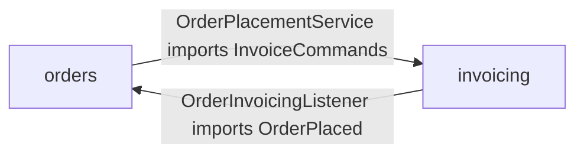
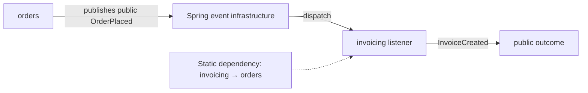

# Suppress dependency cycle không có lý do

Trong chương **Lỗi thường gặp** của học phần **SPRING_MODULITH_VERIFICATION_TESTING**, một sai lầm nguy hiểm là **vô hiệu hóa kiểm tra chu trình phụ thuộc giữa các application module** chỉ để CI chuyển sang màu xanh, nhưng không ghi nhận nguyên nhân, phạm vi, người chịu trách nhiệm hoặc kế hoạch sửa.

Spring Modulith hướng tới các module có ranh giới và hướng phụ thuộc có thể kiểm chứng. Một chu trình như `orders → invoicing → orders` khiến hai module không còn độc lập theo chiều phụ thuộc mã nguồn: thay đổi public API của một phía có thể kéo phía kia đổi theo; test bootstrap khó cô lập; việc chia tách module hoặc thay persistence implementation trở nên tốn kém. Việc “suppress” bằng `@Disabled`, bỏ `ApplicationModules.verify()` khỏi pipeline hoặc đóng băng toàn bộ vi phạm có thể che lỗi, nhưng **không làm đồ thị phụ thuộc trở thành phi chu trình**.

Bài tập trung vào **chu trình ở cấp Spring Modulith module** (static source dependency), có ví dụ Java 17+ và JUnit Jupiter, cách giải quyết qua event hoặc port, và quy trình xử lý ngoại lệ có kiểm soát. Mục tiêu là sử dụng `ApplicationModules.verify()`, `@ApplicationModuleTest`, `PublishedEvents`, `Scenario` và quality gate CI theo đúng trách nhiệm, không lẫn với các lỗi transaction/database hoặc bean wiring.

## 1. Một cycle là vấn đề kiến trúc, không phải một dòng cảnh báo vô hại

Xét ứng dụng có hai application module:

```text
com.example.shop
├── orders
│   ├── OrderPlacementService.java
│   └── OrderPlaced.java
└── invoicing
    ├── InvoiceCommands.java
    └── internal
        └── OrderInvoicingListener.java
```

- `orders.OrderPlacementService` import `invoicing.InvoiceCommands` để chủ động yêu cầu tạo hóa đơn.
- `invoicing.internal.OrderInvoicingListener` import `orders.OrderPlaced` để nhận sự kiện đơn hàng.

Đồ thị **phụ thuộc tĩnh**:



Đây là chu trình **ở cấp module**, dù Java có thể compile và Spring có thể khởi động. Không nhất thiết phải có một vòng constructor injection trực tiếp giữa hai bean. Một chu trình kiến trúc còn có thể đến từ chữ ký method, implements interface, annotation, DTO hoặc class configuration.

### 1.1. Hệ quả cần quan sát được

| Hệ quả | Ví dụ thực tế | Bằng chứng kiểm tra |
| --- | --- | --- |
| Hai chiều coupling | Sửa `InvoiceCommands` kéo sửa `orders`; sửa `OrderPlaced` kéo sửa `invoicing` | Xem dependency/import graph |
| Bootstrap khó cô lập | `@ApplicationModuleTest` của mỗi phía có nhiều dependency và cấu hình ngoài ý định | Xem module scope và bean startup |
| Refactor thiếu an toàn | Tách `invoicing` khỏi monolith nhưng `orders` vẫn gọi interface nội bộ của phía ấy | Kiểm tra public contract và caller |
| Dễ làm trùng nghiệp vụ | Orders gọi tạo hóa đơn trực tiếp, sau đó lại publish event để listener tạo nữa | Assert số invoice/result event theo `orderId` |
| Mất hiệu lực kiến trúc gate | Test `ApplicationModules.verify()` bị tắt vì cycle | Kiểm tra trạng thái kiểm thử trong CI |

**Không suy rằng mọi cycle đều gây exception runtime ngay lập tức.** Một application có thể vẫn chạy ở hiện tại. Mục đích của architecture verification là chặn rủi ro cấu trúc **trước khi** nó biến thành lỗi hồi quy hoặc làm chậm thay đổi.

### 1.2. Ba dấu hiệu dễ gây nhầm

- **Static module cycle:** A phụ thuộc kiểu thuộc B và B phụ thuộc kiểu thuộc A; `ApplicationModules.verify()` kiểm tra mô hình module.
- **Spring bean creation cycle:** hai hoặc nhiều bean cần nhau để constructor injection; Spring có thể báo `BeanCurrentlyInCreationException` khi khởi tạo context. Không cần có bean cycle thì mới có module cycle.
- **Runtime event loop:** handler của event A phát B, handler B lại phát A lặp lại. Điều đó có thể xảy ra dù mã nguồn dùng public event abstractions và không có vòng phụ thuộc static tương ứng.

Mỗi loại cần bằng chứng và cách sửa riêng. Không tắt `verify()` vì nhìn thấy một stack trace bean cycle, và cũng không sửa event retry bằng cách di chuyển package ngẫu nhiên.

## 2. Đọc đúng đồ thị: cạnh nào tạo cycle, cạnh nào chỉ là event flow?

Định nghĩa một cạnh phụ thuộc tĩnh `A → B` khi source code của module A phụ thuộc một kiểu hoặc API thuộc module B. Vòng:

```text
orders → invoicing → orders
```

có thể ngắn hai cạnh, nhưng trong hệ thống lớn còn có:

```text
orders → payments → customers → orders
```

Một dependency gián tiếp vẫn tạo cycle; không chỉ tìm hai class import qua lại trong cùng một package.

### 2.1. Thứ tự kiểm tra cạnh

1. Ghi **module path** do verifier phát hiện, giữ thứ tự cạnh.
2. Với từng cạnh, tìm **class nguồn**, **class đích** và cách reference: constructor, parameter, return type, generic, annotation, inheritance hoặc listener event type.
3. Phân loại dependency: **synchronous command/query**, **public event contract**, **shared domain type**, **persistence implementation**, **test-only import**.
4. Xác định ai **sở hữu invariant**: module nào là nguồn dữ liệu/quyết định nghiệp vụ?
5. Đề xuất **loại một chiều phụ thuộc**, không đơn giản là đổi tên package.
6. Chạy lại kiểm chứng kiến trúc và hành vi theo đúng hướng mới.

### 2.2. Đừng nhầm chiều event với chiều Java dependency

Giả sử `orders` publish `OrderPlaced` và `invoicing` lắng nghe:

```text
Luồng event ở runtime:
orders --OrderPlaced--> invoicing

Quan hệ import ở source:
invoicing --import orders.OrderPlaced--> orders
```

Publisher `orders` chỉ phụ thuộc Spring `ApplicationEventPublisher` và event type **do chính orders sở hữu**. Nó **không cần import consumer**. Đây là một hướng phụ thuộc có thể giữ phi chu trình.

Ngược lại, nếu `orders` vừa publish event vừa import `invoicing.InvoiceCommands`, ta bổ sung cạnh **orders → invoicing** và tạo cycle. **Luồng giao sự kiện theo một chiều không làm Java dependency tự động đi theo chiều ấy.**

### 2.3. Nhận diện điểm cắt tối thiểu

Với đồ thị hai chiều, chỉ cần loại **một cạnh** là hết vòng:

| Điểm cắt | Ý nghĩa | Khi phù hợp |
| --- | --- | --- |
| Bỏ `orders → invoicing` | Orders phát event, invoicing xử lý độc lập | Chấp nhận eventual processing |
| Bỏ `invoicing → orders` | Invoicing không import event/type của orders | Có thể thiết kế contract khác thật sự độc lập |
| Đảo chiều qua port thuộc bên gọi | Orders phụ thuộc interface **của chính orders**, invoicing triển khai | Cần câu trả lời đồng bộ mà muốn giảm coupling |
| Tách domain/shared contract thành module thứ ba | Cả hai cùng phụ thuộc một abstraction độc lập | Kiểu hợp đồng thực sự dùng chung, không phải “dumping ground” |
| Gộp lại thành một module | Hai phần không có ranh giới nghiệp vụ đủ độc lập | Một aggregate/invariant bắt buộc transaction đồng bộ |

Điểm cắt phải dựa trên **hợp đồng nghiệp vụ**, không chỉ để làm graph đẹp. Nếu việc tạo hóa đơn là một phần của quyết định không thể tách khỏi transaction đặt đơn, cần thiết kế transaction/port hoặc xem lại ranh giới module, không chuyển sang event bất đồng bộ mà bỏ invariant.

## 3. Mã gây cycle: orders gọi invoicing, invoicing lại import orders

Ví dụ sau là **phiên bản lỗi để phân tích**, không phải các source file được giữ song song với bản sửa ở mục 5. Giả sử `ShopApplication` đặt tại `com.example.shop` và hai subpackage `orders`, `invoicing` là application modules.

Tệp `com/example/shop/invoicing/InvoiceCommands.java`:

```java
package com.example.shop.invoicing;

import java.math.BigDecimal;
import java.util.UUID;

public interface InvoiceCommands {
    void createForOrder(UUID orderId, BigDecimal amount);
}
```

Tệp `com/example/shop/orders/OrderPlaced.java`:

```java
package com.example.shop.orders;

import java.math.BigDecimal;
import java.util.UUID;

public record OrderPlaced(
        UUID orderId,
        BigDecimal amount) {
}
```

Tệp `com/example/shop/orders/OrderPlacementService.java`, **phiên bản gây cycle**:

```java
package com.example.shop.orders;

import com.example.shop.invoicing.InvoiceCommands;
import java.math.BigDecimal;
import java.util.Objects;
import java.util.UUID;
import org.springframework.context.ApplicationEventPublisher;
import org.springframework.stereotype.Service;

@Service
public class OrderPlacementService {

    private final InvoiceCommands invoices;
    private final ApplicationEventPublisher publisher;

    public OrderPlacementService(
            InvoiceCommands invoices,
            ApplicationEventPublisher publisher) {
        this.invoices = invoices;
        this.publisher = publisher;
    }

    public void place(UUID orderId, BigDecimal amount) {
        Objects.requireNonNull(orderId);
        Objects.requireNonNull(amount);

        if (amount.signum() <= 0) {
            throw new IllegalArgumentException(
                    "amount must be positive");
        }

        invoices.createForOrder(orderId, amount); // orders → invoicing
        publisher.publishEvent(new OrderPlaced(orderId, amount));
    }
}
```

Trong module `invoicing` có một listener:

```java
package com.example.shop.invoicing.internal;

import com.example.shop.orders.OrderPlaced;
import org.springframework.context.event.EventListener;
import org.springframework.stereotype.Component;

@Component
public class OrderInvoicingListener {

    @EventListener
    public void on(OrderPlaced event) {  // invoicing → orders
        // Prepare invoice according to domain contract.
    }
}
```

Trong hệ thống giả định này có **hai reference tĩnh ở hai chiều**:

| Cạnh | Class nguồn | Class đích | Tại sao tạo cạnh? |
| --- | --- | --- | --- |
| `orders → invoicing` | `OrderPlacementService` | `InvoiceCommands` | Constructor field và method call |
| `invoicing → orders` | `OrderInvoicingListener` | `OrderPlaced` | Parameter của `@EventListener` |

`InvoiceCommands` nằm ở API gốc của `invoicing`, nên Java import có vẻ đúng; listener cũng chỉ import public event ở API gốc của `orders`. **Hai cạnh có thể đều hợp lệ về độ hiển thị nhưng vẫn ghép thành một dependency cycle.** Bởi vậy, chỉ xem package `internal` hoặc `allowedDependencies` là chưa đủ.

### 3.1. Đừng lẫn lỗi kiến trúc với lỗi double processing

Trong code lỗi, nếu `InvoiceCommands.createForOrder(…)` đã tạo hóa đơn, sau đó listener cũng làm điều đó vì `OrderPlaced`, có thể có **hai đường tạo hóa đơn**. Nhưng duplicate side effect **không tự xảy ra** nếu listener chỉ làm việc khác hoặc có idempotency. Hai vấn đề cần kiểm chứng độc lập:

- **Kiến trúc:** có chu trình static `orders ↔ invoicing` dù chưa xử lý một request nào.
- **Hành vi:** một `orderId` có sinh thêm hóa đơn hoặc event kết quả quá số lần hợp đồng không?

Không dùng việc “chưa thấy duplicate” để biện hộ cho một cycle; cũng không dùng `verify()` pass để chứng minh downstream side effect exactly-once.

### 3.2. Hình thức fail cần được ghi đúng

Một test gọi `ApplicationModules.verify()` có thể báo lỗi kiến trúc từ phân tích module **trước khi chạy bất kỳ use case nào**. Không nên chép một stack trace tưởng tượng với tên exception/version cụ thể rồi gọi là kết quả đã chạy. Trong issue thực, hãy lưu:

```text
Architecture verification: FAILED
Detected cycle: orders → invoicing → orders
Edge 1: orders.OrderPlacementService → invoicing.InvoiceCommands
Edge 2: invoicing.internal.OrderInvoicingListener → orders.OrderPlaced
Code revision: <actual commit>
Verifier output excerpt: <actual message>
```

Đây là **mẫu báo cáo**, các placeholder cần điền từ lần chạy thực.

## 4. Những cách “suppress” không giải quyết được nguyên nhân

### 4.1. Bỏ qua cả bài architecture test

Anti-pattern rõ nhất:

```java
package com.example.shop;

import org.junit.jupiter.api.Disabled;
import org.junit.jupiter.api.Test;
import org.springframework.modulith.core.ApplicationModules;

@Disabled("Temporary: cycle not fixed")
class DisabledArchitectureVerificationTests {

    @Test
    void verifiesModules() {
        ApplicationModules.of(ShopApplication.class).verify();
    }
}
```

Annotation `@Disabled` khiến JUnit **không chạy** test này. Đó là **tắt toàn bộ quality gate**, không phải chấp nhận có chọn lọc một edge. Chu trình vẫn tồn tại; các cycle khác phát sinh sau đó cũng có thể lọt qua.

Tương tự, việc loại class test khỏi build, bỏ job kiến trúc khỏi CI, cho job fail nhưng luôn báo success, hoặc chạy `./mvnw -DskipTests` thay cho một gate bắt buộc đều **không phải sửa cycle**.

### 4.2. @SuppressWarnings không tắt bộ kiểm chứng Modulith

```java
@SuppressWarnings("all")
public class OrderPlacementService {
    // Dependency tĩnh vẫn tồn tại.
}
```

`@SuppressWarnings` là công cụ cho một số cảnh báo từ compiler/static tooling có hỗ trợ. Nó **không tự thay đổi module graph** và không phải API để `ApplicationModules.verify()` bỏ qua cyclic dependencies. Đừng nhầm một annotation trên class với cấu hình ngoại lệ có hiệu lực cho bộ kiểm chứng kiến trúc.

### 4.3. allowedDependencies và NamedInterface không xóa vòng

Giả sử mở allowlist hai phía:

```java
// orders/package-info.java — KHÔNG phải giải pháp cho cycle.
@org.springframework.modulith.ApplicationModule(
        allowedDependencies = "invoicing")
package com.example.shop.orders;
```

```java
// invoicing/package-info.java — KHÔNG phải giải pháp cho cycle.
@org.springframework.modulith.ApplicationModule(
        allowedDependencies = "orders")
package com.example.shop.invoicing;
```

`allowedDependencies` giới hạn module được phép tham chiếu; nó không phải cơ chế biến đồ thị có vòng thành DAG. `@NamedInterface` công bố một phần API của module, cũng **không tự bẻ gãy chiều import**. Hai câu hỏi phải tách biệt:

1. **Cạnh A → B có được phép truy cập public/named interface không?**
2. **Tổng đồ thị module có chu trình không?**

Một cạnh có thể hợp lệ theo câu hỏi thứ nhất nhưng vẫn tham gia chu trình theo câu hỏi thứ hai.

### 4.4. Đóng băng toàn bộ lỗi bằng một baseline vĩnh viễn

Một số đội dùng cơ chế baseline/“freeze existing violations” từ công cụ phân tích kiến trúc như ArchUnit. Cách này **có thể** giúp đưa legacy code vào kiểm soát dần, nhưng nếu chấp nhận toàn bộ violation mà không có owner và thời hạn thì:

- Cycle cũ không bao giờ được giảm.
- Việc thêm cạnh mới có thể làm tình hình xấu hơn mà không ai nhận ra nếu baseline quá rộng.
- Team mới không biết ngoại lệ dựa trên invariant hay chỉ do lịch sử.
- Bản release vẫn mang rủi ro coupling.

Không giả định một API suppression nào của ArchUnit có thể truyền trực tiếp vào `ApplicationModules.verify()`. Nếu dùng baseline cho **một quy tắc ArchUnit riêng**, hãy mô tả rõ rule đó kiểm tra gì, có bảo toàn những rule còn lại không và cơ chế bổ sung nào vẫn chạy.

### 4.5. Một suppression “có lý do” cần gì?

Ngay cả khi chưa thể refactor ngay, tối thiểu phải có:

| Thành phần | Ví dụ cần ghi |
| --- | --- |
| **Cycle cụ thể** | `orders → invoicing → orders`, kèm class/file tạo mỗi cạnh |
| **Lý do chưa thể sửa** | Đang chuyển API đồng bộ sang port, phải tương thích một hợp đồng đang triển khai |
| **Tác động hiện tại** | Module test bị mở rộng, thay đổi API cần sửa hai phía |
| **Owner** | Nhóm/phụ trách quyết định thiết kế |
| **Ticket/ADR** | `ARCH-214` / ADR mô tả hướng xử lý |
| **Thời hạn** | Mốc sprint/release có ngày cụ thể |
| **Phạm vi cho phép** | Chỉ cycle cũ được ghi nhận, không cho thêm cycle mới |
| **Tiêu chí gỡ ngoại lệ** | `verify()` pass khi bỏ chiều import đã xác định |

Lưu ý: bảng này là **chính sách quản trị rủi ro**, không phải một annotation làm Spring Modulith tự chấp nhận cycle. Khi gate chuẩn vẫn fail, cần quyết định minh bạch về pipeline và một cơ chế giám sát phù hợp thay vì bí mật bỏ qua.

## 5. Refactor trực tiếp: bỏ chiều orders → invoicing bằng public event

Giả định nghiệp vụ cho phép: **đơn được đặt trước, hóa đơn được chuẩn bị như một hệ quả** và không cần đợi hóa đơn hoàn tất để công nhận lệnh đặt đơn. Khi đó, `orders` không nên gọi `InvoiceCommands`. Nó chỉ publish public event `OrderPlaced`; `invoicing` là consumer độc lập.

Sơ đồ sau khi sửa:



Trong code Java, **chỉ còn `invoicing → orders`** vì listener import type `OrderPlaced`. Đường event runtime đi theo chiều từ producer tới consumer, nhưng producer không import consumer.

### 5.1. Cấu trúc source sau refactor

```text
src/main/java/com/example/shop/
├── ShopApplication.java
├── orders/
│   ├── OrderPlaced.java
│   └── OrderPlacementService.java
└── invoicing/
    ├── InvoiceCreated.java
    ├── InvoiceQueries.java
    ├── InvoiceView.java
    └── internal/
        ├── InvoiceMemoryStore.java
        └── OrderInvoicingListener.java

src/test/java/com/example/shop/
├── ArchitectureVerificationTests.java
├── orders/
│   └── OrderPlacementModuleTests.java
└── invoicing/
    └── InvoicingModuleTests.java
```

Đây là **ví dụ self-contained về module, event và test** dùng in-memory state. Nó chưa mô phỏng DB transaction hoặc broker; phần sau sẽ nêu nơi cần test tích hợp nếu triển khai production có outbox/JPA.

### 5.2. Spring Boot application root

Tệp `src/main/java/com/example/shop/ShopApplication.java`:

```java
package com.example.shop;

import org.springframework.boot.SpringApplication;
import org.springframework.boot.autoconfigure.SpringBootApplication;

@SpringBootApplication
public class ShopApplication {

    public static void main(String[] args) {
        SpringApplication.run(ShopApplication.class, args);
    }
}
```

### 5.3. Public event của orders giữ nguyên

Tệp `src/main/java/com/example/shop/orders/OrderPlaced.java`:

```java
package com.example.shop.orders;

import java.math.BigDecimal;
import java.util.UUID;

public record OrderPlaced(
        UUID orderId,
        BigDecimal amount) {
}
```

Public event thuộc **module sở hữu hành vi đặt đơn**. `invoicing` có thể phụ thuộc type này để xử lý. Không chuyển `OrderPlaced` sang `invoicing.internal`; làm vậy đảo ngược ownership và tạo thêm dependency không mong muốn.

### 5.4. Service orders không import invoicing nữa

Tệp `src/main/java/com/example/shop/orders/OrderPlacementService.java`, **phiên bản đã sửa**:

```java
package com.example.shop.orders;

import java.math.BigDecimal;
import java.util.Objects;
import java.util.UUID;
import org.springframework.context.ApplicationEventPublisher;
import org.springframework.stereotype.Service;

@Service
public class OrderPlacementService {

    private final ApplicationEventPublisher publisher;

    public OrderPlacementService(
            ApplicationEventPublisher publisher) {
        this.publisher = publisher;
    }

    public void place(UUID orderId, BigDecimal amount) {
        Objects.requireNonNull(orderId, "orderId");
        Objects.requireNonNull(amount, "amount");

        if (amount.signum() <= 0) {
            throw new IllegalArgumentException(
                    "amount must be positive");
        }

        publisher.publishEvent(new OrderPlaced(orderId, amount));
    }
}
```

So với code mục 3, **đã loại bỏ `import com.example.shop.invoicing.InvoiceCommands`, field `invoices` và lời gọi `invoices.createForOrder(…)`**. Hãy kiểm tra **mọi** đường code của module orders, không chỉ method `place`: một config, DTO hoặc utility khác còn import invoicing thì cycle có thể vẫn tồn tại.

### 5.5. Public outcome và read contract của invoicing

Tệp `src/main/java/com/example/shop/invoicing/InvoiceCreated.java`:

```java
package com.example.shop.invoicing;

import java.math.BigDecimal;
import java.util.UUID;

public record InvoiceCreated(
        UUID orderId,
        BigDecimal amount) {
}
```

Tệp `src/main/java/com/example/shop/invoicing/InvoiceView.java`:

```java
package com.example.shop.invoicing;

import java.math.BigDecimal;
import java.util.UUID;

public record InvoiceView(
        UUID orderId,
        BigDecimal amount) {
}
```

Tệp `src/main/java/com/example/shop/invoicing/InvoiceQueries.java`:

```java
package com.example.shop.invoicing;

import java.util.Optional;
import java.util.UUID;

public interface InvoiceQueries {
    Optional<InvoiceView> findByOrderId(UUID orderId);
}
```

Public query ở đây có ý nghĩa khi một caller thật sự cần đọc hóa đơn. Nếu production không có yêu cầu query, test consumer có thể chỉ kiểm tra `InvoiceCreated`; **không thêm public API chỉ để một test nhìn được internal state**.

### 5.6. In-memory store triển khai public query, nằm trong internal

Tệp `src/main/java/com/example/shop/invoicing/internal/InvoiceMemoryStore.java`:

```java
package com.example.shop.invoicing.internal;

import com.example.shop.invoicing.InvoiceQueries;
import com.example.shop.invoicing.InvoiceView;
import java.util.Optional;
import java.util.UUID;
import java.util.concurrent.ConcurrentHashMap;
import java.util.concurrent.ConcurrentMap;
import org.springframework.stereotype.Component;

@Component
class InvoiceMemoryStore implements InvoiceQueries {

    private final ConcurrentMap<UUID, InvoiceView> invoices =
            new ConcurrentHashMap<>();

    boolean insertIfAbsent(InvoiceView view) {
        return invoices.putIfAbsent(view.orderId(), view) == null;
    }

    @Override
    public Optional<InvoiceView> findByOrderId(UUID orderId) {
        return Optional.ofNullable(invoices.get(orderId));
    }
}
```

Store là package-private: module orders không cần biết nó tồn tại. `ConcurrentHashMap.putIfAbsent` hạn chế duplicate theo `orderId` trong **một JVM**; nó không bảo đảm transaction, durability hoặc exactly-once trên nhiều application instances.

### 5.7. Listener invoicing import duy nhất public OrderPlaced

Tệp `src/main/java/com/example/shop/invoicing/internal/OrderInvoicingListener.java`:

```java
package com.example.shop.invoicing.internal;

import com.example.shop.invoicing.InvoiceCreated;
import com.example.shop.invoicing.InvoiceView;
import com.example.shop.orders.OrderPlaced;
import org.springframework.context.ApplicationEventPublisher;
import org.springframework.context.event.EventListener;
import org.springframework.stereotype.Component;

@Component
class OrderInvoicingListener {

    private final InvoiceMemoryStore invoices;
    private final ApplicationEventPublisher publisher;

    OrderInvoicingListener(
            InvoiceMemoryStore invoices,
            ApplicationEventPublisher publisher) {
        this.invoices = invoices;
        this.publisher = publisher;
    }

    @EventListener
    public void on(OrderPlaced event) {
        var view = new InvoiceView(
                event.orderId(), event.amount());

        if (invoices.insertIfAbsent(view)) {
            publisher.publishEvent(new InvoiceCreated(
                    event.orderId(), event.amount()));
        }
    }
}
```

Module `invoicing` **phụ thuộc `orders` theo compile-time** thông qua public event. Module `orders` không phụ thuộc `invoicing`. Listener `@EventListener` đồng bộ trong demo, không cần transaction để kích hoạt; nếu production dùng `@TransactionalEventListener(AFTER_COMMIT)`, cần commit thật trước khi consumer chạy.

**Đừng chuyển mọi call đồng bộ sang event một cách máy móc.** Ở demo này, business contract đã định nghĩa việc chuẩn bị hóa đơn là hậu quả xử lý event. Với hạ tầng durable, cần thêm outbox/retry/idempotency tests, không được suy rằng `publishEvent` đồng nghĩa hóa đơn đã được commit.

## 6. Kiểm chứng ranh giới thật: ApplicationModules.verify() phải chạy

Test kiến trúc sau refactor:

Tệp `src/test/java/com/example/shop/ArchitectureVerificationTests.java`:

```java
package com.example.shop;

import org.junit.jupiter.api.Test;
import org.springframework.modulith.core.ApplicationModules;

class ArchitectureVerificationTests {

    @Test
    void moduleDependenciesAreAcyclicAndValid() {
        ApplicationModules.of(ShopApplication.class).verify();
    }
}
```

Điều cần thấy:

| Trạng thái source | Đồ thị | Architecture test mong đợi |
| --- | --- | --- |
| Có `orders → invoicing` **và** `invoicing → orders` | Cycle | **FAIL** |
| Bỏ chỉ một lời gọi nhưng còn import invoicing khác ở orders | Có thể vẫn cycle | Không được kết luận PASS nếu chưa chạy verify |
| Refactor toàn bộ orders không còn import invoicing, invoicing chỉ import public `orders.OrderPlaced` | Một chiều | **PASS** với giả định không có violation khác |
| Tắt test bằng `@Disabled` | Không thực thi verify | **Không phải PASS** |
| Dùng `allowedDependencies` cho cả hai chiều | Vòng vẫn tồn tại | Không coi là đã sửa cycle |

`ApplicationModules.verify()` còn kiểm tra các quy tắc module khác mà Spring Modulith hỗ trợ, như access tới API nội bộ, mô hình dependencies được phép và chu trình. Vì vậy, một test vẫn có thể fail **sau khi đã loại cycle** do một vi phạm kiến trúc khác. Hãy đọc **toàn bộ báo cáo root cause**, không tự động quy mọi lỗi còn lại cho cycle cũ.

### 6.1. Biện pháp chống “suppress bằng pipeline”

Giữ architecture verification trong **bộ test bắt buộc**. Nếu dùng CI task riêng để chạy test này, cần bảo đảm:

1. Test được **discovered và executed** chứ không chỉ compile.
2. Job fail khi `verify()` ném exception; không có `continue-on-error` hoặc logic bỏ exit code.
3. Bài test không gắn `@Disabled`/exclude pattern.
4. Nếu có report, số test **skipped** không bị đọc nhầm là passed.
5. PR thay cấu trúc module cần có bằng chứng gate chạy, không chỉ ảnh chụp build xanh của task bỏ qua tests.

Lệnh minh họa, chỉ dùng khi dự án thực sự có wrapper tương ứng:

```bash
./mvnw -Dtest=ArchitectureVerificationTests test
```

Hoặc:

```bash
./gradlew test --tests "com.example.shop.ArchitectureVerificationTests" --stacktrace
```

**Các lệnh trên chưa được chạy khi soạn bài.** Khi áp dụng cho repository thật, lưu commit, build tool/version và output cụ thể; không bịa kết quả “verify pass”.

### 6.2. Phân biệt production code và test-only source

`ApplicationModules.of(ShopApplication.class).verify()` phân tích application module model và thường trọng tâm là **production classes**. Nếu chỉ trong `src/test/java` có test import `invoicing.internal.*`, không nên tự khẳng định lời gọi này chắc chắn đã kiểm tra toàn bộ test-only dependencies. Có thể cần thêm code review hoặc rule riêng chủ động import compiled test classes.

Điều đó **không làm nhẹ đi cycle trong production source**. Với ví dụ mục 3, cả hai cạnh nằm ở `src/main/java` nên thuộc phạm vi kiến trúc cần được kiểm chứng.

### 6.3. Bằng chứng lỗi tối thiểu trong pull request

```text
Root cause: cycle orders -> invoicing -> orders
Edge 1: OrderPlacementService imports InvoiceCommands
Edge 2: OrderInvoicingListener imports OrderPlaced
Change: removed orders' direct InvoiceCommands dependency
New static direction: invoicing -> orders only
Architecture test: <actual result with revision>
Behavior tests: <actual publisher/consumer results>
Remaining constraints: <transaction/outbox/integration tests if any>
```

Nếu chưa chạy test, hãy ghi `not executed`; không đưa các dự đoán vào ô kết quả.

## 7. Java/JUnit bảo vệ hành vi sau khi bẻ cycle

Architecture verification phát hiện chu trình tĩnh; nó **không chứng minh** sự kiện được publish đúng hoặc listener tạo hóa đơn. Do đó cần hai module tests với phạm vi ownership riêng.

### 7.1. Test orders chỉ kiểm tra public OrderPlaced

Tệp `src/test/java/com/example/shop/orders/OrderPlacementModuleTests.java`:

```java
package com.example.shop.orders;

import static org.assertj.core.api.Assertions.assertThat;
import static org.assertj.core.api.Assertions.assertThatThrownBy;

import java.math.BigDecimal;
import java.util.UUID;
import org.junit.jupiter.api.Test;
import org.springframework.beans.factory.annotation.Autowired;
import org.springframework.modulith.test.ApplicationModuleTest;
import org.springframework.modulith.test.PublishedEvents;

@ApplicationModuleTest
class OrderPlacementModuleTests {

    @Autowired
    OrderPlacementService orders;

    @Test
    void acceptedOrderPublishesExactlyOneOrderPlaced(
            PublishedEvents events) {
        UUID orderId = UUID.randomUUID();
        BigDecimal amount = new BigDecimal("120.00");

        orders.place(orderId, amount);

        assertThat(events.ofType(OrderPlaced.class)
                .matching(e -> orderId.equals(e.orderId())))
                .hasSize(1)
                .allSatisfy(e ->
                        assertThat(e.amount())
                                .isEqualByComparingTo(amount));
    }

    @Test
    void invalidAmountDoesNotPublishOrderPlaced(
            PublishedEvents events) {
        UUID orderId = UUID.randomUUID();

        assertThatThrownBy(() ->
                orders.place(orderId, BigDecimal.ZERO))
                .isInstanceOf(IllegalArgumentException.class)
                .hasMessage("amount must be positive");

        assertThat(events.ofType(OrderPlaced.class)
                .matching(e -> orderId.equals(e.orderId())))
                .isEmpty();
    }
}
```

**Ý nghĩa:** Test ở `orders` với `@ApplicationModuleTest` không cần bootstrap `invoicing` để xem `OrderPlaced` đã publish đúng. Đây là lợi ích thực tế của việc loại chiều dependency **orders → invoicing**: module producer có một contract test nhỏ, không cần fake `InvoiceCommands`.

### 7.2. Test invoicing xử lý OrderPlaced và phát InvoiceCreated

Tệp `src/test/java/com/example/shop/invoicing/InvoicingModuleTests.java`:

```java
package com.example.shop.invoicing;

import static org.assertj.core.api.Assertions.assertThat;

import com.example.shop.orders.OrderPlaced;
import java.math.BigDecimal;
import java.util.UUID;
import org.junit.jupiter.api.Test;
import org.springframework.beans.factory.annotation.Autowired;
import org.springframework.context.ApplicationEventPublisher;
import org.springframework.modulith.test.ApplicationModuleTest;
import org.springframework.modulith.test.PublishedEvents;
import org.springframework.modulith.test.Scenario;

@ApplicationModuleTest
class InvoicingModuleTests {

    @Autowired
    ApplicationEventPublisher publisher;

    @Autowired
    InvoiceQueries invoices;

    @Test
    void orderPlacedProducesInvoiceOutcome(
            Scenario scenario,
            PublishedEvents events) {
        UUID orderId = UUID.randomUUID();
        BigDecimal amount = new BigDecimal("120.00");

        scenario.stimulate(() ->
                        publisher.publishEvent(
                                new OrderPlaced(orderId, amount)))
                .andWaitForEventOfType(InvoiceCreated.class)
                .matching(e -> orderId.equals(e.orderId()))
                .toArriveAndVerify(e ->
                        assertThat(e.amount())
                                .isEqualByComparingTo(amount));

        assertThat(events.ofType(OrderPlaced.class)
                .matching(e -> orderId.equals(e.orderId())))
                .hasSize(1);

        assertThat(invoices.findByOrderId(orderId))
                .contains(new InvoiceView(orderId, amount));
    }

    @Test
    void repeatedOrderPlacedHasOneInvoiceOutcome(
            PublishedEvents events) {
        UUID orderId = UUID.randomUUID();
        BigDecimal amount = new BigDecimal("120.00");
        var source = new OrderPlaced(orderId, amount);

        publisher.publishEvent(source);
        publisher.publishEvent(source);

        assertThat(events.ofType(InvoiceCreated.class)
                .matching(e -> orderId.equals(e.orderId())))
                .hasSize(1);

        assertThat(invoices.findByOrderId(orderId))
                .contains(new InvoiceView(orderId, amount));
    }
}
```

Điểm phân biệt:

- Test consumer thuộc `invoicing`, nên listener nằm trong scope mà `@ApplicationModuleTest` cần kiểm tra.
- Source event `OrderPlaced` là public contract từ `orders`; consumer test có thể kích hoạt nó trực tiếp mà không cần đưa `OrderPlacementService` vào test context.
- `Scenario` chờ public outcome theo `orderId`; `InvoiceQueries` kiểm tra state observable, không đọc field của `InvoiceMemoryStore` nội bộ.
- Test duplicate trong demo dùng `putIfAbsent`, kiểm tra một outcome khi cùng `orderId` được gửi lại; đây là **idempotency in-memory**, không thay database unique constraint.

### 7.3. Vì sao hai tests chưa đủ cho production DB/async?

Ví dụ demo là in-memory với `@EventListener` đồng bộ. Nếu production có JPA/`@TransactionalEventListener(AFTER_COMMIT)`, cần integration test riêng xác minh:

1. Transaction nguồn thực sự commit trước callback hậu commit.
2. Invoice row được persist đúng, có unique constraint theo business key.
3. Consumer có idempotency khi event bị redeliver.
4. Side effect đã commit mới được báo là thành công nếu contract yêu cầu.
5. Listener/async executor còn đủ bean khi bootstrap đúng module.

Không “sửa cycle” bằng cách thay `@EventListener` thành `@Async` một cách tùy tiện hoặc tăng `Scenario` timeout: asynchronous execution **không loại cạnh dependency tĩnh**.

## 8. Nếu nghiệp vụ cần đồng bộ: đảo chiều dependency qua port hoặc đổi ranh giới

Event là lời giải phù hợp khi invoicing có thể xử lý **sau** việc đặt đơn. Nhưng nếu orders cần một quyết định ngay trong cùng use case, ví dụ **kiểm tra tín dụng trước khi accept order**, không nên chuyển sang event chỉ để che cycle mà bỏ kiểm tra bắt buộc.

### 8.1. Định nghĩa port tại module gọi

Thay vì orders import `invoicing.CreditService`, orders định nghĩa contract nó **sở hữu**:

Tệp `orders/OrderCreditPolicy.java` (biến thể kiến trúc, **không phải** một phần của source demo event-only ở mục 5):

```java
package com.example.shop.orders;

import java.math.BigDecimal;
import java.util.UUID;

public interface OrderCreditPolicy {
    boolean mayPlaceOrder(UUID customerId, BigDecimal amount);
}
```

Service trong orders chỉ inject interface **thuộc orders**:

```java
@Service
public class OrderPlacementService {

    private final OrderCreditPolicy credit;
    private final ApplicationEventPublisher publisher;

    public OrderPlacementService(
            OrderCreditPolicy credit,
            ApplicationEventPublisher publisher) {
        this.credit = credit;
        this.publisher = publisher;
    }

    public void place(UUID customerId, UUID orderId,
                      BigDecimal amount) {
        if (!credit.mayPlaceOrder(customerId, amount)) {
            throw new IllegalStateException("Credit rejected");
        }
        publisher.publishEvent(new OrderPlaced(orderId, amount));
    }
}
```

Đây là **mẫu class rút gọn** để so sánh với service mục 5: khi triển khai thật phải bổ sung package, import, validation và bảo đảm nó **thay thế**, không đồng tồn tại, với phiên bản event-only. Mục đích là cho thấy signature dùng `OrderCreditPolicy` của **orders**, không phụ thuộc trực tiếp vào một kiểu thuộc `invoicing`.

Adapter triển khai nằm ở invoicing:

```java
package com.example.shop.invoicing.internal;

import com.example.shop.orders.OrderCreditPolicy;
import java.math.BigDecimal;
import java.util.UUID;
import org.springframework.stereotype.Component;

@Component
class InvoicingOrderCreditPolicy
        implements OrderCreditPolicy {

    @Override
    public boolean mayPlaceOrder(
            UUID customerId, BigDecimal amount) {
        // Demo: quyết định đơn giản; production cần policy thật.
        return amount.signum() > 0
                && amount.compareTo(new BigDecimal("1000.00")) <= 0;
    }
}
```

Đồ thị:

```text
orders.OrderPlacementService
  → orders.OrderCreditPolicy (cùng module)

invoicing.internal.InvoicingOrderCreditPolicy
  → orders.OrderCreditPolicy (module invoicing → orders)

Không có static dependency orders → invoicing.
```

**Lưu ý runtime:** Trong `@ApplicationModuleTest` của orders `STANDALONE`, adapter thật từ invoicing có thể **không được bootstrap**. Một test contract có thể dùng `@TestConfiguration` để cấp fake `OrderCreditPolicy`; integration test với cả hai module dùng adapter thật. Đây là test-scope dependency cần cấu hình có chủ đích, không phải lý do quay lại import `invoicing.internal`.

### 8.2. Unit/module test cho port có cả đường chấp nhận và từ chối

Ví dụ khi test phiên bản có port:

```java
@ApplicationModuleTest
@Import(OrderCreditModuleTests.FakeCreditConfig.class)
class OrderCreditModuleTests {

    @Autowired
    OrderPlacementService orders;

    @TestConfiguration(proxyBeanMethods = false)
    static class FakeCreditConfig {

        @Bean
        OrderCreditPolicy creditPolicy() {
            return (customerId, amount) ->
                    amount.signum() > 0
                    && amount.compareTo(
                            new BigDecimal("1000.00")) <= 0;
        }
    }

    @Test
    void allowedOrderPublishesEvent(PublishedEvents events) {
        UUID orderId = UUID.randomUUID();
        UUID customerId = UUID.randomUUID();

        orders.place(customerId, orderId,
                new BigDecimal("120.00"));

        assertThat(events.ofType(OrderPlaced.class)
                .matching(e -> orderId.equals(e.orderId())))
                .hasSize(1);
    }

    @Test
    void deniedCreditDoesNotPublishEvent(PublishedEvents events) {
        UUID orderId = UUID.randomUUID();
        UUID customerId = UUID.randomUUID();

        assertThatThrownBy(() ->
                orders.place(customerId, orderId,
                        new BigDecimal("1500.00")))
                .isInstanceOf(IllegalStateException.class)
                .hasMessage("Credit rejected");

        assertThat(events.ofType(OrderPlaced.class)
                .matching(e -> orderId.equals(e.orderId())))
                .isEmpty();
    }
}
```

Đây là **một class test minh họa khác**, yêu cầu import JUnit, AssertJ, `@Autowired`, `@TestConfiguration`, `@Bean`, `@Import`, `@ApplicationModuleTest`, `PublishedEvents`, `UUID` và `BigDecimal` phù hợp. Nó chỉ áp dụng khi service đã đổi sang phiên bản **port**. Không chạy cùng lớp `OrderPlacementService` event-only của mục 5 mà chưa thay signature.

### 8.3. Khi nào tách contract module, khi nào gộp module?

Nếu `orders` và `invoicing` dùng chung một khái niệm ổn định thực sự (ví dụ `Money` hoặc credit decision contract có owner riêng), có thể tách module `financial-contracts`:

```text
orders ──────→ financial-contracts
invoicing ───→ financial-contracts
```

**Không** chuyển tất cả DTO, entity và repository vào `common` chỉ để xóa cảnh báo cycle. Một shared module không có ownership rõ có thể trở thành “god module” mà mọi module phải phụ thuộc.

Nếu hai phần cùng cập nhật một aggregate bất biến không thể tách, một giải pháp có cơ sở hơn là **gộp chúng vào một application module** với ranh giới ở mức nghiệp vụ lớn hơn. Việc gộp này phải có ADR/đánh giá chứ không chỉ nhằm giấu cycle.

## 9. Nếu chưa sửa được ngay: quản lý ngoại lệ có chứng cứ, không bỏ cả gate

Trong một hệ thống legacy, có thể cần thời gian để chuyển hai phía sang public event hoặc port. Một ngoại lệ tạm thời **chỉ có trách nhiệm** khi mọi người biết **đang chấp nhận rủi ro gì**, **tới khi nào** và **làm sao bảo đảm không phát sinh vòng mới**.

### 9.1. Mẫu quyết định kỹ thuật/waiver

```yaml
decision_id: "ADR-ARCH-CYCLE-014"
title: "Temporary cycle orders <-> invoicing"
status: "temporarily-accepted"
detected_edges:
  - "orders.OrderPlacementService -> invoicing.InvoiceCommands"
  - "invoicing.internal.OrderInvoicingListener -> orders.OrderPlaced"
reason: "Legacy synchronous API is still being migrated"
owner: "<team-or-maintainer>"
issue: "<tracking-ticket>"
created_at: "<actual-date>"
expires_at: "<agreed-review-date>"
allowed_scope: "Only the documented legacy cycle; no new cycles"
target_design: "Remove orders -> invoicing; keep invoicing -> orders"
exit_criteria:
  - "ApplicationModules.verify() passes on new design"
  - "Orders PublishedEvents contract passes"
  - "Invoicing consumer Scenario contract passes"
  - "Relevant DB/transaction integration tests pass"
ci_controls: "<actual narrowly scoped controls and reports>"
```

Đây là **mẫu tài liệu quyết định**, không phải cấu hình Spring Modulith. Các giá trị trong ngoặc nhọn phải được thay bằng dữ liệu xác nhận. Ngay cả khi có waiver, `ApplicationModules.verify()` **không tự chuyển thành PASS**: pipeline cần thể hiện minh bạch trạng thái vi phạm và không được gọi một gate bị vô hiệu hóa là “architecture verified”.

### 9.2. Ngoại lệ kỹ thuật cần hẹp, có thể gỡ bỏ

Nếu đội dùng một rule ArchUnit riêng có khả năng baseline/ignore violations:

- Chỉ ghi nhận **đường vi phạm đã biết**, không loại toàn bộ rule “không có cycle”.
- Không cho phép auto-update baseline trên mọi PR mà không review.
- Giữ một bài kiểm tra **không chấp nhận cycle mới**, theo rule và công cụ được xác nhận ở phiên bản đang dùng.
- Mỗi ngoại lệ có owner, ticket và ngày review.
- Thường xuyên so sánh số cycle và thành phần graph trước/sau thay đổi.

**Không bịa API exclude cho `ApplicationModules.verify()`.** Nếu giải pháp chỉ là tắt verifier và không có kiểm tra thay thế, hãy báo rõ CI đã **mất kiến trúc gate**, không diễn đạt thành “đã suppress an toàn”.

### 9.3. Test xác minh các mốc theo lộ trình

| Mốc | Điều kiện bắt buộc | Điều chưa được phép tuyên bố |
| --- | --- | --- |
| **Ghi nhận** | Có graph edges, owner và ticket | “Cycle đã được sửa” |
| **Bẻ cạnh static** | Code không còn import chiều ngược | “Behavior production đã chắc chắn đúng” |
| **Architecture gate** | `ApplicationModules.verify()` chạy và PASS | “Listener đã commit DB đúng” |
| **Module behavior** | Publisher và consumer tests pass | “Broker exactly-once” |
| **Integration** | Transaction/database/outbox contract pass | “Không còn rủi ro ngoài phạm vi đã test” |
| **Đóng waiver** | Loại ngoại lệ, báo cáo zero cycle trong phạm vi | “Có thể tắt gate từ nay” |

Một thay đổi từ callback đồng bộ sang event có thể làm đổi consistency model; cần review cam kết nghiệp vụ và transaction, không chỉ dựa vào kết quả static graph.

## 10. Checklist review, bài tập ngắn và tiêu chí hoàn thành

### 10.1. Checklist trước khi chấp nhận thay đổi module

- [ ] Đã xác định **đúng module cycle** và các class/reference tạo từng cạnh.
- [ ] Không lẫn static module cycle với `BeanCurrentlyInCreationException` hoặc event feedback loop.
- [ ] Có sơ đồ import graph **trước và sau** thay đổi.
- [ ] Đã xác nhận public API/named interface **không tự giải quyết** cycle.
- [ ] Không gắn `@Disabled` lên `ApplicationModules.verify()` để làm xanh CI.
- [ ] Không dùng `@SuppressWarnings` như một cách “loại trừ” cyclic dependency.
- [ ] Không thêm hai chiều `allowedDependencies` rồi tuyên bố module graph đã hợp lệ.
- [ ] Không public hóa toàn package `internal` chỉ để test hoặc verifier bớt báo lỗi.
- [ ] Cạnh bị loại phù hợp **ownership và business invariant**; event không làm mất yêu cầu đồng bộ.
- [ ] `orders` module test assert event nguồn; `invoicing` module test assert outcome.
- [ ] Khi dùng async/AFTER_COMMIT, có test commit và side effect phù hợp.
- [ ] `ApplicationModules.verify()` được **thực thi** trong CI, không bị skip.
- [ ] Nếu còn ngoại lệ legacy, có ADR/ticket, owner, deadline, scope, kế hoạch gỡ và giám sát cycle mới.

### 10.2. Bài tập kiểm chứng

1. **Vẽ graph:** từ code mục 3, chỉ ra chính xác hai class và hai dòng import tạo chu trình `orders ↔ invoicing`.
2. **Thử suppression sai:** thêm `@Disabled` cho architecture test. Giải thích tại sao CI xanh do test bị skipped khác hoàn toàn `verify()` PASS.
3. **Kiểm tra allowlist:** thêm `allowedDependencies` hai chiều, vẽ lại graph và giải thích vì sao vòng không biến mất.
4. **Refactor event:** bỏ `InvoiceCommands` khỏi orders; giữ `OrderPlaced` ở orders và listener ở invoicing. Nêu chiều static dependency còn lại.
5. **Architecture assertion:** viết `ApplicationModules.of(ShopApplication.class).verify()`, ghi kết quả trước/sau refactor từ lần chạy thực, không đoán exception message.
6. **Publisher contract:** viết `@ApplicationModuleTest` ở orders, dùng `PublishedEvents` xác minh một `OrderPlaced` cùng `orderId`/amount.
7. **Consumer contract:** đặt test tại invoicing, publish `OrderPlaced` và dùng `Scenario` chờ `InvoiceCreated` theo `orderId`.
8. **Tình huống đồng bộ:** giả sử orders bắt buộc phải được phê duyệt credit trước khi đặt đơn. Chọn port do orders sở hữu và viết fake có cả nhánh accept/reject.
9. **DB integration:** nếu invoicing dùng JPA, thiết kế test commit thật và đọc invoice bằng repository thuộc module invoicing; không dựa vào một `Scenario` outcome để khẳng định durability.
10. **Quản lý nợ kỹ thuật:** điền waiver mục 9, nêu exit criteria và cách bảo đảm không có cycle mới trong thời gian chuyển đổi.

### 10.3. Phân tầng quality gate trong CI

| Gate | Dấu hiệu đạt | Dấu hiệu đỏ |
| --- | --- | --- |
| **Architecture** | `verify()` thực sự chạy và không phát hiện violation | Module cycle, internal access, allowed dependency violation |
| **Publisher module** | Đúng `OrderPlaced` count/payload | Đơn hợp lệ không phát event hoặc phát sai |
| **Consumer module** | `InvoiceCreated`/`InvoiceView` đúng contract | Listener không tạo outcome hoặc sai dữ liệu |
| **Synchronous port contract** | Fake accept/reject theo rule | Service bỏ qua credit decision |
| **DB/transaction** | Dữ liệu persisted sau commit khi contract yêu cầu | Side effect mất, duplicate, rollback sai |
| **Waiver governance** | Có owner/timebox và không thêm violation mới | Ngoại lệ tồn tại vô thời hạn, baseline bị nới tự động |

### 10.4. Kết luận

**Suppress dependency cycle không có lý do** là làm biến mất **cảnh báo**, không làm biến mất **phụ thuộc**. Một vòng `orders → invoicing → orders` có thể hình thành từ hai import public API tưởng đều hợp lệ; `@SuppressWarnings`, `allowedDependencies` hoặc việc bỏ `ApplicationModules.verify()` không tự bẻ được vòng này. Hướng sửa thực chất là **loại một cạnh theo ownership**: event-driven consumer khi nghiệp vụ cho phép xử lý hậu kỳ; port do module gọi sở hữu khi cần quyết định đồng bộ; hoặc tái thiết kế ranh giới module khi cả hai không thể độc lập.

Trong Spring Modulith, giữ `ApplicationModules.verify()` như quality gate kiến trúc, `@ApplicationModuleTest` + `PublishedEvents` cho producer, `Scenario` và public state contract cho consumer, cùng integration tests cho transaction/database. Nếu bắt buộc tạm chấp nhận nợ kỹ thuật, phải có **edge cụ thể, owner, thời hạn, giám sát và tiêu chí loại bỏ**; không gọi một test bị skipped là “đã kiểm chứng kiến trúc”.

## Tài liệu tham khảo

- [Spring Modulith Reference — Verifying Application Module Structure](https://docs.spring.io/spring-modulith/reference/verification.html)
- [Spring Modulith Reference — Application Module Fundamentals](https://docs.spring.io/spring-modulith/reference/fundamentals.html)
- [Spring Modulith Reference — Testing Application Modules](https://docs.spring.io/spring-modulith/reference/testing.html)
- [Spring Modulith Reference — Working with Application Events](https://docs.spring.io/spring-modulith/reference/events.html)
- [Spring Modulith Javadoc — ApplicationModuleTest](https://docs.spring.io/spring-modulith/docs/current/api/org/springframework/modulith/test/ApplicationModuleTest.html)
- [Spring Modulith Javadoc — PublishedEvents](https://docs.spring.io/spring-modulith/docs/current/api/org/springframework/modulith/test/PublishedEvents.html)
- [Spring Modulith Javadoc — Scenario](https://docs.spring.io/spring-modulith/docs/current/api/org/springframework/modulith/test/Scenario.html)
- [ArchUnit User Guide — Architecture Rules](https://www.archunit.org/userguide/html/000_Index.html)
- [JUnit 5 User Guide — Disabling Tests](https://junit.org/junit5/docs/current/user-guide/#writing-tests-disabling)
- [Spring Framework Reference — Transaction-bound Events](https://docs.spring.io/spring-framework/reference/data-access/transaction/event.html)
