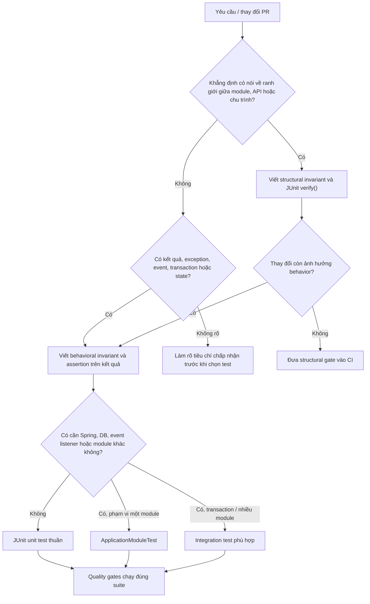
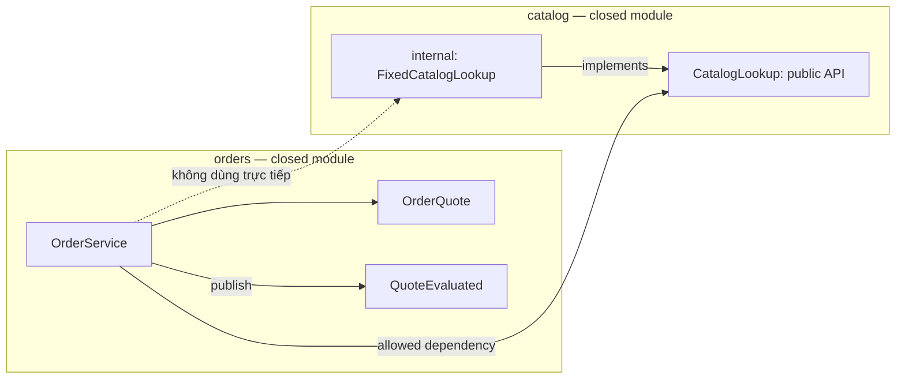

# Xác định mục tiêu là structural hay behavioral verification

Một nhóm đang sửa module `orders` của ứng dụng Spring Modulith. Pull request có hai thay đổi: service bắt đầu sử dụng một kiểu trong `catalog.internal`, và quy tắc báo giá đổi từ “đủ hàng mới nhận” sang “nhận cả khi thiếu hàng”. Hai lỗi cần **hai loại kiểm chứng khác nhau**. Lỗi thứ nhất có thể bị phát hiện bằng phân tích quan hệ giữa các module mà không chạy luồng báo giá; lỗi thứ hai chỉ lộ ra khi thực thi nghiệp vụ với dữ liệu có chủ đích.

Đó là câu hỏi của chiến lược kiểm thử: **mục tiêu hiện tại là structural verification (kiểm chứng cấu trúc) hay behavioral verification (kiểm chứng hành vi)?** Phân loại đúng giúp chọn assertion, phạm vi Spring context, test data và vị trí chạy trong CI. Phân loại sai thường dẫn tới một trong hai kết quả: test xanh nhưng không bảo vệ điều mong muốn, hoặc test nặng/chập chờn vì phải dựng hạ tầng không cần thiết.

Bài thuộc chương **Chọn chiến lược** của lộ trình **SPRING_MODULITH_VERIFICATION_TESTING**. Mục tiêu là xây dựng quyết định kiểm thử có thể giải thích được bằng ví dụ **Java/JUnit với Spring Modulith**, tập trung vào `ApplicationModules.verify()`, `@ApplicationModuleTest`, dependency rules, event/DB integration và cách đặt quality gate. Chúng ta không xem structural và behavioral như hai phe đối lập: một tính năng quan trọng thường cần **cả hai**, nhưng mỗi test phải có **một lời khẳng định chính xác**.

> **Quy tắc chọn nhanh:** Nếu câu khẳng định nói về **“mã của module nào được phép phụ thuộc vào mã nào”**, ưu tiên structural verification. Nếu câu khẳng định nói về **“với đầu vào X, hệ thống trả kết quả Y/phát sự kiện Z/lưu trạng thái S”**, ưu tiên behavioral verification. Nếu yêu cầu chứa cả hai, viết **hai nhóm test độc lập**, không cố lấy một kết quả PASS làm bằng chứng cho mọi mặt.

## 1. Định nghĩa theo thứ cần chứng minh, không theo tên công cụ

### Structural verification: kiểm chứng quan hệ và ranh giới

Structural verification kiểm tra **hình dạng kiến trúc của mã**: application module được phát hiện như thế nào, có phụ thuộc vòng không, module tiêu thụ có truy cập các package/kiểu không công bố không, và có tuân thủ `allowedDependencies` hay không.

Trong Spring Modulith, công cụ chính là:

```java
ApplicationModules.of(ShopApplication.class).verify();
```

`verify()` xem xét mô hình application module và các quy tắc được Spring Modulith hỗ trợ. Test không cần gọi service nghiệp vụ hay tạo bản ghi hóa đơn để xác nhận một quan hệ `orders → catalog` có hợp lệ. Dấu hiệu mạnh nhất là **test FAIL khi một dependency tĩnh trái phép xuất hiện**, kể cả nhánh mã đó chưa từng được chạy.

Structural verification **không tự** xác nhận constructor injection thành công ở mọi profile, SQL chạy đúng, event tới listener hay transaction commit.

### Behavioral verification: kiểm chứng kết quả khi thực thi

Behavioral verification kiểm tra **hệ thống làm gì trong tình huống cụ thể**: trả giá trị, ném exception, phát event, cập nhật database hoặc phối hợp với module phụ thuộc.

Công cụ thường dùng:

- JUnit/AssertJ với test thuần Java cho business rule không cần Spring.
- `@ApplicationModuleTest` cho bean wiring và hành vi trong phạm vi module được chọn.
- `@RecordApplicationEvents` / `ApplicationEvents`, hoặc `Scenario` khi cần kiểm tra stimulus → event.
- Database/integration test và `@SpringBootTest` khi cần transaction, repository, listener thực hoặc nhiều module cùng khởi tạo.

Behavioral verification **không tự** chứng minh mọi phụ thuộc tĩnh hợp lệ. Một luồng có thể trả về kết quả đúng nhờ truy cập thẳng repository nội bộ của module khác; behavior test có thể PASS, nhưng kiến trúc vẫn bị phá.

### Bảng so sánh phạm vi

| Tiêu chí | Structural | Behavioral |
| --- | --- | --- |
| Đối tượng chính | Dependency graph, API module, chu trình, rule | Giá trị trả về, exception, event, DB state, side effect |
| Câu hỏi điển hình | “Module nào được import phần nào?” | “Đầu vào này dẫn đến điều gì?” |
| Có cần thực thi nghiệp vụ? | Thường không | Có |
| Có cần Spring ApplicationContext? | Thường không với `ApplicationModules.verify()` | Tùy mức: unit test không; module/integration test có |
| Có cần dữ liệu test? | Chủ yếu là mã và dependency graph | Thường cần input, fixture, event hoặc DB |
| Lỗi dễ phát hiện | Import nội bộ, chu trình, phụ thuộc ngoài danh sách cho phép | Sai business rule, thiếu bean, event sai, transaction/DB lỗi |
| Lỗi không đủ sức phát hiện | Sai đầu ra, runtime wiring/DB/event | Tham chiếu trái ranh giới không được chạy trong test |
| Phép thử âm tiêu biểu | Tạo dependency vào `catalog.internal` | Đổi quy tắc trả kết quả hoặc bỏ `publishEvent` |

Một điều cần tránh: **“structural” không đồng nghĩa mọi static analysis**. Trong bài này, chúng ta tập trung vào **cấu trúc application module do Spring Modulith phát hiện**. Quy tắc nội bộ từng class, security policy, database schema hoặc mọi dạng dependency động có thể cần công cụ/kiểm tra bổ sung.

## 2. Chuyển yêu cầu thành *invariant* có thể kiểm tra

Trước khi chọn annotation, hãy viết một câu có thể bị bác bỏ:

- **S1 — cấu trúc:** “`orders` chỉ được phụ thuộc vào API công khai của `catalog`.”
- **S2 — cấu trúc:** “`orders` không phụ thuộc vòng qua `catalog` hoặc module khác.”
- **B1 — hành vi:** “Nếu SKU có 7 sản phẩm và yêu cầu 3, báo giá phải được chấp nhận.”
- **B2 — hành vi:** “Nếu yêu cầu 8 khi chỉ còn 7, báo giá không được chấp nhận.”
- **B3 — hành vi:** “Một báo giá hợp lệ phát đúng một `QuoteEvaluated` mang `correlationId` và kết quả đúng.”
- **B4 — hành vi tích hợp:** “Với component `catalog` thật, `orders` vẫn phối hợp được qua Spring DI.”

Hãy thêm **điều kiện FAIL** ngay dưới mỗi invariant. Nếu không viết được tình huống làm test FAIL, có thể ta mới có một đoạn log/chương trình minh họa chứ chưa có phép kiểm chứng.

| Invariant | Loại | Kiểm tra chính | Cố ý phá để xác nhận |
| --- | --- | --- | --- |
| S1 | Structural | `verify()` | Cho `orders` gọi kiểu public trong `catalog.internal` |
| S2 | Structural | `verify()` | Tạo một dependency cycle có thể biên dịch |
| B1/B2 | Behavioral | JUnit/ `@ApplicationModuleTest` | Đổi toán tử so sánh `>=` thành `>` hoặc `<` |
| B3 | Behavioral | `ApplicationEvents` và payload assertion | Bỏ publish/điền sai correlation ID |
| B4 | Behavioral integration | Module test với `DIRECT_DEPENDENCIES` | Làm bean `CatalogLookup` không được đăng ký |

Chú ý: một test có thể **kiểm chứng cả wiring và logic** trong cùng method, nhưng đó vẫn là **behavioral verification**. Nếu muốn chứng minh dependency hợp lệ theo kiến trúc, phải có architectural check riêng.

## 3. Cây quyết định cho một thay đổi trong pull request



**Không chọn `@SpringBootTest` chỉ vì code nằm trong Spring Boot.** Nếu điều cần kiểm chứng là một quy tắc thuần Java, unit test thường ít chi phí hơn. **Không chọn `verify()` chỉ vì trong tên task có từ “module”**: ví dụ “module `orders` phải trả giá đúng” là câu hỏi behavior.

### Bốn câu hỏi nhận diện nhanh

1. **Lỗi có thể tồn tại ngay khi chương trình chưa chạy không?** Ví dụ module gọi trực tiếp subpackage nội bộ khác → structural.
2. **Lỗi cần một input và trạng thái cụ thể mới lộ không?** Ví dụ tồn kho 7, yêu cầu 8 → behavioral.
3. **Lỗi gắn với Spring wiring/transaction/event/DB không?** Behavioral ở mức module/integration, không chỉ unit test.
4. **Một PR sửa cả contract API và cách xử lý không?** Viết cả structural gate và behavioral tests; phân tách thông điệp FAIL để review nhanh.

## 4. Ví dụ thống nhất: `catalog` và `orders`

Ta dùng ứng dụng rất nhỏ để nhìn rõ **cùng một thay đổi được kiểm chứng ở hai trục**.

```text
com.example.shop
├── ShopApplication.java
├── catalog/                         ← application module catalog
│   ├── CatalogLookup.java          ← API ở package gốc
│   └── internal/
│       └── FixedCatalogLookup.java ← implementation nội bộ
└── orders/                          ← application module orders
    ├── package-info.java           ← allowedDependencies = "catalog"
    ├── OrderService.java
    ├── OrderQuote.java
    └── QuoteEvaluated.java         ← event của use case
```

Mô hình dependency:



### 4.1. Spring Boot root class

```java
// src/main/java/com/example/shop/ShopApplication.java
package com.example.shop;

import org.springframework.boot.SpringApplication;
import org.springframework.boot.autoconfigure.SpringBootApplication;

@SpringBootApplication
public class ShopApplication {

    public static void main(String[] args) {
        SpringApplication.run(ShopApplication.class, args);
    }
}
```

Với cơ chế phát hiện module mặc định, `catalog` và `orders` là hai application module. Nếu dự án có chiến lược phát hiện tùy biến hoặc module bị loại khỏi classpath, phải xác minh **mô hình được phát hiện đúng phạm vi** trước khi diễn giải kết quả `verify()`.

### 4.2. Module `catalog`: công bố contract, giấu implementation

```java
// src/main/java/com/example/shop/catalog/CatalogLookup.java
package com.example.shop.catalog;

@FunctionalInterface
public interface CatalogLookup {
    int available(String sku);
}
```

```java
// src/main/java/com/example/shop/catalog/internal/FixedCatalogLookup.java
package com.example.shop.catalog.internal;

import com.example.shop.catalog.CatalogLookup;
import org.springframework.stereotype.Service;

@Service
class FixedCatalogLookup implements CatalogLookup {

    @Override
    public int available(String sku) {
        return "SKU-101".equals(sku) ? 7 : 0;
    }
}
```

`CatalogLookup` nằm ở package gốc của module và là API mặc định công khai với các module khác. `FixedCatalogLookup` nằm ở subpackage `internal`; module khác không cần import hoặc khởi tạo trực tiếp class đó.

### 4.3. Module `orders`: khai báo quan hệ được cho phép

File `src/main/java/com/example/shop/orders/package-info.java`:

```java
@org.springframework.modulith.ApplicationModule(
    allowedDependencies = "catalog"
)
package com.example.shop.orders;
```

`allowedDependencies = "catalog"` cho phép `orders` phụ thuộc vào **API mặc định** của `catalog`; nó **không** cấp quyền truy cập mọi subpackage nội bộ. Nếu `catalog` công bố thêm named interfaces, cần khai báo những quan hệ cần thiết một cách tường minh theo thiết kế.

Ký hiệu `catalog` là tên module trong metadata Spring Modulith, **không phải** câu lệnh Java import. Dù Java cho phép import một class `public` ở `catalog.internal`, quy tắc closed module có thể từ chối dependency ấy.

### 4.4. Hợp đồng kết quả và event

```java
// src/main/java/com/example/shop/orders/OrderQuote.java
package com.example.shop.orders;

public record OrderQuote(
        String sku,
        int requested,
        boolean accepted
) {}
```

```java
// src/main/java/com/example/shop/orders/QuoteEvaluated.java
package com.example.shop.orders;

import java.util.UUID;

public record QuoteEvaluated(
        UUID correlationId,
        OrderQuote quote
) {}
```

`QuoteEvaluated` là application event cho ví dụ kiểm chứng E1. Nó thuộc API mặc định của `orders` trong ví dụ này, nhưng **chưa có module tiêu thụ**. Nếu dự án có consumer riêng, cần thiết kế API event công bố có chủ đích thay vì xuất mọi lớp nội bộ.

### 4.5. Use case có logic cần kiểm tra

```java
// src/main/java/com/example/shop/orders/OrderService.java
package com.example.shop.orders;

import com.example.shop.catalog.CatalogLookup;
import java.util.Objects;
import java.util.UUID;
import org.springframework.context.ApplicationEventPublisher;
import org.springframework.stereotype.Service;

@Service
public class OrderService {

    private final CatalogLookup catalog;
    private final ApplicationEventPublisher events;

    public OrderService(
            CatalogLookup catalog,
            ApplicationEventPublisher events) {
        this.catalog = catalog;
        this.events = events;
    }

    public OrderQuote quote(
            UUID correlationId, String sku, int quantity) {

        Objects.requireNonNull(correlationId, "correlationId");

        if (sku == null || sku.isBlank() || quantity <= 0) {
            throw new IllegalArgumentException("Invalid order request");
        }

        boolean accepted = catalog.available(sku) >= quantity;

        OrderQuote quote = new OrderQuote(
                sku, quantity, accepted
        );

        events.publishEvent(new QuoteEvaluated(
                correlationId, quote
        ));

        return quote;
    }
}
```

**Ngữ nghĩa quan trọng:** `quote` chỉ đánh giá đủ tồn kho theo một snapshot; nó **không giữ hàng, không tạo đơn và không thực hiện transaction database**. Một kết quả `accepted=true` ở đây không phải bảo đảm giao dịch đặt hàng đồng thời sẽ thành công. Đó là ranh giới hợp đồng được test, không nên phóng đại.

Điểm xuất hiện hai loại kiểm chứng:

- **Structural:** `OrderService` phụ thuộc `CatalogLookup`, tức **API mặc định** của `catalog`, và `orders` chỉ khai báo `catalog` là dependency cho phép.
- **Behavioral:** với các tồn kho được định nghĩa, `quote(...)` trả đúng kết quả và phát đúng `QuoteEvaluated`.

## 5. Viết structural verification bằng JUnit

Đặt bài test ở package gốc, không ở package `orders` để diễn giải rõ nó áp dụng cho toàn application module model:

```java
// src/test/java/com/example/shop/ModulithArchitectureTest.java
package com.example.shop;

import org.junit.jupiter.api.Test;
import org.springframework.modulith.core.ApplicationModules;

class ModulithArchitectureTest {

    @Test
    void moduleBoundariesRemainValid() {
        ApplicationModules.of(ShopApplication.class).verify();
    }
}
```

### Một test này phải bảo vệ gì?

Trong ví dụ:

1. `orders` chỉ dùng API được công bố của `catalog`.
2. `orders` tuân thủ `allowedDependencies = "catalog"`.
3. Không xuất hiện dependency cycle giữa các application module được phát hiện.
4. Các quy tắc kiến trúc khác được Spring Modulith verifier hỗ trợ không bị vi phạm.

`ApplicationModules.verify()` là **structural gate**. Nó không khởi động service để tính `accepted`, không đọc tồn kho và không chờ `QuoteEvaluated` được publish.

### Thử âm S1: import implementation nội bộ

Để tạo lỗi có thể biên dịch và kiểm chứng rõ bằng `verify()`, giả sử trong `catalog.internal` có thêm class **public** (chỉ để thực hành):

```java
// catalog/internal/PublicCatalogCache.java
package com.example.shop.catalog.internal;

public class PublicCatalogCache {
    public int value() {
        return 7;
    }
}
```

Nếu trong `orders` xuất hiện một dependency thực sự:

```java
// Phản ví dụ đặt trong module orders: KHÔNG GIỮ LẠI.
package com.example.shop.orders;

import com.example.shop.catalog.internal.PublicCatalogCache;

class UnsafeOrderAdapter {

    private final PublicCatalogCache cache;

    UnsafeOrderAdapter(PublicCatalogCache cache) {
        this.cache = cache;
    }

    int cachedStock() {
        return cache.value();
    }
}
```

Java có thể biên dịch vì `PublicCatalogCache` là `public`, nhưng `catalog.internal` không phải API được `catalog` công bố. Architecture test phải **FAIL** khi công cụ nhận diện dependency này.

**Lưu ý:** thêm một dòng `import` không dùng tới có thể không tạo quan hệ trong bytecode. Muốn thử ranh giới, phải có **field, signature hoặc lời gọi thực sự**. Nếu class là package-private, Java có thể chặn ngay từ bước compile, trước khi Modulith test chạy.

### Thử âm S2: dependency ngoài danh sách

Nếu `orders` bị sửa để phụ thuộc vào một module `payments` không có trong `allowedDependencies`, `verify()` phải phát hiện quan hệ không được phép khi cả hai được phát hiện là application module. **Đừng sửa bằng cách thêm `payments` vào danh sách cho phép chỉ để test xanh**; trước tiên phải trả lời quan hệ ấy có đúng thiết kế hay không.

### Khi `verify()` PASS vẫn cần review

Một đội có thể vô tình mở rộng package công khai hoặc chuyển module thành open để loại lỗi. Khi đó test có thể PASS theo **quy tắc mới**, nhưng bề mặt API đã thay đổi. Vì vậy, review các thay đổi `package-info.java`, named interfaces, module detection và dependency conventions là việc đi kèm architecture gate.

## 6. Viết behavioral verification với `@ApplicationModuleTest`

Đối với B1/B2/B3, điều chúng ta muốn kiểm tra là **logic và event của module `orders`**. Không cần tạo bean `FixedCatalogLookup` thật từ module ngoài; một implementation test có thể đặt tồn kho theo ý đồ và cô lập hành vi.

```java
// src/test/java/com/example/shop/orders/OrdersModuleTest.java
package com.example.shop.orders;

import com.example.shop.catalog.CatalogLookup;
import java.util.UUID;
import org.junit.jupiter.api.Test;
import org.springframework.beans.factory.annotation.Autowired;
import org.springframework.boot.test.context.TestConfiguration;
import org.springframework.context.annotation.Bean;
import org.springframework.context.annotation.Import;
import org.springframework.modulith.test.ApplicationModuleTest;
import org.springframework.modulith.test.ApplicationModuleTest.BootstrapMode;
import org.springframework.test.context.event.ApplicationEvents;
import org.springframework.test.context.event.RecordApplicationEvents;

import static org.assertj.core.api.Assertions.assertThat;
import static org.assertj.core.api.Assertions.assertThatThrownBy;

@ApplicationModuleTest(mode = BootstrapMode.STANDALONE)
@Import(OrdersModuleTest.CatalogStub.class)
@RecordApplicationEvents
class OrdersModuleTest {

    @Autowired
    OrderService orders;

    @Autowired
    ApplicationEvents recordedEvents;

    @Test
    void acceptsWhenEnoughStockAndPublishesMatchingEvent() {
        UUID correlationId = UUID.randomUUID();

        OrderQuote quote = orders.quote(
                correlationId, "SKU-101", 3
        );

        assertThat(quote.accepted()).isTrue();
        assertThat(quote.requested()).isEqualTo(3);
        assertThat(quote.sku()).isEqualTo("SKU-101");

        var matching = recordedEvents.stream(QuoteEvaluated.class)
                .filter(event ->
                        correlationId.equals(event.correlationId()))
                .toList();

        assertThat(matching).hasSize(1);
        assertThat(matching.get(0).quote()).isEqualTo(quote);
    }

    @Test
    void rejectsWhenStockIsInsufficient() {
        UUID correlationId = UUID.randomUUID();

        OrderQuote quote = orders.quote(
                correlationId, "SKU-101", 5
        );

        assertThat(quote.accepted()).isFalse();
        assertThat(quote.requested()).isEqualTo(5);
    }

    @Test
    void invalidQuantityFailsWithoutPublishingEvent() {
        UUID correlationId = UUID.randomUUID();

        assertThatThrownBy(() ->
                orders.quote(correlationId, "SKU-101", 0))
                .isInstanceOf(IllegalArgumentException.class);

        long emitted = recordedEvents.stream(QuoteEvaluated.class)
                .filter(event ->
                        correlationId.equals(event.correlationId()))
                .count();

        assertThat(emitted).isZero();
    }

    @TestConfiguration(proxyBeanMethods = false)
    static class CatalogStub {

        @Bean
        CatalogLookup catalogLookup() {
            return sku -> "SKU-101".equals(sku) ? 4 : 0;
        }
    }
}
```

### Vì sao đây là behavioral verification?

- Test gọi **hành vi thật của `OrderService`**, qua Spring bean.
- `CatalogStub` trả tồn kho **4** để chủ động kiểm tra nhánh **đủ hàng** với yêu cầu 3 và **thiếu hàng** với yêu cầu 5.
- `@RecordApplicationEvents` ghi nhận `QuoteEvaluated` được publish trong Spring test context; assertion so khớp **correlation ID** và payload.
- Không phụ thuộc một câu `LOG.info("Quote accepted")` hay format output.
- Nếu code đổi `>=` thành logic luôn `true`, test từ chối thiếu hàng FAIL. Nếu bỏ `publishEvent`, event assertion FAIL.

`@TestConfiguration` và `@Import` đưa **test double** vào context. Đây là cấu hình phục vụ kiểm thử, không phải lời khẳng định rằng module `catalog` thực tế có bean này trong production. `STANDALONE` không tự nạp implementation module khác; nếu `OrderService` cần `CatalogLookup`, phải cung cấp dependency phù hợp ở test hoặc chọn mode rộng hơn theo mục đích.

### Bài test này chưa chứng minh điều gì?

Nó **không** chứng minh `catalog` thật đã được bootstrap, không đo database, không có consumer xử lý event, và không chứng minh `orders` không truy cập `catalog.internal` ở một lớp khác. Đó là lý do cần structural verification và, khi được yêu cầu, thêm integration test.

**Chú ý bootstrap:** `@ApplicationModuleTest` thu hẹp phạm vi **application modules**, nhưng Spring Boot auto-configuration và test configuration vẫn có thể thêm bean hạ tầng vào context. Đừng coi “STANDALONE” là “Spring context chỉ có đúng các bean thuộc một package”.

## 7. Khi mục tiêu là wiring thật với module phụ thuộc

Nếu yêu cầu đổi thành **“`orders` có hoạt động với `catalog` thật hay không?”**, một stub không đủ. Chọn `DIRECT_DEPENDENCIES` để bootstrap module `orders` cùng các application module mà nó phụ thuộc trực tiếp.

```java
// src/test/java/com/example/shop/orders/OrdersCatalogIntegrationTest.java
package com.example.shop.orders;

import java.util.UUID;
import org.junit.jupiter.api.Test;
import org.springframework.beans.factory.annotation.Autowired;
import org.springframework.modulith.test.ApplicationModuleTest;
import org.springframework.modulith.test.ApplicationModuleTest.BootstrapMode;

import static org.assertj.core.api.Assertions.assertThat;

@ApplicationModuleTest(mode = BootstrapMode.DIRECT_DEPENDENCIES)
class OrdersCatalogIntegrationTest {

    @Autowired
    OrderService orders;

    @Test
    void wiresRealCatalogAndEvaluatesQuote() {
        OrderQuote accepted = orders.quote(
                UUID.randomUUID(), "SKU-101", 7
        );
        OrderQuote rejected = orders.quote(
                UUID.randomUUID(), "SKU-101", 8
        );

        assertThat(accepted.accepted()).isTrue();
        assertThat(rejected.accepted()).isFalse();
    }
}
```

Bài này là **behavioral integration test ở phạm vi module**. Nó kiểm tra `FixedCatalogLookup` thật (với dữ liệu mẫu 7) được Spring cung cấp cho `OrderService` và hai bean tương tác đúng. Tuy nhiên, các giá trị tồn kho trong ví dụ đang được **hard-code** để tránh yêu cầu DB; trong dự án thật, có thể dùng test database/fixture nếu `catalog` có JPA repository.

### So sánh hai bài test behavioral

| Test | Phụ thuộc được dùng | Chứng minh | Khi nào chọn |
| --- | --- | --- | --- |
| `OrdersModuleTest` | `CatalogLookup` stub = 4 | Quy tắc chấp nhận/từ chối và event contract của `orders` | Cần tách logic khỏi integration, kiểm tra nhiều edge cases |
| `OrdersCatalogIntegrationTest` | Bean thật của `catalog` = 7 | Cấu hình DI và phối hợp giữa các module phụ thuộc trực tiếp | Cần phát hiện lỗi wiring, bean registration, contract integration |

Nếu một bài test `STANDALONE` thiếu bean, không mặc định đây là lỗi kiến trúc. Nó có thể chỉ là **bài test không cung cấp dependency ngoài module**. Ngược lại, `DIRECT_DEPENDENCIES` PASS vẫn không thay cho `ApplicationModules.verify()`, vì wiring hoạt động không đồng nghĩa module chỉ truy cập API hợp lệ.

### Ba chế độ trong quyết định kiểm thử

| Mode | Ý nghĩa module được bootstrap | Phù hợp khi |
| --- | --- | --- |
| `STANDALONE` | Module mục tiêu, không tự nạp implementation từ module phụ thuộc | Kiểm tra logic cô lập và hợp đồng API/module |
| `DIRECT_DEPENDENCIES` | Module mục tiêu và module phụ thuộc trực tiếp | Kiểm tra wiring và tương tác gần |
| `ALL_DEPENDENCIES` | Module mục tiêu và những module phụ thuộc bắc cầu | Kiểm tra chuỗi phụ thuộc sâu khi cần |

`ALL_DEPENDENCIES` **không** có nghĩa “tất cả module trong ứng dụng”. Chọn mode dựa trên dependency graph và acceptance criterion; không mở rộng scope chỉ để test tìm thấy nhiều bean hơn.

## 8. Chọn `Scenario` hay `ApplicationEvents` cho behavior theo sự kiện?

`@RecordApplicationEvents` + `ApplicationEvents` phù hợp khi test muốn **đọc danh sách event đã được phát** ngay trong test context. `Scenario` của Spring Modulith giúp diễn đạt **“kích hoạt stimulus rồi chờ event phù hợp”**, hữu ích khi event xử lý bất đồng bộ hoặc cần một ngôn ngữ test gần với kịch bản.

Ví dụ với cùng service `OrderService`, đặt trong class `OrdersScenarioTest` thuộc package `com.example.shop.orders`, dùng `@ApplicationModuleTest(STANDALONE)` và import `CatalogStub` tương tự phần 6:

```java
// Test method trích; lớp chứa cần @ApplicationModuleTest,
// @Import(CatalogStub.class) và field OrderService orders.
@Test
void waitsForQuoteEventBelongingToThisStimulus(Scenario scenario) {
    UUID correlationId = UUID.randomUUID();

    scenario.stimulate(() ->
                orders.quote(correlationId, "SKU-101", 3)
            )
            .andWaitForEventOfType(QuoteEvaluated.class)
            .matching(event ->
                    correlationId.equals(event.correlationId()))
            .toArriveAndVerify(event ->
                    assertThat(event.quote().accepted()).isTrue()
            );
}
```

Cần import `org.springframework.modulith.test.Scenario` và các kiểu khác xuất hiện trong snippet. Tùy phiên bản Spring Modulith, timeout DSL và tùy chọn chờ chi tiết có thể khác nhau; dùng tài liệu của phiên bản thư viện thực tế.

**Hai điều cần phân biệt:**

1. Event được **publish** và recorder/test thấy event.
2. Listener ở module khác **xử lý event** và trạng thái DB thay đổi.

Nếu acceptance criterion chỉ nói “phát đúng `QuoteEvaluated`”, test E1 là đủ cho **claim đó**. Nếu nói “module `billing` tạo invoice sau sự kiện”, phải dùng test có consumer và state assertion. `Scenario.andWaitForEventOfType(...)` không tự chứng minh completion của listener khác.

### Dùng correlation ID để tránh PASS giả

Một test chỉ tìm “bất kỳ `QuoteEvaluated`” có thể nhận event từ một stimulus khác. Predicate `.matching(event -> correlationId.equals(event.correlationId()))` làm claim cụ thể hơn. Trong integration test, kết hợp correlation ID với aggregate ID (`orderId`) để chắc chắn đang quan sát đúng kết quả.

Không dùng `Thread.sleep(1000)` làm bằng chứng listener đã hoàn tất; dùng **điều kiện quan sát được** với timeout hữu hạn.

## 9. Khi nào behavioral verification bắt buộc đi xuống database/transaction?

Không phải mọi behavior test đều cần database. Ví dụ `quote()` chỉ đọc một giá trị stub và phát event, nên test module có thể nhanh và độc lập. Nhưng nếu yêu cầu là:

- “Tạo đơn phải lưu thành công trước khi listener lập hóa đơn chạy.”
- “Transaction rollback thì không phát sinh side effect ở module nhận.”
- “Hai yêu cầu giữ hàng đồng thời không làm số lượng âm.”
- “Listener retry không tạo hóa đơn trùng.”
- “Một publication còn pending có thể được xử lý lại.”

…thì **behavioral verification phải đi tới transaction/DB/event integration**, không thể chỉ assert `OrderQuote.accepted()`.

### Chọn phép kiểm tra theo mốc hành vi

| Mốc | Điều muốn xác nhận | Bằng chứng phù hợp |
| --- | --- | --- |
| **E1: publish** | Event đúng payload đã được phát | `ApplicationEvents` / `Scenario` |
| **E2: commit** | Dữ liệu đơn đã commit | Truy vấn sau commit, test transaction/DB |
| **E3: listener side effect** | Invoice được tạo đúng đơn | Query module nhận / `JdbcTemplate` / repository test |
| **E4: publication completed** | Registry đã đánh dấu hoàn tất | API hoặc backend Event Publication Registry phù hợp |
| **Duplicate/retry** | Không có side effect trùng | Unique constraint + integration/concurrency test |

**Không suy luận E4 từ E1.** `ApplicationEvents` là recorder phục vụ Spring Test, không phải Event Publication Registry bền vững của Spring Modulith. Registry cần listener và backend đã cấu hình; semantics retry, persistence và API phụ thuộc phiên bản.

### Ví dụ integration test cho biến thể có database

Giả sử dự án thật đã thay `OrderService` bằng use case `placeOrder` có `@Transactional`, listener module `billing` dùng `@ApplicationModuleListener`, và bảng `billing_invoices(order_id, correlation_id, status)` đã được migration. Khi ấy test có thể dùng:

```java
// Đoạn nằm trong @SpringBootTest đã inject:
// OrderPlacementService orders; JdbcTemplate jdbc.
UUID correlationId = UUID.randomUUID();

UUID orderId = orders.placeOrder(
        "SKU-101", 2, correlationId
);

await()
    .atMost(java.time.Duration.ofSeconds(10))
    .untilAsserted(() -> {
        Integer count = jdbc.queryForObject(
                "select count(*) from billing_invoices "
                        + "where order_id = ? and correlation_id = ?",
                Integer.class, orderId, correlationId
        );
        assertThat(count).isEqualTo(1);
    });
```

**Đây là biến thể minh họa, không dùng nguyên xi với `quote()` ở phần 4**: phải có `OrderPlacementService`, transaction manager, schema, listener, datasource, Awaitility và test fixtures. Nó được đưa vào để chỉ ra **khi nào đổi loại behavioral test**, không phải tạo thêm một bài nhập môn event/database.

Đặc biệt, đừng gắn `@Transactional` ở cấp test end-to-end theo thói quen khi listener chạy **`AFTER_COMMIT`**: Spring Test thường rollback transaction do test quản lý; nếu service tham gia transaction đó, listener có thể **không bao giờ chạy trước khi test kết thúc**. Hãy để transaction nghiệp vụ commit thật hoặc dùng `TestTransaction`/`TransactionTemplate` có chủ đích.

## 10. Phân loại FAIL theo chiến lược, không sửa nhầm tầng

Một kết quả FAIL dễ bị hiểu sai nếu không biết nó thuộc nhóm structural hay behavioral.

| Triệu chứng | Nhóm cần điều tra trước | Hướng chẩn đoán |
| --- | --- | --- |
| `verify()` báo dependency vào `catalog.internal` | Structural | Kiểm tra public API/module boundary, sửa import/contract |
| `verify()` báo cycle | Structural | Phân tích dependency direction, tách contract/event nếu phù hợp |
| `@ApplicationModuleTest(STANDALONE)` thiếu `CatalogLookup` | Behavioral bootstrap | Bổ sung test double hoặc chọn `DIRECT_DEPENDENCIES` đúng mục tiêu |
| Bean có nhưng `accepted` sai | Behavioral logic | Kiểm tra rule `available >= requested`, edge cases |
| Quote trả đúng nhưng không có `QuoteEvaluated` | Behavioral event | Kiểm tra publish/recorded event và correlation ID |
| Test event PASS nhưng consumer không có invoice | Behavioral integration | Kiểm tra commit, listener registration, executor/DB |
| CI chạy xanh dù code sai | Testing/CI configuration | Test có thực sự được phát hiện/chạy không, có assert đúng không? |
| Production p95 cao, module tests vẫn PASS | Operational/performance ngoài claim của hai test trên | Thu metrics/trace dưới tải phù hợp, viết performance tests riêng |

**Không chữa lỗi cấu trúc bằng cách đổi test sang `@SpringBootTest`.** Việc Spring boot thành công không biến dependency trái phép thành đúng. **Không chữa lỗi behavior bằng cách nới `allowedDependencies`.** Ranh giới hợp lệ không làm một phép tính sai thành đúng.

### Bảng kết quả có thể cùng tồn tại

| Structural gate | Behavioral gate | Ý nghĩa |
| --- | --- | --- |
| PASS | PASS | Ranh giới được kiểm tra hợp lệ và tình huống hành vi được kiểm tra đúng; không chứng minh mọi path/production |
| PASS | FAIL | Graph hợp lệ, nhưng wiring/business rule/event/DB trong tình huống test có lỗi |
| FAIL | PASS | Luồng test có thể chạy đúng dù dependency graph vi phạm quy tắc |
| FAIL | FAIL | Cần sửa cả kiến trúc và hành vi; phải đọc từng báo cáo lỗi |

Một nhóm kiểm thử trưởng thành **không bỏ qua structural FAIL chỉ vì behavioral PASS** và cũng **không ngừng viết behavior tests chỉ vì `verify()` PASS**.

## 11. Chi phí kiểm thử và phạm vi bằng chứng

Chọn test hẹp nhất có thể **bắt đúng lỗi mục tiêu**. Không phải để tối ưu thời gian bằng mọi giá, mà để giữ nguyên nhân FAIL rõ ràng.

| Tầng test | Thường phải khởi tạo | Mạnh nhất cho | Không đủ cho |
| --- | --- | --- | --- |
| Pure JUnit unit | Object/fixture thuần Java | Rule/edge case thuần | Spring component wiring |
| `ApplicationModules.verify()` | Dependency model/classpath | Module boundaries và cycles | Logic runtime, database |
| `@ApplicationModuleTest(STANDALONE)` | Spring context module + test support | Bean/module behavior cô lập | Consumer ngoài module, transaction end-to-end |
| `@ApplicationModuleTest(DIRECT_DEPENDENCIES)` | Module + dependency trực tiếp | Integration giữa module có quan hệ trực tiếp | Mọi consumer không nằm trong dependency graph |
| `@SpringBootTest` + test DB | Context rộng, DB/hạ tầng | End-to-end event/transaction/state | Production load, mọi failure mode |
| Load/production observability | Môi trường và traffic có kiểm soát | Latency, queue, throughput dưới tải | Quy tắc static architecture |

Chi phí thực tế phụ thuộc Spring context caching, Testcontainers, JDK, cấu hình và tài nguyên CI. Bài học này không yêu cầu dùng một “test pyramid” cứng cho mọi dự án; nguyên tắc là **đủ mạnh để kiểm chứng claim, đủ hẹp để dễ tái lập**.

### Khi một test vừa structural vừa behavioral thì sao?

Một JUnit class có thể chứa cả:

```java
@Test
void architectureIsValid() {
    ApplicationModules.of(ShopApplication.class).verify();
}

@Test
void orderQuoteWorks() {
    // Gọi service và assert result.
}
```

Về kỹ thuật có thể, nhưng **tách tên lớp/file theo mục tiêu** thường tốt hơn để:

- Chạy architecture gate nhanh và nhận lỗi dependency rõ.
- Chạy module test với fixture hoặc test double phù hợp.
- Không tạo cảm giác “architecture test” có thể thay thế test logic.
- Phân loại báo cáo CI theo loại hồi quy.

## 12. Dùng mutation thủ công để kiểm tra độ mạnh của test

Chỉ thấy PASS trên baseline chưa đủ xác nhận test thực sự bảo vệ invariant. Thử một thay đổi sai **có kiểm soát**, chạy gate tương ứng rồi khôi phục.

### Mutation A — Làm sai structural rule

Thêm dependency thực sự từ `orders` vào class `public` thuộc `catalog.internal`. Kỳ vọng:

- Compile có thể vẫn PASS.
- `ModulithArchitectureTest` **FAIL**.
- `OrdersModuleTest` có thể vẫn PASS nếu nhánh dependency sai không ảnh hưởng test.

Suy luận: **behavior test không phải oracle cho module boundaries**.

### Mutation B — Làm sai business rule

Đổi:

```java
boolean accepted = catalog.available(sku) >= quantity;
```

thành:

```java
// Sai tại biên bằng nhau; chỉ dùng để thử test.
boolean accepted = catalog.available(sku) > quantity;
```

Với test ở phần 6 chỉ có hai giá trị 3 và 5 trong khi tồn kho 4, **hai test ấy chưa chắc bắt được lỗi `>=` thành `>`**. Đây là bài học quan trọng: test case cần bao phủ **biên bằng nhau**.

Bổ sung vào `OrdersModuleTest`:

```java
@Test
void acceptsExactlyAvailableQuantity() {
    OrderQuote quote = orders.quote(
            UUID.randomUUID(), "SKU-101", 4
    );

    assertThat(quote.accepted()).isTrue();
}
```

Khi đổi `>=` thành `>`, test này **FAIL**, còn architecture test có thể vẫn PASS. Đây là cách chứng minh behavioral assertion thực sự bắt được mutation đã chọn.

### Mutation C — Bỏ publication

Bỏ:

```java
events.publishEvent(new QuoteEvaluated(
        correlationId, quote
));
```

Kỳ vọng `acceptsWhenEnoughStockAndPublishesMatchingEvent()` **FAIL** vì danh sách event phù hợp rỗng, dù `OrderQuote` vẫn đúng. Nếu test chỉ assert giá trị trả về, nó sẽ bỏ sót hồi quy event contract.

### Mutation D — Đổi log text

Đổi `"Quote accepted"` thành `"Quote evaluated"` hoặc tắt `INFO` khi không có logging contract. Structural và behavioral tests **vẫn phải PASS** nếu hành vi không đổi. Nếu một test FAIL chỉ do format log, nó đang phụ thuộc implementation detail không ổn định.

### Đọc kết quả mutation đúng cách

Không giữ mutation ở nhánh chính. Mục tiêu không phải đạt một “mutation score” tùy ý mà là **đặt đúng test case vào đúng claim**. Nếu mutation dự tính không làm test FAIL, hãy kiểm tra: test có chạy không, fixture có chạm biên không, assertion có đủ mạnh không và có cách nào sửa test để bảo vệ invariant đúng hơn không?

## 13. Ma trận thiết kế test cho thay đổi thực tế

Một PR thường chứa nhiều loại thay đổi. Có thể định nghĩa chiến lược ngay trong review:

| Thay đổi PR | Structural test | Behavioral test | Tại sao |
| --- | --- | --- | --- |
| Chuyển class từ `catalog.internal` ra API | **Bắt buộc xem lại topology và `verify()`** | Contract tests nếu API mới được gọi | Thay đổi bề mặt phụ thuộc và kỳ vọng hành vi |
| Thêm dependency `orders → payments` | **Có** | Có nếu logic phối hợp mới | `allowedDependencies` là một quyết định kiến trúc |
| Đổi ngưỡng tồn kho từ `>=` sang `>` | Thường không tăng coverage structural | **Có, đặc biệt boundary value** | Lỗi là logic runtime |
| Đổi constructor sang bean `CatalogLookup` khác | Có nếu đổi module dependency | **Có, module wiring test** | Code có thể hợp lệ nhưng Spring DI lỗi |
| Thêm event `QuoteEvaluated` | Có nếu event công bố sang module khác | **Có, payload và điều kiện phát** | API event và semantics phát đều cần bảo vệ |
| Chuyển listener sang `AFTER_COMMIT` | Có nếu đổi dependency graph | **Có, transaction/integration** | Timing và side effect thay đổi |
| Đưa logic từ monolith vào module mới | **Có** | **Có** | Vừa đổi ranh giới vừa đổi behavior/wiring |
| Chỉ đổi format log không phải contract | Không cần test mới nếu graph giữ nguyên | Business tests không nên đổi kết quả | Log không phải oracle nghiệp vụ |
| Thêm repository cho `catalog` | Có nếu lộ ra module khác | Có, data/transaction test | Cần chắc chắn ranh giới và persistence đều đúng |

**Lưu ý:** “Structural test có” trong bảng nghĩa là kiến trúc phải được kiểm chứng/review phù hợp khi PR đổi quan hệ, không có nghĩa phải thêm một lớp JUnit mới cho mỗi dòng code. Một test `verify()` toàn mô hình đã là nền tảng tốt; quan trọng là nó **được CI chạy thật**.

## 14. Thiết kế CI quality gate không tạo kết luận sai

Mục tiêu CI là **chặn merge khi các invariants quan trọng bị phá**, và cung cấp báo cáo đủ rõ để phân loại lỗi. Một cách tổ chức:

1. **Compile:** bảo đảm Java compile, signatures nhất quán.
2. **Structural gate:** chạy `ModulithArchitectureTest` hoặc toàn suite có chứa test đó; `verify()` FAIL phải làm job FAIL.
3. **Module behavior gate:** chạy `OrdersModuleTest` và test các hợp đồng module khác.
4. **Integration gate khi có hạ tầng:** chạy test dependency/DB/event listener/retry theo cấu hình repository.
5. **Bằng chứng lỗi:** giữ JUnit reports, stack traces, dữ liệu cấu hình không nhạy cảm và correlation ID nếu có.

Với Gradle/JUnit 5:

```bash
./gradlew test
```

Với Maven/Surefire đã cấu hình:

```bash
mvn -B test
```

**Không giả định** một lệnh `test` chạy những integration tests được tách sang Gradle `integrationTest` hoặc Maven Failsafe. Nếu dự án dùng source set/task riêng, CI phải gọi đúng task/plugin của nó.

### Ví dụ GitHub Actions

```yaml
name: Modulith structural and behavioral gates

on:
  pull_request:

jobs:
  verify-modulith:
    runs-on: ubuntu-latest
    permissions:
      contents: read

    steps:
      - uses: actions/checkout@v4

      - uses: actions/setup-java@v4
        with:
          distribution: temurin
          java-version: '21'

      - uses: gradle/actions/setup-gradle@v4

      - name: Run architecture and module behavior tests
        run: bash ./gradlew --no-daemon test

      # Chỉ bật nếu project đã định nghĩa integrationTest task:
      # - name: Run database/event integration tests
      #   run: bash ./gradlew --no-daemon integrationTest

      - name: Preserve test reports
        if: always()
        uses: actions/upload-artifact@v4
        with:
          name: modulith-verification-reports
          path: |
            **/build/test-results/**/*.xml
            **/build/reports/tests/**
          if-no-files-found: warn
```

Đây là **workflow minh họa**, chưa được chạy trên repository được giao. Nó giả định Gradle wrapper ở root, Java tương thích, dependencies của JUnit/Spring Modulith có sẵn; các integration tests dùng database cần cấu hình môi trường riêng.

Để ngăn merge sai, branch protection/ruleset phải yêu cầu job `verify-modulith` PASS. `if: always()` chỉ giúp lưu reports khi test thất bại, **không biến FAIL thành PASS**.

### Không dùng log thay assertion

Một job có thể chứa dòng `"Architecture verified"` nhưng kết thúc thành công dù chưa chạy `ModulithArchitectureTest`. Vì vậy, xác minh bằng **exit code, số test được thực thi, JUnit reports và required status checks**; không chỉ grep chuỗi `SUCCESS`.

Một `verify()` PASS cũng không chứng minh đã chạy hết tests hành vi, và một suite hành vi xanh không chứng minh các rules cấu trúc đã được thực thi.

## 15. Bài thực hành: chọn chiến lược trước khi viết test

### Bối cảnh

Một đội cần sửa `OrderService.quote()` và sắp bổ sung module `payments`. Reviewer đưa ra bốn yêu cầu: (1) `orders` không dùng internal API của `catalog`; (2) báo giá xử lý đúng tồn kho bằng nhau; (3) event mang đúng correlation ID; (4) module `orders` dùng được `CatalogLookup` thật. Học viên phải gán mỗi yêu cầu vào **đúng nhóm test** rồi chứng minh gate có khả năng FAIL.

### Thực hiện

1. **Ghi bốn invariants:** viết chúng thành câu “nếu ... thì ...” hoặc “không được ...”.
2. **Dán nhãn S/B:** xác định (1) là structural; (2), (3), (4) là behavioral ở các phạm vi khác nhau.
3. **Tạo module:** theo cấu trúc `catalog` và `orders` ở phần 4, khai báo `allowedDependencies = "catalog"`.
4. **Viết structural test:** `ApplicationModules.of(ShopApplication.class).verify()`.
5. **Viết module behavioral test:** dùng `@ApplicationModuleTest(STANDALONE)`, `CatalogLookup` stub và `@RecordApplicationEvents`.
6. **Viết ít nhất ba input biên:** yêu cầu 3, 4, 5 khi stub trả tồn kho 4; thêm `0` để kiểm tra validation.
7. **Assert event contract:** filter `QuoteEvaluated` theo `correlationId`, kiểm tra payload tương ứng với `OrderQuote`.
8. **Viết integration test trực tiếp:** `@ApplicationModuleTest(DIRECT_DEPENDENCIES)`, gọi bean `catalog` thật và xác nhận kết quả với tồn kho 7.
9. **Tạo lỗi S1:** từ `orders` tham chiếu kiểu public giả lập trong `catalog.internal`; xác nhận `verify()` FAIL.
10. **Tạo lỗi B1:** đổi `>=` sang `>`; xác nhận case quantity 4 FAIL.
11. **Tạo lỗi B3:** bỏ publish event; xác nhận event test FAIL dù kết quả báo giá đúng.
12. **Tạo lỗi wiring:** bỏ annotation/bean registration của `FixedCatalogLookup` trong một nhánh thực hành; test `DIRECT_DEPENDENCIES` phải FAIL khi không có bean phù hợp.
13. **Khôi phục code:** trả lại cấu trúc đúng, chạy các suite trong CI và kiểm tra test runner thực sự thực thi mọi class.
14. **Lập báo cáo:** với từng claim, ghi loại test, input/điều kiện, assertion, expected FAIL mutation và các phạm vi chưa được bao phủ.

### Ma trận nghiệm thu

| Lỗi cố ý | `verify()` | Module behavior test với stub | Integration test với catalog thật |
| --- | --- | --- | --- |
| Không có lỗi, cấu trúc và logic đúng | PASS | PASS | PASS |
| Dùng `catalog.internal` ngoài module | **FAIL** | Có thể PASS nếu không chạy nhánh sai | Có thể PASS |
| Đổi `>=` thành `>` | Có thể PASS | **FAIL** ở quantity bằng tồn kho | **FAIL** ở quantity 7 nếu test biên |
| Bỏ publish `QuoteEvaluated` | Có thể PASS | **FAIL** ở assertion event | Có thể PASS nếu chỉ assert kết quả quote |
| Stub trả sai dữ liệu so với fixture | Có thể PASS | FAIL theo case liên quan | Không ảnh hưởng nếu dùng bean thật |
| Bean catalog thật không được đăng ký | Có thể PASS | Có thể PASS vì đã dùng stub | **FAIL** khi bootstrap/injection |
| Nới `allowedDependencies` để hợp thức hóa phụ thuộc sai | Có thể PASS theo quy tắc mới | Có thể PASS | Có thể PASS; **cần review thiết kế** |

Bảng là **kỳ vọng theo mô hình thí nghiệm**, không phải kết quả Gradle/JUnit đã chạy trên workspace.

### Câu hỏi tự đánh giá

**1. Một lời yêu cầu “module A không được truy cập internal của B” thuộc loại nào?** Structural verification, vì nó phát biểu ràng buộc dependency giữa các application module.

**2. Tại sao `@ApplicationModuleTest` PASS không đủ để bảo vệ ranh giới?** Nó chạy một tập hành vi và wiring trong một test context; có thể không đụng tới dependency trái phép ở nhánh mã khác.

**3. Khi nào nên dùng `DIRECT_DEPENDENCIES` thay `STANDALONE`?** Khi mục tiêu thật sự là kiểm tra wiring và phối hợp với các module mà module đích phụ thuộc trực tiếp, không chỉ logic riêng.

**4. Vì sao cần quantity bằng đúng stock trong test?** Đó là boundary value phân biệt `>=` và `>`; nếu chỉ test 3 và 5 khi stock = 4, mutation sai có thể không bị phát hiện.

**5. Recorder nhìn thấy event chứng minh listener đã cập nhật DB chưa?** Không. `ApplicationEvents` chỉ chứng minh publish; cần integration test sau commit để xác nhận side effect.

**6. Tại sao không dùng `verify()` để kiểm tra kết quả `OrderQuote.accepted()`?** `verify()` đọc cấu trúc module và rules; nó không thực thi business rule với input.

**7. Khi CI PASS nhưng PR vừa thêm `@ApplicationModule(allowedDependencies = "...")` rộng hơn, nên làm gì?** Review việc mở rộng quyền vì structural verifier chỉ xác nhận theo các rules hiện được khai báo; nó không tự biết chủ đích thiết kế của nhóm.

**8. Một test `@SpringBootTest` có phải là sự thay thế tốt cho mọi structural test không?** Không. Context có thể khởi tạo bình thường dù dependency graph dùng API nội bộ trái phép.

## 16. Checklist chốt chiến lược cho một PR

Trước khi merge, trả lời:

- [ ] Mỗi yêu cầu có một invariant được viết rõ và **phép kiểm tra có thể FAIL** khi invariant bị phá.
- [ ] Các claim về **dependency graph/module API** được bảo vệ bằng `ApplicationModules.verify()` và review bề mặt API.
- [ ] Các claim về **giá trị, exception và event payload** có test behavior với dữ liệu biên đủ mạnh.
- [ ] Các claim về **Spring wiring** được kiểm tra ở đúng `BootstrapMode` hoặc integration scope, không chỉ nhờ test double.
- [ ] Nếu liên quan **commit, listener hoặc database**, có test tích hợp tương ứng; không suy luận từ event recorder.
- [ ] Test không dùng log, số bean hoặc format `toString()` làm bằng chứng thay cho hành vi/kiến trúc.
- [ ] CI thực sự chạy các test bắt buộc, giữ reports khi FAIL và có required status check.
- [ ] Những giới hạn chưa kiểm tra (concurrency, tải production, retry, SLO) được ghi rõ thay vì báo PASS chung chung.

## 17. Ghi nhớ

**Chọn structural hay behavioral verification bằng cách nhìn vào invariant cần bảo vệ.** Structural verification với **`ApplicationModules.verify()`** kiểm tra phụ thuộc, API công bố, `allowedDependencies` và cycles; nó không cần chạy nghiệp vụ để phát hiện quan hệ mã trái phép. Behavioral verification với **JUnit, `@ApplicationModuleTest`**, `ApplicationEvents`/`Scenario` và integration tests kiểm tra **kết quả thực thi, event, wiring, transaction và state**; nó không tự chứng minh mọi dependency tĩnh đều đúng. Một thay đổi lớn có thể cần cả hai, nhưng **mỗi test cần một claim và tình huống FAIL rõ ràng**. Chọn phạm vi hẹp nhất đủ sức kiểm chứng, đặt dữ liệu biên, thử mutation âm và để CI chặn khi bất kỳ invariant bắt buộc nào thất bại.

### Tài liệu tham khảo

- [Spring Modulith Reference — Verifying Application Module Structure](https://docs.spring.io/spring-modulith/reference/verification.html)
- [Spring Modulith Reference — Integration Testing Application Modules](https://docs.spring.io/spring-modulith/reference/testing.html)
- [Spring Modulith Reference — Application Modules](https://docs.spring.io/spring-modulith/reference/fundamentals.html)
- [Spring Modulith Reference — Application Events](https://docs.spring.io/spring-modulith/reference/events.html)
- [Spring Framework Reference — Testing](https://docs.spring.io/spring-framework/reference/testing.html)
