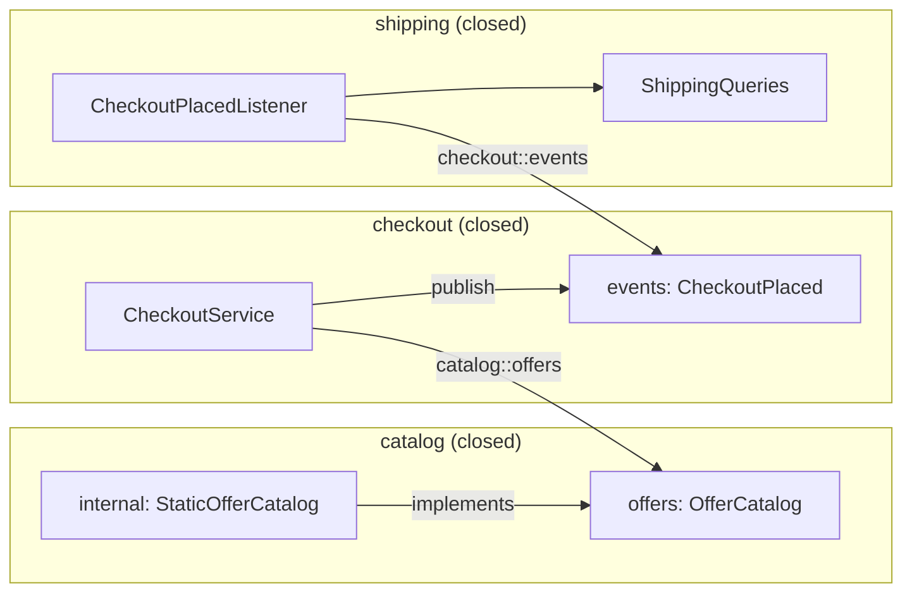

# Chọn ApplicationModules.verify cho luật kiến trúc

Một pull request thêm chức năng giao hàng. Module `shipping` bắt đầu import `CheckoutService` của `checkout` để đọc thông tin đơn, dù thiết kế chỉ cho phép `shipping` tiêu thụ các sự kiện qua `checkout::events`. Một bài test end-to-end có thể PASS vì code vẫn chạy đúng dữ liệu. Tuy nhiên, **hợp đồng phụ thuộc giữa các application module đã bị phá**.

Đây là lúc chọn **`ApplicationModules.verify()`**: câu hỏi cần trả lời là **“Mã Java có tuân thủ luật kiến trúc module hay không?”**, không phải “một kịch bản nghiệp vụ có chạy được không?”. Spring Modulith có thể phân tích quan hệ tĩnh và báo vi phạm **ngay cả khi nhánh mã import trái phép chưa được thực thi**.

Bài thuộc chương **Chọn chiến lược** trong **SPRING_MODULITH_VERIFICATION_TESTING**. Trọng tâm là hiểu chính xác các luật `verify()` kiểm tra, định nghĩa **closed-module boundary**, `@NamedInterface`, `@ApplicationModule(allowedDependencies = ...)`; tạo JUnit architecture gate; và cố ý tạo vi phạm để xác nhận test thật sự FAIL. `@ApplicationModuleTest`, event/DB tests và CI chỉ xuất hiện khi cần chứng minh **phạm vi áp dụng và giới hạn** của phép kiểm chứng kiến trúc.

> **Quy tắc quyết định:** Dùng `ApplicationModules.verify()` khi invariant nói về **dependency giữa các application module, phần API được công bố, quyền phụ thuộc hoặc chu trình**. Nếu invariant nói về **giá trị trả về, event payload, transaction, listener hoặc database**, hãy viết một bài test hành vi khác. Với PR thay đổi cả hai, cần **hai loại bằng chứng độc lập**.

## 1. Khi nào một yêu cầu nên trở thành luật `verify()`?

Hãy diễn đạt mục tiêu thành câu có thể bị bác bỏ.

| Yêu cầu | Invariant cụ thể | `verify()` có phải công cụ chính? |
| --- | --- | --- |
| “Checkout chỉ được hỏi danh mục về offer” | Dependency từ `checkout` sang `catalog` chỉ đi qua `catalog::offers` | **Có** |
| “Shipping không được gọi service checkout” | `shipping` chỉ được phụ thuộc `checkout::events` | **Có** |
| “Không ai được dùng repository nội bộ catalog” | Application module khác không tham chiếu `catalog.internal` | **Có**, với closed modules |
| “Không tạo vòng checkout ↔ shipping” | Đồ thị module không có cycle trái phép | **Có** |
| “Offer không còn hàng phải bị từ chối” | Input cụ thể dẫn đến kết quả/exception đúng | **Không**, dùng behavior test |
| “Event mang correlation ID của yêu cầu” | Payload event được publish đúng | **Không**, dùng event test |
| “Listener retry không tạo hai shipment” | DB/side effect idempotent | **Không**, dùng integration test |
| “Phải hoàn tất trong 500 ms” | Độ trễ trong môi trường/tải xác định | **Không**, dùng performance/observability |

Các thay đổi đáng để **chạy architecture gate** gồm: chuyển class sang module khác, thêm import xuyên module, công bố/thay đổi named interface, tạo facade, sửa `allowedDependencies`, đổi module visibility hoặc thêm một module mới. Không cần chờ đến khi integration test báo lỗi.

### Invariant tốt phải mô tả điều kiện FAIL

Mô tả mơ hồ:

> “Các module cần độc lập và sạch.”

Mô tả có thể kiểm tra:

> “Không class nào trong `shipping` được giữ field, tham số, kiểu trả về hoặc lời gọi tới `checkout.CheckoutService`; shipping chỉ được dùng các kiểu của `checkout::events`.”

Với câu thứ hai, có thể tạo một **class vi phạm có thể biên dịch**, chạy `verify()` và yêu cầu JUnit FAIL. Nếu không thể nghĩ ra trường hợp làm test FAIL, ta có thể mới viết tài liệu định hướng thay vì một luật kiểm chứng hiệu quả.

## 2. `ApplicationModules.of(...).verify()` kiểm chứng những gì?

API trung tâm:

```java
import org.springframework.modulith.core.ApplicationModules;

ApplicationModules modules =
        ApplicationModules.of(ShopApplication.class);

modules.verify();
```

`ApplicationModules.of(ShopApplication.class)` tạo mô hình application modules dựa vào package của lớp ứng dụng và **chiến lược phát hiện module đang cấu hình**. `verify()` kiểm chứng các quy tắc kiến trúc được Spring Modulith hỗ trợ trên mô hình đó:

1. **Cycles:** các application modules không hình thành những chu trình phụ thuộc trái phép.
2. **Published API boundaries:** module ngoài không được tham chiếu phần **không công bố** của một closed module.
3. **Explicit dependencies:** nếu một module khai báo `allowedDependencies`, những quan hệ xuyên module của nó phải nằm trong danh sách cho phép.

`verify()` đọc **quan hệ và metadata của mã**, không yêu cầu chạy use case hoặc tạo record trong database. Architecture test thường **không cần `@SpringBootTest`** hay khởi tạo toàn bộ Spring `ApplicationContext`.

Cần chú ý **phạm vi**: verifier chỉ có thể kiểm tra **những module mà mô hình thực tế phát hiện** và **những quy tắc hiện đã được khai báo**. Nếu một package bị bỏ khỏi model, module được mở thành `OPEN` hoặc `allowedDependencies` bị nới quá rộng, PASS vẫn có thể hợp lệ theo **cấu hình mới** nhưng không còn đúng ý định của đội. Vì vậy, review metadata vẫn cần thiết.

### Những điều `verify()` không tự bảo đảm

- Bean được Spring DI cung cấp đúng trong mọi profile.
- Service trả đúng kết quả hoặc áp đúng business rule.
- `ApplicationEventPublisher` phát đúng payload và event được listener xử lý.
- Transaction đã commit, database có dữ liệu hay retry idempotent.
- Reflection, tên class trong cấu hình động, HTTP/SQL tương tác theo mong muốn.
- Thời gian xử lý, queue depth, throughput hoặc SLO production.

Đó là ranh giới **structural verification**. Không sửa một behavior bug bằng cách nới `allowedDependencies`, và không cố dùng một behavior test làm bằng chứng toàn bộ dependency graph hợp lệ.

## 3. Đồ thị ba module có luật rõ ràng

Giả sử `ShopApplication` nằm trong `com.example.shop`; các package con trực tiếp là application module theo cách phát hiện mặc định.

```text
com.example.shop
├── ShopApplication.java
├── catalog/                                  ← module catalog
│   ├── offers/
│   │   ├── package-info.java                ← @NamedInterface("offers")
│   │   └── OfferCatalog.java                ← hợp đồng công khai
│   └── internal/
│       └── StaticOfferCatalog.java          ← implementation nội bộ
├── checkout/                                 ← module checkout
│   ├── package-info.java                    ← allowedDependencies=catalog::offers
│   ├── CheckoutService.java
│   └── events/
│       ├── package-info.java                ← @NamedInterface("events")
│       └── CheckoutPlaced.java
└── shipping/                                 ← module shipping
    ├── package-info.java                    ← allowedDependencies=checkout::events
    ├── ShippingQueries.java
    └── internal/
        └── CheckoutPlacedListener.java
```

Đồ thị **dependency Java** dự kiến:



**Chiều phụ thuộc Java:** `checkout → catalog::offers` và `shipping → checkout::events`. **Chiều nghiệp vụ phát event:** checkout phát, shipping nhận. Nhận event **không có nghĩa** checkout import shipping; nếu không có kiểu shipping nào được checkout sử dụng, không có dependency ngược.

### 3.1. Ứng dụng gốc để xây module model

```java
// src/main/java/com/example/shop/ShopApplication.java
package com.example.shop;

import org.springframework.boot.SpringApplication;
import org.springframework.boot.autoconfigure.SpringBootApplication;

@SpringBootApplication
public class ShopApplication {

    public static void main(String[] args) {
        SpringApplication.run(ShopApplication.class, args);
    }
}
```

Không tự coi đường dẫn folder là bằng chứng đủ để kết luận model chứa đúng ba module; với module detection tùy biến hoặc classes không nằm trên classpath, phải kiểm tra mô hình được phát hiện so với thiết kế thực.

## 4. Tạo một named interface có ý nghĩa

File `src/main/java/com/example/shop/catalog/offers/package-info.java`:

```java
/**
 * Hợp đồng tra cứu offer cho các module bên ngoài catalog.
 * Không công bố entity, repository hoặc cache implementation.
 */
@org.springframework.modulith.NamedInterface("offers")
package com.example.shop.catalog.offers;
```

Interface trong package đã công bố:

```java
// catalog/offers/OfferCatalog.java
package com.example.shop.catalog.offers;

import java.util.UUID;

public interface OfferCatalog {
    boolean isAvailable(UUID offerId);
}
```

Implementation thuộc module sở hữu:

```java
// catalog/internal/StaticOfferCatalog.java
package com.example.shop.catalog.internal;

import com.example.shop.catalog.offers.OfferCatalog;
import java.util.UUID;
import org.springframework.stereotype.Component;

@Component
class StaticOfferCatalog implements OfferCatalog {

    @Override
    public boolean isAvailable(UUID offerId) {
        return offerId != null
                && !offerId.equals(new UUID(0L, 0L));
    }
}
```

`StaticOfferCatalog` được Spring tạo bean, nhưng **class nằm ở subpackage internal**; các module khác chỉ cần sử dụng interface `OfferCatalog`. Class Java có thể là `public` mà **vẫn không thuộc API được Spring Modulith công bố** nếu nằm trong phần nội bộ của closed module.

Phần này cho thấy vì sao `@NamedInterface` không đơn thuần là chú thích: nó là **điểm ràng buộc** để `verify()` phân biệt phép tham chiếu hợp lệ với kiểu implementation không được công bố.

## 5. Khai báo quyền phụ thuộc chính xác

File `checkout/package-info.java`:

```java
@org.springframework.modulith.ApplicationModule(
    allowedDependencies = "catalog::offers"
)
package com.example.shop.checkout;
```

File `shipping/package-info.java`:

```java
@org.springframework.modulith.ApplicationModule(
    allowedDependencies = "checkout::events"
)
package com.example.shop.shipping;
```

Cú pháp `catalog::offers` gồm **tên module** và **tên named interface**, không phải Java import path. Mệnh đề thứ nhất không cho phép checkout dùng tất cả subpackage của catalog; mệnh đề thứ hai cũng không cho phép shipping dùng mọi class public trong package gốc checkout.

Đây là hai câu hỏi **khác nhau**:

| Luật | Hỏi điều gì? |
| --- | --- |
| **Public API boundary** | “Kiểu này có được module sở hữu công bố không?” |
| **`allowedDependencies`** | “Ngay cả khi kiểu đã công bố, module tiêu thụ **có được phép dùng** API đó không?” |

Một kiểu có thể qua điều kiện đầu tiên nhưng bị từ chối ở điều kiện thứ hai. Ví dụ `CheckoutService` ở package gốc `checkout` có thể là default API, nhưng shipping chỉ được phép dùng `checkout::events`.

Khi module cần **thêm** một named interface khác, phải có quyết định kiến trúc trước khi mở quyền:

```java
// Chỉ minh họa cú pháp nếu payments::api thực sự tồn tại:
@org.springframework.modulith.ApplicationModule(
    allowedDependencies = {
        "catalog::offers",
        "payments::api"
    }
)
package com.example.shop.checkout;
```

**Đừng thêm `payments::api` chỉ để test xanh.** Nó phải là API/module có thật và được duyệt. Danh sách explicit dependency hiệu quả khi **hẹp**, phản ánh đúng những quan hệ dự định duy trì.

Nếu không khai báo `allowedDependencies`, Spring Modulith vẫn có kiểm tra chu trình và closed-module boundaries, nhưng các phụ thuộc tới API **đã công bố** có thể rộng hơn chủ đích. Muốn ràng buộc “shipping chỉ nhận events, không gọi CheckoutService”, cần **explicit dependency policy**.

## 6. Các dependency hợp lệ trong mã Java

### 6.1. Checkout import đúng named interface của catalog

File `checkout/events/package-info.java`:

```java
@org.springframework.modulith.NamedInterface("events")
package com.example.shop.checkout.events;
```

Kiểu event:

```java
// checkout/events/CheckoutPlaced.java
package com.example.shop.checkout.events;

import java.util.Objects;
import java.util.UUID;

public record CheckoutPlaced(
        UUID checkoutId,
        UUID offerId,
        UUID correlationId
) {
    public CheckoutPlaced {
        Objects.requireNonNull(checkoutId, "checkoutId");
        Objects.requireNonNull(offerId, "offerId");
        Objects.requireNonNull(correlationId, "correlationId");
    }
}
```

Service tại package gốc checkout:

```java
// checkout/CheckoutService.java
package com.example.shop.checkout;

import com.example.shop.catalog.offers.OfferCatalog;
import com.example.shop.checkout.events.CheckoutPlaced;
import java.util.Objects;
import java.util.UUID;
import org.springframework.context.ApplicationEventPublisher;
import org.springframework.stereotype.Service;

@Service
public class CheckoutService {

    private final OfferCatalog offers;
    private final ApplicationEventPublisher events;

    public CheckoutService(
            OfferCatalog offers,
            ApplicationEventPublisher events) {
        this.offers = offers;
        this.events = events;
    }

    public UUID start(UUID offerId, UUID correlationId) {
        Objects.requireNonNull(offerId, "offerId");
        Objects.requireNonNull(correlationId, "correlationId");

        if (!offers.isAvailable(offerId)) {
            throw new IllegalStateException("Offer unavailable");
        }

        UUID checkoutId = UUID.randomUUID();

        events.publishEvent(new CheckoutPlaced(
                checkoutId, offerId, correlationId
        ));

        return checkoutId;
    }
}
```

**Ranh giới thực tế:** `CheckoutService` chỉ có cross-module dependency tới `catalog.offers.OfferCatalog`. Nó không import `catalog.internal.StaticOfferCatalog`, dù implementation đó có cung cấp bean.

Đoạn minh họa không lưu checkout xuống database, không có transaction và không cung cấp bảo đảm durable event delivery. Mục đích là tạo ra một **dependency graph có thể phân tích**; runtime reliability phải có test riêng.

### 6.2. Shipping import event, không gọi service checkout

API truy vấn thuộc package gốc của shipping:

```java
// shipping/ShippingQueries.java
package com.example.shop.shipping;

import java.util.UUID;

public interface ShippingQueries {
    boolean wasScheduled(UUID checkoutId);
}
```

Listener nội bộ:

```java
// shipping/internal/CheckoutPlacedListener.java
package com.example.shop.shipping.internal;

import com.example.shop.checkout.events.CheckoutPlaced;
import com.example.shop.shipping.ShippingQueries;
import java.util.Set;
import java.util.UUID;
import java.util.concurrent.ConcurrentHashMap;
import org.springframework.context.event.EventListener;
import org.springframework.stereotype.Component;

@Component
class CheckoutPlacedListener implements ShippingQueries {

    private final Set<UUID> scheduled =
            ConcurrentHashMap.newKeySet();

    @EventListener
    void on(CheckoutPlaced event) {
        scheduled.add(event.checkoutId());
    }

    @Override
    public boolean wasScheduled(UUID checkoutId) {
        return scheduled.contains(checkoutId);
    }
}
```

Ở đây `shipping` tham chiếu **`checkout.events.CheckoutPlaced`**, thuộc named interface được cho phép. Không có import nào tới `checkout.CheckoutService`.

`@EventListener` đồng bộ mặc định chỉ giúp ví dụ có một luồng sự kiện dễ quan sát mà không cần transaction. Nếu chuyển thành `@ApplicationModuleListener` sau commit, cần test transaction/listener riêng; **`verify()` không quan sát những thời điểm đó**.

## 7. JUnit architecture test độc lập

Đặt test tại package gốc để kiểm chứng **toàn bộ mô hình application module** thay vì chỉ một service:

```java
// src/test/java/com/example/shop/ModulithArchitectureTest.java
package com.example.shop;

import org.junit.jupiter.api.Test;
import org.springframework.modulith.core.ApplicationModules;

class ModulithArchitectureTest {

    @Test
    void dependenciesRespectPublishedModuleContracts() {
        ApplicationModules.of(ShopApplication.class).verify();
    }
}
```

Đây là JUnit 5 test tối thiểu. Không cần `@SpringBootTest`, `@Autowired` hoặc datasource khi chỉ kiểm tra module dependencies. Verifier đọc cấu trúc code và **báo lỗi** nếu gặp vi phạm được hỗ trợ; lời gọi kết thúc bình thường khi mô hình hợp lệ.

Có thể bọc `verify()` trong `assertDoesNotThrow`, nhưng không cần thiết: gọi trực tiếp biểu thị rõ **thứ gì là oracle**. Không nên assert văn bản của `ApplicationModules.toString()` hay tìm log `"No violations"`.

### Vì sao phải kiểm tra test discovery?

Một architecture test **không được JUnit runner chạy** thì không bảo vệ được gì, dù file tồn tại trong repository. Khi xem kết quả CI:

- Đảm bảo `ModulithArchitectureTest` có trong JUnit XML/report.
- Kiểm tra không có `skipTests`, `-x test` hoặc filter làm mất bài kiểm tra.
- Xác nhận lớp gốc `ShopApplication` dẫn đến **đúng các module dự định**.
- Thử tạo một vi phạm có chủ đích và xác nhận **status của job chuyển thành FAIL**.

## 8. Mutation 1: public Java nhưng vẫn vi phạm API nội bộ

Đây là ca kiểm chứng mạnh cho luật **closed-module visibility**.

Tạm tạo một kiểu công khai **bên trong** catalog:

```java
// catalog/internal/CatalogSnapshot.java — chỉ dùng trong thử nghiệm
package com.example.shop.catalog.internal;

public class CatalogSnapshot {
    public String storageKey() {
        return "catalog-only";
    }
}
```

Tạo class từ checkout có dependency thật tới kiểu ấy:

```java
// checkout/internal/IllegalCatalogAccess.java — phản ví dụ
package com.example.shop.checkout.internal;

import com.example.shop.catalog.internal.CatalogSnapshot;

class IllegalCatalogAccess {

    private final CatalogSnapshot snapshot;

    IllegalCatalogAccess(CatalogSnapshot snapshot) {
        this.snapshot = snapshot;
    }

    String readInternalKey() {
        return snapshot.storageKey();
    }
}
```

**Kết quả kỳ vọng:**

1. Java có thể compile vì `CatalogSnapshot` là `public`.
2. `verify()` **FAIL** vì checkout dùng một phần của catalog không được công bố qua `catalog::offers`.
3. Behavior test không đụng `IllegalCatalogAccess` có thể vẫn PASS — do đó nó không thay thế architecture gate.

**Chi tiết quan trọng:** chỉ thêm một dòng `import` mà không dùng class có thể không tạo dependency trong bytecode. Muốn thử verifier, phải thật sự sử dụng kiểu trong **field, method signature hoặc lời gọi**. Nếu class là package-private, compiler sẽ chặn import trước khi `verify()` chạy; như vậy không cô lập được luật Modulith.

Sau mutation, khôi phục cả hai class tạm để trở lại baseline.

## 9. Mutation 2: kiểu đã public nhưng consumer chưa được cấp quyền

`CheckoutService` nằm tại package gốc `checkout`, là phần API mặc định của closed module. Tuy nhiên, `shipping` chỉ có quyền `checkout::events`.

Thêm class tạm trong shipping:

```java
// shipping/internal/IllegalServiceAccess.java — phản ví dụ
package com.example.shop.shipping.internal;

import com.example.shop.checkout.CheckoutService;

class IllegalServiceAccess {

    private final CheckoutService checkoutService;

    IllegalServiceAccess(CheckoutService checkoutService) {
        this.checkoutService = checkoutService;
    }
}
```

**Kết quả kỳ vọng:** Java compile. `verify()` **FAIL** theo `allowedDependencies`, dù `CheckoutService` thuộc API mặc định của module. Đây là điểm phân biệt:

| Luật | `CheckoutService` tại root package | Kết luận |
| --- | --- | --- |
| API boundary | Root class có thể được công bố mặc định | Không nhất thiết vi phạm visibility |
| `shipping.allowedDependencies = "checkout::events"` | Không thuộc named interface events | **Vi phạm explicit dependency policy** |

Nếu bỏ `allowedDependencies`, quan hệ này **có thể** không còn bị chặn theo rule explicit dependencies; đó là lý do cần viết chính xác chính sách mà nhóm muốn bảo vệ.

Đừng chữa bằng cách chuyển `shipping` thành `OPEN` hoặc xóa rule. Nếu shipping cần dữ liệu checkout, hãy thiết kế một **named interface mới có chủ đích** hoặc bổ sung event contract phù hợp, rồi review tác động trước khi cấp quyền.

## 10. Mutation 3: chu trình vẫn sai khi từng cạnh được cấp quyền

Trên baseline, shipping phụ thuộc checkout thông qua event type. Cố ý cho checkout tham chiếu ngược về shipping:

```java
// checkout/internal/IllegalShippingBackReference.java
package com.example.shop.checkout.internal;

import com.example.shop.shipping.ShippingQueries;
import java.util.UUID;

class IllegalShippingBackReference {

    private final ShippingQueries shipping;

    IllegalShippingBackReference(ShippingQueries shipping) {
        this.shipping = shipping;
    }

    boolean wasScheduled(UUID checkoutId) {
        return shipping.wasScheduled(checkoutId);
    }
}
```

Bây giờ graph có **hai chiều**:

```text
shipping   --> checkout::events
checkout   --> shipping
```

Với `checkout.allowedDependencies = "catalog::offers"` ban đầu, quan hệ mới còn sai explicit dependency. Để **cô lập luật cycle** trong nhánh thực hành, tạm cấp phép cạnh thứ hai:

```java
// CHỈ DÙNG TRONG THỬ NGHIỆM CYCLE, KHÔNG GIỮ LẠI.
@org.springframework.modulith.ApplicationModule(
    allowedDependencies = {
        "catalog::offers",
        "shipping"
    }
)
package com.example.shop.checkout;
```

Cả hai cạnh bây giờ đều được khai báo là **được phép** theo explicit dependencies, nhưng chúng vẫn hình thành **vòng module**, vì vậy `verify()` phải **FAIL do cycle**. Đây là minh chứng **cho phép một dependency không đồng nghĩa cho phép một chu trình**.

Sau khi quan sát FAIL, xóa class sai và khôi phục `allowedDependencies = "catalog::offers"`.

## 11. Mutation 4: mất `@NamedInterface` làm sai hợp đồng

Tại baseline, package `catalog.offers` có:

```java
@org.springframework.modulith.NamedInterface("offers")
package com.example.shop.catalog.offers;
```

Thử xóa annotation nhưng để nguyên:

- `CheckoutService` vẫn import `catalog.offers.OfferCatalog`;
- `checkout/package-info.java` vẫn ghi `allowedDependencies = "catalog::offers"`.

Khi đó named interface `catalog::offers` **không còn được công bố như trước**. `verify()` hoặc bước dựng/kiểm chứng module model **không được PASS như baseline**; cách báo lỗi cụ thể phụ thuộc phiên bản và cấu hình.

Thí nghiệm này quan trọng vì **Java interface `public` ở subpackage không tự biến thành named interface của Modulith**. Di chuyển `OfferCatalog` sang root package `catalog` cũng là một thay đổi API, dù vẫn có thể sửa import để compile.

### Một lưu ý về việc thay metadata

Nếu team **cố ý** đưa một repository nội bộ ra package công bố, hoặc nới `allowedDependencies` để hợp thức hóa import, verifier có thể PASS vì nó đang kiểm tra **quy tắc mới**. Vì vậy, đừng chỉ hỏi “CI xanh chưa?”; hãy review **diff của `package-info.java`**, phạm vi public API và quyết định kiến trúc đằng sau thay đổi.

## 12. Ma trận kiểm chứng các loại vi phạm

| Biến thể | Rule cần bảo vệ | `verify()` dự kiến | Có cần behavioral test? |
| --- | --- | --- | --- |
| Checkout dùng `catalog.offers.OfferCatalog` | Named interface được công bố + cấp quyền | PASS nếu mô hình còn lại đúng | Có, nếu kiểm tra offer availability |
| Checkout dùng `catalog.internal.CatalogSnapshot` | Closed-module boundary + allowedDependencies | **FAIL** | Không cần để phát hiện import sai |
| Shipping dùng `checkout.CheckoutService` | Explicit dependency chỉ cho events | **FAIL** | Behavior có thể vẫn PASS |
| Shipping dùng `checkout.events.CheckoutPlaced` | Đúng named interface | PASS nếu mô hình còn lại đúng | Có, để kiểm tra xử lý event |
| Checkout ↔ shipping với hai cạnh được cấp quyền tạm | Chu trình module | **FAIL** | Không cần để phát hiện cycle |
| Xóa `@NamedInterface("offers")` | Module API không còn như khai báo | **FAIL / lỗi model** | Có thể còn cần wiring tests |
| Event phát sai correlation ID | Payload runtime | Có thể PASS | **Có** |
| Listener không tạo shipment | Side effect runtime | Có thể PASS | **Có** |
| Transaction rollback sau publish | Transaction/data consistency | Có thể PASS | **Có** |
| Chuyển module sang open / nới rules | Chính luật được thay đổi | Có thể PASS theo luật mới | **Cần architecture review** |

Đây là **kỳ vọng có căn cứ theo thiết kế**, không phải kết quả JUnit đã thực thi. Tên lớp exception và chuỗi thông báo cụ thể có thể thay đổi, nên không dùng regex trên log làm test chính.

## 13. `@ApplicationModuleTest` bổ sung chứ không thay thế `verify()`

Một bài `@ApplicationModuleTest` khởi tạo Spring context của module và chạy hành vi. Nó phù hợp xác minh việc inject bean, điều kiện đầu vào và event payload. Ví dụ test `checkout` với module `catalog` thật:

```java
// src/test/java/com/example/shop/checkout/CheckoutBehaviorTest.java
package com.example.shop.checkout;

import com.example.shop.checkout.events.CheckoutPlaced;
import java.util.UUID;
import org.junit.jupiter.api.Test;
import org.springframework.beans.factory.annotation.Autowired;
import org.springframework.modulith.test.ApplicationModuleTest;
import org.springframework.modulith.test.ApplicationModuleTest.BootstrapMode;
import org.springframework.test.context.event.ApplicationEvents;
import org.springframework.test.context.event.RecordApplicationEvents;

import static org.assertj.core.api.Assertions.assertThat;

@ApplicationModuleTest(mode = BootstrapMode.DIRECT_DEPENDENCIES)
@RecordApplicationEvents
class CheckoutBehaviorTest {

    @Autowired
    CheckoutService checkout;

    @Autowired
    ApplicationEvents recordedEvents;

    @Test
    void publishesCheckoutEventWithSameCorrelation() {
        UUID offerId = UUID.randomUUID();
        UUID correlationId = UUID.randomUUID();

        UUID checkoutId = checkout.start(
                offerId, correlationId
        );

        var matches = recordedEvents.stream(CheckoutPlaced.class)
                .filter(event ->
                        correlationId.equals(event.correlationId()))
                .toList();

        assertThat(matches).hasSize(1);
        assertThat(matches.get(0).checkoutId())
                .isEqualTo(checkoutId);
        assertThat(matches.get(0).offerId())
                .isEqualTo(offerId);
    }
}
```

`DIRECT_DEPENDENCIES` giúp test checkout khởi tạo cả module catalog là dependency trực tiếp, nhờ đó `OfferCatalog` thật được cung cấp. Ở `STANDALONE` có thể cần stub cho interface ấy.

**Nhưng test này không chủ động kiểm tra** xem class ở shipping có import trái phép `CheckoutService` hay không. Shipping là **consumer** của event, không mặc nhiên là dependency của checkout; test checkout có thể không khởi tạo shipping. `ApplicationEvents` chỉ ghi event được **publish trong Spring Test context**, không chứng minh shipping đã xử lý hoặc database đã commit.

| Claim | Phép kiểm tra chính |
| --- | --- |
| Không có import trái API module | `ApplicationModules.verify()` |
| Checkout inject được OfferCatalog | `@ApplicationModuleTest(DIRECT_DEPENDENCIES)` |
| Checkout publish đúng CheckoutPlaced | `ApplicationEvents` / `Scenario` |
| Listener shipping đã cập nhật state | Integration test có cả publisher + consumer |
| Transaction/order/shipment commit | DB/integration test có transaction thật |
| Registry pending/completed/retry đúng | Test publication backend/API phù hợp |

Không nên đổi sang `@SpringBootTest` để “thử có lỗi architecture không”: Spring có thể wire được dependency trái ranh giới. Ngược lại, khi cần kiểm tra AFTER_COMMIT listener và JDBC/JPA, không thể dùng riêng `verify()`.

## 14. Đưa architecture gate vào CI

Vì `verify()` là **API Java**, cách triển khai thực tế là gọi nó trong JUnit rồi chạy test runner. Không mặc định tồn tại lệnh `./gradlew verify`.

Ví dụ với Gradle:

```bash
# Kiểm tra architecture test trong khi phát triển:
./gradlew test --tests 'com.example.shop.ModulithArchitectureTest'

# Chạy toàn bộ test được gắn với task test:
./gradlew test
```

Với Maven/Surefire được cấu hình:

```bash
mvn -B -Dtest=ModulithArchitectureTest test
```

Chỉ chạy `test` không đảm bảo mọi integration suite được tách sang Gradle `integrationTest` hoặc Maven Failsafe cũng chạy. **Architecture gate nên có trong một task/job bắt buộc**, còn các test giao dịch/event/DB được thêm vào các job thích hợp.

### Ví dụ GitHub Actions

```yaml
name: Modulith architecture verification

on:
  pull_request:

jobs:
  structural-gate:
    runs-on: ubuntu-latest
    permissions:
      contents: read

    steps:
      - uses: actions/checkout@v4

      - uses: actions/setup-java@v4
        with:
          distribution: temurin
          java-version: '21'

      - uses: gradle/actions/setup-gradle@v4

      - name: Verify module architecture
        run: bash ./gradlew --no-daemon test --tests 'com.example.shop.ModulithArchitectureTest'

      - name: Run module behavior tests
        run: bash ./gradlew --no-daemon test

      - name: Keep JUnit reports on failure
        if: always()
        uses: actions/upload-artifact@v4
        with:
          name: modulith-architecture-reports
          path: |
            **/build/test-results/**/*.xml
            **/build/reports/tests/**
          if-no-files-found: warn
```

Đây là **pipeline minh họa**, chưa được thực thi trên repository của bài học. Nó đòi hỏi Gradle wrapper, JDK tương thích và các dependency Spring Modulith/JUnit đã được quản lý phù hợp. Đối với test cần database, phải bổ sung hạ tầng và integration task riêng.

Để chặn merge, repository cần **branch protection/ruleset yêu cầu job `structural-gate` thành công**. Bước upload JUnit reports với `if: always()` phục vụ điều tra chứ không chuyển FAIL thành PASS.

### Khi gate FAIL, ưu tiên đọc những thông tin gì?

1. Module **nguồn** tạo dependency, ví dụ shipping.
2. Module **đích**, package và kiểu đang được tham chiếu.
3. Luật nào không đạt: boundary, explicit dependencies hay cycle.
4. Commit/file nào thêm dependency.
5. Giải pháp đúng là bỏ import nội bộ, xuất hợp đồng hẹp hoặc đảo lại hướng dependency — **không tự động nới rule**.

Đừng dùng assertion trên chuỗi log `"Modules verified"`. `verify()` tự tạo điều kiện PASS/FAIL cho JUnit; log và sơ đồ chỉ giúp chẩn đoán.

## 15. Những cách “làm xanh” gate nhưng phá thiết kế

| Cách xử lý vội | Hệ quả | Cách làm phù hợp hơn |
| --- | --- | --- |
| Thêm mọi module vào `allowedDependencies` | Mất giới hạn quyền phụ thuộc | Chỉ cho phép named interface có mục đích |
| Chuyển module thành open | Có thể công bố quá nhiều implementation | Giữ closed module và tạo API hẹp |
| Đưa repository nội bộ ra root API | Làm lộ chi tiết persistence | Dùng facade/port/event contract |
| Xóa architecture test khỏi CI | Không còn chặn hồi quy tĩnh | Required status check cho `verify()` |
| Chỉ in `ApplicationModules.toString()` | Có sơ đồ nhưng không có assertion | Gọi `verify()` |
| Bắt exception rồi chỉ log warning | Test PASS dù có vi phạm | Để exception làm JUnit FAIL |
| Snapshot nguyên text lỗi verifier | Dễ vỡ do version | Kiểm chứng luật, review diagnostic |
| Giả định mọi package là module | Có thể bỏ sót vùng mã | Kiểm tra scope của model |
| Dùng `@SpringBootTest` thay luật kiến trúc | Wiring có thể tốt dù import sai | Kết hợp hai gate độc lập |

Nếu shipping thực sự cần tra cứu trạng thái checkout, hãy cân nhắc liệu **event payload** có thiếu dữ liệu ổn định, hay cần công bố thêm một **named interface query hẹp**. Quyết định API phải xuất phát từ nhu cầu nghiệp vụ và mô hình phụ thuộc, không từ việc “thêm quyền cho test hết đỏ”.

## 16. Giới hạn của `verify()` và các luật bổ sung

`ApplicationModules.verify()` là baseline mạnh cho **application module model**, không phải bộ kiểm tra mọi quy tắc nội bộ của tổ chức.

- **Runtime/dynamic references:** reflection hoặc tên class trong configuration có thể tạo liên kết runtime mà không lộ ra như dependency tĩnh thông thường.
- **Layering bên trong một module:** quy tắc “controller không gọi repository trực tiếp” trong cùng module có thể cần ArchUnit/custom rules bổ sung.
- **API đã được mở rộng:** verifier áp dụng luật **hiện tại**, không biết ý định lịch sử nếu PR mở rộng bề mặt public.
- **Behavioral correctness:** dependency hợp lệ không bảo đảm các điều kiện nghiệp vụ, idempotency, transaction hoặc event listener hoạt động đúng.
- **Operational correctness:** CPU, memory, latency, database locks và retries cần metrics, test tải hoặc tích hợp.

Khi có invariant nội bộ nằm ngoài các luật mặc định, nên thêm **ArchUnit rule chuyên biệt** trong một JUnit architecture suite riêng. Nhưng không cần tự xây lại từ đầu mọi rule về application module boundary nếu Spring Modulith đã cung cấp `verify()`.

## 17. Bài thực hành: chứng minh gate phát hiện sai ranh giới

### Bối cảnh

Team đang review một thay đổi đưa `shipping` gọi trực tiếp `CheckoutService`. Yêu cầu kiến trúc ban đầu là shipping chỉ tiêu thụ `checkout::events`. Bạn cần tạo bằng chứng đủ rõ để một PR có phụ thuộc sai bị CI chặn, và một PR chỉ đổi payload event sai bị **behavior test** chặn.

### Các bước

1. Tạo ba module `catalog`, `checkout`, `shipping` đúng cây package trong phần 3.
2. Công bố `catalog::offers` và `checkout::events` bằng `@NamedInterface`.
3. Khai báo `allowedDependencies = "catalog::offers"` và `allowedDependencies = "checkout::events"` ở module tiêu thụ tương ứng.
4. Đặt `CheckoutService` dùng interface `OfferCatalog`, không dùng implementation `StaticOfferCatalog`.
5. Viết `ModulithArchitectureTest` với `ApplicationModules.of(ShopApplication.class).verify()`.
6. Chạy architecture test; đối chiếu JUnit report và phạm vi module được phát hiện.
7. **Mutation A:** đưa kiểu public `CatalogSnapshot` vào `catalog.internal`, sử dụng thực sự từ checkout; kỳ vọng gate **FAIL**.
8. Khôi phục. **Mutation B:** shipping giữ field kiểu `checkout.CheckoutService`; kỳ vọng gate **FAIL** dù target thuộc default API.
9. Khôi phục. **Mutation C:** checkout tham chiếu `ShippingQueries`, tạm cấp quyền để cô lập cycle; kỳ vọng gate **FAIL** vì vòng checkout ↔ shipping.
10. Khôi phục. **Mutation D:** xóa `@NamedInterface("offers")`; xác nhận mô hình không còn hợp đồng cũ.
11. Viết test behavior checkout với `DIRECT_DEPENDENCIES` và `ApplicationEvents`, assert `CheckoutPlaced` cùng correlation ID.
12. Thử làm payload sai; `verify()` có thể PASS nhưng event test phải **FAIL**.
13. Đưa architecture test và module behavior tests vào CI; lưu JUnit XML; kiểm tra required status check.
14. Hoàn nguyên toàn bộ mutation và metadata tạm. Không giữ thay đổi mở quyền chỉ để bộ test xanh.

### Ma trận nghiệm thu

| Thay đổi | Java compile | `verify()` | Behavior test |
| --- | --- | --- | --- |
| Baseline đúng | PASS | PASS | PASS khi fixture phù hợp |
| Checkout dùng public `catalog.internal.CatalogSnapshot` | Có thể PASS | **FAIL** | Có thể PASS |
| Shipping dùng `checkout.CheckoutService` | PASS | **FAIL** theo explicit dependencies | Có thể PASS |
| Cả hai cạnh cycle đều được cấp quyền tạm | PASS nếu type đúng | **FAIL** theo cycle | Không cần để phát hiện |
| Xóa named interface offers | Có thể PASS | **FAIL / lỗi model** | Có thể PASS |
| `CheckoutPlaced` mang sai correlation ID | PASS | Có thể PASS | **FAIL** |
| Bean `OfferCatalog` không được đăng ký | PASS | Có thể PASS | **FAIL** khi bootstrap |
| Nới rules để hợp thức hóa import | PASS | Có thể PASS theo luật mới | Có thể PASS; **cần review** |

Bảng mô tả **kỳ vọng thiết kế**, không phải kết quả kiểm thử đã được chạy trong workspace.

### Câu hỏi tự đánh giá

**1. Vì sao chọn `verify()` thay vì chỉ chạy `@SpringBootTest` khi cần cấm import internal?** Vì invariant nói về dependency tĩnh, trong khi Spring có thể bootstrap và chạy đúng dù có phụ thuộc trái ranh giới.

**2. Class Java `public` tại package gốc checkout có tự được shipping dùng không?** Không. Nó còn phải được chính sách `allowedDependencies` của shipping cho phép.

**3. Vì sao mutation dùng kiểu public ở internal?** Để compiler có thể chấp nhận và luật Modulith — thay vì Java visibility — là thứ phát hiện quan hệ sai.

**4. `verify()` PASS nhưng listener không ghi dữ liệu thì sao?** Cần test transaction, event, database hoặc integration; không sửa luật kiến trúc khi lỗi là runtime.

**5. Vì sao một dòng `import` thừa có thể không gây FAIL?** Vì dependency analysis dựa trên các quan hệ code thực sự tồn tại trong mô hình/bytecode; import không dùng có thể bị loại khỏi kết quả biên dịch.

**6. Làm sao biết architecture gate được CI thực thi?** Kiểm tra test discovery, JUnit report, exit code/required check và một mutation có kiểm soát làm job FAIL.

## 18. Checklist trước khi chốt PR

- [ ] Claim cần bảo vệ là **module boundary, API công bố, explicit dependency hoặc cycle**.
- [ ] `ShopApplication` được dùng trong `ApplicationModules.of(...)` đại diện đúng cho toàn bộ module cần kiểm tra.
- [ ] Các named interface công bố đúng contract; repository/implementation vẫn nằm trong internal.
- [ ] `allowedDependencies` phản ánh quyền tối thiểu, không bị nới chỉ để né FAIL.
- [ ] JUnit gọi thẳng `verify()`, không bắt exception rồi trả về PASS.
- [ ] CI thật sự chạy `ModulithArchitectureTest` và báo FAIL khi thử import trái phép.
- [ ] Metadata `package-info.java` thay đổi được reviewer xem như thay đổi API/kiến trúc.
- [ ] Hành vi runtime — event payload, commit, listener, DB, retry — có test khác tương ứng khi cần.
- [ ] Không dùng log, sơ đồ hoặc `toString()` để thay thế invariant có assertion.
- [ ] Mutation thử nghiệm đã được hoàn nguyên hoàn toàn.

## 19. Kết luận

**Chọn `ApplicationModules.verify()` khi câu hỏi là “mã Java của các application module có còn tuân thủ luật kiến trúc không?”.** Biến ý định thiết kế thành **closed-module boundaries, named interfaces, `allowedDependencies` và luật không có cycle**; chạy một **JUnit architecture gate độc lập**, rồi cố ý vi phạm để chứng minh nó thật sự FAIL. Đưa gate này vào CI giúp ngăn phụ thuộc sai ngay cả khi behavior test vẫn xanh.

`verify()` không kiểm tra transaction, event payload, listener hay production latency. Với những mục tiêu đó, giữ `@ApplicationModuleTest`, event/DB/integration tests và observability làm **nguồn bằng chứng bổ sung**, thay vì dùng một phép kiểm tra để đưa ra kết luận vượt phạm vi.

### Tài liệu tham khảo

- [Spring Modulith Reference — Verifying Application Module Structure](https://docs.spring.io/spring-modulith/reference/verification.html)
- [Spring Modulith Reference — Application Modules](https://docs.spring.io/spring-modulith/reference/fundamentals.html)
- [Spring Modulith Reference — Integration Testing Application Modules](https://docs.spring.io/spring-modulith/reference/testing.html)
- [Spring Modulith Reference — Application Events](https://docs.spring.io/spring-modulith/reference/events.html)
- [ArchUnit — Architecture Tests](https://www.archunit.org/)
