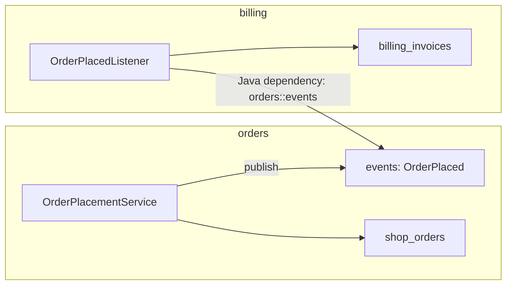
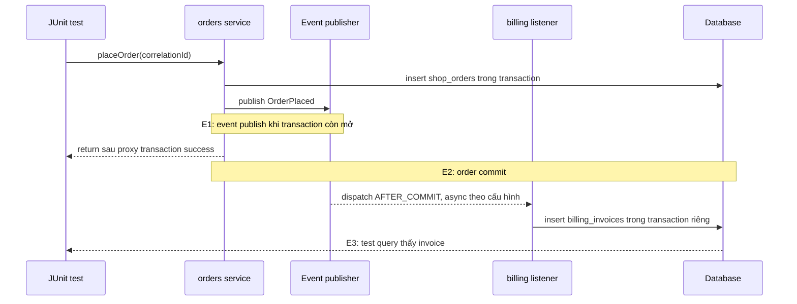

# Chọn @SpringBootTest cho cross-module flow

Một module `orders` lưu đơn hàng thành công rồi phát `OrderPlaced`. Module `billing` nhận sự kiện, tạo hóa đơn trong transaction riêng. Nếu chỉ test `orders` bằng `@ApplicationModuleTest(STANDALONE)`, ta có thể khẳng định event được publish nhưng **không thể mặc nhiên khẳng định hóa đơn đã được tạo**: `billing` là module **tiêu thụ** event, không phải một dependency mã Java mà `orders` cần import.

Với yêu cầu **“đặt đơn thành công phải dẫn tới một hóa đơn đã commit ở module khác”**, đối tượng kiểm tra là **cross-module flow**: một chuỗi hành vi xuyên ranh giới module, bean, transaction và persistence. `@SpringBootTest` thường là lựa chọn phù hợp để bootstrap toàn bộ Spring Boot application context, bao gồm publisher, consumer, transaction manager và database test. Nhưng một context rộng chỉ có giá trị khi bài test **assert đúng từng mốc nghiệp vụ**; một test `contextLoads()` xanh không chứng minh flow hoàn tất.

Bài thuộc chương **Chọn chiến lược** trong lộ trình **SPRING_MODULITH_VERIFICATION_TESTING**. Chúng ta sẽ chọn phạm vi test đúng cho luồng `orders → billing`, viết Java/JUnit kiểm tra **event được publish, order đã commit, invoice được tạo sau commit**, xây test rollback, giải thích giới hạn event registry và dùng CI quality gate. Mục tiêu là **phân biệt chứng cứ của cross-module flow với chứng cứ của một module hoặc kiến trúc tĩnh**, tránh lặp các phần nhập môn không liên quan.

> **Nguyên tắc quyết định:** Dùng `@SpringBootTest` khi acceptance criterion cần **những bean của nhiều module cùng hoạt động**, đặc biệt khi một module phát event và module khác xử lý sau commit. Dùng `@ApplicationModuleTest` khi chỉ cần behavior/wiring ở phạm vi module và dependency được chọn. Dùng `ApplicationModules.verify()` **riêng** để chặn dependency tĩnh sai.

## 1. Nhận diện lúc cross-module flow thực sự cần toàn application context

Hãy viết rõ một *claim* trước khi chọn annotation:

| Claim | Chọn test nào trước? | Vì sao |
| --- | --- | --- |
| `orders` tạo đúng event `OrderPlaced` | `@ApplicationModuleTest` cho `orders` + `ApplicationEvents` | Chỉ cần producer |
| `orders` không import `billing.internal` | JUnit gọi `ApplicationModules.verify()` | Đây là luật cấu trúc tĩnh |
| `billing` xử lý đúng một event đã cho | Module test cho `billing` với stimulus phù hợp | Có thể cô lập consumer |
| `orders` commit rồi `billing` tạo invoice | **`@SpringBootTest` + database + Awaitility** | Cần cả producer, consumer và transaction |
| Listener sau commit không chạy khi order rollback | **`@SpringBootTest` + rollback probe** | Cần kiểm tra ranh giới transaction thực |
| Consumer nhận retry mà không tạo invoice trùng | Integration/concurrency test + unique constraint và code idempotent | Cần persistence/retry semantics |
| HTTP trả đúng status khi tạo đơn | `@SpringBootTest` với web environment phù hợp hoặc web-layer test tùy claim | Cần HTTP nếu status/serialization là contract |
| Production p95 tạo hóa đơn đạt SLO | Metrics/load test ở môi trường, tải phù hợp | JUnit CI không tự đại diện production |

**Điểm bẫy:** `@ApplicationModuleTest(mode = ALL_DEPENDENCIES)` **không đồng nghĩa** bootstrap mọi module trong ứng dụng. Nó mở rộng theo *các module mà module đích phụ thuộc vào*. Module `billing` **phụ thuộc vào** kiểu event của `orders`; điều này không khiến `orders` phụ thuộc ngược vào `billing`. Do đó, một test tập trung vào `orders` có thể không bootstrap consumer, dù mode rộng.

### Chốt ba điểm đầu–cuối của flow

Ví dụ này có ba bằng chứng riêng:

1. **E1 — Published:** `OrderPlaced` với `orderId` và `correlationId` đúng đã được publish trong Spring context.
2. **E2 — Committed:** hàng trong `shop_orders` đã commit và đọc được sau lời gọi service.
3. **E3 — Consumer side effect:** hàng trong `billing_invoices` đúng order/correlation ID được ghi bởi listener của `billing` và đọc được sau commit.

Một ứng dụng có Event Publication Registry có thể cần thêm **E4 — publication completed**, nhưng E4 là mốc khác và không được suy ra từ E1/E3. Bài này dùng **core event flow**, không mặc định bật publication registry bền vững.

## 2. Thiết kế ranh giới module và hợp đồng event trước khi test

Ứng dụng mẫu nằm dưới `com.example.shop`:

```text
com.example.shop
├── ShopApplication.java
├── orders/                              ← application module orders
│   ├── OrderPlacementService.java
│   └── events/
│       ├── package-info.java          ← @NamedInterface("events")
│       └── OrderPlaced.java
└── billing/                             ← application module billing
    ├── package-info.java              ← allowedDependencies=orders::events
    └── internal/
        └── OrderPlacedListener.java
```

Mô hình dependency Java và luồng nghiệp vụ có **hướng khác nhau**:



- **Dependency Java:** `billing → orders::events`, vì listener thuộc `billing` import `OrderPlaced`.
- **Luồng nghiệp vụ:** `orders` publish, `billing` xử lý.
- `orders` **không import** repository, service hoặc implementation của `billing`. Nếu đặt import ngược vào orders, cần `ApplicationModules.verify()` xem xét ranh giới/cycle thay vì hy vọng integration test tự bắt.

File `orders/events/package-info.java`:

```java
/**
 * Hợp đồng sự kiện mà application module khác được phép tham chiếu.
 * Không đưa entity hoặc repository nội bộ của orders ra API.
 */
@org.springframework.modulith.NamedInterface("events")
package com.example.shop.orders.events;
```

File `orders/events/OrderPlaced.java`:

```java
package com.example.shop.orders.events;

import java.util.Objects;
import java.util.UUID;

public record OrderPlaced(
        UUID orderId,
        UUID correlationId
) {
    public OrderPlaced {
        Objects.requireNonNull(orderId, "orderId");
        Objects.requireNonNull(correlationId, "correlationId");
    }
}
```

File `billing/package-info.java`:

```java
@org.springframework.modulith.ApplicationModule(
    allowedDependencies = "orders::events"
)
package com.example.shop.billing;
```

**Vì sao có `correlationId`?** Trong database hoặc test context có thể có nhiều event cùng loại. Assertion chỉ tìm một `OrderPlaced` bất kỳ, hoặc chỉ đếm toàn bộ invoice, có thể **PASS nhờ dữ liệu của stimulus khác**. `orderId` xác định đơn, `correlationId` nối chính yêu cầu của test với event và tác dụng phụ.

## 3. Triển khai producer và consumer có ranh giới transaction rõ ràng

Ví dụ dùng **Spring JDBC** để nhìn thấy commit, thay vì đưa vào các chi tiết mapping JPA không cần cho chủ đề. Hai module sử dụng cùng test datasource, nhưng sở hữu bảng nghiệp vụ riêng. Đây là **minh họa modular monolith**, không phải kiến trúc microservice hay message broker phân tán.

### 3.1. Lớp ứng dụng và async support

```java
// src/main/java/com/example/shop/ShopApplication.java
package com.example.shop;

import org.springframework.boot.SpringApplication;
import org.springframework.boot.autoconfigure.SpringBootApplication;
import org.springframework.scheduling.annotation.EnableAsync;

@SpringBootApplication
@EnableAsync
public class ShopApplication {

    public static void main(String[] args) {
        SpringApplication.run(ShopApplication.class, args);
    }
}
```

`@EnableAsync` làm ý đồ sử dụng xử lý bất đồng bộ rõ ràng. Ở project thật cần kiểm tra executor, queue và cấu hình của Spring Modulith/Spring Framework đang dùng; một listener async có thể chạy trên executor mặc định hoặc executor được cấu hình riêng. Test không nên giả định tên thread hoặc thứ tự log.

### 3.2. Producer: lưu order và publish trong cùng transaction

```java
// src/main/java/com/example/shop/orders/OrderPlacementService.java
package com.example.shop.orders;

import com.example.shop.orders.events.OrderPlaced;
import java.util.Objects;
import java.util.UUID;
import org.springframework.context.ApplicationEventPublisher;
import org.springframework.jdbc.core.JdbcTemplate;
import org.springframework.stereotype.Service;
import org.springframework.transaction.annotation.Transactional;

@Service
public class OrderPlacementService {

    private final JdbcTemplate jdbc;
    private final ApplicationEventPublisher publisher;

    public OrderPlacementService(
            JdbcTemplate jdbc,
            ApplicationEventPublisher publisher) {
        this.jdbc = jdbc;
        this.publisher = publisher;
    }

    @Transactional
    public UUID placeOrder(UUID correlationId) {
        Objects.requireNonNull(correlationId, "correlationId");

        UUID orderId = UUID.randomUUID();

        jdbc.update(
                "insert into shop_orders "
              + "(order_id, correlation_id) values (?, ?)",
                orderId.toString(),
                correlationId.toString()
        );

        publisher.publishEvent(
                new OrderPlaced(orderId, correlationId)
        );

        return orderId;
    }
}
```

**Thứ tự đáng chú ý:**

- SQL insert chạy **trong transaction** do Spring quản lý.
- `publishEvent(...)` được gọi khi transaction còn tồn tại.
- Khi service được gọi **qua Spring proxy** và không bị bao bởi transaction khác, lời gọi thành công trở về sau khi transaction đồng bộ của service đã hoàn tất.
- `publishEvent(...)` **không** đồng nghĩa listener `AFTER_COMMIT` đã thực thi, cũng không tự chứng minh event đã được lưu bền vững.

Điều kiện “qua Spring proxy” quan trọng: nếu gọi nội bộ `this.placeOrder(...)` từ cùng class, `@Transactional` có thể không được áp dụng như mong đợi theo cơ chế proxy thông dụng.

### 3.3. Consumer: xử lý event sau commit

```java
// src/main/java/com/example/shop/billing/internal/OrderPlacedListener.java
package com.example.shop.billing.internal;

import com.example.shop.orders.events.OrderPlaced;
import org.springframework.jdbc.core.JdbcTemplate;
import org.springframework.modulith.events.ApplicationModuleListener;
import org.springframework.stereotype.Component;

@Component
public class OrderPlacedListener {

    private final JdbcTemplate jdbc;

    public OrderPlacedListener(JdbcTemplate jdbc) {
        this.jdbc = jdbc;
    }

    @ApplicationModuleListener
    public void on(OrderPlaced event) {
        jdbc.update(
                "insert into billing_invoices "
              + "(order_id, correlation_id) values (?, ?)",
                event.orderId().toString(),
                event.correlationId().toString()
        );
    }
}
```

Trong Spring Modulith, `@ApplicationModuleListener` là tiện ích dành cho **transactional application event listener** với cách xử lý không đồng bộ và transaction riêng theo semantics của annotation/phiên bản thư viện. Với publisher có transaction như ví dụ, listener thường xử lý **sau khi producer commit**, không trong transaction tạo order.

**Hai giới hạn quan trọng của bản minh họa:**

1. `billing_invoices.order_id` sẽ có unique/primary key. Điều đó chặn bản ghi trùng nhưng **không tự biến handler thành idempotent**: nhận lại cùng event rồi insert lần hai có thể ném exception. Trước khi đưa vào production phải thiết kế retry/idempotency, chẳng hạn upsert phù hợp database và kiểm chứng đồng thời.
2. Bài chưa cấu hình **durable event publication registry**. Nếu một JVM chết giữa commit của producer và xử lý event, đừng coi flow in-process này là bằng chứng giao hàng sự kiện bảo đảm. Muốn cam kết phục hồi, cần backend registry và test recovery riêng.

Nếu dự án không sử dụng `@ApplicationModuleListener`, có thể dùng `@TransactionalEventListener(phase = AFTER_COMMIT)` cùng transaction boundary tường minh. Không thay annotation trong bài mà giữ nguyên giả định của test; mỗi cơ chế cần được kiểm chứng theo cấu hình thực tế.

## 4. Chuẩn bị test database có thể tái lập

Một cross-module test không nên PASS nhờ dữ liệu cũ hoặc database của developer. Ví dụ sử dụng **H2 trong test scope**, Spring Boot SQL initialization và các tên bảng do chính ứng dụng mẫu định nghĩa.

Tập dependency minh họa trong Gradle (cần Spring Boot/Spring Modulith BOM hoặc cơ chế quản lý version phù hợp):

```groovy
dependencies {
    implementation 'org.springframework.boot:spring-boot-starter-jdbc'
    implementation 'org.springframework.modulith:spring-modulith-starter-core'

    testImplementation 'org.springframework.boot:spring-boot-starter-test'
    testImplementation 'org.springframework.modulith:spring-modulith-starter-test'
    testRuntimeOnly 'com.h2database:h2'
}
```

**Không lấy snippet này làm build.gradle hoàn chỉnh.** Version Java, Spring Boot, Spring Modulith, Gradle plugin và BOM cần tương thích; H2 chỉ là test database cho ví dụ, không phải lời khuyên thay production database mọi nơi.

File `src/test/resources/application-cross-module.yml`:

```yaml
spring:
  datasource:
    url: jdbc:h2:mem:crossmodule;DB_CLOSE_DELAY=-1
    driver-class-name: org.h2.Driver
    username: sa
    password:
  sql:
    init:
      mode: always
```

File `src/test/resources/schema.sql`:

```sql
create table if not exists shop_orders (
    order_id varchar(36) primary key,
    correlation_id varchar(36) not null
);

create table if not exists billing_invoices (
    order_id varchar(36) primary key,
    correlation_id varchar(36) not null
);
```

Với Spring Boot SQL initialization trong test profile, schema được chuẩn bị khi context khởi tạo. Nếu dự án thực dùng Flyway/Liquibase, hãy kiểm soát **một** nguồn schema/migration cho test, tránh vừa chạy schema.sql vừa chạy migration gây conflict. Trong production nên kiểm chứng thêm bằng database cùng loại để bắt lỗi SQL dialect, index, lock và transaction.

### Cách cô lập dữ liệu

- Mỗi method sinh `UUID` riêng cho `orderId`/`correlationId`; không assert tổng số hàng của cả bảng.
- Truy vấn theo **cả orderId lẫn correlationId** khi đánh giá một stimulus.
- Không xóa sạch database giữa hai method khi listener async của method trước có thể vẫn còn chạy; dọn dữ liệu có chủ đích sau khi công việc đã hoàn tất.
- Không dựa vào thứ tự thực thi JUnit methods hoặc thứ tự các thread.
- Nếu dùng H2 in-memory và context được Spring Test cache, hiểu rằng dữ liệu có thể tồn tại qua các test trong cùng context; UUID giúp giảm giao thoa nhưng không thay thế mọi cơ chế isolation.

## 5. Viết `@SpringBootTest` chứng minh E1, E2 và E3

Đặt test tại package gốc `com.example.shop` để nó không vô tình bị hiểu là test bootstrap một module riêng. `@SpringBootTest` nạp application context từ `ShopApplication`, gồm publisher ở `orders` và consumer ở `billing`.

```java
// src/test/java/com/example/shop/OrderBillingFlowTest.java
package com.example.shop;

import com.example.shop.orders.OrderPlacementService;
import com.example.shop.orders.events.OrderPlaced;
import java.time.Duration;
import java.util.UUID;
import org.junit.jupiter.api.Test;
import org.springframework.beans.factory.annotation.Autowired;
import org.springframework.boot.test.context.SpringBootTest;
import org.springframework.context.ApplicationEventPublisher;
import org.springframework.jdbc.core.JdbcTemplate;
import org.springframework.test.context.ActiveProfiles;
import org.springframework.test.context.event.ApplicationEvents;
import org.springframework.test.context.event.RecordApplicationEvents;
import org.springframework.transaction.support.TransactionTemplate;

import static org.assertj.core.api.Assertions.assertThat;
import static org.assertj.core.api.Assertions.assertThatThrownBy;
import static org.awaitility.Awaitility.await;

@SpringBootTest
@ActiveProfiles("cross-module")
@RecordApplicationEvents
class OrderBillingFlowTest {

    @Autowired
    OrderPlacementService orders;

    @Autowired
    JdbcTemplate jdbc;

    @Autowired
    ApplicationEvents recordedEvents;

    @Autowired
    TransactionTemplate transactions;

    @Autowired
    ApplicationEventPublisher publisher;

    @Test
    void placedOrderIsCommittedAndBilledByAnotherModule() {
        UUID correlationId = UUID.randomUUID();

        // T0: stimulus chạy qua Spring proxy.
        UUID orderId = orders.placeOrder(correlationId);

        // E1: publisher phát đúng event và đúng ID.
        var matching = recordedEvents.stream(OrderPlaced.class)
                .filter(event ->
                        correlationId.equals(event.correlationId()))
                .toList();

        assertThat(matching).hasSize(1);
        assertThat(matching.get(0).orderId()).isEqualTo(orderId);

        // E2: service đã commit order; truy vấn ngoài test transaction.
        Integer committedOrders = jdbc.queryForObject(
                "select count(*) from shop_orders "
              + "where order_id = ? and correlation_id = ?",
                Integer.class,
                orderId.toString(),
                correlationId.toString()
        );
        assertThat(committedOrders).isEqualTo(1);

        // E3: consumer async hoàn tất, ghi hóa đơn của đúng stimulus.
        await()
            .alias("billing for order " + orderId)
            .pollInterval(Duration.ofMillis(100))
            .atMost(Duration.ofSeconds(10))
            .untilAsserted(() -> {
                Integer invoices = jdbc.queryForObject(
                        "select count(*) from billing_invoices "
                      + "where order_id = ? and correlation_id = ?",
                        Integer.class,
                        orderId.toString(),
                        correlationId.toString()
                );
                assertThat(invoices).isEqualTo(1);
            });
    }

    @Test
    void rolledBackOrderDoesNotCommitOrTriggerAfterCommitBilling() {
        UUID orderId = UUID.randomUUID();
        UUID correlationId = UUID.randomUUID();

        // TransactionTemplate là probe trong TEST, không thêm
        // method forceRollback vào production service.
        assertThatThrownBy(() ->
                transactions.executeWithoutResult(status -> {
                    jdbc.update(
                        "insert into shop_orders "
                      + "(order_id, correlation_id) values (?, ?)",
                        orderId.toString(),
                        correlationId.toString()
                    );
                    publisher.publishEvent(
                        new OrderPlaced(orderId, correlationId)
                    );
                    throw new IllegalStateException("rollback probe");
                })
        ).isInstanceOf(IllegalStateException.class);

        Integer ordersAfterRollback = jdbc.queryForObject(
                "select count(*) from shop_orders "
              + "where order_id = ? and correlation_id = ?",
                Integer.class,
                orderId.toString(),
                correlationId.toString()
        );

        Integer invoicesAfterRollback = jdbc.queryForObject(
                "select count(*) from billing_invoices "
              + "where order_id = ? and correlation_id = ?",
                Integer.class,
                orderId.toString(),
                correlationId.toString()
        );

        assertThat(ordersAfterRollback).isZero();
        assertThat(invoicesAfterRollback).isZero();
    }
}
```

### Phân tích độ mạnh của từng assertion

| Assertion | Bằng chứng | Nếu bỏ điều kiện đó, lỗi nào dễ bị che? |
| --- | --- | --- |
| `matching.hasSize(1)` với correlation ID | E1: đúng event được publish | Event bị bỏ hoặc publish sai ID |
| `committedOrders == 1` | E2: dữ liệu order nhìn thấy sau lời gọi transactional service | Insert/commit không thành công |
| Awaitility query đúng `orderId`/`correlationId` | E3: `billing` xử lý và ghi invoice | Listener không bootstrap, không chạy, SQL lỗi |
| Rollback probe order count = 0 | Producer transaction rollback dữ liệu | Transaction không đúng ranh giới |
| Rollback probe invoice count = 0 | Không có side effect tức thời trong DB sau rollback | Handler chạy sai thời điểm hoặc có listener ngoài semantics dự định |

**Giới hạn quan trọng của rollback probe:** một lần đọc thấy invoice count = 0 **không thể chứng minh không có bất kỳ tác vụ bất đồng bộ nào sẽ ghi về sau**. Kết luận rằng listener `@ApplicationModuleListener` không chạy khi rollback còn dựa trên **semantics AFTER_COMMIT của annotation và cấu hình Spring**, không chỉ một snapshot DB. Nếu yêu cầu kiểm chứng tuyệt đối “không bao giờ xử lý”, cần thêm cơ chế quan sát target listener/cancellation hoặc test chuyên biệt về transaction/event lifecycle.

**Không dùng `@Transactional` ở cấp test class** cho test E3. Nếu transaction test bao ngoài `orders.placeOrder` và rollback khi method kết thúc, sự kiện AFTER_COMMIT có thể **không được listener nhận trước lúc Awaitility timeout**. Đây là một trong những lý do cross-module test chạy mãi dù producer logic đúng.

## 6. Test đúng giao dịch và xử lý bất đồng bộ, không làm PASS giả

Cross-module flow chứa ít nhất ba ranh giới thời gian:



**Hai nhận định cần tránh:**

- “`publishEvent` đã được gọi, vậy listener hoàn tất.” Sai: đó mới là **E1**.
- “`orders.placeOrder` trả về thì invoice chắc đã được tạo.” Sai: producer commit và consumer processing có thể cách nhau một khoảng thời gian.

### Vì sao Awaitility phù hợp hơn `Thread.sleep(...)`?

```java
// Phản ví dụ: 1000 ms không phải chứng cứ hoàn tất.
orders.placeOrder(correlationId);
Thread.sleep(1000);
assertThat(invoiceExists()).isTrue();
```

Giả sử runner CI bận, listener hoàn tất ở 1,2 giây thì test FAIL dù đúng; nếu listener đã thất bại nhưng có invoice của test trước, test còn có thể PASS giả.

Với Awaitility:

```java
await()
    .pollInterval(Duration.ofMillis(100))
    .atMost(Duration.ofSeconds(10))
    .untilAsserted(() -> assertThat(invoiceCountForThisOrder())
            .isEqualTo(1));
```

Nó chờ **điều kiện trạng thái thực**, có timeout hữu hạn và báo lỗi nếu điều kiện không được đáp ứng. Đừng coi `atMost(10s)` là **SLO production**; đây là timeout test để phân biệt thành công với việc chờ quá lâu.

Một chú ý kỹ thuật: nếu **một lần query JDBC tự block**, timeout của Awaitility không phải giải pháp bảo đảm JDBC call sẽ bị hủy tức thì. Cần đặt query/connection timeout của hạ tầng khi điều tra sự cố thật.

### Mẹo bảo toàn thông tin khi FAIL

- Log theo `correlationId` ở producer/listener để nối các thread.
- Giữ exception và nested cause gốc của listener/transaction.
- Quan sát bean bootstrap và executor nếu không thấy xử lý.
- Dùng JUnit XML/test reports; không assert câu log `"Invoice created"` vì log có thể xuất hiện trước commit.
- Nếu sự cố lặp lại, thu thread dump **trước khi JVM chết**, đồng thời kiểm tra connection pool/SQL locks.

## 7. Chọn hạ tầng thật ở mức cần thiết: H2, Testcontainers và external clients

`@SpringBootTest` chỉ bảo đảm Spring context được tạo; độ giống production của **database, HTTP clients và external brokers** phụ thuộc test configuration.

| Hạ tầng/điều kiện | Cách chọn | Điều test có thể chứng minh |
| --- | --- | --- |
| SQL đơn giản, transaction JDBC, dữ liệu nhỏ | H2 in-memory ở test scope | Tương tác JDBC/commit trong H2 |
| SQL dialect/lock/index hoặc migration PostgreSQL/MySQL | Testcontainers hoặc test database cùng engine | Behavior với engine/schema phù hợp hơn |
| External HTTP được module gọi | Stub HTTP có contract (ví dụ WireMock) hoặc môi trường tích hợp chuyên biệt | Request/response/retry của adapter |
| Kafka/Rabbit hoặc broker bên ngoài | Testcontainers/broker test, không chỉ in-process event | Message transport, consumer và acknowledgement theo công nghệ |
| Module consumer chỉ được gọi qua application events | `@SpringBootTest` + listener thật | Flow in-process xuyên module |
| Quan sát p95/p99 production | Load test/observability thật | Phân phối latency dưới tải, không phải một JUnit run |

**Không dùng mock cho chính consumer mà test đang định chứng minh.** Nếu `billing` bị `@MockitoBean` thay thế hoàn toàn, một test có thể chỉ xác nhận “có lời gọi mock”, **không chứng minh invoice commit**. Mock hợp lý ở **ranh giới hệ thống ngoài** (payment provider, email gateway) khi mục tiêu là kiểm tra toàn flow **bên trong application** và không muốn gửi giao dịch/email thật.

### Hạn chế của H2 cần ghi rõ

Schema `varchar(36)` và SQL insert ở ví dụ phù hợp để minh họa. Nhưng H2 không thay cho PostgreSQL/MySQL khi bài test cần kiểm tra:

- Lock/isolation/transaction anomalies đặc thù engine.
- Kiểu cột, index hoặc query plan của production.
- Concurrency và unique conflict khi hai listener retry cùng lúc.
- Migration script phụ thuộc dialect.
- Behavior của connection pool dưới tải cao.

Khi acceptance criterion chứa một trong những điều đó, **test DB cùng loại engine** là lựa chọn đúng dù bài test vẫn dùng `@SpringBootTest`.

## 8. Hồi quy cross-module còn gồm duplicate delivery và publication lifecycle

Test E3 khẳng định *“ít nhất một invoice phù hợp đã xuất hiện trong thời gian chờ, và tại lúc query, có đúng một row”*. Nó **không** tự chứng minh một event được xử lý đúng một lần trong mọi điều kiện.

### Primary key không thay thế idempotent handler

Trong ví dụ, `billing_invoices.order_id` là primary key. Nếu phát lại cùng `OrderPlaced`, lệnh `insert` lần thứ hai có thể ném exception. Không có invoice trùng nhưng **listener vẫn báo lỗi**, có thể dẫn đến publication retry/pending. Một consumer production cần hợp đồng **“xử lý trùng an toàn”**, ví dụ:

- Dùng idempotency key ổn định (`eventId` hoặc `orderId` theo nghiệp vụ).
- Dựa vào unique constraint cộng với upsert/đọc lại kết quả theo semantics của database.
- Khi retry, phân biệt trùng **cùng payload** với xung đột **khác payload**.
- Test cả sequential duplicate lẫn concurrent duplicate nếu yêu cầu thực tế có thể xảy ra.

Đây là **bài integration test riêng**, không nên coi JUnit E3 đơn giản đã kiểm chứng tất cả.

### Event Publication Registry là một phạm vi test khác

Nếu ứng dụng dùng **Spring Modulith Event Publication Registry** với JDBC/JPA (hoặc backend được hỗ trợ), còn cần quan sát:

| Mốc | Bằng chứng nên dùng |
| --- | --- |
| Event publish | `ApplicationEvents` / event contract |
| Order commit | `shop_orders` đã commit |
| Invoice side effect | `billing_invoices` có đúng dữ liệu |
| Registry ghi publication | API/backend publication store được cấu hình |
| Registry đánh dấu completed | Trạng thái completed của publication đúng target |
| Listener lỗi rồi recovery | Pending/republication và idempotent side effect |

**Đừng suy E4 từ E3.** Invoice có thể được ghi nhưng trạng thái publication chưa được đánh dấu completed nếu gặp lỗi tại ranh giới tương ứng; ở chiều khác, phát event không bảo đảm invoice được tạo.

Schema/operations của registry **phụ thuộc phiên bản Spring Modulith và backend**. Bài này không giả định một bảng `event_publication` cụ thể, không tự bịa API registry. Chỉ thêm test lifecycle khi dự án thật sự cấu hình bộ lưu trữ và muốn chứng minh retry/recovery.

## 9. Phân biệt FAIL của flow với lỗi kiến trúc hoặc bootstrap

Khi một test `@SpringBootTest` FAIL hoặc timeout, hãy đặt lỗi vào **đúng mốc** thay vì “sửa bằng cách tăng timeout”.

| Triệu chứng | Mốc đầu tiên cần xem | Giả thuyết chính |
| --- | --- | --- |
| Spring context không khởi động | Trước E1 | Thiếu bean, datasource, schema, auto-configuration |
| Producer ném lỗi khi insert | Trước E1/E2 | SQL/schema/transaction, dữ liệu đầu vào |
| `ApplicationEvents` không thấy `OrderPlaced` | E1 | Publisher không phát, exception trước publish, predicate sai ID |
| Event recorder thấy event nhưng order row không tồn tại | E2 | Transaction rollback hoặc chưa commit |
| Order đã commit nhưng Awaitility timeout invoice | E3 | Listener không nạp, thiếu AFTER_COMMIT, executor, SQL failure |
| Chỉ thất bại trên CI | Test environment | Resource contention, profile, port/DB, fixture, timeout |
| Invoice đúng nhưng registry còn pending | E4 riêng | Completion/retry/backend registry |
| Full flow PASS nhưng `verify()` báo dependency sai | Structural | Code dùng internal API dù chạy được |
| `@ApplicationModuleTest` cho orders PASS, E3 FAIL | Scope/integration | Consumer không được kiểm tra trong producer-only test |

### Kiểm tra listener có thực sự trong context

Trong `@SpringBootTest` của ví dụ, cả `orders` và `billing` phải được Spring component scan theo package gốc. Nếu listener bị đặt ngoài scan, bị điều kiện profile loại bỏ hoặc annotation bị thay đổi, E3 sẽ timeout.

Nếu muốn test chính xác “listener bean được nạp”, có thể inject bean trong cùng package/test root:

```java
@Autowired
org.springframework.context.ApplicationContext context;

@Test
void billingListenerIsPresent() {
    assertThat(context.getBeansWithAnnotation(
            org.springframework.stereotype.Component.class))
            .isNotEmpty();
}
```

**Đây chỉ là ví dụ yếu về việc có component trong context**, không xác minh một listener cụ thể và không thay thế E3. Với bài toán thật, kiểm tra **bean type mong muốn** hoặc điều kiện wiring chính xác, rồi vẫn giữ assertion invoice. Không tạo một assertion mơ hồ chỉ đếm số bean và coi như flow đúng.

### Cạm bẫy `@Transactional` ở test

Không bọc test end-to-end trong transaction rồi chờ listener `AFTER_COMMIT` trước khi method kết thúc. Transaction của test có thể rollback, khiến listener không kích hoạt. Nếu cần kiểm soát commit trong test, dùng `TransactionTemplate`/`TestTransaction` đúng phạm vi; **đừng tắt @Transactional của production service** chỉ để bỏ timeout.

### Đừng suy kết quả qua log

`"OrderPlaced published"` có thể được log trước rollback; `"Invoice inserted"` có thể xuất hiện trước commit. Khi flow FAIL, log giúp tìm vị trí lỗi nhưng JUnit nên assert **event payload, committed rows và trạng thái consumer**. Nếu business behavior đúng mà chỉ đổi log level/format, test không nên thất bại.

## 10. CI quality gate và bài thực hành chọn đúng `@SpringBootTest`

### 10.1. Đưa cross-module test vào suite bắt buộc

Một pipeline có thể tách tests theo nhiệm vụ:

1. **Architecture gate:** JUnit gọi `ApplicationModules.of(ShopApplication.class).verify()` để chặn phụ thuộc sai giữa application modules.
2. **Module contract gate:** `@ApplicationModuleTest` cho producer/consumer khi cần cô lập.
3. **Cross-module flow gate:** `@SpringBootTest` có test datasource, event listener, transaction và assertion E1/E2/E3.
4. **Reliability gate:** duplicate delivery, retry và registry recovery nếu nghiệp vụ yêu cầu.
5. **Operational evidence:** logs/traces/metrics để chẩn đoán hoặc kiểm tra SLO riêng, không thay các assertions trên.

Ví dụ architecture test nhỏ tại package gốc:

```java
package com.example.shop;

import org.junit.jupiter.api.Test;
import org.springframework.modulith.core.ApplicationModules;

class ModulithArchitectureTest {

    @Test
    void crossModuleDependenciesRemainValid() {
        ApplicationModules.of(ShopApplication.class).verify();
    }
}
```

`verify()` PASS không chứng minh `OrderBillingFlowTest` PASS; và full flow PASS cũng không chứng minh không có import trái phép. **Cả hai test phải nằm trong CI quality gate**.

Với Gradle/JUnit 5:

```bash
./gradlew test
```

Với Maven/Surefire đã cấu hình:

```bash
mvn -B test
```

Nếu project tách integration test qua `integrationTest` task hoặc Maven Failsafe, phải gọi đúng suite đó; `test` không tự chạy mọi source set/plugin.

### 10.2. Workflow GitHub Actions minh họa

```yaml
name: Modulith cross-module flow gate

on:
  pull_request:

jobs:
  verify-modulith-flow:
    runs-on: ubuntu-latest
    permissions:
      contents: read

    steps:
      - uses: actions/checkout@v4

      - uses: actions/setup-java@v4
        with:
          distribution: temurin
          java-version: '21'

      - uses: gradle/actions/setup-gradle@v4

      - name: Run architecture and behavioral tests
        run: bash ./gradlew --no-daemon test

      # Chỉ bật nếu project đã định nghĩa integrationTest task:
      # - name: Run cross-module database integration
      #   run: bash ./gradlew --no-daemon integrationTest

      - name: Upload JUnit results for diagnosis
        if: always()
        uses: actions/upload-artifact@v4
        with:
          name: modulith-cross-module-test-results
          path: |
            **/build/test-results/**/*.xml
            **/build/reports/tests/**
          if-no-files-found: warn
```

**Đây là YAML minh họa, chưa chạy trong repository được giao.** Nó giả định có Gradle wrapper, task `test` chạy JUnit 5, JDK/Spring dependencies phù hợp và test database được cấu hình như phần 4. Trên CI, nếu testcontainers cần Docker hoặc database engine khác, phải chuẩn bị hạ tầng và quyền tương ứng.

Job chỉ là quality gate chống merge khi repository cấu hình **branch protection/ruleset yêu cầu `verify-modulith-flow` thành công**. `if: always()` cho phép giữ report khi test FAIL, **không** biến FAIL thành PASS.

### 10.3. Bài thực hành: từ producer test đến flow xuyên module

**Bối cảnh:** team có test `@ApplicationModuleTest` cho `orders`, assert event `OrderPlaced` đúng. Release mới yêu cầu `billing` tự tạo invoice khi order commit.

Thực hiện theo thứ tự:

1. Tạo `orders` và `billing` đúng package model phần 2; công bố `orders::events`, khai báo `billing.allowedDependencies = "orders::events"`.
2. Viết `OrderPlacementService` có `@Transactional`, lưu `shop_orders` và publish `OrderPlaced`.
3. Viết listener `@ApplicationModuleListener` trong `billing.internal` ghi `billing_invoices`.
4. Chuẩn bị H2 `schema.sql` và test profile; dùng `@EnableAsync` để listener async được hỗ trợ trong ví dụ.
5. Viết `@SpringBootTest` ở package gốc, **không** gắn `@Transactional` vào class test.
6. Assert E1 bằng `ApplicationEvents` lọc `correlationId`; E2 bằng query `shop_orders`; E3 bằng Awaitility query `billing_invoices`.
7. Thử phá flow: bỏ publish event; **E1/E3 phải FAIL** dù E2 có thể PASS.
8. Thử phá consumer: bỏ insert invoice; **E1/E2 có thể PASS**, E3 phải timeout/FAIL.
9. Thử rollback bằng `TransactionTemplate`; xác nhận không có committed order row, phân tích lý do listener AFTER_COMMIT không được kích hoạt.
10. Cố ý chuyển test thành `@Transactional` ở cấp class để quan sát bẫy; khôi phục ngay, không giữ cấu hình sai.
11. Thử đưa một dependency vào `orders` từ `billing.internal`: behavior có thể vẫn PASS nhưng `ApplicationModules.verify()` phải FAIL nếu dependency bị verifier phát hiện.
12. Bổ sung duplicate delivery/transaction failure test riêng nếu ứng dụng yêu cầu retry; đừng coi primary key đủ cho idempotency.
13. Chạy đúng Gradle/Maven test suites trong CI, kiểm tra JUnit report và required check; hoàn nguyên mutation trước merge.

**Ma trận nghiệm thu:**

| Thay đổi thử nghiệm | E1 — Event | E2 — Order commit | E3 — Invoice | Architecture gate |
| --- | --- | --- | --- | --- |
| Baseline hợp lệ | PASS | PASS | PASS | PASS nếu model đúng |
| Bỏ `publishEvent` | **FAIL** | Có thể PASS | **FAIL** | Có thể PASS |
| Listener không ghi invoice | PASS | PASS | **FAIL** | Có thể PASS |
| Sai `correlationId` trong event | **FAIL** nếu lọc đúng | PASS | **FAIL** nếu đối chiếu ID | Có thể PASS |
| Producer transaction rollback | Recorder có thể vẫn thấy event | **FAIL** theo claim commit | Không có side effect AFTER_COMMIT | Có thể PASS |
| Test transaction chưa commit | Event có thể được ghi nhận | E2 chưa đọc được từ transaction khác | E3 timeout | Có thể PASS |
| Bean listener bị loại khỏi context | PASS | PASS | **FAIL** | Có thể PASS |
| `orders` import nội bộ `billing` | Hành vi có thể PASS | Có thể PASS | Có thể PASS | **FAIL** theo boundary |

Đây là **kỳ vọng thí nghiệm**, không phải báo cáo test đã được thực thi trên workspace.

### Câu hỏi tự đánh giá

**1. Khi nào `@SpringBootTest` đáng dùng hơn `@ApplicationModuleTest`?** Khi cần publisher và consumer ở các module khác nhau cùng bootstrap, hoặc cần transaction/DB/hạ tầng xuyên module để chứng minh side effect.

**2. Vì sao `ALL_DEPENDENCIES` trên module orders chưa chắc nạp billing?** Vì billing phụ thuộc kiểu event của orders; điều đó không biến billing thành dependency của orders.

**3. `@RecordApplicationEvents` thấy `OrderPlaced` có chứng minh invoice đã commit không?** Không. Nó chứng minh publication trong Spring test context; E3 phải assert riêng.

**4. Vì sao test cross-module tránh `@Transactional` ở cấp test class?** Transaction test có thể rollback mà không commit, khiến listener AFTER_COMMIT không chạy trong lúc Awaitility đang chờ.

**5. Vì sao query cần `orderId` và `correlationId`?** Để kết quả thuộc đúng stimulus, tránh PASS giả từ dữ liệu có sẵn hoặc event khác.

**6. Khi invoice đã có một row, hệ thống có chắc idempotent không?** Chưa. Replay đồng thời vẫn có thể gây duplicate key exception; cần thiết kế idempotency và test retry.

**7. Vì sao còn cần `ApplicationModules.verify()` khi flow end-to-end PASS?** Vì business flow có thể chạy tốt dù code truy cập internal API hoặc tạo dependency cycle bị cấm.

### Ghi nhớ

**Chọn `@SpringBootTest` khi mục tiêu là kiểm chứng một cross-module flow thực sự:** nhiều application module, transaction producer, listener consumer và side effect của database phải cùng tồn tại trong một Spring test context. Với các event-driven flows, hãy đặt **ba assertions tách bạch**: E1 event đúng payload, E2 dữ liệu producer đã commit, E3 side effect consumer đã xuất hiện; dùng Awaitility cho bước bất đồng bộ và test riêng đường rollback. `@SpringBootTest` không tự đảm bảo event registry, idempotency, performance hay ranh giới code. Vì vậy, giữ `@ApplicationModuleTest` cho các contract cô lập và `ApplicationModules.verify()` cho architecture gate, rồi đặt **tất cả phép kiểm tra bắt buộc** vào CI theo đúng phạm vi.

### Tài liệu tham khảo

- [Spring Modulith — Integration Testing Application Modules](https://docs.spring.io/spring-modulith/reference/testing.html)
- [Spring Modulith — Application Events](https://docs.spring.io/spring-modulith/reference/events.html)
- [Spring Modulith — Verifying Application Module Structure](https://docs.spring.io/spring-modulith/reference/verification.html)
- [Spring Boot — Testing Spring Boot Applications](https://docs.spring.io/spring-boot/reference/testing/spring-boot-applications.html)
- [Spring Framework — Transaction-bound Events](https://docs.spring.io/spring-framework/reference/data-access/transaction/event.html)
- [Spring Framework — TestContext Framework](https://docs.spring.io/spring-framework/reference/testing/testcontext-framework.html)
